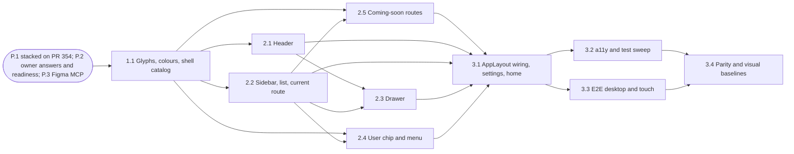

# Epics and stories: app shell navigation (header, sidebar, drawer, user menu)

**Author:** pm (John), autonomous run **Date:** 2026-10-22, revised 2026-10-28 and 2026-10-29 (the
sign-out latch amendment and the failed chip re-read; each change is marked in place as a dated
amendment or owner decision) **Feature:** `app-shell-navigation`

Predecessors: [research](./research-app-shell-navigation-2026-10-22.md),
[brief](./brief-app-shell-navigation-2026-10-22.md), [PRD](./prd-app-shell-navigation-2026-10-22.md)
(the authoritative _what_), [UX spec](./ux-app-shell-navigation-2026-10-22.md) (the authoritative
_look_) and [architecture](./architecture-app-shell-navigation-2026-10-22.md) (the authoritative
_where and how it loads_).

## Overview

This document splits the PRD (FR-1 to FR-19 with their dotted children, NFR-1 to NFR-22) and the
architecture into three epics and ten stories, one story per surface in the order the task brief
§6 lists them plus Story 2.5 (the coming-soon routes), and seven
follow-ups that are never dispatched.

Ids are kept, never renumbered: `US-n`, `FR-n`, `NFR-n`, `SM-n`, `C-n`, `R-n` and `OQ-1` to `OQ-21`, `OQ-2a` and `OQ-28`
are the PRD's; `OQ-22` to `OQ-24`, `P-n`, `PROP-n`, `DV-n` and `V-n` are the UX spec's; `AD-n`,
`AV-n` and `OQ-25` to `OQ-27` are the architecture's. `US-1` to `US-10` stay the PRD's user
journeys; each implementation story below names the journeys it serves. "Story N.M" is this
stage's only new id. Paths: `settings/` means `src/modules/user/features/settings/`, `user/` means
`src/modules/user/`.

> **Every owner question is RESOLVED by owner 2026-10-23** (PRD §9); none is open and nothing blocks
> readiness. Full Figma colour and pixel parity ("we need full figma color and pixel parity", PRD
> NFR-22) binds every UI story. Each story's **Blocked on** line is therefore "none"; its criteria
> name the resolution they implement. No story is dispatched before the readiness check passes.

How bmalph reads this file (the user-settings convention): every `### Story N.M:` header under a
`## Epic N:` heading becomes one open item of `.ralph/@fix_plan.md`; follow-ups use
`### Follow-up 4.M:` under `## Follow-ups`, which no bmalph pattern matches. Every dependency
points to a lower story id. Acceptance criteria are one-line bullets that start with "Given" and
end with the requirement they trace, in parentheses, using the PRD's case letter (`P` positive,
`N` negative, `E` edge).

Language rule: the product ships `uk` (main) and `en`. This file holds no Figma source copy and no
shipped copy; every string is a PRD §11 row, wording OQ-9.

Decisions this stage took on its own are recorded inline as `> Assumption:` blocks.

### Mapping to the task brief and the architecture

| Task brief §6 item                                    | Story | Architecture refers to it as | Verification items it closes                        |
| ----------------------------------------------------- | ----- | ---------------------------- | --------------------------------------------------- |
| 1 assets and tokens                                   | 1.1   | story 1                      | V-7                                                 |
| 2 header (desktop and mobile)                         | 2.1   | story 2                      | V-6 (magnifier paint only, with V-7)                |
| 3 sidebar and current-route logic                     | 2.2   | story 3                      | V-2, V-8, V-9, AV-4 (V-1 and V-4 closed 2026-10-22) |
| 4 mobile drawer                                       | 2.3   | story 4                      | V-11 (V-3 closed 2026-10-22)                        |
| 5 user chip menu with sign out                        | 2.4   | story 5                      | V-5                                                 |
| 6 `AppLayout` wiring, settings centring, home cleanup | 3.1   | story 6                      | AV-1, AV-2, AV-5, AV-7                              |
| 7 stories, unit tests and a11y tests                  | 3.2   | story 7                      | AV-6                                                |
| 8 e2e specs                                           | 3.3   | story 8                      | none                                                |
| 9 visual baselines                                    | 3.4   | story 9                      | AV-3 (recorded)                                     |

> Assumption: brief §6 item 7 ("stories, unit tests and a11y tests") cannot hold every story file
> and unit test of the shell. `tests/unit/tooling/storybook-story-coverage.test.ts` fails on any
> new `.tsx` without a colocated story, NFR-8 requires a direct test for every new `src` file, and
> the task brief requires TDD. Each surface story therefore lands its own direct unit tests and
> colocated stories. Story 3.2 owns what spans surfaces: the jest-axe suites over the assembled
> shell, the `componentCases` rows, the a11y exception review (AV-6), and the coverage, mutation
> and catalogue sweep across every shell file.

## Prerequisites (outside the story grammar)

### P.1: stacked on PR #354

The branch `feat/362-app-shell-navigation` starts at `7668ad23`, the `origin/feat/330-user-settings`
head at planning time. `/settings`, `ProfileProvider` (`AUTH_TOKENS.ProfileProvider`), the
`userSettings` flag, `ProfileHeader` with `displayNameOf` and `monogramOf`,
`settings/routes/user-profile/styles.ts` and home's flag-gated settings link all come from #354.
`ProtectedOutletContext.signOut` comes from #106. A newer #354 head is merged into this branch,
never rebased (C-6).

**Closed by readiness (2026-10-23):** the branch was fast-forwarded from `7668ad23` to
`origin/feat/330-user-settings` at `9c1d2535` (seven commits, `c059a45b` to `9c1d2535`). They amend
`specs/user-settings/planning-artifacts/*` (the architecture's §7 tree and the measured budgets),
change-password, `use-blur-hold`, `ui-form` stories and a visual spec, and touch no shell file. The
readiness check re-verified every cited user-settings line and settings code path against
`9c1d2535` (one stale line, F-20, corrected to `:1710`).

### P.2: owner answers recorded

Every `OQ-n` (PRD §9, UX §12, architecture §13) was RESOLVED by owner 2026-10-23 and is written into the
PRD. What remains is the readiness check: until it passes, no story is dispatched and no source
file changes (task brief §2).

### P.3: Figma MCP reachable

Every UI story runs `figma-design-check` and `figma-ui-parity` against file
`xZ7ccrH6d4QyqLQsayFSEX` before UI code is written (`create_session` first,
`skillNames: "resource:figma-design-to-code"` on `get_design_context`). An unreachable MCP reports
`BLOCKED`, never a skip. Assets come through `mcp__figma__download_assets` only.

## Requirements Inventory

### Functional Requirements

| Id                     | Control or rule (PRD §5)                                                               | Class                                            |
| ---------------------- | -------------------------------------------------------------------------------------- | ------------------------------------------------ |
| FR-1                   | Header frame, the banner landmark                                                      | structure                                        |
| FR-1.1                 | Logo link to `/`                                                                       | link                                             |
| FR-2, FR-2.1           | Header search, desktop and tablet                                                      | disabled with status (OQ-2)                      |
| FR-3, FR-3.1, FR-3.2   | Bell, desktop/tablet and mobile; presentational badge from a prop (stories: 1)         | disabled with status (OQ-2 resolved)             |
| FR-4, FR-4.1, FR-4.2   | Task list, desktop/tablet and mobile; presentational badge from a prop (stories: 8)    | disabled with status (OQ-2 resolved)             |
| FR-5, FR-5.1, FR-5.2   | User chip (desktop/tablet), avatar button (mobile)                                     | action                                           |
| FR-5.3                 | Chip data states (loading, flag off, pending, ok, failed, session ended, chunk failed) | conditional                                      |
| FR-6, FR-6.1           | User menu, APG menu-button behaviour                                                   | container                                        |
| FR-6.2                 | "My profile" item                                                                      | link to `/settings` (OQ-12 resolved)             |
| FR-6.3                 | Menu "Settings" item                                                                   | link; hidden while `userSettings` is off         |
| FR-6.4                 | Menu "Sign out" item                                                                   | action                                           |
| FR-7, FR-7.1 to FR-7.5 | Boards, Products, Orders, Contacts, Analytics rows                                     | link to a coming-soon route (OQ-1 resolved)      |
| FR-8                   | Settings group row                                                                     | link; hidden while `userSettings` is off (OQ-11) |
| FR-8.1                 | Settings group disclosure (chevron)                                                    | action, disclosure button (OQ-6 resolved)        |
| FR-9, FR-9.1 to FR-9.3 | Integrations, Webhooks, Billing sub-items                                              | link to a coming-soon route (OQ-1 resolved)      |
| FR-10                  | Sidebar sign out                                                                       | action                                           |
| FR-11                  | Current-route semantics (`aria-current="page"`)                                        | state                                            |
| FR-12                  | Collapse handle and rail                                                               | conditional action (OQ-4)                        |
| FR-13.1 to FR-13.5     | Burger, drawer dialog, close, drawer search, drawer navigation                         | action, dialog                                   |
| FR-14                  | `AppLayout` wiring                                                                     | structure                                        |
| FR-15                  | Settings content alignment (remove the centring rule)                                  | layout change                                    |
| FR-16                  | Home duplicate controls                                                                | removal (OQ-7)                                   |
| FR-17                  | Shared display-name rule                                                               | refactor                                         |
| FR-18, FR-18.1         | Eight coming-soon routes and the shared page                                           | route (OQ-1 resolved; page design OQ-28)         |
| FR-19                  | Presentational header badge, count as a typed prop, stories feed 1 and 8               | presentational (OQ-2, OQ-2a resolved)            |

### NonFunctional Requirements

| Id     | Subject (PRD §6)                                                  |
| ------ | ----------------------------------------------------------------- |
| NFR-1  | Landmarks (WCAG 1.3.1, 2.4.1)                                     |
| NFR-2  | Keyboard, focus order, focus-visible (2.1.1, 2.1.2, 2.4.3, 2.4.7) |
| NFR-3  | 44 px touch targets on mobile                                     |
| NFR-4  | Contrast (1.4.3, 1.4.11)                                          |
| NFR-5  | Bundle budgets, eager path, zero shell bytes on public routes     |
| NFR-6  | Architecture layers, class and type conventions, items as data    |
| NFR-7  | Data honesty                                                      |
| NFR-8  | Coverage and mutation at 100 %                                    |
| NFR-9  | Localization (`uk`, `en`, lazy catalogs)                          |
| NFR-10 | Visual baselines                                                  |
| NFR-11 | Browser floor (Baseline 2023)                                     |
| NFR-12 | Modal dialog and menu semantics                                   |
| NFR-13 | Lighthouse floors on `/`                                          |
| NFR-14 | Console gate                                                      |
| NFR-15 | No suppression                                                    |
| NFR-16 | Test lanes                                                        |
| NFR-17 | Metrics and duplication                                           |
| NFR-18 | Reliability and observability                                     |
| NFR-19 | Documentation                                                     |
| NFR-20 | Motion: reduced motion and no ripple on shell controls            |
| NFR-21 | Resize and text spacing (1.4.4, 1.4.12)                           |
| NFR-22 | Full Figma colour and pixel parity (owner, 2026-10-23)            |

### Architecture requirements carried into stories

- AD-1, AD-2: eager frame with two `aria-hidden`, size-stable placeholders; everything visible is
  lazy (`ui-app-shell` chunk).
- AD-3: `useShellLayout` over `useMediaQuery` with `noSsr: true`; one navigation landmark at a time.
- AD-4, AD-5: navigation items are one typed, ordered data set; current route through `useMatch`.
- AD-6: MUI `Drawer` (`temporary`, right) in the shell chunk; AD-7: the designed menu from
  `MenuList`, `MenuItem`, `ClickAwayListener`, no portal.
- AD-8: two-stage user-aware slot (`user-menu` container-free, `current-user` only while
  `userSettings` is on); AD-9: `UserDisplayNameMapper`; AD-10: FR-15 and FR-16 edits; AD-11:
  the sign-out latch in `useSignOut` (amended 2026-10-28; the planned `useOnceCallback` was removed); AD-12: shell chunk failure keeps the placeholders (OQ-26).
- Architecture §7: both catalogs lazy, with policy entries and a test helper.

## Definition of done shared by every story

Each story's own criteria add to these; a story is not done until all of them hold.

- **Quality floors.** No threshold, budget, allowlist, scope, baseline or ratchet value is edited
  to make a run pass. The only reviewed re-baselines are the protected-page ones of NFR-10
  (Story 3.4); the only reviewed edits of `config/i18n-catalog-policy.json` are the three new lazy
  entries (Stories 1.1, 2.4 and 2.5) and the append-only owner additions of Story 1.1's assumption,
  one per story that creates the folder (2.1, 2.2, 2.3); the only `A11Y_EXCEPTIONS` entry added
  is the enumerated parity entry of PRD NFR-4 (X-1 only; Story 3.2), because NFR-22 forbids changing a Figma colour to pass contrast. No `eslint-disable`, `@ts-ignore`, `@ts-expect-error`,
  `depcruise-ignore`, `!` in `src`, `.skip`, `.only`, `.fixme`, `waitForTimeout`, conditional
  `expect` or `data-testid`; no added code comments; a Stryker directive only with the proof
  CLAUDE.md accepts (NFR-15).
- **Conventions.** Classes only in non-React `.ts` (no statics, no free functions, no
  function-valued properties of top-level object literals); types in type-only `types/` files
  imported with `import type`; approved class suffixes; components reach the container only through
  `useService`; nothing under `src/components/` imports `src/modules/`; the auth paint path never
  reaches `@/providers/di`; no eager `@mui/*` import beyond `app-providers.tsx`; no raw `Intl`; JSX
  handler props are stable references (`react/jsx-no-bind` warns and `eslint_warnings` is 0)
  (NFR-6).
- **Tests.** Every new `src` file has its own direct unit test; unit coverage and the integration
  coverage the repository enforces stay at 100 %; seeded Faker builders supply names and e-mails;
  elements are located by role, label or text; static tables (the item set, style objects, icon
  maps) load inside the test body through `tests/unit/utils/isolated-module.ts`; a logging path is
  spied and asserted in its own test; layout boxes are measured in the browser lanes, never in jsdom
  (NFR-8, NFR-14, NFR-16).
- **Mutation.** Zero survivors on every new or changed file in `scripts/ci/mutation-scope.mjs`,
  `styles.ts` files included (NFR-8).
- **Accessibility.** jest-axe on every new rendering component and state; no positive `tabindex`;
  WCAG 2.1 AA (NFR-1 to NFR-4).
- **i18n.** Every key a story first uses lands in `uk` and `en` in that story with the OQ-9 wording;
  catalog edits are append-only; `make i18n-generate`, then `make lint-i18n`; shell tests render
  through `tests/unit/utils/create-app-shell-locale-i18n.ts` (NFR-9).
- **Figma.** UI stories pass the P.3 gate first; only FOUND states are built as drawn; a NOT FOUND
  state is built only as the owner's OQ-16 (or OQ-28) answer says, never invented (C-5).
- **Figma parity (NFR-22, owner decision 2026-10-23).** Every UI story ends with all
  measured-versus-Figma rows of UX §10 for its surface passing at 1440, 1024 and 375 within the
  NFR-22 tolerance; every icon and logo it renders is exported from its Figma node; a colour is
  never replaced by a nearest token. A failing row reopens the story; it is never recorded as a
  deviation or absorbed by a tolerance.
- **Local gates** (light, one heavy tool at a time, `free -m` above about 4 GiB first): `make format`;
  ESLint, Prettier `--check` and `tsc` over the changed files; focused Jest with
  `--maxWorkers=2 --forceExit`; `make lint-metrics`; `make lint-md`, `make lint-docs` and
  `make lint-i18n` where the story touches Markdown, docs or catalogs; the story's **Gates** line.
- **CI-only gates** (never on the host, C-7): the full `make lint`, `make test-unit-all`,
  `make test-integration`, Stryker, `make test-e2e`, `make test-visual`, `make test-a11y-e2e`, the
  mobile lane, Lighthouse, the bundle-size report, `make check-adr-drift`, Storybook build. A
  stacked PR gets no gating CI, so these run on the `main`-targeted branch of C-6.
- **Commits.** Conventional headers of at most 100 characters scoped `#362`, no `Co-Authored-By`
  trailer (task brief §0), `Closes #362` in the commits, and only after the owner approves.

## Epic List

1. **Epic 1: Shell foundations** — the Untitled UI glyphs and logos, the exact palette values the
   shell needs and the lazy shell catalog.
2. **Epic 2: Shell surfaces** — the header, the sidebar with its current-route logic, the mobile
   drawer, the user chip menu and the coming-soon routes (Story 2.5), each as a self-contained,
   tested, storied unit.
3. **Epic 3: Integration and release quality** — `AppLayout` wiring with the settings and home
   clean-up, the cross-surface a11y and test sweep, the e2e lanes and the visual baselines.

`## Follow-ups` after Epic 3 holds Follow-ups 4.1 to 4.7. It is not an epic and is never dispatched.

## Epic 1: Shell foundations

Put every shared input of the surface stories in place once: the glyph files, the palette values
and the shell catalog. Scope: `src/assets/icons/shell/`, `src/styles/colors.ts`,
`src/components/ui-app-shell/i18n/`, `config/i18n-catalog-policy.json`, `.storybook/preview.tsx`,
`tests/unit/utils/`, `tests/unit/tooling/`.

### Story 1.1: Export the shell glyphs, name the shell colours and add the lazy shell catalog

As a developer of the shell surfaces,
I want the Untitled UI glyphs, the palette values and the shell copy in one place each,
So that every surface story builds from the same assets and none of them inlines a value.

**Dispatch:** Independent; runs after P.1, P.2 and P.3.

**Serves:** US-1 to US-10 (shared inputs).

**Requirements:** FR-1.1, FR-2.1, FR-3, FR-4, FR-7, FR-8, FR-10, FR-12, FR-13.1, FR-13.3, NFR-4,
NFR-5, NFR-9, NFR-11, NFR-14, NFR-15.

**Blocked on:** none: every question was RESOLVED by owner 2026-10-23 (PRD §9).

**Drafted against:** the resolutions of PRD §9 only.

**Figma:** V-7 (each glyph's root paint and the magnifier's fill or stroke) through
`mcp__figma__download_assets` on the icon instances research §5 lists.

> Assumption: the architecture's file list (§8) does not name `src/styles/colors.ts`, but AD-6 and
> AD-7 style the shell "from palette tokens" and several FOUND values have no token today (the
> 10 % active tint, the badge blue, and the three shadows of UX §6.2 and §6.4; the unavailable grey
> is no longer needed since OQ-1 resolved). Under NFR-22 each entry holds the exact Figma value,
> never the nearest existing token. This story adds named entries for exactly those
> values, so no shell `styles.ts` repeats a literal. If the reviewer prefers literals in the shell
> styles files, the entries move there and nothing else changes.

> Assumption: if the catalog-policy check rejects an owner folder that does not exist yet, this
> story lists only `components/ui-app-shell`, and each surface story appends its own folder as an
> owner when it creates it (append-only).

**Files:** `src/assets/icons/shell/{layout-alt-01,monitor-01,shopping-bag-01,message-square-01,line-chart-up-03,settings-02,log-in-02,chevron-left,bell-01,dotpoints-01,menu-04,x-close,search}.svg`
(NEW), and `globe-02.svg`, `dataflow-02.svg`, `receipt.svg` (NEW, rail icons),
`src/assets/icons/shell/logo-{desktop,mobile}.svg` (NEW: exported from `I313:10479;282:14403` and
`I313:10626;287:14640`, NFR-22), `src/styles/colors.ts`
(CHANGED: the named shell values above), `src/components/ui-app-shell/i18n/{en,uk}.json` (NEW:
`app_shell.*`, one key per PRD §11 row the shell chunk renders, excluding the user-menu rows),
`config/i18n-catalog-policy.json` (CHANGED: the `components/ui-app-shell/i18n` lazy entry),
`.storybook/preview.tsx` (CHANGED: registers the shell catalog), `tests/unit/utils/create-app-shell-locale-i18n.ts`
(NEW, modelled on `create-settings-locale-i18n.ts`), `tests/unit/tooling/shell-icons.test.ts` (NEW),
the existing direct test of `src/styles/colors.ts` (CHANGED) or a NEW one if none exists.

**Tests:** `tests/unit/tooling/shell-icons.test.ts` (every file: root `fill="none"`, `currentColor`
stroke, a `viewBox`, the magnifier per V-7; a must-fail fixture for a hard-coded colour); the colours
test pins every new entry; `make lint-i18n` for the catalog.

**Gates:** DoD local gates; `make i18n-generate` and `make lint-i18n`; the Node `zlib` measurement of
architecture §7 step 2.

**Acceptance Criteria:**

- Given `src/assets/icons/shell/`, when it is listed, then it holds exactly the glyphs the answered OQ-4 requires plus the two logos, each exported from its Figma instance with `mcp__figma__download_assets` and none redrawn by hand (C-5, NFR-22, research §5).
- Given each stroke glyph, when `shell-icons.test.ts` reads it, then its root declares `fill="none"`, its strokes use `currentColor` and it has a `viewBox`, so a shell `SvgIcon` with `fill: 'none'` renders it in the row's colour (FR-7 E, NFR-4).
- Given a fixture glyph with a hard-coded stroke colour or no `viewBox`, when the test runs against it, then the test fails (must-fail, NFR-15).
- Given the magnifier, when V-7 has measured its paint, then the file and the test follow that measurement rather than the stroke assumption (UX V-7).
- Given the logo, when the shell needs it at any breakpoint, then it renders the exported shell logos, whose `viewBox` equals the Figma box (143×48.12, 125×42.07), and the repository files in `src/assets/icons/logo/`, whose boxes differ, are not reused in the shell (FR-1.1, NFR-22).
- Given `src/styles/colors.ts`, when the shell's FOUND values are looked up, then each value of UX §6.2 to §6.4 that has no token today has exactly one named entry holding the exact Figma hex and alpha, the active row text is `#0399ED` (OQ-14 resolved), and the focus ring colour is the value OQ-13 selects (NFR-4, NFR-22).
- Given the shell catalog, when `make lint-i18n` runs, then `en` and `uk` hold identical `app_shell.*` keys with the OQ-9 wording, no key is claimed by another catalog, and no Figma source text appears (NFR-9, C-4).
- Given `config/i18n-catalog-policy.json`, when it is read, then the shell catalog is a lazy entry, and `make i18n-generate` leaves `src/i18n/localization.json` byte-identical (NFR-5, NFR-9).
- Given the minified `en` and `uk` pair, when gzipped with Node `zlib` on the host, then the raw and gzip byte counts are recorded for the pull request as the cost eager would have had (architecture §7 step 2, NFR-5).
- Given a test that renders through `create-app-shell-locale-i18n`, when it reads an `app_shell.*` key, then the key resolves in both locales, and a render without the helper shows the raw key (R-8, NFR-14).
- Given the change, when the DoD gates run, then ESLint, `tsc` and `make lint-metrics` report nothing and Stryker reports zero survivors on the changed files (NFR-8, NFR-17).

## Epic 2: Shell surfaces

Build each visible surface as a user-agnostic `UI*` component in `src/components/` (header,
sidebar, list, drawer) or as a user-aware part of the `user` module (chip and menu), each with its
direct tests and colocated stories, not yet mounted by `AppLayout`. Scope: `src/components/ui-app-header/`,
`src/components/ui-app-shell/` (layout hook and item set), `src/components/ui-navigation-list/`,
`src/components/ui-sidebar/`, `src/components/ui-navigation-drawer/`, `src/components/types/`,
`src/hooks/`, `user/store/`, `user/types/lib/`, `settings/components/user-menu/`, `settings/hooks/`,
`settings/types/`, `settings/components/profile-header/`.

### Story 2.1: Render the header banner with the logo, the disabled controls and the user slot frame

As a signed-in user on any protected page,
I want a header that shows the product, the controls that will exist and my account slot,
So that I recognise the product and nothing in the header pretends to work.

**Dispatch:** Depends on Story 1.1.

**Serves:** US-6, US-7, US-9.

**Requirements:** FR-1, FR-1.1, FR-2.1, FR-3.1, FR-3.2, FR-4.1, FR-4.2, FR-5.3 (the loading row),
FR-14 (header placeholder size), FR-19, NFR-1, NFR-2, NFR-3, NFR-4, NFR-6, NFR-11, NFR-14, NFR-17,
NFR-20, NFR-22.

**Blocked on:** none: every question was RESOLVED by owner 2026-10-23 (PRD §9).

**Drafted against:** the resolutions of PRD §9 only.

**Figma:** `get_design_context` on `313:10479`, `313:10489`, `313:10626`, the logo instances, the
search states `439:19479` to `439:19521`, the round-button states `451:26194` to `451:26214`; V-6
(disabled search text and magnifier colours).

**Files:** `src/components/ui-app-header/header-badge.tsx` and `header-badge.stories.tsx` (NEW: the presentational badge, FR-19; the stories pass exactly 1 and 8), `src/components/types/ui-app-header/shell-badge-counts.ts` (NEW), `src/components/ui-app-header/index.tsx` (NEW: `UIAppHeader`, the banner, the logo link
with `useLinkClickHandler` and `state.focusMain`, the control cluster, the slot frame),
`src/components/ui-app-header/header-search.tsx` (NEW), `src/components/ui-app-header/header-icon-button.tsx`
(NEW), `src/components/ui-app-header/user-slot-frame.tsx` (NEW), `src/components/ui-app-header/styles.ts`
(NEW: UX §3 geometry), four colocated stories, `src/components/ui-app-shell/use-shell-layout.ts`
(NEW: AD-3), `src/components/types/ui-app-header/index.ts` (NEW: `UIAppHeaderProps`,
`HeaderIconButtonProps`, `UserSlotFrameProps`), `src/components/types/ui-app-shell/index.ts` (NEW:
`ShellLayout`), `config/i18n-catalog-policy.json` (CHANGED only under the owner assumption of
Story 1.1).

**Tests:** `tests/unit/components/ui-app-header/{index,header-search,header-icon-button,user-slot-frame}.test.tsx`,
`tests/unit/components/ui-app-header/styles.test.ts`, `tests/unit/components/ui-app-shell/use-shell-layout.test.ts`
(all NEW; `matchMedia` stubbed per width).

**Gates:** DoD local gates.

**Acceptance Criteria:**

- Given the header rendered at each `ShellLayout`, when inspected, then exactly one element with role `banner` exists and its styles set a 64 px height at every breakpoint (FR-1 P; the measured height is Story 3.4's).
- Given the desktop layout, when the styles are read, then the banner draws the 1 px `#E1E7EA` border on four sides, and the tablet and mobile layouts draw none, as each frame draws it (FR-1, OQ-20 resolved).
- Given the logo, when rendered, then it is one link to `/` whose accessible name contains "VilnaCRM", the image inside has no name of its own, it carries no `aria-current`, and the artwork and boxes of UX §3.4 are used: the exported desktop artwork at desktop and tablet (143×48.12), the exported mobile artwork at 125×42.07 (FR-1.1 P, N; NFR-22).
- Given the logo on `/settings`, when it is activated by click or Enter, then the router navigates to `/` without a document load and passes `state.focusMain` (FR-1.1 P).
- Given the tablet or desktop layout, when the header renders, then the search is a natively disabled input named "Search", described by the "Not available yet" status, out of the Tab sequence, in the FOUND disabled style `439:19485` or `439:19503` (FR-2.1 P, N; OQ-2 resolved).
- Given the disabled search, when it is clicked or typed into, then its value stays empty, no dropdown opens and no request is made (FR-2.1 N).
- Given the mobile layout, when the header renders, then no header search exists in the DOM or the accessibility tree (FR-2.1 E).
- Given the tablet or desktop layout, when the header renders, then the bell and the list are disabled buttons named "Notifications" and "Tasks", each described by the status, in the FOUND disabled style `451:26214`, and clicking either does nothing (FR-3.1 P, N; FR-4.1 P, N).
- Given the header story or a unit test passing `badgeCounts` `{ notifications: 1, tasks: 8 }`, when it renders at 1440 and 1024, then the badges show "1" and "8" in Figma's badge style at the Figma positions (V-10), and the descriptions add "1 notification" and "8 tasks" with CLDR plural forms in `uk` and `en` (FR-3.1 P, FR-4.1 P, FR-19).
- Given no `badgeCounts`, or `null` counts (every page in the app), when the header renders, then no badge, digit or count text exists, and no component, hook or route in `src` passes a count (FR-3.1 N, FR-4.1 N, FR-19 N).
- Given the header story (`header-badge.stories.tsx` and the `UIAppHeader` story) at 1440 and 1024, when the badge parity rows P-39 to P-42 of UX §10 are measured against it, then they pass within the NFR-22 tolerance; that story, which passes exactly 1 and 8, is the artifact the owner reviews with the team lead (FR-19, NFR-22).
- Given the mobile layout, when the header renders, then the bell and the list are the bare disabled glyphs at Figma's x 200 and x 240 with the 16 px gap, with the same names and status, no badge, and no target extension (FR-3.2, FR-4.2 E; OQ-15 resolved).
- Given a `userMenu` slot that has not resolved, when the slot frame renders, then an `aria-hidden`, non-null placeholder reserves the chip's FOUND box for the current layout so the banner does not shift when the slot arrives (FR-5.3, FR-14 E).
- Given `useShellLayout` at 1023, 1024, 1025, 1439 and 1440 px, when it renders the first time, then it returns the layout the answered OQ-5 assigns to that width with no second render to correct it (AD-3, AV-4, R-11).
- Given the logo focused by keyboard, when focus is visible, then the indicator is the one OQ-13 selects, and a mouse focus draws no ring (NFR-2).
- Given the header source, when it is checked, then it uses no `inert`, `:has()`, native CSS nesting, `color-mix()` or Popover API, and it imports nothing from `src/modules/` (NFR-11, NFR-6).
- Given the logo link, the bell, the list and the burger, when they are activated by pointer under `matchMedia('(prefers-reduced-motion: reduce)')` and without it, then no MUI `TouchRipple` element is rendered inside them (NFR-20).
- Given `/` already, when the logo is activated, then `window.history.length` is unchanged and `<main>` is focused (FR-1.1 E).
- Given this surface at 1440, 1024 and 375 in the 3004 preview, when every measured-versus-Figma row of UX §10 for it (boxes, paint, type and every FOUND state) is filled, then all of them pass within the NFR-22 tolerance (0 px on integer Figma values, at most 0.5 px sub-pixel rounding on fractional ones; exact hex, alpha and type), and the only differences are the allowed ones of UX §10.3 (NFR-22, SM-1).
- Given the change, when the DoD gates run, then jest-axe reports no violation for each story state, coverage is 100 % and Stryker reports zero survivors (NFR-8).

### Story 2.2: List the navigation as data in the sidebar, mark the current page and sign out once

As a signed-in user at tablet or desktop width,
I want a sidebar that shows the product map, takes me to Settings, tells me where I am and signs me out,
So that I can reach every destination, including the coming-soon pages, and see where I am.

**Dispatch:** Depends on Story 1.1.

**Serves:** US-1, US-3, US-5, US-6, US-9.

**Requirements:** FR-7, FR-7.1 to FR-7.5, FR-8, FR-8.1, FR-9, FR-9.1 to FR-9.3, FR-10, FR-11, FR-12,
NFR-1, NFR-2, NFR-4, NFR-6 (G-5), NFR-7, NFR-8, NFR-11, NFR-14, NFR-17, NFR-20, NFR-22.

**Blocked on:** none: every question was RESOLVED by owner 2026-10-23 (PRD §9).

**Drafted against:** the resolutions of PRD §9 only.

**Figma:** `get_design_context` on `313:10478`, `313:10490`, the row state boards `386:26243`,
`386:26326`, `386:26373`; the rails `377:21385`, `378:21462`, the pills
`386:26290` to `386:26541`, the handle `I313:10478;377:20550` and the tooltip `386:26142`; V-2.
V-1 and V-4 are closed: the handles sit at y 15 (expanded 223,15 24×24; desktop rail 57,15 24×24;
tablet rail 60,15 32×32), and the expanded-row hover icon is `#404142` (rail pill `#1A1C1E`).

**Files:** `src/components/ui-app-shell/navigation-items.ts` (NEW: the ordered `NavigationItemSet`,
AD-4), `src/components/types/ui-app-shell/navigation-item.ts` (NEW),
`src/components/ui-navigation-list/index.tsx` (NEW: `UINavigationList`, one `<ol>` for sidebar and
drawer), `src/components/ui-navigation-list/navigation-row.tsx` (NEW: link and action rows),
`src/components/ui-navigation-list/use-current-navigation-item.ts` (NEW: AD-5), `src/components/ui-navigation-list/use-group-disclosure.ts` and `navigation-group-toggle.tsx` (NEW: AD-15),
`src/components/ui-navigation-list/styles.ts` (NEW), three colocated stories,
`src/components/types/ui-navigation-list/index.ts` (NEW), `src/components/ui-sidebar/index.tsx` (NEW:
`UISidebar`, the labelled `<nav>`, the rail state), `src/components/ui-sidebar/collapse-handle.tsx`
(NEW), `src/components/ui-sidebar/styles.ts` (NEW), its colocated
stories, `src/components/types/ui-sidebar/index.ts` (NEW), `config/i18n-catalog-policy.json` (CHANGED: appends `components/ui-sidebar` and `components/ui-navigation-list` as shell-catalog owners), `src/modules/user/features/auth/stores/use-sign-out.ts` (CHANGED: AD-11, the pending sign-out
latch released on chunk failure; amended 2026-10-28, replacing the planned `useOnceCallback`).

**Tests:** `tests/unit/components/ui-app-shell/navigation-items.test.ts` (item set loaded in the test
body), `tests/unit/components/ui-navigation-list/{index,navigation-row}.test.tsx`,
`tests/unit/components/ui-navigation-list/use-current-navigation-item.test.tsx` (memory router),
`tests/unit/components/ui-navigation-list/styles.test.ts`, `tests/unit/components/ui-sidebar/{index,collapse-handle}.test.tsx`,
`tests/unit/components/ui-sidebar/styles.test.ts` (all NEW),
`tests/unit/modules/user/features/auth/stores/use-sign-out.test.ts` (CHANGED).

**Gates:** DoD local gates; `make lint-dup` (one list renderer, NFR-17).

**Acceptance Criteria:**

- Given the item set, when it is read inside the test body, then it holds, in Figma order, Boards, Products, Orders, Contacts, Analytics, then the Settings group with Integrations, Webhooks and Billing, each with a stable id and its icon, and no function-valued property (FR-7 P, FR-9 P, AD-4).
- Given the sidebar, when it renders, then it is one `<nav>` named "Main navigation" holding one ordered list whose last item is the Sign out button after a decorative divider (FR-7, FR-10, NFR-1).
- Given a product row, when it renders, then it is a link to its `ROUTE_PATHS` key in Figma's default row style `386:26243`, takes the hover style `386:26326`, and carries no "Not available yet" text (FR-7 P, N; FR-7.1 to FR-7.5; OQ-1 resolved).
- Given a click, tap or Enter on a product row or a sub-item, when it lands, then the router navigates to its route without a document load with `state.focusMain` (FR-7 P, FR-9 P).
- Given `/`, `/boards` or any route outside `/settings`, when the sidebar renders, then the Settings group is collapsed: the chevron is a button with `aria-expanded="false"`, `aria-controls` naming the sub-item list id and the name "Expand Settings", its glyph is rotated 180°, and no sub-item is in the DOM (FR-8.1 P; OQ-6 resolved).
- Given `/settings` or any `/settings/*` sub-route, when the sidebar renders, then the group is expanded with its three sub-items in a nested list and the chevron reports `aria-expanded="true"` and "Collapse Settings" (FR-8.1 P).
- Given the chevron activated by click, Enter or Space, when it runs, then the group toggles, focus stays on the chevron, no navigation happens, and on the next route change the group returns to the route rule (FR-8.1 P, N).
- Given the group collapsed, when measured, then only the sub-items are gone: the header row, the divider and Sign out keep their Figma y, and the freed height joins the empty region of UX §4.3 (FR-8.1; UX §4.5).
- Given the sub-items, when they render, then they are links in the FOUND default sub-item style, and their hover and current styles are the ones the owner's OQ-16 answer gives (FR-9 E, C-5).
- Given `userSettings` on, when the Settings row is activated by click or Enter, then the router navigates to `/settings` without a document load with `state.focusMain` (FR-8 P).
- Given `userSettings` off, when the sidebar renders, then the Settings group and its three sub-items are not rendered, as OQ-11's resolution says (FR-8 N, SM-3).
- Given `/settings`, `/settings/` or `/settings?x=1`, when the sidebar renders, then the Settings link, and only it, has `aria-current="page"` and the active style with label and icon `#0399ED` on the 10 % tint (FR-11 P, E; OQ-14 resolved).
- Given each of `/boards`, `/products`, `/orders`, `/contacts`, `/analytics` and the three settings sub-routes, when the sidebar renders, then that row or sub-item, and only it, has `aria-current="page"`, and `/settings/integrations` does not make the Settings row current (FR-11 P, E).
- Given `/`, when the sidebar renders, then no element in the navigation has `aria-current` (FR-11 N).
- Given a navigation from `/settings` to `/`, when it completes, then `aria-current` is removed without a page reload (FR-11 E).
- Given Sign out activated by click, Enter, Space or tap, when it runs, then `signOut` from the props is called exactly once, and a second activation before navigation does not call it again (FR-10 P, N; AD-11).
- Given the Sign out row hovered, when the pointer is over it, then it takes the FOUND hover style `386:26326` (FR-10 P).
- Given an item set filtered to drop one row, when the sidebar renders, then the remaining rows keep their order and no gap is left (FR-7.5 E, G-5).
- Given the longest `uk` product label, when rendered at 238 px, then it stays on one line without truncation (FR-7.3 E; measured again in Story 3.4).
- Given the handle, when it is activated, then the sidebar toggles between expanded and rail, the handle's name and `aria-expanded` follow FR-12, rail rows show the tooltip `386:26142` on hover and keyboard focus, Escape hides the tooltip without moving focus, and rows behave as in the expanded sidebar (FR-12 P, N, E).
- Given the expanded tablet panel at 1024, when it renders, then it shows the owner-approved handle at 222,15 (32×32, the tablet rail handle's box and style, UX DV-10); activating it collapses the panel to the tablet rail `378:21462`, whose handle `378:21542` expands it again, and the handle's 16 px overhang is not clipped by the panel (P-63) (FR-12 E, F-10).
- Given the handle and `matchMedia('(prefers-reduced-motion: reduce)')` matches, when the handle toggles the rail, then the width transition duration is 0 (NFR-20, UX §9).
- Given the Settings row, the Sign out row and the handle, when activated by pointer, then no MUI `TouchRipple` element is rendered (NFR-20).
- Given every row and its icon, when inspected, then the icons are `aria-hidden` stroke icons with `fill: 'none'`, and the focus indicator on Settings and Sign out is OQ-13's inset ring (FR-7 E, NFR-2).
- Given this surface at 1440, 1024 and 375 in the 3004 preview, when every measured-versus-Figma row of UX §10 for it (boxes, paint, type and every FOUND state) is filled, then all of them pass within the NFR-22 tolerance (0 px on integer Figma values, at most 0.5 px sub-pixel rounding on fractional ones; exact hex, alpha and type), and the only differences are the allowed ones of UX §10.3 (NFR-22, SM-1).
- Given the change, when the DoD gates run, then jest-axe is clean for every story state, `make lint-dup` finds no clone, coverage is 100 % and Stryker reports zero survivors (NFR-8, NFR-17).

### Story 2.3: Open the navigation in a modal drawer from the burger below the sidebar breakpoint

As a signed-in user on a phone,
I want a burger that opens the navigation as a dialog and closes it again,
So that I can reach Settings and sign out without the persistent sidebar.

**Dispatch:** Depends on Stories 2.1 and 2.2.

**Serves:** US-1, US-3, US-8, US-9.

**Requirements:** FR-13.1 to FR-13.5, NFR-1, NFR-2, NFR-3, NFR-11, NFR-12, NFR-14, NFR-17, NFR-20,
NFR-22.

**Blocked on:** none: every question was RESOLVED by owner 2026-10-23 (PRD §9).

**Drafted against:** the resolutions of PRD §9 only.

**Figma:** `get_design_context` on `287:14661` (header `287:14667`, scrim `287:14782`, panel
`287:14781`, close `287:14835`, list `287:14813`, group `287:14820`, sign out `287:14815`, search
`609:47254`), the burger `287:14658`; `get_motion_context` on `287:14661` for OQ-23. V-3 is closed:
the header and the footer are painted above the scrim, untinted and unblurred (UX §5.2).

**Files:** `src/components/ui-app-header/menu-toggle-button.tsx` (NEW: the **burger only**, AD-6),
its colocated story, `src/components/ui-app-header/index.tsx` (CHANGED:
mounts the toggle and the drawer below the sidebar breakpoint), `src/components/ui-app-header/header-search.tsx`
(CHANGED: the drawer variant `439:19521`), `src/components/ui-navigation-drawer/index.tsx` (NEW:
`UINavigationDrawer`, MUI `Drawer`, `temporary`, `anchor="right"`, `keepMounted: false`, the
drawn 56 px drawer header `287:14667` with `aria-hidden` copies of logo, bell, list and avatar, the
panel at 62,56, and the close button inside the modal where `287:14667` draws `x-close`, given
initial focus),
`src/components/ui-navigation-drawer/styles.ts` (NEW), `src/components/ui-navigation-drawer/ui-navigation-drawer.stories.tsx`
(NEW), `src/components/types/ui-navigation-drawer/index.ts` (NEW), `src/components/types/ui-app-header/index.ts`
(CHANGED: `MenuToggleButtonProps`), `config/i18n-catalog-policy.json` (CHANGED: appends `components/ui-navigation-drawer`).

**Tests:** `tests/unit/components/ui-app-header/menu-toggle-button.test.tsx` (NEW),
`tests/unit/components/ui-navigation-drawer/{index.test.tsx,styles.test.ts}` (NEW), and the CHANGED
`ui-app-header/index.test.tsx` and `header-search.test.tsx`.

**Gates:** DoD local gates.

**Acceptance Criteria:**

- Given the mobile layout, when the header renders, then the last header control is a button named "Open menu" with `aria-expanded="false"`, `aria-haspopup="dialog"` and no `aria-controls` (the drawer is unmounted while closed); after it opens the drawer, it carries `aria-controls` whose id resolves to the element with `role="dialog"` (FR-13.1 P).
- Given the tablet or desktop layout, when the header renders, then no burger exists in the DOM or the accessibility tree (FR-13.1 N).
- Given the burger activated by tap, Enter or Space, when the drawer opens, then it has `role="dialog"`, `aria-modal="true"` and the name "Main navigation", `document.activeElement` is the "Close menu" button inside `role="dialog"`, and the burger reports `aria-expanded="true"` (FR-13.1 P, FR-13.2 P, AD-6).
- Given the drawer open, when Tab and Shift+Tab are pressed repeatedly, then focus cycles through close, the five product rows, Settings, the Settings chevron, the three sub-items only while the group is expanded, and Sign out, and never reaches the page or the disabled search (FR-13.2 P, NFR-12).
- Given the drawer open, when Escape is pressed or the close control ("Close menu") is activated, then the drawer closes, focus returns to the burger and `aria-expanded` is `false` (FR-13.2 P, FR-13.3 P).
- Given the drawer open, when the scrim or the header area outside the panel is tapped, then the drawer closes and the bell, list or avatar under the pointer is not activated (FR-13.2 N).
- Given the drawer open, when the page behind it is scrolled by touch, then the page does not scroll (FR-13.2 N).
- Given the drawer closed, when the page renders, then no close control exists; while open the close control is inside the dialog, in the 56 px drawer header drawn as `287:14667` (FR-13.3 N, E; OQ-19 resolved).
- Given the drawer open, when the default accessibility tree is queried, then `queryByRole('banner')`, `queryByRole('main')` and the footer `contentinfo` return `null` (their ancestors carry `aria-hidden="true"`); after close they are exposed again and no `aria-hidden` is left on the app root (FR-13.2 N, NFR-12).
- Given the drawer open and OQ-18's resolution, when it renders, then its search is the disabled mobile search with the status and is not a Tab stop (FR-13.4 P, N, E).
- Given the drawer open, when it renders, then it holds a `<nav>` with the same `UINavigationList` and item set as the sidebar, rows reuse the FOUND sidebar states as OQ-16's resolution allows, and the sidebar is not mounted, so one navigation landmark exists (FR-13.5 P, E).
- Given the drawer open on `/`, when Settings is activated, then the drawer closes without restoring focus to the burger, the router navigates to `/settings` with `state.focusMain`, and `document.activeElement` is `<main>` after the transition settles; on `/settings` the Settings link has `aria-current="page"` (FR-13.5 P, FR-13.2 E).
- Given the drawer open, when Sign out is activated, then the drawer closes and `signOut` is called exactly once (FR-13.5 P, FR-10 N).
- Given the drawer open, when a product row or sub-item is tapped, then the drawer closes without restoring focus to the burger, its coming-soon route renders and `<main>` is focused (FR-13.5 P).
- Given the drawer open, when the viewport widens past the sidebar breakpoint, then the drawer unmounts and focus moves to `main[tabindex="-1"]`; when the route changes, then it closes without restoring focus to the burger (FR-13.2 E).
- Given the drawer, when it traps focus, then it relies on MUI's modal and not on `inert`, `:has()` or the Popover API, and under `prefers-reduced-motion: reduce` its slide and scrim transitions have duration 0 (FR-13.2 E, NFR-11, NFR-20, OQ-23).
- Given the burger, the close button and the drawer rows, when activated by pointer, then no MUI `TouchRipple` element is rendered (NFR-20).
- Given the burger, close and drawer rows, when their boxes are declared, then each target is at least 44×44 CSS px, and the panel width follows OQ-24's resolution at 320 px (FR-13.1 E, FR-13.3 E, FR-13.5 E, NFR-3).
- Given this surface at 1440, 1024 and 375 in the 3004 preview, when every measured-versus-Figma row of UX §10 for it (boxes, paint, type and every FOUND state) is filled, then all of them pass within the NFR-22 tolerance (0 px on integer Figma values, at most 0.5 px sub-pixel rounding on fractional ones; exact hex, alpha and type), and the only differences are the allowed ones of UX §10.3 (NFR-22, SM-1).
- Given the change, when the DoD gates run, then jest-axe is clean with the drawer open, scanning `expectNoA11yViolations(document.body)` after asserting `screen.getByRole('dialog', { name: 'Main navigation' })` is present (MUI portals the drawer and hides the render container), no `act()` warning escapes the transitions, coverage is 100 % and Stryker reports zero survivors (NFR-8, NFR-12, NFR-14).

### Story 2.4: Show who is signed in on the user chip and open its menu with Settings and Sign out

As a signed-in user,
I want my name on a chip that opens a menu with Settings and Sign out,
So that I can see whose session this is and reach my settings or leave from the header.

**Dispatch:** Depends on Stories 1.1 and 2.2 (the `useSignOut` latch, AD-11 as amended 2026-10-28).

**Serves:** US-2, US-4, US-7, US-9.

**Requirements:** FR-5, FR-5.1, FR-5.2, FR-5.3, FR-6, FR-6.1 to FR-6.4, FR-17, NFR-2, NFR-3, NFR-6,
NFR-7, NFR-9, NFR-12, NFR-14, NFR-18, NFR-20, NFR-22.

**Blocked on:** none: every question was RESOLVED by owner 2026-10-23 (PRD §9).

**Drafted against:** the resolutions of PRD §9 only.

**Figma:** `get_design_context` on the chips `282:14445` and `287:14586`, the avatar `287:14657`,
the open menus `601:50362`, `601:50409` and `378:22885`; V-5 (mobile caret x).

**Files:** `user/store/user-display-name-mapper.ts` (NEW: the `@injectable()` `UserDisplayNameMapper`,
AD-9), `user/config/di.ts` and `user/config/tokens.ts` (CHANGED: `AUTH_TOKENS.UserDisplayNameMapper`,
registered by class), `user/types/lib/user-display-name.ts` (NEW),
`settings/hooks/use-display-name.ts` (NEW: resolves the mapper with `useService` for `ProfileHeader`),
`settings/types/hooks/use-display-name.ts` (NEW), `settings/components/profile-header/index.tsx`
(CHANGED: uses `useDisplayName`, never imports the mapper file; `displayNameOf` and `monogramOf`
removed; its stories gain the provider decorator), `settings/components/user-menu/user-menu-slot.tsx`
(NEW: chunk `user-menu` entry, flag branch, registers `user_menu.*`), `settings/components/user-menu/index.tsx`
(NEW: `UserMenu`, AD-7), `settings/components/user-menu/current-user-menu.tsx` (NEW: chunk
`current-user`), `settings/components/user-menu/current-user-menu-loader.ts` (NEW: a
`ChunkRetryLoader` instance), `settings/components/user-menu/styles.ts` (NEW: UX §3 and §6.4),
`settings/components/user-menu/i18n/{en,uk}.json` (NEW: `user_menu.*`), three colocated stories
(pending, ready, flag off), `settings/hooks/use-current-user.ts` (NEW: AD-8),
`settings/hooks/use-user-menu.ts` (NEW: AD-7), `settings/types/components/user-menu.ts`,
`settings/types/hooks/{use-current-user,use-user-menu}.ts` (NEW), `config/i18n-catalog-policy.json`
(CHANGED: the `user_menu` lazy entry), `.storybook/preview.tsx` and
`tests/unit/utils/create-app-shell-locale-i18n.ts` (CHANGED: register `user_menu.*`),
`tests/unit/tooling/storybook-provider-story-isolation.test.ts` (CHANGED: the reading story joins
the provider list), `user/README.md` (CHANGED: the mapper and the chip).

**Tests:** `tests/unit/modules/user/store/user-display-name-mapper.test.ts` (one to four words, extra
whitespace, empty), `tests/unit/modules/user/features/settings/components/user-menu/{user-menu-slot,index,current-user-menu}.test.tsx`,
`…/user-menu/current-user-menu-loader.test.ts`, `…/user-menu/styles.test.ts`,
`tests/unit/modules/user/features/settings/hooks/{use-current-user,use-user-menu,use-display-name}.test.tsx` (all NEW;
`ProfileProvider` swapped by registering a mock against `AUTH_TOKENS.ProfileProvider`), the existing
`profile-header/index.test.tsx` (unchanged intent),
`tests/integration/modules/user/features/settings/use-current-user.integration.test.tsx` (NEW:
`renderHook` over `use-current-user.ts` with msw and **no chip UI imported**, because the integration
suite enforces 100 % coverage on every `src` file it imports, and the chip's keyboard, breakpoint and
popover branches are not driven there).

**Gates:** DoD local gates; the focused integration file with `TEST_ENV=integration`, whose
coverage report lists only the read path (`use-current-user.ts`, the mapper, `ProfileProvider` and
what they import) at 100 %;
`make lint-dup`; `make lint-deps` over the settings feature (`settings-layer-edges.test.ts`).

**Acceptance Criteria:**

- Given full names of one, two, three and four words, with extra whitespace, or empty, when `UserDisplayNameMapper.fromFullName` runs, then it returns the display name and monogram the settings header produced before the refactor, and the empty monogram falls back to the person glyph in both consumers (FR-17 P, E).
- Given the settings header after the refactor, when its existing tests run, then they pass unchanged in intent and jscpd finds no copy of the rule (FR-17 N, NFR-17).
- Given `userSettings` off under OQ-11's resolution, when the slot renders, then the `current-user` chunk is never requested, no `currentUser` request is made, and the chip shows the person glyph with no name and a menu with Sign out only (FR-5.3 N, FR-6.3 N, SM-16, R-1).
- Given `userSettings` on, when the slot renders, then the name-less pending chip with My profile, Settings and Sign out is operable at once, exactly one `currentUser` read is made through `ProfileProvider` resolved with `useService`, and on `ok` the chip shows the monogram and the display name (FR-5.3 P, NFR-7).
- Given a failed first read other than `session_ended`, when the chip renders, then it stays name-less and operable with no error text, toast, retry or `console.error` (FR-5.3 N, NFR-14).
- Given a `ready` chip, when a pathname change re-reads and the re-read fails with `rate_limited`, `transient` or `rejected`, then the chip keeps the last good display name and monogram with no error text, toast, retry or `console.error`; given a failed first read, a failed re-read keeps it name-less (FR-5.3 N; owner decision 2026-10-28, which amends the earlier "name-less after any failed read" wording). Tests: `use-current-user.test.tsx` "keeps the last good name when a later re-read fails with %s" and "stays name-less when a re-read after a failed first read fails again"; integration `use-current-user.integration.test.tsx` "keeps the last good identity when a later read fails for another reason".
- Given a `session_ended` read, first read or re-read, when it settles, then the existing session link ends the session, the identity resets to the name-less pending state, and the menu adds nothing of its own (FR-5.3; owner decision 2026-10-28). Tests: `use-current-user.test.tsx` "leaves a session_ended read to the session link and stays pending" and "clears the shown name when a later re-read reports the session ended"; integration "clears the previous identity when a later read ends the session".
- Given a sign out followed by a sign in as another user in the same tab, when the chip renders, then the previous user's name never appears, even for one frame (FR-5.3 E, NFR-7).
- Given the read count on `/settings` and after a pathname change, when the integration test counts `CurrentUser` operations, then the count equals the table OQ-25's resolution fixes (one per pathname change on `/`, two on a cold `/settings`) (FR-5.3 E, R-9).
- Given the tablet or desktop chip, when inspected, then it is a button with `aria-haspopup="menu"`, `aria-expanded="false"`, an accessible name that starts with the visible display name followed by "User menu", a down-pointing caret that is `aria-hidden` and does not rotate when open (FR-5.1 P, N).
- Given a display name wider than the 121 px (desktop) or 138 px (tablet) text box, when rendered, then the chip keeps its Figma width, the visible name ends in an ellipsis and the full name stays in the accessible name (FR-5.1 E).
- Given the mobile layout, when the avatar renders, then it is a 40 px monogram with no name or caret, its target is at least 44×44 CSS px, and its name is the display name followed by "User menu", or "User menu" alone while name-less (FR-5.2 P, N, E).
- Given the mobile avatar, when inspected, then the monogram is `aria-hidden` and the avatar is an icon-only control, so its accessible name does not have to contain the monogram text (WCAG 2.5.3, FR-5.2 P, UX §11).
- Given the chip, the avatar and every menu item, when activated by pointer, then no MUI `TouchRipple` element is rendered (NFR-20).
- Given `userSettings` off, when the menu opens, then it holds exactly one item (Sign out) and the card height is the 1-item height of UX §6.4 (FR-6.2 E).
- Given the chip activated by click, Enter, Space or ArrowDown, when the menu opens, then it is the FOUND card for the layout (grows in place at desktop and tablet, the popover with its caret at mobile, positioned without a portal), `role="menu"` with `menuitem` children, and focus is on the first item (FR-5.1 P, FR-6.1 P, AD-7).
- Given the open menu, when ArrowDown, ArrowUp, Home and End are pressed, then focus moves and wraps per the APG pattern, and the focused item shows the hover background with OQ-13's ring (FR-6.1 P, E).
- Given the open menu, when Escape is pressed, then it closes and focus returns to the chip or avatar; when Tab is pressed, then it closes and focus continues in reading order with no trap (FR-6.1 P, N).
- Given the open menu, when the user clicks outside it, the route changes or the viewport crosses the sidebar breakpoint, then it closes without activating the control under the pointer (FR-6.1 N, E).
- Given `userSettings` on, when the menu renders, then it holds Figma's three items, My profile, Settings and Sign out, the card measures 225×180 / 253×232 / 225×142, and "My profile" links to `/settings` (OQ-12 resolved) (FR-6.2 P, N; NFR-22).
- Given `userSettings` on, when Settings is activated, then the menu closes and the router navigates to `/settings` with `state.focusMain`, also when already on `/settings` (FR-6.3 P, E).
- Given Sign out activated, once or twice before navigation, when it runs, then the menu closes and `signOut` is called exactly once, and a failure inside `useSignOut` adds no UI of the menu's own (FR-6.4 P, N, E).
- Given the `current-user` chunk failing once, when `ChunkRetryLoader` re-imports it, then the chip renders; given it failing twice, then the pending chip stays operable, sign out still works, and `UserMenuSlot` calls its `onChunkFailure('app-shell:current-user', error)` prop exactly once (FR-5.3, NFR-18; architecture §4.5).
- Given the `user-menu` and `current-user` files, when the cruise and `settings-layer-edges.test.ts` run, then none imports `src/services/`; `current-user-menu.tsx` imports neither `ProfileProvider` (not even as a type) nor the mapper file and consumes `useCurrentUser`'s `CurrentUserState`; only `use-current-user.ts` `import type`s `ProfileProvider`; no `.tsx` value-imports `user-display-name-mapper.ts`; and nothing under `features/auth/` reaches them (NFR-6).
- Given this surface at 1440, 1024 and 375 in the 3004 preview, when every measured-versus-Figma row of UX §10 for it (boxes, paint, type and every FOUND state) is filled, then all of them pass within the NFR-22 tolerance (0 px on integer Figma values, at most 0.5 px sub-pixel rounding on fractional ones; exact hex, alpha and type), and the only differences are the allowed ones of UX §10.3 (NFR-22, SM-1).
- Given the change, when the DoD gates run, then jest-axe is clean for the chip and the open menu in every story state, coverage is 100 % in both suites and Stryker reports zero survivors (NFR-8).

> OQ-25 is resolved to independent reads, so the accepted user-settings criterion "exactly one
> `CurrentUser` request" (user-settings epics line 1710) is amended with the owner's consent, and the
> e2e count assertions listed in architecture §5.7 are rewritten with stubs that route replies by
> caller (Story 3.3).

### Story 2.5: Route every planned section to a shared coming-soon page

As a signed-in user,
I want each planned section in the navigation to open its own page that says it is coming soon,
So that every menu item works today and keeps its address when the real module arrives.

**Dispatch:** Depends on Stories 1.1 and 2.2.

**Serves:** US-5, US-10.

**Requirements:** FR-18, FR-18.1, FR-7.1 to FR-7.5, FR-9.1 to FR-9.3, FR-11, NFR-1, NFR-2, NFR-4,
NFR-5, NFR-8, NFR-9, NFR-16, NFR-22 (a).

**Blocked on:** none: every question was RESOLVED by owner 2026-10-23 (PRD §9).

**Drafted against:** the resolutions of PRD §9 only.

**Figma:** NOT FOUND. The 2026-10-23 search of all five pages found no coming-soon design (PRD
FR-18). The page is built only from existing Figma tokens and the error-page layout (UX §15) and is
recorded as a proposal, never as Figma fact.

**Files:** `src/routes/route-paths.ts` (CHANGED: eight keys), `src/routes/app-routes.ts` (CHANGED:
five protected routes), `settings/routes/index.ts` (CHANGED: three protected routes with
`flag: 'userSettings'`), `src/components/coming-soon/index.ts` (NEW: re-exports `ComingSoonPage` as the route loader's default; no JSX), `src/components/coming-soon/{coming-soon-page,coming-soon-home-link}.tsx` and `coming-soon-home-link.stories.tsx`,
`coming-soon-sections.ts`, `styles.ts`, `i18n/{en,uk}.json` and `coming-soon-page.stories.tsx`
(NEW), `src/components/types/coming-soon/index.ts` (NEW), `config/i18n-catalog-policy.json`
(CHANGED: the `coming_soon` entry), `.storybook/preview.tsx` (CHANGED),
`tests/unit/utils/create-coming-soon-locale-i18n.ts` (NEW), `tests/e2e/route-coverage.tsv` (CHANGED: eight `e2e` rows naming `tests/e2e/modules/coming-soon.spec.ts`), `tests/e2e/modules/coming-soon.spec.ts` (NEW), `tests/e2e/a11y/routes.a11y.spec.ts`
(CHANGED: eight entries), `src/routes/README.md` (CHANGED: the shell-owned routes and their later
move).

**Tests:** `tests/unit/components/coming-soon/{coming-soon-page.test.tsx,coming-soon-home-link.test.tsx,coming-soon-sections.test.ts,styles.test.ts}`
(NEW; the section set loaded in the test body), `tests/unit/routes/app-routes.test.ts` (**NEW**:
no such file exists; `app-routes.ts` is pinned today only by
`tests/unit/tooling/performance-serving.test.ts:129,236`), the settings route-contract test
(CHANGED), `tests/unit/routes/route-paths.test.ts` (CHANGED: it pins the key set with
`toStrictEqual`, `:8-21`), `tests/unit/tooling/performance-serving.test.ts` (CHANGED:
each new loader pinned to `webpackChunkName: "coming-soon"`).

**Gates:** DoD local gates; `make i18n-generate` and `make lint-i18n`; `make check-e2e-route-coverage`.

**Acceptance Criteria:**

- Given `ROUTE_PATHS`, when it is read, then it holds `boards`, `products`, `orders`, `contacts`, `analytics`, `settingsIntegrations`, `settingsWebhooks` and `settingsBilling` with the paths of PRD FR-18 (FR-18).
- Given the eight route contracts, when the router is built, then each is `guard: 'protected'` with a loader `import(/* webpackChunkName: "coming-soon" */ …)`, and the three settings ones carry `flag: 'userSettings'` (FR-18 P).
- Given the production bundle report, when read, then one `coming-soon` chunk serves all eight routes (FR-18 P, NFR-5).
- Given each route opened directly with a session, when it renders, then the `h1` names the section, the message and home link render and the document title names the section (FR-18 P, FR-18.1 P).
- Given no session, when a coming-soon path is opened, then `ProtectedRoute` redirects to `/sign-in` with the path in `state.from`, and signing in returns to it (FR-18 N).
- Given `userSettings` off, when a settings sub-route is opened, then not-found renders and the `coming-soon` chunk is not requested (FR-18 N).
- Given the home link clicked, when it runs, then no document load happens and `<main>` is focused (FR-18.1 P, N).
- Given `ComingSoonHomeLink`, when inspected, then it is a contained `UIButton` with `href` and a `useLinkClickHandler(ROUTE_PATHS.home, { state: { focusMain: true } })` click inside the `ERROR_PAGE_ACTIONS_ID` box, labelled `coming_soon.home_link`, and the page imports neither `ErrorPageCard`, `ErrorPageActions` nor `ERROR_PAGE_VARIANTS` (FR-18.1, PRD NFR-4).
- Given the page source, when checked, then it imports nothing from `src/modules/`, contains no status digit and no Russian text, and uses only existing Figma tokens (FR-18.1 N, C-4, NFR-22 (a)).
- Given `tests/e2e/route-coverage.tsv`, when `make check-e2e-route-coverage` runs, then each new key has an `e2e` row naming an existing spec; its `visual` row lands in Story 3.4 (FR-18 E).
- Given `tests/e2e/a11y/routes.a11y.spec.ts`, when it runs, then each new key is scanned with a seeded token and axe reports no violation in three engines (FR-18 E, NFR-4).
- Given the change, when the DoD gates run, then jest-axe is clean, coverage is 100 % and Stryker reports zero survivors (NFR-8).

## Epic 3: Integration and release quality

Mount the shell on every protected route behind the lazy boundary, retire the two stopgaps of the
settings bundle, and prove the result across the a11y, e2e and visual lanes. Scope:
`src/components/layouts/`, `src/components/ui-app-shell/`, `src/routes/`, `settings/routes/`,
`src/features/home/`, `tests/unit/`, `tests/e2e/`, `tests/visual/` and the READMEs; no `docs/adr/`
file (OQ-10 resolved to `adr:not-required`).

### Story 3.1: Mount the lazy shell in AppLayout, left-align settings and remove home's duplicate controls

As a signed-in user on any protected page,
I want the header and navigation to arrive with every protected page and nowhere else,
So that the shell is everywhere I am signed in while public pages stay as fast as today.

**Dispatch:** Depends on Stories 2.1, 2.2, 2.3, 2.4 and 2.5.

**Serves:** US-1 to US-10.

**Requirements:** FR-1 (N, E), FR-14, FR-15, FR-16, FR-19, NFR-1, NFR-5, NFR-6, NFR-8, NFR-13 (CI), NFR-22,
NFR-14, NFR-18, NFR-19.

**Blocked on:** none: every question was RESOLVED by owner 2026-10-23 (PRD §9).

**Drafted against:** the resolutions of PRD §9 only.

> Assumption: the architecture's verification items AV-1 (cycle-free slot, `make lint-deps` on the
> first wiring commit) and AV-7 (`UIContainer` padding yields the Figma content start in the 3004
> preview) run in this story; AV-2 and AV-5 come from the CI bundle report of the first
> `main`-targeted run and are recorded here when it exists.

**Files:** `src/components/layouts/app-layout.tsx` (CHANGED: grid frame, `lazy(appShellLoader)` in
Suspense with the two placeholders, forwards `signOut` and `userMenu`, calls the injected
`onShellFailure` prop on the second shell failure and imports nothing from `src/services/`),
`src/components/layouts/app-layout.styles.ts` (CHANGED: areas, `headerSlot`, `navSlot`, the sidebar
breakpoint as a number pinned to the toolkit value), `src/components/layouts/app-shell-loader.ts`
(NEW: `ThemedChunkLoader` around `ChunkRetryLoader` around the `ui-app-shell` import),
`src/components/layouts/app-layout.stories.tsx` (CHANGED), `src/components/types/layouts/app-layout.ts`
(NEW: `AppLayoutProps`), `src/components/ui-app-shell/index.tsx` (NEW: `UIAppShell`, registers the
shell catalog, picks the layout, renders header and sidebar), `src/components/ui-app-shell/styles.ts`
(NEW), `src/components/ui-app-shell/ui-app-shell.stories.tsx` (NEW), `src/components/ui-app-shell/README.md`
(NEW), `src/components/types/ui-app-shell/index.ts` (CHANGED: `UIAppShellProps`),
`src/routes/route-composer.tsx` (CHANGED, ADR drift: `protectedBranch` passes the slot and
`onShellFailure`; the slot is read without a new array callback, since the file holds 5 of its 6
allowed closures), `src/routes/route-mapper.tsx` (CHANGED: `shellSlot(load)` with second-failure
capture and the bound `onChunkFailure`, and `chunkFailureReporter(source)`),
`src/routes/route-validator.ts` (CHANGED: one `shell.userMenu` per registry),
`src/routes/types/route-module.ts` (CHANGED), `src/routes/types/shell-slot.ts` (NEW),
`src/routes/README.md` (CHANGED: "Shell slots"), `settings/routes/index.ts` (CHANGED:
`shell.userMenu`; OQ-17 resolved to Option A),
`settings/routes/user-profile/styles.ts` (CHANGED: FR-15), `settings/README.md` (CHANGED: parity
section), under OQ-7's resolution `src/features/home/{index.tsx,styles.ts,home.stories.tsx}` and
`src/features/home/i18n/{en,uk}.json` (CHANGED), `src/i18n/localization.json` (regenerated),
`tests/unit/features/home/settings-link.test.tsx` (DELETED), and an "App shell decisions" section in
the shell README plus a "Shell slots" section in `src/routes/README.md` (OQ-10 resolved: no ADR, no
`docs/adr/` file; the PR carries the `adr:not-required` label or a `[no-adr]` body line).

**Tests:** CHANGED `tests/unit/components/layouts/{app-layout.test.tsx,app-layout.styles.test.tsx,app-layout.styles.tokens.test.ts,app-layout.footer-failure.test.tsx}`;
NEW `tests/unit/components/layouts/{app-shell-loader.test.tsx,app-layout.shell-failure.test.tsx}`;
NEW `tests/unit/components/ui-app-shell/{index.test.tsx,styles.test.ts}`; CHANGED
`tests/unit/routes/{route-composer.test.tsx,route-validator.test.ts,routes.test.tsx}`; NEW
`tests/unit/routes/route-mapper.shell-slot.test.tsx`; CHANGED `tests/unit/app.test.tsx`,
`tests/unit/app-root.test.tsx`, `tests/unit/components/error-boundary/route-error.router.test.tsx`,
`tests/unit/modules/user/features/settings/routes/{index.test.ts,user-profile/index.test.tsx,user-profile/styles.test.ts}`,
`tests/unit/features/home/index.test.tsx`, `tests/unit/tooling/performance-serving.test.ts`.

**Gates:** DoD local gates; `make lint-deps` (AV-1); `make i18n-generate` and `make lint-i18n` under
OQ-7's resolution; `make lint-docs`; CI-only: bundle-size report, Lighthouse, `make check-adr-drift`.

**Acceptance Criteria:**

- Given a protected route, when `AppLayout` renders, then the landmarks in DOM order are banner, navigation (at or above the breakpoint), main and contentinfo, and `<main>` is still the only `main[tabindex="-1"]` with `useArrivalFocus` (FR-14 P, NFR-1).
- Given `state.focusMain` on arrival, when the page renders, then `<main>` receives focus, not the header or the navigation (FR-14 P).
- Given the shell chunk loading, when the frame paints, then two `aria-hidden`, non-null placeholders reserve the 64 px header and, at or above the breakpoint, the 250 px nav column, so home's `h1` does not move when the shell arrives (FR-14 E, AD-2).
- Given `app-layout.styles.ts`, when its test reads the sidebar breakpoint, then the number equals the toolkit's `lg` (1024, OQ-5 resolved), and the eager file imports neither `@/components/ui-breakpoints` nor any `@mui/*` module (AD-2, NFR-5).
- Given `performance-serving.test.ts`, when it walks the eager graph, then `app-providers.tsx` is still the only eager `@mui/*` edge, `app-shell-loader.ts` holds `new ThemedChunkLoader(` with a `ui-app-shell` chunk name, and the `user-menu` and `current-user` imports are dynamic only (NFR-5).
- Given a shell file imported statically by `AppLayout`, when the performance test runs on that fixture, then it fails (must-fail, NFR-5).
- Given the composer under OQ-17's resolution, when the router is built, then the protected branch passes `routeMapper.shellSlot(load)` as `AppLayout`'s `userMenu`, the public branch renders no `AppLayout`, and `make lint-deps` reports no `no-circular` or layer violation (FR-14, R-3, AV-1).
- Given two route modules declaring `shell.userMenu`, when the validator runs, then it rejects the registry (architecture §12.4).
- Given the `user-menu` chunk failing twice, when `shellSlot` handles it, then the slot frame stays empty and size-stable and the failure is captured through the observability boundary with `source: 'app-shell:user-menu'`, with no reload (FR-5.3, NFR-18).
- Given the `ui-app-shell` chunk failing twice, when `AppLayout` handles it, then the placeholders stay (OQ-26 resolved: `AppLayout` calls its injected `onShellFailure` prop once, which the composer binds to `routeMapper.chunkFailureReporter('app-shell:load')`, and no reload of a protected route); `app-layout.tsx` value-imports nothing from `src/services/` and `make lint-deps` is clean (NFR-18, R-13, architecture §4.5).
- Given a protected page whose route throws, when the `errorElement` renders under `AppLayout`, then the banner and the navigation stay rendered and the error content keeps `landmark="region"` (FR-1 E).
- Given every public route, when its unit test renders the composed tree, then no shell component renders (FR-1 N, FR-14 N; the network leak guard is Story 3.3's).
- Given OQ-8's resolution, when the shell is wired, then it is unflagged and nothing under `src/config/**` changes (OQ-8 resolved).
- Given `settings/routes/user-profile/styles.ts`, when its test reads the `lg + 1` rule, then `width: 'fit-content'`, `maxWidth: '100%'` and `marginInline: 'auto'` are gone and `gap` and `paddingTop` remain (FR-15 N).
- Given `/settings` in the 3004 preview at 1440 and 1024, when the title box is measured, then it starts at x 262 and x 263 at 0 px (NFR-22), and 375 is unchanged except for the header (FR-15 P, E; AV-7).
- Given the composer, when the protected branch renders `AppLayout`, then no `badgeCounts` is passed and no page renders a badge (FR-19, NFR-22 (d)).
- Given the pull request, when the ADR-drift gate runs on `route-composer.tsx`, then the PR carries the `adr:not-required` label or a `[no-adr]` body line, and the decision is in the shell README and `src/routes/README.md` (OQ-10 resolved).
- Given OQ-7's resolution, when `/` renders, then `<main>` holds no "Sign out" control and no link to `/settings`, `home.sign_out` and `home.settings_link` are removed or reused as the i18n gate allows, and `make i18n-generate` is fresh (FR-16 P, N).
- Given the shell README, the routes README, the user README and the settings README, when `make lint-docs` runs, then they describe the slot, the lazy boundary, the mapper and the FR-15 change, and the `adr:not-required` record exists in the shell README and `src/routes/README.md` and records that #362 supersedes enterprise-app-shell's prop-less `AppLayout` contract (an optional `userMenu` slot, `onShellFailure` and a props type file) (NFR-19).
- Given the first `main`-targeted CI run, when the bundle report is read, then the entry grows by under 1 kB gzip, the three new chunks exist with the declared names, no budget in `config/performance-budget.json` is exceeded or raised, and the per-chunk table of architecture §10 is filled in the pull request (NFR-5, AV-2, AV-5, SM-10, SM-11).
- Given the same run, when CI Lighthouse audits `/`, then mobile performance is at least 0.84 and desktop at least 0.95 with every other assertion unchanged, or the contingency ladder of architecture §10 is followed and never a budget raise (NFR-13, SM-12).
- Given this surface at 1440, 1024 and 375 in the 3004 preview, when every measured-versus-Figma row of UX §10 for it (boxes, paint, type and every FOUND state) is filled, then all of them pass within the NFR-22 tolerance (0 px on integer Figma values, at most 0.5 px sub-pixel rounding on fractional ones; exact hex, alpha and type), and the only differences are the allowed ones of UX §10.3 (NFR-22, SM-1).
- Given the change, when the DoD gates run, then coverage is 100 %, Stryker reports zero survivors and no `act()` warning escapes the lazy tests (NFR-8, NFR-14).

### Story 3.2: Prove the assembled shell with jest-axe, the catalogue and the coverage sweep

As a keyboard and screen-reader user,
I want the assembled shell checked as a whole, not only part by part,
So that landmarks, names and states stay correct where the parts meet.

**Dispatch:** Depends on Story 3.1.

**Serves:** US-5, US-6, US-9.

**Requirements:** FR-1, FR-5.1, FR-6.1, FR-7, FR-11, FR-13.2, FR-14, NFR-1, NFR-2, NFR-4, NFR-8,
NFR-12, NFR-14, NFR-15, NFR-16.

**Blocked on:** none: every question was RESOLVED by owner 2026-10-23 (PRD §9).

**Drafted against:** the resolutions of PRD §9 only.

**Files:** `tests/unit/a11y/app-shell.a11y.test.tsx` (NEW: `AppLayout` with the shell on `/` and
`/settings`, the drawer open, the menu open, the rail), `tests/unit/a11y/user-menu.a11y.test.tsx`
(NEW), `tests/unit/a11y/ui-components.a11y.test.tsx` (CHANGED: one `componentCases` row per new
`UI*` component; Home inside the shell), `tests/unit/a11y/settings-shell.a11y.test.tsx` (CHANGED),
`tests/unit/a11y/a11y-gate.test.tsx` (CHANGED only to assert AV-6), `tests/utils/a11y/axe-config.ts`
(CHANGED: entry X-1 for the current row's label, rule `color-contrast`, a selector the element must
match, the owner's 2026-10-23 full-parity decision as the reason, tracking issue #276; the same
entry covers the current sub-item, which reuses the drawn active state `386:26373` per OQ-16).

**Tests:** the files above.

**Gates:** DoD local gates; the focused jest-axe files; CI-only Storybook build with
`make check-storybook-static`.

**Acceptance Criteria:**

- Given `AppLayout` with the shell loaded on `/` and on `/settings`, when jest-axe scans it, then it reports no violation, with `color-contrast` left to the browser lane (NFR-1, NFR-16).
- Given the drawer open and the user menu open, when jest-axe scans each with `expectNoA11yViolations(document.body)` after asserting `screen.getByRole('dialog', { name: 'Main navigation' })` or `role="menu"` is present (so the scan cannot pass vacuously on the `aria-hidden` render container), then it reports no violation and the dialog and menu roles, names and `aria-expanded` values of FR-13.2 and FR-6.1 hold (NFR-12).
- Given the rendered shell, when its landmarks are counted, then one banner, one navigation (sidebar or open drawer), one main and one contentinfo exist, and the dialog and its `nav` share the name "Main navigation" (NFR-1, UX §8.1).
- Given the disabled search, bell and list, when the accessibility tree is read, then each has its name followed by "Not available yet", none is a live region, and none is a Tab stop; every navigation row and sub-item is a link with no such status (FR-2.1 P, FR-3, FR-4, FR-7 P, UX §8.2).
- Given every new `UI*` component, when `ui-components.a11y.test.tsx` runs, then it has a `componentCases` row and passes (NFR-16).
- Given the `footer`-scoped `A11Y_EXCEPTIONS` entry, when `a11y-gate.test.tsx` runs, then it matches no shell element; given the error-page entries, then on the eight coming-soon routes they match only the enumerated `#error-page-actions > .MuiButton-contained` home link (PRD NFR-4) and `#error-page-digits` matches nothing (AV-6, NFR-4).
- Given the exception list, when it is read, then it gained only the enumerated parity entries of PRD NFR-4 (X-1 only, covering the current row and the current sub-item, which reuses the drawn active state per OQ-16), each scoped by a selector with a reason and tracking issue #276, never a wildcard and never a changed Figma colour (NFR-4, NFR-22, SM-6, NFR-15).
- Given every new `.tsx` under `src/components/` and `settings/components/user-menu/`, when `storybook-story-coverage.test.ts` runs, then each has a colocated story with a unique `title`, and the catalogue built in CI passes `make check-storybook-static` (NFR-16).
- Given every new and changed `src` file of Stories 1.1 to 3.1, when the focused unit and integration files run with coverage, then statements, branches, functions and lines are 100 %, and the CI Stryker run over the mutate scope reports zero survivors (NFR-8, SM-13).
- Given the whole shell test set, when it runs under the console gate, then no `act()` warning, missing `key`, invalid nesting or i18next `missingKey` is emitted (NFR-14, SM-14).

### Story 3.3: Prove Settings, Sign out, the drawer and the current item end to end on desktop and touch

As a signed-in user,
I want every working path in the shell proved in real browsers,
So that Settings and sign out work from every place they appear and nothing else does anything.

**Dispatch:** Depends on Story 3.1.

**Serves:** US-1 to US-10.

**Requirements:** FR-1.1, FR-2.1 N, FR-3 N, FR-4 N, FR-19 N, FR-5.3, FR-6.1, FR-6.3, FR-6.4, FR-7 N, FR-8,
FR-10, FR-11, FR-12, FR-13.1 to FR-13.5, FR-14 N, FR-16 E, NFR-2, NFR-3, NFR-4, NFR-5, NFR-12,
NFR-16, NFR-21.

**Blocked on:** none: every question was RESOLVED by owner 2026-10-23 (PRD §9).

**Drafted against:** the resolutions of PRD §9 only.

**Files:** `tests/e2e/modules/app-shell.spec.ts` (NEW), `tests/e2e/a11y/app-shell-keyboard.a11y.spec.ts`
(NEW), `tests/e2e/a11y/app-shell-text-spacing.a11y.spec.ts` (NEW, NFR-21),
`tests/e2e/mobile/app-shell-touch.spec.ts` (NEW), `tests/utils/a11y/keyboard.ts` (CHANGED: a new
arrow-key walk helper beside `expectTabOrder` that presses ArrowDown, ArrowUp, Home and End and
asserts `toBeFocused`, `:focus-visible` and a changed style per `menuitem`),
`tests/e2e/a11y/routes.a11y.spec.ts` (CHANGED: shell readiness for `home` and `settings`, a
flag-off scan of `/`, and the menu-open and drawer-open scans), under OQ-25's resolution
`tests/e2e/a11y/settings-states.a11y.spec.ts` (CHANGED, `:103`), and, under OQ-7's resolution, CHANGED
`tests/e2e/modules/home.spec.ts`, `tests/e2e/a11y/home-keyboard.a11y.spec.ts`,
`tests/e2e/utils/sign-out.ts`, `tests/e2e/modules/user/features/settings/utils/settings-page.ts`,
`tests/e2e/modules/user/features/settings/settings.spec.ts`, `…/settings-save.spec.ts` (it opens
`/settings` through home's link today), `tests/e2e/mobile/settings-touch.spec.ts`,
`tests/e2e/a11y/settings-keyboard.a11y.spec.ts`; `tests/e2e/route-coverage.tsv` (CHANGED: `home` and
`settings` rows naming the two new desktop specs, and the `details` text of the home rows under
OQ-7's resolution; the eight new keys are Story 2.5's).

**Tests:** the specs above; flag-off runs through `tests/utils/override-runtime-config.ts`; chip
names through `tests/e2e/modules/user/features/settings/utils/profile-stub.ts`.

**Gates:** `make check-e2e-route-coverage`; Playwright `--workers=1` in the pinned container only
for a focused spec; the full lanes are CI-only; `retries: 0`.

**Acceptance Criteria:**

- Given `/` at 1440, when Settings is activated in the sidebar, then `/settings` renders with `<main>` focused and the Settings link has `aria-current="page"`; on `/` no navigation element has it (FR-8 P, FR-11 P, N; SM-2).
- Given `/` at 1440 and 1024, when Settings is chosen from the chip's menu, then `/settings` renders with `<main>` focused (FR-6.3 P, SM-2).
- Given `/` and `/settings`, when Sign out is activated in the sidebar and, separately, in the chip's menu, then each lands on `/sign-in` with `<main>` focused (FR-10 P, FR-6.4 P, SM-2).
- Given every product row and sub-item, when clicked, then its coming-soon route renders with that item current; given the search, the bell and the list, when clicked, then the URL does not change and no request is made (FR-7 P, FR-9 P, FR-2.1 N, FR-3 N, FR-4 N, SM-3).
- Given every protected page, when it loads in the browser lanes, then no badge renders (FR-19 N, NFR-22 (d)).
- Given each coming-soon route opened directly, when it renders, then the shell renders and that row is current (FR-18 P, FR-11).
- Given `userSettings` off, when `/` loads, then no `CurrentUser` request and no `current-user` chunk request is made and the menu holds Sign out only; with it on, the request count equals OQ-25's resolution (FR-5.3 N, E; SM-16).
- Given each of the seven public Lighthouse URLs, when it loads, then no request names `ui-app-shell`, `user-menu` or `current-user` (FR-14 N, NFR-5, SM-9).
- Given 1440, when `expectTabOrder` runs with `visibleFocus: true`, then the stops on `/` are logo, chip, the handle (OQ-4 resolved), the five product rows, Settings, the Settings chevron, Sign out, then the page, and on `/settings` the three sub-items follow the chevron; given 1024, then the same (the expanded tablet panel carries the owner-approved handle, UX DV-10); given 375, then logo, avatar, burger (NFR-2, SM-7).
- Given the chip by keyboard, when the menu opens, then the new arrow-key walk helper moves focus with ArrowDown, ArrowUp, Home and End and asserts each `menuitem` is focused, `:focus-visible` and visibly changed; Escape returns focus to the chip, and Tab closes it without a trap (FR-6.1, NFR-12).
- Given 375, when the burger is opened with Enter, then focus is on the close control inside `role="dialog"`, Tab cycles inside the drawer, and Escape closes it with focus back on the burger (FR-13.2 P, NFR-12).
- Given 375 with the drawer open, when the accessibility tree is read, then the banner, `<main>` and the footer are not exposed; after close they are exposed again (FR-13.2 N, NFR-12).
- Given the handle, when it is operated by keyboard at 1440 and at 1024, then the rail and the expanded sidebar toggle as FR-12 states (FR-12 P).
- Given the mobile-chrome and mobile-safari projects, when the drawer is opened by tap and closed by the close control, the scrim and a drawer link, then each closes it, Settings and Sign out work from it, after drawer Settings `expect(page.locator('main')).toBeFocused()` holds, and the touched header control under the scrim is not activated (FR-13.2 N, E; FR-13.5 P).
- Given both mobile projects, when the avatar is tapped and then Settings, then `/settings` renders with `<main>` focused; when the avatar is tapped and then Sign out, then `/sign-in` renders (FR-6.3 P, FR-6.4 P, SM-2).
- Given both mobile projects, when `expectTouchTarget` measures the logo, avatar, burger, close, drawer rows, drawer Sign out and the mobile menu items My profile, Settings and Sign out, then each is at least 44×44 CSS px with transparent extensions; the disabled bell and list keep Figma's 40 px pitch, are not measured, and are recorded as a known sizing gap (NFR-3, SM-8; OQ-15 resolved).
- Given both mobile projects at device width and at 320 px, when the page and the open drawer render, then the document has no horizontal overflow (FR-1 E, FR-13.5 E, OQ-24).
- Given OQ-7's resolution, when `home.spec.ts`, the home keyboard spec, `sign-out.ts` and the settings specs run, then they sign out and reach `/settings` through the shell and pass (FR-16 E).
- Given `tests/e2e/route-coverage.tsv`, when `make check-e2e-route-coverage` runs, then every existing route keeps its key, the eight new keys have their rows, and every row names an existing spec (NFR-16).
- Given `tests/e2e/a11y/routes.a11y.spec.ts`, when it opens `/` and `/settings`, then readiness also waits for `getByRole('banner')`, `getByRole('navigation', { name: 'Main navigation' })` and the rendered chip button before axe runs, and axe reports no violation in three engines outside the enumerated entries of PRD NFR-4 (NFR-4, SM-5).
- Given `/` with `userSettings` off (so the Settings group is hidden), when axe runs in three engines, then it reports no violation outside the enumerated entries (NFR-4).
- Given the user menu open at 1440, and the drawer open on `/settings` on both mobile projects, when `expectNoAxeViolations` runs, then it reports no violation (the open drawer's active row and the menu card are contrast-checked) (NFR-4, NFR-12).
- Given 1440, 1024 and 375 under the `TEXT_SPACING_OVERRIDES` of `error-pages-text-spacing.a11y.spec.ts`, when the shell renders closed, with the menu open and with the drawer open, then no label, row, chip name or menu item is clipped or overlaps (NFR-21).

### Story 3.4: Record the protected-page visual baselines after the parity table passes

As the design owner,
I want the shell measured against Figma and then pinned in the visual baselines,
So that future changes cannot drift from the design unnoticed and no diff is hidden.

**Dispatch:** Depends on Stories 3.2 and 3.3.

**Serves:** US-5, US-6, US-7, US-8.

**Requirements:** NFR-10, NFR-19, NFR-22, FR-15 P, FR-18.1, SM-1, SM-15.

**Blocked on:** none: every question was RESOLVED by owner 2026-10-23 (PRD §9).

**Drafted against:** the resolutions of PRD §9 only.

> Assumption: AV-3 (what the seeded Lighthouse run of `/` receives from `CurrentUser`) and the
> NFR-13 result are read from the same `main`-targeted CI run that produces the visual artifact, so
> this story records both in the pull request; a 401 there is returned to the owner, never worked
> around by switching the flag off for Lighthouse.

**Files:** `tests/visual/visual-comparison.spec.ts` (CHANGED: the deterministic `CurrentUser` stub
the settings specs use) and its 39 baselines, `tests/visual/visual-comparison.settings.spec.ts`
baselines (93), `tests/visual/mobile/settings.spec.ts` baselines (2),
`tests/visual/visual-comparison.app-shell.spec.ts` (NEW: the menu open at 1440 and 1024 in three
engines, `notFoundScreens` `desktop` and `tablet`; the rail at 1440 and 1024; the expanded tablet
panel with its owner-approved handle),
`tests/visual/mobile/app-shell.spec.ts` (NEW, `scale: 'device'`, both mobile projects: home with the
closed header, the drawer open on `/settings` with the current row, and the menu open),
`tests/visual/visual-comparison.coming-soon.spec.ts` and `tests/visual/mobile/coming-soon.spec.ts`
(NEW: the eight routes, the UX §15 proposal), `tests/e2e/route-coverage.tsv` (CHANGED: eight `visual`
rows naming `tests/visual/visual-comparison.coming-soon.spec.ts`), `src/components/ui-app-shell/README.md` and
`settings/README.md` (CHANGED: the measured column of UX §10.2 and the deviations register of UX
§10.3).

**Tests:** the visual specs above.

**Gates:** baselines re-recorded locally in the pinned Playwright container
(`make test-visual-update`, `--workers=1`) only after **every** row of the parity table passes, then confirmed
against the CI `visual tests` artifact of the same head.

**Acceptance Criteria:**

- Given the 3004 preview at 1440, 1024 and 375, when every P-n row and every paint, type and state row of UX §10.2 is measured, then each is within the NFR-22 tolerance of its FOUND value (0 px on integer values, at most 0.5 px sub-pixel rounding on fractional ones; exact hex, alpha and type), the only differences are UX §10.3's allowed ones, and the measured column is filled in both READMEs and the pull request with screenshots (SM-1, NFR-19, NFR-22).
- Given any measured value outside the tolerance, when found, then the story stops and the surface story is reopened; no baseline is recorded and no deviation is added (NFR-10, NFR-22).
- Given the protected-page baselines, when recorded, then they show no badge, the allowed difference NFR-22 (d) (content absent because no data exists), and the badge parity is proved against the header story instead (FR-19, NFR-10).
- Given the coming-soon specs, when recorded, then each of the eight routes has its baselines at 1440, 1024 and 375 in three engines and on both mobile projects, labelled in the README as the OQ-28 proposal (FR-18.1, NFR-10).
- Given the home, settings and mobile settings visual specs, when they run against the old baselines, then only those 134 snapshots differ, and each difference is the shell (without badges) or FR-15 (NFR-10).
- Given the auth, recovery, error, not-found, submit-loader, registration-notification, auth-skeleton, mobile auth and mobile error specs, when they run, then every snapshot is byte-identical (NFR-10, SM-15).
- Given the new app-shell specs, when recorded, then the menu-open snapshot exists at 1440 and 1024 in three engines and on both mobile projects, home with the closed mobile header and the drawer open on `/settings` exist on both mobile projects, and the rail at 1440 and 1024 exists (NFR-10).
- Given the 18 existing settings state baselines at 1024×1366, when re-recorded, then they show the layout OQ-5's resolution assigns to 1024 (tablet sidebar) (NFR-10).
- Given 1280 and 1366, when the home and settings baselines render, then they show the layout the answered OQ-5 assigns to those widths (NFR-10, R-11).
- Given the re-recorded set, when it is committed, then it was recorded in the pinned Playwright container with `--workers=1` after the parity check, it matches the CI `visual tests` artifact of the same head, and no baseline was re-recorded to hide an unexplained diff (NFR-10, NFR-15).
- Given the pull request exceeds CodeRabbit's 100-file limit with the PNGs, when review is requested, then never-merged review-only mirror PRs split by area hold the final code, and the feature still lands as one PR (R-5).

## Follow-ups

### Follow-up 4.1: Wire search, notifications and tasks to a backend

When user-service or another backend serves them, turn FR-2.1, FR-3 and FR-4 into working controls
and pass a real count to the presentational badge then (brief follow-up 1).

### Follow-up 4.2: Replace each coming-soon route with its module page and filter rows through RBAC

When a module ships, move its route from `app-routes.ts` (or the settings contract) to the module's
contract at the same path, delete its coming-soon entry, and filter the item set through #114
(brief follow-up 2, G-5).

### Follow-up 4.3: Show the avatar photo in the chip

After #361 and user-service #519, render the photo with the monogram as fallback (brief follow-up 3).

### Follow-up 4.4: Add home and settings-resting baselines at 1024 px

18 settings state baselines at 1024×1366 already exist through `notFoundScreens` (NFR-10). Only if
the owner wants the Figma tablet frame pinned on home and the settings resting state too (brief
follow-up 4).

### Follow-up 4.5: Ask design for every NOT FOUND state the owner wants designed

Current row on `/settings`, sub-item states, the collapsed Settings group, chip, burger and handle
hover and focus, drawer row states and focus-visible everywhere (research §4, OQ-16, brief
follow-up 5).

### Follow-up 4.7: Error-page home link reloads the page under AppLayout (out of scope)

Out of scope for #362: the existing error pages' home link (`src/components/error-page/components/error-page-actions.tsx:37-45`, `UIButton to` renders a plain `<a href>`) does a full document load when an error page renders under `AppLayout` on a protected route, which drops the memory-only session token and signs a production user out; it predates #362 and is out of its scope, and the owner decides whether to file it.

### Follow-up 4.6: Tell the two-factor bundle that home's settings link moved

Under OQ-7's resolution, home loses the settings link that #331 planned to rely on; record the shell
as its entry point (R-4).

## Open questions per story

None. Every question (OQ-1 to OQ-28 and OQ-2a) is RESOLVED by owner 2026-10-23 and recorded in PRD §9;
OQ-18 and OQ-24 are RESOLVED to default (owner did not object). Where a resolution changed a
story, the story's criteria name it: OQ-6 (the Settings chevron toggles the group) in Stories 2.2
and 2.3, OQ-2a (badges only in stories) in Stories 2.1, 3.1, 3.3 and 3.4, OQ-10 (`adr:not-required`)
in Story 3.1, OQ-25 (independent reads) in Stories 2.4 and 3.3, OQ-28 (designer confirmation) in
Stories 2.5 and 3.4.

## Traceability: FR and NFR to story to test

"Unit" paths are under `tests/unit/`, "integ." under `tests/integration/`, "e2e" under `tests/e2e/`,
"visual" under `tests/visual/`. Every FR and NFR has at least one story and one verifying test.

| Requirement            | Stories                           | Unit / integration                                                                                                                                                                                                                                    | a11y                                   | E2E                                                                  | Visual                                                                      |
| ---------------------- | --------------------------------- | ----------------------------------------------------------------------------------------------------------------------------------------------------------------------------------------------------------------------------------------------------- | -------------------------------------- | -------------------------------------------------------------------- | --------------------------------------------------------------------------- |
| FR-1                   | 2.1, 3.1                          | `components/ui-app-header/index`, `components/ui-app-header/styles`, `components/layouts/app-layout`, `components/error-boundary/route-error.router`                                                                                                  | `a11y/app-shell`                       | `a11y/app-shell-keyboard`, `mobile/app-shell-touch` (overflow)       | home, settings                                                              |
| FR-1.1                 | 1.1, 2.1, 3.3                     | `components/ui-app-header/index`                                                                                                                                                                                                                      | `a11y/app-shell`                       | `a11y/app-shell-keyboard` (first stop)                               | home, settings                                                              |
| FR-2.1                 | 1.1, 2.1, 3.2, 3.3                | `components/ui-app-header/header-search`                                                                                                                                                                                                              | `a11y/ui-components`                   | `modules/app-shell` (no request)                                     | home, settings                                                              |
| FR-3.1, FR-3.2         | 1.1, 2.1, 3.3                     | `components/ui-app-header/header-icon-button` (counts 0, 1, 2, 5, 8, 21, `null`)                                                                                                                                                                      | `a11y/ui-components`                   | `modules/app-shell` (no badge on any page), `mobile/app-shell-touch` | home, settings (no badge); header story (badge 1)                           |
| FR-4.1, FR-4.2         | 1.1, 2.1, 3.3                     | `components/ui-app-header/header-icon-button`                                                                                                                                                                                                         | `a11y/ui-components`                   | `modules/app-shell` (no badge on any page), `mobile/app-shell-touch` | home, settings (no badge); header story (badge 8)                           |
| FR-5.1, FR-5.2         | 2.4, 3.3                          | `modules/user/features/settings/components/user-menu/index`, `…/user-menu/styles`                                                                                                                                                                     | `a11y/user-menu`                       | `modules/app-shell`, `mobile/app-shell-touch`                        | home, settings                                                              |
| FR-5.3                 | 2.1, 2.4, 3.1, 3.3                | `…/user-menu/user-menu-slot`, `…/current-user-menu`, `…/current-user-menu-loader`, `…/hooks/use-current-user`, `components/ui-app-header/user-slot-frame`, `routes/route-mapper.shell-slot`; integ. `modules/user/features/settings/use-current-user` | `a11y/user-menu`                       | `modules/app-shell` (request count on and off)                       | home                                                                        |
| FR-6.1                 | 2.4, 3.2, 3.3                     | `…/hooks/use-user-menu`, `…/user-menu/index`                                                                                                                                                                                                          | `a11y/user-menu`, `a11y/app-shell`     | `a11y/app-shell-keyboard`                                            | `visual-comparison.app-shell`                                               |
| FR-6.2                 | 2.4                               | `…/user-menu/index`                                                                                                                                                                                                                                   | `a11y/user-menu`                       | `modules/app-shell` ("My profile" destination)                       | `visual-comparison.app-shell`                                               |
| FR-6.3, FR-6.4         | 2.4, 3.3                          | `…/user-menu/index`, `auth/stores/use-sign-out`                                                                                                                                                                                                       | `a11y/user-menu`                       | `modules/app-shell`                                                  | none                                                                        |
| FR-7, FR-7.1 to FR-7.5 | 2.2, 2.5, 3.2, 3.3                | `components/ui-app-shell/navigation-items`, `components/ui-navigation-list/navigation-row`, `components/ui-sidebar/index`                                                                                                                             | `a11y/ui-components`, `a11y/app-shell` | `modules/app-shell` (rows navigate), `modules/coming-soon`           | home, settings, coming-soon                                                 |
| FR-8                   | 2.2, 3.3                          | `components/ui-navigation-list/index`, `…/navigation-row`                                                                                                                                                                                             | `a11y/app-shell`                       | `modules/app-shell`                                                  | settings                                                                    |
| FR-8.1                 | 2.2, 2.3, 3.3                     | `components/ui-navigation-list/use-group-disclosure`, `…/navigation-group-toggle`                                                                                                                                                                     | `a11y/app-shell`                       | `a11y/app-shell-keyboard` (toggle), `modules/app-shell`              | home (collapsed), settings (expanded)                                       |
| FR-9, FR-9.1 to FR-9.3 | 2.2, 2.5, 3.3                     | `components/ui-app-shell/navigation-items`, `…/navigation-row`                                                                                                                                                                                        | `a11y/app-shell`                       | `modules/app-shell` (sub-items navigate), `modules/coming-soon`      | home, settings, coming-soon                                                 |
| FR-10                  | 2.2, 3.3                          | `…/navigation-row`, `auth/stores/use-sign-out`                                                                                                                                                                                                        | `a11y/app-shell`                       | `modules/app-shell`, `a11y/app-shell-keyboard`                       | none                                                                        |
| FR-11                  | 2.2, 3.2, 3.3                     | `components/ui-navigation-list/use-current-navigation-item`                                                                                                                                                                                           | `a11y/app-shell`                       | `modules/app-shell`                                                  | settings                                                                    |
| FR-12                  | 2.2, 3.3, 3.4                     | `components/ui-sidebar/index`, `…/collapse-handle`, `…/styles`                                                                                                                                                                                        | `a11y/app-shell` (rail)                | `a11y/app-shell-keyboard`                                            | `visual-comparison.app-shell` (rail)                                        |
| FR-13.1, FR-13.3       | 2.3, 3.3                          | `components/ui-app-header/menu-toggle-button`                                                                                                                                                                                                         | `a11y/app-shell`                       | `a11y/app-shell-keyboard`, `mobile/app-shell-touch`                  | `mobile/app-shell`                                                          |
| FR-13.2                | 2.3, 3.2, 3.3                     | `components/ui-navigation-drawer/index`                                                                                                                                                                                                               | `a11y/app-shell`                       | `a11y/app-shell-keyboard`, `mobile/app-shell-touch`                  | `mobile/app-shell`                                                          |
| FR-13.4                | 2.3                               | `components/ui-app-header/header-search`                                                                                                                                                                                                              | `a11y/app-shell`                       | `mobile/app-shell-touch`                                             | `mobile/app-shell`                                                          |
| FR-13.5                | 2.3, 3.3                          | `components/ui-navigation-drawer/index`, `components/ui-navigation-list/index`                                                                                                                                                                        | `a11y/app-shell`                       | `mobile/app-shell-touch`                                             | `mobile/app-shell`                                                          |
| FR-14                  | 2.1, 3.1, 3.2, 3.3                | `components/layouts/app-layout`, `…/app-layout.shell-failure`, `…/app-shell-loader`, `components/ui-app-shell/index`, `routes/route-composer`, `routes/route-validator`, `tooling/performance-serving`                                                | `a11y/app-shell`                       | `modules/app-shell` (leak guard)                                     | all protected                                                               |
| FR-15                  | 3.1, 3.4                          | `modules/user/features/settings/routes/user-profile/styles`                                                                                                                                                                                           | `a11y/settings-shell`                  | none                                                                 | settings                                                                    |
| FR-16                  | 3.1, 3.3                          | `features/home/index`                                                                                                                                                                                                                                 | `a11y/ui-components` (Home)            | `modules/home`, `a11y/home-keyboard`, `utils/sign-out`               | home                                                                        |
| FR-17                  | 2.4                               | `modules/user/store/user-display-name-mapper`, `…/profile-header/index`                                                                                                                                                                               | none                                   | none                                                                 | settings (no diff from the rule)                                            |
| FR-18, FR-18.1         | 2.5, 3.3, 3.4                     | `components/coming-soon/coming-soon-page`, `…/coming-soon-sections`, `routes/app-routes`, settings route contract, `tooling/performance-serving`                                                                                                      | `a11y/ui-components`                   | `modules/coming-soon`, `a11y/routes`, route coverage                 | `visual-comparison.coming-soon`, `mobile/coming-soon`                       |
| FR-19                  | 2.1, 3.1, 3.3, 3.4                | `components/ui-app-header/header-badge`, `…/header-icon-button` (counts 0, 1, 2, 5, 8, 21, `null`)                                                                                                                                                    | `a11y/ui-components`                   | `modules/app-shell` (no badge on any page)                           | header story (1 and 8, the parity artifact); no page baseline shows a badge |
| NFR-1                  | 2.1, 2.2, 2.3, 3.1, 3.2           | `components/layouts/app-layout`                                                                                                                                                                                                                       | `a11y/app-shell`                       | `a11y/routes`                                                        | none                                                                        |
| NFR-2                  | 2.1 to 2.4, 3.2, 3.3              | row, toggle and menu tests                                                                                                                                                                                                                            | `a11y/app-shell`, `a11y/user-menu`     | `a11y/app-shell-keyboard`                                            | none                                                                        |
| NFR-3                  | 2.1, 2.3, 2.4, 3.3                | style tests (declared boxes)                                                                                                                                                                                                                          | none                                   | `mobile/app-shell-touch`                                             | none                                                                        |
| NFR-4                  | 1.1, 2.1, 2.2, 3.2, 3.3           | `styles/colors`, style tests                                                                                                                                                                                                                          | `a11y/a11y-gate`                       | `a11y/routes` (three engines)                                        | none                                                                        |
| NFR-5                  | 1.1, 3.1, 3.3                     | `tooling/performance-serving`                                                                                                                                                                                                                         | none                                   | `modules/app-shell` (leak guard)                                     | none; CI bundle report                                                      |
| NFR-6                  | every code story                  | `tooling/settings-layer-edges`; `make lint-deps`                                                                                                                                                                                                      | none                                   | none                                                                 | none                                                                        |
| NFR-7                  | 2.2, 2.4                          | `…/hooks/use-current-user`; integ. `modules/user/features/settings/use-current-user`                                                                                                                                                                  | none                                   | `modules/app-shell` (request count)                                  | none                                                                        |
| NFR-8                  | every code story; 3.2 sweep       | every direct test; CI Stryker                                                                                                                                                                                                                         | none                                   | none                                                                 | none                                                                        |
| NFR-9                  | 1.1, 2.4, 3.1                     | `make lint-i18n`; tests through `create-app-shell-locale-i18n`                                                                                                                                                                                        | none                                   | none                                                                 | none                                                                        |
| NFR-10                 | 3.4                               | none                                                                                                                                                                                                                                                  | none                                   | none                                                                 | home, settings, mobile settings, both app-shell specs                       |
| NFR-11                 | 2.1, 2.3                          | header and drawer tests; `compat/compat` lint                                                                                                                                                                                                         | none                                   | none                                                                 | none                                                                        |
| NFR-12                 | 2.3, 2.4, 3.2, 3.3                | `ui-navigation-drawer/index`, `use-user-menu`                                                                                                                                                                                                         | `a11y/app-shell`, `a11y/user-menu`     | `a11y/app-shell-keyboard`                                            | none                                                                        |
| NFR-13                 | 3.1, 3.4                          | none                                                                                                                                                                                                                                                  | none                                   | none                                                                 | CI Lighthouse on `/`                                                        |
| NFR-14                 | every story; 3.2 sweep            | console gate in every suite                                                                                                                                                                                                                           | all                                    | all                                                                  | none                                                                        |
| NFR-15                 | every story; 1.1 (icon must-fail) | `tooling/shell-icons`                                                                                                                                                                                                                                 | `a11y/a11y-gate`                       | none                                                                 | none                                                                        |
| NFR-16                 | 3.2, 3.3                          | `tooling/storybook-story-coverage`, `tooling/storybook-provider-story-isolation`                                                                                                                                                                      | `a11y/ui-components`                   | `make check-e2e-route-coverage`                                      | none                                                                        |
| NFR-17                 | 2.2, 2.4, every code story        | `make lint-metrics`, `make lint-dup`                                                                                                                                                                                                                  | none                                   | none                                                                 | none                                                                        |
| NFR-18                 | 2.4, 3.1                          | `routes/route-mapper.shell-slot`, `components/layouts/app-layout.shell-failure`, `…/current-user-menu-loader`                                                                                                                                         | none                                   | none                                                                 | none                                                                        |
| NFR-19                 | 2.4, 3.1, 3.4                     | `make lint-docs`                                                                                                                                                                                                                                      | none                                   | none                                                                 | none                                                                        |
| NFR-20                 | 2.1, 2.2, 2.3, 2.4                | header, row, drawer and menu tests (reduced-motion `matchMedia` stub, no `TouchRipple`)                                                                                                                                                               | none                                   | none                                                                 | none                                                                        |
| NFR-21                 | 3.3                               | none                                                                                                                                                                                                                                                  | none                                   | `a11y/app-shell-text-spacing`                                        | none                                                                        |
| NFR-22                 | every UI story (parity AC); 3.4   | style tests pin the exact values; `tooling/shell-icons` (exported boxes)                                                                                                                                                                              | `a11y/a11y-gate` (X-1 only)            | the UX §10 parity table, measured in the 3004 preview                | every new and re-recorded baseline                                          |

User journeys: US-1 (2.2, 2.3, 3.3), US-2 (2.4, 3.3), US-3 (2.2, 2.3, 3.3), US-4 (2.4, 3.3), US-5
(2.2, 2.5, 3.2, 3.3), US-6 (2.1, 3.2), US-7 (2.4), US-8 (2.3, 3.3), US-9 (2.1 to 2.4, 3.2, 3.3),
US-10 (2.2, 2.5, 3.3).

## Dependency graph

Every edge points from a lower story id to a higher one; P.1, P.2 and P.3 precede everything.

Once P.2 holds, Stories 2.1 and 2.2 can run in parallel, and 2.4 can run beside 2.1 and 2.3. Only
read-only work runs in parallel on this laptop: two stories that each run Jest, `tsc` or a browser
never run at the same time (task brief §0). Stories 1.1 and 2.4 both append a `lazyCatalogs` entry,
so the second rebases onto the first.

## Points for the owners

1. Nothing blocks readiness: every question was RESOLVED by owner 2026-10-23 (PRD §9). Stories
   are dispatched once the readiness check passes.
2. Brief §6 item 7 is split: each surface story lands its own unit tests and stories (the story
   coverage gate and TDD require it), and Story 3.2 keeps the cross-surface a11y suites and the
   coverage and mutation sweep.
3. Story 1.1 adds named colour entries that the architecture's file list does not name; it is the
   only file this plan adds beyond architecture §8, and it can be dropped in favour of literals.
4. `settings-save.spec.ts` opens `/settings` through home's link today; under OQ-7's resolution it has
   to use the shell, so Story 3.3 changes it.
5. OQ-20 is resolved (each frame as drawn), so Story 3.4 no longer waits on it. Story 3.4 records
   baselines only after every NFR-22 parity row passes.
6. The stacked draft gets no gating CI: the bundle numbers, Lighthouse, Stryker and the visual
   artifact all come from the `main`-targeted branch of C-6, so Stories 3.1, 3.2 and 3.4 close only
   on that run. After #354 squash-merges: branch `feat/362-app-shell-navigation-main` from
   `origin/main`, `git cherry-pick <first-shell-commit>^..<last-shell-commit>`, open the PR into
   `main`, close the stacked draft with a link; a one-time `--force-with-lease` only with the
   owner's explicit approval (task brief §7.3).
7. The 134 changed baselines plus the new ones exceed CodeRabbit's 100-file limit; review-only
   mirror PRs are planned (R-5).
