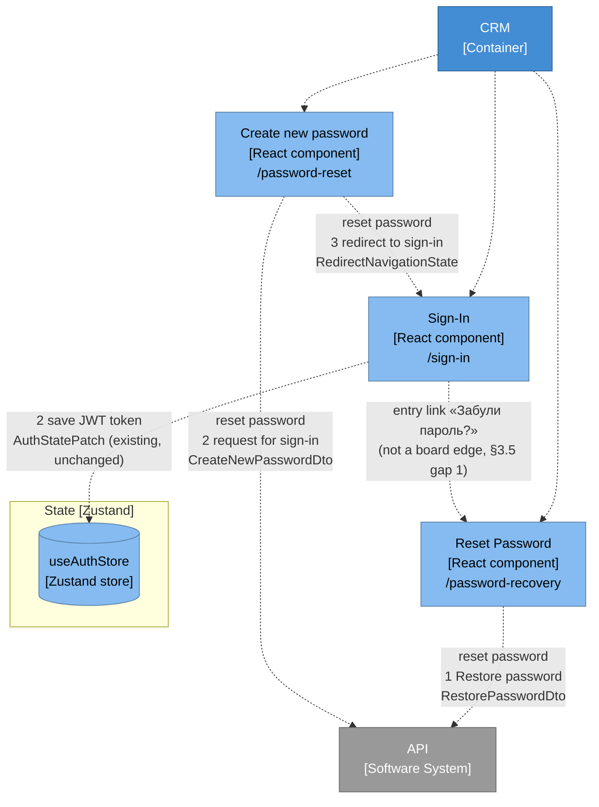
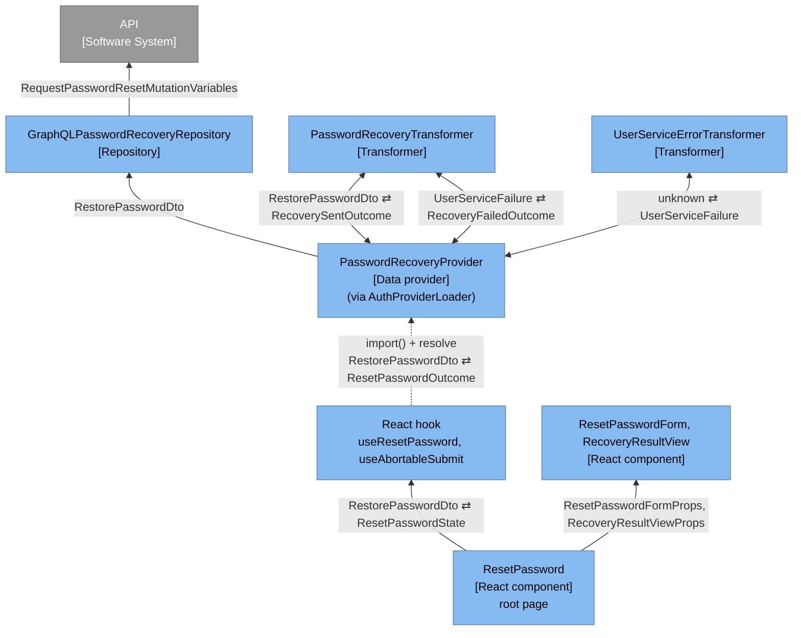
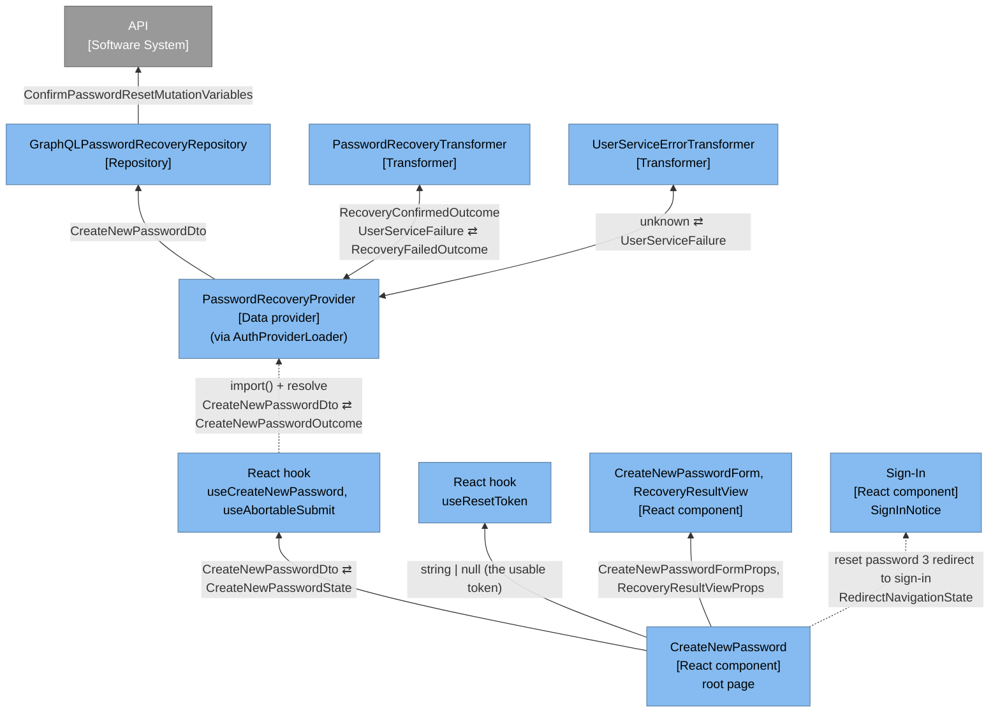
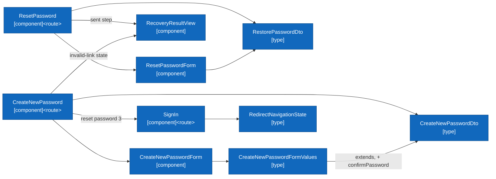
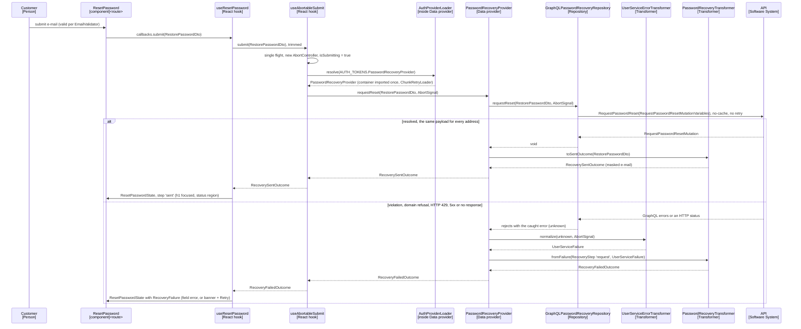
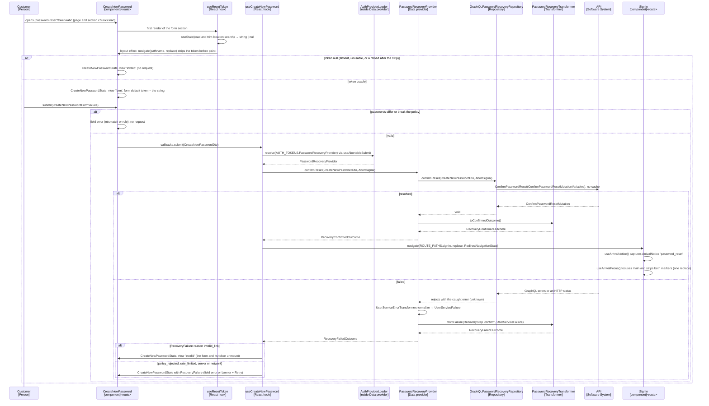

# Architecture: password recovery for the user module (create new password)

**Author:** BMad (Architect) **Date:** 2026-10-05, revised 2026-10-13 **Feature:**
`create-new-password`

Predecessors: [run summary](./run-summary-create-new-password-2026-10-05.md),
[research](./research-create-new-password-2026-10-05.md),
[brief](./brief-create-new-password-2026-10-05.md) and the authoritative
[PRD](./prd-create-new-password-2026-10-05.md). The PRD decides _what_; this document decides
_how_, and every claim about the repository cites the file and line it was read from. Decisions
this stage had to make on its own are marked `> Assumption:` inline.

> Revision 2026-10-08: every value that crosses a layer boundary is a named type (TB-1, §5.17),
> the layers follow the Miro board, which has no frontend Controller or Service (§1.1, §3.5), and
> the board's User domain is plain data in `src/modules/user/types/user/` (§2.3, §6.5.2). The
> board evidence and the shared naming come from the planning contract
> `crm-worktrees/_planning-shared/miro-layer-contract.md`.
>
> Simplification 2026-10-08
> (`crm-worktrees/_planning-shared/over-engineering-review-2026-10-08.md`): the TB-1 gate and
> its burn-down moved to the prerequisite chore `typed-boundaries-gate`; one container-free
> `AuthProviderLoader` replaces the per-flow proxy, factory and provider interface (§5.4); the
> invented security signal is gone; the mock is a stateless happy path (§5.16);
> `ResetTokenSource` became the `useResetToken` hook (§5.6); the outcome, rule-table and deps
> types were collapsed (§6.5); the shared error classification lost its slot ceremony (§5.5.1).
>
> Zustand 2026-10-08 (the user: "change the react state var to zustand"): client and UI state
> moves to Zustand stores in a second prerequisite chore, `zustand-client-state` (#334),
> which adds `zustand`, supersedes ADR-008 and migrates `AuthStateVar`, `ConnectivityStateVar`
> and `src/lib/state/` to `useAuthStore` and `useConnectivityStore`. The board's `State [Redux]`
> is drawn `State [Zustand]` (§3.2). This feature still publishes no store state and adds no
> migration story; the chore owns the migration.

## 1. Approach summary

This is a brownfield extension of the `auth` feature of the `user` module: two new public,
lazily loaded routes under the existing auth chrome, built as the board's L3 stack — a root page
`[component]<route>`, its React hooks, one `[Data provider]` with its `[Transformer]`s, and one
`[Repository]` over two generated GraphQL mutation documents — reached through a container-free
loader beside the deferred seam sign-in already uses. Nothing is added to the eager entrypoint
except the route key and the two route declarations. Implementation starts now, against mocked
GraphQL (the user's decision of 2026-10-05): the pinned v2.8.0 contract lacks both mutations, so
one pending schema extension copied verbatim from user-service `main` supplies them to codegen and
to the local Apollo mock until the pin moves (§5.16). Two prerequisite chores land first: #332
(`typed-boundaries-gate`) lands the TB-1 gate, so every new file is written against it, and
`zustand-client-state` (#334) makes the auth store the Zustand store `useAuthStore`.

```text
/sign-in ──"Забули пароль?"──▶ /password-recovery          /password-reset?token=…
                               (Reset Password)            (Create new password)
                               ┌──────────────────────┐    ┌───────────────────────┐
                               │ request form ─▶ sent │    │ token → form ─▶ ok ───┼─▶ /sign-in
                               │ e-mail       masked  │    │ invalid-link view     │   + notice
                               └──────────┬───────────┘    └──────────┬────────────┘
                                          │ edge 1                    │ edge 2       edge 3
                                          ▼                           ▼
                               requestPasswordResetUser    confirmPasswordResetUser
                               (GraphQL mutation)          (GraphQL mutation)
```

Eight decisions shape everything below:

1. **GraphQL through the container's Apollo client, no transport retry, deadline kept** (FR-15,
   NFR-13): the `[Repository]` `GraphQLPasswordRecoveryRepository` injects
   `AUTH_TOKENS.ApolloClient`, as `RegistrationAPI` does (`repositories/registration-api.ts:22-58`),
   and runs two generated `TypedDocumentNode`s with `fetchPolicy: 'no-cache'`. It is transport
   only. The link chain has no retry link (`apollo-link-factory.ts:17-22`) and `HttpLink` fetches
   through the `DeadlineFetchAdapter`, so the deadline bounds every operation (§5.1).
2. **The uniform outcome is decided upstream and kept below the hooks** (FR-9, NFR-12): the
   request document selects only `clientMutationId`, the repository resolves `void`, and the
   `[Data provider]` `PasswordRecoveryProvider` turns every resolved request into the one
   `RecoverySentOutcome`. A failure is translated by two `[Transformer]`s — answer shape to
   `UserServiceFailure` in the module-shared `UserServiceErrorTransformer`, failure to outcome by
   step in `PasswordRecoveryTransformer` (§5.5).
3. **The pages reach the Data provider through one container-free loader, never `useService`**
   (NFR-4): `stores/index.ts` stays the only feature file that may import the composition root
   (`.dependency-cruiser.js`, `no-di-config-import-outside-composition-root`), and the auth tree
   may never reach `@/providers/di` (`no-paint-path-import-di-bridge`). `AuthProviderLoader`,
   exported from that file, imports the container on the first `resolve` and returns the
   registered provider (§5.4). `DeferredAuthActions` stays untouched.
4. **Flow state is page-local React state held by React hooks** (board element "React hook"):
   the step, the masked address, the failure and the in-memory reset token live in
   `useResetPassword`, `useCreateNewPassword` and `useResetToken`; the two flow hooks share one
   submit skeleton, `useAbortableSubmit`. There is no controller class, no new Zustand store and
   no new module-level singleton.
5. **One password policy, never weaker than the API** (FR-24): `PasswordValidator` narrows its
   uppercase rule to ASCII `[A-Z]`, keeps the lowercase rule, and exposes per-rule evaluation as
   a named `PasswordRuleResultSet`.
6. **Mocked GraphQL until user-service releases** (§5.16): a pending schema extension mirrors the
   upstream declarations exactly, codegen and a stateless local Apollo mock read it beside the
   pinned SDL, and the pin bump deletes it (Follow-up 5.3). No runtime flag gates the flow:
   issue #309 removed `forgotPassword` and the entry link is unconditional (§5.14).
7. **Typed boundaries (TB-1, TB-2)** (§5.17, NFR-17): every value that crosses a layer is a named
   interface, class or named alias in a type-only file, enforced by the chore's ESLint gate; a
   board type (`RestorePasswordDto`, `CreateNewPasswordDto`) crosses component and form
   boundaries as itself.
8. **The Miro board's layers and nothing else** (§1.1, §3.5, §5.18, NFR-18): Root page component
   → React hook → `[Data provider]` ⇄ `[Transformer]` → `[Repository]` → API, with `[type]` DTOs
   and outcomes on every edge. No frontend Controller, Service or Handler class exists in this
   design; Story 0.1 adds the `data-providers/` and `transformers/` feature folders.

### 1.1 Miro alignment

Every class and hook of this design sits in one board layer (planning contract §2), captured
from board `uXjVMG64hTs=` on 2026-10-08.

| Implementation (§6, §7)                    | Board stereotype     | Board frame (screenshot) |
| ------------------------------------------ | -------------------- | ------------------------ |
| `ResetPassword` (`/password-recovery`)     | `[component]<route>` | User/Auth (`01`)         |
| `CreateNewPassword` (`/password-reset`)    | `[component]<route>` | User/Auth (`01`, `02`)   |
| forms, `RecoveryResultView`, `AuthCard`    | `[React component]`  | Access control (`05`)    |
| `useResetPassword`, `useCreateNewPassword` | React hook           | Access control (`05`)    |
| `useAbortableSubmit`, `useResetToken`      | React hook           | Onboarding (`22`)        |
| `PasswordRecoveryProvider`                 | `[Data provider]`    | Access control (`05`)    |
| `AuthProviderLoader`                       | inside Data provider | contract §2.2            |
| `PasswordRecoveryTransformer`              | `[Transformer]`      | Access control (`05`)    |
| `UserServiceErrorTransformer`              | `[Transformer]`      | Onboarding (`23`)        |
| `GraphQLPasswordRecoveryRepository`        | `[Repository]`       | Access control (`05`)    |
| `*-mutation.ts` document seams             | `Mutation [GraphQL]` | Onboarding (`23`)        |
| `RestorePasswordDto`                       | `[type]` (DTO)       | User code (`20`, `21`)   |
| `CreateNewPasswordDto`                     | none (Q-2)           | User code (`20`, `21`)   |
| `UserEntity`, `SignInDto`, `SignUpDto`     | `[type]`             | User code (`20`, `21`)   |
| `Recovery*Outcome`, `UserServiceFailure`   | `[type]`             | User code (`20`, `21`)   |
| user-service GraphQL and the Apollo mock   | `[Software System]`  | User/Auth (`01`)         |
| `PasswordValidator`                        | helper inside hook   | contract §2              |
| `PiiScrubber`                              | infra                | contract §2              |

Screenshot numbers are the contract's `miro/NN-*.png` files: `01` User/Auth component diagram,
`02` the Create new password card, `05` Interactive access control, `20`/`21` the code-level
User module, `22`/`23` the Onboarding component.

## 2. Ubiquitous language and bounded context

### 2.1 Glossary

| Term             | Meaning in this subdomain                                                  |
| ---------------- | -------------------------------------------------------------------------- |
| Reset request    | Ask user-service to mail a reset link to an address (edge 1)               |
| Reset link       | The e-mailed URL `<host>/password-reset?token=<token>`                     |
| Reset token      | Opaque single-use credential, ≤ 255 chars, 1 h TTL; never logged or shown  |
| Usable token     | Present, non-empty after trimming, ≤ 255 characters (FR-17)                |
| Password policy  | 8–64 chars, a digit, an ASCII uppercase, a lowercase letter (FR-24)        |
| Confirmation     | Set the new password for a token (edge 2)                                  |
| Uniform outcome  | The request step reports "sent" whether or not the address exists (FR-9)   |
| Masked e-mail    | Display projection of the submitted address, `eir*****@gmail.com` (FR-10)  |
| Invalid link     | A confirmation refused for its token, or a visit without a usable token    |
| Domain refusal   | A GraphQL error with only a translated message, no code (§5.5.1)           |
| Recovery failure | A bounded reason: rate limit, validation, server, network (FR-12 to FR-14) |
| Arrival notice   | One-time marker carried to `/sign-in` in navigation state (FR-21)          |
| Data provider    | Board `[Data provider]`: supplies one named outcome per step to the hooks  |
| Transformer      | Board `[Transformer]`: pure translation of a payload or failure            |
| Typed boundary   | A position where a value crosses layers; it carries a named type (TB-1)    |
| Board type       | A board `[type]` card's interface (`UserEntity`, `*Dto`), data only (§2.3) |

### 2.2 Bounded context and anti-corruption layer

Password recovery belongs to user-service's identity context; the SPA is a thin client of it.
The boundary is drawn at the `[Data provider]` `PasswordRecoveryProvider`: everything above it
speaks the glossary (`RestorePasswordDto`, `CreateNewPasswordDto`, the `Recovery*Outcome` types,
`RecoveryFailure`); everything below it speaks transport (generated GraphQL types, Apollo errors,
`UserServiceFailure`). The anti-corruption layer is the Data provider with its two Transformers:

- `GraphQLPasswordRecoveryRepository` (`[Repository]`) sends a DTO as the generated mutation
  variables and resolves `void`, or rejects with exactly what Apollo threw.
- `UserServiceErrorTransformer` (`[Transformer]`, module-shared) narrows that `unknown` rejection
  into a named `UserServiceFailure` (§5.5.1).
- `PasswordRecoveryTransformer` (`[Transformer]`) turns a `UserServiceFailure` of one step into a
  `RecoveryFailedOutcome` (§5.5.2), and a submitted `RestorePasswordDto` into the
  `RecoverySentOutcome` with the masked address.
- `PasswordRecoveryProvider` (`[Data provider]`) calls them in order. This is where every
  resolved request becomes the same sent outcome, where a domain refusal on the request step
  becomes `rate_limited` and where one on the confirm step becomes `invalid_link`.

No user-service shape crosses the boundary: components and hooks never see a status, a GraphQL
error, a generated type or an `ApiError`.

### 2.3 Domain (Miro User module frame)

The domain is what the board's code-level "User module" frame draws: `UserEntity` plus the
board's DTOs (planning contract §1.3, §3.5). Business rules — who may reset, token issue and
expiry, the password policy of record, the rate limits — live in user-service; the frontend only
carries and displays data. The domain is therefore plain data interfaces in
`src/modules/user/types/user/`, one type-only file per board card, built by Story 0.2 (§6.5.2):

| Board `[type]`       | Interface              | In this feature                              |
| -------------------- | ---------------------- | -------------------------------------------- |
| `RestorePasswordDTO` | `RestorePasswordDto`   | the request step's form and submit (`email`) |
| none (Q-2)           | `CreateNewPasswordDto` | the confirm step's form and submit           |
| `UserEntity`         | `UserEntity`           | not read by the flow; the one User shape     |
| `SignInDTO`          | `SignInDto`            | renamed from `LoginUserDto` (sign-in)        |
| `SignUpDTO`          | `SignUpDto`            | renamed from `RegisterUserDto` (sign-up)     |

`RestorePasswordDTO` is the forgotten-password request (the user's answer to Q-1, 2026-10-08);
`CreateNewPasswordDto` has no card and is a justified gap (Q-2, §3.5). `UserEntity` is the
module's only User model: the module barrel exports it in place of `SafeUserInfo`, which stays in
the auth feature, unchanged, as the sign-up echo held in `AuthState.user`.

The client-side logic this flow keeps is plain implementation that its UX and security
requirements need: `useResetToken` reads and strips the token (FR-16, FR-17), and
`PasswordValidator` drives the live rule list (FR-19, FR-24). Neither adds a class or a layer.

## 3. Context and component views

The diagrams follow the board's three zoom levels and its visual language (planning contract
§5): name, line break, stereotype in square brackets; board colours; arrows toward the
dependency; the board's numbered edge labels verbatim; every edge carries the named type that
crosses it. The board writes the state store as `State [Redux]`; after the prerequisite chore
`zustand-client-state` the current stack implements that role with Zustand stores, drawn
`State [Zustand]` with the store as a cylinder (`useAuthStore`, §3.2). This feature publishes no
store state (§5.3): §3.2 draws the store only for Sign-In's existing "2 save JWT token" edge.

### 3.1 Context (C4 level 1)

```mermaid
flowchart LR
  customer(["Customer<br/>[Person]"]):::external
  crm["CRM<br/>[Frontend]"]:::container
  uilib["UI library<br/>[Frontend]"]:::container
  user["User module<br/>[module]<br/>restore password"]:::component
  api["API<br/>[Software System]<br/>user-service GraphQL"]:::external
  mail["E-mail<br/>[sent by user-service, not on the board]"]:::external
  customer -->|"/password-recovery, /password-reset"| crm
  crm -->|"renders common UI components"| uilib
  uilib -->|"hosts the auth pages"| user
  user -->|"RestorePasswordDto, CreateNewPasswordDto"| api
  api -.->|"reset link with token"| mail
  mail -.->|"opens /password-reset?token=…"| customer
  classDef component fill:#85BBF0,stroke:#5D82A8,color:#000;
  classDef external fill:#999999,stroke:#6B6B6B,color:#fff;
  classDef container fill:#438DD5,stroke:#2E6295,color:#fff;
```



### 3.2 Components (C4 level 2, the board's User/Auth component diagram)



### 3.3 Layer stacks (C4 level 3, drawn like the board's Interactive access control frame)

Reset Password, `/password-recovery` (board edge 1):



Create new password, `/password-reset` (board edges 2 and 3):



Edges into `PROV` from a hook are dynamic imports: the hook holds the container-free
`AuthProviderLoader`, drawn inside the Data provider box, which `import()`s the composition root
on the first `resolve`. Nothing above those dotted edges holds a static import of the container,
zod, Apollo or tsyringe (`tests/unit/tooling/paint-path-graph.test.ts:16-23`). The Repository →
API edge runs over the existing `ApolloClient` with the `DeadlineFetchAdapter` (§5.1); the
generated `*Mutation` result type travels back only as far as the Repository, which resolves
`void`.

### 3.4 Code level (C4 level 4, drawn like the board's code-level User module frame)



The forms work on the board types directly (TB-2, §5.17): `ResetPasswordForm` is a
`UIForm<RestorePasswordDto>`, and `CreateNewPasswordForm` is a
`UIForm<CreateNewPasswordFormValues>`, whose only addition to `CreateNewPasswordDto` is the
UI-only `confirmPassword`; each form hands its hook the DTO.

### 3.5 Miro conformance

Board elements and edges this feature implements (frames from planning contract §1.2 and §1.6):

| Board element or edge                       | Implemented by                                     |
| ------------------------------------------- | -------------------------------------------------- |
| CRM `[Container]` fan-out to the components | two `guard: 'public'` entries in `@auth/routes`    |
| Reset Password `[React component]`          | `ResetPassword` page, `/password-recovery`         |
| Create new password `[React component]`     | `CreateNewPassword` page, `/password-reset`        |
| Sign-In `[React component]`                 | existing `SignIn` page plus `SignInNotice`         |
| API `[Software System]`                     | user-service GraphQL; local Apollo mock (§5.16)    |
| edge "reset password 1 Restore password"    | `requestReset`: `RequestPasswordReset`             |
| edge "reset password 2 request for sign-in" | `confirmReset`: `ConfirmPasswordReset`             |
| edge "reset password 3 redirect to sign-in" | `navigate` with `RedirectNavigationState` (§5.7)   |
| Root page component (L3)                    | the two pages and their lazy form sections         |
| Child component (L3)                        | forms, `RecoveryResultView`, `AuthCard`, links     |
| React hook (L3; two boxes in Onboarding)    | flow hooks, `useAbortableSubmit`, `useResetToken`  |
| edge Root page component → React hook       | sections hand their hooks the board DTO (TB-2)     |
| edge React hook ↔ Data provider             | hooks call the provider through the loader         |
| `[Data provider]` (`EntityProvider`)        | `PasswordRecoveryProvider`                         |
| edge Data provider ⇄ `[Transformer]`        | both `*Transformer` classes (§5.5)                 |
| edge Data provider → `[Repository]`         | `GraphQLPasswordRecoveryRepository`, DTO in        |
| edge `[Repository]` → API                   | `ApolloClient.mutate`, deadline, no retry          |
| `Mutation [GraphQL]`                        | `request-` / `confirm-password-reset-mutation.ts`  |
| `RestorePasswordDTO` `[type]` (code level)  | `RestorePasswordDto` (Q-1 resolved, §2.3)          |
| `UserEntity`, `SignInDTO`, `SignUpDTO`      | `UserEntity`, `SignInDto`, `SignUpDto` (Story 0.2) |
| `[type]` results (code level)               | `Recovery*Outcome`, `UserServiceFailure`           |

Board elements in the same frames that this feature does not use, by design: `State [Redux]`,
drawn `State [Zustand]` (`useAuthStore`, owned by the chore `zustand-client-state`; recovery
state is page-local, and the board's only State edge on these components belongs to Sign-In,
"2 save JWT token", drawn in §3.2 as existing and unchanged); `[Decorator]`
`MutationAccessGuard` (both routes are public); BFF (no cookie or token flow is involved).

Justified gaps — design items with no card of their own, each placed inside the box it serves
(planning contract §2, "Infrastructure the board does not model"):

1. **The entry link.** Sign-In → Reset Password ("Забули пароль?", FR-1) is an existing,
   unconditional link (issue #309); drawn dotted in §3.2 and proposed as a board edge.
2. **Code-level cards.** The code-level frame has no `ResetPassword` or `CreateNewPassword` card
   and no `CreateNewPasswordDTO`; §3.4 draws them in the frame's style, and the board owner is
   asked (Q-2) to add them.
3. **A second Transformer.** The module-shared `UserServiceErrorTransformer` sits beside
   `PasswordRecoveryTransformer` on the same Provider ⇄ Transformer edge, shared with #330 and
   #331 because all three call the same user-service API.
4. **The loader.** `AuthProviderLoader` exists only to keep the DI graph off the paint path; it
   is drawn inside the Data provider box.
5. **Helpers inside a hook.** `PasswordValidator` and `EmailValidator`.
6. **Cross-cutting infrastructure.** `PiiScrubber`, the observability core (the loader's load
   failure), `ApolloLinkFactory` and `DeadlineFetchAdapter`.
7. **The pending contract and the local mock.** They stand in for the API until user-service
   releases the mutations (§5.16).
8. **E-mail delivery.** Outside the board; the dashed context element of §3.1.

No class, hook or diagram node carries a Controller, Service or Handler stereotype.

## 4. Sequence views

Participants carry their board stereotype; every message names its argument and result types
(planning contract §5). `L` is the container-free loader drawn inside the Data provider box.

### 4.1 Request step, one outcome for every address (board edge 1)



### 4.2 Confirm step, token strip and redirect (board edges 2 and 3)



The navigation state is the named constant `PASSWORD_RESET_ARRIVAL`, typed
`RedirectNavigationState`, whose value sets `focusMain` and `notice: 'password_reset'`.

## 5. Design decisions

### 5.1 Transport: GraphQL through the container's Apollo client, in the Repository

Both operations are GraphQL mutations, the user's decision of 2026-10-05 (PRD §3); it also
follows the repository's transport rule (`src/api/contracts/README.md`, "The transport decision
rule"). The board's `[Repository]` → API edge is one class, `GraphQLPasswordRecoveryRepository`:
it injects `AUTH_TOKENS.ApolloClient` (the existing singleton,
`src/modules/user/config/di.ts:57-67`) and calls `apolloClient.mutate` with a generated
`TypedDocumentNode`, as `RegistrationAPI` does. There is no API-client class between Repository
and API, because the board draws none, and the repository extends no base class.

- **Documents.** Two operation documents sit in `repositories/` beside `create-user.graphql`,
  where `codegen.ts` finds them (`documents: ['src/modules/**/*.graphql']`):

  ```text
  mutation RequestPasswordReset($input: requestPasswordResetUserInput!) {
    requestPasswordResetUser(input: $input) {
      clientMutationId
    }
  }
  ```

  and `ConfirmPasswordReset($input: confirmPasswordResetUserInput!)` over
  `confirmPasswordResetUser`, selecting the same single field. Neither selects `user`, so
  nothing identifying is requested (FR-9). `make codegen` emits the two documents, their
  `*Mutation` and `*MutationVariables` types and the two input types into
  `src/api/generated/graphql.ts`. `request-password-reset-mutation.ts` and
  `confirm-password-reset-mutation.ts` re-export the documents exactly as
  `create-user-mutation.ts` does (the board's `Mutation [GraphQL]`). The documents validate
  against the pinned SDL plus the pending extension of §5.16.

- **Call.** Each public method builds the generated variables from its DTO —
  `{ input: { ...dto, clientMutationId: uuidv4() } }`, assigned to a variable typed
  `RequestPasswordResetMutationVariables` or `ConfirmPasswordResetMutationVariables` — and hands
  them to one private generic `mutate(document, variables, signal)`, which runs
  `apolloClient.mutate` with `context: { fetchOptions: { signal } }` and
  `fetchPolicy: 'no-cache'`. The typed assignment is the compile-time drift check between the
  DTO interfaces and the generated inputs. `no-cache` is a decision: the default policy writes
  the result under `ROOT_MUTATION` with a field key that serialises the arguments, so the token
  and the new password would pass through the process-wide `InMemoryCache` (FR-16, NFR-12); the
  test pins "no cache write during a confirm" with a spy on `cache.write`.
- **Result.** Both methods resolve `void` whatever the payload (a payload object or `null`), so
  nothing that could differ between addresses leaves the repository; nothing is parsed.
- **No retry.** The chain is correlation link, error link, `HttpLink`
  (`apollo-link-factory.ts:17-22`), with no retry link. Nothing is added to it.
- **Deadline and abort.** `HttpLink` fetches through `DeadlineFetchAdapter`, so an expired
  deadline arrives as `networkError` = `HttpError({ status: 0 })`
  (`deadline-fetch-adapter.ts:81-83`). The caller's signal rides `context.fetchOptions.signal`;
  a call whose signal is already aborted rejects with an `AbortError` before `mutate` runs.
- **Errors.** The repository translates nothing: every rejection propagates unchanged to the
  Data provider, which hands it to `UserServiceErrorTransformer` (§5.5.1).

No `src/config/api-config.ts` entry is added: the endpoint is the existing `GraphQLUrl`.

### 5.2 Route keys, pages and chunks

`ROUTE_PATHS.passwordReset = '/password-reset'` is added beside the existing
`passwordRecovery` (`src/routes/route-paths.ts:7`); the URL paths are fixed by the sign-in link
and by the link user-service e-mails. The auth contract gains two `guard: 'public'` entries with
`webpackChunkName` `"reset-password"` and `"create-new-password"` and `meta.titleKey`, which is
what the route-coverage gate reads. `RouteMapper` then
wraps each page loader in `ChunkRetryLoader` + `ThemedChunkLoader` and `ReloadingChunkLoader`
(`src/routes/route-mapper.tsx:31-40`); the composer attaches the `errorElement`. No registry,
composer or shell edit (FR-2).

The page components take the board's names: `ResetPassword` in
`routes/reset-password/index.tsx` and `CreateNewPassword` in
`routes/create-new-password/index.tsx`. Each mirrors `routes/sign-in/index.tsx`: it calls
`usePageTitle`, renders `AuthPageLayout` and `lazy`-loads a `webpackPreload`ed form-section chunk
written inline (`lazy(() => import(/* webpackChunkName: "reset-password-form-section" */ …))`),
not through a `*FormSectionLoader` module instance, which would add a module-level singleton.

### 5.3 Page-local state in React hooks, one shared submit skeleton

The recovery step, the masked address and the reset token are read by exactly one page each and
must not survive the page (FR-17), so they live in `useState` inside the hooks — the board's
"React hook" box of each component:

- `useResetPassword(loader: AuthProviderLoader): ResetPasswordState` keeps the step, the
  submitted (trimmed) e-mail — so "Назад" on the sent step re-renders the form with the value in
  the field and its heading focused (FR-11) — the masked address and the failure, and returns
  them with its `ResetPasswordCallbacks`, whose `submit` takes the form's `RestorePasswordDto`.
- `useCreateNewPassword(loader: AuthProviderLoader, token: string | null)` returns
  `CreateNewPasswordState`; its `submit` takes the form's `CreateNewPasswordDto` and sends only
  `token` and `newPassword`. It keeps the view (`form | invalid`, `invalid` when the token is
  `null`) and the failure, and navigates to `/sign-in` on `confirmed` (§5.7).
- Each flow hook's run resolves the provider through
  `loader.resolve(AUTH_TOKENS.PasswordRecoveryProvider)` and calls the step; a rejected load
  becomes a `RecoveryFailedOutcome` with reason `network`, retryable (a module-level constant
  typed `RecoveryFailedOutcome`, below the jscpd bar).
- `useAbortableSubmit` (`src/hooks/use-abortable-submit.ts`, shared with #330 and #331) takes an
  `AbortableRun<TInput, TOutcome>` and returns `AbortableSubmit<TInput, TOutcome>`: single flight
  (a submit while one is in flight returns `null`), a fresh `AbortController` per submit, abort
  on unmount, `isSubmitting`, and `retry()`, which re-runs the last input once. An aborted run
  resolves `null`, so an aborted attempt patches no state and needs no outcome of its own.

The outcome → view decision is a typed lookup inside each flow hook on the outcome's `kind`. If a
flow hook would exceed the rust-code-analysis file caps (10 functions, 6 closures, 15 in total),
that lookup moves to a second React hook beside it, never to a Transformer: on the board a
`[Transformer]` sits only on the Data provider edge (verification F20).

Two React StrictMode rules bind the hooks: initializers have no side effects, and the unmount
cleanup of `useAbortableSubmit` aborts only the `AbortController` of the request in flight and
never marks the hook as disposed, so the simulated unmount aborts nothing and the next submit
still sends its request.

### 5.4 The Data provider without `useService`: one container-free loader

The auth tree cannot import `@/providers/di`, and only `stores/index.ts` may import the
composition root. `DeferredAuthActions` solves this for sign-in by loading the container inside a
`ChunkRetryLoader` on the first action (`stores/index.ts:15-80`). That file holds eight
functions and three closures today against the file caps of 10 functions, 6 closures and 15 in
total (`config/metrics-policy.json`), so one small class is added beside it:

```ts
// @auth/stores/index.ts (MODIFY): the only feature file that imports the container
export class AuthProviderLoader {
  public resolve<T>(token: InjectionToken<T>): Promise<T>;
}
```

- A private `ChunkRetryLoader` field memoizes `import('@/config/dependency-injection-config')`
  (one closure); `resolve` (one function) awaits it and returns `container.resolve<T>(token)`.
  The file ends at nine functions, four closures and 13 in total. These counts are `main`'s
  before the chore `zustand-client-state`, whose `DeferredAuthActions` writes go through
  `useAuthStore.setState`; if the chore changes the file's counts, the loader still adds exactly
  one function and one closure, and the file stays within the caps.
- A final load failure is captured once through `observabilityCore.captureError` with the source
  `auth:provider-load` — the file already imports it (`:2`) — and rethrown; nothing is written to
  the console.
- `useAuthProviderLoader(): AuthProviderLoader` (`@auth/hooks/`) builds one loader per page mount
  in a `useState` initializer, so no module-level instance exists, and tests pass a stub loader
  without module mocking. Mounting twice does not rebuild the DI graph: Rspack caches the
  dynamic import and the provider is a container singleton.
- With one implementation, the Data provider needs no interface and no proxy; the hooks see the
  `PasswordRecoveryProvider` class by `import type`.
- `DeferredAuthActions` is not changed. #331's challenge hook resolves its own provider through
  the same loader; #330's protected pages use `useService` below the route split instead.

### 5.5 Uniform outcome and error translation (the Provider ⇄ Transformer edge)

A failure is translated twice, each time by one `[Transformer]`. The Data provider calls them in
order:

```text
PasswordRecoveryProvider.requestReset(dto, signal)
  try   repository.requestReset(dto, signal)            → void
        return transformer.toSentOutcome(dto)          → RecoverySentOutcome
  catch failure = errors.normalize(caught, signal)      → UserServiceFailure
        return transformer.fromFailure('request', failure)
```

`confirmReset` is the same shape with `toConfirmedOutcome()` and the `'confirm'` step.

#### 5.5.1 GraphQL answers to failures (`UserServiceErrorTransformer`)

What user-service returns was read at its source (`main`):

- **Input violations** come from API Platform's `ValidationException`; the message is
  `<propertyPath>: <reason>` (for an invalid e-mail it starts with `email:`), and API Platform's
  GraphQL normalizer adds `extensions.status` `422`.
- **Domain exceptions** (token not found, expired, already used, mismatched, user not found, the
  per-address rate limit) are normalised by `DomainExceptionNormalizer` into a bare translated
  `message`, with no `extensions`, no status and no code.
- **Endpoint limiters** answer the whole HTTP request with `429` before GraphQL runs; today they
  do not reach the reset mutations (#462, #469, #470).

`UserServiceErrorTransformer` (`src/modules/user/lib/user-service-error-transformer.ts`, shared
by #315, #330 and #331) has one public method,
`normalize(error: unknown, signal?: AbortSignal): UserServiceFailure` (`unknown` is allowed as a
narrowing parameter, TB-1 (d)). It narrows Apollo's error structurally (`import type` only) and
applies these steps in order; the first that matches wins:

1. The caller's signal is aborted, or the error is an `AbortError` → `aborted`.
2. A `networkError` → its HTTP status through the status table; a `networkError` without a status
   (the fetch rejected) → `network`, with no message-keyword matching (WebKit says `Load failed`).
3. The first GraphQL error's message names a violated input property (the prefix before the first
   colon is one of the operation's inputs: `email`, `token`, `newPassword` here) → `violation`,
   with one `FieldViolation` per property (`path` the property, `reason` `other`).
4. The first GraphQL error has a numeric `extensions.status` → the status table.
5. The first GraphQL error has any other message → `refused`, a domain refusal; an
   `extensions.code` is ignored.
6. Anything else → `unknown`.

The status table is module-private data: `0` (the deadline adapter's `HttpError`) → `network`;
`422` → `violation` with an empty set; `429` → `rate_limited`; `500` to `599` → `server`, status
kept; any other status → `unknown`. No step reads the message for meaning (step 3 reads only the
untranslated property prefix), so a translated message cannot change a result.

**How #330 and #331 extend it.** They append, and never reorder or remove a step: a literal to
`UserServiceFailureReason` or `FieldViolationReason`, a row to the status table (for example
`401` → `unauthenticated`), their operations' input properties to step 3, and rows to a message
step: #330 adds the exact-message step between steps 3 and 4 with its rows ("Access Denied." →
`access_denied`), and #331 appends its rows to it. #315 ships no message step, because an empty
table would be an untestable branch. No appended row reaches #315's operations, so no #315
outcome changes.

> Assumption: API Platform keeps `extensions.status` `422` on user-service's GraphQL validation
> errors; this was read from API Platform's normalizer, not observed. Step 3's prefix test
> recognises a violation without it.
>
> Assumption: the transformer is undecorated and registered by value in `UserModuleRegistrar`
> (`useValue: new UserServiceErrorTransformer()`), because `src/modules/user/lib/` is outside
> the DI-collaborator gate and the class has no collaborators.

#### 5.5.2 Failures to outcomes (`PasswordRecoveryTransformer`)

`PasswordRecoveryTransformer` (`@auth/transformers/password-recovery-transformer.ts`,
`@injectable()`, no collaborators) owns the recovery-specific half. `fromFailure` takes a
`RecoveryStep` and a `UserServiceFailure` and returns a `RecoveryFailedOutcome` from one
module-private data table (the `STATUS_ERROR_SPECS` shape of `api-status-error-factory.ts:16-44`,
no function-valued properties; a private table is not a boundary, TB-1 (iii)):

| Step    | `UserServiceFailure` (§5.5.1) | Outcome                                   |
| ------- | ----------------------------- | ----------------------------------------- |
| request | none: the mutation resolved   | `RecoverySentOutcome` for every address   |
| request | `violation` (`email` or none) | `RecoveryFailedOutcome` `invalid_email`   |
| request | `refused` (per-address limit) | `RecoveryFailedOutcome` `rate_limited`    |
| confirm | none: the mutation resolved   | `RecoveryConfirmedOutcome`                |
| confirm | `refused` (token refused)     | `RecoveryFailedOutcome` `invalid_link`    |
| confirm | `violation` (`token`)         | `RecoveryFailedOutcome` `invalid_link`    |
| confirm | `violation` (other or none)   | `RecoveryFailedOutcome` `policy_rejected` |
| any     | `rate_limited`                | `RecoveryFailedOutcome` `rate_limited`    |
| any     | `network`, `aborted`          | `RecoveryFailedOutcome` `network`, retry  |
| any     | `server`, `unknown`, default  | `RecoveryFailedOutcome` `server`, retry   |

`aborted` needs no outcome of its own: `useAbortableSubmit` resolves `null` for an aborted run,
so that outcome is never shown. The last row is the table's default, so the table stays total
for a reason a later bundle appends. `rate_limited` is never retryable; `network` and `server`
are. A request-step `refused` is the per-address limit because that is the only domain exception
the request path raises; a confirm-step `refused` is a dead link because every domain exception
the confirm path raises is about the token or its user.

The same class owns the success side: `toSentOutcome` turns a `RestorePasswordDto` into a
`RecoverySentOutcome` with the masked address (§5.12), and `toConfirmedOutcome` returns the
`RecoveryConfirmedOutcome`. It value-imports only `tsyringe`.

The UI needs no third table. A field reason is rendered by the form that owns the field
(`invalid_email` by `ResetPasswordForm`, `policy_rejected` by `CreateNewPasswordForm`, both
through `ServerFieldError`, §5.11); `invalid_link` switches `useCreateNewPassword` to the
`invalid` view. Every other reason is a banner: `useRecoveryFailureBanner(failure, retry)`
returns the named `RecoveryFailureBanner` (the `UIForm` `error` and `errorAction`).

### 5.6 Reset token: read once, memory only, URL stripped

`useResetToken(): string | null` reads the `token` parameter of `location.search` once, in a
`useState` initializer, trims it and keeps it only when it is usable (non-empty, ≤ 255
characters, FR-17); otherwise it returns `null`. In a `useLayoutEffect` it navigates to the bare
pathname with `replace: true` when a `token` parameter is present, so the router's
`location.search` and the address bar agree and the URL is stripped before the browser paints
the form (FR-16, NFR-12). `navigate` is safe there: react-router marks the function active in its
own layout effect, which runs first because the hook calls `useNavigate()` before declaring its
effect, so the console gate sees no warning. Under StrictMode the initializer runs twice on the
same `search` and the guard on a present `token` parameter makes the second effect a no-op.

The form section passes the token to `CreateNewPasswordForm`, which puts it in the form's
default values; no input renders it, so it never reaches the DOM, and it lives only in memory
(FR-16, NFR-12). The strip runs only after the token is in memory, so a reload-once chunk
recovery that fires before the section renders still re-requests the original URL (FR-16). A real
remount — a reload after the strip — finds no token and renders the invalid-link state.

### 5.7 Success notice: one-time navigation state, one replace

On a `RecoveryConfirmedOutcome`, `useCreateNewPassword` navigates to `ROUTE_PATHS.signIn` with
`replace: true` and the named constant `PASSWORD_RESET_ARRIVAL: RedirectNavigationState`
(`focusMain: true`, `notice: 'password_reset'`; board edge "reset password 3 redirect to
sign-in"). `RedirectNavigationState` (`src/routes/types/navigation-state.ts:7-10`) gains
`notice?: ArrivalNotice | undefined`. Two hooks consume it, and only one writes history:

- `useArrivalFocus` (`src/hooks/use-arrival-focus.ts:10-23`, MODIFY) keeps its single replace,
  but the replaced state now clears **every** one-time marker (`focusMain: false`, `notice`
  omitted); the rule is written into `navigation-state.ts`.
- `useArrivalNotice(): ArrivalNotice | null` (`src/hooks/`, NEW) captures `state.notice` into
  `useState` on the first render in the `SignIn` page, not in the lazy section, which can mount
  after the marker is stripped, and passes it down as a prop.
- `SignInNotice` (`@auth/components/sign-in-notice/index.tsx`, the generic arrival notice #330
  and #331 import) renders `role="status"` above the form, mounts empty and fills its text in an
  effect, and renders nothing without a notice, so the resting `/sign-in` is unchanged (FR-21).
- The text comes from a module-private table typed by `SignInNoticeMessageTable` (§6.5.1), one
  member per `ArrivalNotice` literal valued by a `*Key`-named constant. #330 appends
  `session_ended`, #331 `two_factor_expired` and `account_locked`, each with its member and key
  pair; `tsc` fails while a member is missing.

### 5.8 Shared password policy

`PasswordValidator` (`validations/password.ts:6-33`) changes its third rule from `/\p{Lu}/u` to
`/[A-Z]/` and keeps the fourth (`/\p{Ll}/u`); it gains `evaluate`, which returns
`PasswordRuleResultSet`, a named collection whose `items` hold one `PasswordRuleResult` (`key`,
`met`) per rule in policy order, which `PasswordPolicyRules` renders live. `create(t)` is
unchanged. The live list renders **every** rule the policy enforces — four rows — and reads the
same rule list as `create`, so the list and the validator cannot drift. #330 reuses the set.

### 5.9 The card without the OAuth block

`AuthFormSection` always mounts `AuthProviderButtons` (`auth-form-section/index.tsx:14-24`). The
smallest change that keeps jscpd at zero is to extract the section + card wrapper into `AuthCard`
(props `AuthCardProps`: `children`, optional `after`) and make `AuthFormSection` a composition of
it. Sign-in and sign-up render the same DOM as today.

### 5.10 `PasswordField` generalised

`PasswordField` hard-codes `name="password"`, the `T extends { password: string }` bound and the
policy rules (`password-field.tsx:43-61`). `PasswordFieldProps` gains three optional props with
today's values as defaults — `name`, `rules`, `describedBy` — and the bound relaxes to
`FieldValues`. #330 Story 1.1 later moves it to `src/components/` as `UIPasswordField`.

### 5.11 Server-side field errors and the banner action

`UIForm` owns the `useForm` instance and exposes no `setError`. Two small additions keep that
encapsulation:

- `ServerFieldError` (props `ServerFieldErrorProps`), rendered inside the form, calls
  `setError(name, { type: 'server', message })` and `setFocus(name)` through `useFormContext`
  whenever its `message` prop changes to a string; the next edit clears it (FR-6, FR-13, FR-20).
- `UIFormProps` gains `errorAction?: FormErrorAction | undefined` (`label: string`,
  `onClick: () => void`), rendered inside `ErrorBanner` after the `role="alert"` text; the header
  props gain `titleRef?: RefCallback<HTMLElement> | undefined`, which gives the heading the ref
  and `tabIndex={-1}`. `ResetPasswordForm` passes `useFocusOnMount()` only when it is re-entered
  from the sent step (FR-11). Sign-in and sign-up pass nothing and render as today.

### 5.12 Masked e-mail

`PasswordRecoveryTransformer.toSentOutcome(dto)` masks the address in a private `mask(email)`
(FR-10: split at the last `@`, a prefix of three characters when the local part has six or more,
otherwise one, always five asterisks, a value without `@` maps to `*****`). The sent view
receives a ready string.

### 5.13 The telemetry scrubber

`PiiScrubber.patterns` gains `/(?<=token=)[^&#\s]+/gi`, so a captured URL reads
`…?token=[redacted]&x=1` (FR-26); the key-based denial already drops `token`, `newPassword` and
`email` keys at any depth (`pii-scrubber.ts:4-12`), which covers a `variables` object. On GraphQL
the token, the new password and the e-mail travel in the request body, never in a URL; the Apollo
error link captures errors that carry no variables, and Sentry's fetch breadcrumbs record no body.
No security signal is emitted: the `password_reset` category of the earlier plan was invented by
the planner and is withdrawn (PRD FR-25).

### 5.14 Feature flag per environment

No flag. Issue #309 removed the `forgotPassword` flag before this feature: the `FeatureFlag`
union is empty, `public/index.html` ships `{ "flags": {} }`, and `UserOptions` renders the
"Забули пароль?" link unconditionally. This feature therefore edits no runtime-config source
file, no compose file and no flag case of the runtime-config contract; the contract's
route-registration case flips from #309's interim `allowlisted` row to the registered route
(§8.3). The `/sign-in` baselines and the sign-in keyboard spec already contain the link (NFR-6,
NFR-10). Registering both routes (§5.2) is what
makes the link open the flow in every environment; production works once a user-service release
with both mutations is deployed (Follow-up 5.6). §18 item 1 records the drift from the plan.

### 5.15 Signed-in users

Both routes are `guard: 'public'`; `ProtectedRoute` is not in their branch, `usePostLoginRedirect`
is not mounted on them, and `useCreateNewPassword` never touches `useAuthStore` (FR-4).

### 5.16 Pending schema extension and the stateless mock

user-service declares both mutations on `main` only (PR #215, commit `63041e4a`, unchanged in
`f82bbef5`); v2.8.0, the newest tag and the pin, has neither. The user's decision of 2026-10-05 is
to mock them and build now.

**One file.** `src/api/contracts/pending/password-reset.graphql` holds the upstream declarations
copied verbatim (spec lines 231-235 and 633-656 on `main`):

```text
extend type Mutation {
  "RequestPasswordResets a User."
  requestPasswordResetUser(input: requestPasswordResetUserInput!): requestPasswordResetUserPayload

  "ConfirmPasswordResets a User."
  confirmPasswordResetUser(input: confirmPasswordResetUserInput!): confirmPasswordResetUserPayload
}

"RequestPasswordResets a User."
input requestPasswordResetUserInput {
  clientMutationId: String
  email: String!
}

"RequestPasswordResets a User."
type requestPasswordResetUserPayload {
  user: User
  clientMutationId: String
}

"ConfirmPasswordResets a User."
input confirmPasswordResetUserInput {
  clientMutationId: String
  token: String!
  newPassword: String!
}

"ConfirmPasswordResets a User."
type confirmPasswordResetUserPayload {
  user: User
  clientMutationId: String
}
```

It sits outside the `src/modules/**/*.graphql` documents glob and references only `User`.
`src/api/contracts/README.md` gains one "Pending contracts" row: the file, the version it is
pending against (`v2.8.0`), the upstream source and the removal trigger (Follow-up 5.3).

**Codegen.** `codegen.ts` reads `schema: [schemaPath, 'src/api/contracts/pending/*.graphql']`;
graphql-codegen merges the sources, so `src/api/generated/graphql.ts` is unchanged until Story 1.3
adds documents.

**The stateless mock.** `Apollo.Dockerfile`'s production stage copies `src/api/contracts/pending`,
and `docker/apollo-server/lib/server.ts` passes the pinned SDL and the pending file as `typeDefs`,
with no branch. `docker/apollo-server/lib/resolvers.ts` gains two stateless resolvers:

| Op      | Input                                     | Answer                                     |
| ------- | ----------------------------------------- | ------------------------------------------ |
| request | any valid e-mail                          | `{ user: null, clientMutationId }`         |
| request | e-mail failing the mock's `EMAIL_REGEX`   | `email:` violation, status `422`, HTTP 200 |
| confirm | token of 1-255 characters, valid password | `{ user: null, clientMutationId }`         |
| confirm | `newPassword` failing the upstream rule   | `newPassword:` violation, status `422`     |

The violations throw `GraphQLError` with `extensions: { code: 'BAD_USER_INPUT', status: 422 }`:
the repository's `formatError` (`docker/apollo-server/lib/format-error.ts`, not edited) rewrites
the message of a code-less error, which would erase the property prefix. The client never reads
the code. Every other shape — refusals, `429`, `503`, aborts — is exercised where it is
deterministic: `page.route('**/graphql')` in the browser lanes and msw `graphql` handlers in the
integration suite. No test imports `server.ts`.

**Cleanup.** The pin bump (Follow-up 5.3, §15.2) deletes the extension, its `codegen.ts` entry,
the `Apollo.Dockerfile` copy and the `server.ts` read, and keeps the two resolvers. Nothing in
`src/modules/**` changes. No checker enforces the deletion: graphql-codegen and Apollo Server
merge an identical duplicate silently, so Follow-up 5.3 lists it explicitly.

### 5.17 Typed boundaries (TB-1)

The user's rule of 2026-10-08, shared verbatim by the #315, #330 and #331 bundles (planning
contract §4) and PRD NFR-17:

> **TB-1 Typed boundaries.** Every value that crosses a layer boundary is an instance of a
> **named type**: an exported `interface` declared in a type-only file (`types/` folder or
> `types.ts`, issue #88), a class, or a named alias declared in a type-only file whose whole
> body is a union of named types or literals, a callback type, or one generic or derived type
> whose arguments are named types (`type RecoveryRetry = () => Promise<void>`,
> `type LoadFailureReporter = Pick<…>`, `type AuthFailureCategory = Extract<…>`). A layer
> boundary is any of these positions:
>
> 1. the props of a `[component]` or `[component]<route>`;
> 2. the parameters and result of an exported React hook;
> 3. the constructor parameters, the parameters and return type (including a `Promise`'s
>    resolved type) of every non-private method, and every non-private property of a class in
>    the Data provider, Transformer, Repository, State, Guard, Factory or helper roles (the layer
>    map of the planning contract §2);
> 4. every value registered in or resolved from the DI container;
> 5. published state: reactive-var state, outlet context, router navigation state, toast and
>    notice payloads;
> 6. events and telemetry payloads (security signals, observability);
> 7. every member of an interface in a type-only file;
> 8. the return value of a test builder in `tests/builders/`.
>
> At those positions the following are **forbidden**:
>
> - **(a) Anonymous objects.** Inline object type literals `{ … }`, including object members of
>   a union (`{ kind: 'sent' } | { kind: 'failed' }`): each variant is a named interface
>   (`RecoverySentOutcome`, `RecoveryFailedOutcome`) and the union is a named alias of them. An
>   object shape is always declared with `interface`, never `type X = { … }`.
> - **(b) Tuples** `[A, B]`.
> - **(c) Bare arrays.**
>   - `T[]`, `readonly T[]`, `Array<T>` and `ReadonlyArray<T>` are forbidden as a parameter, a
>     return type, a class property, a hook result, an alias body or a nested array.
>   - A collection crosses only as a **named collection interface**, whose array property's
>     element type is itself a named interface or class:
>     `interface RecoveryCodeSet { readonly items: readonly RecoveryCode[] }` with
>     `interface RecoveryCode { readonly value: string }`.
>   - Arrays of primitives or literals (`readonly string[]`) are forbidden everywhere at a
>     boundary.
> - **(d) Catch-all payloads.** `any`, `object`, `Record<…>` and index signatures
>   (`[key: string]: …`). `unknown` is allowed in exactly two places:
>   - the parameter (never the return) of a method whose role is to narrow a caught error (a
>     `*Transformer`, `*Guard` or `*Detector`);
>   - the `error` / `cause` property of an error type.
> - **(e) Inline derived types.** `Omit`, `Pick`, `Partial` and `Required` written at the
>   boundary. Name the derivation once in a type-only file
>   (`export type ToastDraft = Omit<ToastItem, 'id'>;`) and use the name.
>
> **Allowed.**
>
> - Single scalar values (`string`, `number`, `boolean`, a named literal-union alias).
> - Named third-party types (`ReactNode` for `children`, `AbortSignal`, `TFunction`, `SxProps`,
>   `ApolloClient`, `RefObject<UserEntity>`).
> - Generics whose arguments are named types (`Promise<RecoveryOutcome>`).
> - Callback types whose parameters and results obey this rule.
> - `T | null` and `T | undefined`, written inline, where `T` is itself allowed here
>   (`RecoveryFailure | null`, `string | undefined`).
>
> **Exceptions.** No others:
>
> - **(i) Generated contract types.** Generated GraphQL/OpenAPI codegen types
>   (`src/api/generated/**`) are named, but they stay below the Data provider. They may appear
>   only in `repositories/`, `transformers/`, `*-mutation.ts` / `*-query.ts` contract modules,
>   `response-schemas.ts`, and as `import type` inside `data-providers/` bodies. They never
>   appear in a Provider's public signature, a hook, a component or State, including as the
>   argument of a generic type (`Promise<RequestPasswordResetMutation>`).
> - **(ii) Module augmentation and declaration files.** `declare module` blocks and `.d.ts`
>   files.
> - **(iii) Private members and function-local values.** These are not boundaries.
>
> **No suppression.** Satisfy TB-1 by declaring the named type, never with `eslint-disable`, a
> cast, a scope narrowing or an allowlist entry.

TB-2 sits beside TB-1 and leaves its text unchanged (planning contract §4):

> **TB-2 Board types at component boundaries** (the user, 2026-10-08; it sits beside TB-1 and
> does not change it). A board type crosses component and form boundaries as itself (e.g.
> `UIForm<SignInDto>`); form values may only `extends` a DTO to add UI-only fields; the
> `*Dto`/`*Entity` names are reserved for board types, the `[type]` cards of the Miro "User
> module" frame, plus `CreateNewPasswordDto`, whose card is proposed to the board.
>
> Enforcement is deliberately light. #315 Story 0.7 adds one naming check,
> `tests/unit/tooling/domain-type-names.test.ts`, which fails when an interface or alias named
> `*Dto` or `*Entity` is declared outside `src/modules/*/types/user/`, with a must-fail case on an
> in-memory fixture. The other two clauses are review-enforced; no ESLint selector is added.

The frozen TB-2 text names the naming check's story by its former id; it is now Story 0.2. The
frozen TB-1 text says "reactive-var state" in position 5; since the prerequisite chore
`zustand-client-state` it means Zustand store state (`AuthState` in `useAuthStore`).

**Enforcement.** TB-1's ESLint gate, `consistent-type-definitions`, the fixtures, the policy pin
and the burn-down of the existing sites belong to the prerequisite chore `typed-boundaries-gate`
(its architecture §3 to §5), which lands first; this feature adds no selector, and its new code
passes the gate from the first commit. Exception (i) is a review item: no dependency-cruiser rule
confines generated types.

**What it changed in this design.**

| 2026-10-05 plan                                    | Now                                      |
| -------------------------------------------------- | ---------------------------------------- |
| `evaluate(value): readonly PasswordRuleResult[]`   | returns `PasswordRuleResultSet`          |
| outcome unions of inline `{ kind: … }` objects     | `Recovery{Sent,Confirmed,Failed}Outcome` |
| `ResetOperation` holding document, schema, context | gone: a private generic `mutate` (§5.1)  |
| DTOs derived from the generated inputs inline      | the board DTOs of §6.5.2 (Story 0.2)     |
| `UIForm` `errorAction` as `{ label, onClick }`     | `FormErrorAction` interface              |
| `InCardLink` props as an inline object             | `InCardLinkProps` interface              |

`ResetPasswordForm` is a `UIForm<RestorePasswordDto>`, and `CreateNewPasswordFormValues extends
CreateNewPasswordDto` adds only the UI-only `confirmPassword`.

### 5.18 The board's layer vocabulary in the repository policies

The board's frontend vocabulary (planning contract §1.11) is `[React component]` and
`[component]<route>`, React hook, `[Data provider]`, `[Transformer]`, `[Repository]` and
`Mutation [GraphQL]`, `State`, `[Decorator]`, `[type]`, `[module]`, `[Software System]`.
"Controller" appears only in the Structurizr sample and "service" only as backend containers, so
this feature introduces no `*Controller`, `*Service` or `*Handler` class.

- **Suffixes** (the chore): `*Transformer` is added to `config/class-naming-policy.js` and the
  CLAUDE.md role table, and the unused `Controller` is removed. `*Provider` and `*Loader` are
  already approved.
- **Folders** (Story 0.1): `data-providers` and `transformers` join `feature.allowedFolders` and
  `tests.featureAllowedFolders` in `config/module-shape.json`; `config/di-collaborator-policy.js`
  `LOGIC_SOURCE_GLOBS` and `LOGIC_SOURCE_PATHS`, the dependency-cruiser
  `components-no-direct-injectable-import` path list, `scripts/ci/mutation-scope.mjs` and the plop
  templates follow. `src/providers/` stays the React-context folder.

The folder edit touches `.dependency-cruiser.js`, an ADR-drift significant path, so ADR-019 lands
in the same story (§14).

## 6. Classes, types, tokens and registrations

Signatures are type-level only. `@auth` is `src/modules/user/features/auth`. Every constructor
parameter, non-private method parameter and result, hook parameter and result, prop, DI value and
published state below is a named type from §6.5 (TB-1); private helpers are omitted.

### 6.1 Repository (`@auth/repositories/`, board `[Repository]`)

```ts
@injectable()
export default class GraphQLPasswordRecoveryRepository {
  constructor(
    @inject(AUTH_TOKENS.ApolloClient) apolloClient: ApolloClient<NormalizedCacheObject>
  );
  public requestReset(dto: RestorePasswordDto, signal?: AbortSignal): Promise<void>;
  public confirmReset(dto: CreateNewPasswordDto, signal?: AbortSignal): Promise<void>;
  // private mutate<TData, TVariables>(document, variables, signal): generic, three parameters
}
```

The two `*-mutation.ts` seams are imported by the repository only and not re-exported from the
barrel. The repository value-imports only `tsyringe`, `uuid`, token modules and the two seams.

### 6.2 Transformers (board `[Transformer]`)

```ts
// @auth/transformers/password-recovery-transformer.ts
@injectable()
export default class PasswordRecoveryTransformer {
  public toSentOutcome(dto: RestorePasswordDto): RecoverySentOutcome;
  public toConfirmedOutcome(): RecoveryConfirmedOutcome;
  public fromFailure(step: RecoveryStep, failure: UserServiceFailure): RecoveryFailedOutcome;
  // private mask(email: string): string — FR-10 (§5.12)
}

// src/modules/user/lib/user-service-error-transformer.ts (module-shared with #330 and #331)
export default class UserServiceErrorTransformer {
  public normalize(error: unknown, signal?: AbortSignal): UserServiceFailure;
  // private helpers for the network half, the GraphQL half and the violated property (§5.5.1)
}
```

### 6.3 Data provider and loader

```ts
// @auth/data-providers/password-recovery-provider.ts (board [Data provider], no interface)
@injectable()
export default class PasswordRecoveryProvider {
  constructor(
    @inject(AUTH_TOKENS.PasswordRecoveryRepository) repository: GraphQLPasswordRecoveryRepository,
    @inject(AUTH_TOKENS.PasswordRecoveryTransformer) transformer: PasswordRecoveryTransformer,
    @inject(AUTH_TOKENS.UserServiceErrorTransformer) errors: UserServiceErrorTransformer
  );
  public requestReset(dto: RestorePasswordDto, signal?: AbortSignal): Promise<ResetPasswordOutcome>;
  public confirmReset(
    dto: CreateNewPasswordDto,
    signal?: AbortSignal
  ): Promise<CreateNewPasswordOutcome>;
}

// @auth/stores/index.ts (MODIFY; the only feature file that imports the container)
export class AuthProviderLoader {
  public resolve<T>(token: InjectionToken<T>): Promise<T>;
}
// DeferredAuthActions and `authActions` are unchanged
```

The provider takes three collaborators, the metrics cap; it value-imports only `tsyringe` and
token modules.

### 6.4 Hooks and helpers

```ts
// @auth/components/form-section/validations/password.ts (MODIFY)
class PasswordValidator {
  public create<TFieldValues extends FieldValues>(t: TFunction): Validate<string, TFieldValues>;
  public evaluate(value: string): PasswordRuleResultSet;
}
```

Hooks (exempt from the class rules, bound by TB-1 positions 2 and 5):

- `useAuthProviderLoader(): AuthProviderLoader` (`@auth/hooks/`).
- `useResetPassword(loader: AuthProviderLoader): ResetPasswordState` (`@auth/hooks/`).
- `useCreateNewPassword(loader: AuthProviderLoader, token: string | null)` returns
  `CreateNewPasswordState` (`@auth/hooks/`).
- `useResetToken(): string | null` (`@auth/hooks/`).
- `useRecoveryFailureBanner(failure: RecoveryFailure | null, retry: () => Promise<void>)`
  returns `RecoveryFailureBanner` (`@auth/hooks/`).
- `useAbortableSubmit<TInput, TOutcome>(run: AbortableRun<TInput, TOutcome>)` returns
  `AbortableSubmit<TInput, TOutcome>` (`src/hooks/`).
- `useArrivalNotice(): ArrivalNotice | null` (`src/hooks/`).

### 6.5 Type-only files

Every shape is an `interface`; every alias is a union of named types or literals, a callback
type, or one named derivation. No file below imports `src/api/generated/**`. The two DTOs are
board types in the module's domain folder (§6.5.2).

```ts
// @auth/types/password-recovery/outcome.ts
export type RecoveryStep = 'request' | 'confirm';
export type RecoveryFailureReason =
  'invalid_email' | 'invalid_link' | 'policy_rejected' | 'rate_limited' | 'server' | 'network';
export interface RecoveryFailure {
  readonly reason: RecoveryFailureReason;
  readonly retryable: boolean;
}
export interface RecoverySentOutcome {
  readonly kind: 'sent';
  readonly maskedEmail: string;
}
export interface RecoveryConfirmedOutcome {
  readonly kind: 'confirmed';
}
export interface RecoveryFailedOutcome {
  readonly kind: 'failed';
  readonly failure: RecoveryFailure;
}
export type ResetPasswordOutcome = RecoverySentOutcome | RecoveryFailedOutcome;
export type CreateNewPasswordOutcome = RecoveryConfirmedOutcome | RecoveryFailedOutcome;

// @auth/types/password-recovery/state.ts (hook results)
export type ResetPasswordStep = 'form' | 'sent';
export type CreateNewPasswordView = 'form' | 'invalid';
export interface ResetPasswordCallbacks {
  submit(dto: RestorePasswordDto): Promise<void>; // the form's values are the DTO (TB-2)
  retry(): Promise<void>;
  backToForm(): void;
}
export interface ResetPasswordState {
  readonly step: ResetPasswordStep;
  readonly submittedEmail: string; // refills the field after "Назад" on the sent step (FR-11)
  readonly maskedEmail: string | null;
  readonly failure: RecoveryFailure | null;
  readonly isSubmitting: boolean;
  readonly callbacks: ResetPasswordCallbacks;
}
export interface CreateNewPasswordCallbacks {
  submit(dto: CreateNewPasswordDto): Promise<void>; // sends only token and newPassword
  retry(): Promise<void>;
}
export interface CreateNewPasswordState {
  readonly view: CreateNewPasswordView;
  readonly failure: RecoveryFailure | null;
  readonly isSubmitting: boolean;
  readonly callbacks: CreateNewPasswordCallbacks;
}
export interface RecoveryFailureBanner {
  readonly error: string | null;
  readonly errorAction?: FormErrorAction | undefined;
}

// @auth/types/password-recovery/forms.ts (TB-2: the one form type, a DTO plus a UI-only field)
export interface CreateNewPasswordFormValues extends CreateNewPasswordDto {
  readonly confirmPassword: string; // `token` is a default value no input renders (§5.6)
}

// @auth/types/validations/password.ts (MODIFY)
export interface PasswordRuleResult {
  readonly key: ValidationPswdMessageKey;
  readonly met: boolean;
}
export interface PasswordRuleResultSet {
  readonly items: readonly PasswordRuleResult[];
}

// src/components/types/ui-form/index.ts (MODIFY)
export interface FormErrorAction {
  readonly label: string;
  readonly onClick: () => void;
}
// UIFormProps gains `errorAction?: FormErrorAction | undefined`; the header props gain
// `titleRef?: RefCallback<HTMLElement> | undefined` (a named third-party type)
```

Component props are named interfaces, one per component:
`@auth/types/password-recovery/components.ts` (`ResetPasswordFormProps`,
`CreateNewPasswordFormProps`, `RecoveryResultViewProps` with a named `RecoveryResultAction`,
`CardBackControlProps`, `InCardLinkProps` with a named `InCardLinkVariant`),
`@auth/types/auth-card/index.ts` (`AuthCardProps`),
`@auth/types/components/password-policy-rules.ts`, `@auth/types/components/server-field-error.ts`,
`@auth/types/components/sign-in-notice.ts` and the modified
`@auth/types/components/password-field.ts`. The two form props carry the board type (TB-2).

#### 6.5.1 Shared types this bundle owns (final)

This bundle lands first among #315, #330 and #331, so these shapes are final. The later bundles
import them and extend them only by appending literals to the named unions, rows to the
classification (§5.5.1) and members to the notice table; they never add a field, a variant
interface or a second name for the same shape. `AuthStatePatch`, `AuthOkResult<T>` and
`AuthFailedResult` come from the prerequisite chore.

```ts
// src/modules/user/types/user-service/user-service-failure.ts
export type UserServiceFailureReason =
  'aborted' | 'network' | 'rate_limited' | 'server' | 'violation' | 'refused' | 'unknown';
export type FieldViolationReason = 'other'; // #330 appends 'taken'
export interface FieldViolation {
  readonly path: string; // the violated input property; the message text is never kept
  readonly reason: FieldViolationReason;
}
export interface FieldViolationSet {
  readonly items: readonly FieldViolation[];
}
export interface UserServiceFailure {
  readonly reason: UserServiceFailureReason;
  readonly status: number | null; // the HTTP or extensions status when one was present
  readonly violations: FieldViolationSet;
}

// src/hooks/types/use-abortable-submit.ts (members final; consumers compose, never extend)
export type AbortableRun<TInput, TOutcome> = (
  input: TInput,
  signal: AbortSignal
) => Promise<TOutcome>;
export interface AbortableSubmit<TInput, TOutcome> {
  readonly isSubmitting: boolean;
  submit(input: TInput): Promise<TOutcome | null>; // null: refused as a duplicate, or aborted
  retry(): Promise<TOutcome | null>; // re-runs the last input once; null before any submit
}

// src/routes/types/navigation-state.ts (MODIFY)
export type ArrivalNotice = 'password_reset'; // #330 appends 'session_ended'; #331 two more
export interface RedirectNavigationState {
  from?: RedirectLocationLike;
  focusMain?: boolean;
  notice?: ArrivalNotice | undefined;
}

// @auth/types/components/sign-in-notice.ts (NEW)
export interface SignInNoticeProps {
  readonly notice: ArrivalNotice | null;
}
export interface SignInNoticeMessageTable {
  readonly password_reset: string; // PASSWORD_RESET_NOTICE_KEY, 'sign_in.notices.password_reset'
}
```

#### 6.5.2 Shared User domain (Story 0.2, planning contract §3.5)

Plain, data-only interfaces, one type-only file per board card, in
`src/modules/user/types/user/`; no class, no behaviour, no validation. The module barrel
re-exports each by type, and exports `UserEntity` in place of `SafeUserInfo`. #331 later adds
`TwoFactorDto` and `TwoFactorSettingsEntity` to the same folder.

```ts
// src/modules/user/types/user/user-entity.ts: board UserEntity [type]
export interface UserEntity {
  readonly id: string; // upstream IRI, opaque
  readonly fullName: string; // upstream `initials`
  readonly email: string;
  readonly confirmed: boolean;
}

// src/modules/user/types/user/sign-in-dto.ts: board SignInDTO [type] (was LoginUserDto)
export interface SignInDto {
  readonly email: string;
  readonly password: string;
}

// src/modules/user/types/user/sign-up-dto.ts: board SignUpDTO [type] (was RegisterUserDto)
export interface SignUpDto extends SignInDto {
  readonly fullName: string;
}

// src/modules/user/types/user/restore-password-dto.ts: board RestorePasswordDTO [type]
export interface RestorePasswordDto {
  readonly email: string;
}

// src/modules/user/types/user/create-new-password-dto.ts: no board card (Q-2)
export interface CreateNewPasswordDto {
  readonly token: string;
  readonly newPassword: string;
}
```

`@auth/types/credentials.ts` is deleted: its two types move here under the board's names, and
`SignUpDto extends SignInDto` follows the board's relation. The rename creates no runtime code.

### 6.6 Tokens and registrations

`src/modules/user/config/tokens.ts` gains four symbols: `PasswordRecoveryRepository`,
`PasswordRecoveryTransformer`, `UserServiceErrorTransformer` and `PasswordRecoveryProvider`. The
repository injects the existing `AUTH_TOKENS.ApolloClient` singleton (`di.ts:57-67`).

`src/modules/user/config/di.ts` gains its registrations inside existing steps:

- `registerResponseMappers`: `registerSingleton` of `PasswordRecoveryTransformer`, and
  `register` of `UserServiceErrorTransformer` by value.
- `registerRepository`: `registerSingleton` of `GraphQLPasswordRecoveryRepository` and of
  `PasswordRecoveryProvider`.

`UserModuleRegistrar` stays at nine functions and three closures, each step within 10 LLOC; this
feature adds no `useFactory` closure. Every registered value is a named class (TB-1 position 4).

### 6.7 Route contract entries

```ts
// @auth/routes/index.ts (MODIFY): two entries appended to `routes`
{
  path: ROUTE_PATHS.passwordRecovery,
  guard: 'public',
  load: () => import(/* webpackChunkName: "reset-password" */ './reset-password'),
  meta: { titleKey: 'password_recovery.title' },
},
{
  path: ROUTE_PATHS.passwordReset,
  guard: 'public',
  load: () => import(/* webpackChunkName: "create-new-password" */ './create-new-password'),
  meta: { titleKey: 'password_reset.title' },
},
```

The entries are values of the existing named `AppRouteObject` type.

## 7. Components and hooks

### 7.1 Page trees

```text
ResetPassword (routes/reset-password/index.tsx)          usePageTitle('password_recovery.title')
└ AuthPageLayout                                          UIBackToMain, <main tabIndex=-1>, footer
  └ ResetPasswordFormSection (lazy, webpackPreload)       useAuthProviderLoader,
    │                                                     useResetPassword, useRecoveryFailureBanner
    └ AuthCard
      ├ CardBackControl  to=/sign-in | onClick=backToForm  "Назад", chevron aria-hidden, ≥24 px
      ├ step=form:  ResetPasswordForm (UIForm, h1 — focused when re-entered from the sent step,
      │             body, e-mail FormField refilled from submittedEmail, ServerFieldError)
      └ step=sent:  RecoveryResultView (focused h1, role=status body with masked e-mail,
                    InCardLink to=/sign-in)

CreateNewPassword (routes/create-new-password/index.tsx) usePageTitle('password_reset.title')
└ AuthPageLayout
  └ CreateNewPasswordFormSection (lazy, webpackPreload)   useAuthProviderLoader,
    │                                                     useResetToken, useCreateNewPassword,
    │                                                     useRecoveryFailureBanner
    └ AuthCard
      ├ CardBackControl  to=/sign-in
      ├ view=form:    CreateNewPasswordForm (UIForm, h1, body, PasswordField×2,
      │                                      PasswordPolicyRules, ServerFieldError)
      └ view=invalid: RecoveryResultView (focused h1, role=status body,
                      InCardLink to=/password-recovery)

SignIn (routes/sign-in/index.tsx, MODIFY)                useArrivalNotice → notice prop
└ AuthPageLayout
  └ SignInFormSection notice={notice} (MODIFY)
    └ AuthFormSection ─ SignInNotice ─ LoginForm
```

### 7.2 Component contracts

Placements are relative to `@auth/components/`.

- `AuthCard` in `auth-card/index.tsx` (NEW): section + card wrapper, optional `after`.
- `AuthFormSection` in `auth-form-section/index.tsx` (MODIFY): composes `AuthCard`.
- `InCardLink` in `reset-password/in-card-link.tsx` (NEW): `UIButton` with a string `to` plus
  `useLinkClickHandler` (below).
- `CardBackControl` in `reset-password/card-back-control.tsx`: `InCardLink` when `to`,
  `UIButton type="button"` when `onClick`.
- `RecoveryResultView` in `reset-password/recovery-result-view.tsx`: heading, status body and
  action; the sections render the sent step and the invalid-link state through it directly
  (focus and announcement as in `registration-success-view.tsx:23-32,108-125`).
- `ResetPasswordForm` in `reset-password/reset-password-form.tsx`: a `UIForm<RestorePasswordDto>`.
- `CreateNewPasswordForm` in `create-new-password/create-new-password-form.tsx`: a
  `UIForm<CreateNewPasswordFormValues>` whose `token` default comes from the `token` prop.
- `SignInNotice` in `sign-in-notice/index.tsx`: FR-21 notice region on `/sign-in`.
- `PasswordPolicyRules`, `ServerFieldError` (NEW) and `PasswordField` (MODIFY) in
  `form-section/components/`; #330 Story 1.1 moves them to `src/components/` as
  `UIPasswordPolicyRules`, `UIServerFieldError` and `UIPasswordField`.

**In-card links navigate client-side.** `UIButton` with a string `to` emits a real `<a href>`
(`src/components/ui-button/index.tsx:27-34`) but does not use the router, so every activation
would be a document load that drops the memory-only session token. The repository's precedent is
`AuthSwitcher` (`auth-switcher/index.tsx:3,12`): `UIButton to={to}` plus
`onClick={useLinkClickHandler(to)}`. `InCardLink` composes exactly that, with the arrival marker:

```ts
// in-card-link.tsx — props: InCardLinkProps (to, variant: InCardLinkVariant, sx, children)
const FOCUS_ON_ARRIVAL: RedirectNavigationState = { focusMain: true };
const handleClick = useLinkClickHandler<HTMLButtonElement>(to, { state: FOCUS_ON_ARRIVAL });
return <UIButton to={to} onClick={handleClick} variant={variant} sx={sx}>{children}</UIButton>;
```

The handler calls `preventDefault` and `navigate(to, { state })` only for an unmodified
primary-button click; a modifier or middle click falls through to the native `href`. Three call
sites use it: `CardBackControl` link mode, the sent step's "До входу" and the invalid-link
state's "Запросити нове посилання"; each arrives on a page whose `AuthPageLayout` runs
`useArrivalFocus`.

**"Назад" colour: an accessibility override of the Figma token.** Figma `72:5605` styles the row
with `Font/300 (Placeholder) #969B9D`, about 2.8:1 on white, below WCAG 1.4.3. The text and
chevron render in `Font/200 #404142` (`paletteColors.text.primary`, about 10:1) with the Golos
Medium 15/18 size and weight, and `minHeight: '1.5rem'`. `figma-design-check` records this as a
reviewed deviation, and the design owner is asked to confirm (PRD §10).

The two primary links of `RecoveryResultView` take the Figma primary pill, white on `#1EAEFF`
(2.45:1), the palette debt issue #276 tracks. This feature adds exactly one scoped
`color-contrast` entry to `A11Y_EXCEPTIONS` (`tests/utils/a11y/axe-config.ts`), a selector
matching only those two links, the existing reason and `trackingUrl: PALETTE_CONTRAST_ISSUE`.

### 7.3 Hooks

Under `@auth/hooks/` (signatures in §6.4):

| Hook                       | Returns / does                                      |
| -------------------------- | --------------------------------------------------- |
| `useAuthProviderLoader`    | one container-free loader per mount (§5.4)          |
| `useResetPassword`         | `ResetPasswordState`; composes `useAbortableSubmit` |
| `useCreateNewPassword`     | `CreateNewPasswordState`; navigates on confirmed    |
| `useResetToken`            | the usable token or `null`; strips the URL once     |
| `useRecoveryFailureBanner` | `RecoveryFailureBanner` for the `UIForm` banner     |

Under `src/hooks/`:

| Hook                         | Returns / does                                            |
| ---------------------------- | --------------------------------------------------------- |
| `useAbortableSubmit`         | `AbortableSubmit`: single flight, abort on unmount, retry |
| `useArrivalNotice()`         | `ArrivalNotice \| null`, captured once                    |
| `useArrivalFocus()` (MODIFY) | also clears `notice` in its one replace                   |

## 8. File-by-file placement

Every path is inside a folder `config/module-shape.json` allows for a feature once Story 0.1 adds
`data-providers` and `transformers`.

### 8.0 Epic 0: folders and the User domain

| File                                                   | Kind   | Role                     |
| ------------------------------------------------------ | ------ | ------------------------ |
| `docs/adr/{019-password-recovery-flow,README}.md`      | NEW    | §14, Story 0.1           |
| `config/module-shape.json`                             | MODIFY | two feature folders      |
| `config/di-collaborator-policy.js`                     | MODIFY | logic globs gain both    |
| `.dependency-cruiser.js`                               | MODIFY | component rule path list |
| `scripts/ci/depcruise-rule-fixtures.mjs`               | MODIFY | fixture gains the folder |
| `scripts/ci/mutation-scope.mjs`, `scripts/templates/`  | MODIFY | follow the folders       |
| `src/modules/user/types/user/*.ts` (5 files)           | NEW    | Story 0.2, §6.5.2 domain |
| `src/modules/user/index.ts`, `src/modules/user/README` | MODIFY | export the domain types  |
| `@auth/types/credentials.ts`, about 28 importers       | DELETE | `SignInDto`, `SignUpDto` |
| `tests/unit/tooling/domain-type-names.test.ts`         | NEW    | TB-2 naming check        |

### 8.1 Under `src/modules/user/features/auth/`

- `routes/`: `index.ts` (MODIFY: two entries); `reset-password/index.tsx` and
  `create-new-password/index.tsx` (NEW pages); `reset-password/reset-password-form-section.tsx`
  and `create-new-password/create-new-password-form-section.tsx` (NEW sections);
  `sign-in/index.tsx` and `sign-in/sign-in-form-section.tsx` (MODIFY: the notice).
- `components/`: `auth-card/index.tsx` (NEW); `auth-form-section/index.tsx` (MODIFY);
  `reset-password/{in-card-link,card-back-control,recovery-result-view,reset-password-form}.tsx`
  (NEW); `create-new-password/create-new-password-form.tsx` (NEW); `sign-in-notice/index.tsx`
  (NEW); `form-section/components/{password-policy-rules,server-field-error}.tsx` (NEW);
  `form-section/components/password-field.tsx` and `form-section/validations/password.ts`
  (MODIFY).
- `hooks/`: `use-auth-provider-loader.ts`, `use-reset-password.ts`, `use-create-new-password.ts`,
  `use-reset-token.ts`, `use-recovery-failure-banner.ts` (NEW).
- `data-providers/password-recovery-provider.ts` (NEW): §5.5.
- `transformers/password-recovery-transformer.ts` (NEW): §5.5.2, FR-10 masking.
- `repositories/`: the two `.graphql` documents, the two `*-mutation.ts` seams and
  `graphql-password-recovery-repository.ts` (NEW); `index.ts` (MODIFY).
- `stores/index.ts` (MODIFY): `AuthProviderLoader` (§5.4).
- `types/`: `password-recovery/{outcome,state,forms,components}.ts` (NEW), `auth-card/index.ts`
  and `components/{password-policy-rules,server-field-error,sign-in-notice}.ts` (NEW),
  `components/password-field.ts` and `validations/password.ts` (MODIFY), `credentials.ts`
  (DELETE, Story 0.2).
- `i18n/{en,uk}.json` (MODIFY): §11.

### 8.2 Shared source, config and generated artifacts

| File                                                     | Kind   | Role                       |
| -------------------------------------------------------- | ------ | -------------------------- |
| `src/modules/user/lib/user-service-error-transformer.ts` | NEW    | §5.5.1, shared Transformer |
| `src/modules/user/types/user-service/*.ts`               | NEW    | `UserServiceFailure`, set  |
| `src/hooks/use-abortable-submit.ts`, `types/`            | NEW    | §5.3, shared skeleton      |
| `src/routes/route-paths.ts`                              | MODIFY | `passwordReset` key        |
| `src/routes/types/navigation-state.ts`                   | MODIFY | `notice` marker            |
| `src/hooks/use-arrival-focus.ts`                         | MODIFY | clears every marker        |
| `src/hooks/use-arrival-notice.ts`                        | NEW    | §5.7                       |
| `src/components/ui-form/index.tsx`, `types/ui-form/`     | MODIFY | `errorAction`, `titleRef`  |
| `src/api/generated/graphql.ts`                           | REGEN  | `make codegen`, two ops    |
| `src/api/contracts/pending/password-reset.graphql`       | NEW    | pending extension, §5.16   |
| `src/api/contracts/README.md`                            | MODIFY | "Pending contracts" row    |
| `codegen.ts`                                             | MODIFY | schema array, §5.16        |
| `Apollo.Dockerfile`                                      | MODIFY | copies the pending dir     |
| `docker/apollo-server/lib/server.ts`                     | MODIFY | `typeDefs` gains the file  |
| `docker/apollo-server/lib/{resolvers,types}.ts`          | MODIFY | two stateless resolvers    |
| `src/modules/user/config/tokens.ts`, `config/di.ts`      | MODIFY | §6.6                       |
| `src/services/observability/pii-scrubber.ts`             | MODIFY | `token=` pattern           |
| `src/i18n/localization.json`                             | REGEN  | `make i18n-generate`       |
| `src/modules/user/README.md`, `src/routes/README.md`     | MODIFY | loader seam; two routes    |
| `CLAUDE.md`, `docs/accessibility/acceptance-standard.md` | MODIFY | contrast count, see below  |

The `color-contrast` entry count grows by exactly one from the count on `main` at merge time (open
PR #311 raises it on its own branch). Beyond Story 0.1's policy edits, no change to `package.json`
dependencies, `src/config/**`, `public/index.html`, `rsbuild.config.ts`,
`src/services/observability/apollo-link-factory.ts`, `src/routes/registry.ts`,
`src/routes/route-composer.tsx` or `lighthouse/constants.js`.

### 8.3 Tests, manifests and baselines

| File                                                                             | Kind   |
| -------------------------------------------------------------------------------- | ------ |
| `tests/unit/modules/user/features/auth/**` (one per new source file)             | NEW    |
| `tests/unit/modules/user/lib/user-service-error-transformer.test.ts`             | NEW    |
| `tests/unit/hooks/use-abortable-submit.test.tsx`, `use-arrival-notice.test.tsx`  | NEW    |
| `tests/unit/hooks/use-arrival-focus.test.tsx`                                    | MODIFY |
| `tests/unit/components/ui-form/*` (error action)                                 | MODIFY |
| `tests/unit/services/observability/pii-scrubber*.test.ts`                        | MODIFY |
| `tests/unit/a11y/{reset-password,create-new-password}.a11y.test.tsx`             | NEW    |
| `tests/unit/tooling/runtime-config-contract.test.ts` (route-registration case)   | MODIFY |
| `tests/builders/auth.ts` (`buildResetToken()`, Story 1.3)                        | MODIFY |
| `tests/integration/modules/user/features/auth/password-*.integration.test.ts`    | NEW    |
| `tests/integration/mocks/server.ts` (msw `graphql` handlers for both operations) | MODIFY |
| `tests/apollo-server/resolvers.test.ts` (two resolvers, real `formatError`)      | MODIFY |
| `tests/e2e/utils/password-reset-responses.ts` (`operationName` dispatcher)       | NEW    |
| `tests/e2e/modules/user/features/auth/password-{recovery,reset}.spec.ts`         | NEW    |
| `tests/e2e/a11y/routes.a11y.spec.ts` (+2 scans)                                  | MODIFY |
| `tests/e2e/a11y/password-{recovery,reset}-keyboard.a11y.spec.ts`                 | NEW    |
| `tests/e2e/a11y/sign-in-keyboard.a11y.spec.ts` (password-toggle focus ring)      | MODIFY |
| `tests/utils/a11y/axe-config.ts` (one scoped `color-contrast` entry, #276)       | MODIFY |
| `tests/e2e/mobile/password-recovery-touch.spec.ts`, `constants.ts`               | NEW    |
| `tests/visual/visual-comparison.password-{recovery,reset}.spec.ts`               | NEW    |
| `tests/visual/mobile/auth.spec.ts`, `tests/visual/constants.ts`                  | MODIFY |
| `tests/e2e/route-coverage.tsv`                                                   | MODIFY |

## 9. Patterns used

None. Every new class is a plain class with one role, named by its approved suffix (§12), and
none needs an interface: the repository, both Transformers, the Data provider and the loader each
have one implementation. `useAbortableSubmit` is a shared hook, not a pattern.

## 10. Bundle and paint-path analysis

- **Eager entrypoint.** One `ROUTE_PATHS` key, two route entries with `import()` thunks, three
  lines in `use-arrival-focus.ts`, one regex in `pii-scrubber.ts`: < 1 kB gzip.
- **Page and form-section chunks.** Pages, sections, flow hooks, `useAbortableSubmit`, `AuthCard`,
  forms, `RecoveryResultView`, `PasswordPolicyRules`: lazy, preloaded.
- **Chunk that carries `stores/index.ts`** (today the sign-in and sign-up sections):
  `AuthProviderLoader`, a few dozen bytes.
- **DI graph chunk (`import()` from the loader).** The container, `PasswordRecoveryProvider`, the
  repository, both Transformers and the two generated documents, beside the Apollo client the
  container already builds: lazy, on the first action.

Nothing new imports `@mui/material` on eager code (ADR-017); no new third-party dependency;
`tsyringe`, `zod`, `@apollo/client` and `@sentry/react` stay behind `import()`. The Lighthouse URL
list is unchanged and `/sign-in` gains only the conditional notice (NFR-7, NFR-8). `zustand`
reaches the paint path through the chore `zustand-client-state`, which measures that cost
against the same budgets; this feature imports no store and adds nothing to it.

## 11. Localisation, titles and copy

Recovery-page strings under `password_recovery`, `password_reset` and `password_policy` live in
the lazy recovery catalog `@auth/routes/recovery-catalog/i18n/{en,uk}.json` with identical key
sets, registered by
`RecoveryPageLayout` when the route module evaluates and kept out of
`src/i18n/localization.json` by `config/i18n-catalog-policy.json` (see the epics'
"Implementation drift"); `make i18n-generate` refreshes the merged catalog without them:

- `password_recovery.title`, `.body`, `.submitting`, `.errors.email_rejected` (Story 2.4);
  `.submit_button`, `.back` (Story 2.2, shared by both forms); `.errors.rate_limited`,
  `.transient` (Story 2.3); `.sent.title`, `.sent.body` (`{{email}}`), `.sent.to_sign_in`
  (Story 2.5).
- `password_reset.title`, `.body`, `.submitting`, `.new_password.*`, `.confirm_password.*`,
  `.errors.mismatch`, `.errors.policy_rejected` (Story 3.5); `.invalid.title`, `.invalid.body`,
  `.invalid.request_new` (Story 3.6).
- `password_policy.rules.length`, `.digit`, `.uppercase`, `.lowercase`,
  `password_policy.state.met`, `.unmet` (Story 3.2).
- In the shared auth catalog, which `/sign-in` and `/sign-up` render eagerly:
  `sign_in.notices.password_reset` (Story 3.3), `sign_up.form.password_input.error_line_break`
  (§18 item 7) and `sign_up.form.password_input.error_uppercase`, whose text changed in both
  locales (Story 1.2).

Reused as-is: the e-mail label and placeholder, `auth.password.{show,hide}`,
`auth.error.tryAgain`, `buttons.back_to_main`. Titles: "Забули пароль? - VilnaCRM" and
"Створіть новий пароль - VilnaCRM", both through `usePageTitle`.

## 12. Gate-compliance notes

- **Class naming (#129).** The five new classes use approved suffixes only — `Repository`,
  `Transformer` (approved by the chore), `Provider`, `Loader`. No `*Controller`, `*Service` or
  `*Handler` class is added.
- **Typed boundaries.** Every value at a TB-1 position is a named type from §6.5; the chore's gate
  checks this feature's code from the first commit.
- **No statics, no free functions, no object-literal methods (#100, #180).** All new `.ts` logic
  is instance methods; the tables are module-private data without function-valued properties.
- **No new module-level singletons.** The pages import their sections inline (§5.2), the loader
  is built per mount (§5.4), and the container classes are container-managed.
- **Type-only files (#88).** Every interface and alias is in `types/`; logic files declare none.
- **DI collaborators (#130).** The repository value-imports only `tsyringe`, `uuid`, token
  modules and the two document seams; the provider `tsyringe` and token modules;
  `PasswordRecoveryTransformer` only `tsyringe`. `stores/index.ts` is an index barrel, exempt by
  file kind, as it is for `DeferredAuthActions`. `data-providers/` and `transformers/` are inside
  the gate from Story 0.1 on.
- **Component DI gate (#128).** The auth tree is carved out of both halves, and nothing in it
  reaches `@/providers/di`. The rule's path list gains the two new folders.
- **Layering rules.** Hooks and components import no `src/services/**`
  (`no-feature-ui-to-services`): the load-failure capture lives in `stores/index.ts`, which
  already imports `observabilityCore`.
- **Metrics** (`config/metrics-policy.json`). Every class ≤ 8 public methods; every function ≤ 3
  parameters — the provider's constructor takes three, the repository's private `mutate` three,
  `fromFailure` two. `stores/index.ts` ends at 9 / 4 / 13 (functions / closures / total),
  `UserModuleRegistrar` stays at 9 / 3 / 12.
- **jscpd.** The two forms share `UIForm`, `PasswordField`, `ServerFieldError`, `CardBackControl`,
  `InCardLink` and the banner hook; the two sections share `AuthCard` and `RecoveryResultView`;
  the two flow hooks share `useAbortableSubmit`; the repository methods share a private `mutate`.
- **Suspense and router selectors (#116).** Both form-section `lazy` boundaries sit under
  `AuthPageLayout`'s `Suspense` with `AuthSkeleton`.
- **Route coverage (#169).** The `passwordRecovery` allowlist row is replaced by e2e, visual, axe,
  keyboard and mobile rows; `passwordReset` gets the same five.
- **a11y (#118).** Both routes join `routeScans`; jest-axe runs over every new component and page;
  `A11Y_EXCEPTIONS` gains only the one scoped #276 entry (§7.2).
- **Visual (NFR-6).** Full matrix for the two resting forms, desktop/mobile pairs for the sent
  step, the invalid-link state and `/sign-in` with the notice; the existing `/sign-in`
  baselines do not change, since the link already renders unconditionally.
- **Console gate (#192).** The loader reports through `captureError` and logs nothing; tests that
  exercise a logging path spy and assert per test.

## 13. Test strategy

### 13.1 Mapping to requirements

- **Unit, jsdom: components.** Fields, toggles, rule list, result view, notice, back control,
  titles. FR-3, FR-5, FR-9 to FR-11, FR-17 to FR-23.
- **Unit, jsdom: hooks.** `useAbortableSubmit` (single flight, abort on unmount, retry, `null` for
  aborted and duplicate calls), the two flow hooks with a stub loader (including a rejected
  load), navigate on confirm, `useResetToken`, the banner hook, and a StrictMode render. FR-7,
  FR-11, FR-14 to FR-17, FR-21, FR-22.
- **Unit: repository.** Variables, `fetchPolicy: 'no-cache'`, the signal, the pre-aborted guard,
  both results resolving `void`, every Apollo rejection propagating unchanged, the selection
  sets. FR-7, FR-9, FR-15, FR-21, FR-26.
- **Unit: Transformers.** Each §5.5.1 step and status-table row, and every §5.5.2 cell plus the
  FR-10 masking examples. FR-9, FR-10, FR-12 to FR-15, FR-22.
- **Unit: provider, loader, policy.** The provider's call order, one container import per loader,
  retry after a failed load, the capture source, the FR-24 property test. FR-9, FR-14, FR-24.
- **Unit: scrubber.** `token=` redaction. FR-26.
- **Unit: jest-axe** over both pages and every new component. NFR-9.
- **Unit: tooling.** Runtime-config contract (the route-registration case), performance serving,
  paint-path graph, the module-shape test, the dependency-cruiser fixtures and the TB-2 naming
  check. FR-1, NFR-4, NFR-8, NFR-17, NFR-18.
- **Server (apollo-server suite).** The two resolvers against a server built with the real
  extension and `formatError`, each violation test asserting its spied `'GraphQL Error:'` log.
  FR-7, FR-9, FR-21, NFR-15.
- **Integration (msw).** The loader → container → provider → Transformers → repository chain
  through the real Apollo client per answer shape (resolved object, resolved `null`, violation,
  message-only error, HTTP `429`, HTTP `503`, network error), one request per answer, deadline
  timeout, and no cache write during a confirm. FR-9, FR-12 to FR-15, FR-21, FR-26.
- **Mutation (Stryker, 100%).** All of the above; tables loaded with `loadIsolated`. NFR-2.
- **e2e, `page.route('**/graphql')`.** A dispatcher on `operationName` answers each shape of the
  PRD outcome table; both flows per shape, DOM equality across resolved payloads, token stripped,
  notice once, `/sign-in` serving the link. FR-1, FR-7 to FR-9, FR-12 to FR-16, FR-21, FR-22.
- **e2e a11y, mobile lane, visual.** NFR-9, NFR-10, NFR-11, NFR-6.

Arbitrary e-mails, passwords and session tokens come from the Faker builders; reset tokens come
from `buildResetToken()` (`tests/builders/auth.ts`, Story 1.3, `faker.string.alphanumeric(32)`,
user-service's token length). `buildToken()` returns an about 380-character JWT that
`useResetToken` rejects, so it must never be used for a reset token. Every browser case that
opens the form with a token first asserts the new-password form is visible.

### 13.2 Must-fail cases

- `PasswordRecoveryProvider.requestReset` returns anything but the one `RecoverySentOutcome` for a
  resolved request; any table row changed or removed (one assertion per cell).
- A request document that selects `user`, or a mutation called without `fetchPolicy: 'no-cache'`.
- A message-only GraphQL error classified by its text; a `token` violation that is not
  `invalid_link`.
- The request step sends more than one request for an HTTP `503`.
- `token` survives in `location.search`, `document.title`, `document.body.innerHTML`,
  `sessionStorage` or a captured context after the page settles.
- An interface or alias named `*Dto` or `*Entity` outside `src/modules/*/types/user/` (Story 0.2),
  or a confirm call whose DTO carries `confirmPassword`.
- Under `<StrictMode>`, the first submit after mount sends no request, or the strip logs a
  react-router warning.
- `PasswordValidator` accepts a value user-service rejects, or rejects `Password1` / `Abcdefg1`.
- `useArrivalFocus` leaves `notice` in history state, or the notice renders after a reload.
- Two resolved request payloads (`{ clientMutationId }` and `null`) produce different DOM or text.
- A confirm writes to the Apollo cache.
- `PiiScrubber` leaves `token=abc` in a string, or a `variables.input.token` value in an event.
- A mock violation thrown without an `extensions.code` reaches the response as the generic
  message (the reason the mock sets `BAD_USER_INPUT`).
- A component value-imports a class under `data-providers/` or `transformers/` (Story 0.1).

## 14. ADR-019 outline

> Revision 2026-10-13: no ADR-019. Every ADR from 003 up was deleted on PR #333 (user decision);
> this outline is written into the `## Password recovery decisions` section of
> `src/modules/user/README.md` instead, and `make check-adr-drift` passes through a `[no-adr]`
> line in the pull-request body. ADR numbers cited below no longer exist as files.

`config/docs-policy.json` makes `.dependency-cruiser.js` significant, and Story 0.1 edits it (the
two folders in `components-no-direct-injectable-import`); nothing else this feature touches is
significant (`src/api/**`, `codegen.ts`, `docker/**`, `Apollo.Dockerfile` and
`docker-compose.test.yml` are not). ADR-019 therefore lands in Story 0.1. Its number is the next
free on `main`, in open pull requests and in the planned bundles (PR #311 claims 018, the chore
022, #331 020, #330 021, and the chore `zustand-client-state` the next free after them for the
ADR that supersedes ADR-008); if 019 is taken, Story 0.1 takes the next free number.

`docs/adr/019-password-recovery-flow.md` — "Password recovery runs over GraphQL on the board's
layer stack with a uniform request outcome and a memory-only reset token":

- Status: Proposed. Deciders: [@kravalg](https://github.com/kravalg). Date: 2026-10-05,
  revised 2026-10-08.
- Technical Story: the `create-new-password` feature; link to the GitHub issue (#315).
- Context and Problem Statement: two Miro components and their numbered edges, a board with no
  frontend Controller or Service, a pinned contract (v2.8.0) that predates the mutations, GraphQL
  errors that carry no machine code, a credential in the URL and in the mutation's variables.
- Decision Drivers: board fidelity, anti-enumeration, token hygiene, the no-retry side effects,
  the paint-path budget, the `useService` carve-out, the gates, no over-engineering.
- Considered Options: controller and service classes vs the board's React hook → Data provider ⇄
  Transformer → Repository stack; a proxy, factory and interface per flow vs one loader; error
  translation in the repository vs in Transformers; GraphQL vs REST transport; classification by
  operation vs by message text; Apollo cache write vs `no-cache`; token in memory vs in the URL;
  transport retry vs user-initiated Retry; policy identical to the API vs never weaker; redirect
  signed-in users vs allow; wait for a release vs a pending schema extension; a self-expiring
  checker vs a follow-up deletion; a runtime flag vs none (issue #309 removed it);
  per-feature DTOs vs one domain folder; a parallel `*FormValues` copy vs forms typed by the DTO.
- Domain Outcome (Story 0.2): `UserEntity` plus its DTOs, data-only interfaces in
  `src/modules/user/types/user/`; `RestorePasswordDTO` is the forgotten-password request (Q-1);
  `LoginUserDto` and `RegisterUserDto` become `SignInDto` and `SignUpDto`; business rules stay in
  user-service.
- Decision Outcome: the board's layers — root page `[component]<route>`, React hooks over
  `useAbortableSubmit`, the `[Data provider]` `PasswordRecoveryProvider` reached through one
  container-free `AuthProviderLoader`, the `[Transformer]`s `PasswordRecoveryTransformer` and
  `UserServiceErrorTransformer`, the `[Repository]` `GraphQLPasswordRecoveryRepository` — with the
  `data-providers/` and `transformers/` folders; TB-1 and the suffix policy per the chore's
  ADR-022; GraphQL through the container's Apollo client with two documents that select only
  `clientMutationId`, `no-cache` and no retry link; failures classified by shape and then by
  step; `useResetToken` with a layout-effect strip; one shared `PasswordValidator`; both routes
  public; a pending schema extension and a stateless mock until the pin bump deletes them; no
  runtime flag, the entry link being unconditional since issue #309.
- Positive / Negative Consequences: code reads like the board, every boundary has a reviewable
  name, #330 and #331 import the shared pieces; no enumeration surface, no token in history, the
  cache or telemetry; the mock can drift before release (mitigated by the verbatim copy), the
  extension's deletion is a manual follow-up step, a domain refusal is classified by operation
  until user-service adds a code, the GraphQL limiter gaps stay upstream's.
- Links: the issue, the user-service requests (§15), #462, #469, #470,
  `src/api/contracts/README.md`, the Miro board, ADR-007, ADR-009, ADR-011, ADR-012, the chore's
  ADR-022, and the ADR of the chore `zustand-client-state` that supersedes ADR-008.

Add the row to `docs/adr/README.md`; `make lint-adr` validates the rest.

## 15. Upstream requests and the follow-up pin bump

### 15.1 Requests to user-service (at GitHub-issue time)

1. **Reset link host.** `PasswordResetEmailSentEventSubscriber::createResetUrl` builds
   `${API_BASE_URL}/password-reset?token=…`; the path matches `ROUTE_PATHS.passwordReset`, so the
   fix is a separate SPA-origin setting for the host only.
2. **A release tag carrying both mutations.** v2.8.0, the newest tag, has neither. This unblocks
   the pin bump (§15.2) and, once deployed, a working production reset.
3. **A machine-readable code on GraphQL errors** (optional), so §5.5.1 stops inferring the reason
   from the operation.

Accepted upstream dependency, already filed: #462, #469 and #470 (GraphQL limiters). The OpenAPI
defects the research found no longer affect crm; reporting them is optional (Follow-up 5.2).

### 15.2 Follow-up: the contract pin bump deletes the pending extension

It is epics Follow-up 5.3, unblocked by a user-service release tag `vX.Y.Z` newer than v2.8.0
whose `.github/graphql-spec/spec` declares both mutations; a commit-SHA pin stays out, because
`scripts/check-contract-versions.sh` requires equal `vX.Y.Z` pins. Its scope: move both pins in
`.env.example`, the `Mockoon.Dockerfile` spec pin and `OPENAPI_SPEC_SHA256`; delete the pending
extension and its wiring (the list at the end of §5.16); run `make codegen`,
`make codegen-check` and `make contract-diff`, with a reviewed approval line for every upstream
breaking change; fix the call sites those changes reach. The client is unchanged afterwards.

## 16. Traceability

### 16.1 Functional requirements

| FR    | Realised by                                                                           |
| ----- | ------------------------------------------------------------------------------------- |
| FR-1  | no flag (issue #309); `UserOptions` unchanged; both routes registered (§5.2)          |
| FR-2  | `@auth/routes/index.ts` entries, `route-paths.ts`, `RouteMapper`/composer unchanged   |
| FR-3  | `usePageTitle` in both pages, `titleKey` meta                                         |
| FR-4  | `guard: 'public'`, no `usePostLoginRedirect`, no `useAuthStore` write                 |
| FR-5  | `AuthCard`, `CardBackControl`, `ResetPasswordForm` (`UIForm<RestorePasswordDto>`)     |
| FR-6  | `EmailValidator` rules via `FormField`, `ServerFieldError`                            |
| FR-7  | `useResetPassword` over `useAbortableSubmit`, `RequestPasswordReset` document,        |
|       | `UIForm` busy state, the pending extension and the mock resolver (§5.16)              |
| FR-8  | `UIForm` offline notice and disabled submit                                           |
| FR-9  | `clientMutationId`-only selection, repository `void`, provider `RecoverySentOutcome`, |
|       | `RecoveryResultView`                                                                  |
| FR-10 | `PasswordRecoveryTransformer.toSentOutcome`, private `mask`                           |
| FR-11 | `CardBackControl`, `InCardLink`, "До входу", `submittedEmail`, `titleRef`             |
| FR-12 | `rate_limited` rows, `useRecoveryFailureBanner` without action                        |
| FR-13 | `violation` → `invalid_email` / `policy_rejected` rows, `ServerFieldError`            |
| FR-14 | `server` / `network` rows, banner `errorAction` Retry, `useAbortableSubmit.retry`,    |
|       | a rejected load mapped to `network`                                                   |
| FR-15 | no retry link, `DeadlineFetchAdapter`, abort on unmount, `null` for an aborted run    |
| FR-16 | `useResetToken`, layout-effect replace navigation                                     |
| FR-17 | `useResetToken` returns `null`, `CreateNewPasswordState.view = 'invalid'`, no request |
| FR-18 | `CreateNewPasswordForm`, generalised `PasswordField`                                  |
| FR-19 | `PasswordPolicyRules`, `PasswordValidator.evaluate` (`PasswordRuleResultSet`),        |
|       | `describedBy`                                                                         |
| FR-20 | confirmation rule in `CreateNewPasswordForm`, `ServerFieldError`                      |
| FR-21 | `useCreateNewPassword` navigate (`RedirectNavigationState`), `useArrivalNotice`,      |
|       | `useArrivalFocus`, `SignInNotice`                                                     |
| FR-22 | `refused` / `token` → `invalid_link` rows, `useCreateNewPassword` view switch,        |
|       | `RecoveryResultView`                                                                  |
| FR-23 | `CardBackControl to="/sign-in"` via `InCardLink`, abort on unmount                    |
| FR-24 | `PasswordValidator` ASCII uppercase + kept lowercase, property test                   |
| FR-25 | withdrawn 2026-10-08 (no security signal)                                             |
| FR-26 | `PiiScrubber` pattern, key denial, no new origin                                      |
| FR-27 | `@auth/routes/recovery-catalog/i18n/{en,uk}.json` (lazy, `RecoveryPageLayout`),       |
|       | `config/i18n-catalog-policy.json` owners, `[lazy-key-scope]`, `make lint-i18n`        |
| FR-28 | `route-coverage.tsv` rows, `routes.a11y.spec.ts`, visual `PAGES`                      |

### 16.2 Non-functional requirements

| NFR    | Mechanism                                                                         |
| ------ | --------------------------------------------------------------------------------- |
| NFR-1  | one unit test per new source file; integration tests for the repository,          |
|        | Transformers, provider and loader chain                                           |
| NFR-2  | isolated-load tests for every table; equivalent mutants removed by simplification |
| NFR-3  | §12 jscpd note                                                                    |
| NFR-4  | §12 naming, free-function, singleton, type-file, DI and layering notes            |
| NFR-5  | §12 metrics note; per-file function, closure and total counts                     |
| NFR-6  | §12 visual note; CI-artifact baselines; existing `/sign-in` baselines unchanged   |
| NFR-7  | Lighthouse list unchanged; `/sign-in` gains only a conditional notice             |
| NFR-8  | §10 bundle breakdown                                                              |
| NFR-9  | §7.2 contracts and the one scoped #276 entry, jest-axe, route scans, 24 / 44 px   |
| NFR-10 | keyboard specs per state with `expectTabOrder`; sign-in link stop already present |
| NFR-11 | mobile touch spec on both device projects                                         |
| NFR-12 | §5.5, §5.6, §5.13; CSP/referrer unchanged; no new origin                          |
| NFR-13 | deadline via `DeadlineFetchAdapter`, no retry link, composer `errorElement`,      |
|        | reload-once on public routes                                                      |
| NFR-14 | `make lint-i18n`, regenerated merged catalog                                      |
| NFR-15 | Faker builders, semantic queries, `**/graphql` route mocks, the stateless mock    |
| NFR-16 | ADR-019, README and docs updates, `src/api/contracts/README.md`, `make lint-docs` |
| NFR-17 | §5.17: the chore's TB-1 gate; §6.5 named types; TB-2 and its naming check (0.2)   |
| NFR-18 | §1.1 and §3.5 board mapping; §5.18 folders; no `*Controller` / `*Service` /       |
|        | `*Handler` class; §3 diagrams; §2.3 and §6.5.2 the board's User domain            |

## 17. PRD corrections and points for the next stage

The PRD corrections this stage raised have been applied (FR-19's four rules, NFR-5's file caps,
assumption 15, FR-10's wording, the mocked-GraphQL rollout, NFR-17 and NFR-18). Points for the
stories stage:

1. **Integration coverage — answered.** The integration run's 100% binds exactly the `src` files
   integration tests load, including those reached through the container and `stores/index.ts`;
   Stories 1.3, 1.4 and 1.5 carry their own integration tests (epics AR-8).
2. **Chores first.** The chore `typed-boundaries-gate` (#332) lands before Epic 0, so every
   feature story is written against TB-1; the chore `zustand-client-state` (#334) also lands
   before Epic 0, so the auth store is already `useAuthStore` and no story migrates state.
3. **Domain first.** Story 0.2 lands the board's User domain before every feature story, so the
   feature stories import `RestorePasswordDto` and `CreateNewPasswordDto`.
4. **Landing order #315 → #330 → #331.** This bundle owns the shared pieces of §6.5.1, `AuthCard`,
   `InCardLink`, `CardBackControl`, `SignInNotice`, the `UIForm` additions, `useAbortableSubmit`,
   `UserServiceErrorTransformer` and `AuthProviderLoader`; #330 and #331 import them.

## 18. Implementation drift (recorded 2026-10-13)

Where the shipped code differs from this document, the code is authoritative and the gap is
justified below. No class introduced for this feature ends in `Controller`, `Service` or
`Handler`; every new class, hook and component maps to a board layer of §1.1 and §3.5.

1. **No feature flag (§5.14).** Issue #309 removed the `forgotPassword` flag before this branch,
   so the sign-in link already rendered and Story 4.1 reduced to documentation. Both routes ship
   unflagged; production depends on user-service serving the mutations.
2. **`useRecoveryRun` (§5.3).** Provider resolution and the load-failure outcome live in one
   shared hook used by `useResetPassword` and `useCreateNewPassword`, which keeps jscpd at zero.
3. **Flow hooks split for the metrics caps (§5.3).** Each flow hook is a small set of top-level
   functions and sub-hooks in its own file (`useResetPassword` reduces by the outcome `kind`);
   no class is declared, matching `use-login-submitter.ts`.
4. **`AuthCard` takes an optional `page` (§5.9).** It keeps the `auth-form-card` id and the
   per-page bottom padding, so sign-in and sign-up render the same DOM.
5. **Chevron asset (§7.2).** The Figma asset download was not available to the build agent; the
   24 × 24 `chevron-left.svg` reuses the repository's back-arrow path with `currentColor`.
6. **Mock token check (§5.16).** The stateless mock also rejects a token outside 1 to 255
   characters with a `token:` violation, so the bound the client enforces is exercised.
7. **Password with a line break (§5.8).** The OpenAPI `pattern` `^(?=.*[0-9])(?=.*[A-Z]).{8,64}$`
   rejects a line terminator, because its `.` matches none, while the Symfony `Length` and `Regex`
   constraints accept one; the client follows the stricter `pattern`. The length rule
   (`/^[^\n\r

]{8,64}$/u`) mirrors the pattern's `.{8,64}`: it counts code points, so
   an astral character such as an emoji counts once, and it is unmet while the value holds `\n`,
   `\r`, U+2028 or U+2029. A browser `<input type="password">` strips `\n` and `\r`, but a pasted
   U+2028 or U+2029 reaches the field, so the length row turns unmet and the checklist never
   shows every rule met for a value the validator rejects. Validation checks a separate
   `lineBreakForbidden` rule first, so the field reports the specific message
   (`sign_up.form.password_input.error_line_break`) rather than the length one. It adds no
   checklist row.
8. **Sign-in link navigation.** The "Забули пароль?" link is the shared `UITextLink`, a plain
   `href`, so it performs a document load; the in-card links navigate client-side.
9. **Visual baselines (Story 4.4).** The specs are committed; the baselines are taken from the
   branch's CI `visual tests` artifact.
