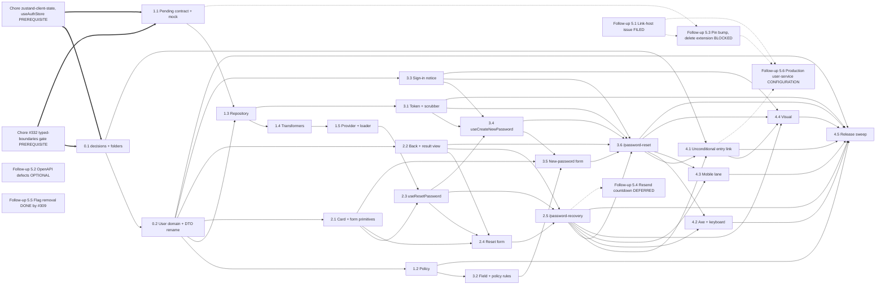

# Epics and stories: password recovery for the user module (create new password)

**Author:** BMad (Product Manager) **Date:** 2026-10-05 **Feature:** `create-new-password`

## Overview

This document decomposes the [PRD](./prd-create-new-password-2026-10-05.md) (28 FRs, FR-25
withdrawn, 18 NFRs, the authoritative _what_) and the reviewed
[architecture](./architecture-create-new-password-2026-10-05.md) (the authoritative _how_) into five
epics (Epic 0 to Epic 4), 23 stories and six follow-ups. Both operations run over GraphQL only, the
user's decision of 2026-10-05, and against mocked GraphQL until user-service releases them, the
user's decision of the same day: Story 1.1 adds a pending schema extension and a stateless local
mock, so no story waits for an upstream tag. Requirement ids (`FR-n`, `NFR-n`) are the PRD's;
section references (`§n`) are the architecture's. Every story names its dispatch dependencies,
every dependency appears earlier in file order for Ralph's top-to-bottom loop, and every story
stays under the rust-code-analysis caps (per file at most 10 functions, 6 closures and 15 in
total, 120 LLOC; per function at most 10 LLOC, 3 arguments, 3 exit points; class NPM 8).

Decisions this stage had to make on its own are recorded inline as `> Assumption:` blocks.

**Prerequisite: chore `typed-boundaries-gate` (#332, draft PR #333; lands first).** It ships the
TB-1 ESLint gate, its burn-down of the existing sites, `*Transformer` in and `Controller` out of
the class-naming policy, and the `CLAUDE.md` TB-1 section
(`specs/typed-boundaries-gate/` on branch `chore/typed-boundaries-gate`). Every story here is
written against that gate and adds no selector.

**Prerequisite: chore `zustand-client-state` (#334; lands first).** The user's decision of
2026-10-08 ("change the react state var to zustand"). It adds `zustand`, writes the ADR that
supersedes ADR-008, removes the ESLint `clientStateSelectors` Zustand ban and the Zustand-free
assertions of `tests/unit/tooling/state-architecture-contract.test.ts`, migrates `AuthStateVar`,
`ConnectivityStateVar` and `src/lib/state/` to the stores `useAuthStore` and
`useConnectivityStore`, and measures the paint-path budget. No story here migrates state or
writes a store; FR-4 forbids a `useAuthStore` write.

**Revision 2026-10-08.** Every value that crosses a layer is a named type (TB-1, PRD NFR-17), the
layers follow the Miro board (PRD NFR-18), which has no frontend Controller or Service, and the
board's User domain is plain data in `src/modules/user/types/user/` (Story 0.2, TB-2).

**Simplification 2026-10-08**
(`crm-worktrees/_planning-shared/over-engineering-review-2026-10-08.md`; the user: "apply all
10", "do not over-engineer"):

- The TB-1 gate and its burn-down moved to the prerequisite chore; Epic 0 keeps the README's password-recovery decisions, the two
  feature folders and the User domain.
- One container-free `AuthProviderLoader` in `@auth/stores/index.ts` replaces the per-flow proxy,
  factory and provider interface; the Data provider is the plain `PasswordRecoveryProvider`.
- The invented `password_reset` security signal (FR-25) is withdrawn.
- The mock is the extension, codegen and a stateless happy path with one violation per mutation.
- `ResetTokenSource` became the `useResetToken(): string | null` hook; `SentView` and
  `InvalidLinkView` became plain uses of `RecoveryResultView`; the aborted and interrupted outcome
  variants, the rule-table types and the deps types are gone.
- Thin stories merged; every story renumbered from 0.1, 1.1, 2.1, 3.1 and 4.1 (the former ids
  appear in the run summary).

> Assumption: the epic seams follow the dispatcher's suggestion (foundations, request page, reset
> page, release wiring, upstream) rather than BMAD's "no technical-layer epic" heuristic, because
> the data-access seam (§5.4, §5.5) is the shared prerequisite of both pages and is user-visible
> on its own through the shared password policy. Each later epic builds only on earlier ones.

### Status vocabulary

- **Ready**: implementable now; its `Depends on` stories are its only prerequisites. Every
  `### Story N.M:` in this document is Ready.
- **Blocked upstream**: a follow-up that waits for a user-service release tag carrying both reset
  mutations (Follow-up 5.3, the pin bump that deletes the pending schema extension).
- **Configuration**: a per-environment change with no code (Follow-up 5.6).
- **Filed at planning**: completed by filing a user-service issue (Follow-up 5.1).
- **Optional**: no crm work depends on it (Follow-up 5.2).
- **Deferred**: out of scope for this feature (Follow-up 5.4).
- **Done before this feature**: issue #309 already did it (Follow-up 5.5).

> Assumption: bmalph turns every `### Story N.M:` header under a `## Epic N:` heading into an open
> item of `.ralph/@fix_plan.md`, so every story is dispatched. The six follow-ups sit after Epic 4
> as `### Follow-up 5.M:`, which bmalph's patterns do not match, and keep their ids.

## Requirements Inventory

### Functional Requirements

- FR-1: "Забули пароль?" entry link: renders unconditionally since issue #309 removed the
  `forgotPassword` flag; registering both routes makes it open the flow (Story 4.1).
- FR-2: two public, lazily loaded routes (`/password-recovery`, `/password-reset`) in the auth
  route contract; no registry, composer or shell edit.
- FR-3: a distinct `document.title` per route from `titleKey`, never carrying token or e-mail.
- FR-4: signed-in users may use both routes; a reset changes no client session state.
- FR-5: request form content and chrome (back control, one `h1`, body, e-mail field, submit; no
  OAuth row, no switcher); card widths per breakpoint from the existing `formWrapper` (502 / 632
  / 363 px; the code's 632 px tablet card is authoritative over the 636 px Figma reading).
- FR-6: e-mail validation reusing the existing rules; no request while invalid.
- FR-7: one `RequestPasswordReset` GraphQL mutation per submit; busy state, `aria-busy`, polite
  status text.
- FR-8: shared offline behaviour on both forms.
- FR-9: uniform sent step for every address: the document selects only `clientMutationId`, and
  every resolved request becomes one sent outcome in the Data provider; focus on the heading,
  polite status body.
- FR-10: deterministic masked e-mail rule.
- FR-11: navigation on the request route ("Назад", sent-step "Назад" back to a refilled form,
  "До входу"); 24 px targets; in-card links navigate client-side with `focusMain`.
- FR-12: rate-limit banner on either step, no retry action, no automatic resend.
- FR-13: `email` and `newPassword` violations mapped to the fixable field.
- FR-14: no response, deadline, `5xx` and unknown answers show a banner with a user-initiated
  Retry.
- FR-15: no transport retry; request deadline and caller abort; an aborted attempt is silent.
- FR-16: token read once, held in memory, stripped from the address bar by a history replace.
- FR-17: missing, empty or over-long token renders the invalid-link state with no request.
- FR-18: new-password form content (two password fields with toggles, rule list, submit).
- FR-19: four live policy rules under the new-password field; not a live region.
- FR-20: confirmation field required and equal; re-validates when either field changes.
- FR-21: a resolved confirm redirects to `/sign-in` with a one-time notice; no session created;
  no cache write of the arguments.
- FR-22: a domain refusal or a `token` violation on confirm renders the invalid-link state.
- FR-23: navigation on the reset route; in-flight request aborted on "Назад".
- FR-24: one shared password policy never weaker than the API (ASCII uppercase).
- FR-25: withdrawn 2026-10-08 (the `password_reset` security signal was planner-invented).
- FR-26: token and PII scrubbing in telemetry (`token=` string pattern, `variables` keys).
- FR-27: every string in `uk` and `en`; merged catalog regenerated.
- FR-28: route-coverage manifest rows for both keys; route scan and visual lists gain both.

### NonFunctional Requirements

- NFR-1: 100% statements, branches, functions and lines in the unit and integration suites.
- NFR-2: Stryker `break: 100`; static tables loaded inside the test body.
- NFR-3: jscpd zero clones (70 tokens, 5 lines) over `src`.
- NFR-4: ESLint, `tsc` and dependency-cruiser clean; every repository convention kept.
- NFR-5: `make lint-metrics` hard-fail policy, including the per-file function caps.
- NFR-6: zero visual diffs; new baselines from CI artifacts only; `/sign-in` baselines unchanged
  for FR-1, since the link already renders unconditionally.
- NFR-7: Lighthouse desktop and mobile floors; audited URL list unchanged.
- NFR-8: bundle and paint-path budgets; eager entrypoint grows by under 1 kB gzip.
- NFR-9: WCAG 2.1 AA, axe in three engines, 24 px / 44 px targets, and at most one new scoped
  exception (the #276 `color-contrast` entry for the result views' primary-pill links); the
  in-card "Назад" renders in `Font/200 #404142`, an accessibility override of the Figma `#969B9D`.
- NFR-10: keyboard contract for both forms and both result states, plus the "Забули пароль?"
  stop in the existing sign-in keyboard spec.
- NFR-11: mobile touch lane on Pixel 7 and iPhone 14.
- NFR-12: no enumeration, token hygiene (no Apollo cache write), headers unchanged, no transport
  retry; upstream GraphQL limiter gaps #462, #469, #470 accepted.
- NFR-13: deadline, abort, composer error element, chunk retry, reload-once on public routes.
- NFR-14: `make lint-i18n` parity and regenerated merged catalog.
- NFR-15: Faker builders, semantic locators, test-liveness and console gates, `**/graphql` route
  mocks keyed on `operationName`, msw `graphql` handlers.
- NFR-16: the README's password-recovery decisions and documentation drift (`make lint-docs`, markdownlint).
- NFR-17: typed boundaries (TB-1, enforced by the prerequisite chore) and board types at component
  boundaries (TB-2, its naming check in Story 0.2).
- NFR-18: the Miro board's layers — root page component, React hook, Data provider ⇄
  Transformer, GraphQL Repository, API — with named DTOs and outcomes and no frontend Controller
  or Service.

### Additional Requirements

- AR-1 (§5.4): the pages reach the Data provider only through the container-free
  `AuthProviderLoader` in `stores/index.ts`; nothing in the auth tree reaches `@/providers/di`,
  and `DeferredAuthActions` stays untouched.
- AR-2 (§12): no new module-level singleton (`export default new X()`); the loader is built per
  mount by `useAuthProviderLoader`, and there is no controller class.
- AR-3 (§5.3): `useAbortableSubmit` has side-effect-free initializers and its unmount cleanup
  aborts only the request in flight, so a StrictMode double mount still sends the first submit.
- AR-4 (§6.5): every interface and alias lives in a type-only file under `types/`.
- AR-5 (§12): the five new classes use approved suffixes (`Repository`, `Transformer`,
  `Provider`, `Loader`); no `*Controller`, `*Service` or `*Handler` class is added.
- AR-6 (§5.7): one-time navigation markers are cleared only by `useArrivalFocus`, in one
  history replace.
- AR-7 (§12): `RecoveryResultView` renders both the sent step and the invalid-link state.
- AR-8 (this stage): integration coverage counts every `src` file an integration test loads,
  including files reached through the DI container and `stores/index.ts`.
- AR-9 (§5.5): GraphQL failures are classified twice — answer shape to `UserServiceFailure` in
  `UserServiceErrorTransformer` (§5.5.1), failure to outcome by step in
  `PasswordRecoveryTransformer` (§5.5.2); the repository translates nothing.
- AR-10 (§15.2): no story edits a contract pin, sets `ALLOW_CONTRACT_VERSION_SKEW` or patches
  `src/api/generated/**` by hand; the pin bump is Follow-up 5.3.
- AR-11 (§5.16): until Follow-up 5.3, the reset mutations come from one pending schema
  extension, `src/api/contracts/pending/password-reset.graphql`, read by codegen and the mock.
- AR-12 (prerequisite): the chore `typed-boundaries-gate` lands first; no story adds a selector.
- AR-13 (§1.1, §3.5): every new class, hook and component maps to one board layer; the pages are
  `ResetPassword` and `CreateNewPassword`, the route keys and URL paths keep their names.
- AR-14 (prerequisite): the chore `zustand-client-state` lands first; no story migrates state.

> Assumption: AR-8 answers the architecture's open point (§17). `jest.config.ts` sets
> `roots: ['./tests/integration']` for `TEST_ENV=integration`, so the integration run's 100%
> threshold binds exactly the `src` files the integration tests load. Existing integration tests
> resolve the container and load `stores/index.ts`, so `GraphQLPasswordRecoveryRepository`,
> `PasswordRecoveryTransformer`, `UserServiceErrorTransformer`, `PasswordRecoveryProvider` and
> `AuthProviderLoader` must each be covered by integration tests in the story that adds them.

### UX Design Requirements

- UX-DR-1: Figma file `xZ7ccrH6d4QyqLQsayFSEX`, section "Восстановление пароля": request
  `72:5596` / `72:5617` / `72:5638`, sent `360:11925` / `360:11937` / `360:11949`; card widths
  502 / 632 / 363 in code (the existing `formWrapper` `39.5rem` is authoritative, PRD §4), tokens
  `Font/100 #1A1C1E`, `Font/200 #404142`, `Primary #1EAEFF`; the "Назад" row (`72:5605`, "15
  (medium)" Golos Medium 15/18) keeps its size and weight but takes `Font/200 #404142` (NFR-9).
- UX-DR-2: the new-password form and the invalid-link state have no frame; their composition
  from the existing card and form primitives is the design of record for v1 (PRD §3).
- UX-DR-3: Russian Figma copy is replaced by the PRD FR-27 `uk`/`en` strings.
- UX-DR-4: the mobile resend row with countdown (`72:5638`) is out of scope (Follow-up 5.4).
- UX-DR-5: every user-facing story runs the mandatory `figma-design-check` gate through the
  Figma MCP before UI code is written; an unreachable MCP reports `BLOCKED`, never a skip.

### FR Coverage Map

| Requirement | Stories                                                              |
| ----------- | -------------------------------------------------------------------- |
| FR-1        | 4.1                                                                  |
| FR-2        | 2.5, 3.6                                                             |
| FR-3        | 2.5, 3.6                                                             |
| FR-4        | 2.5, 3.4, 3.6                                                        |
| FR-5        | 2.1, 2.2, 2.4, 2.5, 4.4                                              |
| FR-6        | 2.1, 2.4, 2.5                                                        |
| FR-7        | 1.1, 1.3, 2.3, 2.4, 2.5                                              |
| FR-8        | 2.4, 2.5, 3.5, 3.6                                                   |
| FR-9        | 1.1, 1.3, 1.4, 1.5, 2.2, 2.3, 2.5                                    |
| FR-10       | 1.4, 1.5                                                             |
| FR-11       | 2.1, 2.2, 2.3, 2.4, 2.5, 4.2                                         |
| FR-12       | 1.4, 2.3, 2.5, 3.6                                                   |
| FR-13       | 1.4, 2.1, 2.4, 2.5, 3.5, 3.6                                         |
| FR-14       | 1.4, 1.5, 2.1, 2.3, 2.5, 3.4, 3.6                                    |
| FR-15       | 1.3, 1.4, 2.3, 2.5, 3.4, 3.6                                         |
| FR-16       | 3.1, 3.6                                                             |
| FR-17       | 3.1, 3.4, 3.6                                                        |
| FR-18       | 3.2, 3.5                                                             |
| FR-19       | 1.2, 3.2, 3.5                                                        |
| FR-20       | 2.1, 3.5                                                             |
| FR-21       | 1.1, 1.3, 3.3, 3.4, 3.6                                              |
| FR-22       | 1.4, 2.2, 3.4, 3.6                                                   |
| FR-23       | 2.2, 3.4, 3.6, 4.2                                                   |
| FR-24       | 1.2, 3.2                                                             |
| FR-25       | withdrawn                                                            |
| FR-26       | 1.3, 2.5, 3.1, 3.6                                                   |
| FR-27       | 1.2, 2.2, 2.3, 2.4, 2.5, 3.2, 3.3, 3.5, 3.6                          |
| FR-28       | 2.5, 3.6, 4.2, 4.3, 4.4, 4.5                                         |
| NFR-1       | every Ready code story; 4.5 sweep                                    |
| NFR-2       | every Ready code story; 1.4, 4.5                                     |
| NFR-3       | 2.1, 2.2, 2.3, 3.4, 3.5, 4.5                                         |
| NFR-4       | every Ready code story; 0.1, 0.2, 1.5, 2.5, 3.6, 4.5                 |
| NFR-5       | every Ready code story; 1.3, 1.4, 1.5, 4.5                           |
| NFR-6       | 1.2, 2.1, 3.2, 3.3, 4.1, 4.4, 4.5                                    |
| NFR-7       | 3.3, 4.1, 4.5                                                        |
| NFR-8       | 1.5, 2.5, 3.3, 3.6, 4.5                                              |
| NFR-9       | every user-facing story; 2.1, 2.2, 2.4, 3.2, 3.3, 3.5, 4.1, 4.2, 4.3 |
| NFR-10      | 4.1, 4.2                                                             |
| NFR-11      | 4.3                                                                  |
| NFR-12      | 1.3, 1.4, 2.5, 3.1, 3.6                                              |
| NFR-13      | 1.3, 1.5, 2.3, 2.5, 3.4, 3.6                                         |
| NFR-14      | every story that adds a string; 1.2, 2.2, 2.3, 2.4, 3.2, 3.3, 3.5    |
| NFR-15      | every story with tests; 1.1, 1.3, 2.5, 3.1, 3.6, 4.3                 |
| NFR-16      | 0.1, 0.2, 1.1, 1.5, 2.5, 3.6, 4.1, 4.5                               |
| NFR-17      | every story adding a `src` type; 0.2, 4.5                            |
| NFR-18      | 0.1, 0.2, 1.3, 1.4, 1.5, 2.3, 2.5, 3.4, 3.6, 4.5                     |

Every FR-1 to FR-28 except the withdrawn FR-25, and every NFR-1 to NFR-18, is covered by at least
one Ready story. The FR rows equal the union of the per-story **Requirements** lines; an NFR row
opening with "every …" lets the qualifier stand for the stories it names generically.

## Definition of done shared by every Ready story

Each story's own criteria add to these; a story is not done until all of them hold.

- **Quality floors.** No threshold, budget, allowlist, scope, baseline or ratchet value is
  edited to make a run pass (the PRD's reviewed deviation — the one scoped #276 entry of
  Story 2.2 — is an intended change, not a pass); no
  `eslint-disable`, `@ts-ignore`, `@ts-expect-error`, `depcruise-ignore`, `.skip`, `.only`,
  `.fixme`, `waitForTimeout` or `expect` inside a conditional; no `data-testid` in `src`; no
  added inline code comments beyond a `// Stryker disable next-line <Mutator>: <proof>` the
  mutation policy accepts.
- **Conventions.** Classes only in non-React `.ts` (no statics, no free functions, no
  function-valued properties of top-level object literals); types in type-only files; approved
  class-name suffixes; collaborators through DI tokens; auth code never reaches
  `@/providers/di`; only `stores/index.ts` imports the composition root; no raw `Intl` or
  `toLocale*` call; no `@mui/material` import on eager code.
- **Typed boundaries and board layers.** Every value that crosses a layer is a named interface,
  class or named alias in a type-only file (TB-1, the chore's gate); every new unit sits in one
  board layer, and no `*Controller`, `*Service` or `*Handler` class is added (NFR-18); a board
  type (`UserEntity`, a `*Dto`) crosses component and form boundaries as itself, form values
  only `extends` a DTO with UI-only fields, and only Story 0.2's folder declares a `*Dto` or
  `*Entity` (TB-2).
- **Tests.** Every new `src` file has a direct unit test; unit coverage stays at 100%; AR-8
  integration coverage stays at 100%; Faker builders (`buildEmail`, `buildPassword`, `buildToken`,
  and `buildResetToken` for every arbitrary reset token — 32 alphanumeric characters, added in
  Story 1.3, the first story whose tests send one; never `buildToken`, whose ~380-character JWT
  is not a usable reset token) supply arbitrary values, and literals appear only where the value
  is the test case; elements are located by role, label or text; logging paths are spied and
  asserted per test; layout measurements (44 px and 24 px targets, the visible focus ring)
  belong to the browser lanes, never to jsdom.
- **Mutation.** Zero survivors on every new or changed file in the mutate scope; static tables
  (outcome table, status table, rule list, style objects) are loaded in the test body through
  `tests/unit/utils/isolated-module.ts`; an equivalent mutant is removed by adopting the simpler
  program, or annotated with a proof only where no refactor exists.
- **i18n.** Every key a story first uses lands in `uk` and `en` in that story — or, for a key two
  later stories share, in the earlier story both depend on (`password_recovery.submit_button`
  lands with `.back` in Story 2.2) — followed by `make i18n-generate`; catalog edits are
  append-only so parallel stories merge cleanly.
- **Local gates** (light, run before handing back): `make format`; then ESLint, Prettier
  `--check` and `tsc` over the changed files inside the dev container, plus `make lint-md`,
  `make lint-i18n` and `make lint-docs` where the story touches Markdown, catalogs or docs, and
  the gate a story names in its **Gates** line; then the focused Jest files the story touches,
  e.g. `docker compose exec -T dev bun x jest tests/unit/path/to/file.test.ts`. The full
  `make lint` aggregate runs in CI only, per the repository's no-heavy-suites-locally rule.
- **CI-only gates** (heavy, never run locally): the full `make lint` aggregate,
  `make test-unit-all`, `make test-integration`, the sharded Stryker run, `make test-e2e`,
  `make test-visual`, `make test-a11y-e2e`, the mobile lane, Lighthouse, the bundle-size report,
  `make check-adr-drift` and the supply-chain scans.
- **Commits.** Headers ≤ 100 characters with the issue scope; the auto-close reference rides
  the commit message (squash-merge repository).

## Epic List

0. **Epic 0: The board's folders and User domain** — the README's password-recovery decisions, the `data-providers/` and
   `transformers/` folders, and the board's User domain types with the DTO rename and the TB-2
   naming check. Lands after the two prerequisite chores and before every feature story.
1. **Epic 1: Recovery foundations** — the pending schema extension with a stateless mock, the
   shared password policy, the GraphQL Repository, the two Transformers, and the Data provider
   behind the container-free loader. Delivers a sign-up policy fix on its own.
2. **Epic 2: Reset Password page** — `/password-recovery`: request form, uniform sent step,
   errors and navigation, plus the shared card and form primitives both pages use.
3. **Epic 3: Create new password page** — `/password-reset`: token intake, strip and scrub, the
   new-password form with live rules, the invalid-link state and the sign-in arrival notice.
4. **Epic 4: Release wiring** — the unconditional entry link, the accessibility, mobile and visual
   lanes, and the release gate sweep.

The section "Upstream work and follow-ups (not dispatched)" after Epic 4 holds Follow-ups 5.1 to
5.6. It is not an epic and is never dispatched.

## Epic 0: The board's folders and User domain

**Goal.** Record the durable decisions in the user-module README, give the board's `[Data provider]` and
`[Transformer]` their feature folders, and land the board's User domain — `UserEntity` and the
DTOs as data-only interfaces in `src/modules/user/types/user/` — with the TB-2 naming check.
Every later story imports those types. #330 and #331 import them and build none.

**Prerequisites.** The chore `typed-boundaries-gate` (#332) lands first (TB-1 gate, suffix
policy), and so does the chore `zustand-client-state` (#334; `useAuthStore`,
`useConnectivityStore`).

**Scope.** `config/{module-shape.json,di-collaborator-policy.js}`,
`.dependency-cruiser.js`, `scripts/ci/{depcruise-rule-fixtures,mutation-scope}.mjs`,
`scripts/templates/`, `plopfile.ts`, `tests/unit/tooling/`, and
`src/modules/user/{index.ts,README.md,types/user/}` with the importers of the renamed DTOs.

> Assumption: the epic is numbered 0 so that it precedes the features in both orders bmalph uses:
> it sorts fix-plan items by numeric story id and Ralph runs them top to bottom. The
> `## Epic 0:` header matches bmalph's `^##\s+Epic\s+\d+:` pattern and `0.M` is a canonical id.

### Story 0.1: Record the recovery decisions and add the data-providers and transformers folders

As a maintainer of the auth feature,
I want the durable decisions of the recovery flow recorded and the board's two feature folders
allowed by every policy that lists folders,
So that the decisions live beside the code they govern and a Data provider and a Transformer
have a home.

**Dispatch:** Independent (prerequisites: the chores `typed-boundaries-gate` and
`zustand-client-state`). **Status:** Ready.

**Requirements:** NFR-16 (decision record), NFR-18 (folders, decisions recorded), NFR-4.

**Files:** `src/modules/user/README.md` (MODIFY: a `## Password recovery decisions` section),
`config/module-shape.json` (MODIFY: `data-providers` and `transformers` in
`feature.allowedFolders` and `tests.featureAllowedFolders`), `config/di-collaborator-policy.js`
(MODIFY: `LOGIC_SOURCE_GLOBS` and `LOGIC_SOURCE_PATHS` gain both folders),
`.dependency-cruiser.js` (MODIFY: both folders in `components-no-direct-injectable-import`),
`scripts/ci/depcruise-rule-fixtures.mjs` (MODIFY: that rule's fixture gains a `data-providers/`
import), `scripts/ci/mutation-scope.mjs`, `plopfile.ts` and `scripts/templates/**` (MODIFY where
they list folders), the tooling tests that pin those files.

> Assumption: this story merges the former Stories 0.1 and 0.2. The suffix edits moved to the
> chore and the generated-types rule was dropped (over-engineering review, item 2); what remains
> is the folder policy, which `.dependency-cruiser.js` makes ADR-significant.

> Revision 2026-10-13: no new ADR. The user deleted every ADR from 003 up on PR #333 ("can be
> written in a README or nowhere"); only ADR-001 and ADR-002 remain. The decisions go into the
> module README and the pull-request body carries a `[no-adr]` line for `make check-adr-drift`.

**Gates:** `make lint-docs`, `make lint-md`, `make lint-deps`; the focused Jest files
`tests/unit/tooling/module-shape.test.ts`, `tests/unit/tooling/di-collaborator-gate.test.ts`,
`tests/unit/tooling/depcruise-rules.test.ts` and `tests/unit/tooling/component-di-gate.test.ts`;
CI `make verify-scaffold` and `make check-adr-drift` (via the `[no-adr]` PR-body line).

**Acceptance criteria:**

- **Given** `docs/adr/`, **when** the story lands, **then** no ADR file is added or changed.
- **Given** the architecture §14 outline, **when** the decisions are written into the README section, **then** each decision states its context, the decision and the rejected options.
- **Given** the layer decisions, **when** the README lists them, **then** it records the board's stack (root page component, React hooks over `useAbortableSubmit`, the Data provider `PasswordRecoveryProvider` reached through `AuthProviderLoader`, the Transformers `PasswordRecoveryTransformer` and `UserServiceErrorTransformer`, the Repository `GraphQLPasswordRecoveryRepository`) and the two folders, with the rejected options (controller and service classes, a proxy and factory per flow, error translation in the repository).
- **Given** the flow decisions, **when** the README lists them, **then** it records GraphQL only through the container's Apollo client with two generated documents selecting only `clientMutationId`, `fetchPolicy: 'no-cache'` and no retry link, the two-step classification of GraphQL errors, the uniform request outcome, the pending schema extension copied verbatim from user-service `main` with the follow-up pin bump that deletes it, the memory-only token stripped by `useResetToken`, the shared `PasswordValidator`, both routes public, and no runtime flag (issue #309 removed `forgotPassword`, so the link is unconditional), each with its rejected options.
- **Given** the domain decisions, **when** the README lists them, **then** it has the Domain Outcome.
- **Given** the README's links, **when** `make lint-doc-links` runs, **then** every relative link and anchor resolves; the GitHub issue and the user-service requests are linked (Story 4.5).
- **Given** `config/module-shape.json`, **when** the module-shape test and the generator read it,
  **then** `data-providers` and `transformers` are allowed feature and test feature folders, the
  single-source assertion holds, and CI `make verify-scaffold` passes.
- **Given** `config/di-collaborator-policy.js`, **when** the DI-collaborator gate test runs,
  **then** files under `features/*/data-providers/**` and `features/*/transformers/**` are in the
  gated logic scope for both layers, and no policy entry is stale.
- **Given** a component fixture that value-imports a class under `data-providers/` and another
  under `transformers/`, **when** dependency-cruiser runs, **then**
  `components-no-direct-injectable-import` reports each (must-fail), and `import type` passes.
- **Given** `scripts/ci/mutation-scope.mjs`, **when** it resolves the mutate scope, **then** the
  two folders are inside it and its exclusions still mirror `jest.config.ts`.
- **Given** the architecture-drift gate, **when** CI runs `make check-adr-drift`, **then** it passes through the `[no-adr]` line of the pull-request body.

### Story 0.2: Land the board's User domain types and rename the sign-in and sign-up DTOs

As a contributor on any user-module feature,
I want `UserEntity` and the board's DTOs as plain data interfaces in one module folder,
So that components and forms pass the board's types between them instead of private copies.

**Dispatch:** Depends on: 0.1. **Status:** Ready.

**Requirements:** NFR-17 (TB-2), NFR-18 (the board's User domain), NFR-4, NFR-16 (module
README).

> Assumption: the domain is data only — the user, 2026-10-08: "its just front-end features
> without any logic, its all in the back-end side" — so this story adds no class, no behaviour,
> no validation and no runtime code. It lands before every feature story, so Stories 1.3 to 3.5
> import `RestorePasswordDto` and `CreateNewPasswordDto` instead of declaring them. TB-2's frozen
> text names this story by its former id, Story 0.7.

**Files:** `src/modules/user/types/user/{user-entity,sign-in-dto,sign-up-dto}.ts` and
`src/modules/user/types/user/{restore-password-dto,create-new-password-dto}.ts` (NEW: the five
interfaces of architecture §6.5.2), `src/modules/user/index.ts` (MODIFY: re-exports the five by
type, `UserEntity` in place of `SafeUserInfo`), `src/modules/user/README.md` (MODIFY: public
types and the folder rule), `@auth/types/credentials.ts` (DELETE), its importers in `src/` and
`tests/` (about 28 files, MODIFY: `SignInDto` for `LoginUserDto`, `SignUpDto` for
`RegisterUserDto`, among them `@auth/stores/index.ts` and `tests/builders/{credentials,user}.ts`),
`tests/unit/tooling/domain-type-names.test.ts` (NEW: the TB-2 naming check).

**Gates:** DoD local gates; `make lint-deps`, `make lint-md`; `tsc` and ESLint over the changed
files; the focused Jest file `tests/unit/tooling/domain-type-names.test.ts` and the unit tests
of the renamed importers.

**Acceptance criteria:**

- **Given** `src/modules/user/types/user/`, **when** read, **then** it holds the five §6.5.2 types.
- **Given** each new file, **when** read, **then** it has only `readonly` data members, no logic.
- **Given** `SignUpDto`, **when** read, **then** it `extends SignInDto` and adds only `fullName`.
- **Given** `RestorePasswordDto`, **when** read, **then** its one member is `email`.
- **Given** `CreateNewPasswordDto`, **when** read, **then** its members are `token`, `newPassword`.
- **Given** `src/` and `tests/`, **when** searched, **then** no `LoginUserDto` or `RegisterUserDto`.
- **Given** `@auth/types/credentials.ts`, **when** the story lands, **then** the file is deleted.
- **Given** `UIForm<SignInDto>` and `UIForm<SignUpDto>`, **when** `tsc` runs, **then** both compile.
- **Given** the sign-in and sign-up forms, **when** read, **then** each submits its DTO (TB-2).
- **Given** the module barrel, **when** read, **then** it has the five types, not `SafeUserInfo`.
- **Given** `SafeUserInfo` and `AuthState.user`, **when** read, **then** both are unchanged.
- **Given** `make lint-deps`, **when** it runs, **then** no new file is an orphan or a deep import.
- **Given** a `*Dto` interface outside `types/user/`, **when** the check runs, **then** it fails.
- **Given** an `*Entity` alias outside `types/user/`, **when** the check runs, **then** it fails.
- **Given** `src/` after the rename, **when** the naming check runs, **then** it reports nothing.
- **Given** every new type, **when** `make lint-eslint` runs, **then** TB-1 reports no violation.
- **Given** the change, **when** Stryker scores the mutate scope, **then** no mutant is added.
- **Given** the module README, **when** read, **then** it names the folder and the TB-2 rule.

## Epic 1: Recovery foundations

**Goal.** Give the SPA a complete, container-managed password-recovery capability on the board's
layer stack, working now against mocked GraphQL: a pending schema extension that codegen and a
stateless local Apollo mock read until user-service releases the mutations, one shared password
policy, the `[Repository]` `GraphQLPasswordRecoveryRepository`, the `[Transformer]`s
`UserServiceErrorTransformer` and `PasswordRecoveryTransformer`, and the `[Data provider]`
`PasswordRecoveryProvider`, which the pages reach through the container-free
`AuthProviderLoader`. No route is registered in this epic.

**Scope.** `src/modules/user/features/auth/` (`repositories`, `transformers`, `data-providers`,
`stores`, `hooks`, `types`, `i18n`), `src/modules/user/{lib,types}`,
`src/modules/user/config/{tokens,di}.ts`, `src/api/generated/graphql.ts` (regenerated),
`src/api/contracts/`, `codegen.ts`, `Apollo.Dockerfile`, `docker/apollo-server/lib/`,
`tests/apollo-server/`, `src/modules/user/README.md`.

### Story 1.1: Mock the reset mutations through a pending schema extension

As a developer of the auth feature,
I want both reset mutations available to codegen and to the local Apollo mock before user-service
tags a release that declares them,
So that the recovery flow is built and runs now.

**Dispatch:** Independent. **Status:** Ready.

**Requirements:** FR-7, FR-9 and FR-21 (both mutations exist for codegen and the local stack),
AR-10, AR-11, NFR-15 (deterministic mock), NFR-16 (contracts README).

> Assumption: the mock is a stateless happy path with one violation per mutation (over-engineering
> review, item 3). The browser lanes route `**/graphql` and the integration suite uses msw, so no
> gate needs an expiry checker, a fixture suite or a magic-input table; Follow-up 5.3 deletes the
> extension by hand when the pin moves.

**Files:** `src/api/contracts/pending/password-reset.graphql` (NEW: the upstream declarations of
architecture §5.16, verbatim), `src/api/contracts/README.md` (MODIFY: one "Pending contracts"
row), `codegen.ts` (MODIFY: `schema: [schemaPath, 'src/api/contracts/pending/*.graphql']`),
`Apollo.Dockerfile` (MODIFY: one `COPY` of `src/api/contracts/pending`),
`docker/apollo-server/lib/server.ts` (MODIFY: `typeDefs` gains the pending file, no branch),
`docker/apollo-server/lib/{resolvers,types}.ts` (MODIFY: two stateless resolvers),
`tests/apollo-server/resolvers.test.ts` (MODIFY).

**Gates:** DoD local gates; `make codegen`, `make codegen-check`, `make lint-docs`, `make lint-md`;
the focused Jest file `tests/unit/tooling/image-hardening.test.ts`; the focused server-environment
Jest file `tests/apollo-server/resolvers.test.ts`, run with `TEST_ENV=server`.

**Acceptance criteria:**

- **Given** `.github/graphql-spec/spec` on user-service `main` (reset declarations unchanged
  from `63041e4a` through `f82bbef5`), **when** the extension is written, **then** it holds one
  `extend type Mutation` with `requestPasswordResetUser` and `confirmPasswordResetUser` and the
  four input and payload types of architecture §5.16, copied verbatim, references no other type
  than `User`, and sits outside the documents glob of `codegen.ts`.
- **Given** `codegen.ts` with the schema array, **when** `make codegen` runs with the documents
  that exist today, **then** `src/api/generated/graphql.ts` is unchanged and
  `make codegen-check` passes against the v2.8.0 pin.
- **Given** `Apollo.Dockerfile` and `server.ts`, **when** read, **then** the production stage
  copies `src/api/contracts/pending` once, `server.ts` passes the pinned SDL and the pending file
  as `typeDefs` with no branch, no test imports `server.ts`, and
  `tests/unit/tooling/image-hardening.test.ts` still passes.
- **Given** a server built from a fixture pinned SDL, the real extension, the real `resolvers`
  and the real `formatError`, **when** `requestPasswordResetUser` runs with a valid e-mail and
  `confirmPasswordResetUser` with a token of 1 to 255 characters and a valid password, **then**
  each answers `{ user: null, clientMutationId }` with the input's `clientMutationId` echoed.
- **Given** the same server, **when** the request carries an e-mail failing the mock's
  `EMAIL_REGEX` and, in a second test, the confirm carries a `newPassword` failing
  `^(?=.*[0-9])(?=.*[A-Z]).{8,64}$`, **then** each answers one GraphQL error on HTTP `200` whose
  message reads `<property>: <reason>` with `extensions: { code: 'BAD_USER_INPUT', status: 422 }`,
  and each test spies `console.error` and asserts its `'GraphQL Error:'` call (must-fail: a
  violation thrown without an `extensions.code` reaches the response as the generic message).
- **Given** `src/api/contracts/README.md`, **when** read, **then** its "Pending contracts" row
  names the file, the version it is pending against (`v2.8.0`), the upstream source
  (`VilnaCRM-Org/user-service@63041e4a`), the two mock answers and the removal trigger
  (Follow-up 5.3), and `make lint-docs` and `make lint-md` pass.
- **Given** the compose stacks, **when** the `apollo` image is rebuilt, **then** the container
  starts healthy with both mutations, and server coverage of `docker/apollo-server/lib/` stays
  complete.

### Story 1.2: Share one password policy that never accepts what the API rejects

As a person signing up or setting a new password,
I want the client to reject exactly the passwords the API would reject with `422`,
So that I never pass client validation and then fail on the server with a confusing error.

**Dispatch:** Depends on: 0.2. **Status:** Ready.

**Requirements:** FR-24, FR-19 (per-rule evaluation), FR-27 (uppercase message), NFR-6
(sign-up baselines unchanged), NFR-14, NFR-17.

**Files:** `@auth/components/form-section/validations/password.ts` (MODIFY: uppercase rule
`/[A-Z]/`, lowercase `\p{Ll}` kept, new `evaluate(value)`), `@auth/types/validations/password.ts`
(MODIFY: `PasswordRuleResult`, `PasswordRuleResultSet`), `@auth/i18n/{uk,en}.json` (MODIFY:
`sign_up.form.password_input.error_uppercase` text), `src/i18n/localization.json` (REGEN),
`tests/unit/modules/user/features/auth/components/form-section/validations/password*.test.ts`.

**Gates:** DoD local gates; `make lint-i18n`.

**Acceptance criteria:**

- **Given** `Пароль123`, **when** validated, **then** the uppercase rule fails with the new
  message uk "Будь ласка, додайте принаймні одну велику латинську літеру (A–Z)" / en "Please add
  at least one uppercase Latin letter (A–Z)".
- **Given** `Password1` and the 8-character `Abcdefg1`, **when** validated, **then** both pass.
- **Given** `password1`, `PASSWORD1`, `Passwordd`, the 7-character `Abcdef1` and a 65-character
  value, **when** validated, **then** each fails with its matching existing message.
- **Given** any value the policy accepts, **when** matched against
  `^(?=.*[0-9])(?=.*[A-Z]).{8,64}$`, **then** it matches — a property test over seeded generated
  strings plus the fixed cases above (must-fail: the test turns red if `\p{Lu}` is restored).
- **Given** `evaluate(value)`, **when** called, **then** it returns a `PasswordRuleResultSet`
  whose `items` hold one `PasswordRuleResult` (`key`, `met`) per rule in policy order (length,
  digit, uppercase, lowercase), reading the same rule list as `create(t)`; for `Pa1` it reports
  length unmet and the other three met.
- **Given** sign-up, **when** a password with no lowercase letter is submitted, **then** the
  existing lowercase error appears exactly as today, and `create(t)` keeps its signature.
- **Given** `buildPassword()`, **when** its seeded output is validated, **then** it passes the
  narrowed policy (the builder is adjusted if not).
- **Given** the existing visual specs, **when** searched, **then** no baseline renders the
  uppercase message, so no `/sign-up` baseline changes; if one does, the story stops and
  reports instead of re-baselining.
- **Given** `PasswordValidator`, **when** mutation runs, **then** every rule and the `evaluate`
  ordering are killed (rules loaded in isolation).
- **Given** every value this story passes across a layer boundary, **when** `make lint-eslint`
  runs, **then** `evaluate` returns the named collection `PasswordRuleResultSet` and ESLint
  reports no TB-1 violation.

### Story 1.3: Add the reset mutations and the GraphQLPasswordRecoveryRepository

As the recovery feature,
I want a typed GraphQL `[Repository]` over the `requestPasswordResetUser` and
`confirmPasswordResetUser` mutations that never retries, never caches its arguments and always
runs under the deadline,
So that a reset request is sent at most once per submit, the token never outlives the page in
the Apollo cache, and a hung request becomes a retryable error.

**Dispatch:** Depends on: 0.2, 1.1. **Status:** Ready.

**Requirements:** FR-7 and FR-21 (transport), FR-9 (selection set, `void` result), FR-15 (no
retry, abort), FR-26 (no cache write), AR-10, AR-11, NFR-12 (no transport retry), NFR-13, NFR-5
(registrar caps), NFR-15 (adds the `buildResetToken()` builder), NFR-17, NFR-18.

> Assumption: `buildResetToken()` lands here because these tests are the first to send a reset
> token, and Ralph's sequential loop takes stories top to bottom. Stories 1.4 and 1.5 reach it
> through 1.3; Story 3.1 depends on 1.3 for it, and Stories 3.4, 3.5, 3.6, 4.2, 4.3 and 4.4 reach
> it through 3.1 or 3.6. The repository resolves `void` and translates nothing, so it parses no
> result schema.

**Files:** `@auth/repositories/request-password-reset.graphql` and
`@auth/repositories/confirm-password-reset.graphql` (NEW: architecture §5.1, each selecting only
`clientMutationId`), `@auth/repositories/request-password-reset-mutation.ts` and
`@auth/repositories/confirm-password-reset-mutation.ts` (NEW: re-export the generated documents as
`create-user-mutation.ts` does), `src/api/generated/graphql.ts` (REGEN: `make codegen`), the
DTOs imported from Story 0.2's `src/modules/user/types/user/`,
`@auth/repositories/graphql-password-recovery-repository.ts` (NEW), `@auth/repositories/index.ts`
(MODIFY), `src/modules/user/config/tokens.ts` (MODIFY: `PasswordRecoveryRepository`),
`src/modules/user/config/di.ts` (MODIFY: one `registerSingleton` inside `registerRepository`),
`tests/unit/.../repositories/graphql-password-recovery-repository.test.ts`,
`tests/integration/modules/user/features/auth/password-recovery-repository.integration.test.ts`,
`tests/integration/mocks/server.ts` (MODIFY: msw `graphql.link(GRAPHQL_URL)` handlers for both
operations, ahead of the existing catch-all `createUser` handler), `tests/builders/auth.ts`
(MODIFY: `buildResetToken()` returning `faker.string.alphanumeric(32)`), a builder unit test.

**Gates:** DoD local gates; `make codegen`, `make codegen-check`, `make lint-deps`,
`make lint-metrics`.

**Acceptance criteria:**

- **Given** the pinned SDL plus Story 1.1's pending extension, **when** the documents are
  validated by `make codegen`, **then** both validate, and the story never moves a pin, sets
  `ALLOW_CONTRACT_VERSION_SKEW`, edits `src/api/generated/graphql.ts` by hand or edits the
  extension.
- **Given** the two documents, **when** `make codegen` runs, **then**
  `src/api/generated/graphql.ts` gains `RequestPasswordResetDocument`,
  `ConfirmPasswordResetDocument`, their `*Mutation` and `*MutationVariables` types and the two
  `*UserInput` types, and `make codegen-check` passes.
- **Given** each generated document, **when** its selection set is read, **then** it is exactly
  `clientMutationId` (must-fail: a `user` selection fails the test).
- **Given** `buildResetToken()`, **when** called under the seeded Faker, **then** it returns 32
  characters from `[A-Za-z0-9]`, deterministic per seed, importable from `@tests/builders`, and
  `buildToken()` is unchanged as the session-token builder.
- **Given** `requestReset` with a `RestorePasswordDto`, **when** called, **then**
  `apolloClient.mutate` runs once with `RequestPasswordResetDocument`, variables typed
  `RequestPasswordResetMutationVariables` holding the DTO's `email` and a fresh v4 UUID
  `clientMutationId`, `fetchPolicy: 'no-cache'` and the caller's signal in
  `context.fetchOptions.signal`.
- **Given** `confirmReset` with a `CreateNewPasswordDto` whose `token` comes from
  `buildResetToken()`, **when** called, **then** the same holds for
  `ConfirmPasswordResetDocument` with the DTO's `token` and `newPassword`.
- **Given** a resolved payload object and, in a second case, a `null` payload, **when** either
  method settles, **then** it resolves `undefined` (`Promise<void>`).
- **Given** any Apollo rejection, **when** either method settles, **then** it rejects with
  exactly that error, unchanged (must-fail: a repository that maps or swallows an error fails).
- **Given** an already aborted signal, **when** either method is called, **then** no request is
  sent and it rejects with an `AbortError`.
- **Given** an HTTP `503` from msw, **when** `requestReset` runs, **then** msw observes exactly
  one request (must-fail: a transport retry would make it two).
- **Given** a resolved confirm through the container's Apollo client with a spy on
  `apolloClient.cache.write`, **when** it settles, **then** the spy records no call (must-fail:
  without `fetchPolicy: 'no-cache'` the spy records one write).
- **Given** the class, **when** inspected, **then** both methods share one private generic
  `mutate` of three parameters, the class has two public methods, extends no base class, its
  only injected collaborator is `AUTH_TOKENS.ApolloClient`, and it value-imports only
  `tsyringe`, `uuid`, token modules and the two document seams.
- **Given** the DTO interfaces, **when** `tsc` checks the repository's typed variables
  assignment, **then** a field the generated input renames or newly requires fails compilation.
- **Given** every value this story passes across a layer boundary, **when** `make lint-eslint`
  runs, **then** the public signatures carry only `RestorePasswordDto`, `CreateNewPasswordDto`,
  `AbortSignal` and `Promise<void>`, generated types appear only inside `repositories/` and the
  `*-mutation.ts` seams, and ESLint reports no TB-1 violation.
- **Given** the container, **when** `AUTH_TOKENS.PasswordRecoveryRepository` is resolved,
  **then** a singleton `GraphQLPasswordRecoveryRepository` over the existing
  `AUTH_TOKENS.ApolloClient` is returned; `UserModuleRegistrar` stays at nine functions and
  three closures and `registerRepository` within 10 LLOC.
- **Given** AR-8, **when** the integration suite runs, **then**
  `graphql-password-recovery-repository.ts` is 100% covered by integration tests.

### Story 1.4: Classify user-service failures with the two Transformers

As the recovery feature,
I want one pure Transformer that turns any user-service GraphQL failure into a named
`UserServiceFailure`, and one that turns a failure of a given step into the outcome the user
sees,
So that no page or hook can ever tell an unknown address from a known one, and the user sees an
error they can act on.

**Dispatch:** Depends on: 1.3. **Status:** Ready.

**Requirements:** FR-9 (one sent outcome for every resolved request), FR-10 (masking), FR-12,
FR-13, FR-14, FR-15, FR-22 (classification), AR-9, NFR-12, NFR-2, NFR-5, NFR-17, NFR-18.

> Assumption: both Transformers land in one story because neither can be exercised end to end
> without the other, they are pure, and together they hold the two tables of architecture §5.5.

**Files:** `src/modules/user/types/user-service/user-service-failure.ts` (NEW: the five shared
types of architecture §6.5.1), `src/modules/user/lib/user-service-error-transformer.ts` (NEW,
module-shared with #330 and #331), `@auth/types/password-recovery/outcome.ts` (NEW:
`RecoveryStep`, `RecoveryFailureReason`, `RecoveryFailure`, `RecoverySentOutcome`,
`RecoveryConfirmedOutcome`, `RecoveryFailedOutcome`, `ResetPasswordOutcome`,
`CreateNewPasswordOutcome`), `@auth/transformers/password-recovery-transformer.ts` (NEW),
`src/modules/user/config/tokens.ts` (MODIFY: `PasswordRecoveryTransformer`,
`UserServiceErrorTransformer`), `src/modules/user/config/di.ts` (MODIFY: both registered inside
`registerResponseMappers`, the shared one by value), unit tests including isolated-load table
tests, and
`tests/integration/modules/user/features/auth/password-recovery-transformers.integration.test.ts`
(NEW: real Apollo errors from msw through the repository into both Transformers).

**Gates:** DoD local gates; `make lint-deps`, `make lint-metrics`.

**Acceptance criteria:**

- **Given** each row of architecture §5.5.1, **when** `UserServiceErrorTransformer.normalize`
  receives that shape, **then** the reason is exactly the listed one: aborted signal or
  `AbortError` → `aborted`; deadline `HttpError` (`status: 0`) → `network`; HTTP `429` →
  `rate_limited`; HTTP `500` and `503` → `server` with the status kept; HTTP `400` → `unknown`;
  a status-less `networkError` → `network`; a `token`, `email` or `newPassword` violation, with
  and without `extensions.status` `422` → `violation` with one `FieldViolation` (`path` the
  property, `reason` `other`); `extensions.status` `422` without a prefix → `violation` with an
  empty set; `extensions.status` `429` → `rate_limited`; a message-only error, with and without
  an `extensions.code` → `refused`; a thrown non-Apollo value → `unknown`. One assertion per row.
- **Given** a status-less `networkError` of `new TypeError('Failed to fetch')` and, in a second
  case, `new TypeError('Load failed')` (WebKit), **when** normalised, **then** both are
  `network` (must-fail: matching the message for network keywords leaves `Load failed` as
  `unknown`).
- **Given** two message-only GraphQL errors with different texts, **when** normalised, **then**
  both give `refused` (must-fail: the client never reads the message for meaning).
- **Given** each cell of the architecture §5.5.2 table, **when**
  `PasswordRecoveryTransformer.fromFailure` receives that failure for that step, **then** it
  returns exactly the listed `RecoveryFailedOutcome`: request `violation` → `invalid_email`;
  request `refused` → `rate_limited` not retryable; confirm `refused` → `invalid_link`; confirm
  `token` violation → `invalid_link`; confirm other violation → `policy_rejected`;
  `rate_limited` → `rate_limited`; `network` and `aborted` → `network` retryable; `server` and
  `unknown` → `server` retryable through the default row. One assertion per cell, table loaded in
  isolation.
- **Given** `user-service-failure.ts`, **when** read, **then** it declares exactly the shapes of
  architecture §6.5.1 with no variant interface.
- **Given** `normalize`, **when** inspected, **then** statuses are classified through one
  module-private status table and violated properties through one property list, so a later
  bundle appends a row or a property and no #315 outcome changes (architecture §5.5.1).
- **Given** `refused` on each step, **when** translated, **then** the request step yields
  `rate_limited` and the confirm step `invalid_link` (must-fail: one shared mapping fails).
- **Given** each FR-10 example (`eirene@gmail.com` → `eir` + five asterisks + `@gmail.com`,
  `jo@x.io` → `j` + five asterisks + `@x.io`, `abcdef@d.com` → `abc` + five asterisks +
  `@d.com`, `abcde@d.com` → `a` + five asterisks + `@d.com`), **when** `toSentOutcome` receives
  a `RestorePasswordDto` with it, **then** the `RecoverySentOutcome` carries exactly that
  `maskedEmail`; a value is split at the last `@`, case preserved; a value with no `@` maps to
  five asterisks alone.
- **Given** two `toSentOutcome` calls for two addresses of the same masked shape, **when**
  compared, **then** nothing but `maskedEmail` differs, and `toConfirmedOutcome` returns the same
  `RecoveryConfirmedOutcome` every time.
- **Given** both classes, **when** inspected, **then** they hold no collaborator and do no I/O,
  `PasswordRecoveryTransformer` is `@injectable()` and value-imports only `tsyringe`,
  `UserServiceErrorTransformer` is undecorated and imports Apollo by `import type` only, every
  module table is private data without function-valued properties and without named row types
  (TB-1 exception (iii)), and `mask` is private.
- **Given** every value this story passes across a layer boundary, **when** `make lint-eslint`
  runs, **then** each method takes and returns only the named types of architecture §6.5
  (`unknown` only as `normalize`'s parameter), and ESLint reports no TB-1 violation.
- **Given** the container, **when** `AUTH_TOKENS.PasswordRecoveryTransformer` and
  `AUTH_TOKENS.UserServiceErrorTransformer` are resolved, **then** singletons are returned;
  `UserModuleRegistrar` stays at nine functions and `registerResponseMappers` within 10 LLOC.
- **Given** AR-8, **when** the integration suite runs, **then** both Transformers are 100%
  covered by integration tests that drive real GraphQL answers through msw and the repository
  (resolved payload, violation, message-only error, HTTP `429`, HTTP `503`, network error).

### Story 1.5: Run the recovery steps in the PasswordRecoveryProvider behind one loader

As the two recovery pages,
I want a Data provider that returns one named outcome per step, reached through a container-free
loader that imports the DI graph only on the first call,
So that neither page pulls tsyringe, zod or the repository onto the paint path.

**Dispatch:** Depends on: 1.4. **Status:** Ready.

**Requirements:** FR-9 (sent outcome), FR-10 (delivered to the hook), FR-14 (load failure is
retryable), AR-1, AR-2, NFR-4, NFR-5, NFR-8, NFR-13, NFR-16 (module README), NFR-17, NFR-18.

> Assumption: this story merges the former Stories 1.7 and 1.8. One `AuthProviderLoader`
> replaces the per-flow proxy, its factory, the provider interface and two deps types
> (over-engineering review, item 8); with no second implementation the Data provider needs no
> interface, and with no security signal it takes three injected collaborators, within the cap.

**Files:** `@auth/data-providers/password-recovery-provider.ts` (NEW),
`@auth/stores/index.ts` (MODIFY: exported `AuthProviderLoader`),
`@auth/hooks/use-auth-provider-loader.ts` (NEW), `src/modules/user/config/tokens.ts` (MODIFY:
`PasswordRecoveryProvider`), `src/modules/user/config/di.ts` (MODIFY: one `registerSingleton`
inside `registerRepository`), `src/modules/user/README.md` (MODIFY: the loader seam), unit
tests for the provider, the loader and the hook,
`tests/integration/modules/user/features/auth/password-recovery-chain.integration.test.ts` (NEW:
loader → container → provider → Transformers → repository over msw `graphql` handlers).

**Gates:** DoD local gates; `make lint-deps`, `make lint-metrics`, the paint-path graph and
performance-serving tooling tests run focused.

**Acceptance criteria:**

- **Given** a resolved repository call, **when** `requestReset` runs with a `RestorePasswordDto`,
  **then** it returns the `RecoverySentOutcome` that `transformer.toSentOutcome` built from it.
- **Given** a rejected repository call, **when** either method runs, **then** the caught error
  and the caller's signal go to `errors.normalize` once, its `UserServiceFailure` goes to
  `transformer.fromFailure` once with the method's `RecoveryStep`, and that outcome is returned.
- **Given** a resolved confirm, **when** `confirmReset` returns, **then** the outcome is the
  `RecoveryConfirmedOutcome`.
- **Given** the chain integration test, **when** msw answers each step with a resolved payload,
  a `null` payload, an `email` or `newPassword` violation, a `token` violation, a message-only
  error, an HTTP `429`, an HTTP `503` and a network error, **then** the provider outcome matches
  the PRD backend-outcome table, and each answer produces exactly one request.
- **Given** the provider class, **when** inspected, **then** it is `@injectable()`, takes three
  `@inject` constructor parameters (repository, transformer, error transformer), implements no
  interface, value-imports only `tsyringe` and token modules, and is registered under
  `AUTH_TOKENS.PasswordRecoveryProvider`; `UserModuleRegistrar` stays at nine functions and three
  closures.
- **Given** an `AuthProviderLoader`, **when** `resolve(AUTH_TOKENS.PasswordRecoveryProvider)` is
  called twice, **then** the composition root is imported once (memoized by `ChunkRetryLoader`)
  and both calls return the container's singleton.
- **Given** the container import rejects once, **when** the next `resolve` runs, **then** it
  imports again and succeeds (the failure is forgotten).
- **Given** a final load failure, **when** `resolve` settles, **then** it rejects after one
  `captureError` with the source `auth:provider-load`, and nothing is written to the console.
- **Given** `stores/index.ts`, **when** metrics run, **then** it ends at one function and one
  closure more than the chore `zustand-client-state` left it (nine, four and 13 in total on
  today's `main`), within the caps, and `DeferredAuthActions` and `authActions` are unchanged.
- **Given** `useAuthProviderLoader`, **when** a component mounts twice, **then** each mount
  builds one loader in a `useState` initializer and no module-level instance exists.
- **Given** the paint-path graph test and dependency-cruiser, **when** they run, **then** no
  static import path from `src/index.tsx` reaches the container, zod, tsyringe or Apollo, and
  nothing under `features/auth/` reaches `@/providers/di`.
- **Given** every value this story passes across a layer boundary, **when** `make lint-eslint`
  runs, **then** the provider's signatures carry only the DTOs, `AbortSignal` and the named
  outcome aliases, `resolve` takes tsyringe's named `InjectionToken`, and ESLint reports no TB-1
  violation.
- **Given** AR-8, **when** the integration suite runs, **then** the provider and the loader are
  100% covered by integration tests.
- **Given** `src/modules/user/README.md`, **when** read, **then** it documents the loader beside
  `DeferredAuthActions` and names the board layer it serves.

## Epic 2: Reset Password page

**Goal.** A locked-out user opens `/password-recovery` from `/sign-in`, enters the account
e-mail and is told, in every case, to check the inbox; errors are actionable and nothing reveals
whether the address is registered. The epic also lands the shared card, form and result
primitives the reset page reuses.

**Scope.** `@auth/components/{auth-card,auth-form-section,reset-password,form-section}`,
`@auth/hooks`, `src/hooks`, `@auth/routes/{index.ts,reset-password/}`,
`src/components/ui-form`, `src/components/types/ui-form`, `@auth/i18n`, `src/routes/README.md`,
`tests/e2e/route-coverage.tsv`, `tests/e2e/modules/user/features/auth/`.

**Design gate.** Every UI story in this epic runs `figma-design-check` against `72:5596`,
`72:5617`, `72:5638`, `360:11925`, `360:11937` and `360:11949` before code.

### Story 2.1: Add the AuthCard, the UIForm error action and title ref, and ServerFieldError

As a person on any auth page,
I want the recovery screens in the same card as sign-in, a Retry action beside an error, focus
returned to the heading, and server field errors on the field I must fix,
So that the flow looks like one product and every failure is actionable.

**Dispatch:** Depends on: 0.2. **Status:** Ready.

**Requirements:** FR-5 (chrome), FR-6, FR-11 (heading focus hook), FR-13, FR-14 (Retry
placement), FR-20 (server field error path), NFR-3, NFR-6, NFR-9, NFR-17.

> Assumption: this story merges the former Stories 2.1, 2.2 and 2.3, three small primitives with
> no dependency on each other.

**Files:** `@auth/components/auth-card/index.tsx` (NEW: props `children` and optional `after`),
`@auth/types/auth-card/index.ts` (NEW: `AuthCardProps`),
`@auth/components/auth-form-section/index.tsx` (MODIFY: composes `AuthCard`),
`src/components/types/ui-form/index.ts` (MODIFY: `FormErrorAction`, `errorAction?`, header
`titleRef?`), `src/components/ui-form/index.tsx` (MODIFY: `ErrorBanner` action, `FormHeader`
ref), `@auth/components/form-section/components/server-field-error.tsx` (NEW),
`@auth/types/components/server-field-error.ts` (NEW: `ServerFieldErrorProps`), unit and
jest-axe tests.

**Gates:** DoD local gates; CI `make test-visual` green with no baseline change.

**Acceptance criteria:**

- **Given** `AuthCard`, **when** rendered with children and `after`, **then** it renders
  `section > div` with the existing `formSection` and `formWrapper` styles and `after` as the
  last child of the section; without `after`, nothing follows the card.
- **Given** `/sign-in` and `/sign-up`, **when** rendered after the change, **then** their DOM is
  identical to before, and the CI visual suite reports zero diffs.
- **Given** jscpd, **when** it runs, **then** no clone exists between `AuthCard` and
  `AuthFormSection`.
- **Given** `error` and an `errorAction` (`label`, `onClick`), **when** the banner renders,
  **then** a button named `label` follows the `role="alert"` text inside the banner, is
  keyboard-operable with Enter and Space, and calls `onClick` once per activation.
- **Given** `error` without `errorAction`, **when** rendered, **then** the banner is exactly as
  today; sign-in and sign-up pass nothing and render unchanged.
- **Given** `titleRef`, **when** provided, **then** the title element receives the ref and
  `tabIndex={-1}`; without it, the title has no `tabindex` attribute.
- **Given** `exactOptionalPropertyTypes`, **when** `tsc` runs, **then** the new optional props
  are declared `| undefined` in the type file and no cast or `!` is used.
- **Given** a form context and `message` changing from `null` to a string, **when**
  `ServerFieldError` re-renders, **then** it calls `setError(name, { type: 'server', message })`
  and `setFocus(name)` once, and the field gets `aria-invalid="true"` with `aria-describedby`
  pointing at the message; the same message on a re-render sets nothing again.
- **Given** the user edits the field after a submit, **when** `reValidateMode` re-validates,
  **then** the server error clears; `ServerFieldError` renders no DOM of its own.
- **Given** jest-axe, **when** `AuthCard` with a heading and a form and the banner with an
  action render, **then** there are no violations, and the action is a native `button` reached
  by Tab after the alert text (its focus ring is measured in a browser by Story 4.2).
- **Given** every value this story passes across a layer boundary, **when** `make lint-eslint`
  runs, **then** the props are the named `AuthCardProps`, `FormErrorAction`,
  `RefCallback<HTMLElement>` and `ServerFieldErrorProps`, and ESLint reports no TB-1 violation.

### Story 2.2: Add the CardBackControl, InCardLink and RecoveryResultView

As a person moving through recovery,
I want a consistent "Назад" control and result screens with a focused heading and an
announced message,
So that I always know where I am and how to go back.

**Dispatch:** Depends on: 0.2. **Status:** Ready.

**Requirements:** FR-11 and FR-23 (back control, client-side in-card links), FR-9 and FR-22
(result view shape), FR-5, NFR-3, NFR-9 ("Назад" colour override), NFR-14, FR-27, NFR-17.

**Files:** `@auth/components/reset-password/in-card-link.tsx` (NEW: `UIButton to` plus
`useLinkClickHandler<HTMLButtonElement>` with the named `FOCUS_ON_ARRIVAL` state, architecture
§7.2), `@auth/components/reset-password/card-back-control.tsx` (NEW: `InCardLink` when `to`,
`UIButton type="button"` when `onClick`; "Назад" in `paletteColors.text.primary` `#404142`),
`@auth/components/reset-password/recovery-result-view.tsx` (NEW: `title`, `body`, `action`
rendered through `InCardLink`), `@auth/types/password-recovery/components.ts` (NEW:
`InCardLinkProps`, `InCardLinkVariant`, `CardBackControlProps`, `RecoveryResultViewProps`,
`RecoveryResultAction`), `@auth/i18n/{uk,en}.json` (MODIFY: `password_recovery.back` "Назад" /
"Back" and the shared `password_recovery.submit_button` "Підтвердити" / "Confirm"),
`src/i18n/localization.json` (REGEN), `tests/utils/a11y/axe-config.ts` (MODIFY: one scoped
`color-contrast` entry), `CLAUDE.md` and `docs/accessibility/acceptance-standard.md` (MODIFY:
the `color-contrast` entry count grows by exactly one from the count on `main` at merge time),
unit and jest-axe tests.

**Gates:** DoD local gates; `make lint-i18n`, `make lint-docs`.

**Acceptance criteria:**

- **Given** `to="/sign-in"`, **when** `CardBackControl` renders, **then** it is a real `<a>`
  with `href="/sign-in"`, named "Назад" from its visible text, the chevron `aria-hidden`, and the
  `minHeight: '1.5rem'` style that gives the 24 × 24 CSS px hit area (measured by Story 4.3).
- **Given** `InCardLink` inside a data router, **when** it is activated by a plain primary click
  or by Enter, **then** the router navigates to `to` with `location.state.focusMain === true`,
  the click's default is prevented and the anchor keeps its `href`; **when** it is activated
  with Ctrl, Meta, Shift or Alt held, or with the middle button, **then** the default is not
  prevented and the browser follows the `href` (must-fail: a bare `UIButton to` fails the
  first case).
- **Given** `onClick`, **when** `CardBackControl` renders, **then** it is a native `button`
  with `type="button"`, the same name and size, activated by Enter and Space, and no router
  navigation happens.
- **Given** the "Назад" text and chevron, **when** their computed style is read, **then** the
  colour is `rgb(64, 65, 66)` (`#404142`) with the Golos Medium 15/18 size and weight of Figma
  `72:5605`; the contrast verdict is proven by the Story 4.2 browser scans, and
  `figma-design-check` records the colour as a reviewed accessibility override (PRD §10).
- **Given** any other new text in this story, **when** its token is below 4.5:1 on its
  background, **then** the story stops and reports; it never adds a second exception.
- **Given** `RecoveryResultView`, **when** it mounts, **then** its `h1` has `tabIndex={-1}` and
  is `document.activeElement` (via `useFocusOnMount`), the body is a polite `role="status"`
  region containing the body text, and the action renders through `InCardLink`; the sent step
  and the invalid-link state use it directly, with no view component of their own.
- **Given** jest-axe, **when** `InCardLink`, `CardBackControl` (both modes) and
  `RecoveryResultView` render, **then** there are no violations.
- **Given** the i18n catalogs, **when** `make lint-i18n` runs, **then** `password_recovery.back`
  and `password_recovery.submit_button` exist in `uk` and `en`.
- **Given** the action renders as the Figma primary pill (white on `#1EAEFF`, 2.45:1), **when**
  `A11Y_EXCEPTIONS` is inspected, **then** it carries exactly one new entry: rule
  `color-contrast`, a selector matching only the "До входу" and "Запросити нове посилання"
  links, the existing reason "white on the Figma primary #1EAEFF (2.45:1); token owned by design"
  and `trackingUrl: PALETTE_CONTRAST_ISSUE` (issue #276), deleted when issue #276 closes.
- **Given** every value this story passes across a layer boundary, **when** `make lint-eslint`
  runs, **then** the three components take the named `InCardLinkProps`, `CardBackControlProps`
  and `RecoveryResultViewProps` (its action a named `RecoveryResultAction`), the arrival state is
  a named `RedirectNavigationState` value, and ESLint reports no TB-1 violation.

### Story 2.3: Drive the request step with useResetPassword over useAbortableSubmit

As a person submitting my e-mail,
I want exactly one request per submit, a busy state while it runs, one clear banner when it
fails and a clean cancel when I leave,
So that I never trigger duplicate mails, spam the server or see stale errors.

**Dispatch:** Depends on: 1.5, 2.1. **Status:** Ready.

**Requirements:** FR-7, FR-9 (step switch), FR-11 (`backToForm` refill), FR-12, FR-14
(`retry`, banner), FR-15 (abort), FR-27, AR-2, AR-3, NFR-3, NFR-13, NFR-14, NFR-17, NFR-18.

> Assumption: this story merges the former Stories 2.5 and 2.6. `useAbortableSubmit` lands here,
> with its first user, and is shared from `src/hooks/` with Story 3.4 and the #330 and #331
> features.

**Files:** `src/hooks/use-abortable-submit.ts` (NEW), `src/hooks/types/use-abortable-submit.ts`
(NEW: `AbortableRun`, `AbortableSubmit`), `@auth/hooks/use-reset-password.ts` (NEW),
`@auth/hooks/use-recovery-failure-banner.ts` (NEW), `@auth/types/password-recovery/state.ts`
(NEW: `ResetPasswordStep`, `ResetPasswordCallbacks`, `ResetPasswordState`,
`RecoveryFailureBanner`), `@auth/i18n/{uk,en}.json` (MODIFY:
`password_recovery.errors.rate_limited`, `.transient`), `src/i18n/localization.json` (REGEN),
unit tests including a `StrictMode` render.

**Gates:** DoD local gates; `make lint-i18n`, `make lint-metrics`.

**Acceptance criteria:**

- **Given** `useAbortableSubmit` with a run function, **when** `submit` is called, **then** the
  run receives the input and a fresh `AbortSignal`, `isSubmitting` is `true` while pending and
  `false` after, and `submit` resolves the run's outcome.
- **Given** a pending call, **when** `submit` is called again, **then** no second run starts and
  the second call resolves `null` (single flight).
- **Given** a settled call, **when** `retry` is called, **then** the last input runs once more
  with a fresh signal; before any submit, `retry` resolves `null` and runs nothing.
- **Given** an unmount mid-request, **when** the hook cleans up, **then** the signal is aborted
  and the pending call resolves `null`, so no state is patched afterwards.
- **Given** `<StrictMode>`, **when** a component using the hook mounts and then submits, **then**
  exactly one run starts (must-fail: a hook that marks itself disposed in the first cleanup would
  start none).
- **Given** a valid e-mail with surrounding spaces, **when** `useResetPassword`'s
  `callbacks.submit` receives the form's `RestorePasswordDto`, **then** the provider resolved
  through `loader.resolve(AUTH_TOKENS.PasswordRecoveryProvider)` receives a `RestorePasswordDto`
  with the trimmed value.
- **Given** a `RecoverySentOutcome`, **when** it settles, **then** the `ResetPasswordState` has
  `step` `sent`, the `maskedEmail`, the `submittedEmail` and a `null` failure.
- **Given** a `RecoveryFailedOutcome`, or a loader that rejects (mapped to `network`,
  retryable), **when** it settles, **then** `failure` is set and `step` stays `form`;
  `callbacks.retry` re-submits the same trimmed value once.
- **Given** the sent step, **when** `callbacks.backToForm` runs, **then** `step` is `form`,
  `failure` is `null`, `submittedEmail` is kept, and the provider is not called.
- **Given** a `rate_limited` failure, **when** `useRecoveryFailureBanner` runs, **then** it
  returns the text "Забагато запитів. Спробуйте пізніше." and no `errorAction`.
- **Given** a retryable `network` or `server` failure and a `retry` callback, **when** the banner
  hook runs, **then** it returns the transient text and an `errorAction` labelled with the
  existing `auth.error.tryAgain` string whose `onClick` calls `retry` once.
- **Given** `invalid_email`, `policy_rejected`, `invalid_link` or no failure, **when** the banner
  hook runs, **then** its `error` is `null` (field reasons are rendered by their forms).
- **Given** every `t()` call, **when** the i18n gate scans the files, **then** each key is a
  static literal that resolves in both locales.
- **Given** the three hooks, **when** inspected, **then** each file stays within 10 functions
  and 6 closures, no class is declared, no module-level instance exists, and the outcome-to-state
  decision reads the outcome's `kind` (a second hook beside it only if the caps require one,
  never a Transformer, architecture §5.3).
- **Given** every value this story passes across a layer boundary, **when** `make lint-eslint`
  runs, **then** the hooks' parameters and results are `AbortableRun`, `AbortableSubmit`,
  `AuthProviderLoader`, `ResetPasswordState`, `RecoveryFailure | null`, an inline
  `() => Promise<void>` callback and `RecoveryFailureBanner`, and ESLint reports no TB-1
  violation.
- **Given** `ResetPasswordCallbacks.submit`, **when** read, **then** it takes the DTO, and no
  `ResetPasswordFormValues` type exists (TB-2).

### Story 2.4: Render the ResetPasswordForm

As a person who forgot the password,
I want a short form asking for my account e-mail,
So that I can ask for a reset link without learning anything about other accounts.

**Dispatch:** Depends on: 2.1, 2.2, 2.3. **Status:** Ready.

**Requirements:** FR-5, FR-6, FR-7 (busy UI), FR-8, FR-11 (refill and heading focus), FR-13
(e-mail field error), NFR-9, NFR-14, FR-27, NFR-17.

**Files:** `@auth/components/reset-password/reset-password-form.tsx` (NEW),
`@auth/types/password-recovery/components.ts` (MODIFY: `ResetPasswordFormProps`),
`@auth/i18n/{uk,en}.json` (MODIFY: `password_recovery.title`, `.body`, `.submitting`,
`.errors.email_rejected`; `.submit_button` is reused from Story 2.2),
`src/i18n/localization.json` (REGEN), unit and jest-axe tests.

Visual coverage of the resting form is delivered by Story 4.4; this story asserts structure,
semantics and styles in jsdom.

**Gates:** DoD local gates; `make lint-i18n`; `figma-design-check` recorded.

**Acceptance criteria:**

- **Given** the form, **when** rendered, **then** it is a `UIForm` with one `h1` "Забули
  пароль?" (`titleComponent="h1"`), the body "Введіть адресу поштової скриньки вашого
  акаунту", one e-mail field reachable by the reused label with `autocomplete="email"` and the
  `vilnaCRM@gmail.com` placeholder, and a `button[type="submit"]` named "Підтвердити"; no
  provider buttons and no switcher link exist.
- **Given** an empty or `user@domain` value, **when** submitted, **then** the existing required
  or basic-format message shows, focus moves to the field, `aria-invalid` and
  `aria-describedby` are set, and `onSubmit` is not called.
- **Given** `isSubmitting`, **when** rendered, **then** the submit shows the shared loader and
  is disabled, the form has `aria-busy="true"` and the status region reads "Надсилання…".
- **Given** an `invalid_email` failure, **when** rendered, **then** `ServerFieldError` puts
  "Перевірте адресу електронної пошти та спробуйте ще раз" on the e-mail field and focuses it.
- **Given** `submittedEmail` after "Назад" from the sent step, **when** the form re-renders,
  **then** the field holds that value and the `h1` is focused through `titleRef`; on the first
  visit the heading is not focused.
- **Given** the browser is offline, **when** the form renders, **then** the shared offline
  notice shows and the submit is disabled.
- **Given** the uk catalog, **when** read, **then** "акаунту" is spelled correctly and no
  Russian string remains.
- **Given** jest-axe, **when** the form renders (including an error state), **then** there are
  no violations; the 44 px floor is measured in a browser by Story 4.3.
- **Given** every value this story passes across a layer boundary, **when** `make lint-eslint`
  runs, **then** the form takes the named `ResetPasswordFormProps` (the `RestorePasswordDto`
  callback and `RecoveryFailure`), and ESLint reports no TB-1 violation.
- **Given** `ResetPasswordForm`, **when** read, **then** it is `UIForm<RestorePasswordDto>` (TB-2).
- **Given** a valid submit, **when** the form calls `onSubmit`, **then** it passes the DTO as is.

### Story 2.5: Register the /password-recovery route and its end-to-end flow

As a locked-out user,
I want to open `/password-recovery` and complete the request step end to end,
So that I receive a reset e-mail without anyone learning whether my address is registered.

**Dispatch:** Depends on: 2.2, 2.3, 2.4. **Status:** Ready.

**Requirements:** FR-2, FR-3, FR-4, FR-5, FR-6, FR-7, FR-8, FR-9, FR-11, FR-12, FR-13, FR-14,
FR-15, FR-26 (no third-party origin), FR-27 (sent copy), FR-28 (e2e rows), NFR-4, NFR-8, NFR-12,
NFR-13, NFR-15, NFR-16, NFR-17, NFR-18.

**Files:** `@auth/routes/index.ts` (MODIFY: `passwordRecovery` entry, chunk `reset-password`,
`titleKey: 'password_recovery.title'`), `@auth/routes/reset-password/index.tsx` (NEW page
`ResetPassword`: `usePageTitle`, `AuthPageLayout`, inline `lazy` + `webpackPreload` section
import), `@auth/routes/reset-password/reset-password-form-section.tsx` (NEW: the card, the back
control, the form or the sent step through `RecoveryResultView`), `@auth/i18n/{uk,en}.json`
(MODIFY: `password_recovery.sent.title`, `.sent.body` with `{{email}}`, `.sent.to_sign_in`),
`src/i18n/localization.json` (REGEN), `tests/unit/.../routes/reset-password/*.test.tsx`,
`tests/unit/a11y/reset-password.a11y.test.tsx` (NEW),
`tests/e2e/modules/user/features/auth/password-recovery.spec.ts` (NEW),
`tests/e2e/utils/password-reset-responses.ts` (NEW: a GraphQL route handler on the existing
`REGISTRATION_API_URL` glob, `tests/e2e/mobile/constants.ts:10`, that dispatches on the request's
`operationName`, answers both operations with a resolved payload, a `null` payload, a violation,
a message-only error, an HTTP `429` or `503`, or aborts, and continues any other operation),
`tests/e2e/modules/user/features/auth/offline-notice.spec.ts` (MODIFY),
`tests/e2e/route-coverage.tsv` (MODIFY), `src/routes/README.md` (MODIFY).

**Gates:** DoD local gates; `make lint-i18n`, `make check-e2e-route-coverage`; CI
`make test-e2e`, bundle-size.

**Acceptance criteria:**

- **Given** the route table, **when** `/password-recovery` opens, **then** the request form
  renders inside the auth chrome behind the lazy chunk with the skeleton fallback;
  `src/routes/registry.ts`, `routes.tsx` and the composer are unchanged; the page is not
  statically imported anywhere.
- **Given** the page, **when** it renders, **then** `document.title` is "Забули пароль? -
  VilnaCRM" (English after a language change) and is unchanged on the sent step.
- **Given** a seeded session token, **when** the route opens, **then** it renders with no
  navigation to `/`.
- **Given** the sent step for `eirene@gmail.com` (masked as `eir`, then five asterisks, then
  `@gmail.com`), **when** it mounts, **then** `RecoveryResultView` renders the focused `h1`
  "Перевірте пошту", the status body with the masked address and the primary link "До входу"
  with `href="/sign-in"`.
- **Given** the GraphQL route mock answering `RequestPasswordReset` with `{ clientMutationId }`
  and, in a second test, with a `null` payload, **when** the user submits the same valid e-mail,
  **then** exactly one `RequestPasswordReset` request is observed whose `variables.input.email`
  is the trimmed value and whose query selects no `user`, the sent step renders with the `h1`
  focused, and the two renders are equal in DOM and text (must-fail on any difference).
- **Given** an `email` violation, **then** the e-mail field error shows.
- **Given** an HTTP `429` and, in a second test, a message-only GraphQL error, **then** the
  banner "Забагато запитів. Спробуйте пізніше." shows without Retry and the form keeps its value.
- **Given** an HTTP `503` or an aborted network request, **then** the banner shows with
  "Спробувати ще раз", one request was sent, and Retry sends exactly one more with the same
  `variables.input.email`.
- **Given** a request in flight, **when** "Назад" is activated, **then** the URL is `/sign-in`,
  no banner appears and the request was aborted.
- **Given** the sent step, **when** "Назад" is activated, **then** the form returns with the
  e-mail refilled and the heading focused, and no request is sent; **when** "До входу" is
  activated, **then** the URL is `/sign-in`, no document load happened, and `main` has focus.
- **Given** a seeded session (`seedPreloadedAuthToken`) and a sentinel property written on
  `window` after the first load, **when** "Назад" on the request form and, in a second test,
  "До входу" on the sent step are activated, **then** after arrival on `/sign-in` the sentinel is
  still present (no document load), `main` has focus, and a client-side navigation to `/`
  (`history.pushState` plus `popstate`) renders the protected home page.
- **Given** "До входу" activated with Ctrl or Meta held, **when** the click settles, **then** a
  new page opens on `/sign-in` and the current page keeps the sent step.
- **Given** the network log on the route, **when** inspected, **then** only the document origin
  and the configured API origins were contacted.
- **Given** the offline-notice spec, **when** run on `/password-recovery`, **then** the offline
  notice and disabled submit behave as on `/sign-in`.
- **Given** `tests/e2e/route-coverage.tsv`, **when** `make check-e2e-route-coverage` runs,
  **then** the `passwordRecovery` allowlisted row is gone and e2e rows name
  `password-recovery.spec.ts` and `offline-notice.spec.ts`.
- **Given** the performance-serving and paint-path graph tests, **when** run, **then** the new
  loader is a `webpackChunkName`-named dynamic import and the eager graph gains nothing but the
  route entry; the CI bundle-size report shows < 1 kB gzip growth on the entrypoint.
- **Given** jest-axe over the page in both steps, **when** run, **then** there are no violations.
- **Given** `src/routes/README.md`, **when** read, **then** it lists the new route.
- **Given** the page and its section, **when** inspected, **then** the root page component is
  `ResetPassword` (the board's "Reset Password" component), it reaches the Data provider only
  through `useAuthProviderLoader` and `useResetPassword`, and the route key and URL stay
  `passwordRecovery` and `/password-recovery`.
- **Given** every value this story passes across a layer boundary, **when** `make lint-eslint`
  runs, **then** the page and section take named props or none, and ESLint reports no TB-1
  violation.

## Epic 3: Create new password page

**Goal.** A user who opens the e-mailed link lands on `/password-reset`, the token leaves the
address bar before the form paints and never reaches telemetry, the new password is checked live
against the shared policy, and a successful reset sends the user to `/sign-in` with a one-time
notice; a missing, invalid or expired link offers a new one.

**Scope.** `@auth/hooks`, `@auth/components/{create-new-password,sign-in-notice,form-section}`,
`@auth/routes/{index.ts,create-new-password/,sign-in/}`, `src/hooks/use-arrival-{focus,notice}.ts`,
`src/routes/{route-paths.ts,types/}`, `src/services/observability/pii-scrubber.ts`, `@auth/i18n`.

**Design gate.** No frame exists for the new-password form or the invalid-link state; the
composition of record (PRD §3) is checked against the sign-in card `15:793` tokens.

### Story 3.1: Read, strip and scrub the reset token with useResetToken

As a person opening the reset link,
I want the token removed from the address bar and history as soon as the page has it, and never
captured in telemetry,
So that the credential cannot leak through history, a screenshot, a referrer or an error report.

**Dispatch:** Depends on: 1.3. **Status:** Ready.

**Requirements:** FR-16 (including the reload-once scenario), FR-17 (usability rule), FR-26
(scrubber), NFR-12, NFR-15 (reset tokens from Story 1.3's `buildResetToken()`), NFR-17.

> Assumption: this story merges the former Stories 3.1 and 1.5, and `ResetTokenSource` became
> plain hook state (over-engineering review, item 10): the hook returns the usable token or
> `null`, and a class added nothing. It depends on Story 1.3 only for `buildResetToken()`.

**Files:** `@auth/hooks/use-reset-token.ts` (NEW), `src/services/observability/pii-scrubber.ts`
(MODIFY: `/(?<=token=)[^&#\s]+/gi` in `patterns`), unit tests (the hook, including a
`StrictMode` render and a data-router render, and `pii-scrubber*.test.ts`).

**Gates:** DoD local gates.

**Acceptance criteria:**

- **Given** `?token=<buildResetToken()>` in a data router, **when** `useResetToken` runs, **then**
  it returns the trimmed token (must-fail: `buildToken()` in its place returns `null`).
- **Given** no token, an empty or blank token, or 256 characters, **when** the hook runs,
  **then** it returns `null`; exactly 255 characters is returned.
- **Given** `/password-reset?token=x`, **when** the hook runs, **then** a layout effect replaces
  the entry with the bare pathname, `location.search` is empty, the hook still returns the token,
  and no react-router warning reaches the console gate.
- **Given** `<StrictMode>`, **when** the hook mounts, **then** the token survives the simulated
  remount and the replace runs once; with no `token` parameter no navigation happens.
- **Given** FR-16's reload-once case — the page chunk failed before the strip and the
  public-route policy reloaded the original URL — **when** the hook mounts, **then** the token
  is read and stripped exactly as on a first visit (asserted by rendering the hook twice from the
  same `?token=<buildResetToken()>` entry).
- **Given** a reload after the strip, **when** the hook mounts, **then** it returns `null` and
  no navigation happens, so the page renders the invalid-link state (Story 3.4).
- **Given** the token, **when** the page settles, **then** it is absent from `document.title`,
  `document.body.innerHTML`, `localStorage` and `sessionStorage` (must-fail).
- **Given** an event whose `url` is `https://app/password-reset?token=abc&x=1`, **when**
  scrubbed, **then** it reads `https://app/password-reset?token=[redacted]&x=1`.
- **Given** a token followed by `#frag`, by whitespace, or at the end of the string, **when**
  scrubbed, **then** the redaction stops at that boundary; `TOKEN=abc` in upper case is redacted
  too (the `i` flag is asserted, so its mutant dies).
- **Given** an event with `token`, `newPassword` and `email` keys, and one that nests
  `{ variables: { input: { token, newPassword, email } } }` in its `extra` and in a breadcrumb's
  `data`, **when** scrubbed, **then** none of the three values remains anywhere in the event.
- **Given** a string with no `token=` fragment, **when** scrubbed, **then** it is unchanged, and
  `detect-unsafe-regex` passes without suppression (star height 1).
- **Given** AR-8, **when** the integration suite runs, **then** the observability chain stays at
  100%.
- **Given** every value this story passes across a layer boundary, **when** `make lint-eslint`
  runs, **then** `useResetToken` returns the scalar `string | null`, and ESLint reports no TB-1
  violation.

### Story 3.2: Generalise PasswordField and list the live policy rules

As a person choosing a new password,
I want both password fields to behave like the sign-in field and to see which of the four rules
my password already meets,
So that the controls are familiar and I can fix the password before submitting.

**Dispatch:** Depends on: 1.2. **Status:** Ready.

**Requirements:** FR-18, FR-19, FR-24 (same rules), NFR-6 (sign-in and sign-up unchanged),
NFR-9 (not a live region, not colour alone), NFR-14, FR-27, NFR-17.

> Assumption: this story merges the former Stories 3.2 and 3.3.

**Files:** `@auth/components/form-section/components/password-field.tsx` (MODIFY),
`@auth/types/components/password-field.ts` (MODIFY: `PasswordFieldProps` gains optional `name`,
`rules`, `describedBy`, bound relaxed to `FieldValues`),
`@auth/components/form-section/components/password-policy-rules.tsx` (NEW),
`@auth/types/components/password-policy-rules.ts` (NEW), `@auth/i18n/{uk,en}.json` (MODIFY:
`password_policy.rules.length`, `.digit`, `.uppercase`, `.lowercase`, `password_policy.state.met`,
`.unmet`), `src/i18n/localization.json` (REGEN), unit and jest-axe tests.

**Gates:** DoD local gates; `make lint-i18n`.

**Acceptance criteria:**

- **Given** no new props, **when** sign-in and sign-up render, **then** the DOM is unchanged and
  the CI visual suite reports zero diffs.
- **Given** `name="confirmPassword"` and an equality rule, **when** rendered, **then** the
  input's `name`/`id` follow it and the rule runs.
- **Given** `describedBy="rules-id"` and an error, **when** rendered, **then**
  `aria-describedby` lists both `rules-id` and `${name}-helper-text`; without an error, only
  `rules-id`.
- **Given** the toggle, **when** activated with Space, **then** `type` becomes `text`, the name
  becomes "Приховати пароль" and `aria-pressed` is `"true"`; again restores `password`.
- **Given** `autocomplete`, **when** set to `new-password` by a caller, **then** it reaches the
  input.
- **Given** the field holds `Pa1`, **when** the rule list updates through `useWatch`, **then**
  the length rule reads unmet and the digit, uppercase and lowercase rules read met.
- **Given** `PASSWORD1`, **then** lowercase is unmet; **given** `Пароль123`, **then** uppercase
  is unmet.
- **Given** each rule, **when** rendered, **then** its state is carried by an icon plus text
  ("виконано" / "не виконано", visible or visually hidden), never by colour alone.
- **Given** the list, **when** inspected, **then** it has the id the field's `aria-describedby`
  references and no `aria-live`, `role="status"` or `role="alert"`.
- **Given** `PasswordValidator.evaluate`, **when** the list renders, **then** the `items` of its
  `PasswordRuleResultSet` are the only source of rule order and state.
- **Given** jest-axe, **when** `PasswordField` (default, `name="confirmPassword"`, `describedBy`
  plus an error) and the list (met and unmet) render, **then** there are no violations.
- **Given** every value this story passes across a layer boundary, **when** `make lint-eslint`
  runs, **then** both components take named props interfaces and the list reads only the named
  `PasswordRuleResultSet`, and ESLint reports no TB-1 violation.

### Story 3.3: Announce a successful reset on /sign-in once

As a person who just changed the password,
I want `/sign-in` to tell me the change worked, once,
So that I sign in confidently and a reload never repeats the message.

**Dispatch:** Depends on: 0.2. **Status:** Ready.

**Requirements:** FR-21 (notice), AR-6, NFR-6 (resting `/sign-in` unchanged), NFR-7, NFR-8,
NFR-9, NFR-14, FR-27, NFR-17.

**Files:** `src/routes/types/navigation-state.ts` (MODIFY: `ArrivalNotice`, `notice?`, the
one-time-marker rule), `src/hooks/use-arrival-focus.ts` (MODIFY: clears every marker in its one
replace), `src/hooks/use-arrival-notice.ts` (NEW),
`@auth/components/sign-in-notice/index.tsx` (NEW: `SignInNotice`, the generic arrival notice that
the #330 and #331 bundles import, `password_reset` its first key),
`@auth/types/components/sign-in-notice.ts` (NEW: `SignInNoticeProps`,
`SignInNoticeMessageTable`), `@auth/routes/sign-in/index.tsx` (MODIFY),
`@auth/routes/sign-in/sign-in-form-section.tsx` (MODIFY), `@auth/i18n/{uk,en}.json` (MODIFY:
`sign_in.notices.password_reset`), `src/i18n/localization.json` (REGEN),
`tests/unit/hooks/use-arrival-{focus,notice}.test.tsx`, component and page tests.

**Gates:** DoD local gates; `make lint-i18n`.

**Acceptance criteria:**

- **Given** a `RedirectNavigationState` with `focusMain` true and `notice` `password_reset`,
  **when** `/sign-in` renders, **then** "Пароль змінено. Увійдіть з новим паролем." appears in a
  polite `role="status"` region inside the card above the form, `main` has focus, and the sign-in
  form is operable.
- **Given** the notice region, **when** it mounts, **then** it mounts empty and fills its text
  in an effect so the announcement is not dropped.
- **Given** `useArrivalFocus`, **when** it consumes the markers, **then** one history replace
  leaves `focusMain: false` and no `notice` (must-fail: a leftover `notice` re-shows the message
  after reload or Back).
- **Given** `useArrivalNotice` in the `SignIn` page, **when** the lazy section mounts after the
  marker is stripped, **then** the notice still shows because the page captured it on first
  render and passes it as a prop.
- **Given** the resting `/sign-in` with no state, **when** rendered, **then** no notice region
  exists, the DOM is unchanged and the CI visual suite reports zero diffs.
- **Given** the eager graph, **when** measured, **then** `use-arrival-focus.ts` grows by a few
  lines only and the CI bundle-size report shows no measurable entrypoint change.
- **Given** jest-axe, **when** `/sign-in` renders with the notice, **then** there are no
  violations.
- **Given** every value this story passes across a layer boundary, **when** `make lint-eslint`
  runs, **then** `useArrivalNotice` returns `ArrivalNotice | null`, `SignInNotice` takes the
  named `SignInNoticeProps`, the navigation state is the named `RedirectNavigationState`, and
  ESLint reports no TB-1 violation.
- **Given** `ArrivalNotice` and `SignInNotice`, **when** inspected, **then** the union is exactly
  `'password_reset'`, the text comes from a module-private table typed by the named
  `SignInNoticeMessageTable` (one member per literal, valued by the `*Key`-named constant
  `PASSWORD_RESET_NOTICE_KEY`), so #330 appends `session_ended` and #331 `two_factor_expired`
  and `account_locked` with their members, and a literal without a member fails `tsc`.

### Story 3.4: Drive the confirm step with useCreateNewPassword

As a person submitting a new password,
I want the page to confirm exactly once, show the invalid-link state for a dead token, and send
me to sign-in on success,
So that a single-use token is never wasted and I always end in the right place.

**Dispatch:** Depends on: 2.3, 3.1, 3.3. **Status:** Ready.

**Requirements:** FR-4 (no session change), FR-14 (`retry`), FR-15 (abort), FR-17, FR-21
(navigate, board edge 3), FR-22 (view switch), FR-23 (abort on leave), AR-2, AR-3, NFR-3,
NFR-13, NFR-17, NFR-18.

**Files:** `@auth/hooks/use-create-new-password.ts` (NEW),
`@auth/types/password-recovery/state.ts` (MODIFY: `CreateNewPasswordView`,
`CreateNewPasswordCallbacks`, `CreateNewPasswordState`), `@auth/types/password-recovery/forms.ts`
(NEW: `CreateNewPasswordFormValues extends CreateNewPasswordDto`, adding only
`confirmPassword`), unit tests including a `StrictMode` render.

**Gates:** DoD local gates; `make lint-metrics`, `make lint-dup`.

**Acceptance criteria:**

- **Given** a `null` token, **when** the hook initialises, **then** `view` is `invalid` and the
  provider is never resolved.
- **Given** a token, **when** `callbacks.submit` receives the form's `CreateNewPasswordDto`,
  **then** the provider resolved through the loader receives, once and with a fresh signal, a
  `CreateNewPasswordDto` holding exactly the token and the typed `newPassword`; a second submit
  while pending sends nothing.
- **Given** a `RecoveryConfirmedOutcome`, **when** it settles, **then** exactly one navigation
  happens: `navigate(ROUTE_PATHS.signIn)` with `replace: true` and the named
  `PASSWORD_RESET_ARRIVAL` constant typed `RedirectNavigationState` (`focusMain` true, `notice`
  `password_reset`), and `useAuthStore` is never written.
- **Given** an `invalid_link` failure, **when** it settles, **then** `view` becomes `invalid`, so
  the form and the token in its values unmount.
- **Given** `policy_rejected`, `rate_limited`, `server`, `network` or a loader rejection (mapped
  to `network`, retryable), **when** it settles, **then** `failure` is set, `view` stays `form`,
  and `callbacks.retry` re-submits the same values once.
- **Given** an unmount mid-request, **then** the signal is aborted and nothing is patched; under
  `<StrictMode>` the first submit still sends one request.
- **Given** jscpd, **when** `make lint-dup` compares this hook with `useResetPassword`, **then**
  it reports 0 clones, because the submit, abort and retry skeleton lives once in
  `useAbortableSubmit`.
- **Given** every value this story passes across a layer boundary, **when** `make lint-eslint`
  runs, **then** the hook takes `AuthProviderLoader` and `string | null` and returns
  `CreateNewPasswordState`, its callbacks take `CreateNewPasswordDto`, the navigation state is a
  named `RedirectNavigationState`, and ESLint reports no TB-1 violation.
- **Given** form values with `confirmPassword`, **when** submitted, **then** the DTO sent omits it.
- **Given** `CreateNewPasswordFormValues`, **when** read, **then** it only `extends` the DTO (TB-2).

### Story 3.5: Render the CreateNewPasswordForm

As a person on the reset page,
I want a clear form to choose and confirm my new password,
So that I can finish the reset.

**Dispatch:** Depends on: 2.1, 3.2, 3.4. **Status:** Ready.

**Requirements:** FR-8, FR-13 (password field error), FR-18, FR-19, FR-20, NFR-3, NFR-9, NFR-14,
FR-27, NFR-17.

**Files:** `@auth/components/create-new-password/create-new-password-form.tsx` (NEW),
`@auth/types/password-recovery/components.ts` (MODIFY: `CreateNewPasswordFormProps`),
`@auth/i18n/{uk,en}.json` (MODIFY: `password_reset.title`, `.body`, `.submitting`,
`.new_password.label`, `.placeholder`, `.confirm_password.label`, `.placeholder`,
`.errors.mismatch`, `.errors.policy_rejected`; the submit label reuses
`password_recovery.submit_button`), `src/i18n/localization.json` (REGEN), unit and jest-axe
tests.

Visual coverage of the resting new-password form is delivered by Story 4.4; this story asserts
structure, semantics and styles in jsdom.

**Gates:** DoD local gates; `make lint-i18n`, `make lint-dup`.

**Acceptance criteria:**

- **Given** the form, **when** rendered, **then** it shows one `h1` "Створіть новий пароль", the
  body, "Новий пароль" and "Підтвердьте пароль" fields (`type="password"`,
  `autocomplete="new-password"`, toggles named "Показати пароль" with `aria-pressed="false"`),
  the rule list referenced by the first field's `aria-describedby`, and "Підтвердити"; no
  e-mail field.
- **Given** an unmet rule, **when** submitted, **then** the shared policy message for the first
  unmet rule shows on the new-password field, it is focused, and `onSubmit` is not called.
- **Given** an empty confirmation, **then** "Це поле обов'язкове" shows on it; **given** a
  mismatch, **then** "Паролі не збігаються" shows on it and it is focused; **when** the user
  edits the new-password field so the values match, **then** the mismatch clears.
- **Given** a `policy_rejected` failure, **then** "Пароль не відповідає вимогам. Перевірте
  правила нижче" shows on the new-password field, focused, both values kept, rules visible.
- **Given** `isSubmitting`, **then** the status region reads "Збереження…" and the form has
  `aria-busy="true"`.
- **Given** the browser is offline, **then** the shared notice shows and submit is disabled.
- **Given** jscpd, **when** it runs, **then** `CreateNewPasswordForm` shares `UIForm`,
  `PasswordField`, `ServerFieldError` and the banner hook with the request form and no clone
  exists.
- **Given** jest-axe, **when** the form (resting, error) renders, **then** there are no
  violations; the 44 px floor is measured in a browser by Story 4.3.
- **Given** every value this story passes across a layer boundary, **when** `make lint-eslint`
  runs, **then** the form takes the named `CreateNewPasswordFormProps` (the `token`, the
  `CreateNewPasswordDto` callback and `RecoveryFailure`), and ESLint reports no TB-1 violation.
- **Given** the confirm form, **when** read, **then** it is `UIForm<CreateNewPasswordFormValues>`.
- **Given** the `token` prop, **when** the form renders, **then** it is a default no input renders.
- **Given** a valid submit, **when** `onSubmit` runs, **then** it hands the hook the DTO (TB-2).

### Story 3.6: Register the /password-reset route and its end-to-end flow

As a person who received the reset e-mail,
I want the link to open a working page that lets me set a new password and sends me to sign-in,
or tells me clearly when the link no longer works,
So that I regain access to my account.

**Dispatch:** Depends on: 2.2, 2.5, 3.1, 3.3, 3.4, 3.5. **Status:** Ready.

The e2e spec reuses Story 2.5's GraphQL route dispatcher
(`tests/e2e/utils/password-reset-responses.ts`).

**Requirements:** FR-2, FR-3, FR-4, FR-8, FR-12, FR-13, FR-14, FR-15, FR-16, FR-17, FR-21,
FR-22, FR-23, FR-26 (no third-party origin), FR-27 (invalid-link copy), FR-28 (e2e rows), NFR-4,
NFR-8, NFR-12, NFR-13, NFR-15, NFR-16, NFR-17, NFR-18.

**Files:** `src/routes/route-paths.ts` (MODIFY: `passwordReset: '/password-reset'`),
`@auth/routes/index.ts` (MODIFY: `passwordReset` entry, chunk `create-new-password`,
`titleKey: 'password_reset.title'`), `@auth/routes/create-new-password/index.tsx` (NEW page
`CreateNewPassword`), `@auth/routes/create-new-password/create-new-password-form-section.tsx`
(NEW: the card, the back control, the form or the invalid-link state through
`RecoveryResultView`), `@auth/i18n/{uk,en}.json` (MODIFY: `password_reset.invalid.title`,
`.invalid.body`, `.invalid.request_new`), `src/i18n/localization.json` (REGEN),
`tests/unit/.../routes/create-new-password/*.test.tsx`,
`tests/unit/a11y/create-new-password.a11y.test.tsx` (NEW),
`tests/e2e/modules/user/features/auth/password-reset.spec.ts` (NEW),
`tests/e2e/modules/user/features/auth/offline-notice.spec.ts` (MODIFY),
`tests/e2e/route-coverage.tsv` (MODIFY), `src/routes/README.md` (MODIFY).

> Assumption: the `passwordReset` key lands in this story, with its contract entry and its
> manifest rows, because `make check-e2e-route-coverage` requires every key in `route-paths.ts`
> to have a row in the same change; `useResetToken` strips to the current pathname.

**Gates:** DoD local gates; `make lint-i18n`, `make check-e2e-route-coverage`; CI
`make test-e2e`, bundle-size.

**Acceptance criteria:**

- **Given** every case below that opens `/password-reset?token=<buildResetToken()>`, **when**
  the page settles, **then** the new-password form is asserted visible first — the `h1`
  "Створіть новий пароль" and the field labelled "Новий пароль" — before any other assertion
  (must-fail: the same spec with `buildToken()` fails on this precondition).
- **Given** that URL and the GraphQL route mock answering `ConfirmPasswordReset` with a resolved
  payload, **when** the page settles, **then** `location.search` is empty, `location.pathname`
  is `/password-reset`, the page HTML and `document.title` ("Створіть новий пароль - VilnaCRM")
  contain no token, and Back does not return to a URL carrying it.
- **Given** a valid pair, **when** submitted, **then** exactly one `ConfirmPasswordReset` request
  is observed whose `variables.input.token` equals the token from the URL and whose
  `variables.input.newPassword` equals the typed value, the URL becomes `/sign-in` (replace),
  the notice is in a `role="status"` region, `main` has focus, and a reload or Back shows no
  notice.
- **Given** the invalid-link state, **when** it mounts, **then** `RecoveryResultView` renders
  the focused `h1` "Посилання недійсне", a status body that does not say whether an earlier link
  is still valid, and the primary link "Запросити нове посилання" to `/password-recovery`.
- **Given** a message-only GraphQL error and, in a second test, another message-only error with
  a different text, **then** the same invalid-link state renders (DOM and text equal) and
  "Запросити нове посилання" opens the request form on `/password-recovery` by a router
  navigation with `main` focused; a `token` violation renders the same state.
- **Given** no token, an empty token, a 256-character token, or a reload after the strip,
  **then** the invalid-link state renders and no request is sent.
- **Given** a `newPassword` violation, **then** the new-password field error shows with both
  values kept.
- **Given** an HTTP `429`, **then** the banner shows without Retry.
- **Given** an HTTP `503` or an aborted network request, **then** the Retry banner shows and
  Retry sends exactly one more request.
- **Given** a request in flight, **when** "Назад" is activated, **then** the URL is `/sign-in`,
  the request is aborted and no banner or notice appears.
- **Given** a seeded session token, **when** the route opens, **then** it renders without a
  redirect, and a successful confirm leaves the session token unchanged.
- **Given** a seeded session and a `window` sentinel written after the first load, **when**
  "Назад" on the form and, in a second test, "Запросити нове посилання" on the invalid-link state
  are activated, **then** after arrival the sentinel is still present (no document load), `main`
  has focus, and a client-side navigation to `/` renders the protected home page.
- **Given** the network log, **then** only the document origin and the API origins were
  contacted.
- **Given** the manifest, **when** `make check-e2e-route-coverage` runs, **then** `passwordReset`
  has e2e rows for `password-reset.spec.ts` and `offline-notice.spec.ts` and no allowlisted row.
- **Given** the performance-serving and paint-path tests, **then** the loader is a named lazy
  chunk and the eager graph gains only the route key and entry.
- **Given** jest-axe over the page in both views, **then** there are no violations.
- **Given** `src/routes/README.md`, **then** it lists the new route.
- **Given** the page and its section, **when** inspected, **then** the root page component is
  `CreateNewPassword` (the board's "Create new password" component), it reaches the Data
  provider only through `useAuthProviderLoader`, `useResetToken` and `useCreateNewPassword`, and
  the route key and URL stay `passwordReset` and `/password-reset`.
- **Given** every value this story passes across a layer boundary, **when** `make lint-eslint`
  runs, **then** the page and section take named props or none, and ESLint reports no TB-1
  violation.

## Epic 4: Release wiring

**Goal.** Confirm the unconditional "Забули пароль?" link opens the flow — no flag gates it since
issue #309 — and prove the flow against every browser-level gate the repository enforces: axe
and the keyboard contract in three engines, the mobile touch lane, the visual matrix, and a
final sweep of documentation, bundle, Lighthouse and mutation results.

### Story 4.1: Confirm the unconditional entry link

As a locked-out user on `/sign-in`,
I want the "Забули пароль?" link to open the recovery flow,
So that I can find the flow without knowing its URL.

**Dispatch:** Depends on: 0.1, 2.5, 3.6. **Status:** Ready.

**Requirements:** FR-1, NFR-7, NFR-9, NFR-10 (sign-in keyboard stop), NFR-16.

**Files:** `src/modules/user/README.md` (MODIFY: the "No feature flag" decision),
`tests/e2e/a11y/sign-in-keyboard.a11y.spec.ts` (VERIFY: the link is a stop after "remember me"
and before the submit), `tests/unit/tooling/runtime-config-contract.test.ts` (MODIFY: the
route-registration case expects `passwordRecovery` registered with e2e and visual rows instead of
#309's interim `allowlisted` row). No runtime-config source, compose or flag file changes: issue
#309 removed the `forgotPassword` flag and the link already renders unconditionally (see
"Implementation drift").

**Gates:** DoD local gates; `make lint-docs`; CI `make test-e2e`, `make test-a11y-e2e`,
`make test-visual`, Lighthouse.

**Acceptance criteria:**

- **Given** any stack with no `APP_CONFIG_FLAG_*` variable set, **when** `/sign-in` renders, **then** the options row contains a link named "Забули пароль?" with `href="/password-recovery"` that opens the request form.
- **Given** the runtime configuration, **when** read, **then** the `FeatureFlag` union has no `forgotPassword` member, `public/index.html` ships `{ "flags": {} }`, and no compose file or runtime-config contract case names the flag.
- **Given** `tests/e2e/a11y/sign-in-keyboard.a11y.spec.ts`, **when** it runs, **then** the `expectTabOrder` list has the link as a stop between the "remember me" checkbox and the submit with a visible focus ring.
- **Given** the `/sign-in` axe scan, **when** it runs in three engines, **then** it passes with no new `A11Y_EXCEPTIONS` entry beyond the issue-#309 brand-link entry.
- **Given** the `/sign-in` visual baselines, **when** the visual lane runs, **then** none changes for FR-1, because the link was already in them.
- **Given** the README's password-recovery decisions, **then** the "No feature flag" decision states that the flow ships unflagged and that production depends on its user-service serving the mutations (Follow-up 5.6), and `make lint-docs` passes.
- **Given** CI, **then** the mobile Lighthouse median on `/sign-in` stays at or above 0.84.

### Story 4.2: Prove both routes against axe and the keyboard contract

As a keyboard or screen-reader user,
I want both recovery pages and both result states to be fully operable and correctly announced,
So that I can recover my account without a mouse.

**Dispatch:** Depends on: 2.5, 3.6. **Status:** Ready.

**Requirements:** NFR-9 (including the browser-side focus-ring and contrast measurements moved
out of jsdom), NFR-10, FR-11 and FR-23 (arrival focus through in-card links), FR-28 (axe and
keyboard rows).

**Files:** `tests/e2e/a11y/routes.a11y.spec.ts` (MODIFY: two `routeScans` entries),
`tests/e2e/a11y/password-recovery-keyboard.a11y.spec.ts` (NEW),
`tests/e2e/a11y/password-reset-keyboard.a11y.spec.ts` (NEW), `tests/e2e/route-coverage.tsv`
(MODIFY).

**Gates:** DoD local gates; `make check-e2e-route-coverage`; CI `make test-a11y-e2e`.

**Acceptance criteria:**

- **Given** the route-scan list, **when** it runs in chromium, firefox and webkit, **then**
  `/password-recovery` (ready on `form button[type="submit"]`) and
  `/password-reset?token=<buildResetToken()>` (ready on `main h1`) have zero violations outside
  the existing scoped allowlist and no positive `tabindex`.
- **Given** the `/password-reset` scan and keyboard spec, **when** the page is ready, **then**
  the new-password form is asserted visible — the `h1` "Створіть новий пароль" and the field
  labelled "Новий пароль" — before axe runs or the first Tab is pressed (must-fail: a ready
  check on `main h1` alone passes for the invalid-link `h1`).
- **Given** the in-card "Назад" on both routes, **when** axe runs `color-contrast` in three
  engines and its computed colour is read with `toHaveCSS`, **then** it is `rgb(64, 65, 66)`
  and produces no finding.
- **Given** the request form, **when** tabbing from the top with `expectTabOrder`, **then** the
  order is back-to-main → "Назад" → e-mail → "Підтвердити" → footer links, each stop
  `:focus-visible` with the 2 px dark ring; Enter submits; an empty submit moves focus to the
  e-mail field with `aria-invalid` and `aria-describedby`.
- **Given** an HTTP `503` answered by the GraphQL route mock, **when** the error banner shows,
  **then** its Retry action (Story 2.1) is the next Tab stop after the alert text and is
  `:focus-visible` with the 2 px dark ring.
- **Given** the sent step, **then** the `h1` is focused on arrival and the order is
  back-to-main → "Назад" → "До входу" → footer; **when** "До входу" is activated with Enter,
  **then** `/sign-in` opens without a document load and `main` is focused.
- **Given** the new-password form, **then** the order is back-to-main → "Назад" → new password →
  its toggle → confirmation → its toggle → "Підтвердити" → footer; Space toggles visibility.
- **Given** the invalid-link state, **then** the order is back-to-main → "Назад" → "Запросити
  нове посилання" → footer.
- **Given** the primary links "До входу" and "Запросити нове посилання", **when** axe checks
  `color-contrast`, **then** the only finding it drops is through the one scoped #276 entry
  Story 2.2 adds; if a finding is not covered by that entry, the story stops and reports.
- **Given** the manifest, **then** each key gains e2e rows for the route scan and its keyboard
  spec.

### Story 4.3: Complete both flows on touch devices

As a person on a phone,
I want to complete both recovery steps with taps only,
So that the flow works where most reset links are opened.

**Dispatch:** Depends on: 2.5, 3.6. **Status:** Ready.

**Requirements:** NFR-11, NFR-9 (44 px), FR-28 (mobile rows), NFR-15 (`buildResetToken()`,
route mocks).

**Files:** `tests/e2e/mobile/password-recovery-touch.spec.ts` (NEW),
`tests/e2e/mobile/constants.ts` (MODIFY), `tests/e2e/route-coverage.tsv` (MODIFY).

**Gates:** DoD local gates; `make check-e2e-route-coverage`; CI mobile lane inside
`make test-e2e`.

**Acceptance criteria:**

- **Given** `mobile-chrome` (Pixel 7) and `mobile-safari` (iPhone 14), **when** the request and
  the reset flows run with `tap()` only against the GraphQL route mock, the reset flow opening
  `/password-reset?token=<buildResetToken()>` and asserting the new-password form visible before
  the first tap, **then** both complete, ending on the sent step and on `/sign-in` with the
  notice.
- **Given** the password toggle, **when** tapped, **then** visibility flips.
- **Given** the text inputs and the submit on both routes, **when** measured with
  `boundingBox()`, **then** each is ≥ 44 CSS px tall; the in-card "Назад", the primary links and
  the banner Retry action are ≥ 24 px (the measurements Stories 2.2, 2.4 and 3.5 leave to the
  browser).
- **Given** 390 and 412 px widths, **then** neither page overflows horizontally, and the submit
  stays reachable at the keyboard-height layout viewport.
- **Given** an empty submit, **then** no request fires.
- **Given** `retries: 0`, **then** every test is deterministic (no timing waits).
- **Given** the manifest, **then** each key gains a mobile e2e row.

### Story 4.4: Record the visual baselines from CI

As a maintainer,
I want every new screen and state captured in the visual matrix,
So that any later pixel regression on the recovery flow fails CI.

**Dispatch:** Depends on: 2.5, 3.3, 3.6, 4.1. **Status:** Ready.

**Requirements:** NFR-6, FR-5 (card widths per breakpoint), FR-28 (visual rows and page
list).

**Files:** `tests/visual/visual-comparison.password-recovery.spec.ts` (NEW),
`tests/visual/visual-comparison.password-reset.spec.ts` (NEW), `tests/visual/constants.ts`
(MODIFY: `PAGES` and desktop/mobile pairs), `tests/visual/mobile/auth.spec.ts` (MODIFY), the
new `*-snapshots/` folders (from CI artifacts), `tests/e2e/route-coverage.tsv` (MODIFY).

**Gates:** DoD local gates; `make check-e2e-route-coverage`; CI `make test-visual`.

**Acceptance criteria:**

- **Given** every snapshot of the new-password form, **when** the page is opened at
  `/password-reset?token=<buildResetToken()>`, **then** the spec first asserts the form is
  visible and only then calls `waitForStableDom` and takes the snapshot (must-fail: with
  `buildToken()` the precondition fails before any snapshot); the invalid-link baseline is
  opened with no token and asserts its own `h1` "Посилання недійсне" first.
- **Given** the 13 screen sizes × 3 desktop engines, **then** the resting request form and the
  resting new-password form have baselines.
- **Given** the 1440, 1024 and 375 px viewports, **when** the request card's `boundingBox()` is
  read before the snapshot, **then** its width is 502, 632 and 363 px, equal to the `/sign-in`
  card at the same viewport.
- **Given** the `notFoundScreens`-shaped desktop and mobile pair, **then** the sent step, the
  invalid-link state and `/sign-in` with the success notice have baselines.
- **Given** the mobile visual lane (Pixel 7, iPhone 14, `scale: 'device'`), **then** both resting
  forms have baselines.
- **Given** the baselines, **when** committed, **then** they are taken from the CI
  `visual tests` artifact of this branch, and every existing baseline is unchanged.
- **Given** stable rendering, **then** the specs wait on `waitForStableDom`, not on the clock.
- **Given** the manifest, **then** each key gains a visual row naming its spec.

### Story 4.5: Sweep the release gates and documentation

As the release owner,
I want one final pass that proves every floor holds on the merged feature,
So that the pull request can be approved without a hidden regression.

**Dispatch:** Depends on: 0.2, 1.2, 2.5, 3.1, 3.6, 4.1, 4.2, 4.3, 4.4. **Status:** Ready.

**Requirements:** NFR-1 to NFR-8 (verification), NFR-16, NFR-17, NFR-18, FR-28 (no
allowlisted row).

**Files:** `src/modules/user/README.md` (MODIFY: issue and upstream-issue links),
documentation found stale by the sweep; no source change unless a gate finds a defect, which is
then fixed at its root in the story that owns the file.

**Gates:** every CI check of the pull request (including the full `make lint` aggregate); local
DoD gates on the files the sweep changes.

**Acceptance criteria:**

- **Given** the manifest, **when** `make check-e2e-route-coverage` runs, **then** neither key has
  an allowlisted row and every named spec exists under its suite root.
- **Given** CI, **then** unit and integration coverage are 100%, the merged Stryker score is
  100% with zero survivors, jscpd reports zero clones, metrics zero hard failures, ESLint, `tsc`
  and dependency-cruiser zero findings.
- **Given** the bundle-size report, **then** the entrypoint grows by < 1 kB gzip, no chunk
  breaches its budget, and no `@mui/material` import landed on eager code.
- **Given** Lighthouse CI, **then** desktop and mobile floors hold on the unchanged URL list and
  `/sign-in` loses no point against `main`.
- **Given** `make check-adr-drift` and `make lint-docs`, **then** both pass; the README's password-recovery decisions,
  `docs/feature-flags.md`, `src/api/contracts/README.md`, `src/modules/user/README.md` and
  `src/routes/README.md` describe what shipped, including the pending extension and its removal
  trigger.
- **Given** `make codegen-check` in CI, **then** it passes against the v2.8.0 pin with the
  pending extension.
- **Given** the security-header and preloaded-auth seed gates, **then** both stay green and the
  CSP, `Referrer-Policy` and `X-Frame-Options` are unchanged.
- **Given** CI, **then** `make lint-eslint` reports zero TB-1 findings and no TB-1 selector,
  stock rule or glob was relaxed since the chore.
- **Given** the merged diff, **then** it adds no class ending in `Controller`, `Service` or
  `Handler`, every new class, hook and component appears in the architecture's Miro alignment
  and conformance tables (§1.1, §3.5), and any drift is fixed in the code or recorded in the
  architecture as a justified gap.

## Upstream work and follow-ups (not dispatched)

**Purpose.** Track what this feature asks of user-service, and the work it deliberately leaves for
later. These six items are not an epic and not stories: their `### Follow-up 5.M:` headers sit
outside bmalph's `### Story N.M:` grammar. The user-service issues #462, #469 and #470 (GraphQL
limiter gaps) are an accepted upstream dependency, already filed upstream.

### Follow-up 5.1: File the user-service issue for the reset link host

As the CRM team,
I want user-service to build the reset link on the SPA origin,
So that the e-mailed link opens `/password-reset` in the SPA instead of on the API host.

**Dispatch:** Not dispatched. **Status:** Filed at planning, 2026-10-05:
VilnaCRM-Org/user-service#512 (reset link host) and VilnaCRM-Org/user-service#513 (release tag).

**Requirements:** PRD §8 (link host), architecture §15.1 item 1.

**Gates:** none (no repository change).

**Acceptance criteria:**

- **Given** `PasswordResetEmailSentEventSubscriber::createResetUrl`, **when** the issue is
  filed, **then** it explains that the path already matches `ROUTE_PATHS.passwordReset` and
  asks only for a separate SPA-origin setting for the host.
- **Given** the open questions of PRD §10, **then** the issue also asks whether a second
  request invalidates earlier tokens and whether a reset invalidates active sessions.
- **Given** the issue, **then** it is linked from the README's password-recovery decisions (Story 4.5) and the feature issue.
- **Given** Follow-up 5.3, **when** this issue is filed, **then** the request for a release tag
  carrying both reset mutations is filed with it, and a working production reset
  (Follow-up 5.6) waits for that release to be deployed.

### Follow-up 5.2: Optionally report the OpenAPI defects of the reset operations

As the CRM team,
I want user-service to know about the defects the research found in its reset OpenAPI description,
So that other REST clients get correct generated types.

**Dispatch:** Not dispatched. **Status:** Optional; crm generates no REST types for these
operations, so no crm work depends on this follow-up.

**Requirements:** architecture §15.1 (closing note).

**Gates:** none (no repository change).

**Acceptance criteria:**

- **Given** the spec on user-service `main`, **when** the issue is filed, **then** it lists the
  `enum: [reset-confirm-token]` / `enum: [passWORD1]` literals on request properties and the
  conflicting `newPassword` patterns.
- **Given** the issue is not filed, **when** the feature ships, **then** nothing in crm is
  affected.

### Follow-up 5.3: Bump the contract pin to the reset release and delete the pending extension

As a maintainer of the auth feature,
I want the pinned GraphQL schema and OpenAPI spec to be a user-service release that declares both
reset mutations, and the pending extension gone,
So that codegen and the mock read the real contract and no hand-copied schema lingers.

**Dispatch:** Not dispatched; would depend on 1.1. **Status:** Blocked upstream.

**Unblock condition:** user-service publishes a release tag `vX.Y.Z`, newer than v2.8.0, whose
`.github/graphql-spec/spec` declares both mutations. Unblock action: the tag request filed with
Follow-up 5.1. A commit-SHA pin is no alternative: `scripts/check-contract-versions.sh` accepts
only equal `vX.Y.Z` pins unless `ALLOW_CONTRACT_VERSION_SKEW=1` is set.

**Requirements:** PRD §8, AR-10, AR-11, architecture §5.16 (cleanup) and §15.2.

**Files:** `.env.example` (`GRAPHQL_SCHEMA_VERSION` and `OPENAPI_SPEC_VERSION`, kept equal),
`Mockoon.Dockerfile` (spec pin and `OPENAPI_SPEC_SHA256`), `src/api/generated/**` (REGEN),
`src/api/contracts/breaking-changes-approved.txt` and
`src/api/contracts/graphql-breaking-changes-approved.txt` (one reviewed line per upstream
breaking change), the existing call sites those changes reach and their tests; DELETE
`src/api/contracts/pending/`; MODIFY `codegen.ts` (schema back to the pinned SDL),
`Apollo.Dockerfile` (no pending `COPY`), `docker/apollo-server/lib/server.ts` (single
`typeDefs`), `tests/apollo-server/resolvers.test.ts` (a fixture of the pinned SDL alone) and
`src/api/contracts/README.md` (no "Pending contracts" row).

**Gates:** `make codegen-check`, `make contract-diff`, `make check-env-sync`; CI
`contract testing`, `static testing`, `unit testing` and `make test-e2e`.

**Acceptance criteria:**

- **Given** the new tag, **when** both pins move together in `.env.example` and the
  `Mockoon.Dockerfile` pin and checksum follow, **then** `scripts/check-contract-versions.sh`
  passes with no skew exception.
- **Given** the extension and its wiring are deleted in the same change, **when** `make codegen`
  runs, **then** `src/api/generated/graphql.ts` shows no diff in the reset operations and types,
  `make codegen-check` passes, and no `src/modules/**` file changes.
- **Given** the two mock resolvers of Story 1.1, **when** the `apollo` image is rebuilt on the
  new pin, **then** they answer fields of the pinned SDL and the apollo-server suite passes.
- **Given** `make contract-diff` between v2.8.0 and the tag, **when** it reports breaking
  changes, **then** each has a reviewed approval line and every existing call site a break
  reaches is fixed in the same change with its tests — never by editing generated code.
- **Given** a call-site fix that reaches an `architectureDrift.significantPaths` entry, **when**
  the pull request is opened, **then** it carries its own ADR change.

### Follow-up 5.4: Add the mobile resend row with countdown

As a person on a phone waiting for the reset e-mail,
I want a resend control with a countdown,
So that I know when I may ask for another mail.

**Dispatch:** Not dispatched; would depend on 2.5. **Status:** Deferred.

**Unblock condition:** the design owner confirms the mobile frame `72:5638` resend row for all
breakpoints and user-service answers whether a resend invalidates earlier tokens (Follow-up 5.1);
until then the sent step's "Назад" is the resend path (PRD §2, §11).

**Requirements:** PRD non-goal (Figma `72:5638`), UX-DR-4.

**Gates:** to be set when planned.

**Acceptance criteria:**

- **Given** a confirmed design, **when** the follow-up is planned, **then** it gets its own PRD
  amendment covering the countdown's announcement, the 3/h quota and the masked-address
  variant (`f*****dj@gmail.com`) against FR-10.

### Follow-up 5.5: Delete the forgotPassword flag after the flow has shipped

As a maintainer,
I want no dead `forgotPassword` toggle in the runtime configuration,
So that the entry link has no untested path.

**Dispatch:** Not dispatched. **Status:** Done before this feature (issue #309).

**Unblock condition:** none; issue #309 already removed the flag and made the link
unconditional (see "Implementation drift").

**Requirements:** PRD goal 5, `docs/feature-flags.md` lifecycle stage 3.

**Gates:** none.

**Acceptance criteria:**

- **Given** the runtime configuration, **then** the `FeatureFlag` union, `FEATURE_FLAG_DEFAULTS`, `app-config-schema.ts`, `public/index.html`, `.env.example` and `docker-compose.test.yml` carry no `forgotPassword` entry and `UserOptions` renders the link unconditionally, as issue #309 left them.

### Follow-up 5.6: Serve the reset mutations behind the production SPA

As a locked-out user of the production SPA,
I want the "Забули пароль?" link to complete a real reset,
So that I can recover access without contacting support.

**Dispatch:** Not dispatched; would depend on 4.1. **Status:** Configuration (no code).

**Unblock condition:** a user-service release carrying both reset mutations (Follow-up 5.3's
tag) is deployed behind the production SPA, and its e-mail link points at the SPA origin
(Follow-up 5.1).

**Requirements:** FR-1 (production rollout), PRD goal 5.

**Gates:** none in the repository; the environment's own smoke check of the reset flow.

**Acceptance criteria:**

- **Given** the deployed release, **when** a user follows the "Забули пароль?" link on production `/sign-in` and submits an address, **then** the request succeeds with no crm rebuild or configuration change, because the link is unconditional and no flag exists.
- **Given** staging first, **when** a real reset completes end to end there, **then** production follows with the same user-service release.

## Dependency graph

Solid edges are dispatch dependencies between stories; the follow-ups are drawn with dashed edges
and are never dispatched. The two prerequisite chores, `typed-boundaries-gate` (#332) and
`zustand-client-state` (#334), precede every story; their thick edges reach the two Wave 1
stories and, through them, every later one.

## Recommended implementation order

Waves list stories whose dependencies are all done; stories inside a wave can be dispatched in
parallel. Wave 1 can start as soon as both prerequisite chores have merged.

1. **Wave 1 (independent):** 0.1, 1.1.
2. **Wave 2:** 0.2.
3. **Wave 3:** 1.2, 1.3, 2.1, 2.2, 3.3.
4. **Wave 4:** 1.4, 3.1, 3.2.
5. **Wave 5:** 1.5.
6. **Wave 6:** 2.3.
7. **Wave 7:** 2.4, 3.4.
8. **Wave 8:** 2.5, 3.5.
9. **Wave 9:** 3.6.
10. **Wave 10:** 4.1, 4.2, 4.3.
11. **Wave 11:** 4.4.
12. **Wave 12:** 4.5.
13. **Not dispatched (follow-ups):** 5.1 (filed at planning, with the tag request), 5.2
    (optional), 5.3 (blocked upstream; deletes the pending extension), 5.4 (deferred), 5.5
    (done by issue #309) and 5.6 (production user-service once that release is deployed).

Ralph's sequential loop ignores `Depends on` and takes the stories top to bottom in file order,
so every story's `Depends on` names only stories that appear earlier in this file. Parallel
stories that append to the same files (`@auth/i18n/{uk,en}.json`, `src/i18n/localization.json`,
`@auth/types/password-recovery/{state,forms,components}.ts`, `@auth/routes/index.ts`,
`tests/e2e/route-coverage.tsv`, `src/modules/user/config/{tokens,di}.ts`) are append-only; the
merge re-runs `make i18n-generate` rather than hand-merging the generated catalog.

## Conflicts and points for the owners

1. **NFR-6 vs FR-1 — resolved.** The `/sign-in` baselines do not change: issue #309 made the
   link unconditional before this feature, so they already contain it.
2. **NFR-9 vs the Figma primary pill on links — resolved.** One scoped `color-contrast` entry for
   the result views' primary-pill links, with the existing #276 reason and tracking (Story 2.2,
   proven by Story 4.2). The plain link style remains an open question for the design owner.
3. **Sign-in keyboard contract — resolved.** NFR-10 includes the "Забули пароль?" stop; Story
   4.1 verifies the spec.
4. **Integration coverage — resolved by AR-8.** Stories 1.3, 1.4 and 1.5 carry integration tests.
5. **File ownership.** `state.ts` holds both flows' types; Story 2.3 creates it and Story 3.4
   appends the confirm side, which makes 3.4 depend on 2.3 for file existence as well as for
   `useAbortableSubmit`. `forms.ts` holds only `CreateNewPasswordFormValues`.
6. **Merge order with PR #311 (shared files).** Whichever branch merges second rebases onto the
   other, writes the contrast count as `main`'s count at
   merge time plus one (Story 2.2), and re-runs `make check-e2e-route-coverage` and the route
   a11y scan against the merged route table.
7. **Landing order #315 → #330 → #331.** After chore #332 and chore `zustand-client-state` (which
   owns `useAuthStore` and `useConnectivityStore`), this feature lands first and owns the
   shared pieces of the planning contract §3.4 (`useAbortableSubmit`,
   `UserServiceErrorTransformer`, `UserServiceFailure`, the DTOs, `PasswordRuleResultSet`,
   `SignInNotice`, `AuthCard`, `InCardLink`, `CardBackControl`, the `UIForm` additions,
   `AuthProviderLoader`); #330 and #331 import them and build none.
8. **History.** GraphQL only (2026-10-05), mocked GraphQL (2026-10-05), typed boundaries and the
   Miro layers (2026-10-08), the board's User domain (2026-10-08), the simplification
   (2026-10-08) and the Zustand prerequisite (2026-10-08) are recorded in the run summary and the
   readiness report.

## Implementation drift

Deliberate differences between the stories above and what shipped on PR #340. Each one keeps the
acceptance criteria it touches; only the planned shape or file name changed.

1. **Form-section loaders instead of an inline `lazy` (Stories 2.5 and 3.6, architecture §5.2,
   AR-2).** The stories planned an inline
   `lazy(() => import(/* webpackChunkName: "reset-password-form-section" */ …))` in
   `routes/reset-password/index.tsx` and its `create-new-password` twin. Each recovery route
   instead ships a `form-section-loader.ts` (`ResetPasswordFormSectionLoader`,
   `CreateNewPasswordFormSectionLoader`) exported as a module singleton, exactly like the
   existing `sign-in` and `sign-up` loaders, and the page wraps `loader.load()` in `lazy`. The
   reason is that the chunk name is now load-bearing: the `authForms` cache group
   (`scripts/auth-forms-chunk-group.ts`, issue #315) admits the two recovery form-section chunks
   by name, and `tests/unit/tooling/performance-serving.test.ts` reads the `webpackChunkName` of
   all four `form-section-loader.ts` files to pin that the group names equal what the loaders
   emit. One file per route with one `import()` keeps that pin a plain read and lets
   `recovery-form-section-loader.test.ts` and `recovery-pages.test.tsx` load or mock the section
   per route. A section chunk that fails to load rejects into the route's `errorElement`
   (`RouteError`, strategy `reload`), the same recovery as the sign-in and sign-up sections. This
   is an accepted exception to AR-2's "no new module-level singleton": the singleton is a
   stateless import seam, not a state holder, and the recovery loader of AR-2 itself is still
   built per mount by `useAuthProviderLoader`. Both pages also share one `RecoveryPageLayout`
   (`@auth/components/recovery-page-layout`), which registers the lazy recovery catalog, sets the
   page title through `usePageTitle` and renders `AuthPageLayout`, instead of repeating those
   three steps in each page.
2. **Test file names (Stories 1.1 and 1.5).** The provider-chain integration test planned as
   `tests/integration/modules/user/features/auth/password-recovery-chain.integration.test.ts`
   shipped as `password-recovery-provider.integration.test.ts` in the same folder, and the
   resolver test planned as a change to `tests/apollo-server/resolvers.test.ts` shipped as a new
   `tests/apollo-server/password-reset.test.ts`, which also runs with `TEST_ENV=server`.
3. **Component axe runs (Stories 2.5 and 3.6).** No separate
   `tests/unit/a11y/reset-password.a11y.test.tsx` or `tests/unit/a11y/create-new-password.a11y.test.tsx`
   exists. The section tests
   `tests/unit/modules/user/features/auth/routes/{reset-password,create-new-password}/*-form-section.test.tsx`
   run `expectNoA11yViolations` over the rendered form and its result or invalid-link state, so
   the jest-axe gate covers the same states the planned files would have.
4. **Lazy recovery catalog (FR-27, architecture §11).** The stories planned every recovery string
   in the eager `@auth/i18n/{en,uk}.json`, merged into `src/i18n/localization.json` by
   `make i18n-generate`. The `password_recovery.*`, `password_reset.*` and `password_policy.*`
   keys instead live in `src/modules/user/features/auth/routes/recovery-catalog/i18n/{en,uk}.json`,
   which `RecoveryCatalogLoader` registers for both locales through `addResourceBundle` when
   `RecoveryPageLayout` — imported by both recovery route modules — evaluates, before the page's
   `usePageTitle` runs. `config/i18n-catalog-policy.json` lists the folder under `lazyCatalogs`,
   so the generator leaves it out of the merged catalog and `make lint-i18n` still enforces
   locale parity on it, reports a leaked key as stale, and fails any call site outside the listed
   owners with `[lazy-key-scope]`. The reason is the mobile Lighthouse floor on `/sign-in`: the
   merged catalog is imported into the eager `index.js` every page downloads, and the recovery
   keys were 3,742 B of it. Keys a page outside the recovery routes renders, such as
   `sign_in.notices.password_reset`, stay in the eager auth catalog. FR-27's acceptance criteria
   are unchanged: every string ships in `uk` and `en` with identical key sets.
5. **No feature flag (FR-1, Story 4.1, Follow-ups 5.5 and 5.6, architecture §5.14).** The plan
   kept the `forgotPassword` runtime flag `false` in production, enabled it in the test stack
   after the route registration, re-baselined `/sign-in` for the newly visible link, and left
   production enablement and flag deletion to two follow-ups. Issue #309 removed the flag before
   this branch and made the "Забули пароль?" link render unconditionally, so no flag, compose
   override, flag case in the runtime-config contract or `/sign-in` re-baseline ships here; the
   contract's route-registration case only flips to expect the registered route. FR-1, Story 4.1
   and both follow-ups were rewritten to match: Story 4.1 confirms the unconditional link,
   Follow-up 5.5 is done by #309, and Follow-up 5.6 is the deployment of a user-service release
   serving both mutations behind the production SPA, not a configuration change of this
   repository.
