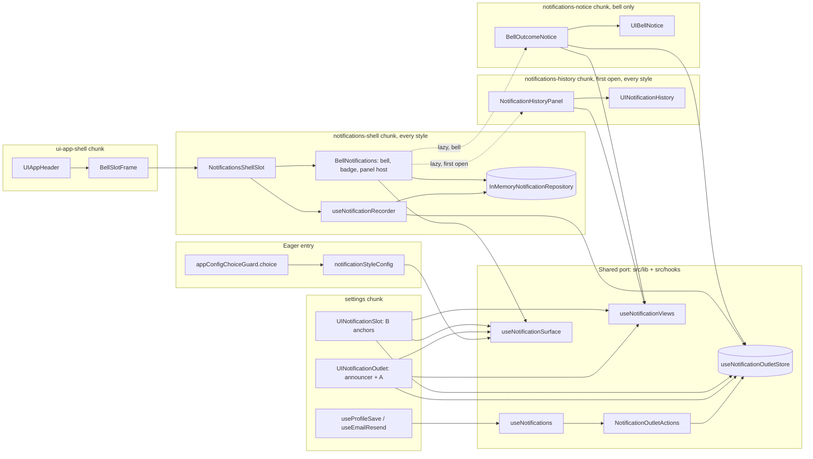

# Architecture: notification visibility variants

**Author:** architect, autonomous run **Date:** 2026-11-11 **Feature:**
`notification-visibility-variants` **Issue:** none (no issue or PR until the owner approves, MA-4)

Predecessors: the [run summary](./run-summary-notification-visibility-variants-2026-11-11.md)
(binding; later blocks supersede earlier ones), the
[research](./research-notification-visibility-variants-2026-11-11.md) (R1–R17), the
[brief](./brief-notification-visibility-variants-2026-11-11.md) and the
[PRD](./prd-notification-visibility-variants-2026-11-11.md) (FR-1..34, NFR-1..22, P-1..P-13).
The style follows the
[user-settings architecture](../../user-settings/planning-artifacts/architecture-user-settings-2026-10-06.md).
Decisions this stage took on its own are marked `> Assumption:` and indexed in §17. File references
are `path:line` on `main` at `8b24105e`. `features/notifications` is short for
`src/modules/user/features/notifications` throughout. This document writes no production code.

> **What this stage had to reconcile.** Two repository gates make the PRD's literal wording
> ("every caller reaches it only through its public barrel and its DI token", FR-1) impossible for
> the two callers that exist:
>
> - `no-cross-feature-imports` (`.dependency-cruiser.js:591-602`) forbids **every** edge from
>   `features/settings` into a sibling feature, barrel or not, and counts `import type` too
>   (`tsPreCompilationDeps: true`);
> - `no-components-import-modules` (`:280-289`) forbids the shell header in `src/components` from
>   importing any module.
>
> The owner's intent (O-1: a notifications capability inside the user module, behind a repository
> with a mock, extractable without changing callers) is kept by a hexagonal split. The
> **caller-facing port** lives in the shared layers (`src/lib/notifications`, `src/hooks`). The
> **feature** owns the repository, the mock, the history, the bell and the recorder, and reaches the
> shell through a route-contract shell slot (the `userMenu` precedent, issue #362). This changes the
> import path of FR-1, not its intent, and is reported as a PRD concern (§19).

> **Owner decision, 2026-11-12 (applied throughout).** The header's unread count is shown under
> all three variants (run summary, last section; PRD amendment 2026-11-12, items 21–36). The
> enabled bell, its badge, its count description, the history panel and mark-all-read are common
> to `toast`, `inline` and `bell`; the variants differ only in the transient outcome surface (A the
> toast stack, B the inline status, C the merged card). The former bell-only chunk
> `notifications-bell` is retired: the bell connector moves into `notifications-shell`, the
> history panel becomes the lazy `notifications-history` chunk loaded on the first open under
> every style, and the merged card becomes the lazy `notifications-notice` chunk loaded only under
> `bell` (A-23 to A-30).

## 1. Approach summary

### 1.1 Decisions

| Id    | Decision                                                                | §    |
| ----- | ----------------------------------------------------------------------- | ---- |
| AD-1  | Caller-facing port in `src/lib` + `src/hooks`; adapter in the feature   | 2, 5 |
| AD-2  | Outcome contract `NotificationDraft` (replaces `ToastDraft`), i18n keys | 5.1  |
| AD-3  | One Zustand store plus one `NotificationOutletActions` class            | 5.2  |
| AD-4  | One announcer: two always-mounted regions in the page outlet            | 5.4  |
| AD-5  | One surface table maps the style to the page, anchor or header surface  | 6    |
| AD-6  | `InMemoryNotificationRepository`, a container-free module singleton     | 3.3  |
| AD-7  | Feature-root `tokens.ts` + `di.ts`, one aggregator entry                | 4    |
| AD-8  | Second shell slot `shell.notifications`, always mounted, with the bell  | 6.3  |
| AD-9  | Lazy `notifications-history` (first open) and `notifications-notice`    | 6.4  |
| AD-10 | Runtime setting as a generic "choice" kind: source, zod, renderer       | 7    |
| AD-11 | A dependency-cruiser rule pins the feature's isolation (FR-2)           | 3.6  |
| AD-12 | `[no-adr]`; decisions recorded in four READMEs                          | 7.6  |

### 1.2 Stack fit

Every piece is built from what the repository already runs; no dependency is added.

- **React 19:** function components; `lazy` + `Suspense` with non-null fallbacks for the three
  new chunks.
- **TypeScript strict** with `exactOptionalPropertyTypes` (props passed through are declared
  `prop?: T | undefined`) and `noUncheckedIndexedAccess` (store lookups use `find` and `?? null`,
  never `!`).
- **MUI v9 + Emotion:** `Box` + `sx` style objects in `styles.ts`; `keyframes` from
  `@emotion/react` for motion.
- **Zustand v5:** one store, `create<State>()(…)`, no middleware, root import only (ADR-002).
- **tsyringe:** one by-value registration under `NOTIFICATION_TOKENS`; no `@injectable()` class.
- **React Router v7:** a route-contract shell slot (`RouteModule.shell`); `useLocation` to close
  the history on navigation.
- **RSBuild:** `webpackChunkName` magic comments only; no new cache group in `rsbuild.config.ts`.
- **i18next:** two new **lazy** catalogs through `lazyCatalogLoader`; the registered
  `{{value, datetime}}` formatter (`src/i18n.js:23`).
- **Jest/RTL:** unit and integration (`--maxWorkers=2` on the host); jest-axe; the
  `isolated-module` helper for style literals.
- **Playwright:** the style chosen per test by rewriting the runtime block in the document
  response; the mobile lane.
- **Runtime config:** `@/config/runtime` gains its first non-URL, non-flag setting.

## 2. Boundaries and placement

### 2.1 Why the port is shared and the adapter is a feature

- `no-cross-feature-imports` has no barrel exception, so settings cannot import
  `features/notifications` at all.
- `no-components-import-modules` keeps `UIAppHeader` from importing the feature.
- `no-cross-module-imports` would forbid settings from importing `@/modules/notifications` after
  extraction, so a barrel contract would break on the day of the move.
- `no-feature-ui-to-services` forbids feature hooks from importing `src/services`, so the recorder
  reports through the slot host's failure callback, not `observabilityCore`.
- NFR-12 (container-free shell on `/`) means the shell slot cannot `useService`; the repository is
  a module singleton.
- `components-no-direct-injectable-import` and `no-components-to-repositories` mean feature
  components reach the repository only through feature hooks.

The port is therefore placed where both callers may reach it today **and after extraction**:
`src/lib/notifications/` (types, store, actions class) and `src/hooks/` (the hooks that read and
write it). The feature subscribes to the port; nothing in the port imports the feature. Extraction
moves the feature folder to `src/modules/notifications/` and touches three import lines (registry,
aggregator, the isolation rule's path); settings and the shell do not change. That is FR-7's "a
move, not a rewrite".

### 2.2 Placement map

| Piece                               | Path                                                     |
| ----------------------------------- | -------------------------------------------------------- |
| Port types                          | `src/lib/notifications/types/*.ts`                       |
| Outlet store                        | `src/lib/notifications/use-notification-outlet-store.ts` |
| Store transitions                   | `src/lib/notifications/notification-outlet-actions.ts`   |
| Surface table                       | `src/lib/notifications/notification-surfaces.ts`         |
| Writer and reader hooks             | `src/hooks/use-notification*.ts` (§5.2)                  |
| Renderers, content piece, outlets   | `src/components/ui-*` (§11)                              |
| Repository contract, record types   | `features/notifications/types/*.ts`                      |
| In-memory adapter and seed          | `features/notifications/repositories/`                   |
| Token module, registrar             | `features/notifications/{tokens,di}.ts`                  |
| Recorder, history, disclosure hooks | `features/notifications/hooks/use-*.ts`                  |
| Shell slot, bell connector          | `features/notifications/components/`                     |
| Route contract (shell slot only)    | `features/notifications/routes/index.ts`                 |
| Setting                             | `src/config/runtime/notification-style*.ts` (§7.1)       |

## 3. The notifications feature

### 3.1 Layout

Only `config/module-shape.json` feature folders are used (`components`, `hooks`, `i18n`,
`repositories`, `routes`, `types`); root files are not folder-gated.

```text
src/modules/user/features/notifications/
├── README.md                     # contract, token, 4 operations, seed, extraction rule
├── index.ts                      # public barrel: types only
├── tokens.ts                     # NOTIFICATION_TOKENS
├── di.ts                         # NotificationsRegistrar (ModuleRegistrar)
├── types/
│   ├── notification-record.ts    # NotificationRecord(+Set), NotificationRecordDraft(+Set)
│   ├── notification-repository.ts
│   ├── notification-history.ts   # NotificationHistory (hook result)
│   ├── bell-disclosure.ts        # BellDisclosure, BellDisclosureControls
│   └── components.ts             # NotificationsShellSlotProps, BellNotificationsProps
├── repositories/
│   ├── index.ts                  # barrel: class + singleton
│   └── in-memory-notification-repository.ts   # class + seed + `export default new …`
├── hooks/
│   ├── use-notification-repository.ts   # the one seam returning the adapter
│   ├── use-notification-recorder.ts     # outlet store → repository.record
│   ├── use-notification-history.ts      # list + unread + markAllRead
│   └── use-bell-disclosure.ts           # open, close, Escape, outside, route close, visited
├── components/
│   ├── notifications-shell-slot.tsx     # chunk `notifications-shell`, every style
│   ├── bell-notifications.tsx           # in `notifications-shell`: bell, badge, panel host
│   ├── notification-history-panel.tsx   # chunk `notifications-history`, first open, every style
│   ├── notification-history-panel-loader.ts   # ChunkRetryLoader for the panel chunk
│   ├── bell-outcome-notice.tsx          # chunk `notifications-notice`, `bell` only
│   ├── bell-outcome-notice-loader.ts    # ChunkRetryLoader for the notice chunk
│   └── comparison/notification-comparison.stories.tsx
├── routes/index.ts               # RouteModule { routes: [], shell.notifications }
└── i18n/{en,uk}.json             # `notification_center.*`, lazy, registered by BellNotifications
```

### 3.2 Domain types (type-only files, TB-1)

The feature's types import only port types from `src/lib/notifications/types` (`import type`) and
nothing from the rest of `src/modules/user/**` (FR-2). Code samples in this document carry no
comments, because the repository forbids inline comments; the facts a comment would hold are in
the prose around each sample.

`features/notifications/types/notification-record.ts` (`createdAt` is epoch milliseconds, the
instant the outcome was raised):

```typescript
import type { NotificationKind } from '@/lib/notifications/types/notification-kind';
import type { NotificationMessageKey } from '@/lib/notifications/types/notification-draft';

export interface NotificationRecord {
  readonly id: string;
  readonly kind: NotificationKind;
  readonly messageKey: NotificationMessageKey;
  readonly createdAt: number;
  readonly read: boolean;
}

export interface NotificationRecordSet {
  readonly items: readonly NotificationRecord[];
}

export interface NotificationRecordDraft {
  readonly kind: NotificationKind;
  readonly messageKey: NotificationMessageKey;
  readonly createdAt: number;
}

export interface NotificationRecordDraftSet {
  readonly items: readonly NotificationRecordDraft[];
}
```

`features/notifications/types/notification-repository.ts` (`list` resolves newest first):

```typescript
export interface NotificationRepository {
  record(drafts: NotificationRecordDraftSet): Promise<NotificationRecordSet>;
  list(): Promise<NotificationRecordSet>;
  countUnread(): Promise<number>;
  markAllRead(): Promise<void>;
}
```

A record carries no action (a server cannot store a callback) and no e-mail, name, password, token
or user id (NFR-21). Transport shapes of a future GraphQL or REST adapter are mapped inside that
adapter (FR-3).

### 3.3 The in-memory adapter (FR-4, MA-5)

- **Class:** `InMemoryNotificationRepository implements NotificationRepository` (`*Repository`,
  "persistence / API boundary of an aggregate"). Its constructor takes a `NotificationRecordSet`
  (the seed). It keeps a private array and a sequence counter:
  - `record` assigns `notification-<n>` ids;
  - `list` returns a copy sorted by `createdAt` descending, stable by insertion;
  - `countUnread` counts `read === false`;
  - `markAllRead` replaces every entry with `read: true`.

  All four resolve on a microtask; nothing touches storage or the network.

- **Seed (P-2, PRD readiness amendment 11):** a module-private
  `const NOTIFICATION_SEED: NotificationRecordSet` in the **same file**. Three `success` rows at
  fixed instants with three **feature-owned** keys in the notifications catalog, whose `uk` and
  `en` texts equal the shipped `settings.toasts.password_changed`, `email_sent` and `saved` texts
  (no new wording):

  | Id       | `messageKey`                                | `createdAt`            | `read` |
  | -------- | ------------------------------------------- | ---------------------- | ------ |
  | `seed-1` | `notification_center.seed.password_changed` | `2026-11-10T09:15:00Z` | false  |
  | `seed-2` | `notification_center.seed.email_sent`       | `2026-11-09T16:40:00Z` | true   |
  | `seed-3` | `notification_center.seed.saved`            | `2026-11-08T11:05:00Z` | true   |

- **Instance:** the file ends with
  `export default new InMemoryNotificationRepository(NOTIFICATION_SEED)` and also exports the class
  by name for tests.

> Assumption: the seed lives in the adapter's own file. The adapter is in a gated `repositories/`
> folder (`config/di-collaborator-policy.js:43-49`), so a value import of a separate fixture module
> would trip `injectable-classes-no-value-imports`, and an `EXEMPT_RENDER_PATH_FILES` entry would
> break NFR-18 ("no new allowlist or exemption entry"). With only `import type` lines the file needs
> no carve-out. Tests build other seeds with
> `new InMemoryNotificationRepository(buildNotificationRecordSet(…))`.

> Assumption: records store an **i18n key**, not translated text (AD-2). A real server would store a
> template or event type, which a future adapter maps to a key. Keys let the seed exist in both
> locales and keep the history in the active language.

> Assumption (A-17, revised 2026-11-12, main-agent decision): the seed uses feature-owned keys, not the shipped
> `settings.toasts.*` keys. The settings catalog is lazy and only the settings page registers it
> (`settings/routes/user-profile/index.tsx:23`), so a seed literal under `settings.toasts.*` would
> fail `make lint-i18n`'s `lazy-key-scope` check (`scripts/ci/check-i18n-parity.mjs:416-427`; a
> `messageKey: '…'` line matches the `*Key` binding rule, `scripts/ci/i18n-key-scan.mjs:31-34`)
> and, under every style, a fresh `/` would render raw keys in the history; the notifications
> feature cannot register the settings catalog itself (`notifications-feature-self-contained`,
> §3.6). Feature-owned keys need no new owner on the settings catalog, add no settings bytes to
> every protected page and need no `lazy-key-scope` exemption. The notifications catalog lists the
> adapter file and the feature's `components/` folder as owners and is registered by
> `BellNotifications` at module evaluation, which runs in `notifications-shell` on every protected
> page under every style (A-27), before the panel or the notice translates a record.
>
> **Invariant:** runtime records keep their `settings.toasts.*` keys, because settings raises them only on `/settings`, whose page registers the settings catalog for the rest of the document (`lazyCatalogLoader` never unregisters), and a reload resets the history to the seed (P-3), so every record the history can show resolves wherever the bell renders. A future page that raises outcomes must register its own catalog before it raises,
> which is already what owning a lazy catalog means.

### 3.4 Hooks (the Data-provider seam)

- `useNotificationRepository(): NotificationRepository` returns the singleton; it is the one switch
  point for a future real adapter.
- `useNotificationRecorder(report: ShellChunkFailureHandler): number` subscribes to the outlet store
  (`useNotificationOutletStore.subscribe`), records every new raise once with
  `createdAt = raisedAt`, and returns a revision that grows when a record settles. A raise is
  detected by comparing the listener's `(state, previous)` pair (`state.revision !==
previous.revision`), never against a revision the hook remembers, and `clear()` keeps
  `revision` monotonic (§5.2), so a raise after a page unmount is still recorded. On rejection it
  calls `report('app-shell:notifications-record', error)`; the outcome was already shown and
  announced (FR-5).
- `useNotificationHistory(revision: number): NotificationHistory` returns
  `{ records, unread, markAllRead, refresh }` and refreshes on mount, on each revision and after
  `markAllRead`. `BellNotifications` calls it under every style, so the badge and the count
  description are current on every protected page; the panel receives `records` and
  `markAllRead` as props.
- `useBellDisclosure(layout: ShellLayout): BellDisclosure` mirrors `use-user-menu.ts` (settings)
  for route close, layout close, Escape and Tab-out, and closes on a document `pointerdown`
  outside the bell wrapper with no backdrop (§10). It runs under every style. `show()` calls the
  port's `dismissAll()` **only** when `useNotificationSurface('header')` is true (under `bell`,
  P-9); under `toast` and `inline` opening hides nothing, because `dismissAll()` empties `shown`
  and `useInlineBatch` would then return an empty block (A-26). The result carries
  `visited: boolean`, `true` from the first `show()` for the rest of the component's life, which
  is what loads the panel chunk once and keeps it mounted (A-25).

> Assumption: the shell-side hooks read the repository through `useNotificationRepository()`, not
> `useService`. NFR-12 forbids the composition root, tsyringe and Apollo on `/` under every style;
> the user-menu precedent (`settings/hooks/use-current-user.ts` reading
> `utils/current-user-source.ts`) does the same. The DI token (§4) is registered with the same
> instance, so container code and the shell see one history. Component tests mock the hook module
> (`jest.mock('…/hooks/use-notification-repository')`), the sanctioned seam for hooks.

### 3.5 Public barrel and extraction readiness (FR-7)

`index.ts` exports types only: `NotificationRepository`, `NotificationRecord`,
`NotificationRecordSet`. No caller imports it today (callers use the port); it is the ready surface
of the future `@/modules/notifications` barrel. The README lists the port, the token, the four
operations, the seed and the isolation rule.

**Extraction checklist (a move):**

1. `git mv` the feature to `src/modules/notifications/`, `tokens.ts` and `di.ts` into `config/`;
2. update `src/routes/registry.ts`, `src/config/dependency-injection-config.ts` and the isolation
   rule's path;
3. change nothing in settings, the shell, the port, or their tests and stories.

### 3.6 Isolation rule (FR-2, AD-11)

A new dependency-cruiser rule, with a must-fail fixture in `scripts/ci/depcruise-rule-fixtures.mjs`:

```javascript
{
  name: 'notifications-feature-self-contained',
  comment:
    'The notifications feature imports nothing from the rest of the user module, so it can ' +
    'move to its own module unchanged (owner decision O-1, FR-2).',
  severity: 'error',
  from: { path: '^src/modules/user/features/notifications/' },
  to: { path: '^src/modules/user/(?!features/notifications/)' },
},
```

The fixture imports a module-level `types/` file (not a sibling feature), so only this rule fires
and no `alsoFires` or `DOCUMENTED_SUBSET_OVERLAPS` entry is needed. Because it also forbids the
barrel from re-exporting a user-module type, it covers FR-7's barrel check.

## 4. DI token and registrar (AD-7, P-11)

`features/notifications/tokens.ts`:

```typescript
const NOTIFICATION_TOKENS = Object.freeze({
  NotificationRepository: Symbol('NotificationRepository'),
} as const);

export default NOTIFICATION_TOKENS;
```

`features/notifications/di.ts` registers by value, so the shell reads the same container-free
singleton (NFR-12):

```typescript
import type { DependencyContainer } from 'tsyringe';

import type { ModuleRegistrar } from '@/config/types/module-registrar';

import inMemoryNotificationRepository from './repositories';
import NOTIFICATION_TOKENS from './tokens';
import type { NotificationRepository } from './types/notification-repository';

class NotificationsRegistrar implements ModuleRegistrar {
  public register(container: DependencyContainer): void {
    container.register<NotificationRepository>(NOTIFICATION_TOKENS.NotificationRepository, {
      useValue: inMemoryNotificationRepository,
    });
  }
}

export default new NotificationsRegistrar();
```

`src/config/dependency-injection-config.ts` gains one import and one array entry after
`userModuleRegistrar` (the documented "one import + one array entry").

Gate fit:

- the aggregator is exempt from `no-module-internal-imports` and `no-repository-internal-imports`;
- `di.ts` imports the `repositories` **index**, which any importer may;
- `di.ts` matches the collaborator policy's `composition-roots` kind (`/di[.]ts$`) and sits outside
  `LOGIC_SOURCE_PATHS` anyway;
- the file has one method; `src/modules/user/config/di.ts`, already at
  `nom_functions_file_max: 10`, is not touched; no `DI_COMPOSITION_ROOTS` regex changes.
- `no-di-config-import-outside-composition-root` does **not** guard the new file:
  `DI_COMPOSITION_ROOTS` (`.dependency-cruiser.js:17-23`) lists `src/modules/[^/]+/config/di.ts`
  but not a feature-root `di.ts`. An outside importer is still stopped by the boundary rules
  (PRD readiness amendment 12: `no-cross-feature-imports`, `no-components-import-modules`,
  `no-routes-import-feature-internals`, `no-module-internal-imports`,
  `no-feature-internal-imports`); only a file inside the feature could import it, and the file
  imports `tsyringe` as a type only, so an eager import would pull no container code. The gap is
  recorded rather than closed, because widening `DI_COMPOSITION_ROOTS` is a gate edit this bundle
  does not need.

> Assumption: the token has no runtime consumer in this bundle. Settings raises through the port and
> the shell must stay container-free. It is kept because MA-5 binds it and because it is the seam a
> future container-side consumer (a notifications page) resolves. A DI unit test resolves it and
> asserts identity with `useNotificationRepository()`. See §19, concern 3.

## 5. Outcome contract, store and announcer

### 5.1 `ToastDraft` becomes `NotificationDraft` (AD-2)

`src/components/types/ui-toast/index.ts` (`ToastDraft`, `ToastItem`, `ToastQueue`, …) and
`src/hooks/use-toast-queue.ts` are **replaced**, not wrapped. The port types follow, one file per
block.

`src/lib/notifications/types/notification-kind.ts`:

```typescript
export type NotificationKind = 'success' | 'error';
```

`src/lib/notifications/types/notification-draft.ts` (`anchor` is B's placement; an absent anchor
is stored as `primary`):

```typescript
export type NotificationMessageKey = string;

export type NotificationAnchor = string;

export type NotificationActivate = () => void;

export interface NotificationAction {
  readonly labelKey: NotificationMessageKey;
  readonly onActivate: NotificationActivate;
}

export interface NotificationDraft {
  readonly kind: NotificationKind;
  readonly messageKey: NotificationMessageKey;
  readonly action?: NotificationAction | undefined;
  readonly anchor?: NotificationAnchor | undefined;
}

export interface NotificationDraftSet {
  readonly items: readonly NotificationDraft[];
}
```

`src/lib/notifications/types/shown-notification.ts`:

```typescript
export interface ShownNotification extends NotificationDraft {
  readonly id: number;
  readonly batch: number;
  readonly raisedAt: number;
}

export interface ShownNotificationSet {
  readonly items: readonly ShownNotification[];
}
```

What changed and why:

- `tone` → `kind`: a domain word; a tone is a renderer concern.
- `message` (text) → `messageKey` (§3.3); `action.label` → `action.labelKey`.
- `anchor`: B's placement (FR-15, FR-26).
- On the shown item, `batch` (B's "one block per save") and `raisedAt` (C's time, FR-20).

Copy is unchanged: settings passes the same `settings.toasts.*` and `auth.error.tryAgain` keys it
translates today.

### 5.2 Store and transitions (AD-3, `docs/state-architecture.md`)

`src/lib/notifications/types/notification-outlet-state.ts`. In the state, `shown` is FIFO, at most
three, newest last (A, C); `raised` holds every item of the latest raise (the recorder); `inline`
holds the latest batch per anchor (B); `focus` is published by the page outlet; `revision`,
`nextId`, `nextBatch` and `marked` are counters that only move forward.

```typescript
export interface NotificationAnnouncement {
  readonly polite: string;
  readonly assertive: string;
}

export interface NotificationInlineBatch {
  readonly anchor: NotificationAnchor;
  readonly batch: number;
}

export interface NotificationInlineBatchSet {
  readonly items: readonly NotificationInlineBatch[];
}

export interface NotificationFocusReturn {
  readonly primary: RefObject<HTMLElement | null>;
  readonly fallback?: RefObject<HTMLElement | null> | undefined;
}

export interface NotificationOutletState {
  readonly shown: ShownNotificationSet;
  readonly raised: ShownNotificationSet;
  readonly inline: NotificationInlineBatchSet;
  readonly announcement: NotificationAnnouncement;
  readonly focus: NotificationFocusReturn | null;
  readonly revision: number;
  readonly nextId: number;
  readonly nextBatch: number;
  readonly marked: boolean;
}

export type NotificationTranslate = (key: NotificationMessageKey) => string;

export type NotificationClock = () => number;
```

**Store.** `src/lib/notifications/use-notification-outlet-store.ts`:
`create<NotificationOutletState>()(() => ({ ...CLEARED_NOTIFICATION_OUTLET }))`, the initial value
as its only logic (the `use-connectivity-store.ts` precedent). It is added to
`tests/utils/reset-client-stores.ts`.

**Transitions.** `NotificationOutletActions` (`*Actions`, "state transitions of a store") in
`src/lib/notifications/notification-outlet-actions.ts`, constructed with
`StoreApi<NotificationOutletState>` and a `NotificationClock` (the `BrowserConnectivityAdapter`
precedent). Six public methods, under `class_npm_max: 8`:

- `raise(drafts, translate)`: ids, batch and `raisedAt = clock()`; `shown` FIFO-3; `raised`;
  `inline[anchor]`; the announcement is the translated texts of the shown slice per kind, joined by
  a space, plus `ALTERNATING_MARK` on the first, third and every odd raise (`marked` flips before
  the text is built and starts `false`, today's `use-toast-queue.ts:18-41`, moved); `revision + 1`.
- `dismiss(id)`: removes one item from `shown` (A and C close).
- `dismissAll()`: empties `shown` (under `bell` only: opening the history hides the merged card,
  P-9; `useBellDisclosure` never calls it under `toast` or `inline`, A-26).
- `withdraw(anchor)`: drops the anchor's inline batch (B: next submit, Clear, a new resend).
- `publishFocus(focus)`: sets the page's focus-return targets.
- `clear()`: resets `shown`, `raised`, `inline`, `announcement` and `focus` to their
  `CLEARED_NOTIFICATION_OUTLET` values and **keeps** `revision`, `nextId`, `nextBatch` and
  `marked` (page outlet unmount, FR-27). The counters stay monotonic so a listener that compares
  revisions never mistakes a raise after a page change for an old one (readiness M-05); only
  `resetClientStores()` returns the whole store to its initial value between tests.

**Writer hook.** `src/hooks/use-notifications.ts` holds one module-level
`new NotificationOutletActions(useNotificationOutletStore, Date.now)` and returns a stable
`NotificationsPort` (`raise`, `dismiss`, `dismissAll`, `withdraw`), binding `t` from
`useTranslation()` into `raise`. The announcement text is fixed at raise time, as today (SM-6).

**Reader hooks** (`src/hooks/`):

- `useShownNotifications()` → `state.shown`;
- `useInlineBatch(anchor)` → that anchor's latest batch as a `ShownNotificationSet`, memoised on
  `shown` and `inline`;
- `useNotificationAnnouncement()` → `state.announcement`;
- `useNotificationFocus()` → `state.focus`.

Every selector returns a stored field, so identities are stable and no `useShallow` is needed.

**View mapping.** `src/hooks/use-notification-views.ts` maps a `ShownNotificationSet` to the
display-ready `NotificationViewSet` the presentational renderers take: `message` and
`action.label` translated, `time` only when a time key is passed. Renderers never see keys.

### 5.3 Settings wiring (FR-25, FR-26)

- `settings/hooks/use-profile-save.ts`: `useNotifications()`; drafts carry `messageKey`;
  `withdraw('primary')` on `pending` and on `clear`; one `raise` per settle, in the name, e-mail,
  password order.
- `settings/hooks/use-email-resend.ts`: `raise` with `anchor: 'email'`; `withdraw('email')` when a
  resend starts.
- `settings/routes/user-profile/index.tsx`: drop `useToastQueue` and `SettingsToasts`; render
  `<UINotificationOutlet returnFocusRef={saveRef} fallbackFocusRef={headingRef} />` last inside
  `UIShellContent`.
- `settings/components/profile-form/index.tsx`:
  `footer={<><ClearButton …/><UINotificationSlot anchor="primary" /></>}`, and
  `<UINotificationSlot anchor="email" />` after the conditional `EmailStatusRow`. The e-mail slot is
  always mounted, so a resend that turns the address confirmed still shows its outcome.
- `settings/types/**`: remove the `ToastQueue` fields.

`useSettledFocus` is unchanged (focus on Save, or the `h1` while Save is disabled). No settings
file imports the notifications feature.

### 5.4 The single announcer (AD-4, FR-6, NFR-1)

`UINotificationOutlet` (`src/components/ui-notification-outlet/index.tsx`) is mounted once per page
that raises outcomes, and always renders, under every style:

1. `<UILiveStatus message={announcement.polite} />` and
   `<UILiveStatus message={announcement.assertive} politeness="assertive" />`, the only two
   notification regions, present before the first outcome;
2. a layout effect calling `publishFocus({ primary, fallback })` on mount and `clear()` on unmount,
   so visible outcomes leave with the page while the history keeps them under every style (FR-27);
3. the A stack, only when the page surface is active (§6).

No renderer (toast, inline block, merged card, caret card, history row) carries `role`,
`aria-live` or `aria-atomic` (R13). `UILiveStatus` is unchanged.

> Assumption: the announcer is page-level, not shell-level. A shell-level announcer would exist
> only under the protected shell, which the settings route, a11y and Storybook tests do not render.
> The page outlet is the one component every raising page mounts anyway (it owns lifetime and focus
> targets), and it keeps today's test seams.

## 6. Renderer strategy (AD-5, AD-8, AD-9)

### 6.1 One surface table

`src/lib/notifications/types/notification-surface.ts`:

```typescript
export type NotificationSurface = 'page' | 'anchor' | 'header';

export type NotificationSurfaceTable = {
  readonly [Style in NotificationStyle]: NotificationSurface;
};
```

`src/lib/notifications/notification-surfaces.ts`:

```typescript
const NOTIFICATION_SURFACES: NotificationSurfaceTable = Object.freeze({
  toast: 'page',
  inline: 'anchor',
  bell: 'header',
});
```

`useNotificationSurface(surface): boolean` (`src/hooks/use-notification-surface.ts`) compares the
table entry for `notificationStyleConfig.value()` with its argument. Each mount point asks for its
own surface, so exactly one **transient** renderer exists per style (FR-11), and the losing
variants are removed by deleting a table row and its mounts (§14). The table decides the transient
surface only: the enabled bell, its badge and the history panel are not in it, because they render
under every style (owner decision 2026-11-12, A-23).

### 6.2 Mount points

| Variant | Surface  | Mounted by                              | Renderer                               |
| ------- | -------- | --------------------------------------- | -------------------------------------- |
| A       | `page`   | `UINotificationOutlet` (page root)      | `UIToastStack` → `UIToast`             |
| B       | `anchor` | `UINotificationSlot` (anchors per page) | `UIInlineStatus`                       |
| C       | `header` | `BellNotifications` (shell slot), lazy  | `BellOutcomeNotice` → `UIBellNotice`   |
| all     | none     | `NotificationsShellSlot` (shell slot)   | `BellNotifications`: bell, badge, host |
| all     | none     | `BellNotifications`, lazy on first open | `NotificationHistoryPanel` (§11)       |

- **A** keeps today's position, width, stacking, close, focus return and bottom clearance
  (`use-stack-clearance.ts`, `use-toast-focus.ts`, fed from the store). Focus return reads
  `NotificationFocusReturn` from the store.
- **B:** the page hands it a slot by placing `UINotificationSlot` where the outcome belongs; the
  renderer has no settings code. The `primary` slot sits in `UIForm`'s `footer` after
  `ClearButton`. Save and Clear are `inline-flex` and the slot is a block, so it opens a new line
  below the action row and Save never moves (FR-15); `margin-top: 16px` keeps it within 16 px.
- **The bell (every style):** `UIAppHeader` renders the disabled `HeaderIconButton` only when no
  `notifications` slot is passed (a shell with no notifications module, the header stories); with
  a slot it renders the slot node, under every style, in the same cluster position inside a
  fixed-size `BellSlotFrame` (the `UserSlotFrame` precedent), so loading never shifts the cluster.
  `BellNotifications` composes the enabled bell (`HeaderIconButton` with `disclosure`), the alert
  `HeaderBadge`, the count description and `UINotificationHistoryFrame`, the panel's host element,
  whose content is the lazy `NotificationHistoryPanel` once the bell has been opened (A-25).
- **C:** under `bell` only, `BellNotifications` also renders the lazy `BellOutcomeNotice`, which
  draws `UIBellNotice` over the shown items (A-24).

### 6.3 The shell slot (AD-8)

The route-contract slot mechanism (issue #362) is generalised from one slot to two:

- `src/routes/types/shell-slot.ts`: `RouteModuleShell.notifications?`; a `ShellSlot` alias (today's
  `UserMenuSlot`); `ShellChunkSource` adds `'app-shell:notifications'` (the slot chunk),
  `'app-shell:notifications-history'` (the panel chunk), `'app-shell:notifications-notice'` (the
  merged-card chunk) and `'app-shell:notifications-record'` (a rejected record), so each failure is
  attributable on its own (readiness M-14).
- `src/routes/shell-slot-factory.ts`: `create(load, source)` reports its own source.
- `src/routes/route-composer.tsx`: `shellLoad(registry, key)` for both keys.
- `src/routes/route-validator.ts`: at most one module per slot key.
- `src/routes/protected-layout-loader.ts` and `types/protected-layout.ts`: build both slots.
- `src/components/types/layouts/app-layout.ts`, `layouts/app-layout*.tsx`,
  `ui-app-shell/index.tsx`, `ui-app-header/index.tsx`: pass `notifications` through.
- `src/routes/registry.ts`: `items: [appRoutes, authRoutes, settingsRoutes, notificationsRoutes]`.

`features/notifications/routes/index.ts`:

```typescript
const notificationsRoutes: RouteModule = {
  id: 'user.notifications',
  shell: {
    notifications: () =>
      import(
        /* webpackChunkName: "notifications-shell" */ '../components/notifications-shell-slot'
      ),
  },
  routes: [],
};
```

The `webpackChunkName` magic comment is the one comment the samples keep: it names the chunk the
bundle-size report and `performance-serving.test.ts` track, exactly as every route contract does.

`NotificationsShellSlot` runs on every protected page under every style. It calls
`useNotificationRecorder(onChunkFailure)` and renders `BellNotifications` (a static import, so the
bell, the badge and the count arrive with the slot chunk) under every style.
`BellNotifications` reads `useNotificationHistory(revision)` and `useBellDisclosure(layout)`,
registers the `notification_center` catalog at module evaluation, and renders two lazy children:

- the panel content `NotificationHistoryPanel` (through `notification-history-panel-loader.ts`, a
  `ChunkRetryLoader`, chunk `notifications-history`), mounted inside the always-present
  `UINotificationHistoryFrame` host only once `visited` is `true`, under every style. Its
  `Suspense` sits inside the host with `<RouteFallback minHeight=… />` as its non-null fallback
  (the in-page `Suspense` pattern of CLAUDE.md), so `aria-controls` resolves before the chunk
  arrives. The panel chunk is never prefetched (no hover or focus warm-up), so no request for it
  exists before the first open. When its loader gives up it reports
  `onChunkFailure('app-shell:notifications-history', error)` and the host stays empty;
- the merged card `BellOutcomeNotice` (through `bell-outcome-notice-loader.ts`, chunk
  `notifications-notice`), only when `useNotificationSurface('header')` is true. It suspends to the
  factory's boundary below like the slot chunk does; on a final failure it reports
  `onChunkFailure('app-shell:notifications-notice', error)` and renders `null`, and the bell keeps
  working. Under `toast` and `inline` its loader is never called.

The slot declares no `Suspense` of its own: the header renders it inside `BellSlotFrame`, a
fixed-size box whose own `Suspense` fallback is the bell-sized `aria-hidden` placeholder (§11.3).
In the composed shell the slot is rendered through `ShellSlotFactory.create`
(`src/routes/shell-slot-factory.ts`), which wraps every slot in its own `Suspense` with an
`aria-hidden` `span` fallback, so that inner boundary is the one that catches the slot chunk and
the notice chunk; the frame keeps its size and both fallbacks are invisible and `aria-hidden`. The
frame's placeholder covers an empty child or a slot rendered directly in the frame (the stories).
While `notifications-shell` loads, the frame shows the empty bell-sized box under every style; the
disabled bell is not drawn in its place (A-23). No second placeholder component exists (readiness
M-15, R2-03).

> Assumption: the slot is mounted under every style so that every raised outcome is recorded (FR-5)
> and the badge counts it (owner decision 2026-11-12), which FR-33 keeps after the pick. The price
> is one deferred chunk on every protected page, `/` included (estimate ≈ 4.5 kB gzip: recorder,
> adapter, seed, the bell connector, the disclosure, the panel host, the catalog and two loaders).
> If Lighthouse on `/` regresses in any category, the fallback is PRD amendment item 31's: the
> count read and the enabled bell stay; what is not needed to paint them (the disclosure handlers
> and the panel-only strings, in a second lazy catalog owned by the panel) moves into
> `notifications-history`; anything weaker, such as recording only under `bell` or dropping the
> badge under `toast` and `inline`, needs the owner's acceptance (§19, concern 2, as superseded).

### 6.4 Chunk map (NFR-11, NFR-12)

| Chunk                       | Loaded when                  | Gains                                       | Est. gzip |
| --------------------------- | ---------------------------- | ------------------------------------------- | --------- |
| eager `index`               | every page                   | choice guard, style list                    | ≤ 0.5 kB  |
| `settings`                  | `/settings`                  | port, outlet, slot, A, B, content           | ≈ +4 kB   |
| `ui-app-shell`              | protected pages              | surface hook, `BellSlotFrame`, disclosure   | ≈ +0.6 kB |
| `protected-layout`          | protected pages              | two-slot factory and loader                 | ≈ +0.1 kB |
| `notifications-shell` new   | protected, every style       | recorder, adapter + seed, bell, badge, host | ≈ 4.5 kB  |
| `notifications-history` new | first bell open, every style | panel content, history views                | ≈ 2.5 kB  |
| `notifications-notice` new  | protected, `bell` only       | merged card, caret card, anchor, clearance  | ≈ 3.5 kB  |
| auth chunks                 | public pages                 | nothing (NFR-12)                            | 0         |

`notifications-shell` includes the `notification_center` catalog (both locales) and the two lazy
loaders; the `HeaderIconButton` disclosure and the alert badge tone live in `ui-app-shell` with the
rest of the header. On `/` the loaded chunk set is `main`'s plus `notifications-shell` under every
style and `notifications-notice` under `bell`; `notifications-history` joins it only after the bell
is opened (PRD amendment item 31). The store module is shared by `settings` and
`notifications-shell`; Rspack evaluates a module once per runtime, so there is one store instance.
No chunk imports `@/providers/di`, the composition root, tsyringe, Apollo or zod for
notifications; only the aggregator imports the registrar, and the aggregator still loads lazily.
The bundle-size workflow verifies the estimates on the PR; budgets are not changed.

> Assumption (A-24, owner decision 2026-11-12): the retired `notifications-bell` chunk is split
> three ways. The bell connector joins `notifications-shell`, because the badge and the count must
> paint on every protected page under every style. The history panel's content becomes
> `notifications-history`, loaded on the first open under every style, to keep `/` light. The
> merged card and caret card become `notifications-notice`, loaded under `bell` only. Two
> alternatives were rejected. Putting the notice in `notifications-shell` would add ≈ 3.5 kB to
> `/` under the default style for code that never renders there. Putting it in
> `notifications-history` would force that chunk to load at mount under `bell`, which breaks "the
> panel loads on first open under every style".

## 7. Runtime setting `notificationStyle` (FR-8..FR-10)

### 7.1 Files

- `src/config/runtime/types/notification-style.ts`:
  `export type NotificationStyle = 'toast' | 'inline' | 'bell';`
- `src/config/runtime/types/app-config.ts`: `AppConfigValues.notificationStyle?`,
  `AppConfigChoiceKey = 'notificationStyle'`, `AppConfigChoices`.
- `src/config/runtime/notification-styles.ts`: `NOTIFICATION_STYLES` (a frozen tuple) and
  `DEFAULT_NOTIFICATION_STYLE = 'toast'`.
- `src/config/runtime/app-config-choice-guard.ts` (new, zod-free): `AppConfigChoiceGuard`
  (`*Guard`, "precondition: boolean, type, or throwing"), exported as `appConfigChoiceGuard`.
  It holds the frozen choice table (`notificationStyle` → `NOTIFICATION_STYLES`) and one method,
  `choice(key, text)`, which returns `text` if it is one of the allowed values, `undefined` if
  `text` is `undefined`, and **throws** otherwise, naming the setting, the value and the allowed
  values. `app-config-source.ts` already holds 10 methods against `nom_functions_file_max: 10`
  (`load`, `validated`, `text`, `url`, `flag`, `raw`, `parse`, `parseJson`, `isRecord`,
  `isHttpUrl`), so it gains **no** method (readiness M-01).
- `src/config/runtime/app-config-source.ts`: `text(key)` widens its key type from
  `AppConfigUrlKey` to `AppConfigTextKey = AppConfigUrlKey | AppConfigChoiceKey` (it already
  trims and reports an empty or non-string value as absent), and `load()` passes every choice key
  through `appConfigChoiceGuard.choice(key, this.text(key))`, so a bad block fails before
  `root.render` (FR-10). `src/index.tsx` calls `createRoot` first and `appConfigSource.load()`
  after it; a throw renders the shell's `ErrorFallback` with the bootstrap recovery, so the app
  itself never renders (readiness R2-12). `src/config/**` is outside the collaborator-policy globs, so the value
  import needs no carve-out.
- `src/config/runtime/notification-style-config.ts`: `NotificationStyleConfig` (`*Config`),
  `value(): NotificationStyle` =
  `appConfigChoiceGuard.choice('notificationStyle', appConfigSource.text('notificationStyle')) ?? DEFAULT_NOTIFICATION_STYLE`;
  `export default new …`.
- `src/config/runtime/app-config-schema.ts`:
  `notificationStyle: z.enum(NOTIFICATION_STYLES).optional()`.
- `src/hooks/use-notification-surface.ts`: the read path (§6.1), container-free like
  `use-feature-flag.ts`.
- `scripts/render-app-config.js`: a `CHOICE_SETTINGS` array with one entry (`envVar`
  `APP_CONFIG_NOTIFICATION_STYLE`, `key` `notificationStyle`, `values` `toast`, `inline`, `bell`)
  and `applyChoiceSettings`. Empty writes no key; a value must match exactly after trimming;
  otherwise it throws
  `APP_CONFIG_NOTIFICATION_STYLE must be one of toast, inline, bell, got "banner".` (FR-9).
- `public/index.html`: **unchanged** (`{ "flags": {} }`); the default lives in code (FR-9).
- `.env.example`: `APP_CONFIG_NOTIFICATION_STYLE=` with a comment naming the values and the removal
  trigger.
- `docker-compose.test.yml`:
  `- APP_CONFIG_NOTIFICATION_STYLE=${APP_CONFIG_NOTIFICATION_STYLE-}`.
- `src/config/runtime/README.md` and `docs/feature-flags.md`: a "Settings" row with the values,
  the default, the variable, "temporary" and the removal story.
- Tests: `tests/unit/tooling/runtime-config-contract.test.ts` (§7.3),
  `tests/unit/scripts/render-app-config.test.js`, `tests/bats/render_app_config.bats`,
  `tests/unit/config/runtime/*`.

`RUNTIME_TOKENS` gains nothing: no container code reads the style.

> Assumption: a non-string `notificationStyle` (for example `5`) is reported absent by `text()`
> on the paint path and so renders the default. Only a hand-edited block can carry one, because
> the renderer writes strings only; the zod schema rejects it in container code, and the contract
> test that validates the committed block rejects it before it ships.

### 7.2 Read path

Container-free, synchronous, immutable for the document (the block is rendered at container start),
exactly like flags: `appConfigSource.text` and `appConfigChoiceGuard` (eager) →
`notificationStyleConfig` →
`useNotificationSurface` → the three mount points. The zod schema guards container code
(`AppConfig`) and the committed block.

### 7.3 What the contract test must pin

The test asserts today that the schema's non-flag keys equal the renderer's URL settings
(`runtime-config-contract.test.ts`, "declares every URL setting …"). It is extended, not loosened:

1. schema non-flag keys = URL keys ∪ choice keys;
2. for each choice, renderer `values` = schema enum options = the guard's table entry =
   `NOTIFICATION_STYLES`, in order;
3. the default is `toast` and is one of exactly three values;
4. `.env.example` declares every choice variable and `docker-compose.test.yml` passes it through;
5. the renderer accepts each value, rejects `Toast`, `banner` and `toast,bell`, and writes no key
   for an empty value (the `it.each` parity pattern already used for URLs);
6. `src/config/runtime/README.md` names the setting and every value.

### 7.4 Selecting the style in browser lanes (P-10)

`tests/e2e/utils/notification-style.ts` exports `useNotificationStyle(page, style)`. It routes
document requests only (`route.request().resourceType() === 'document'`, `route.fallback()`
otherwise), fetches the real response, rewrites the block with the real `renderAppConfig()` from
`scripts/render-app-config.js` (env `APP_CONFIG_NOTIFICATION_STYLE` set to the style), and fulfils
with the original headers. The CSP is untouched (the block is JSON data, not script). The browser
therefore runs the renderer the entrypoint runs, on the one test-harness image.

The entrypoint itself is proven three ways:

- the renderer unit test;
- `render_app_config.bats`, running `scripts/docker-entrypoint.sh` against a fixture shell with the
  variable set;
- the existing built-image boot in `scripts/ci/check-security-headers.sh`, whose override run gains
  `-e APP_CONFIG_NOTIFICATION_STYLE=inline` and a `curl` assertion that the served `/` block holds
  `"notificationStyle":"inline"` (FR-30's "on a built image").

> Assumption: the built-image check rides the existing `security headers` boot, not a new make
> target and workflow. That job already boots the `production` image with `APP_CONFIG_*` overrides
> to prove the entrypoint ran, so one more assertion costs seconds; the bats and contract tests hold
> the behavioural cases.

### 7.5 Local development

`make start` serves the committed block through RSBuild with no entrypoint, so it shows A. Local
review of B and C uses Storybook (`make storybook-start`) or the production-parity stack started
with the value **on the make command line** (the R3 default path, PRD readiness amendment 7):

```bash
make start-prod-clean APP_CONFIG_NOTIFICATION_STYLE=bell
```

Two things make the obvious alternatives silently show A:

- the Makefile `-include`s `.env` and `export`s every variable (`Makefile:7`, `:15`); a value
  read from an included file overrides the shell environment in GNU make, so
  `APP_CONFIG_NOTIFICATION_STYLE=bell make start-prod` exports the empty `.env` line that
  `.env.example` adds and `make check-env-sync` forces into every local `.env`. A command-line
  variable overrides the included file and is exported to the recipe, and docker compose prefers
  that environment value over its own `.env` interpolation;
- `start-prod` runs `up -d --no-recreate` (`Makefile:845`), so a second run keeps the running
  `prod` container's value. `start-prod-clean` (`Makefile:847-848`) runs
  `up -d --force-recreate --build`, so each run restarts `prod` with the new value.

No Makefile target is added, so `tests/bats/make-target-coverage.tsv` needs no new row (its
`start-prod-clean` row, line 51, already exists). Story 1.3 pins the command in a Bats case and in
`src/config/runtime/README.md`. A contributor whose untracked `.env` predates the change fails
`make check-env-sync` until the line is added, which is the gate's purpose.

### 7.6 ADR drift (NFR-22, AD-12)

The change touches four ADR-significant surfaces: `src/config/**` (runtime setting, choice guard,
and the aggregator entry in `src/config/dependency-injection-config.ts`),
`src/routes/registry.ts`, `src/routes/route-composer.tsx` (two slots) and
`.dependency-cruiser.js` (isolation rule). The PR body carries:

```text
[no-adr] The notificationStyle setting is temporary and is deleted by the removal story once the
team lead picks a variant (FR-33). The route-composer change adds a second instance of the existing
#362 shell-slot pattern, the dependency-cruiser rule enforces owner decision O-1, and the
notifications port/adapter split is recorded in the feature, module, routes and runtime READMEs.
The one durable DI change is a feature-root registrar (features/notifications/di.ts) with one
aggregator entry in src/config/dependency-injection-config.ts, the documented #109 pattern; the
feature-root di.ts is not in DI_COMPOSITION_ROOTS, so the boundary rules, not
no-di-config-import-outside-composition-root, keep it out of other code.
```

> Assumption: no ADR is written. Since the ADR purge (PR #333) the repository keeps only ADR-001
> and ADR-002 and records feature decisions in module READMEs; the setting is temporary (R2); and
> the two durable parts (a second shell slot, an isolation rule) apply decisions already recorded.
> If a reviewer reads the port/adapter split as a new decision, it is an ADR-003 candidate,
> "Notifications: shared port, feature adapter".

## 8. Views

### 8.1 Component view (C4 level 3)



### 8.2 One save with three successes

```mermaid
sequenceDiagram
  actor U as User
  participant Save as useProfileSave
  participant Port as useNotifications / Actions
  participant Store as outlet store
  participant Ann as outlet live regions
  participant R as active renderer (A, B or C)
  participant Rec as useNotificationRecorder
  participant Repo as InMemoryNotificationRepository
  U->>Save: activate Save (name, e-mail, password changed)
  Save->>Port: withdraw('primary')
  Save->>Save: submit; spinner
  Save->>Port: raise({ items: [saved, email_sent, password_changed] })
  Port->>Store: setState(shown, raised, inline, announcement, revision + 1)
  Store-->>Ann: polite = the three texts in one utterance (+ mark)
  Store-->>R: A three toasts, B one block of three lines, C three rows
  Note over R: no focus move; useSettledFocus puts focus on Save
  Store-->>Rec: subscribe(revision changed)
  Rec->>Repo: record(3 drafts, createdAt = raisedAt)
  Repo-->>Rec: records (unread)
  Rec-->>R: every style: history revision + 1, badge = seed unread + 3 (1 → 4)
  alt record rejects
    Rec->>Rec: onChunkFailure('app-shell:notifications-record', error)
    Note over R: shown and announced anyway (FR-5)
  end
```

### 8.3 The bell under every style

```mermaid
sequenceDiagram
  actor U as User
  participant B as enabled bell (HeaderIconButton disclosure)
  participant D as useBellDisclosure
  participant H as useNotificationHistory
  participant Repo as repository
  participant Store as outlet store
  participant P as UINotificationHistory panel
  U->>B: Enter
  B->>D: show()
  alt style is bell
    D->>Store: dismissAll() (merged card hidden, P-9)
  else style is toast or inline
    Note over D,Store: nothing hidden; toasts or inline block stay
  end
  D-->>B: visited = true (first open loads notifications-history)
  D->>H: refresh()
  H->>Repo: list(), countUnread()
  Repo-->>H: seed + document records, newest first
  H-->>P: rows, unread marked in text; aria-expanded = true
  U->>P: Tab to "Позначити всі прочитаними", Enter
  P->>H: markAllRead()
  H->>Repo: markAllRead(), list(), countUnread() = 0
  H-->>B: badge hidden, count description dropped
  Note over P: focus stays on the button
  U->>P: Escape
  P->>D: dismiss()
  D->>B: close and focus the bell (aria-expanded = false)
```

## 9. Visual specification

### 9.1 Tokens

No palette token is added; every colour below exists in `src/styles/colors.ts`.

| Use                         | Token                              | Value                    |
| --------------------------- | ---------------------------------- | ------------------------ |
| success fill (A, B)         | `paletteColors.success.surface`    | `#E8F4EF`                |
| error fill (A, B)           | `paletteColors.error.surface`      | `#FDECEC`                |
| success edge and icon       | `paletteColors.success.text`       | `#2E7D32`                |
| error edge and icon         | `paletteColors.error.main`         | `#DC3939`                |
| text, glyph, focus ring     | `customColors.text.dark`           | `#1A1C1E`                |
| C card, enabled bell fill   | `paletteColors.background.default` | `#FFFFFF`                |
| C time, empty state         | `customColors.text.muted`          | `#57595B`                |
| badge fill (enabled bell)   | `paletteColors.error.text`         | `#D63333`                |
| unread dot, mark-all-read   | `paletteColors.primary.linkText`   | `#0074B5`                |
| unread row tint             | `customColors.shell.currentTint`   | `rgba(30, 174, 255, .1)` |
| C row divider               | `paletteColors.background.subtle`  | `#E1E7EA`                |
| A, caret card, panel shadow | `customColors.shell.popoverShadow` | `0 8px 27px` at .14      |
| C merged card shadow (R6)   | `customColors.shell.cardShadow`    | `0 8px 27px` at .05      |

### 9.2 Contrast (computed 2026-11-11)

Snippet, run with `python3 -I` (WCAG 2.x relative luminance):

```python
def lin(c):
    c = c / 255
    return c / 12.92 if c <= 0.04045 else ((c + 0.055) / 1.055) ** 2.4


def lum(h):
    r, g, b = (int(h.lstrip('#')[i:i + 2], 16) for i in (0, 2, 4))
    return 0.2126 * lin(r) + 0.7152 * lin(g) + 0.0722 * lin(b)


def ratio(a, b):
    hi, lo = sorted((lum(a), lum(b)), reverse=True)
    return (hi + 0.05) / (lo + 0.05)


print(f"{ratio('#2E7D32', '#FBFBFB'):.2f}")  # 4.95
```

Floors: text 4.5:1 (1.4.3); icons, marks, badge edge and focus ring 3:1 (1.4.11); container edge
3:1 against its backdrop (the product rule, SM-1).

| Pair                                           | Ratio     | Floor   |
| ---------------------------------------------- | --------- | ------- |
| A/C success edge `#2E7D32` on page `#FBFBFB`   | 4.95:1    | edge    |
| A/C error edge `#DC3939` on page `#FBFBFB`     | 4.33:1    | edge    |
| B/C success edge `#2E7D32` on white            | 5.13:1    | edge    |
| B/C error edge `#DC3939` on white              | 4.48:1    | edge    |
| A success edge over footer pill `#F4F5F6`      | 4.70:1    | edge    |
| A error edge over footer pill `#F4F5F6`        | 4.10:1    | edge    |
| text `#1A1C1E` on success fill `#E8F4EF`       | 15.15:1   | text    |
| text `#1A1C1E` on error fill `#FDECEC`         | 14.96:1   | text    |
| success icon `#2E7D32` on success fill         | 4.55:1    | graphic |
| error icon `#DC3939` on error fill             | 3.92:1    | graphic |
| error icon `#DC3939` on white (C rows)         | 4.48:1    | graphic |
| C message `#1A1C1E` on white                   | 17.09:1   | text    |
| C time `#57595B` on white                      | 7.03:1    | text    |
| C time `#969B9D` on white (rejected)           | 2.81:1    | fails   |
| enabled bell glyph `#1A1C1E` on white          | 17.09:1   | graphic |
| badge text white on `#D63333`                  | 4.79:1    | text    |
| badge text white on `#DC3939` (rejected)       | 4.48:1    | fails   |
| badge `#D63333` on white bell / on page        | 4.79/4.63 | graphic |
| unread dot `#0074B5` on white / on unread tint | 5.04/4.60 | graphic |
| unread dot `#1EAEFF` on white (rejected)       | 2.46:1    | fails   |
| row text `#1A1C1E` on unread tint `#E8F7FF`    | 15.61:1   | text    |
| time `#57595B` on unread tint                  | 6.42:1    | text    |
| error icon `#DC3939` on unread tint            | 4.09:1    | graphic |
| mark-all-read `#0074B5` on white               | 5.04:1    | text    |
| focus ring `#1A1C1E` on page, tints, white     | ≥ 14.96:1 | graphic |
| C card fill white on page (not the edge)       | 1.03:1    | n/a     |
| today's fill `#E8F4EF` on page (the defect)    | 1.09:1    | fails   |

`#E8F7FF` is `currentTint` composited on white. C's stroke and badge sit on the white header at
tablet and mobile and on `#FBFBFB` at desktop; both backdrops are listed.

### 9.3 Variant A, elevated toast

- **Box:** today's geometry (`ui-toast/styles.ts:33-120`). Fixed; below 480 px 15 px left, right
  and bottom, full width; from 480 px `right/bottom 24px`, width 397; from 1025 px `right 12px`;
  `zIndex 1400`; gap 8; radius 12; padding 16 (mobile) or `19px 18px 19px 20px`; Golos 600, 14 or
  16 px; max height `50dvh` minus the gutter.
- **Edge:** `border: 1px solid <tone>`, and the accent as
  `boxShadow: inset 4px 0 0 0 <tone>, <popoverShadow>` (an inset shadow follows the radius and
  moves no content); the fill is unchanged.
- **Motion:** `@keyframes` sliding 16 px in from the inline-end edge (from the bottom below 480 px)
  with opacity 0 → 1, **180 ms** `cubic-bezier(0.2, 0, 0, 1)`, on mount only; no exit animation;
  `@media (prefers-reduced-motion: reduce) { animation: none }`.
- **Forced colors:** `border-color: CanvasText` (the existing rule); shadows drop out by design.
- **Clearance:** `useStackClearance` unchanged (bottom, also at 320 × 256).

### 9.4 Variant B, inline status

- **Box:** a block, `margin-top: 16px` below the action row (FR-15), full content width; radius 8;
  padding `12px 16px`. Fill and edge use the tone of the **most severe** line (error if any, else
  success); edge `boxShadow: inset 4px 0 0 0 <tone>`; no border and no shadow (the card is the
  elevation).
- **Lines:** up to three, gap 8. Each: a 20 px icon, the message in Golos 500 15/25 px (the settings
  status text) `#1A1C1E`, and Retry as an underlined text button after the message, 24 px minimum
  with a 44 px hit area on mobile through the shared negative-margin `control` pattern.
- **E-mail anchor:** the same block with `margin-top: 8px`, right after the e-mail status row.
- **Motion:** opacity 0 → 1, **160 ms** ease-out on mount; the space it opens is not animated;
  under reduced motion no fade and the reveal scroll uses `behavior: 'auto'` (FR-17).
- **Reveal:** `useInlineReveal(blockRef, batch)`, a layout effect: if the block is not wholly in the
  viewport, `scrollIntoView({ block: 'nearest' })`; focus never moves.
- **Forced colors:** `border: 1px solid CanvasText` (tint and inset shadow vanish there).
- **Breakpoints:** inherits the card (1440, 1024, 375); no media query of its own.

### 9.5 Variant C, bell-merged notification, and the bell of every style

The merged shape, card content, caret card, height cap, motion, stickiness and clearance below are
C only (`bell`). The **enabled bell, the badge and the history panel** are common to every style
(owner decision 2026-11-12): they render identically under `toast`, `inline` and `bell`.

- **Desktop shell (≥ 1440), merged shape (`397:18093`).** A `position: relative` wrapper around the
  enabled bell holds a union of a pill (48 × 117, radius 24, at 0, 0) and a card (256 wide,
  `min-height: 62px`, radius 12, at 23 px, 55 px), both white. The **union outline** is drawn on the
  wrapper as a `filter` of four 1 px `drop-shadow`s in tone `T` (±1 px on each axis) followed
  by the card shadow `drop-shadow(0 8px 27px rgba(49, 59, 67, 0.05))`. `T` is the tone of the most
  severe row, and the stroke follows the fused shape with no seam. Visible extent at 1440 for one
  row: 1087–1366 × 8–125 (FR-18).
- **Card content.** Padding `15px 14px 11px 14px`; a row is the message (Golos 600 14/18), the time
  (Inter 500 12/18, `#57595B`) and a 24 × 24 close at the row end; rows divided by 1 px `#E1E7EA`,
  gap 12; at most three rows, newest last.
- **Tablet (1024–1439) and mobile (< 1024) shell, caret card** (`377:18485` language, R7). Width
  `min(313px, 100vw - 32px)`. The caret is 26 × 6 (a `clip-path` triangle in tone with a 1 px-inset
  white triangle), its tip 4 px below the bell box and on the bell's centre. The card's left edge is
  `clamp(16px, var(--bell-centre-x) - caretOffset, 100vw - 16px - width)`; radius 8;
  `border: 1px solid <tone>`; `popoverShadow`. `useBellAnchor` sets `--bell-centre-x` (layout effect
  plus `resize`), so the card follows the bell wherever the header puts it (FR-19).
- **Height cap.** The card body has `max-height: max(4rem, calc(50dvh - 4rem))` and
  `overflow-y: auto`, so at 320 × 256 a focused page control keeps at least 64 px of viewport.
- **Enabled bell (every style).** Desktop 48 and tablet 52 px round, white fill, glyph
  `#1A1C1E`, `cursor: pointer`, hover fill `#F4F5F6`. Mobile: the button element itself is
  44 × 44 CSS px (`min-width` and `min-height: 2.75rem`) with `margin: -10px` (`-0.625rem`), the
  negative-margin pattern of the toast close and Retry controls (`ui-toast/styles.ts:17-31`), and
  the 24 px glyph centred in it. Its layout footprint stays 24 × 24, so the cluster does not move,
  and the box reaches 10 px into the 16 px cluster gap, 6 px clear of the tasks button. A
  `::before` hit area is **not** used: `expectTouchTarget` (`tests/e2e/mobile/utils/touch-target.ts:12-19`)
  measures `boundingBox()`, which a pseudo-element does not change (readiness F-04).
  `BellSlotFrame` keeps its 24 px mobile box and `overflow: visible`, so it never clips the larger
  button. The disabled bell, drawn only by a header with no notifications slot, is unchanged.
  Focus ring 2 px `#1A1C1E`, offset 2. `HeaderBadge` gains `tone: 'muted' | 'alert'`; `alert`
  is a `#D63333` fill with white 12 px text, drawn on desktop and tablet only (P-8). The mobile
  drawer's `aria-hidden` drawn copy of the header bell (`mobile-navigation.tsx`) draws the same
  enabled glyph colour `#1A1C1E` when a notifications slot is present, so the drawn header matches
  the real one; it stays non-interactive (A-29).
- **History panel (every style).** The host `UINotificationHistoryFrame` (shell chunk) owns the
  `id`, `hidden` and the geometry below; the content `UINotificationHistory` (panel chunk) fills
  it. The caret-card geometry at every shell layout, width
  `min(313px, 100vw - 32px)`, `max-height: calc(100dvh - 80px)` with scroll. Heading `h2` Golos 600
  16 px. Rows: icon, message, time, and for unread rows the tint, an 8 px `#0074B5` dot and the
  hidden "Непрочитане". Empty state in `#57595B`. "Позначити всі прочитаними" is a `#0074B5` text
  button, 24 px minimum (44 px on mobile).
- **Motion.** The merged card and the caret card enter with `translateY(-8px)` and opacity over
  180 ms `cubic-bezier(0.2, 0, 0, 1)` when the first row mounts, `transform-origin` at the bell. The
  panel has no motion. Reduced motion: none (FR-21).
- **Stickiness and clearance (R14).** The card is inside the sticky header (`zIndex 1100`), so it
  stays in view while scrolling. `useNoticeClearance(cardRef, rows)` sets
  `--app-top-overhang: <card bottom - 64>px` on `document.documentElement` while shown and removes
  it on hide. `app-layout.styles.ts` `HEADER_CLEARANCE` becomes
  `scrollMarginTop: calc(64px + var(--app-top-overhang, 0px))`, and
  `use-sticky-focus-clearance.ts` adds the same overhang. The hook also scrolls back a focused
  control the card has just covered. It does **not** use document `scroll-padding-top`, which made
  Chromium scroll on header focus (`src/routes/README.md:189-190`).
- **Forced colors.** The drop-shadow outline is replaced by `border: 1px solid CanvasText` on the
  pill and the card (a visible seam is acceptable there). No `forced-color-adjust: none` is used:
  the hidden "Непрочитане" text is the non-colour unread mark and the dot renders as `CanvasText`;
  the badge gets a 1 px `CanvasText` border so it stays legible in system colours.

### 9.6 Breakpoints

| Viewport    | A                        | B                  | C (shell layout)        |
| ----------- | ------------------------ | ------------------ | ----------------------- |
| 1440 × 900  | right 12, bottom 24, 397 | below action row   | merged pill and card    |
| 1024 × 1366 | right 24, bottom 24, 397 | below action row   | caret card, mid-header  |
| 375 × 812   | 15 px gutters, full      | below stacked Save | caret card, 24 px glyph |
| 320 × 256   | stack ≤ 50dvh, scrolls   | inline, no overlap | card height capped      |

## 10. Accessibility design (NFR-1..NFR-10)

| Guarantee             | A                        | B                    | C                        |
| --------------------- | ------------------------ | -------------------- | ------------------------ |
| Announce (4.1.3)      | outlet regions           | outlet regions       | outlet regions           |
| Renderer role         | none                     | none                 | none                     |
| Focus on appearance   | unchanged, bell closed   | unchanged, closed    | unchanged, bell closed   |
| Enabled bell, badge   | yes                      | yes                  | yes                      |
| Opening the history   | hides nothing            | hides nothing        | hides the merged card    |
| Close                 | per toast                | none (R11)           | per row                  |
| Focus return on close | close, Save, `h1`        | n/a                  | close, Save, `h1`        |
| Retry                 | dismiss, activate        | focus Save, activate | dismiss, activate        |
| Timer (2.2.1)         | none                     | none                 | none                     |
| Focus not obscured    | bottom clearance         | overlaps nothing     | top overhang clearance   |
| 44 px on mobile       | bell, close, Retry, mark | bell, Retry, mark    | bell, close, Retry, mark |
| Forced colors         | `CanvasText` edge        | `CanvasText` edge    | `CanvasText` edges, text |
| Reduced motion        | no animation             | no fade, instant     | no animation             |

"Close, Save, `h1`" means: the next or previous close button, then Save, then the `h1` while Save
is disabled. A and C dismiss through the focus hook before activating Retry; B moves focus to Save,
withdraws the block and then activates Retry, so focus never falls to `body`. C's panel is a `div`
with an `h2` and a `ul`, with no `role` attribute.

**The bell disclosure (P-7).** Under every style, `HeaderIconButton` gains an optional `disclosure`
prop (`HeaderDisclosure { expanded; controls; describedBy; onToggle }`). The button is then enabled
with `aria-expanded` and `aria-controls` set to the panel id; the panel host
`UINotificationHistoryFrame` is always rendered (in the shell chunk) and `hidden` while closed, so
the reference always resolves, even before the panel chunk has loaded. Its name stays
"Сповіщення"; its description is the unread-count hidden text
(`notification_center.bell.unread_count_one|few|many|other`), or none at zero. Behaviour, in
`useBellDisclosure`, mirroring `use-user-menu.ts`:

- Enter and Space toggle it (a native button); a raised outcome never opens it; opening hides the
  merged card under `bell` only and hides nothing under `toast` or `inline` (A-26);
- the first open sets `visited`, which mounts the lazy panel content; while it loads the host shows
  the deferred `RouteFallback` (nothing for 150 ms, then a spinner and a polite "loading" line),
  and focus stays on the bell;
- Escape, on the bell or inside the panel, closes it and focuses the bell;
- an outside click closes it through a document-level `pointerdown` listener (capture phase,
  added while open and removed on close) whose target is outside the bell wrapper. **No overlay or
  backdrop** is drawn, unlike the user menu (`user-menu/index.tsx:23`, `styles.ts:86`), so the
  pointer reaches the element under it and the browser moves focus there; the hook moves no
  focus, so focus is where the user clicked (FR-24, PRD readiness amendment 8). If focus was
  inside the panel and the click lands on a non-focusable area, the browser blurs to `body`
  before the panel's `hidden` applies, which is the platform behaviour for any outside click;
- a `focusout` whose `relatedTarget` leaves the bell wrapper closes it without moving focus (Tab
  out);
- a route change or a shell-layout change closes it (the user-menu hooks' pattern);
- "Позначити всі прочитаними" stays enabled at zero unread, so it never drops focus by disabling.

On mobile the badge is not drawn (P-8) but the count is in the description (FR-23), unlike today's
disabled `HeaderIconButton`, which describes no count on mobile. Because the bell is enabled under
every style, it is a Tab stop on every protected page between the logo (and the search, where
drawn) and the user chip; the existing shell keyboard contracts gain that stop (§13.3).

> Assumption: at zero unread the bell has no count description (the PRD's "names none"), rather
> than a "no unread notifications" sentence, which would need another key and add speech on every
> focus.

## 11. Component inventory (component-first)

### 11.1 Existing, reused unchanged

`UILiveStatus`, `UITypography` (kit), `UIButton`, `UILinkButton`, `UIForm` (its `footer` slot),
`HeaderHiddenText`, `UserSlotFrame` (as the pattern), `UIShellContent`, `ui-breakpoints` (kit),
`ChunkRetryLoader`, `ThemedChunkLoader`, `lazyCatalogLoader`, `ALTERNATING_MARK`.

### 11.2 Existing, changed

- `UIToastStack` (`src/components/ui-toast/index.tsx`): the regions move to the outlet; it renders
  `UIToast` from a `NotificationViewSet` and reads focus targets from the store.
- `UIToast` (`ui-toast.tsx`): frame plus `UINotificationContent`; edge, accent, shadow, motion.
- `ToastIcon`: moved and renamed `NotificationIcon` in `ui-notification-content`.
- `use-toast-focus.ts`, `use-stack-clearance.ts`: take the new set types and
  `NotificationFocusReturn`.
- `HeaderIconButton`: optional `disclosure` (the enabled bell). `HeaderBadge`: `tone`.
- `UIAppHeader`, `UIAppShell`, `AppLayout`, `AppLayoutFrame`: the `notifications` slot
  pass-through; the header draws the disabled bell only when no slot is passed.
- `MobileNavigation` (`ui-app-header/mobile-navigation.tsx`): the drawn bell copy takes the
  enabled glyph colour when a notifications slot is present (A-29).
- `app-layout.styles.ts`, `use-sticky-focus-clearance.ts`: `--app-top-overhang`.
- `ShellSlotFactory`, route composer, validator and protected-layout loader: two slot keys.

### 11.3 New components (each with a story)

Paths under `src/components/` unless they start with `features/`.

| Component                    | Path                                                   |
| ---------------------------- | ------------------------------------------------------ |
| `UINotificationContent`      | `ui-notification-content/index.tsx`                    |
| `NotificationIcon`           | `ui-notification-content/notification-icon.tsx`        |
| `UINotificationOutlet`       | `ui-notification-outlet/index.tsx`                     |
| `UINotificationSlot`         | `ui-notification-slot/index.tsx`                       |
| `UIInlineStatus`             | `ui-inline-status/index.tsx`                           |
| `UIBellNotice`               | `ui-bell-notice/index.tsx`                             |
| `UINotificationHistory`      | `ui-notification-history/index.tsx`                    |
| `UINotificationHistoryFrame` | `ui-notification-history/history-frame.tsx`            |
| `BellSlotFrame`              | `ui-app-header/bell-slot-frame.tsx`                    |
| `NotificationsShellSlot`     | `features/…/components/notifications-shell-slot.tsx`   |
| `BellNotifications`          | `features/…/components/bell-notifications.tsx`         |
| `NotificationHistoryPanel`   | `features/…/components/notification-history-panel.tsx` |
| `BellOutcomeNotice`          | `features/…/components/bell-outcome-notice.tsx`        |

Roles: `UINotificationContent` is the shared piece (icon, message, action, time, close) that keeps
A, B and C free of clones; the outlet is the page connector (announcer, lifetime, A); the slot is
B's anchor connector; `UIInlineStatus` is B; `UIBellNotice` is C's merged card and caret card;
`UINotificationHistoryFrame` is the panel's host (id, `hidden`, geometry) and
`UINotificationHistory` its presentational content, both common to every style;
`BellNotifications` is the bell connector of every style (bell, badge, description, disclosure,
host); `NotificationHistoryPanel` is the lazy panel connector (records to views, mark-all-read);
`BellOutcomeNotice` is C's lazy merged-card connector.

Hooks added with them: `src/components/ui-inline-status/use-inline-reveal.ts`,
`src/components/ui-bell-notice/use-bell-anchor.ts` and `use-notice-clearance.ts`, plus §3.4 and
§5.2.

**Catalogs.** The close label moves to a new lazy catalog
`src/components/ui-notification-content/i18n` (`ui_notification.close`, copy unchanged, «Закрити
сповіщення»), replacing `src/components/ui-toast/i18n`. The feature catalog
`features/notifications/i18n` holds the PRD §13 strings under a distinct top-level namespace,
`notification_center.*` (`notification_center.history.heading`, `.mark_all_read`, `.unread`,
`.empty`, `notification_center.bell.unread_count_one|few|many|other` and
`notification_center.time`, `{{value, datetime}}`) and the three seed keys
`notification_center.seed.password_changed|email_sent|saved` (§3.3). `notifications.*` is not used: the eager
catalog already owns that top-level key (`src/i18n/localization.json`), and although
`lazyCatalogLoader.register` deep-merges (`addResourceBundle(…, true)`), a distinct namespace
keeps ownership and the `lazy-key-scope` owner lists unambiguous (readiness M-12). The catalog is
registered at runtime by `BellNotifications` (`features/notifications/components/bell-notifications.tsx`),
so it ships in `notifications-shell` and is registered on every protected page under every style,
before the panel or the notice (both under the same `components/` owner) translates a record; it
stays one catalog (A-27). The catalog
first lands with the seed keys (the adapter file is its first owner); the bell and panel strings
(shown under every style) and the `components/` owner follow with `BellNotifications`. Both catalogs are added to `config/i18n-catalog-policy.json`,
`.storybook/preview.tsx` and the pinned list in `tests/unit/scripts/localization-generator.test.js`.

**Types.** Prop types live in `src/components/types/<component>/` and
`features/notifications/types/` (type-only files). The display types are
`NotificationView { id; kind; message; action?: NotificationViewAction; time?: string }`,
`NotificationViewSet` and `NotificationViewAction { label; onActivate }`.

## 12. Storybook comparison (FR-28, FR-29)

### 12.1 Component stories

All under `src/components/`; titles under `Components/Feedback/` unless noted.

- `ui-notification-content`: success, error with Retry, with time, without close.
- `ui-toast` (existing titles): success, error, three, reduced motion.
- `ui-inline-status`: one, three, transient with Retry, permanent error.
- `ui-bell-notice`: desktop merged with one and three rows, caret tablet, caret mobile, error.
- `ui-notification-history`: seeded, all read, empty; `history-frame`: closed, open with content,
  open while loading.
- `ui-notification-outlet`, `ui-notification-slot`: one story per style.
- `Shell/Header/HeaderIconButton` adds `BellEnabled`, `BellExpanded`, `BellWithUnread`;
  `Shell/Header/BellSlotFrame`: empty and filled.
- Feature stories: `BellNotifications` and `NotificationsShellSlot` have one story per style, and
  every one shows the enabled bell with the seed badge "1" (desktop, tablet) or the count
  description (mobile); `NotificationHistoryPanel` and `BellOutcomeNotice` (`bell` only) have
  their own.

### 12.2 The comparison matrix

File `features/notifications/components/comparison/notification-comparison.stories.tsx`, title
`Notifications/Comparison`. Each story renders:

- `UIAppHeader` with the real `NotificationsShellSlot`, given the story's shell `layout`
  (`desktop`, `tablet` or `mobile`) as a prop, since every header component takes
  `layout: ShellLayout` (`src/components/types/ui-app-header/index.ts`);
- a settings-like card frame from `.storybook/notification-comparison-frame.tsx`, built from shared
  `src/components` only (card, fields, a 270 px Save, Clear, an e-mail row, `UINotificationSlot`
  anchors);
- `UINotificationOutlet`.

A decorator writes the `#app-runtime-config` block with the story's style (the production read
path), resets the store, and raises the story's outcome set through
`new NotificationOutletActions(useNotificationOutletStore, FIXED_CLOCK)`, which is the contract
with a frozen clock for stable times. The history and the badge of every style come from the
real in-memory adapter class,
but never from the module singleton: the `withFreshNotificationRepository(seed?)` decorator in
`.storybook/notification-story-decorators.tsx` gives each story its own
`new InMemoryNotificationRepository(seed ?? NOTIFICATION_SEED)` behind the
`useNotificationRepository` seam (a story-level substitution of that hook module) and discards it
after the story. Canvas navigation in the published Storybook reuses one preview iframe
(`inline = false` isolates docs pages only), so a shared singleton would let the badge count,
history and read state drift with navigation order, for example `BellAfterMarkAllRead` marking
rows read for every later story; the team lead's primary review path must show reproducible C
states (readiness R2-08). The substitution mechanism is an implementation choice; the contract
is one fresh adapter per story, pinned by a unit test that renders two stories in sequence.

| Arg        | Values                                                             |
| ---------- | ------------------------------------------------------------------ |
| `style`    | `toast`, `inline`, `bell`                                          |
| `outcomes` | `oneSuccess`, `threeSuccesses`, `transientError`, `permanentError` |
| `viewport` | `xl` (1440 × 900), `lg1366` (1024 × 1366), `mobile375` (375 × 812) |
| `layout`   | derived from `viewport`: `desktop`, `tablet`, `mobile`             |

That is 3 × 4 × 3 = 36 stories named `<Style><Outcomes><Viewport>`, built by a story-file factory,
plus `<Style>ReducedMotion` (3), `<Style>HistoryOpen` (3: `ToastHistoryOpen`,
`InlineHistoryOpen`, `BellHistoryOpen`, each after a three-success save so the panel opens beside
that style's transient surface) and `BellAfterMarkAllRead`: 43 in all (A-30). Under every style
the header shows the enabled bell with its badge: "1" before a save, the recorded count after it
(4 after `threeSuccesses`, 2 after an error), on the desktop and tablet layouts; under `toast` and
`inline` no merged card renders.
`.storybook/preview.tsx` gains the `lg1366` and `mobile375` viewports. The reduced-motion stories
add a story-root style that removes animations and are labelled as a simulation; the real media
path is pinned by unit style tests and Playwright `emulateMedia`, since Storybook cannot force the
media query and no addon is added.

The real page gets `WithToastOutcomes` and `WithInlineOutcomes` in
`settings/routes/user-profile/user-profile.stories.tsx`, with the port pre-filled by a decorator.
That story cannot render the header slot, so C's real-page review is the running app.

**Isolation.** Every story file that writes the global `#app-runtime-config` block or the
module-level outlet store (the outlet, slot, `BellNotifications`, `NotificationsShellSlot`,
`NotificationHistoryPanel`, `BellOutcomeNotice` and comparison stories) sets `parameters.docs.story.inline = false`, so a docs page renders each
story in its own iframe and one story's style or raised outcomes never bleed into the next. The
shared decorators live in `.storybook/notification-story-decorators.tsx`
(`withNotificationStyle(style)`, `withRaisedNotifications(drafts)`, and, from the story that first
needs an adapter, `withFreshNotificationRepository(seed?)`), and every call name joins
`SHARED_STATE_STUB_CALLS` in `tests/unit/tooling/storybook-provider-story-isolation.test.ts`,
which then asserts `inline: false` on every file that uses them (readiness M-06).

**Axe.** There is no Storybook a11y addon. `tests/unit/a11y/notification-comparison.a11y.test.tsx`
renders every comparison story through `composeStories` and runs `expectNoA11yViolations`, which
satisfies FR-28's "in-story axe check" without a dependency. jsdom has no viewport, so the
Storybook viewport alone would give axe one layout; because each story passes its shell `layout`
as an arg, the composed stories render the desktop merged card, the tablet caret card and the
mobile header in jsdom, and axe covers all three (readiness M-19). `make storybook-build` and
`make check-storybook-static` run unchanged (FR-29).

## 13. Test strategy

All Jest runs on the host use `--maxWorkers=2`; full suites, builds, Stryker and Lighthouse stay in
CI.

### 13.1 Unit (`tests/unit/**`)

- **Port:** `lib/notifications/notification-outlet-actions.test.ts` (FIFO-3, batch, inline per
  anchor, withdraw, dismissAll, alternating mark, polite/assertive split, clock) and the store test.
- **Hooks:** `hooks/use-notifications.test.ts`, `use-notification-surface.test.ts` (every style ×
  surface), `use-notification-views.test.ts`, `use-shown-notifications.test.ts`.
- **Runtime:** `config/runtime/app-config-choice-guard.test.ts` (choice absent, valid, invalid
  throwing with name, value and values), `app-config-source.test.ts` (`text()` trims a choice key;
  `load()` throwing on a bad choice), `notification-style-config.test.ts`,
  `app-config-schema.test.ts`.
- **Contract and scripts:** `tooling/runtime-config-contract.test.ts` (§7.3),
  `scripts/render-app-config.test.js`, `tests/bats/render_app_config.bats`.
- **Renderers:** `components/ui-toast/*` (tokens for border, accent, shadow, keyframes and reduced
  motion), `ui-inline-status/*` with `use-inline-reveal`, `ui-bell-notice/*` with anchor and
  clearance, `ui-notification-history/*`, `ui-notification-content/*`, `ui-notification-outlet/*`,
  `ui-notification-slot/*`, `ui-app-header/*` (disclosure, badge tone, frame).
- **Feature:** `modules/user/features/notifications/` repositories (four operations, seed, order, no
  storage), hooks (recorder including rejection → `onChunkFailure`, history refresh, disclosure
  keys, `dismissAll()` under `bell` only, `visited`), components (the bell, badge and description
  under each style, the panel loader not called before the first open, the notice loader never
  called under `toast` or `inline`), and `di.test.ts` (token identity).
- **Settings:** route, hook and component tests move from `ToastQueue` mocks to the store
  (`resetClientStores()` in `beforeEach`); `use-profile-save` asserts withdraw on pending and clear
  and one raise per settle.
- **Routes:** composer, validator (two slots, duplicates rejected), factory sources, loader.
- **Tooling:** `performance-serving.test.ts` (the `ui_notification` and `notification_center`
  catalogs out of the eager set; slot loaders are `webpackChunkName` `import()` calls);
  `scripts/localization-generator.test.js` (the pinned lazy-catalog list); the depcruise fixture;
  `storybook-provider-story-isolation.test.ts` (the two notification decorators).
- **a11y (jsdom):** `a11y/ui-toast.a11y.test.tsx` kept; new `ui-inline-status`, `ui-bell-notice`,
  `ui-notification-history` (host and content) and `notification-comparison` tests;
  `settings-page-states` per style; the composed header with the enabled bell under each style.

Determinism: `raisedAt` comes from the injected clock (`jest.setSystemTime` in hook tests, a fixed
clock in the actions tests). Builders `buildNotificationRecord(Set)` and
`buildNotificationDraft(Set)` go in `tests/builders/` (Faker for ids, catalog keys fixed).

### 13.2 Integration (`tests/integration/**`)

`tests/integration/modules/user/features/notifications/notification-flow.integration.test.tsx`
uses the real store, `useNotifications`, the outlet, the slot and `NotificationsShellSlot` with the
real adapter. A raise is announced, rendered by the active surface only, and recorded once with
`createdAt = raisedAt`, and under every style the bell's badge then counts it (1 → 2, or 1 → 4
for three); a rejecting repository (the mocked hook seam) still shows and announces,
calls `onChunkFailure`, and logs nothing. Settings integration tests that assert outcomes point at
the outlet regions. Coverage stays 100 % over `src`.

### 13.3 E2E, mobile, a11y and visual (Playwright, CI)

- **E2E:** `settings-save.spec.ts` and `settings-failures.spec.ts` are parametrised over
  `['toast', 'inline', 'bell']` with `useNotificationStyle`, J1–J9 each, each success journey ending
  with the badge incremented. New `tests/e2e/modules/user/features/notifications/bell-history.spec.ts`
  covers J15 under each of the three styles: the badge from 1 to 4 after a three-success save,
  mark-all-read clearing it, Escape, outside click, Tab out, route close, the transient surface left
  alone under `toast` and `inline`, and no network request.
- **Existing shell specs** that assert the disabled, inert bell change once the registry carries the
  notifications slot (epics Story 3.4): `tests/e2e/modules/app-shell.spec.ts` (the "disabled
  search, bell and list" test keeps the search and the list), `tests/e2e/mobile/app-shell-touch.spec.ts`
  (the bell leaves the inert-tap test and the recorded 40 px gap; it is measured at 44 px), and the
  keyboard contracts `tests/e2e/a11y/app-shell-keyboard.a11y.spec.ts` and
  `home-keyboard.a11y.spec.ts`, whose header stops gain the bell before the chip.
- **Helper:** `utils/settings-page.ts` gains `outcomeSurface(page, style)`: the toast stack (the
  parent of a close button), the `form` element, or the `banner` landmark; outcomes are found by
  text inside it, never by `data-testid`.
- **Clearance:** 320 × 256 and the three sizes, one and three outcomes, tabbing through every
  control (NFR-4), including the open panel's controls beside three toasts under `toast` (K14).
- **Mobile lane:** `tests/e2e/mobile/settings-touch.spec.ts` per style: 44 px for close, Retry,
  the bell and mark-all-read (the bell and mark-all-read under every style); no horizontal overflow
  at 320.
- **a11y:** `tests/e2e/a11y/settings-states.a11y.spec.ts` (axe per style × success and error, and
  with the panel open) and `settings-keyboard.a11y.spec.ts` (focus return per style, the bell
  disclosure under every style).
- **Visual (A-28):** every existing baseline of a page rendered in the app shell is re-recorded,
  because its header gains the enabled bell and, on desktop and tablet, the badge: 243 files
  (`visual-comparison.spec.ts` 39, `visual-comparison.app-shell.spec.ts` 15,
  `visual-comparison.coming-soon.spec.ts` 72, `visual-comparison.settings.spec.ts` 93 including
  A's 18 `uk-settings-{success-toasts,transient-toast}-*`, `mobile/app-shell.spec.ts` 6,
  `mobile/coming-soon.spec.ts` 16, `mobile/settings.spec.ts` 2). B adds 18
  `uk-settings-inline-{success,transient}-*`; C adds 18 `uk-settings-bell-{success,transient}-*`;
  `visual-comparison.app-shell.spec.ts` adds 6 `uk-app-shell-history-open-{desktop,mobile}-*` (the
  open panel in three engines, under the default style). `freezeClock` runs before the save, and
  baselines come only from the CI artifact. The reduced-motion capture of each style is compared
  against that style's **resting** baseline name, never a name of its own, so it adds no PNG and
  "exactly 285 changed files" (243 re-recorded plus 42 new) holds. The 434 public-page baselines
  stay unchanged.
- **Network:** under every style, `/` loads `main`'s chunks plus `notifications-shell`, and
  `notifications-notice` under `bell` only; `notifications-history` is requested only after the
  bell's first open. Under `toast` and `inline` the network logs of `/` and `/settings` hold no
  `notifications-notice` request (FR-11, NFR-12).

### 13.4 Mutation

The mutate scope (`scripts/ci/mutation-scope.mjs`) picks up the new files through its existing
`src/**` globs. Style objects, keyframes, the seed and the surface table are loaded inside the test
body with `tests/unit/utils/isolated-module.ts`. The only expected equivalent mutants are empty hook
dependency arrays, annotated with the existing proof wording; the "most severe tone" choice and all
surface-table row are killed by assertions. If a shard nears its 15-minute kill switch, raise
`MUTATION_SHARD_TOTAL`, never the timeout.

## 14. Removal plan (FR-33)

**Common to every outcome.** Delete the setting: `notification-styles.ts`,
`notification-style-config.ts`, `types/notification-style.ts`, the choice loop in
`app-config-source.ts` `load()`, the schema field, `CHOICE_SETTINGS` in the renderer, the `.env.example` and
compose lines, the README rows, the contract-test, renderer-test and bats cases (the
`start-prod-clean` style case included), `app-config-choice-guard.ts` with its test, the widened
`text()` key type, and the `check-security-headers.sh` assertion. Delete `notification-surfaces.ts` and
`use-notification-surface.ts` (mount points become unconditional), `useNotificationStyle` and the
per-style parametrisation in the browser lanes, the comparison stories, frame and viewports, and the
losers' baselines (the 243 re-recorded shell baselines and the 6 history captures stay, because the
bell and the badge stay).

**Kept whatever wins (owner decision 2026-11-12).** The enabled bell, the badge and the count
description, the history panel and mark-all-read: `BellNotifications`, `NotificationsShellSlot`,
`NotificationHistoryPanel` with its loader and the `notifications-history` chunk,
`ui-notification-history/` (host and content), `use-notification-history.ts`,
`use-bell-disclosure.ts` (its `dismissAll()` branch goes with C if C loses), the `HeaderIconButton`
disclosure, the `HeaderBadge` tone, `BellSlotFrame`, the drawer copy's enabled glyph, the shell
slot, the recorder, the adapter with all four operations and the seed, the `notification_center`
catalog, the token and registrar, the port, the outlet (regions, lifetime) and the notifications
feature. The bell never returns to disabled.

**If A wins**, also delete:

- B: `ui-inline-status/`, `ui-notification-slot/`, both slot mounts in `profile-form`, `withdraw`,
  the `inline` state and anchors;
- C's transient surface: `ui-bell-notice/` (with `use-bell-anchor` and `use-notice-clearance`),
  `bell-outcome-notice*` and the `notifications-notice` chunk, `--app-top-overhang` and its two
  readers, `dismissAll()` and the `bell`-only branch of `useBellDisclosure.show()`, and the
  `notification_center.time` key if nothing else reads it.

Kept, besides the common set: A.

**If B wins**, delete the A stack (`ui-toast/` with clearance and focus hooks if unused, and the
outlet's A branch) and every C transient item above. Kept, besides the common set: the slot and B.

**If C wins**, delete `ui-toast/`, `ui-inline-status/`, `ui-notification-slot/`, the slot mounts,
`withdraw`, `inline` and anchors. Kept, besides the common set: the merged card, its chunk and
`dismissAll()`.

**If the decision is "none, revise"**, the story stays blocked (P-13).

## 15. Gate-by-gate compliance

| Gate                                       | Compliance                                         |
| ------------------------------------------ | -------------------------------------------------- |
| `no-cross-feature-imports`                 | settings uses `src/hooks`, `lib`, `components`     |
| `no-components-import-modules`             | the shell reaches the feature via the slot         |
| `no-components-import-feature-internals`   | as above                                           |
| `no-module-internal-imports`               | only the aggregator and registry import it         |
| `no-feature-internal-imports`              | no module-level layer imports the feature          |
| `no-routes-import-feature-internals`       | the registry imports `routes/index` only           |
| `no-repository-internal-imports`           | hooks and `di.ts` use the `repositories` index     |
| `no-components-to-repositories`            | feature `.tsx` reaches the adapter via hooks       |
| `components-no-direct-injectable-import`   | as above                                           |
| `no-feature-ui-to-services`                | the recorder reports via `onChunkFailure`          |
| `injectable-classes-no-value-imports`      | adapter has type imports; `di.ts` exempt kind      |
| `no-di-config-import-outside-…`            | no new import of a composition root                |
| `no-paint-path-import-di-bridge`           | auth untouched; no `@/providers/di` import         |
| `no-eager-shell-import-di-bridge`          | routes import no `@/providers/di`                  |
| `type-files-*`                             | types in `types/`, imported as `import type`       |
| folder, hook-file and kebab-case rules     | §3.1                                               |
| `notifications-feature-self-contained`     | new, with a must-fail fixture                      |
| `no-circular`                              | the port never imports the feature or settings     |
| ESLint #100/#180 (statics, free functions) | classes in `.ts`; functions in hooks, `.tsx`       |
| ESLint #128 (`new` in `.tsx`)              | construction in hook files and `di.ts` only        |
| ESLint #129 class naming                   | `*Actions`, `*Repository`, `*Registrar`, `*Config` |
| TB-1                                       | every boundary shape named; sets, no arrays        |
| `noRawIntlSelectors`                       | time via `{{value, datetime}}`                     |
| Suspense fallback gate                     | sized placeholders, `RouteFallback`, never null    |
| `data-testid` ban                          | role, text and landmark selectors                  |
| `react-hooks/exhaustive-deps`              | refs and stored callbacks; no suppression          |
| rca (10 functions, 6 closures, LLOC 10)    | one concern per file; helpers split                |
| jscpd (70 tokens)                          | one shared `UINotificationContent`                 |
| i18n parity and lazy catalogs              | two new uk/en catalogs; eager set unchanged        |
| Performance budgets                        | unchanged; eager ≤ 1 kB; auth chunks 0 B           |
| Lighthouse                                 | default style; `/` gets `notifications-shell` only |
| Visual regression                          | exactly the 285 files of NFR-15 (A-28), from CI    |
| Chunk scope                                | panel on first open; notice under `bell` only      |
| Console gate                               | CSS motion; effects settle in `act`                |
| a11y (jest-axe, Playwright axe)            | per renderer and style; no `A11Y_EXCEPTIONS`       |
| Coverage and mutation 100 %                | §13; isolated loading for literals                 |
| Gate ratchet                               | no threshold file touched                          |
| ADR drift                                  | the `[no-adr]` line (§7.6)                         |
| License and lockfile                       | no dependency added                                |

## 16. Risks

| Id  | Risk                                                     | Mitigation                   |
| --- | -------------------------------------------------------- | ---------------------------- |
| K1  | The shared port is read as contradicting O-1 and FR-1    | §2 evidence; concern 1       |
| K2  | `notifications-shell` (bell, badge) costs `/` Lighthouse | ≈ 4.5 kB deferred; K2a       |
| K3  | The drop-shadow union outline renders unevenly (WebKit)  | three-engine baselines; K3a  |
| K4  | `--app-top-overhang` meets Firefox sticky-focus gaps     | clearance e2e at 320 × 256   |
| K5  | Document-rewrite routing adds flake                      | documents only; `retries: 0` |
| K6  | 42 new and 243 re-recorded PNGs (285) swamp the review   | K6a; changed-list check      |
| K7  | Keys break a future server that sends text               | the adapter maps; additive   |
| K8  | The DI token is unused at runtime                        | concern 3                    |
| K9  | Untracked local `.env` files fail `check-env-sync`       | §7.5; PR body note           |
| K10 | B's reveal scroll fights `useSettledFocus`               | never focuses; e2e asserts   |
| K11 | Mutation shards grow                                     | raise the shard count        |
| K12 | Existing shell specs assert a disabled, inert bell       | Story 3.4 rewrites them      |
| K13 | The open panel and three toasts meet at 320 × 256        | clearance e2e; K13a          |

K3a: if WebKit renders the four-shadow outline unevenly, fall back to two bordered boxes with a
white patch covering the seam. K10: the reveal runs in a layout effect after settle and never moves
focus; the e2e asserts that Save keeps focus.

K2a: Lighthouse runs on `/` under the default `toast`, which now paints the enabled bell and
the badge from `notifications-shell`. If a category regresses, PRD amendment item 31's fallback
applies: the count read and the bell stay, the disclosure handlers and panel-only strings move to
`notifications-history`; anything weaker needs the owner. K6a: the 243 re-recorded baselines are
expected to differ only inside the header's bell box (and, in the drawer captures, its drawn
copy); the reviewer reads the CI diff images per spec and engine and stops on any diff outside
that box, and the changed-PNG list must equal NFR-15's 285 names exactly. K13a: if a focused panel
control is fully covered by the toast stack at 320 × 256, the panel's `max-height` subtracts the
stack's measured height (the value `useStackClearance` already computes), never a z-index swap
that hides a toast.

## 17. Assumptions added by this stage

| Id   | Decision (short)                                                               | §        |
| ---- | ------------------------------------------------------------------------------ | -------- |
| A-1  | Port in `src/lib` and `src/hooks`, adapter in the feature                      | 2        |
| A-2  | Seed in the adapter's own file (no exemption entry)                            | 3.3      |
| A-3  | Records and drafts carry i18n keys, not text                                   | 3.3, 5.1 |
| A-4  | Shell hooks read the adapter through a hook seam, not `useService`             | 3.4      |
| A-5  | Registrar is a feature-root `di.ts` with one aggregator entry                  | 4        |
| A-6  | The token is kept with no runtime consumer                                     | 4        |
| A-7  | The announcer is page-level, inside `UINotificationOutlet`                     | 5.4      |
| A-8  | The shell slot is mounted under every style, so all are recorded and counted   | 6.3      |
| A-9  | The built-image check rides the `security headers` boot                        | 7.4      |
| A-10 | `[no-adr]`; ADR-003 only if reviewers ask                                      | 7.6      |
| A-11 | B and C use the most severe tone for the shared edge                           | 9.4, 9.5 |
| A-12 | Under `bell`, opening calls `dismissAll()`; the card does not return (A-26)    | 5.2, 8.3 |
| A-13 | No count description at zero unread                                            | 10       |
| A-14 | Comparison stories use a shared frame; axe via `composeStories`                | 12       |
| A-15 | Motion: A 180 ms slide and fade, B 160 ms fade, C 180 ms drop                  | 9        |
| A-16 | C's card height is capped at `max(4rem, 50dvh - 4rem)`                         | 9.5      |
| A-17 | Seed uses feature-owned `notification_center.seed.*` keys (revised 2026-11-12) | 3.3      |
| A-18 | Choices read through `AppConfigChoiceGuard`, not a new source method           | 7.1      |
| A-19 | Outside click is a document `pointerdown`; no backdrop                         | 10       |
| A-20 | The mobile bell is a 44 px box by negative margin, not `::before`              | 9.5      |
| A-21 | `clear()` keeps the counters; the recorder keys on `(state, prev)`             | 3.4, 5.2 |
| A-22 | No `BellPlaceholder`; the slot suspends to the factory's boundary in the frame | 6.3      |
| A-23 | Bell, badge, count, history under every style; disabled bell only with no slot | 6.2, 6.3 |
| A-24 | Three chunks: shell (bell, badge), history (first open), notice (`bell` only)  | 6.4      |
| A-25 | Panel host in the shell chunk; content lazy from the first open; no prefetch   | 6.3, 10  |
| A-26 | `show()` calls `dismissAll()` only under `bell`; A and B lose nothing on open  | 3.4, 10  |
| A-27 | One `notification_center` catalog, registered in `notifications-shell`         | 11.3     |
| A-28 | 285 changed PNGs: 243 shell baselines re-recorded, 42 new; no header captures  | 13.3     |
| A-29 | The drawer's drawn bell copy takes the enabled glyph colour                    | 9.5      |
| A-30 | Comparison adds `<Style>HistoryOpen` per style: 43 stories                     | 12.2     |

## 18. Open questions

**Owner.**

1. R3, the running-app review path (unchanged).
2. If `/` regresses, accept anything weaker than PRD amendment item 31's fallback (which keeps
   the badge and the bell under every style)? Concern 2's "record only under `bell`" is
   superseded by the owner decision of 2026-11-12.
3. Keep or drop the unused DI token (concern 3)?
4. Resolved 2026-11-12 (main agent): feature-owned seed keys. The seed uses
   `notification_center.seed.*` keys in the notifications feature catalog with the shipped texts
   (A-17, revised); the settings catalog keeps its owners and the user-menu slot is unchanged.

**Design.**

1. A's accent bar plus border, or border only.
2. B's most-severe-tone rule for mixed outcomes.
3. C's stroke-tone rule, and the drop-shadow outline versus a drawn union.
4. The enabled bell's look, the badge colour `#D63333`, the count cap, no mobile badge, now under
   every style (owner decision 2026-11-12); Figma already draws the bell enabled.
5. The drawer's drawn bell copy in the enabled glyph colour (A-29).
6. The time format (`datetime`: medium date and short time) in the 256 px card.
7. The seed copy. Resolved (PRD readiness amendment 11): the seed's feature-owned keys carry
   the shipped `settings.toasts.password_changed`, `email_sent` and `saved` texts, so no new
   wording is written; the designer may still ask for different rows.
8. The motion values.
9. B's salience on its three unaccented edges (1.13:1 success, 1.14:1 error on white), recorded
   by the comparison sheet (PRD readiness amendment 14).

**Architecture follow-ups.**

1. Once a back end exists, whether the shell can afford a container read (then
   `useNotificationRepository` switches to `useService`).
2. Whether a second page mounts `UINotificationOutlet` before the removal story (G5).

## 19. Concerns for the PRD

1. **FR-1 and O-1 wording.** "Every caller reaches it only through its public barrel and its DI
   token" cannot hold: settings may not import a sibling feature even through its barrel
   (`no-cross-feature-imports`, type imports included), and the header may not import a module.
   Proposed wording: "Every caller reaches it through the shared notifications port
   (`src/lib/notifications`, `src/hooks/use-notifications`), and the shell through the feature's
   route-contract slot; no file outside the feature imports it except the route registry and the DI
   aggregator." FR-1's must-fail check stays.
2. **FR-5 against NFR-12 on `/`.** Recording under every style needs a small always-loaded shell
   chunk on `/`, a Lighthouse URL. If that regresses Lighthouse, FR-5 should allow recording only
   under `bell`. (Superseded 2026-11-12: the owner decided that the count shows under every
   style, so the fallback is PRD amendment item 31's.)
3. **MA-5's DI token has no consumer.** NFR-12 forces the shell to be container-free and settings
   raises through the port, so the token is registered but never resolved in this bundle.
4. **FR-28's "in-story axe check".** The repository has no Storybook a11y addon; this design runs
   jest-axe over the composed stories instead of adding a dependency.
5. **FR-23's mobile description** differs from today's `HeaderIconButton`, which describes no count
   on mobile; the enabled bell adds it, as the PRD asks.
6. **NFR-15's baseline names.** "The header with a badge at desktop and mobile": the mobile header
   draws no badge (P-8), so C's header captures are named `uk-shell-bell-header-*`. (Superseded
   2026-11-12: the header captures are dropped and the history captures are named
   `uk-app-shell-history-open-*`, PRD amendment item 32, A-28.)
