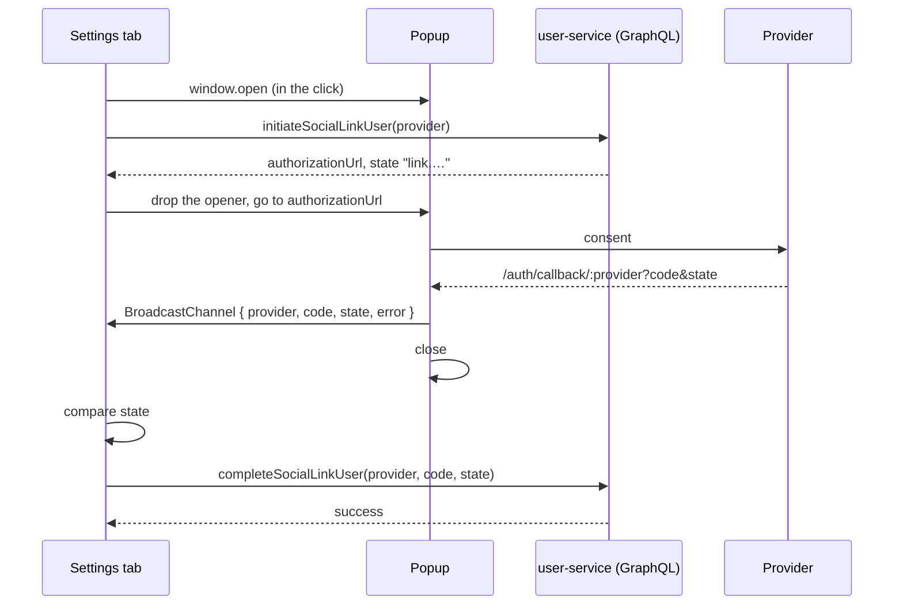

# Architecture: Social Account Linking in Settings

> **Amendment 2026-11-27 — three linked-tile styles (product owner).** A linked tile renders one of
> three renderers chosen by a `tileStyle` prop that only Storybook sets (PRD L8, L9); the settings
> page always renders `tinted`. Two trial seams carry the toolkit components the other two styles
> mount. §2 lists the new pieces and §3 says why the switch is a prop, not a runtime setting, and
> why each style is built the way it is.

## 1. Flow

## 2. Pieces

| Piece            | Where                                                                                         |
| ---------------- | --------------------------------------------------------------------------------------------- |
| Pending contract | `src/api/contracts/pending/social-account-linking.graphql` (`# pending-against: v2.8.0`)      |
| Shared leaves    | `src/modules/user/lib/social-link/`: state guard, channel adapter, window navigator           |
| Repository       | settings `GraphQLSocialLinkRepository`; the list uses `queryDeduplication: false`             |
| Transformer      | settings `GraphQLSocialLinkTransformer`; zod results, `error_code` to failure kind            |
| Data provider    | settings `SocialLinkProvider`: `linked`, `start`, `complete`, `unlink`                        |
| Hooks            | `use-social-links`, `use-social-link-attempt`, `use-social-unlink`, `use-social-link-settle`  |
| View             | `social-networks` card and `social-tile`; notifications through `useNotifications().raise`    |
| Linked tiles     | `social-tile` renders `LINKED_TILES[tileStyle]`; `social-tile-badge`, `-labelled`, `-label`   |
| Tile styles      | `styles.ts` for `tinted` and the shared tile; `variant-styles.ts` for `badge` and `labelled`  |
| Trial seams      | `src/components/ui-status-badge`, `ui-outlined-small-button`; `trial` in `docs/ui-toolkit.md` |
| Trial stories    | `Settings/SocialNetworks/Comparison` (375 to 1440 px); per-style `Settings/SocialTile`        |
| Popup return     | auth `social-link-return-view` and `use-social-link-return`, chosen by the `link.` prefix     |
| Local mock       | `docker/apollo-server/lib/social-link-resolvers.ts`                                           |

## 3. Why these choices

- **`queryDeduplication: false`** on the list: StrictMode aborts the first request, and a
  deduplicated second one would reuse the aborted answer.
- **The `link.` prefix** rather than a popup check: `window.opener`, `window.toolbar` and
  `window.name` are each lost on some return from a provider, and storage is lost when the return
  lands on another origin. `state` travels in the URL.
- **A change touches one provider** (FR7): the tiles act only once the list has answered, and each
  result adds or removes its own provider, so the order of answers cannot undo a change.
- **`initiate` checks its signal after it answers** (FR6): an abort that fired during the call has
  already happened, so a listener added afterwards would never run. It checks `popup.closed` at
  the same point, so a popup closed during the call is never navigated.
- **`popup.closed` is not watched once the popup leaves** (FR6, 2026-11-27): it is read only in
  the check above, while the popup is still the tab's own `about:blank` and the flag is reliable.
  A provider page that sends `Cross-Origin-Opener-Policy` moves the popup to another
  browsing-context group, and the tab's reference then reads `closed === true` while the user is
  still on the consent page. A watch would settle the attempt `cancelled` and drop the callback
  that arrives later over the `BroadcastChannel`, which still reaches the tab across groups; a
  false `cancelled` that loses a link the user is completing is worse than a silent wait. The wait
  therefore ends on an answer, the next click or leaving the card, and the tiles are never held
  while it waits. How the real providers' pages behave stays a check for user-service #520 before
  production.
- **Closing the popup is best effort** (FR6): every ending calls `popup.close()`. It is certain
  while the popup is `about:blank` (an ending during `initiate`). Once the popup has been on the
  provider's page, the tab has set `popup.opener = null`, and a provider that sends
  `Cross-Origin-Opener-Policy` detaches the tab's reference for the rest of the popup's life, so
  the browser can ignore the call even on the callback page. The callback page closes itself
  (FR4); a window abandoned at the provider stays the user's to close.
- **Channel messages are narrowed by hand**: any same-origin page can post to the channel, and zod
  would reach the auth paint path through the callback page.
- **The tile style is a prop compared in Storybook, not a runtime setting** (PRD L9, owner
  2026-11-27): the styles are compared once, side by side at five widths, and the owner picks.
  A runtime setting would add a container-start check, a boot guard, a schema entry and a browser
  lane per style, all deleted again after the pick. The cost is the evidence limit in PRD L9:
  `badge` and `labelled` have no real-page browser or visual evidence during the trial.
- **One renderer per style, in its own file**: `LinkedTile` stays in `social-tile.tsx`;
  `BadgeLinkedTile` and `LabelledLinkedTile` have their own files and share `TileLabel` and the
  base tile style with it. `styles.ts` is near the rust-code-analysis file limits, so their own
  styles live in `variant-styles.ts`. Removing the losers (S4.2) is file deletions plus the
  `tileStyle` prop (on `SocialNetworks`, `SocialNetworksCard`, `SocialList` and `SocialTile`),
  the `SocialTileStyle` type, `LINKED_TILES` and `LinkedTileRenderers`; the winner becomes the
  only linked renderer. Every renderer takes the same `SocialTileControlProps`, so the ref,
  `TileFocusHandler` and the L6 row are untouched (FR9, FR10).
- **Real toolkit components behind trial seams**: the status badge and the outlined small pill
  are the toolkit's own, mounted through `src/components/ui-status-badge` and
  `src/components/ui-outlined-small-button`, so the comparison shows what adopting them would
  ship. Each seam has a `uiToolkitSeams` entry, an ESLint policy pin, a story, a direct test and a
  `trial` row in `docs/ui-toolkit.md`, removed with its style if it loses.
- **The `UiActionIconBar` danger colours, not the component** (`badge`): its slot is 24 px, under
  NFR2's 44 px; it exposes no ref to its action, which FR9 and FR10 need; and it wraps one action
  in `role="group"`.
- **The status badge is `aria-hidden`** (`badge`): the hidden ", linked" status already speaks
  the state, so the tree stays identical to `tinted`'s. The toolkit needs a non-blank `label`
  (a blank one warns in development), hence the `settings.social.linked_badge` key.
- **A real 2px border and a container query** (`labelled`): an inset ring loses its weight in
  forced colours, and the pill folds by its tile's width, not the viewport's, because a tile in
  the two-column grid does not follow the viewport. jsdom cannot evaluate container queries, so
  the fold is shown in Storybook.
- **The neutral outlined pill and CRM's focus ring** (`labelled`): the danger pill's 3.89:1 text
  would need an axe exception, which NFR2 forbids, and the toolkit `focusOutline` is `#404142`,
  not the card's `#1A1C1E`.

## 4. Differences from the prototype

`crm-worktrees/social-account-linking` proved the flow. Changed here: results raise #392's
notifications, recorded in the bell history; the prefix instead of `isPopup()`; no cross-window storage; FR1, FR6, FR7 and the split
`already_linked` / `provider_linked` kinds.

## 5. Upstream

user-service #520 must settle L3 and L4 and provide the three refusal codes of FR11.
