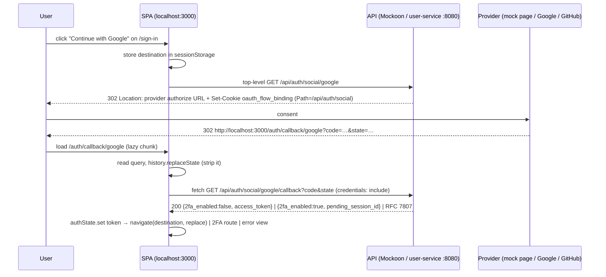

# Architecture: Social Sign-In

Predecessors: [research](research-social-sign-in-2026-11-18.md) ·
[PRD](prd-social-sign-in-2026-11-18.md).

**Fit statement (from `.claude/react-sdlc.yml`):** React 19 + TypeScript + MUI v9 (Emotion) SPA,
client state in the zustand `useAuthStore` (the auth token included), tsyringe DI with per-area composition roots, React Router v7 route
registry, RSBuild, react-i18next. The feature slots into the existing `user` module's `auth`
feature on the Apollo GraphQL data layer (§7); the edits outside it are listed in §6. No new
top-level directory.

> **Revision 2026-11-19 — GraphQL only, no ADR.** The SPA talks to user-service over GraphQL
> only, never REST, and the feature carries no ADR. user-service exposes social sign-in only as
> REST, so this plan declares two pending GraphQL mutations for it to add —
> `initiateSocialSignInUser` (returns the provider's `authorizationUrl` and a `state`) and
> `completeSocialSignInUser` (returns a `signInUser`-shaped payload) — in
> `src/api/contracts/pending/social-sign-in.graphql`, answered locally by the Apollo mock. The
> state is bound to the tab in `sessionStorage` instead of a cross-origin cookie. Rows below marked
> _(2026-11-19)_ supersede the earlier text.
>
> **§7 is the current design.** §§1-5 are kept as the history of the superseded REST relay
> (cookie-bound state, credentialed `fetch`, Mockoon social routes), none of which is built. The kit
> check and component of §2, the route, the 2FA text of §3.4 and the `[no-adr]` line of §4 still hold;
> where §§1-5 disagree with §7, §7 wins.

## 1. End-to-end flow (historical: superseded REST relay, see §7)



## 2. Component and layer inventory (historical, see §7)

> The inventory below is the 2026-11-18 plan. The landed files are listed in §6 and §7.

### UI kit check

| Need on the callback screen        | Kit component                                        | Status                                            |
| ---------------------------------- | ---------------------------------------------------- | ------------------------------------------------- |
| Deferred spinner + polite announce | `RouteFallback` (`minHeight`, `message`)             | exists                                            |
| Heading, body text                 | `UITypography`                                       | exists                                            |
| "Try again" button                 | `UIButton`                                           | exists                                            |
| "Back to sign in" link             | `UILink` / `UITextLink` (ui-toolkit)                 | exists                                            |
| Error message container            | none with a polite `role="status"` + focused heading | **new feature component** `SocialSignInErrorView` |
| Provider buttons                   | `AuthProviderButtons` (feature)                      | exists, behaviour change only                     |

No new `UI*` kit component is required. One feature-local presentational component is new.

### New and changed files

| Layer (path under `src/`)                                                                                | Kind                     | Change                                                                                                                                                   |
| -------------------------------------------------------------------------------------------------------- | ------------------------ | -------------------------------------------------------------------------------------------------------------------------------------------------------- |
| `routes/route-paths.ts`                                                                                  | config                   | add `socialCallback: '/auth/callback/:provider'`                                                                                                         |
| `modules/user/features/auth/routes/index.ts`                                                             | route contract           | add the public route, `load: () => import(/* webpackChunkName: "social-callback" */ './social-callback')`, `meta.titleKey: 'auth.social.callback_title'` |
| `modules/user/features/auth/routes/social-callback/index.tsx`                                            | page                     | reads params, renders loading / error / redirect                                                                                                         |
| `modules/user/features/auth/routes/social-callback/use-social-callback.ts`                               | hook                     | single-flight relay, state machine `idle → relaying → done/error`                                                                                        |
| `modules/user/features/auth/components/social-sign-in-error-view/index.tsx` (+ `styles.ts`, story)       | component                | `role="alert"` region, focused `<h1>`, recovery actions                                                                                                  |
| `modules/user/features/auth/components/form-section/components/auth-provider-buttons/oauth-providers.ts` | singleton                | correct path, same-tab navigation, destination store, flag filter                                                                                        |
| `modules/user/features/auth/utils/browser-navigator.ts`                                                  | singleton                | add `assign(url)`; keep `openInNewTab` only if another caller remains (otherwise delete it — dead code)                                                  |
| `modules/user/features/auth/utils/social-sign-in-destination-source.ts`                                  | singleton (`*Source`)    | `save(path)` / `take()` over `sessionStorage`, internal-path validation, `try/catch` on storage                                                          |
| `modules/user/features/auth/utils/social-provider-guard.ts`                                              | singleton (`*Guard`)     | narrows a route param to `SocialProvider`                                                                                                                |
| `modules/user/features/auth/repositories/social-auth-api.ts`                                             | `@injectable` repository | `callback(provider, { code, state }, { signal })` → `HttpsClient.get` with `credentials: 'include'`, schema-validated, **no** `retry`                    |
| `modules/user/features/auth/repositories/social-auth-error-mapper.ts`                                    | `@injectable` mapper     | RFC 7807 `error_code` → `SocialSignInErrorKind`                                                                                                          |
| `modules/user/features/auth/utils/response-schemas.ts`                                                   | contract                 | `SocialCallbackResponseSchema` (zod discriminated union on `2fa_enabled`), `ProblemResponseSchema` reuse                                                 |
| `modules/user/features/auth/stores/auth-store-actions.ts`                                                | actions                  | `completeSocialSignIn(...)` — sets token, emits security signals through `AuthSecuritySignals`                                                           |
| `modules/user/config/{tokens,di}.ts`                                                                     | DI                       | `AUTH_TOKENS.SocialAuthAPI`, `AUTH_TOKENS.SocialAuthErrorMapper`                                                                                         |
| `modules/user/features/auth/types/social-sign-in/*.ts`                                                   | type-only                | `SocialProvider`, `SocialCallbackResult`, `SocialSignInErrorKind`, component props                                                                       |
| `services/types/https-client/*` + `services/https-client/http-request-config-builder.ts`                 | infra                    | `RequestConfig.credentials?: RequestCredentials \| undefined` passed to `fetch`                                                                          |
| `services/observability/pii-scrubber.ts`                                                                 | infra                    | scrub `code`, `state`, `pending_session_id`, `access_token`, `refresh_token` keys and query params                                                       |
| `config/api-config.ts`                                                                                   | config                   | `SOCIAL_AUTH_INITIATE(provider)` and `SOCIAL_AUTH_CALLBACK(provider)` paths                                                                              |
| `api/contracts/README.md`                                                                                | contract                 | "Pending REST operations" entry naming the schemas and the upstream SHA (PRD D3)                                                                         |
| `modules/user/features/auth/i18n/{en,uk}.json` → `make i18n-generate`                                    | i18n                     | `auth.social.*` keys                                                                                                                                     |

Out of `src/`:

| Path                                            | Change                                                                                                                                                                                                                                 |
| ----------------------------------------------- | -------------------------------------------------------------------------------------------------------------------------------------------------------------------------------------------------------------------------------------- |
| `scripts/mockoon-social-oauth.js`               | builds the social routes for the selected mode from the container environment and merges them into the imported environment (refuses to shadow a route the spec already declares)                                                      |
| `scripts/docker/mockoon-entrypoint.sh`          | runs the merge, then `exec mockoon-cli start`                                                                                                                                                                                          |
| `Mockoon.Dockerfile`                            | `mockoon-cli import` the pinned spec at build time into `/app/base.json`; copy the script + entrypoint; `ENV MOCKOON_OAUTH_MODE=mock`, `MOCKOON_SPA_ORIGIN=http://localhost:3000`; `CMD` → entrypoint; healthcheck unchanged           |
| `docker-compose.yml`, `docker-compose.test.yml` | `mockoon.environment`: `MOCKOON_OAUTH_MODE`, `MOCKOON_OAUTH_GOOGLE_CLIENT_ID`, `MOCKOON_OAUTH_GITHUB_CLIENT_ID`, `MOCKOON_OAUTH_FACEBOOK_CLIENT_ID`, `MOCKOON_OAUTH_TWITTER_CLIENT_ID`, `MOCKOON_SPA_ORIGIN`; test compose pins `mock` |
| `.env.example`                                  | `OAUTH_MODE=mock`, empty `OAUTH_<P>_CLIENT_ID=` keys, `OAUTH_SPA_ORIGIN=http://${WEBSITE_DOMAIN}:${DEV_PORT}`                                                                                                                          |
| `Makefile`                                      | `make mockoon-restart` (recreate the mockoon service only); Bats manifest row                                                                                                                                                          |
| `tests/e2e/route-coverage.tsv`                  | row for `socialCallback`                                                                                                                                                                                                               |
| `docs/social-sign-in-local.md`                  | the local verification guide (published copy of the bundle guide)                                                                                                                                                                      |

## 3. Key designs (historical, see §7)

### 3.1 Initiation (`oauth-providers.ts`, paint path)

- Stays a container-free module singleton (render-path carve-out); no tsyringe, no zod.
- `onClick` → `socialSignInDestinationSource.save(currentFrom)` then
  `browserNavigator.assign(urlBuilder.build(API_ENDPOINTS.SOCIAL_AUTH_INITIATE(key)))`.
- `currentFrom` comes from the router location state passed in by `AuthProviderButtons`
  (`useLocation().state?.from`), so `oauth-providers.ts` exposes `list(from)` rather than reading
  globals.
- FR3 is withdrawn (PRD); the buttons carry no inert state.

### 3.2 Relay (`use-social-callback.ts`)

- Single flight: a module-level `Map<string, Promise<SocialCallbackResult>>` keyed by `state`
  inside an `*Cache` singleton (`SocialCallbackCache`), so StrictMode's second effect run reuses
  the first promise instead of spending the code twice (FR9). The entry is deleted on settle.
- Abort: the cache entry owns an `AbortController`; the last unmount aborts, aborted results are
  ignored (§6).
- Sequence: guard provider (`SocialProviderGuard`) → `history.replaceState(null, '', pathname)`
  → branch on `error` / missing params (no network) → `authActions.completeSocialSignIn(...)`.
- Authenticated on mount → `navigate('/', { replace: true })` (FR14).

### 3.3 Repository and errors

- `SocialAuthAPI extends BaseAPI`, `@inject(HTTP_TOKENS.HttpsClient)` and
  `@inject(AUTH_TOKENS.ApiErrorFactory)`, exactly the `LoginAPI` shape minus `retry: true`.
- `SocialAuthErrorMapper` reads `error_code` from the parsed problem body; HTTP status 0
  (timeout/network) → `unavailable`; anything unmapped → `generic`. The mapping table is the
  PRD FR12 table, encoded as a `Readonly<Record<string, SocialSignInErrorKind>>` lookup with an
  explicit `?? 'generic'` (satisfies `noUncheckedIndexedAccess`).

### 3.4 2FA hand-off (PRD D6)

_(Rewritten 2026-11-20; §7 is authoritative.)_ On a `twoFactorEnabled: true` result,
`SocialSignInProvider.settle()` ends any earlier session first (`session.signOut()` when the store
holds a token), then writes `{ ...signedOut, pendingSessionId }` to the memory-only auth store and
never a token. `SocialCallbackViewMapper.outcomeView` then replace-navigates to
`ROUTE_PATHS.twoFactorChallenge` with `state: { from }`, built from the saved destination and
consumed once; main's challenge page and `usePostLoginRedirect` finish the sign-in. The
`pendingSessionId` never enters the URL, router or history state, or `sessionStorage` (NFR7).

### 3.5 Mockoon overlays

```text
mockoon container start
  └─ mockoon-entrypoint.sh
       ├─ node mockoon-social-oauth.js /app/base.json /tmp/mockoon-env.json
       │      (mode, SPA origin and client IDs read from MOCKOON_* at start; bad values exit 1)
       └─ exec mockoon-cli start --data /tmp/mockoon-env.json --port 8080
```

Routes the script adds (mode `mock`):

| Route                                     | Response                                                                                                                                                                                                                                                                                                           |
| ----------------------------------------- | ------------------------------------------------------------------------------------------------------------------------------------------------------------------------------------------------------------------------------------------------------------------------------------------------------------------ |
| `GET /api/auth/social/:provider`          | rule `provider` ∉ enum → `400 unsupported_provider`; else `302 Location: /__mock-oauth/{{urlParam 'provider'}}/authorize?state=<uuid>` + `Set-Cookie: oauth_flow_binding=<uuid>; Path=/api/auth/social; HttpOnly; SameSite=Lax`                                                                                    |
| `GET /__mock-oauth/:provider/authorize`   | `200 text/html` consent page: one link per scenario → `${MOCKOON_SPA_ORIGIN}/auth/callback/<provider>?code=<scenario>&state=<state>`, plus "Deny" → `?error=access_denied&state=…`                                                                                                                                 |
| `GET /api/auth/social/:provider/callback` | rules on cookie presence (absent → `400 missing_oauth_parameters`) then on `code`: `mock-success` → 200 tokens; `mock-2fa` → 200 pending; `mock-unverified`, `mock-no-email`, `mock-expired`, `mock-invalid-state`, `mock-mismatch`, `mock-duplicate`, `mock-unavailable` → matching problem; default → 200 tokens |
| `OPTIONS` on the above                    | CORS preflight answer                                                                                                                                                                                                                                                                                              |

Mode `provider` differs only in the initiate route: when
`MOCKOON_OAUTH_<P>_CLIENT_ID` is non-empty it redirects to the real authorize URL

| Provider | Authorize URL template                                                                                                                                                                         |
| -------- | ---------------------------------------------------------------------------------------------------------------------------------------------------------------------------------------------- |
| google   | `https://accounts.google.com/o/oauth2/v2/auth?response_type=code&client_id=…&redirect_uri=${SPA}/auth/callback/google&scope=openid%20email%20profile&state=…&prompt=select_account`            |
| github   | `https://github.com/login/oauth/authorize?client_id=…&redirect_uri=${SPA}/auth/callback/github&scope=read:user%20user:email&state=…`                                                           |
| facebook | `https://www.facebook.com/v19.0/dialog/oauth?client_id=…&redirect_uri=${SPA}/auth/callback/facebook&scope=email&state=…`                                                                       |
| twitter  | `https://x.com/i/oauth2/authorize?response_type=code&client_id=…&redirect_uri=${SPA}/auth/callback/twitter&scope=users.read%20tweet.read&state=…&code_challenge=…&code_challenge_method=plain` |

and the callback answers 200 tokens for any `code` (no exchange — the client secret is never
needed in this mode).

> Assumption A5 (resolved in S1.1): Mockoon renders `Set-Cookie` before the other headers and
> scopes `setVar` to one header template, so the state is generated with `setGlobalVar` inside
> `Set-Cookie` and read with `getGlobalVar` in `Location`. Verified against the built image: the
> cookie and the `state` query match on every initiate. A global var can race only under
> concurrent initiates, which a single local developer does not produce.

### 3.6 Mode `backend`

Documented only (guide §5): run user-service from its repository with
`OAUTH_<P>_CLIENT_ID/SECRET` and `OAUTH_<P>_REDIRECT_URI=http://localhost:3000/auth/callback/<p>`,
`CORS_ALLOW_ORIGIN='^http://localhost:(3000|3001)$'`, and point the SPA at it with
`REACT_APP_MOCKOON_URL` in the local `.env`. No crm code depends on this mode.

## 4. Cross-cutting constraints (historical, see §7)

- **Paint path (ADR-011, ADR-017).** The callback page, hook, repository, mapper and zod schema
  load only in the `social-callback` chunk and the deferred auth-actions chunk. The button
  module gains a `sessionStorage` write and a same-tab navigation only.
- **DI gates (#128, #130).** The page calls `authActions` (container-free composition root);
  `SocialAuthAPI` and the mapper arrive through tokens. `SocialSignInDestinationSource`,
  `SocialProviderGuard` and `SocialCallbackCache` join `EXEMPT_RENDER_PATH_FILES` only if they
  sit in a gated directory (`utils/` is gated — so they are added to
  `config/di-collaborator-policy.js` with that rationale).
- **Class naming (#129).** `SocialAuthAPI` (`*API`), `SocialAuthErrorMapper` (`*Mapper`),
  `SocialSignInDestinationSource` (`*Source`), `SocialProviderGuard` (`*Guard`),
  `SocialCallbackCache` (`*Cache`) — all existing suffixes.
- **Route registry (#105, #116).** The route gets its `errorElement` from the composer; the
  manifest row and an E2E spec land in the same story.
- **Security.** Destination validation reuses the issue-#150 internal-path check; the callback
  page never renders query values; `Referrer-Policy` unchanged.
- **ADR drift** _(2026-11-19)_. The feature carries no ADR by the owner's decision; the pull request uses the documented `[no-adr]` escape hatch for the `src/routes/**` change.

## 5. Test strategy (historical, see §7)

| Layer       | Where                                                                                 | What                                                                                                                                                                     |
| ----------- | ------------------------------------------------------------------------------------- | ------------------------------------------------------------------------------------------------------------------------------------------------------------------------ |
| Unit        | `tests/unit/modules/user/features/auth/**`                                            | providers list/navigation, destination source (storage throws), guard, mapper table, cache single-flight, hook state machine with StrictMode, error view a11y (jest-axe) |
| Integration | `tests/integration/**` with msw                                                       | `SocialAuthAPI` + mapper + `completeSocialSignIn` against every FR12 response, credentials flag, deadline                                                                |
| E2E         | `tests/e2e/modules/social-sign-in.spec.ts`, `tests/e2e/mobile/social-sign-in.spec.ts` | every mock-consent scenario, destination restore, double-click guard, history stripped (`page.url()`), keyboard-only path                                                |
| Visual      | `tests/visual/social-callback.spec.ts`                                                | loading + three representative error kinds, desktop + mobile projects                                                                                                    |
| A11y E2E    | `tests/e2e/a11y/routes.a11y.spec.ts`                                                  | picks up the new route automatically from `route-paths.ts`                                                                                                               |
| Script      | `tests/unit/scripts/mockoon-social-oauth.test.js`                                     | mode selection, bad mode/origin, route order, state binding, consent links, callback responses, credentialed CORS                                                        |

## 6. Implementation notes (2026-11-18)

What changed against this design while building it on the `main` of the day, and why:

| Planned                                                                        | Built                                                                                                                                                     | Reason                                                                                                     |
| ------------------------------------------------------------------------------ | --------------------------------------------------------------------------------------------------------------------------------------------------------- | ---------------------------------------------------------------------------------------------------------- |
| `SocialAuthAPI` + `SocialAuthErrorMapper` + `authActions.completeSocialSignIn` | `GraphQLSocialSignInRepository` → `SocialSignInTransformer` → `SocialSignInProvider` (`AUTH_TOKENS.SocialSignIn*`), resolved through `AuthProviderLoader` | `main` moved auth to the data provider / repository / transformer layering password recovery uses          |
| `oauth-providers.ts` navigates itself                                          | `socialSignInNavigator` (`start`, `restart`) shared by the buttons and the callback's "Try again"                                                         | One owner of the three hops: into the callback page, out to the returned `authorizationUrl`, and the retry |
| `AuthStateVar`                                                                 | `useAuthStore` (zustand)                                                                                                                                  | `main` replaced the reactive var                                                                           |
| Feature flags per provider                                                     | none (S2.2 withdrawn)                                                                                                                                     | `main` retired every runtime flag                                                                          |
| `pending/social-auth.openapi.yaml`                                             | `pending/social-sign-in.graphql` and zod schemas for its two mutations (§7)                                                                               | `pending/` is GraphQL-only                                                                                 |
| Abort the relay on unmount (NFR8)                                              | the relay counts the pages that share it and aborts once none is left _(2026-11-24)_                                                                      | StrictMode unmounts once on mount, and aborting would spend the single-use code on a cancelled request     |
| `jq` merge, Bats suite                                                         | Node merge script that adds the one consent page, with its Jest suites (page, rules, image)                                                               | No new image package; the mode logic lives in the Apollo mock and its suite                                |
| E2E against Mockoon                                                            | E2E stubs both mutations with `page.route`                                                                                                                | The suite stays deterministic (NFR12); the mock and its consent page have their own Apollo and Jest suites |
| Visual baselines for the callback states (S4.1)                                | recorded 2026-11-19 in CI (W5 closed)                                                                                                                     | They were first deferred: baselines come from the production stack, which this laptop's rules keep CI-only |
| No new axe exception (superseded, readiness W7)                                | `#social-sign-in-actions > .MuiButton-contained` (issue #276)                                                                                             | The primary action reuses the design-owned `#1EAEFF` button, like the recovery in-card links               |

Edits outside `modules/user/features/auth` and why each is there:

- `src/routes/`: the `socialCallback` path and the `socialStart` marker of the navigation state.
- `src/modules/user/config/{di,tokens}.ts`: the social tokens and registrations; the settings
  registrations moved unchanged to `src/modules/user/features/settings/di.ts`, which it composes.
- `src/services/observability/`: the callback scrubber (NFR7).
- `src/api/contracts/`, `src/api/generated/`: the pending contract and its generated operations (D3).
- `src/utils/url-builder.ts` is removed, and with it the `mockoonUrl()` reader of
  `src/config/env/raw-env.ts` (S4.3).
- `docker/`, `Mockoon.Dockerfile`, `scripts/mockoon-social-oauth.js`, `scripts/docker/`, `Makefile`,
  `.env.example`: the local back end (S1.1, S1.2).
- `scripts/local-stack/start.sh` and its Bats suite: a separate developer fix for the local stack's
  user-service e-mail workers, carried by this pull request; no requirement depends on it.
- `config/di-collaborator-policy.js`, `docs/`, `CONTRIBUTING.md`, `CLAUDE.md`, `AGENTS.md` and the
  module READMEs: the gates' policy entries and the documentation (S1.3, S4.2, S4.3).

## 7. GraphQL design (2026-11-19)

```mermaid
sequenceDiagram
    participant U as User
    participant SPA as SPA (/auth/callback/:provider)
    participant G as GraphQL (Apollo mock / user-service)
    participant P as Provider (mock page / Google / GitHub)
    U->>SPA: click provider button (in-app, state socialStart)
    SPA->>G: initiateSocialSignInUser(provider)
    G-->>SPA: authorizationUrl, state
    SPA->>SPA: sessionStorage state; location.replace(authorizationUrl)
    U->>P: consent
    P-->>SPA: /auth/callback/:provider?code&state
    SPA->>SPA: state equals the saved one? strip the query
    SPA->>G: completeSocialSignInUser(provider, code, state)
    G-->>SPA: accessToken | pendingSessionId | error (extensions.error_code)
```

| Piece            | Where                                                                                                                                                                                                                                                                                                                                                                                                                                                                                              |
| ---------------- | -------------------------------------------------------------------------------------------------------------------------------------------------------------------------------------------------------------------------------------------------------------------------------------------------------------------------------------------------------------------------------------------------------------------------------------------------------------------------------------------------- |
| Pending contract | `src/api/contracts/pending/social-sign-in.graphql`; operations `initiate-social-sign-in.graphql`, `complete-social-sign-in.graphql` beside the repository; types from `make codegen`                                                                                                                                                                                                                                                                                                               |
| Repository       | `GraphQLSocialSignInRepository` (Apollo client, `no-cache`, zod-parsed: http(s) `authorizationUrl`, non-empty `state`, token or pending session)                                                                                                                                                                                                                                                                                                                                                   |
| Transformer      | `SocialSignInTransformer`: `toStart`, `toOutcome`, `fromFailure` (no answer at all → `unavailable`, `extensions.error_code` → kind, else `generic`, an HTTP error status and an unparsable body included), `signalOf` (the reason code and status of an answered failure, HTTP-level or GraphQL; `network` only when nothing answered)                                                                                                                                                             |
| Data provider    | `SocialSignInProvider.start` / `.complete`; a session or a pending 2FA challenge starts through `SocialSignInDeps` (the auth store, the security signals, `session`: `authSessionProvider`, `signedOut`: `CLEARED_AUTH_STATE`), ending any earlier session first, as main's `SignInSubmitProcessor` does; _(2026-11-24)_ a completion is dropped as `aborted` when the store's token or pending session changed at any point while it ran, which a store subscription held for the request records |
| 2FA hand-off     | `SocialCallbackViewMapper.outcomeView` maps a `two-factor` outcome to a replace redirect to `ROUTE_PATHS.twoFactorChallenge` with `{ from }` built from the saved destination; main's challenge page and `usePostLoginRedirect` finish the sign-in                                                                                                                                                                                                                                                 |
| Tab binding      | `SocialSignInFlowSource` in `sessionStorage`: the destination, validated twice and consumed once by `takeDestination()` after a sign-in; `provider:state`, read without consuming so StrictMode sees one answer                                                                                                                                                                                                                                                                                    |
| Navigation       | `SocialSignInNavigator`: `start` pushes the callback page, `restart` replaces it, `leave` uses `location.replace` so Back from the provider returns to sign-in, `consumeStart` spends the entry's start marker so Back never starts again (FR15)                                                                                                                                                                                                                                                   |
| Page             | `useSocialCallback` + `useSocialCallbackRelay` (one relay per history entry, whose query is stripped, so one per `state`) + `SocialCallbackViewMapper` (`starting`, `relaying`, `leaving`, `failed`, `redirect`)                                                                                                                                                                                                                                                                                   |
| Pending view     | `SocialSignInPendingView`: `RouteFallback` with the localized loading text, for every view but `failed`                                                                                                                                                                                                                                                                                                                                                                                            |
| Leak protection  | `SocialCallbackTextScrubber` (`src/services/observability/`), run by `PiiTextScrubber`: redacts `code` and `state` values, plain and percent-encoded, behind plain or percent-encoded names, in every event and breadcrumb (NFR7)                                                                                                                                                                                                                                                                  |
| Local mock       | `docker/apollo-server/lib/social-sign-in-resolvers.ts` (stateful, `OAUTH_MODE`); Mockoon serves only the mock consent page                                                                                                                                                                                                                                                                                                                                                                         |
| Removed          | the REST `credentials` option of `HttpsClient`, the REST schemas, Mockoon's social routes and CORS, ADR-004; `src/utils/url-builder.ts`, whose last consumers each side of the #331 merge had removed                                                                                                                                                                                                                                                                                              |
