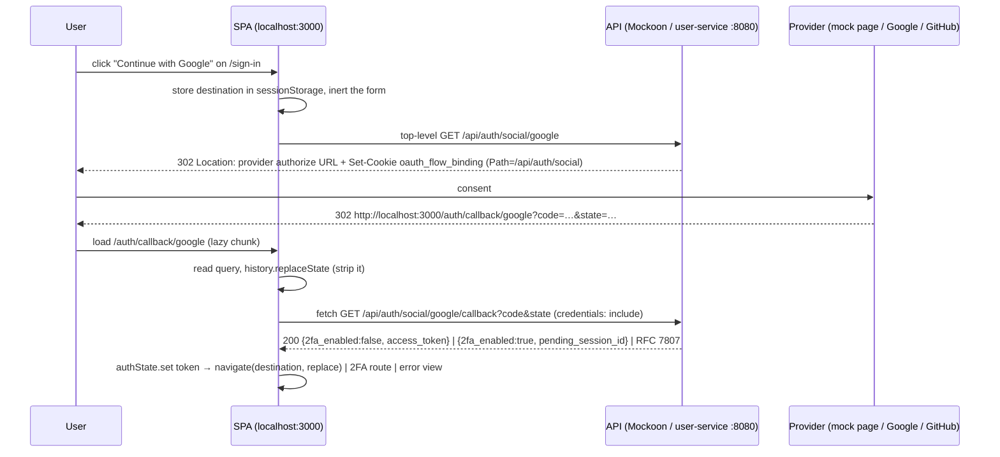

# Architecture: Social Sign-In

Predecessors: [research](research-social-sign-in-2026-11-18.md) ·
[PRD](prd-social-sign-in-2026-11-18.md).

**Fit statement (from `.claude/react-sdlc.yml`):** React 19 + TypeScript + MUI v9 (Emotion) SPA,
reactive-var client state, tsyringe DI with per-area composition roots, React Router v7 route
registry, RSBuild, react-i18next. All new code slots into the existing `user` module's `auth`
feature, the shared `services/https-client` layer, `config/runtime`, and `docker/` — no new
top-level directory.

## 1. End-to-end flow



## 2. Component and layer inventory

### UI kit check

| Need on the callback screen        | Kit component                              | Status                                            |
| ---------------------------------- | ------------------------------------------ | ------------------------------------------------- |
| Deferred spinner + polite announce | `RouteFallback` (`minHeight`, `message`)   | exists                                            |
| Heading, body text                 | `UITypography`                             | exists                                            |
| "Try again" button                 | `UIButton`                                 | exists                                            |
| "Back to sign in" link             | `UILink` / `UITextLink` (ui-toolkit)       | exists                                            |
| Error message container            | none with `role="alert"` + focused heading | **new feature component** `SocialSignInErrorView` |
| Provider buttons                   | `AuthProviderButtons` (feature)            | exists, behaviour change only                     |

No new `UI*` kit component is required. One feature-local presentational component is new.

### New and changed files

| Layer (path under `src/`)                                                                                | Kind                     | Change                                                                                                                                                   |
| -------------------------------------------------------------------------------------------------------- | ------------------------ | -------------------------------------------------------------------------------------------------------------------------------------------------------- |
| `routes/route-paths.ts`                                                                                  | config                   | add `socialCallback: '/auth/callback/:provider'`                                                                                                         |
| `modules/user/features/auth/routes/index.ts`                                                             | route contract           | add the public route, `load: () => import(/* webpackChunkName: "social-callback" */ './social-callback')`, `meta.titleKey: 'auth.social.callback_title'` |
| `modules/user/features/auth/routes/social-callback/index.tsx`                                            | page                     | reads params, renders loading / error / redirect                                                                                                         |
| `modules/user/features/auth/routes/social-callback/use-social-callback.ts`                               | hook                     | single-flight relay, state machine `idle → relaying → done/error`                                                                                        |
| `modules/user/features/auth/components/social-sign-in-error-view/index.tsx` (+ `styles.ts`, story)       | component                | `role="alert"` region, focused `<h1>`, recovery actions                                                                                                  |
| `modules/user/features/auth/components/form-section/components/auth-provider-buttons/oauth-providers.ts` | singleton                | correct path, same-tab navigation, destination store, flag filter                                                                                        |
| `modules/user/features/auth/utils/browser-navigator.ts`                                                  | singleton                | add `assign(url)`; keep `openInNewTab` only if another caller remains (otherwise delete it — dead code)                                                  |
| `modules/user/features/auth/utils/social-sign-in-destination-source.ts`                                  | singleton (`*Source`)    | `save(path)` / `take()` over `sessionStorage`, internal-path validation, `try/catch` on storage                                                          |
| `modules/user/features/auth/utils/social-provider-guard.ts`                                              | singleton (`*Guard`)     | narrows a route param to `SocialProvider`                                                                                                                |
| `modules/user/features/auth/repositories/social-auth-api.ts`                                             | `@injectable` repository | `callback(provider, { code, state }, { signal })` → `HttpsClient.get` with `credentials: 'include'`, schema-validated, **no** `retry`                    |
| `modules/user/features/auth/repositories/social-auth-error-mapper.ts`                                    | `@injectable` mapper     | RFC 7807 `error_code` → `SocialSignInErrorKind`                                                                                                          |
| `modules/user/features/auth/utils/response-schemas.ts`                                                   | contract                 | `SocialCallbackResponseSchema` (zod discriminated union on `2fa_enabled`), `ProblemResponseSchema` reuse                                                 |
| `modules/user/features/auth/stores/auth-store-actions.ts`                                                | actions                  | `completeSocialSignIn(...)` — sets token, emits security signals through `AuthSecuritySignals`                                                           |
| `modules/user/config/{tokens,di}.ts`                                                                     | DI                       | `AUTH_TOKENS.SocialAuthAPI`, `AUTH_TOKENS.SocialAuthErrorMapper`                                                                                         |
| `modules/user/features/auth/types/social-sign-in/*.ts`                                                   | type-only                | `SocialProvider`, `SocialCallbackResult`, `SocialSignInErrorKind`, component props                                                                       |
| `services/types/https-client/*` + `services/https-client/http-request-config-builder.ts`                 | infra                    | `RequestConfig.credentials?: RequestCredentials \| undefined` passed to `fetch`                                                                          |
| `services/observability/pii-scrubber.ts`                                                                 | infra                    | scrub `code`, `state`, `pending_session_id`, `access_token`, `refresh_token` keys and query params                                                       |
| `config/api-config.ts`                                                                                   | config                   | `SOCIAL_AUTH_INITIATE(provider)` and `SOCIAL_AUTH_CALLBACK(provider)` paths                                                                              |
| `api/contracts/README.md`                                                                                | contract                 | "Pending REST operations" entry naming the schemas and the upstream SHA (PRD D3)                                                                         |
| `modules/user/features/auth/i18n/{en,uk}.json` → `make i18n-generate`                                    | i18n                     | `auth.social.*` keys                                                                                                                                     |

Out of `src/`:

| Path                                                | Change                                                                                                                                                                                                                                 |
| --------------------------------------------------- | -------------------------------------------------------------------------------------------------------------------------------------------------------------------------------------------------------------------------------------- |
| `scripts/mockoon-social-oauth.js`                   | builds the social routes for the selected mode from the container environment and merges them into the imported environment (refuses to shadow a route the spec already declares)                                                      |
| `scripts/docker/mockoon-entrypoint.sh`              | runs the merge, then `exec mockoon-cli start`                                                                                                                                                                                          |
| `Mockoon.Dockerfile`                                | `mockoon-cli import` the pinned spec at build time into `/app/base.json`; copy the script + entrypoint; `ENV MOCKOON_OAUTH_MODE=mock`, `MOCKOON_SPA_ORIGIN=http://localhost:3000`; `CMD` → entrypoint; healthcheck unchanged           |
| `docker-compose.yml`, `docker-compose.test.yml`     | `mockoon.environment`: `MOCKOON_OAUTH_MODE`, `MOCKOON_OAUTH_GOOGLE_CLIENT_ID`, `MOCKOON_OAUTH_GITHUB_CLIENT_ID`, `MOCKOON_OAUTH_FACEBOOK_CLIENT_ID`, `MOCKOON_OAUTH_TWITTER_CLIENT_ID`, `MOCKOON_SPA_ORIGIN`; test compose pins `mock` |
| `.env.example`                                      | `OAUTH_MODE=mock`, empty `OAUTH_<P>_CLIENT_ID=` keys, `OAUTH_SPA_ORIGIN=http://${WEBSITE_DOMAIN}:${DEV_PORT}`                                                                                                                          |
| `Makefile`                                          | `make mockoon-restart` (recreate the mockoon service only); Bats manifest row                                                                                                                                                          |
| `tests/e2e/route-coverage.tsv`                      | row for `socialCallback`                                                                                                                                                                                                               |
| `docs/social-sign-in-local.md`                      | the local verification guide (published copy of the bundle guide)                                                                                                                                                                      |
| `docs/adr/0NN-social-sign-in-spa-callback-relay.md` | ADR for D1/D2 (the `ROUTE_PATHS`/registry change trips the ADR drift gate)                                                                                                                                                             |

## 3. Key designs

### 3.1 Initiation (`oauth-providers.ts`, paint path)

- Stays a container-free module singleton (render-path carve-out); no tsyringe, no zod.
- `onClick` → `socialSignInDestinationSource.save(currentFrom)` then
  `browserNavigator.assign(urlBuilder.build(API_ENDPOINTS.SOCIAL_AUTH_INITIATE(key)))`.
- `currentFrom` comes from the router location state passed in by `AuthProviderButtons`
  (`useLocation().state?.from`), so `oauth-providers.ts` exposes `list(from)` rather than reading
  globals.
- FR3: `AuthProviderButtons` lifts a `started` flag through the existing `oauthInert` path of
  `AuthFormSection` (it already inerts the box while a form submits) — no new inert mechanism.

### 3.2 Relay (`use-social-callback.ts`)

- Single flight: a module-level `Map<string, Promise<SocialCallbackResult>>` keyed by `state`
  inside an `*Cache` singleton (`SocialCallbackCache`), so StrictMode's second effect run reuses
  the first promise instead of spending the code twice (FR9). The entry is deleted on settle.
- Abort: the effect owns an `AbortController`; unmount aborts, aborted results are ignored.
- Sequence: guard provider (`SocialProviderGuard`) → `history.replaceState(null, '', pathname)`
  → branch on `error` / missing params (no network) → `authActions.completeSocialSignIn(...)`.
- Authenticated on mount → `navigate('/', { replace: true })` (FR14).

### 3.3 Repository and errors

- `SocialAuthAPI extends BaseAPI`, `@inject(HTTP_TOKENS.HttpsClient)` and
  `@inject(AUTH_TOKENS.ApiErrorFactory)`, exactly the `LoginAPI` shape minus `retry: true`.
- `SocialAuthErrorMapper` reads `error_code` from the parsed problem body; HTTP status 0
  (timeout/network) → `unavailable`; anything unmapped → `generic`. The mapping table is the
  PRD FR12 table, encoded as a `Readonly<Record<string, SocialSignInErrorKind>>` lookup with an
  explicit `?? 'generic'` (satisfies `noUncheckedIndexedAccess`).

### 3.4 2FA hand-off (PRD D6)

`completeSocialSignIn` returns `{ kind: 'two-factor', pendingSessionId }`. The page navigates to
`ROUTE_PATHS.twoFactorChallenge` with the pending session in **router state** (never the URL)
when that key exists; otherwise it renders `SocialSignInErrorView` with kind
`two_factor_required`. Story S3.3 is the only place that branches on the 2FA route's presence and
is re-planned when PR #377 merges.

### 3.5 Mockoon overlays

```text
mockoon container start
  └─ mockoon-entrypoint.sh
       ├─ node mockoon-social-oauth.js /app/base.json /tmp/mockoon-env.json
       │      (mode, SPA origin and client IDs read from MOCKOON_* at start; bad values exit 1)
       └─ exec mockoon-cli start --data /tmp/mockoon-env.json --port 8080
```

Routes the script adds (mode `mock`):

| Route                                     | Response                                                                                                                                                                                                                                                                                                           |
| ----------------------------------------- | ------------------------------------------------------------------------------------------------------------------------------------------------------------------------------------------------------------------------------------------------------------------------------------------------------------------ |
| `GET /api/auth/social/:provider`          | rule `provider` ∉ enum → `400 unsupported_provider`; else `302 Location: /__mock-oauth/{{urlParam 'provider'}}/authorize?state=<uuid>` + `Set-Cookie: oauth_flow_binding=<uuid>; Path=/api/auth/social; HttpOnly; SameSite=Lax`                                                                                    |
| `GET /__mock-oauth/:provider/authorize`   | `200 text/html` consent page: one link per scenario → `${MOCKOON_SPA_ORIGIN}/auth/callback/<provider>?code=<scenario>&state=<state>`, plus "Deny" → `?error=access_denied&state=…`                                                                                                                                 |
| `GET /api/auth/social/:provider/callback` | rules on cookie presence (absent → `400 missing_oauth_parameters`) then on `code`: `mock-success` → 200 tokens; `mock-2fa` → 200 pending; `mock-unverified`, `mock-no-email`, `mock-expired`, `mock-invalid-state`, `mock-mismatch`, `mock-duplicate`, `mock-unavailable` → matching problem; default → 200 tokens |
| `OPTIONS` on the above                    | CORS preflight answer                                                                                                                                                                                                                                                                                              |

Mode `provider` differs only in the initiate route: when
`MOCKOON_OAUTH_<P>_CLIENT_ID` is non-empty it redirects to the real authorize URL

| Provider | Authorize URL template                                                                                                                                                                         |
| -------- | ---------------------------------------------------------------------------------------------------------------------------------------------------------------------------------------------- |
| google   | `https://accounts.google.com/o/oauth2/v2/auth?response_type=code&client_id=…&redirect_uri=${SPA}/auth/callback/google&scope=openid%20email%20profile&state=…&prompt=select_account`            |
| github   | `https://github.com/login/oauth/authorize?client_id=…&redirect_uri=${SPA}/auth/callback/github&scope=read:user%20user:email&state=…`                                                           |
| facebook | `https://www.facebook.com/v19.0/dialog/oauth?client_id=…&redirect_uri=${SPA}/auth/callback/facebook&scope=email&state=…`                                                                       |
| twitter  | `https://x.com/i/oauth2/authorize?response_type=code&client_id=…&redirect_uri=${SPA}/auth/callback/twitter&scope=users.read%20tweet.read&state=…&code_challenge=…&code_challenge_method=plain` |

and the callback answers 200 tokens for any `code` (no exchange — the client secret is never
needed in this mode).

> Assumption A5 (resolved in S1.1): Mockoon renders `Set-Cookie` before the other headers and
> scopes `setVar` to one header template, so the state is generated with `setGlobalVar` inside
> `Set-Cookie` and read with `getGlobalVar` in `Location`. Verified against the built image: the
> cookie and the `state` query match on every initiate. A global var can race only under
> concurrent initiates, which a single local developer does not produce.

### 3.6 Mode `backend`

Documented only (guide §5): run user-service from its repository with
`OAUTH_<P>_CLIENT_ID/SECRET` and `OAUTH_<P>_REDIRECT_URI=http://localhost:3000/auth/callback/<p>`,
`CORS_ALLOW_ORIGIN='^http://localhost:(3000|3001)$'`, and point the SPA at it with
`REACT_APP_MOCKOON_URL` in the local `.env`. No crm code depends on this mode.

## 4. Cross-cutting constraints

- **Paint path (ADR-011, ADR-017).** The callback page, hook, repository, mapper and zod schema
  load only in the `social-callback` chunk and the deferred auth-actions chunk. The button
  module gains a `sessionStorage` write and a same-tab navigation only.
- **DI gates (#128, #130).** The page calls `authActions` (container-free composition root);
  `SocialAuthAPI` and the mapper arrive through tokens. `SocialSignInDestinationSource`,
  `SocialProviderGuard` and `SocialCallbackCache` join `EXEMPT_RENDER_PATH_FILES` only if they
  sit in a gated directory (`utils/` is gated — so they are added to
  `config/di-collaborator-policy.js` with that rationale).
- **Class naming (#129).** `SocialAuthAPI` (`*API`), `SocialAuthErrorMapper` (`*Mapper`),
  `SocialSignInDestinationSource` (`*Source`), `SocialProviderGuard` (`*Guard`),
  `SocialCallbackCache` (`*Cache`) — all existing suffixes.
- **Route registry (#105, #116).** The route gets its `errorElement` from the composer; the
  manifest row and an E2E spec land in the same story.
- **Security.** Destination validation reuses the issue-#150 internal-path check; the callback
  page never renders query values; `Referrer-Policy` unchanged.
- **ADR drift.** `src/routes/**` and `src/config/**` changes require the new ADR in the same PR.

## 5. Test strategy

| Layer       | Where                                                                                 | What                                                                                                                                                                     |
| ----------- | ------------------------------------------------------------------------------------- | ------------------------------------------------------------------------------------------------------------------------------------------------------------------------ |
| Unit        | `tests/unit/modules/user/features/auth/**`                                            | providers list/navigation, destination source (storage throws), guard, mapper table, cache single-flight, hook state machine with StrictMode, error view a11y (jest-axe) |
| Integration | `tests/integration/**` with msw                                                       | `SocialAuthAPI` + mapper + `completeSocialSignIn` against every FR12 response, credentials flag, deadline                                                                |
| E2E         | `tests/e2e/modules/social-sign-in.spec.ts`, `tests/e2e/mobile/social-sign-in.spec.ts` | every mock-consent scenario, destination restore, double-click guard, history stripped (`page.url()`), keyboard-only path                                                |
| Visual      | `tests/visual/social-callback.spec.ts`                                                | loading + three representative error kinds, desktop + mobile projects                                                                                                    |
| A11y E2E    | `tests/e2e/a11y/routes.a11y.spec.ts`                                                  | picks up the new route automatically from `route-paths.ts`                                                                                                               |
| Script      | `tests/unit/scripts/mockoon-social-oauth.test.js`                                     | mode selection, bad mode/origin, route order, state binding, consent links, callback responses, credentialed CORS                                                        |

## 6. Implementation notes (2026-11-18)

What changed against this design while building it on the `main` of the day, and why:

| Planned                                                                        | Built                                                                                                                                              | Reason                                                                                                           |
| ------------------------------------------------------------------------------ | -------------------------------------------------------------------------------------------------------------------------------------------------- | ---------------------------------------------------------------------------------------------------------------- |
| `SocialAuthAPI` + `SocialAuthErrorMapper` + `authActions.completeSocialSignIn` | `SocialSignInRepository` → `SocialSignInTransformer` → `SocialSignInProvider` (`AUTH_TOKENS.SocialSignIn*`), resolved through `AuthProviderLoader` | `main` moved auth to the data provider / repository / transformer layering password recovery uses                |
| `oauth-providers.ts` navigates itself                                          | `socialSignInNavigator` (`start`, `restart`) shared by the buttons and the callback's "Try again"                                                  | One owner of the initiate URL                                                                                    |
| `AuthStateVar`                                                                 | `useAuthStore` (zustand)                                                                                                                           | `main` replaced the reactive var                                                                                 |
| Feature flags per provider                                                     | none (S2.2 withdrawn)                                                                                                                              | `main` retired every runtime flag                                                                                |
| `pending/social-auth.openapi.yaml`                                             | hand-written zod schemas, README "Pending REST operations"                                                                                         | `pending/` is GraphQL-only                                                                                       |
| Abort the relay on unmount (NFR8)                                              | the relay is never aborted; an unmounted page ignores its result                                                                                   | StrictMode unmounts once on mount, and aborting would spend the single-use code on a cancelled request           |
| `jq` merge, Bats suite                                                         | Node merge script, Jest suite, built image probed route by route                                                                                   | No new image package; the mode logic is testable in Jest                                                         |
| E2E against Mockoon                                                            | E2E stubs the initiate and callback responses with `page.route`                                                                                    | The e2e stack serves the SPA and the API on different sites, so the `SameSite=Lax` flow cookie cannot flow there |
| Visual baselines for the callback states (S4.1)                                | not recorded                                                                                                                                       | Baselines come from `make test-visual-update` on the production stack, which this laptop's rules keep CI-only    |
| No new axe exception                                                           | `#social-sign-in-actions > .MuiButton-contained` (issue #276)                                                                                      | The primary action reuses the design-owned `#1EAEFF` button, like the recovery in-card links                     |
