# Architecture: two-factor authentication for the user module

**Author:** BMad (Architect) **Date:** 2026-10-06 **Feature:** `two-factor-authentication`

Predecessors: [research](./research-two-factor-authentication-2026-10-06.md),
[brief](./brief-two-factor-authentication-2026-10-06.md) and the authoritative
[PRD](./prd-two-factor-authentication-2026-10-06.md) (FR-1 to FR-45 with FR-2 withdrawn, NFR-1 to
NFR-22). The PRD decides _what_; this document decides _how_. Every claim about existing code
cites the file and line it was read from (`58099168`). Decisions this stage took on its own are
marked `> Assumption:`. The pieces this feature imports from #315 and #330 are listed in §14.

**Prerequisites and landing order.** chore #332 (typed-boundaries-gate, draft PR #333) and chore
`zustand-client-state` (#334, lands before #315) → #315 Epic 0 (Stories 0.1–0.2) → #330.
The bundles land #315 → #330 → #331 (planning contract §3.4). chore #332 ships the TB-1 gate, its
burn-down and the `*Transformer` suffix; chore `zustand-client-state` adds `zustand`, an ADR
superseding ADR-008, removes the zustand ESLint ban and its contract test, migrates
`AuthStateVar`, `ConnectivityStateVar` and `src/lib/state/*` to Zustand stores (the auth one is
`useAuthStore`, §6.2) and measures the paint budget; #315 ships the board folders, the shared
User domain and the shared pieces of §14; #330 ships the settings page, the Bearer link, the
route flag gate and the session-ended notice. This bundle imports all of them, builds none of
them, adds no TB-1 selector and creates no store.

**Typed boundaries and the board's layers (2026-10-08).** Every value that crosses a layer is a
named interface or class from a type-only file (TB-1, §2.5), and board types cross component and
form boundaries as themselves (TB-2). The layers are the Miro board's — `[component]<route>` →
`React hook` → `[Data provider]` ⇄ `[Transformer]` → `[Repository]` → API — with no frontend
Controller, Service or Handler (§2.4, §19).

**Simplification 2026-10-08.** The user applied all ten items of
`_planning-shared/over-engineering-review-2026-10-08.md` and decided that data is reached only
through GraphQL repositories ("we use only graphql"). What changed:

- **Sign-in is GraphQL only.** The REST `LoginAPI` / `AuthRepositoryImpl.login` path, its
  `/api/users` endpoint constant and `LoginResponseMapper` are removed (§6.19); the
  `SignInProvider` Strategy and its legacy implementation are gone. `GraphQLSignInProvider` is
  the one sign-in Data provider. Registration already uses the GraphQL `createUser` mutation
  (`registration-api.ts:46-56`) and is untouched.
- **The `twoFactorAuth` flag gates only the 2FA section** on #330's `/settings` page. It no
  longer selects a transport, and the challenge route is not flag-gated: a sign-in that returns
  a challenge must always reach it (§6.15).
- **No service-role class on either step.** `TwoFactorChallengeActions` and `AuthStateActions`
  are gone: the challenge hook resolves `GraphQLSignInProvider` through #315's
  `AuthProviderLoader`, writes `useAuthStore` itself and records the challenge signal (§6.3).
  Sign-in takes the same shape: `useSignInSubmit` resolves the provider through the loader and
  writes the `AuthStatePatch` itself (§6.1). Only the sign-in path leaves `AuthStoreActions` and
  `DeferredAuthActions`; their registration and logout methods stay as they are.
- **One owner per shared piece.** The settings shell, `SessionLinkFactory` with its anonymous
  operation set, `RouteFlagGate`, the error-red token, the `UIForm` `footer`, the
  `session_ended` notice and `settings/utils/response-schemas.ts` with its policy entry are
  #330's; `AuthCard`, `InCardLink`, `UIForm` `errorAction` and `titleRef`, the arrival notice
  pieces, `useAbortableSubmit`, `UserServiceErrorTransformer` and the loader are #315's. No
  "first lander builds it" branch remains. The mock reads no token, as #330's does; every
  401/403 branch comes from msw and `page.route`.
- **Smaller pieces.** The local mock is stateless (happy path, the challenge branch, one
  violation per mutation that takes input); the settings security signal and its deps bag are
  dropped, so `TwoFactorSettingsProvider` takes three `@inject` collaborators and the registrar
  gains no closure; the classification appends rows to #315's step list with no 3a/7a slots;
  `PendingChallenge`, the aborted outcome variants, the twin banner and field-error types and
  the `busy` view flag are collapsed; the disable and regenerate confirmations are one view.

**Client state in Zustand (2026-10-08).** The user: "change the react state var to zustand". Client
and UI state lives in Zustand stores made with `create`, one per concern; the auth one is
`useAuthStore` (`@auth/stores/use-auth-store.ts`, `create<AuthState>()`), built by the
prerequisite chore `zustand-client-state`. This feature only adds fields to `AuthState`. Reads are
selectors (`useAuthStore((s) => s.twoFactorStatus)`); writes come from hooks through
`useAuthStore.setState(patch)` with a named `AuthStatePatch`; the store holds no logic and no
actions class. Server state stays in Apollo and the GraphQL repositories, and the token and the
pending session id stay memory-only, with no `persist` middleware. `AuthStateVar`,
`ReactiveVarFactory` and `useReactiveVar` are replaced by the chore; the diagrams were redrawn
first.

**Reconciliation 2026-10-27.** The plan now builds on real code: branch
`feat/331-two-factor-authentication` at `77f59152`, stacked on #362 (app shell, local), #330
(PR #354, head `9c1d2535`) and #315 (PR #340), which sit on `main` with #311 and #333. None of
the three stacked changes is merged. Line citations elsewhere in this document are against
`58099168` and may have moved. Where a section below and this list disagree, this list and the
`Code facts (reconciled 2026-10-27)` notes win; `> Assumption (reconciliation 2026-10-27)` blocks
record the judgment calls. The corrections:

1. **No ADR from 003 up exists** (`docs/adr/README.md` lists 001 and 002 only). ADR-007, 008,
   016, 017, 019 and 021 cited here are not files. ADR-020 is not written: the decisions of §15
   become a `## Two-factor authentication decisions` section in `src/modules/user/README.md`,
   beside `## Password recovery decisions` and `## User Settings decisions`, and the
   pull-request body carries a `[no-adr]` line for `make check-adr-drift` (the #315 and #330
   precedent). The toolkit seam register is `docs/ui-toolkit.md`; the theme rule cited as
   ADR-017 is the `ThemedChunkLoader` + `muiThemeShellLoader` chain in `src/providers/mui-theme/`.
2. **State is Zustand, as planned.** `useAuthStore` (`@auth/stores/use-auth-store.ts`,
   `create<AuthState>()`, exported `CLEARED_AUTH_STATE`), rules in ADR-002 "Current rules" and
   `docs/state-architecture.md`. `AuthState` today is `email`, `token`, `user`, `loginLoading`,
   `loginError`, `registerLoading`, `registerError` (`@auth/types/auth-store.ts`); the store
   seeds the token from `sandboxDemoSessionProvider.restore()` or the preloaded seed.
3. **The error transformer lives in `src/modules/user/transformers/`**, not `user/lib/`:
   `user-service-error-transformer.ts` behind the barrel `transformers/index.ts`, decorated
   `@injectable()` and registered with `registerSingleton` under
   `AUTH_TOKENS.UserServiceErrorTransformer`, not by value. Its shipped order: aborted;
   `networkError` → status; violation lines whose prefix is in `VIOLATION_PROPERTIES`; the
   exact-message map `MESSAGE_REASONS`; a numeric `extensions.status` → `STATUS_REASONS` (5xx →
   `server`); `extensions.code` present → `unknown`, else `refused`. The 2FA rows of §6.8 are
   appended as `'twoFactorCode'` in `VIOLATION_PROPERTIES`, `[423, 'locked']` in
   `STATUS_REASONS`, six `MESSAGE_REASONS` entries and seven `UserServiceFailureReason` literals
   (`src/modules/user/types/user-service/user-service-failure.ts`). The file already holds ten
   functions: rows only, never a new method.
4. **#330's pieces exist as planned**, at these paths: `SessionLinkFactory`
   (`@auth/repositories/session-link-factory.ts`, imported by path, not from the barrel; its
   anonymous set is `CreateUser`, `RequestPasswordReset`, `ConfirmPasswordReset`, `SignInUser`,
   `CompleteTwoFactorUser`; session end also calls `sandboxDemoSession.signOut()`),
   `RouteFlagGate` (`src/routes/route-flag-gate.tsx`, scalar `flag` on `RouteCommon`),
   `paletteColors.error.text` `#C62828` (`src/styles/colors.ts`), the `UIForm` `footer`, the
   toast primitive, and `settings/utils/response-schemas.ts` with its
   `EXEMPT_RENDER_PATH_FILES` entry (`config/di-collaborator-policy.js:180`). The local mock reads
   no token and throws no 401 (`docker/apollo-server/lib/server.ts` context returns `{}`).
5. **No `twoFactorAuth` flag yet.** `FeatureFlag` is `'userSettings'` alone
   (`src/config/runtime/types/feature-flag.ts`), and `forgotPassword` is gone. The compose
   precedent is `APP_CONFIG_FLAG_USER_SETTINGS=${APP_CONFIG_FLAG_USER_SETTINGS:-true}`
   (`docker-compose.test.yml:24`). The settings contract (`settings/routes/index.ts`) flags
   `/settings` and three coming-soon sub-routes with `userSettings` and declares
   `shell.userMenu`.
6. **The `/settings` layout is #330's plus #362's.** `UserProfile`
   (`settings/routes/user-profile/index.tsx`) renders `UIShellContent` → heading →
   `SettingsGrid` (`settings/components/settings-grid/`), whose single child is a profile column
   (`UserProfileSettings` above `SocialNetworks`). The 2FA card is the grid's second child: above
   1024 px an implicit column (`gridAutoFlow: 'column'`, `gridAutoColumns: 'minmax(0,
29.9375rem)'`), at and below 1024 px a second row. Content is left-aligned beside #362's
   sidebar. There is no home settings link: #362's sidebar and user-chip menu
   (`settings/components/user-menu/`) link `/settings`.
7. **The outlet context is `{ signOut }` and two types extend it.**
   `ShellSlotHostProps extends ProtectedOutletContext` (`src/routes/types/shell-slot.ts`) and
   `SignOutState extends ProtectedOutletContext` (`@auth/types/sign-out.ts`); the home page no
   longer reads the context (`src/features/home/index.tsx`). Widening it (§6.6) therefore
   declares `SignOutContext` in `src/routes/types/protected-outlet-context.ts` itself (a routes
   type may not import `@auth`) and moves both extensions onto it.
8. **Sign-in shows a result card (#315).** A settled failure renders `RegistrationNotification`
   with `flow="signIn"`: a focused h2, an alert filled after mount, "Назад" always and
   "Спробувати ще раз" only when `onRetry` is passed
   (`@auth/components/form-section/auth-forms/registration-error-view.tsx`). A sign-in shows the
   success card whose "Продовжити" calls `postLogin.proceed()`; `usePostLoginRedirect` returns
   `{ signedIn, proceed }` and never navigates by itself (`@auth/hooks/use-post-login-redirect.ts`).
   `useLoginSubmitter` holds five functions and an abort-controller set, so "Назад" aborts a
   running request. `AuthStoreActions.login` short-circuits the sandbox demo credentials
   (`sandboxDemoSession.signIn`) before the repository.
9. **`UIForm` has no `errorAction`** (`src/components/types/ui-form/index.ts`: `titleRef`,
   `notice`, `footer`, `submitRef`, `submitSx`, `onInvalid`, `submitSpacing`), and
   `useAbortableSubmit` is `src/hooks/use-abortable-submit.ts` with `isSubmitting` and `submit`
   only (aborts on unmount, exposes no abort). #331 now owns `errorAction` beside
   `submitBlockedReason`.
10. **The registrar is at its function cap.** `UserModuleRegistrar` (`src/modules/user/config/
di.ts`) has ten functions (`register`, eight `register*` steps, `buildAuthRepositoryDeps`)
    and four closures, 14 of the 15 allowed (`config/metrics-policy.json`), and already registers
    #330's `ProfileProvider`, `GraphQLProfileRepository`, `GraphQLProfileTransformer` and
    `UserDisplayNameMapper`. "Keeps nine functions" below is wrong. A new composition root is not
    free either: `DI_COMPOSITION_ROOTS` (`.dependency-cruiser.js:17-24`) and the
    `composition-roots` exemption (`config/di-collaborator-policy.js:84-91`) admit only
    `src/modules/<m>/config/di.ts` (§7.2).
11. **Copy placement follows `config/i18n-catalog-policy.json`.** The settings catalog is lazy,
    so `settings.two_factor.*` never reaches `src/i18n/localization.json`. `CardBackControl`'s
    "Назад" (`password_recovery.back`) sits in the lazy recovery catalog that `RecoveryPageLayout`
    registers.
12. **Auth form sections share two chunks** (`scripts/auth-forms-chunk-group.ts`, pinned by
    `tests/unit/tooling/auth-forms-chunk-group.test.ts`): each auth page is a small route chunk
    that lazily loads a `*-form-section` chunk (`webpackPreload`), and the form-section chunk names
    are listed so shared modules come from the cached `auth-forms` chunks.
13. **The toolkit pin is v0.8.0** (`package.json:14`, `docs/ui-toolkit.md`); `ui-pin-input` is in
    the pinned build (`config/ui-toolkit-checksums.json`); seams are listed in `uiToolkitSeams`
    (`eslint.config.mjs:529-540`). Shipped primitives replace two planned ones: the `UICheckbox`
    seam for the codes acknowledgement, and #330's `UILinkButton`
    (`src/components/ui-link-button/`) for the challenge mode toggle.
14. **Mock and contract.** `GRAPHQL_SCHEMA_VERSION=v2.8.0` (`.env.example:84`); the generated
    file has no sign-in or 2FA operation (`src/api/generated/graphql.ts`). A pending file must
    open with `# pending-against: v2.8.0` (`scripts/ci/check-pending-contracts.sh`).
    `docker/apollo-server/lib/resolvers.ts` spreads `profileResolvers`; a violation is
    `rejectViolation(property, reason)` (`docker/apollo-server/lib/violations.ts`): message
    `<property>: <reason>`, `extensions: { code: 'BAD_USER_INPUT', status: 422 }`, no
    `extensions.violations`.
15. **More specs stub the REST login** than §6.19 lists: also
    `tests/e2e/a11y/home-keyboard.a11y.spec.ts`, `tests/e2e/modules/coming-soon.spec.ts`,
    `tests/e2e/modules/user/features/auth/runtime-config.spec.ts` (`LOGIN_PATH`) and the settings
    `settings.spec.ts` and `settings-session.spec.ts`. GraphQL stubs dispatch on `operationName`
    with `route.fallback()` (`tests/e2e/modules/user/features/settings/utils/profile-stub.ts`).
16. **Counts moved.** `A11Y_EXCEPTIONS` holds ten entries (`tests/utils/a11y/axe-config.ts`), not
    four; Lighthouse audits eight URLs (`lighthouse/constants.js:15-29`), not three.
17. **Story changes** (epics, reconciliation 2026-10-27): no story is deleted, because #330 and
    #362 built none of this bundle's own pieces. Story 1.2 records the decisions in the module
    README; Story 2.1 also lands `UIForm` `errorAction`; Story 2.4 is rewritten to the result-card
    delta; Story 2.6 takes the two `ArrivalNotice` members from 2.7 (the notice table is typed per
    member, so `tsc` needs them where the hook first names them); Story 2.3's browser-spec
    migration becomes the new Story 2.9; Story 3.4 is split, its leaf pieces becoming the new
    Story 3.1; the former Story 3.1 (low-codes notice) is renumbered 3.6. bmalph sorts stories by
    number and parses only `N.M` ids, so split parts take whole numbers. 25 stories.
18. **Before `bmalph implement`:** `.ralph/@fix_plan.md` holds #362's plan with ten completed
    `Story N.M` lines, and bmalph's `syncFixPlan` carries completed ids into the new plan; move
    it aside first, or 2FA Stories 1.1, 2.1 to 2.5 and 3.1 to 3.4 start checked.

## Miro alignment

Board "Frontend C4 Architecture VilnaCRM" (`uXjVMG64hTs=`), captured 2026-10-08; screenshots in
`_planning-shared/miro/`. Every node of the diagrams below maps to one board element; §19 holds
the full per-class table and the justified gaps.

Screenshots: `01` = `01-user-auth-component.png`, `05` = `05-interactive-access-control.png`,
`20` / `21` = `20-user-module-code-top.png` / `21-user-module-code-bottom.png`.

Diagram node (this document) → board frame and element (screenshot):

- `TwoFactorChallenge` page, `/sign-in/two-factor` → User module (code), `2FA [component]<route>`
  (20).
- `TwoFactorDto` → User module (code), `2FADTO [type]` (20).
- `SignIn` page and `SignInDto` (#315) → User module (code), `SignIn <route>` → `SignInDTO` (20).
- `UserProfile` page, `/settings` (#330) → User module (code), `UserProfile [component]<route>`
  (21).
- `UserEntity` (#315 Story 0.2, shared) → User module (code), `UserEntity [type]` (21).
- `TwoFactorSettings` section → `2FASettings [component]` (21); component level `2FA` (01).
- `TwoFactorSettingsEntity` → User module (code), `2FADTOSettingsEntity [type]` (21).
- `use*` hooks → Interactive access control, `React hook` (05).
- `TwoFactorSettingsProvider`, `GraphQLSignInProvider` → `EntityProvider [Data provider]` (05).
- `GraphQL*Transformer` and `UserServiceErrorTransformer` → `GraphQLTransformer [Transformer]`
  (05).
- `GraphQL*Repository` → `GraphQLEntityRepository [Repository]` (05).
- `useAuthStore` → `State [Redux]`, drawn `State [Zustand]`, edge "2 save JWT token", written by
  the sign-in and challenge hooks (01).
- `ProtectedRoute` and #330's `RouteFlagGate` → `MutationAccessGuard [Decorator]` (05).
- user-service GraphQL → `API [Software System]`, edge "1 request to API" (01).

## 1. Approach summary

A brownfield extension of the `user` module in two features: the challenge step joins the
existing `auth` feature, and the 2FA section (`TwoFactorSettings`, board `2FASettings`) fills the
slot #330 leaves on its `UserProfile` page in the `settings` feature. Seven new classes, each with
logic a test can observe, no new module-level singleton, and nothing new on the eager path beyond
one route key and one route entry; the coordination lives in React hooks (§6.18).

```text
/sign-in ──signInUser──▶ 2FA off: token ───────────────▶ redirect-back target (issue #150)
   │                     2FA on : pendingSessionId ────▶ /sign-in/two-factor
   │                              (memory, never token)    │ completeTwoFactorUser
   │◀── Назад · expiry · lock (one-time notice) ───────────┤ token ─▶ target
   │                                                       └ ≤ 2 codes left ─▶ notice ─▶ /settings
/settings (#330) ─ TwoFactorSettings: off ─▶ setup ─▶ confirm ─▶ codes ─▶ on
                                     on ─▶ disable · regenerate (sudo 403)
```

Nine decisions shape everything below:

1. **Sign-in is GraphQL only, through one Data provider.** `useSignInSubmit` resolves
   `GraphQLSignInProvider` through #315's `AuthProviderLoader` and calls `login`, which calls the
   transport-only `GraphQLSignInRepository` and the two Transformers; the hook writes the
   `AuthStatePatch`. The REST login path is removed (§6.1, §6.19).
2. **The challenge lives in `useAuthStore`, never in `token`** (D4). `AuthState` gains
   `pendingSessionId`, `recoveryCodesRemaining` and `twoFactorStatus`;
   `isAuthenticated = !!token` (`auth-store-selectors.ts:14-16`) and the null-to-token redirect
   stay correct (§6.2).
3. **Completion goes through #315's loader.** The challenge hook resolves
   `GraphQLSignInProvider` through `AuthProviderLoader` (`@auth/stores/index.ts`), writes the
   token patch to `useAuthStore` itself and records the signal; no actions class is added
   (§6.3).
4. **The challenge route is a plain public route guarded by its page**, always registered and
   never flag-gated (§6.4).
5. **The 2FA section lives in `features/settings`** and reaches `useAuthStore` only through the
   protected outlet context `ProtectedRoute` already provides and fills from the store (§2.3,
   §6.6).
6. **Transport is #330's.** `SessionLinkFactory` adds the Bearer header and ends the session on
   a transport `401`; its anonymous set, also #330's, already lists this feature's two
   anonymous operations (§6.7).
7. **One translation layer, two halves, both `[Transformer]`s.** #315's
   `UserServiceErrorTransformer` turns every Apollo failure into a `UserServiceFailure`; this
   feature appends its rows. One feature Transformer per feature maps that, per operation, to a
   named outcome. Repositories only send documents (§6.8, §8).
8. **Reuse before build.** `UiPinInput` is adopted as the `UIPinInput` seam (ADR-016); the QR
   encoder is `qrcode-generator` (MIT), imported by the settings chunk only (§6.10, §6.11).
9. **One flag, one job.** `twoFactorAuth` (default `false`) decides whether `TwoFactorSettings`
   renders in #330's page; the test stack turns it on in Story 4.1 (§6.15).

## 2. Terms and boundaries

### 2.1 Glossary

The research glossary (research §6) is reused unchanged: 2FA, authenticator app, TOTP secret,
otpauth URI, TOTP code, recovery code, recovery codes remaining, enrolment (setup, confirm),
two-factor challenge, pending session, challenge completion, access token, refresh token, known
2FA status, disable, regenerate, sudo window, lockout, rate limit, uniform credential response.
The crm side adds:

- **Pending session id** — `AuthState.pendingSessionId: string | null`, the client's handle on
  the pending session; memory only.
- **2FA DTO** — `TwoFactorDto` (board `2FADTO`), the code a person submits as user-service's
  `twoFactorCode` on the challenge, the confirm step and the disable step.
- **2FA settings entity** — `TwoFactorSettingsEntity` (board `2FADTOSettingsEntity`): the
  account's known status plus, while on screen, the `otpauthUri`, the `secret` and the recovery
  codes (`RecoveryCodeSet`) user-service returned.
- **Recovery-codes notice** — `AuthState.recoveryCodesRemaining`, set from a completion that
  reported two or fewer codes, cleared on dismiss, on `/settings`, on logout and on reload.
- **Known 2FA status** — `AuthState.twoFactorStatus`, `'enabled' | 'disabled' | 'unknown'`;
  `unknown` until a sign-in or a settings outcome reports it, and again after the logout reset.
- **Protected outlet context** — `ProtectedOutletContext`, the typed value `ProtectedRoute`
  hands every protected page (`signOut` today, issue #106); it gains `twoFactorStatus`,
  `setTwoFactorStatus` and `banner`.
- **Upstream failure** — `UserServiceFailure` (#315), one interface: a `reason`, the `status`
  when one arrived, and the `violations` (§6.8).
- **Anonymous operation** — `SignInUser`, `CompleteTwoFactorUser`, `CreateUser`: sent without
  `Authorization` and never a reason to end the session.
- **Arrival notice** — a one-time `notice` marker in `RedirectNavigationState`, an
  `ArrivalNotice` shown once on `/sign-in` by #315's `SignInNotice`: #315 declares
  `password_reset`, #330 appends `session_ended`, and this feature appends `two_factor_expired`
  and `account_locked`.

### 2.2 Boundary with user-service

2FA belongs to user-service, which holds every 2FA rule; crm is a client of it over GraphQL only
(the user, 2026-10-08). The boundary is drawn at the board's Repository and Transformer layers:

- `GraphQLSignInRepository` (auth) and `GraphQLTwoFactorSettingsRepository` (settings) send the
  generated documents and return the generated `*Mutation` payloads or rethrow the Apollo error.
  They decide nothing and call no Transformer.
- `GraphQLSignInProvider` and `TwoFactorSettingsProvider` hand the payload to their feature
  Transformer, or the caught error to `UserServiceErrorTransformer` and its `UserServiceFailure`
  to the feature Transformer.
- `GraphQLSignInTransformer` and `GraphQLTwoFactorSettingsTransformer` parse `data` with zod and
  turn it, and every `UserServiceFailure`, into named crm results: `SignInResult`,
  `ChallengeResult`, `TwoFactorSettingsOutcome`. The sign-in Transformer decides the uniform
  answer: every `401`, `422` and domain refusal on sign-in becomes the same
  `invalid_credentials` failure with no status attached (NFR-3).
- No GraphQL type, error, status or English message crosses upward. Generated types stay in
  `repositories/`, `transformers/`, `*-mutation.ts` and `response-schemas.ts`, and appear as
  `import type` in the two Data-provider bodies (TB-1 exception (i), a review item).

### 2.3 Placement under the sibling-feature ban

`no-cross-feature-imports` forbids any edge between sibling features
(`.dependency-cruiser.js:591-602`), and `tsPreCompilationDeps: true` (`:852`) makes an
`import type` an edge too. Placement follows from that and from `config/module-shape.json`:

- **Challenge route, its page, completion and the low-codes notice → `features/auth`.** They
  reuse `AuthPageLayout`, `useAuthStore` and the sign-in result, and must stay container-free
  (`no-paint-path-import-di-bridge`, `.dependency-cruiser.js:484-503`).
- **The `TwoFactorSettings` section → `features/settings`**, beside #330's `UserProfile` page.
  Its Data provider, Transformer and Repository live in `data-providers/`, `transformers/` and
  `repositories/` (the first two folders added by #315 Story 0.1). Settings is not on the auth
  paint path, so its hooks resolve the Data provider through `useService`
  (`src/providers/di/use-service.ts:6-8`).
- **Known 2FA status → `AuthState` in `useAuthStore`**, reached by the settings feature through
  `ProtectedOutletContext` (`src/routes/types/protected-outlet-context.ts`), a type both features
  already import (`protected-route/index.tsx:4`, `src/features/home/index.tsx:10`).
- **`TwoFactorCodeNormalizer` → `src/modules/user/lib/`** beside #315's
  `UserServiceErrorTransformer`; `no-lib-to-features` (`:663-672`) keeps it feature-free and both
  features may import it. The board types `TwoFactorDto` and `TwoFactorSettingsEntity` → #315's
  shared User folder `src/modules/user/types/user/` (§2.6); the code-input unions both 2FA
  features share → `src/modules/user/types/two-factor/`.

Code facts (reconciled 2026-10-27): the transformer is not in `lib/` but in
`src/modules/user/transformers/` (list item 3); `src/modules/user/lib/` holds `api-errors/`,
`validations/` and `is-api-error.ts`, so the normalizer still goes there. The settings feature
imports nothing from `features/auth` today (no `@auth` import under `features/settings/`), and the
outlet context is reached through `ProtectedOutletContext`, which `ProtectedRoute` and `AppLayout`
type and the shell slot props extend (list item 7).

> Assumption: the settings feature reaches `useAuthStore` through the outlet context rather than
> a direct import, because `no-cross-feature-imports` forbids an edge from `features/settings` to
> `@auth/stores`, and the context is the seam the module already built for this shape of problem
> — sign-out reaches protected pages through it (`src/modules/user/README.md:75-82`). It adds no
> class, no token, no second store and no second owner of the token.

### 2.4 Layer map: the board's stack in this feature

The board's L3 stack (Interactive access control, `miro/05`; Onboarding component, `miro/22-23`)
is the architecture of both features. Arrows point at what a layer depends on:

```text
[component]<route> → [React component] → React hook → [Data provider] ⇄ [Transformer]
          ↘ State                ↘ State                       ↓
                                                         [Repository] → API [Software System]
```

- **`[component]<route>`** — auth: `SignIn`, `TwoFactorChallenge`. Settings: #330's
  `UserProfile` (`/settings`).
- **`[React component]` / `[component]`** — auth: `LoginForm`, `TwoFactorChallengeForm`,
  `RecoveryCodesNotice`. Settings: `TwoFactorSettings` and its views, `QrCodeImage`.
- **`React hook`** — auth: `useLoginSubmitter`, `useSignInSubmit`, `useTwoFactorChallenge`,
  `useChallengeSubmit`, `useTwoFactorRedirect`. Settings: `useTwoFactorSettings`,
  `useTwoFactorSetup`, `useTwoFactorDisable`, `useRecoveryCodesRegenerate`, `useCopyToClipboard`.
- **`[Data provider]`** — auth: `GraphQLSignInProvider`. Settings: `TwoFactorSettingsProvider`.
  One implementation each, so no interface (contract §2).
- **`[Transformer]`** — auth: `GraphQLSignInTransformer`. Settings:
  `GraphQLTwoFactorSettingsTransformer`. Both: #315's `UserServiceErrorTransformer`. Only a Data
  provider calls a Transformer.
- **`[Repository]` + `Mutation [GraphQL]`** — auth: `GraphQLSignInRepository` and two documents.
  Settings: `GraphQLTwoFactorSettingsRepository` and four documents. Each takes `ApolloClient`
  alone.
- **`State [Redux]`** (drawn `State [Zustand]`) — `useAuthStore`, written through `setState` by
  `useSignInSubmit` after the password step and by the challenge hook after the code step (board
  Sign-In → State "2 save JWT token"). Settings reads and writes it only through
  `ProtectedOutletContext` (§6.6).
- **`[Decorator]`** — `ProtectedRoute`; #330's `RouteFlagGate` above it.
- **`[type]` `*Dto` / `*Entity`** — `SignInDto` (#315), `TwoFactorDto`,
  `TwoFactorSettingsEntity`, all plain data interfaces in the shared User folder (§2.6); the
  named outcomes, `TwoFactorChallengeInput` and the view states never take the `Dto` or `Entity`
  suffix (TB-2).

Infrastructure the board does not draw sits inside the box it serves: `AuthProviderLoader`
inside the Data provider box on the paint path, #330's `SessionLinkFactory` on the Repository →
API edge, `TwoFactorCodeNormalizer` inside the React hooks, `UserModuleRegistrar` in the
composition root, `AuthSecuritySignals` where it is called. There is no Controller, Service or
Handler class anywhere in this design (§19.1).

### 2.5 Typed boundaries (TB-1)

The canonical rule, shared verbatim by the #315, #330 and #331 bundles:

> **TB-1 Typed boundaries.** Every value that crosses a layer boundary is an instance of a
> **named type**: an exported `interface` declared in a type-only file (`types/` folder or
> `types.ts`, issue #88), a class, or a named alias declared in a type-only file whose whole
> body is a union of named types or literals, a callback type, or one generic or derived type
> whose arguments are named types (`type RecoveryRetry = () => Promise<void>`,
> `type LoadFailureReporter = Pick<…>`, `type AuthFailureCategory = Extract<…>`). A layer
> boundary is any of these positions:
>
> 1. the props of a `[component]` or `[component]<route>`;
> 2. the parameters and result of an exported React hook;
> 3. the constructor parameters, the parameters and return type (including a `Promise`'s
>    resolved type) of every non-private method, and every non-private property of a class in
>    the Data provider, Transformer, Repository, State, Guard, Factory or helper roles (the layer
>    map of the planning contract §2);
> 4. every value registered in or resolved from the DI container;
> 5. published state: reactive-var state, outlet context, router navigation state, toast and
>    notice payloads;
> 6. events and telemetry payloads (security signals, observability);
> 7. every member of an interface in a type-only file;
> 8. the return value of a test builder in `tests/builders/`.
>
> At those positions the following are **forbidden**:
>
> - **(a) Anonymous objects.** Inline object type literals `{ … }`, including object members of
>   a union (`{ kind: 'sent' } | { kind: 'failed' }`): each variant is a named interface
>   (`RecoverySentOutcome`, `RecoveryFailedOutcome`) and the union is a named alias of them. An
>   object shape is always declared with `interface`, never `type X = { … }`.
> - **(b) Tuples** `[A, B]`.
> - **(c) Bare arrays.**
>   - `T[]`, `readonly T[]`, `Array<T>` and `ReadonlyArray<T>` are forbidden as a parameter, a
>     return type, a class property, a hook result, an alias body or a nested array.
>   - A collection crosses only as a **named collection interface**, whose array property's
>     element type is itself a named interface or class:
>     `interface RecoveryCodeSet { readonly items: readonly RecoveryCode[] }` with
>     `interface RecoveryCode { readonly value: string }`.
>   - Arrays of primitives or literals (`readonly string[]`) are forbidden everywhere at a
>     boundary.
> - **(d) Catch-all payloads.** `any`, `object`, `Record<…>` and index signatures
>   (`[key: string]: …`). `unknown` is allowed in exactly two places:
>   - the parameter (never the return) of a method whose role is to narrow a caught error (a
>     `*Transformer`, `*Guard` or `*Detector`);
>   - the `error` / `cause` property of an error type.
> - **(e) Inline derived types.** `Omit`, `Pick`, `Partial` and `Required` written at the
>   boundary. Name the derivation once in a type-only file
>   (`export type ToastDraft = Omit<ToastItem, 'id'>;`) and use the name.
>
> **Allowed.**
>
> - Single scalar values (`string`, `number`, `boolean`, a named literal-union alias).
> - Named third-party types (`ReactNode` for `children`, `AbortSignal`, `TFunction`, `SxProps`,
>   `ApolloClient`, `RefObject<UserEntity>`).
> - Generics whose arguments are named types (`Promise<RecoveryOutcome>`).
> - Callback types whose parameters and results obey this rule.
> - `T | null` and `T | undefined`, written inline, where `T` is itself allowed here
>   (`RecoveryFailure | null`, `string | undefined`).
>
> **Exceptions.** No others:
>
> - **(i) Generated contract types.** Generated GraphQL/OpenAPI codegen types
>   (`src/api/generated/**`) are named, but they stay below the Data provider. They may appear
>   only in `repositories/`, `transformers/`, `*-mutation.ts` / `*-query.ts` contract modules,
>   `response-schemas.ts`, and as `import type` inside `data-providers/` bodies. They never
>   appear in a Provider's public signature, a hook, a component or State, including as the
>   argument of a generic type (`Promise<RequestPasswordResetMutation>`).
> - **(ii) Module augmentation and declaration files.** `declare module` blocks and `.d.ts`
>   files.
> - **(iii) Private members and function-local values.** These are not boundaries.
>
> **No suppression.** Satisfy TB-1 by declaring the named type, never with `eslint-disable`, a
> cast, a scope narrowing or an allowlist entry.

Note: position 5's "reactive-var state" reads as Zustand store state once chore
`zustand-client-state` lands; the frozen text is unchanged.

TB-2 sits beside TB-1 and leaves its text unchanged (contract §4, canonical wording):

> **TB-2 Board types at component boundaries** (the user, 2026-10-08; it sits beside TB-1 and
> does not change it). A board type crosses component and form boundaries as itself (e.g.
> `UIForm<SignInDto>`); form values may only `extends` a DTO to add UI-only fields; the
> `*Dto`/`*Entity` names are reserved for board types, the `[type]` cards of the Miro "User
> module" frame, plus `CreateNewPasswordDto`, whose card is proposed to the board.
>
> Enforcement is deliberately light. #315 Story 0.7 adds one naming check,
> `tests/unit/tooling/domain-type-names.test.ts`, which fails when an interface or alias named
> `*Dto` or `*Entity` is declared outside `src/modules/*/types/user/`, with a must-fail case on an
> in-memory fixture. The other two clauses are review-enforced; no ESLint selector is added.

TB-2's frozen text names the naming check's story by its former id: it is now #315 Story 0.2.

In this design the sign-in form is a `UIForm<SignInDto>`, the challenge, confirm and disable
forms are `UIForm<TwoFactorDto>` (no field is UI-only, so there is no form-values type), and
`TwoFactorSettings` passes the `TwoFactorSettingsEntity` its hook returns to its views. The
challenge's command to the Data provider is `TwoFactorChallengeInput`, which no component sees,
so it takes no `Dto` suffix.

**How this design meets it.** §7.3 lists every type that crosses a boundary in this feature, all
named interfaces or named unions of them:

- recovery codes cross as `RecoveryCodeSet`, whose `items` hold `RecoveryCode` interfaces;
- every outcome union (sign-in, challenge, settings) is a named alias of named interfaces;
- hook dependencies are the named `ChallengeSubmitHookDeps` and `TwoFactorSettingsHookDeps`;
- `Pick<ProtectedOutletContext, 'signOut'>` is named once as `SignOutContext`;
- `TwoFactorCodeNormalizer.normalize(raw, accept)` takes the named `TwoFactorCodeAcceptance`;
- every sequence message names its type (`ChallengeResult`, `TwoFactorSettingsOutcome`, …).

Existing sites this feature touches — `useAuthStore.setState` and `AuthResult<T>` — use the names
the chore #332 burn-down lands: `type AuthStatePatch = Partial<AuthState>`, and `AuthResult<T>`
as the named union of `AuthOkResult<T>` and `AuthFailedResult` (contract §3.4, D5).

**Enforcement.** chore #332 ships the gate: the `typedBoundarySelectors` and
`typedBoundaryTypeFileSelectors` arrays in `eslint.config.mjs` with their must-fail fixtures,
`@typescript-eslint/consistent-type-definitions` at `error` and the policy pin. This bundle adds
no selector, fixture or allowlist entry; its code must pass the gate. Three items stay review
checks, as the contract records: TB-1 exception (i) (generated types stay below the Data
provider), a collection's element type being an interface rather than a primitive alias, and a
hook's inferred result being a named type.

### 2.6 Shared User domain (board `[type]`s)

The board's User module frame draws `UserEntity` and the DTOs its components submit; every 2FA
rule lives in user-service, so these are plain data interfaces with no class, behaviour or
validation (contract §3.5). They sit in `src/modules/user/types/user/`, one type-only file per
board card, built by #315 Story 0.2; this feature adds two files there and re-exports both by
type from the module barrel `src/modules/user/index.ts`.

| Board `[type]`         | Interface                 | Built by   | In this feature             |
| ---------------------- | ------------------------- | ---------- | --------------------------- |
| `SignInDTO`            | `SignInDto`               | #315 (0.2) | sign-in form and provider   |
| `UserEntity`           | `UserEntity`              | #315 (0.2) | not read (#330 loads it)    |
| `2FADTO`               | `TwoFactorDto`            | #331       | challenge, confirm, disable |
| `2FADTOSettingsEntity` | `TwoFactorSettingsEntity` | #331       | `TwoFactorSettings` views   |

`TwoFactorDto` is `twoFactorCode` alone, as user-service's inputs take it, and
`TwoFactorSettingsEntity` is the known status plus the `otpauthUri`, `secret` and recovery codes
the setup, confirm and regenerate answers carry. The status has one stored copy,
`AuthState.twoFactorStatus` (§6.6); the entity's `status` is that value as the section renders
it, never a second store.

## 3. Context, component and code views

Notation follows the board (contract §5): name, line break, stereotype in brackets; light blue
for the component level and the L3 stack, dark blue for the code level, grey for systems and for
pieces another bundle owns. The board's `State [Redux]` is drawn `State [Zustand]`: a cylinder
labelled `useAuthStore [Zustand store]`, the store chore `zustand-client-state` builds. Edges into
it name the call and the type, `setState(AuthStatePatch)` for a write and `selector: AuthState`
for a read. Every edge names the type that crosses it.

### 3.1 L1 context

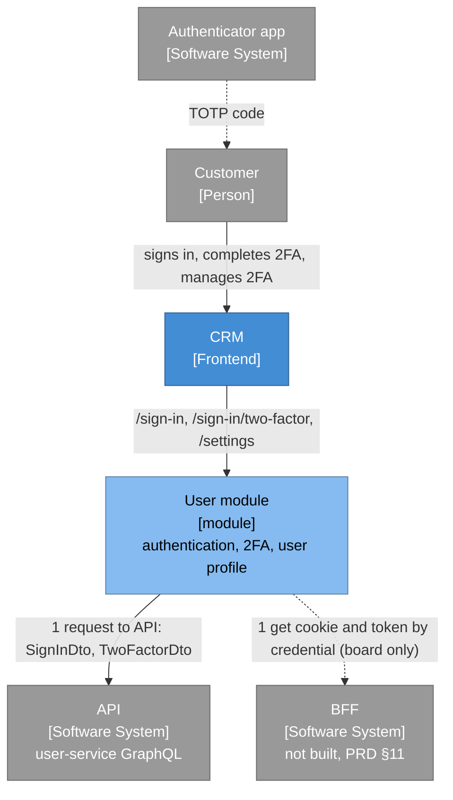

### 3.2 L2 components (board "User module", component level)

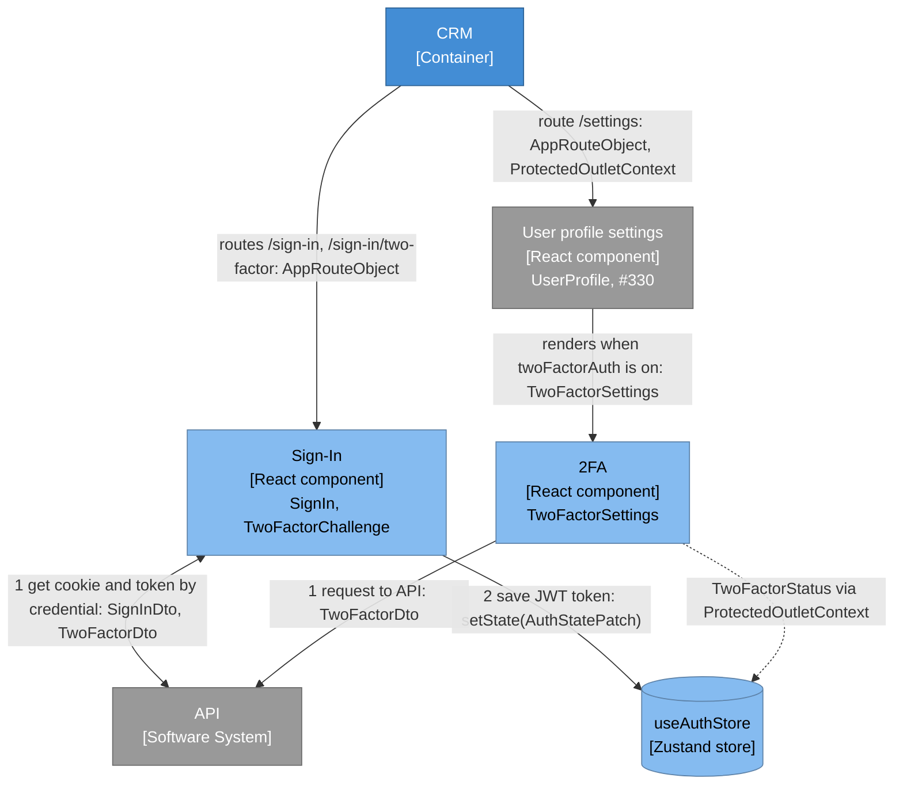

The board's Sign-In edge "1 get cookie and token by credential" ends at the BFF; crm has no BFF,
so the same exchange (credentials, then the second factor) reaches the API (§19.3).

### 3.3 L3 stack: sign-in and challenge (auth feature, container-free paint path)

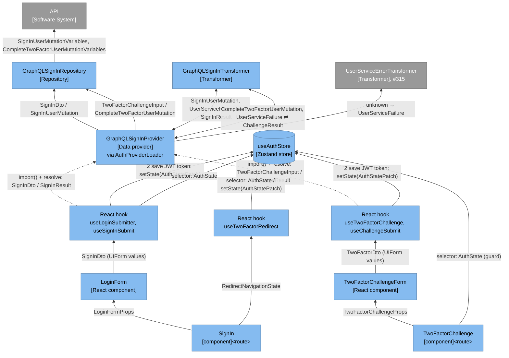

Both edges into the Data provider are the dotted `import() + resolve` of #315's
`AuthProviderLoader`, drawn inside the Data provider box: `useAuthProviderLoader()` builds one
loader per mount (the challenge page's, and the sign-in form's inside `useLoginSubmitter`) and
`loader.resolve(AUTH_TOKENS.GraphQLSignInProvider)` returns the container singleton. Sign-in no
longer passes through `DeferredAuthActions` or `AuthStoreActions`. Nothing in the auth tree holds
a static import of the container, Apollo, zod or tsyringe
(`tests/unit/tooling/paint-path-graph.test.ts`). `TwoFactorCodeNormalizer` is drawn inside the
challenge hook box; `AuthSecuritySignals` inside the two hook boxes, the two places that write
the token.

### 3.4 L3 stack: the 2FA section (settings feature, below the route code split)

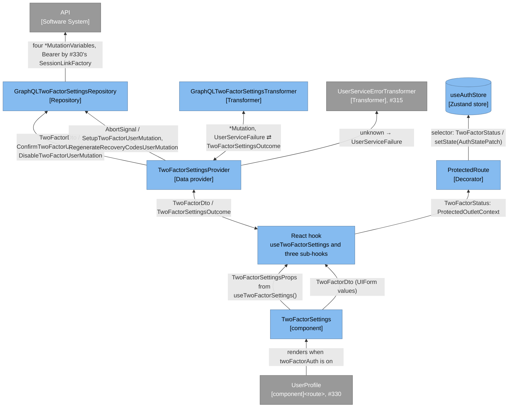

The hooks reach the Data provider through `useService(AUTH_TOKENS.TwoFactorSettingsProvider)`,
which `no-eager-shell-import-di-bridge` allows below the route code split
(`.dependency-cruiser.js:505-522`); #330's `SessionLinkFactory` sits inside the Repository → API
edge. The board's React hook → State edge is realised through the outlet context, because the
settings feature may not import `@auth/stores` (§2.3, §6.6): `ProtectedRoute` reads the status
from `useAuthStore` with a selector and writes the patch with `setState`.

### 3.5 Routing and guards

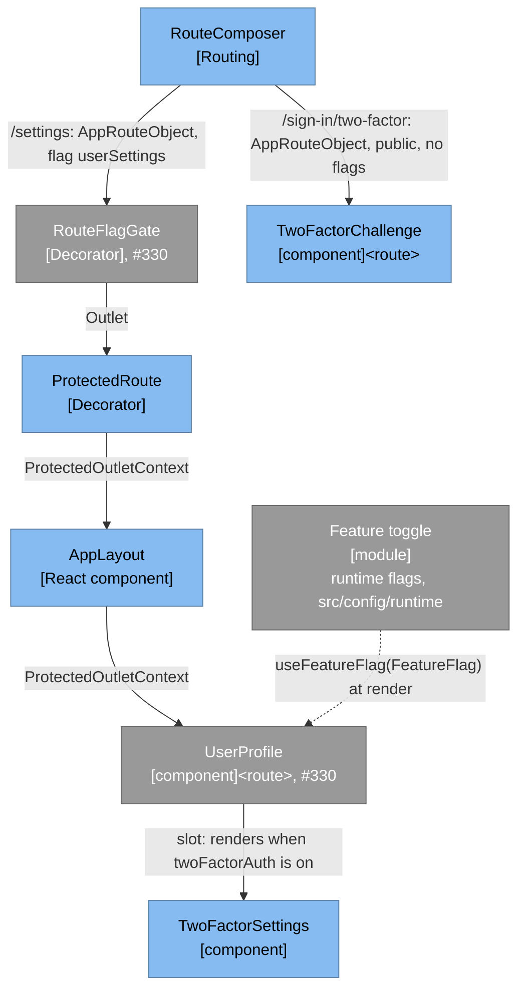

The challenge route lists no flag: a sign-in can return a challenge in every environment, so the
page must always be reachable while a pending session id exists (§6.4). `/settings`, its gate and
its `userSettings` flag are #330's; this feature reads `twoFactorAuth` only where the page renders
its slot (§6.9, §6.15).

### 3.6 L4 code (board "User module", code level)

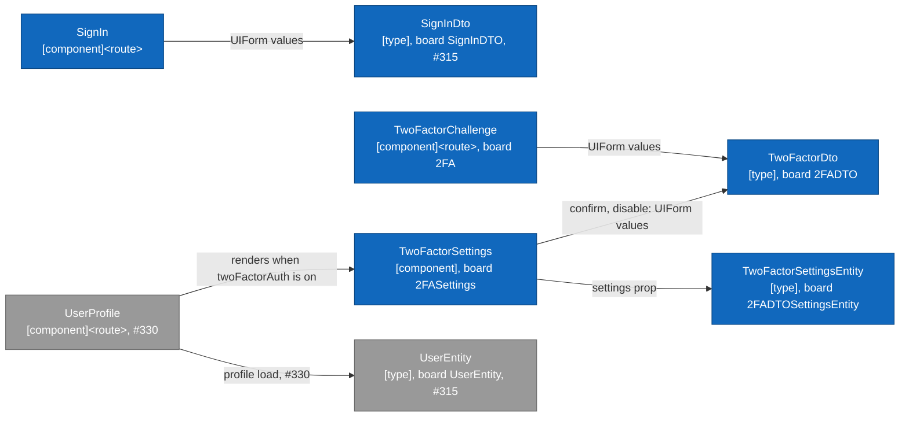

`TwoFactorSettings → TwoFactorDto` is the one edge the board does not draw: the confirm and
disable steps submit a code, the same `2FADTO` the challenge sends (§19.3).

Board names recorded (verification D8): the board's `2FA <route>` is the `TwoFactorChallenge`
page, its `2FADTO` is `TwoFactorDto`, and its `2FADTOSettingsEntity` is
`TwoFactorSettingsEntity`. TypeScript identifiers cannot start with a digit, and the entity is
the settings state, not a transfer object, so the names keep `TwoFactor` and drop `Dto`.

## 4. Sequence views

Participants carry their board stereotype; every message names its argument and result types.
`AuthStatePatch` is the named partial of `AuthState` (§2.5).

### 4.1 Sign-in, 2FA off and on

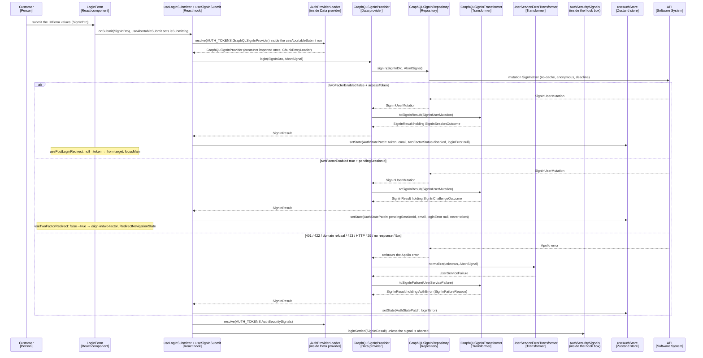

There is one sign-in path in every environment: the REST request of `LoginAPI` no longer exists
(§6.19). A rejected loader resolve becomes the module-level `transient` failure inside the run;
an aborted run writes and records nothing and resolves `null` in `useAbortableSubmit`.

### 4.2 Challenge completion, including expiry and lock

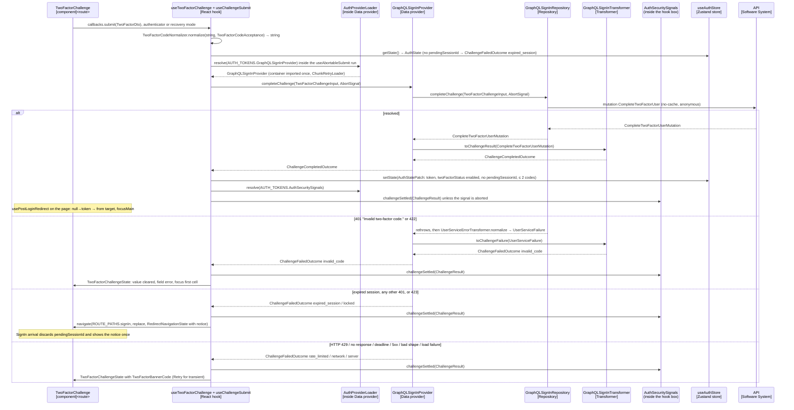

A rejected loader resolve becomes the module-level `ChallengeFailedOutcome` with reason `network`
inside the run; an aborted run records nothing and resolves `null` in `useAbortableSubmit`.

### 4.3 Enrolment: setup, confirm, recovery codes

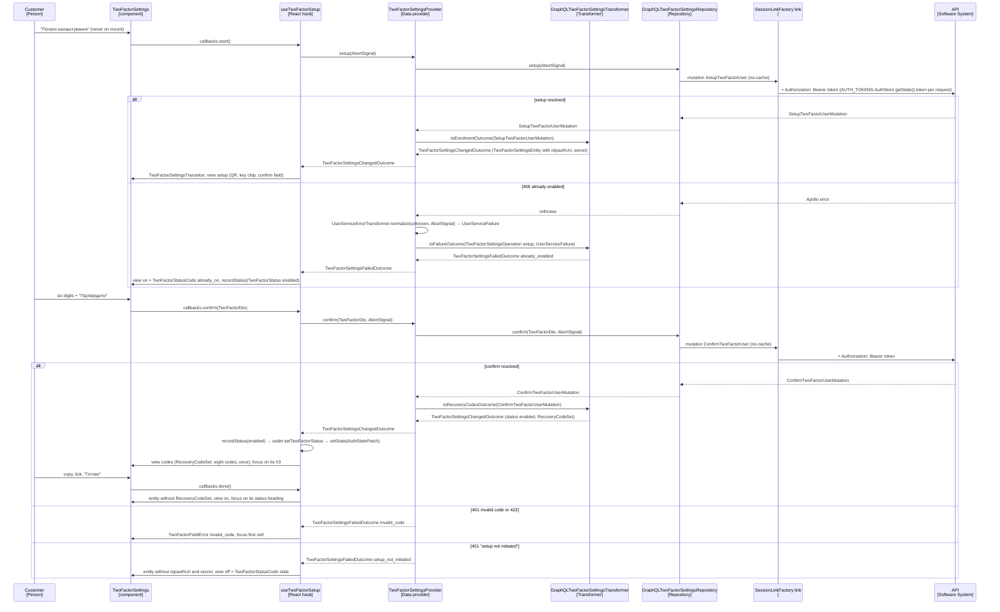

### 4.4 Disable

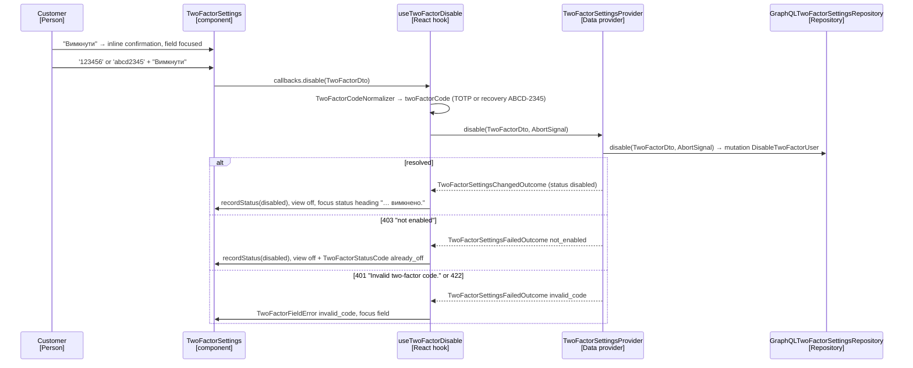

### 4.5 Regenerate, including the sudo-window 403

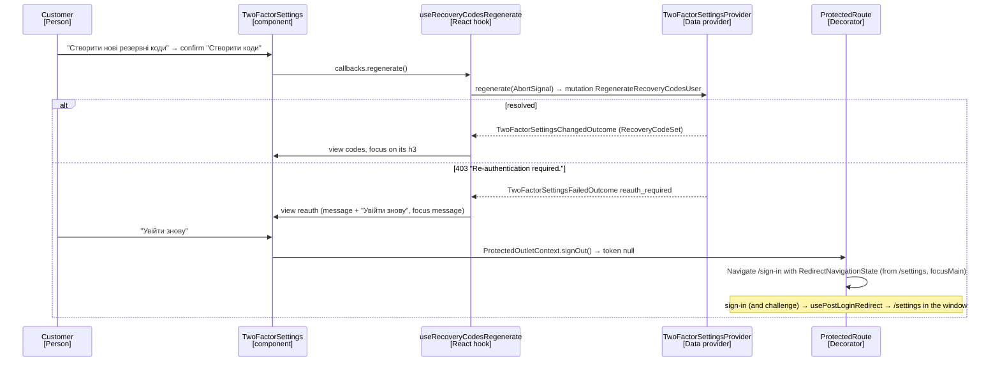

A protected call whose session the server no longer accepts ends at #330's link: the transport
`401` clears the token and `ProtectedRoute` redirects with the `session_ended` notice (§6.7). The
section renders nothing for that outcome.

## 5. State machines

Each machine's context is a named type in a type-only file (TB-1 position 5):
`TwoFactorChallengeState` for §5.1, `TwoFactorSettingsEntity` plus `TwoFactorSettingsViewState`
for §5.2 (§7.3). Transitions are written by the React hooks; no class holds view state. These
diagrams are documentation of typed lookups, not an engine; the in-flight state is
`useAbortableSubmit`'s `isSubmitting`, never a stored flag.

### 5.1 Challenge page (context `TwoFactorChallengeState`)

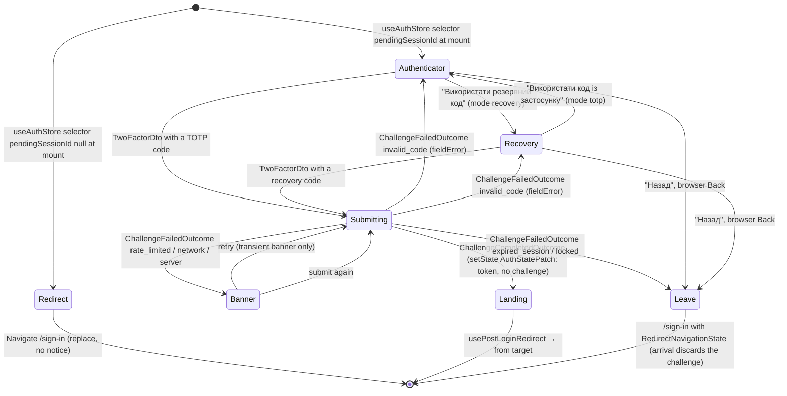

`Submitting` is `isSubmitting` and keeps the mode it came from; `Landing` is the page seeing a
token and no pending session id, so it renders nothing while the redirect runs. A mode switch
clears the value and the error and moves focus into the new input (FR-17).
`useAbortableSubmit` (#315) aborts any in-flight request on leave and on unmount.

### 5.2 Settings 2FA section (context `TwoFactorSettingsEntity` + `TwoFactorSettingsViewState`)

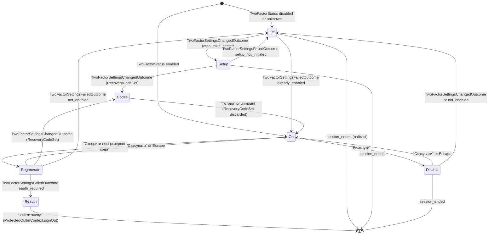

While a request is in flight the view is unchanged and shows the shared submit loader and
`aria-busy`; `429`, network and server failures keep the view and its values and show a focused
`role="alert"` banner inside the section (FR-35). `session_ended` changes nothing in the section:
the `ProtectedRoute` redirect unmounts it.

## 6. Design decisions

### 6.1 GraphQL sign-in through one Data provider

The user decided on 2026-10-08 that data is reached only through GraphQL repositories. Sign-in
therefore has one path in every environment, and the earlier flag-selected Strategy
(`SignInProvider` with the REST `AuthRepositoryImpl` as a "legacy" second implementation) is
gone: its second implementation posted to `/api/users`, the create-user endpoint
(`src/config/api-config.ts:4-5`), so it never had a working backend.

- `GraphQLSignInRepository` (`@auth/repositories/graphql-sign-in-repository.ts`) is transport
  only and takes `AUTH_TOKENS.ApolloClient` alone. `signIn(credentials: SignInDto, signal?)`
  sends `SignInUser` with `email`, `password` and a fresh `clientMutationId` (no `rememberMe`,
  D3') and returns the generated `SignInUserMutation`;
  `completeChallenge(input: TwoFactorChallengeInput, signal?)` sends `CompleteTwoFactorUser`
  with `pendingSessionId`, `twoFactorCode` and a fresh `clientMutationId` and returns
  `CompleteTwoFactorUserMutation`. Both check the signal before `mutate`, use
  `fetchPolicy: 'no-cache'` and rethrow the Apollo error unchanged; neither calls a Transformer.
- `GraphQLSignInTransformer` (`@auth/transformers/graphql-sign-in-transformer.ts`) is pure:
  `toSignInResult(SignInUserMutation)`, `toSignInFailure(UserServiceFailure)`,
  `toChallengeResult(CompleteTwoFactorUserMutation)` and
  `toChallengeFailure(UserServiceFailure)`, each over a module-level table (§8).
- `GraphQLSignInProvider` (`@auth/data-providers/graphql-sign-in-provider.ts`) takes three
  collaborators by `@inject` — `AUTH_TOKENS.GraphQLSignInRepository`,
  `AUTH_TOKENS.GraphQLSignInTransformer` and `AUTH_TOKENS.UserServiceErrorTransformer` (#315) —
  so it needs no deps bag and no closure. `login(SignInDto, AbortSignal?)` resolves a
  `SignInResult`; `completeChallenge(TwoFactorChallengeInput, AbortSignal?)` resolves a
  `ChallengeResult`. Each calls the repository, hands the payload to the Transformer, or on a
  throw hands `UserServiceErrorTransformer.normalize(error, signal)` to the failure method.
  Generated types appear only as `import type` in its body.

**Sign-in through the loader, as the challenge does (§6.3).** The password step takes the
challenge's shape; only the sign-in path leaves `AuthStoreActions` and `DeferredAuthActions`
(`stores/index.ts:15-80`), and their registration, logout and reset methods stay as they are.

- `useLoginSubmitter` (`use-login-submitter.ts:70-81`) already holds the file's ten functions, so
  the run lives in a new hook, `useSignInSubmit` (`@auth/hooks/use-sign-in-submit.ts`).
  `useLoginSubmitter` builds the form's one loader with #315's `useAuthProviderLoader()` and
  hands it over; its controller set and `useAbortableLogin` (`:29-68`) give way to
  `useAbortableSubmit`, whose `isSubmitting` replaces `AuthState.loginLoading`.
- The `useAbortableSubmit` run of `useSignInSubmit` resolves
  `loader.resolve(AUTH_TOKENS.GraphQLSignInProvider)`, calls `login(SignInDto, signal)` and
  writes one `AuthStatePatch` through `useAuthStore.setState`: a `SignInSessionOutcome` writes the
  token, `email`, `twoFactorStatus: 'disabled'` and `loginError: null`; a
  `SignInChallengeOutcome` writes `email`, `pendingSessionId` and `loginError: null` and never
  `token`; a failure writes `loginError`. Unless the signal was aborted it then resolves
  `AUTH_TOKENS.AuthSecuritySignals` and calls `loginSettled(result)`.
- A rejected `resolve` (the loader has captured it once) becomes a module-level
  `AuthFailedResult` constant holding the existing load-failure `AuthError` text, written as
  `loginError`.
- Deleted: `AuthStoreActions.login`, `applyLogin` and `applyLoginRejection`
  (`auth-store-actions.ts:15-24`, `:76-100`), `DeferredAuthActions.loginUser` (`:27-33`),
  `AuthActions.loginUser`, the `LoginActions` and `LoginUser` types,
  `AuthSecuritySignals.loginFailed` (its only caller was `applyLoginRejection`), and
  `AuthState.loginLoading` with its cleared-state entry and selector. `AuthStoreActionsDeps`
  and its `useFactory` closure (`di.ts:43-54`) gain nothing; `register` still calls
  `deps.repository.register`.
- `AuthSecuritySignals.loginSettled` (`auth-security-signals.ts:33-40`) takes the `SignInResult`
  and calls `observability.setUser` only for a `session` outcome, so a pending step is not a
  sign-in.

No tsyringe, Apollo or zod reaches the paint chunk: the hook value-imports only the token module
and `useAuthStore`, as the challenge hook does, and the loader stays container-free
(`tests/unit/tooling/paint-path-graph.test.ts`). `zustand` itself is on the paint path from chore
`zustand-client-state`, which measures the paint budget; this feature adds no store.

GraphQL sign-in failures carry an i18n reason. `AuthError` (`auth-error.ts:9-16`) gains
`readonly reason?: SignInFailureReason` (`invalid_credentials`, `locked`, `rate_limited`,
`transient`). `useLoginSubmitter` renders `t('sign_in.errors.<reason>')` when `reason` is set,
keeps the existing `formatLoginError` (`:23-27`) for an `AuthError` without one (only the
module-load failure constant of `useSignInSubmit` is left), and returns #315's `errorAction`
(Retry, re-submitting the last credentials once) only for `transient`. The Transformer fills the
other `AuthError` fields so that
`reasonOf` (`auth-security-signals.ts:55-59`, plus `423 → locked`, §6.14) records the §8 signal:
`invalid_credentials` is kind `authentication` with no status; `locked` is kind
`authentication` with status 423; `rate_limited` is kind `server` with status 429; `transient` is
kind `network` for no answer or the deadline and `server` for a `5xx` or a bad shape. An aborted
call returns the existing aborted `AuthError` (`aborted: true`), for which `useSignInSubmit`
writes nothing.

> Assumption: GraphQL sign-in messages render as the plain PRD text (FR-11), not inside the
> frame "Помилка входу: {{reason}}" (`uk.json:82`), which stays only for the module-load
> failure.

Code facts (reconciled 2026-10-27): there is no "Помилка входу" frame and no `formatLoginError`
any more. `use-login-submitter.ts` holds five functions (`loginErrorMessage`, `clearLoginError`,
`useLoginControllers`, `useAbortableLogin`, the hook) and maps an `AuthError` to a key through
`MESSAGE_KEY_BY_KIND` plus HTTP 429 → `sign_in.errors.rate_limited`; the text is shown in #315's
result card, never a `UIForm` banner (`login-form.tsx` passes `error={null}` to `UIForm`).
`sign_in.errors.invalid_credentials` and `sign_in.errors.rate_limited` already exist
(`@auth/i18n/uk.json:83-84`). `AuthStoreActions.login` first tries
`sandboxDemoSession.signIn(credentials)`, which answers the demo account without a request
(`@auth/stores/auth-store-actions.ts`, `src/config/env/sandbox-demo-session-provider.ts`).
`DeferredAuthActions.loginUser` writes `loginLoading: true` before the chunk loads, for the
synchronous submit feedback its comment cites (`@auth/stores/index.ts`).

> Assumption (reconciliation 2026-10-27): sign-in keeps the shipped submit mechanics and changes
> only the transport. `useSignInSubmit(loader)` returns a named `SignInRun` callback
> `(dto: SignInDto, signal: AbortSignal) => Promise<void>` that `useLoginSubmitter`'s existing
> `useAbortableLogin` controller set calls in place of `authActions.loginUser`, so "Назад" still
> aborts a running request (#315's "Sign-in and sign-up results use one notification" decision
> in `src/modules/user/README.md`); `useAbortableSubmit` is not used for sign-in because it
> exposes no abort. The run writes `loginLoading: true` and `loginError: null` first, answers the
> sandbox demo credentials through `sandboxDemoSessionProvider.signIn` as `AuthStoreActions.login`
> does (a `session` outcome), and otherwise resolves the provider through the loader. So
> `AuthState.loginLoading`, its cleared-state entry and `AuthStoreSelectors.loginLoading` stay;
> `AuthStoreActionsDeps` loses `sandboxDemoSession`, whose only reader was `login`.
>
> Assumption (reconciliation 2026-10-27): the reason text keeps the shipped catalog: existing
> `invalid_credentials` and `rate_limited` keys and texts stay, `locked` and `transient` are
> added. Retry stays the result card's "Спробувати ще раз", which `LoginForm` passes as `onRetry`
> only for `transient` (`registration-error-view.tsx` renders it only when `onRetry` is set).

### 6.2 Auth state: challenge and notice, never the token

`AuthState` (`types/auth-store.ts:5-13`, the type-only file stays) and the cleared initial state of
`useAuthStore` (`@auth/stores/use-auth-store.ts`, `create<AuthState>()`, chore
`zustand-client-state`) gain three fields and lose `loginLoading` (§6.1); the logout reset, which
writes the cleared state, therefore clears all three, and a reload loses them:

```ts
readonly pendingSessionId: string | null; // the pending session; memory only
readonly recoveryCodesRemaining: number | null; // set only when completion reported ≤ 2
readonly twoFactorStatus: TwoFactorStatus; // 'unknown' in the cleared state
```

The store gains no action and no logic: the writes are `useAuthStore.setState(patch)` with a
named `AuthStatePatch` at their call sites — `useSignInSubmit`, the challenge hook,
`useTwoFactorRedirect` (arrival discards the challenge), the notice's dismiss and
`ProtectedRoute`'s `setTwoFactorStatus`. A scalar `pendingSessionId` replaces the earlier
`PendingChallenge` wrapper; TB-1 allows a single scalar.

The access token already lives in this memory-only store, with no `persist` middleware; the
pending session id gets the same treatment. Components read only booleans, counts and the status
through selectors (`useAuthStore((s) => s.twoFactorStatus)`); the session id is read only by the
challenge hook through `useAuthStore.getState()`.

> Assumption: `AuthStoreSelectors` (`auth-store-selectors.ts:5-41`) gains no selector and loses
> `loginLoading` (§6.1); it keeps eight public methods.

Code facts (reconciled 2026-10-27): `AuthStoreSelectors` has nine public methods today
(`@auth/stores/auth-store-selectors.ts`). Under the §6.1 reconciliation `loginLoading` stays, so
the class keeps nine and gains none; `AuthState` gains the three fields and loses nothing.

### 6.3 Challenge completion through the shared loader

Only `stores/index.ts` may import the composition root
(`no-di-config-import-outside-composition-root`, `.dependency-cruiser.js:418-445`), and the auth
tree may never reach `@/providers/di` (`:484-503`). #315 Story 1.5 adds the one container-free
`AuthProviderLoader` to that file (`resolve<T>(token: InjectionToken<T>): Promise<T>` over a
memoized `ChunkRetryLoader`) and `useAuthProviderLoader()` (`@auth/hooks/`), which builds one
loader per page mount. This feature uses them unchanged; in `stores/index.ts` it only deletes
`DeferredAuthActions.loginUser` (§6.1).

- The `TwoFactorChallenge` page calls `useAuthProviderLoader()` and hands the loader to
  `useTwoFactorChallenge`, which passes it to `useChallengeSubmit` in the named
  `ChallengeSubmitHookDeps` (`loader`, `normalizer`, `navigate`, `from`).
- The `useAbortableSubmit` run of `useChallengeSubmit` reads
  `useAuthStore.getState().pendingSessionId`
  (none → a `ChallengeFailedOutcome` with `expired_session`, no request), builds the
  `TwoFactorChallengeInput` (the dto's normalised `twoFactorCode` plus `pendingSessionId`),
  resolves `loader.resolve(AUTH_TOKENS.GraphQLSignInProvider)` and calls `completeChallenge`.
- On a `ChallengeCompletedOutcome` the hook writes one `AuthStatePatch`: the token,
  `twoFactorStatus: 'enabled'`, `pendingSessionId: null` and `recoveryCodesRemaining` (the count
  for 0, 1 or 2, `null` otherwise). This is the board's React hook → State edge, "2 save JWT
  token". On a failure the challenge is kept: the page navigates to `/sign-in`, whose arrival
  discards it, so a render-time redirect can never race the notice navigation (§6.4).
- Unless the signal was aborted, the hook resolves `loader.resolve(AUTH_TOKENS.AuthSecuritySignals)`
  and calls `challengeSettled(result)` (§6.14). The signal stays where the token is written, as
  `useSignInSubmit` does for the password step; putting it in the provider would give the
  provider a fourth constructor argument, past the three-argument cap, or a deps bag.
- A rejected `resolve` (the chunk failed after `ChunkRetryLoader`'s retry; the loader has captured
  it once) becomes a module-level `ChallengeFailedOutcome` constant with reason `network`, shown
  as the transient banner with Retry.

No actions class, no `AuthStateActions` interface and no second `load()` are added; the review's
only (c)-class is gone.

### 6.4 Challenge route and its guard

- `ROUTE_PATHS.twoFactorChallenge = '/sign-in/two-factor'` (`src/routes/route-paths.ts:1-9`).
- `@auth/routes/index.ts:4-20` gains a `guard: 'public'` entry,
  `webpackChunkName: "two-factor-challenge"` and `meta.titleKey: 'two_factor.title'`. It lists no
  flag and is always reachable: a sign-in can return a challenge in any environment.
  `routes.tsx` and the composer stay untouched (FR-12).
- The page is a mid-flow public route without a new `RouteGuard` member (the union stays
  `'protected' | 'public'`, `src/routes/types/app-route.ts:3`). Its component decides: a
  `pendingSessionId` → `TwoFactorChallengeForm` with the `TwoFactorChallengeProps`
  `useTwoFactorChallenge` returns; no pending session but a token (completion just landed) →
  `null` while `usePostLoginRedirect` navigates; otherwise
  `<Navigate to={ROUTE_PATHS.signIn} replace />` with no notice.
- `RouteMapper` gives every public page the reload-once chunk recovery
  (`route-mapper.tsx:31-40`). On this page a reload wipes the memory-only challenge and the guard
  sends the user to `/sign-in`: accepted (D4, NFR-16), documented in ADR-020.
- `LoginRedirectTarget.isInternalPath` (`login-redirect-target.ts:13-19`) rejects
  `ROUTE_PATHS.twoFactorChallenge` beside `ROUTE_PATHS.signIn` (FR-13).
- `usePostLoginRedirect` (`hooks/use-post-login-redirect.ts:7-19`) is mounted on the challenge
  page too; it fires on the null-to-token edge and resolves the same `state.from`.
- New hook `useTwoFactorRedirect` (`@auth/hooks/use-two-factor-redirect.ts`), mounted on the
  sign-in page only, runs one effect keyed on `pendingSessionId !== null`: on its first run it
  writes an `AuthStatePatch` clearing `pendingSessionId` when one exists (arrival discards it,
  FR-23); on a later false-to-true transition it navigates to the challenge route with a
  `RedirectNavigationState` holding `from` only (FR-10). One non-empty dependency list, so no
  equivalent `ArrayDeclaration` mutant needs an annotation.

Code facts (reconciled 2026-10-27): `ROUTE_PATHS` (`src/routes/route-paths.ts`) now holds 17 keys
(the error pages, `settings`, the five coming-soon sections and three settings sub-routes);
`@auth/routes/index.ts` registers four public routes (`signUp`, `signIn`, `passwordRecovery`,
`passwordReset`). Every auth page is a small route chunk that lazily loads a form section through a
`form-section-loader.ts` singleton with `webpackPreload` (`@auth/routes/sign-in/`,
`@auth/routes/reset-password/`), and the recovery pages render `RecoveryPageLayout`
(`@auth/components/recovery-page-layout/`: registers the lazy recovery catalog, sets the title,
wraps `AuthPageLayout`) around `AuthCard` and `CardBackControl`. `usePostLoginRedirect` returns
`{ signedIn, proceed }` and navigates only when `proceed()` is called. `LoginRedirectTarget`
rejects only `ROUTE_PATHS.signIn` today (`@auth/utils/login-redirect-target.ts`). `InCardLink`
always navigates with `{ focusMain: true }` and cannot carry `from`
(`@auth/components/reset-password/in-card-link.tsx`).

> Assumption (reconciliation 2026-10-27): the challenge follows the shipped page shape. The route
> chunk `two-factor-challenge` is `@auth/routes/two-factor/index.tsx` (`RecoveryPageLayout`
> with `titleKey="two_factor.title"`, the guard), which lazily loads
> `two-factor-form-section.tsx` through `@auth/routes/two-factor/form-section-loader.ts`
> (`webpackChunkName: "two-factor-form-section"`, `webpackPreload`); that name joins the
> form-section list of `scripts/auth-forms-chunk-group.ts` (and its test), so `UIForm` and the
> shared pieces come from the cached `auth-forms` chunks. "Назад" is `CardBackControl` with
> `onClick`, a hook callback that navigates to `/sign-in` with `{ from, focusMain: true }`; if
> `make lint-i18n` rejects the lazy `password_recovery.back` key there, the challenge files are
> added as owners of the recovery catalog in `config/i18n-catalog-policy.json`.
>
> Assumption (reconciliation 2026-10-27): on completion the challenge page calls
> `postLogin.proceed()` in an effect once `signedIn` turns true, a navigation the user's own
> "Підтвердити" caused, not a timer. It shows no success card: Figma `72:4846` draws none. Open
> question for the owner: reuse the sign-in success card ("Вітаємо!", "Продовжити") instead.

### 6.5 Arrival notices (#315's pieces, two members appended)

The #315 bundle builds `SignInNotice`, `RedirectNavigationState.notice`, `useArrivalNotice` and
the marker-clearing `useArrivalFocus`, with `type ArrivalNotice = 'password_reset'` and the text
table `SignInNoticeMessageTable`; #330 appends `'session_ended'`. This feature appends
`'two_factor_expired'` and `'account_locked'` with their table members and `*Key` constants, and
the two catalog keys `sign_in.notices.two_factor_expired` and `sign_in.notices.account_locked`.
`SignInNoticeProps { notice: ArrivalNotice | null }` is unchanged. `useChallengeSubmit` navigates
with `replace: true` and a `RedirectNavigationState` holding `from`, `focusMain: true` and the
notice, keeping `from` for the next sign-in; `useArrivalFocus` clears both markers in its one
replace.

Code facts (reconciled 2026-10-27): `ArrivalNotice` is `'password_reset' | 'session_ended'`
(`src/routes/types/navigation-state.ts`). `SignInNoticeMessageTable` names one member per notice
and each `SignInNoticeRow` carries `messageKey`, `tone` (`'success' | 'neutral'`) and `Icon`
(`@auth/types/components/sign-in-notice.ts`); `NOTICE_ROWS` lives in
`@auth/components/sign-in-notice/index.tsx`, and `useArrivalNotice` / `useArrivalFocus` are in
`src/hooks/`. A union member without a table member fails `tsc` at `NOTICE_ROWS[notice]`, so the
story that first names a new member (Story 2.6) adds its row and key; both new rows take tone
`neutral` and `InfoOutlinedIcon`, as `session_ended` does.

> Assumption: a `423` on completion reuses the notice region with the locked text rather than the
> sign-in error banner of FR-11, because the user arrives on `/sign-in` without having submitted
> that form; the text is the FR-11 locked message.

### 6.6 Known status through the protected outlet context

The known status is `AuthState.twoFactorStatus` (§6.2). Its writers are `useSignInSubmit`
(GraphQL sign-in writes `disabled`), the challenge hook (completion writes `enabled`) and the
settings hooks; its readers are `ProtectedRoute` and those hooks. The settings feature may not
import `@auth/stores` (§2.3), so it reaches the field the way sign-out already reaches protected
pages (`src/modules/user/README.md:75-82`): through the outlet context. This field is the one
stored copy: `TwoFactorSettingsEntity.status` is read from it.

- `ProtectedOutletContext` (`src/routes/types/protected-outlet-context.ts:1-3`) gains
  `twoFactorStatus`, `setTwoFactorStatus` and `banner?` beside `signOut` and whatever #330 has
  added, with `TwoFactorStatus = 'enabled' | 'disabled' | 'unknown'` declared in the same
  type-only file so `@auth/types/auth-store.ts` and the settings types import it from a path both
  may reach. `SignOutState` (`@auth/types/sign-out.ts:3-5`) narrows its base to
  `SignOutContext`, declared once as
  `type SignOutContext = Pick<ProtectedOutletContext, 'signOut'>`.
- `ProtectedRoute` (`protected-route/index.tsx:8-19`) reads the token and
  `useAuthStore((s) => s.twoFactorStatus)` with selectors, puts the status into the context and
  provides `setTwoFactorStatus`, a callback that calls `useAuthStore.setState` with an
  `AuthStatePatch` holding only `twoFactorStatus`. It stays container-free and on the eager
  composer path; the change is a few lines of the eager bundle (§11). `AppLayout` forwards the
  context unchanged.
- `useTwoFactorSettings` calls `useOutletContext<ProtectedOutletContext>()` exactly as the home
  page does for `signOut` and hands `setTwoFactorStatus` to its sub-hooks as
  `TwoFactorSettingsHookDeps.recordStatus`, which they call on the status-changing outcomes of §8
  (confirm ok, setup `409`, disable ok, disable or regenerate `403` not enabled).
- The logout reset writes the cleared state, which returns the status to `unknown` with the
  token, so FR-26's "logout → unknown" holds with no new code; a seeded test token starts from
  the cleared state and reads `unknown`.

Code facts (reconciled 2026-10-27): `ProtectedRoute` builds `{ signOut }` from `useSignOut()`
and reads the token with `useAuthToken()` (`@auth/components/protected-route/index.tsx`).
`AppLayout` reads the context once, forwards `signOut` to the lazy app shell and the whole
context to its `<Outlet>` (`src/components/layouts/app-layout.tsx`). `ShellSlotHostProps`
(`src/routes/types/shell-slot.ts`) extends `ProtectedOutletContext`, and
`ShellSlotFactory.create` passes only `signOut` and `onAvatar` to the user-menu slot
(`src/routes/shell-slot-factory.ts`), so required context members would break `tsc` there; the
home page reads no context. Tests that build the context by hand:
`tests/unit/components/protected-route.test.tsx`,
`tests/unit/components/layouts/app-layout.test.tsx`,
`tests/unit/routes/route-mapper.shell-slot.test.tsx`,
`tests/unit/routes/shell-slot-factory.test.tsx`,
`tests/unit/utils/render-app-shell.tsx`.

Code facts (Story 1.5, 2026-10-27): `ProtectedOutletContext` has `signOut`, `twoFactorStatus` and
`setTwoFactorStatus` as required members, and `banner?` is not added. Besides the five tests above,
two files that build the context by hand needed the new members for `tsc`:
`.storybook/router-decorators.tsx` (`storySignOut`) and `src/components/layouts/app-layout.stories.tsx`
(its stub user menu is typed `SignOutContext`). `setTwoFactorStatus` is a module-level arrow in
`protected-route/index.tsx`, so its identity is stable and no hook dependency array is introduced.

> Assumption (reconciliation 2026-10-27): `SignOutContext` is declared in
> `src/routes/types/protected-outlet-context.ts`, not in `@auth/types/sign-out.ts`, because the
> routes types may not import a feature; `ShellSlotHostProps` and `SignOutState` extend it, so
> the shell slot keeps receiving `signOut` alone.
>
> Assumption: a React-side `setTwoFactorStatus` on the outlet context is the settings feature's
> one write into `useAuthStore`, in preference to a container-registered store and port, because
> it adds no class, no token and no second reader of the token.

### 6.7 Bearer link and session end (#330's)

The #330 bundle builds `SessionLinkFactory` (`@auth/repositories/session-link-factory.ts`) and
composes it in `registerGraphqlClient` (`di.ts:57-68`), with its `RESTRICTED_LIBRARY_ADAPTERS`
entry. Its rule, which this feature relies on: every non-anonymous operation carries
`Authorization: Bearer <token>` read through the injected `AUTH_TOKENS.AuthStore` (`getState()`)
at request time, and a
transport `401` on a non-anonymous operation ends the session (`observability.clearUser()`, then
the cleared-state reset); `ProtectedRoute` then redirects to `/sign-in` with `from`, `focusMain` and
the `session_ended` notice. The link is transport infrastructure drawn inside the board's
Repository → API edge.

The link's module-level anonymous-operation set is #330's and already lists `SignInUser` and
`CompleteTwoFactorUser` beside `CreateUser`; this feature appends nothing to it. Stories 2.2 and
2.5 each add one test that their request carries no `Authorization` header and that a `401` on
it never clears the token. The four settings operations are non-anonymous and get the Bearer
header with no change.

user-service rejects an invalid, expired or revoked token with a transport `401` "Authentication
required." before GraphQL runs (`DualAuthenticator.php:79-93`, read at `a95c1e85`), and answers a
protected operation sent without any token with the GraphQL error "Access Denied." over HTTP 200.
The first is the link's session end; the second reaches the settings Transformer as #330's
`access_denied` reason and maps to `session_ended` (§8), by which time the token is already gone.

Code facts (reconciled 2026-10-27): as described, at
`@auth/repositories/session-link-factory.ts`; it is composed in `registerGraphqlClient` and
built from `AUTH_TOKENS.SessionLinkDeps` (store, cleared state, sandbox demo session,
observability, error transformer) in `registerSessionLink` (`src/modules/user/config/di.ts`).
The 401 test reads `UserServiceErrorTransformer.normalize({ networkError }).reason ===
'unauthenticated'` and the token the request carried (`SessionLinkContext.sessionToken`), so a
401 after a newer sign-in never clears the newer token.

### 6.8 Error classification

`UserServiceErrorTransformer` (`src/modules/user/lib/`, #315) narrows a caught error:
`normalize(error: unknown, signal?: AbortSignal): UserServiceFailure`, the one place TB-1 allows
`unknown`, as a parameter only. `UserServiceFailure` is #315's one interface
(`reason`, `status: number | null`, `violations: FieldViolationSet`). Its steps run in order and
the first match wins (#315 architecture §5.5.1, contract §3.4):

1. aborted → `aborted`;
2. a `networkError` → its HTTP status through the status table; no status → `network`;
3. the first GraphQL error's message prefix names an input property → `violation`;
4. a numeric `extensions.status` → the status table;
5. any other message → `refused`;
6. anything else → `unknown`.

Status table: `0` → `network`, `422` → `violation`, `429` → `rate_limited`, `5xx` → `server`,
any other status → `unknown`. #330, which lands before this feature, appends the row `401` →
`unauthenticated` and one exact-message step between steps 3 and 4 with its five rows
(`access_denied`, `invalid_password` ×2, `taken` ×2).

This feature only appends, never reorders or removes:

- **Input properties for step 3:** `twoFactorCode` (`password` is #330's, `email` #315's).
- **One status row:** `423` → `locked`.
- **Six exact-message rows** in #330's message step, each matching the whole message:
  "Invalid two-factor code." → `invalid_code`; "Invalid or expired two-factor session." →
  `expired_session`; "Two-factor setup not initiated." → `setup_not_initiated`; "Two-factor
  authentication is already enabled." → `already_enabled`; "Two-factor authentication is not
  enabled." → `not_enabled`; "Re-authentication required." → `reauth_required`.
- **Seven reason literals** appended to `UserServiceFailureReason`: `locked`, `invalid_code`,
  `expired_session`, `setup_not_initiated`, `already_enabled`, `not_enabled`,
  `reauth_required`.

The message step runs before step 4 because user-service domain exceptions reach the client with
no `extensions` at all (`DomainExceptionNormalizer.php:29-41` at `a95c1e85`) and because one
status (`401`, `403`) means several things. The rows are untranslated wire text
(`HttpExceptionDetailResolver.php:18-25`), so a translated message can never match one.
`extensions.code` is never read (FR-4, MD-2). Each feature Transformer then maps a failure per
operation through one module-level table (§8); the feature reason unions reuse these literals
(`expired_session`, `setup_not_initiated`) instead of renaming them.

`UserServiceErrorTransformer` carries no `@injectable()` decorator, and the #315 bundle registers
it by value; the two Data providers inject it by token (#130). `TwoFactorCodeNormalizer`, the other
`lib/` class, is undecorated and never registered: it is a helper inside the React hooks, which
construct it once per mount in a `useState` initializer and pass it on as a typed dependency.

Code facts (reconciled 2026-10-27): the shipped transformer
(`src/modules/user/transformers/user-service-error-transformer.ts`) is `@injectable()` and
registered with `registerSingleton` in `registerResponseMappers`; the Data providers still inject
it by `AUTH_TOKENS.UserServiceErrorTransformer`
(`@auth/data-providers/password-recovery-provider.ts`
is the precedent with exactly the three collaborators planned here). Its step order is the list
above with #330's message step between 3 and 4; only step 5 is narrower: an unmatched error with
no status gives `unknown` when it carries `extensions.code` and `refused` when it does not
(reconciliation list item 3), so the 2FA rows must match before that step. #330's rows are
`401 → unauthenticated` in `STATUS_REASONS` and `"Access Denied."`, `"Old password is invalid"`
and `"Старий пароль невірний"` in `MESSAGE_REASONS`; "taken" is a `FieldViolationReason` read from
`TAKEN_MESSAGES`, not a failure reason. `VIOLATION_PROPERTIES` is `email`, `token`,
`newPassword`, `initials`, `password`; this feature appends `twoFactorCode`. Rows are module-level
`Map`/array constants, so appending adds no function to a file already at ten.

> Assumption: a GraphQL error carrying `extensions.status` 401 with a message no row matches
> becomes `unauthenticated` and, on a settings operation, `session_ended` (§8) while the token
> stays, because #330's link ends sessions on transport `401`s only. user-service sends no such
> error today (its 2FA 401s are message-matched first), so the section staying silent is an
> accepted risk, re-checked on the pin bump (Follow-up 5.1).

### 6.9 The `UserProfile` page (#330's) and the 2FA slot

The #330 bundle builds the `settings` feature, `ROUTE_PATHS.settings`, the `UserProfile` page
(`settings/routes/user-profile/index.tsx`, board `UserProfile [component]<route>`, route path
`/settings`, gated by `userSettings` through #330's `RouteFlagGate`) and the home link. This
feature changes one line of that page: its right-column slot renders `<TwoFactorSettings />` while
`useFeatureFlag('twoFactorAuth')` is on (plain composition, as the board draws
`UserProfile → 2FASettings`). The page calls no 2FA hook; the section calls
`useTwoFactorSettings()` itself. The page sits under `AppLayout`'s `<main>`, so the outlet
context of §6.6 is available to the section through `useOutletContext`.

Code facts (reconciled 2026-10-27): there is no home link; #362's sidebar and user-chip menu link
`/settings`. The page is `UserProfile` in `settings/routes/user-profile/index.tsx`: it registers
the lazy settings catalog, calls `usePageTitle('settings.title')`, and renders `UIShellContent` →
`SettingsHeading` → `SettingsGrid` (`settings/components/settings-grid/`) → one profile-column
`Box` holding `UserProfileSettings` and `SocialNetworks` → `SettingsToasts` last. The "slot" is
the grid's second child: `SettingsGrid` lays children out as one column up to 1024 px
(`minmax(0, 46.8125rem)` from 768 px) and, above 1024 px, a 675 px first column with any further
child in an implicit `minmax(0, 29.9375rem)` column (`settings/components/settings-grid/styles.ts`,
`settings/README.md` "Figma parity"). The one-line change is therefore
`{twoFactorAuth && <TwoFactorSettings />}` after the profile-column `Box` inside `SettingsGrid`,
with `const twoFactorAuth = useFeatureFlag('twoFactorAuth')` (`src/hooks/use-feature-flag.ts`).

### 6.10 The 2FA section `TwoFactorSettings`: views, QR, clipboard, secrets

`settings/components/two-factor-settings/` holds the section (`index.tsx`, a card in the Figma
design with the `h2` "Двофакторна автентифікація") and one view per state of §5.2: `off-view`,
`setup-view`, `recovery-codes-view`, `on-view`, `confirm-action-view` (the disable and the
regenerate confirmation, one view parameterised by the action) and `reauth-view`, plus
`qr-code-image`. The component is the board's `2FASettings [component]`; it calls
`useTwoFactorSettings()` itself (§6.18) and passes the returned `TwoFactorSettingsProps` to its
views: the `TwoFactorSettingsEntity`, the view state and the callbacks. The hook mounts only when
the `twoFactorAuth` flag renders the section; nothing is sent on mount.

- **Hooks, not a controller.** `useTwoFactorSettings` composes `useTwoFactorSetup`,
  `useTwoFactorDisable` and `useRecoveryCodesRegenerate`, each over #315's `useAbortableSubmit`,
  and maps each `TwoFactorSettingsOutcome` to the next view through a typed lookup (§5.2, §8).
  The section never ends a session on its own (only "Увійти знову" signs out, through the outlet
  `signOut`; `session_ended` publishes nothing).
- **Secrets.** `otpauthUri`, `secret` and the recovery codes exist only in the
  `TwoFactorSettingsEntity` held in `useTwoFactorSettings`'s React state. "Готово", any view that
  no longer shows them and unmount drop them; none is written to the global auth state, the URL,
  storage, logs or the Apollo cache (FR-36).
- **Acknowledgement.** The codes view is a `UIForm` whose submit is "Готово"; while the box is
  unticked it passes `submitBlockedReason` ("Спочатку підтвердьте, що зберегли коди"), so
  "Готово" stays focusable, `aria-disabled` and described by the reason, and activating it does
  nothing (§6.12).
- **Control variants.** "Почати налаштування", "Підтвердити", "Готово", "Вимкнути" in the
  confirmation and "Створити коди" are `UIForm` submits, the contained pill the #276 entry covers
  (`form button[type="submit"].MuiButton-contained`). Every other button is `variant="outlined"`:
  "Скопіювати ключ", "Скопіювати коди", "Скасувати", and the on view's "Вимкнути" and "Створити
  нові резервні коди" with border `#80878A` (3.65:1) and text `#1B2327` (15.95:1); "Увійти знову"
  with text `#1A1C1E` (17.09:1) and border `#80878A`. None keeps `UIButton`'s default text variant
  (`#1976D2`, 4.45:1 on `#FBFBFB`), and no contained pill sits outside a form.
- **Focus ring.** The theme's ring (`2px solid #404142`, offset 2 px,
  `src/components/ui-button/theme.ts:25-29`) sits inside the `contained` override only, so every
  non-contained control this feature adds applies one shared style, `focusVisibleRing` in
  `src/styles/focus-ring.ts`: `'&:focus-visible'` with `outline: 2px solid` in
  `customColors.text.primary` (`#404142`, `src/styles/colors.ts:62`) and `outlineOffset: 2px`,
  10.23:1 on white. It applies to both copy buttons, "Скасувати", the on view's two buttons,
  "Увійти знову", the mode toggle (§6.11) and the notice's link and dismiss (§6.13). The
  `UIPinInput` seam paints the same values on its cells through its own selector. The computed
  ring is a browser assertion (`toHaveCSS` after keyboard focus); jsdom computes no
  `:focus-visible` style.
- **QR.** `qr-code-image.tsx` encodes `otpauthUri` with `qrcode-generator` (error correction
  `M`), reads the module matrix through `getModuleCount()` and `isDark(row, col)` and draws one
  `<svg role="img">` path in React, `#1A1C1E` on a white quiet zone of four modules, named
  "QR-код для застосунку автентифікації". No `dangerouslySetInnerHTML` (`react/no-danger`), no
  `data:` URI, no network, no `eval`.
- **Clipboard.** `useCopyToClipboard` (`settings/hooks/use-copy-to-clipboard.ts`) calls
  `navigator.clipboard.writeText` and, when it is missing (the test stack's `http://prod:3001`) or
  rejects, selects the chip text and reports the fallback; the section announces either through
  its always-mounted polite status region (only its text changes, the `UIOfflineNotice`
  technique) and keeps focus on the copy button (FR-28, NFR-8).
- **Outcomes by focus.** Every state change moves focus to the new view's status heading (an
  `h3` with `tabIndex={-1}`): the setup and codes `h3`; the on view's status heading
  ("Двофакторну автентифікацію ввімкнено", or the already-on text after a setup `409`); and,
  after an outcome, the off view's status heading ("Двофакторну автентифікацію вимкнено." after a
  disable, the already-off text after a `403` not enabled, the stale text after a stale confirm).
  Its text is the single announcement (NFR-8); no live region repeats it, and the section never
  uses #330's `UIToast`. A resting off view at mount has no status heading and moves no focus.
  Opening the confirmation moves focus to its own `h3`: "Вимкнути двофакторну автентифікацію" or
  "Створити нові резервні коди"; the reauth view focuses its message.
- **Errors inline.** Failures render inside the section as a focused `role="alert"` banner, the
  `UIForm` banner pattern (`ErrorBanner` with #315's `errorAction` for Retry); field errors stay
  on their input.

Code facts (reconciled 2026-10-27): `UIForm`'s `ErrorBanner`
(`src/components/ui-form/error-banner.tsx`) is a focused `section` holding one `role="alert"`
text and no action; `UIForm` has no `errorAction` (list item 9), so this feature adds it
(Story 2.1). `UIButton`'s contained ring is `2px solid customColors.text.primary` (`#404142`)
at `src/components/ui-button/theme.ts:30-31`; #330's toast and #362's header keep module-private
rings in `customColors.text.dark` (`src/components/ui-toast/styles.ts`,
`src/components/ui-app-header/styles.ts`); no shared `src/styles/focus-ring.ts` exists, so
`focusVisibleRing` is still this feature's. The toolkit checkbox seam `UICheckbox`
(`src/components/ui-checkbox/`) is the codes acknowledgement; the copy buttons, "Скасувати" and
"Увійти знову" are `UIButton` `variant="outlined"` as planned.

**QR encoder choice.** `qrcode-generator` (Kazuhiko Arase): MIT, which `ALLOWED_LICENSES` admits
(`Makefile:581`); zero runtime dependencies; one file, roughly 20 kB minified and 8 kB gzip
(estimate, measured by the bundle-size report); no DOM or network access. Added to
`dependencies` (an ADR-drift surface, ADR-020). Imported only by `qr-code-image.tsx`, so it lands
in the `settings` chunk and never in the eager entry or the deferred auth/DI chunk. If the package
ships no `.d.ts`, one ambient declaration file is added under `src/types/`.

### 6.11 `UIPinInput` seam (ADR-016)

Code facts (reconciled 2026-10-27): there is no ADR-016; the seam rules and register are
`docs/ui-toolkit.md` ("Adopted component subpaths" and the primitives register). The pin is
v0.8.0, not v0.6.0 (`package.json:14`); `build/ui-pin-input.mjs` is in the pinned digests
(`config/ui-toolkit-checksums.json`), so the line ranges cited below for `index.d.mts` and the
checksums are v0.6.0's and must be re-read from the installed v0.8.0 build in the design gate.
`uiToolkitSeams` is `eslint.config.mjs:529-540` (ten seams today, `ui-checkbox` and `ui-link`
among them), and the Jest mapper resolves `[a-z-]+` subpaths (`docs/ui-toolkit.md`).
`breakpointsTheme` is `@/components/ui-breakpoints`. The challenge card is `AuthCard`
(`@auth/components/auth-card/index.tsx`) over `@auth/components/form-section/styles`
`formWrapper`; the card widths below are re-measured against it.

`src/components/ui-pin-input/index.tsx` wraps `@vilnacrm/ui-toolkit/ui-pin-input` (component and
props documented in the package's `build/index.d.mts:2012-2176`: named `role="group"`, `label` or
`labelledBy`, `cellLabel`, controlled `value`/`onChange`, `error` + `helperText`, `disabled` as
`readOnly` + `aria-disabled`, `sx`; `autoComplete="one-time-code"` on the first cell; paste strips
non-digits and distributes digits from the focused cell; every cell is a native input in the
natural tab order, so Tab and Shift+Tab move cell by cell, a typed digit advances focus and the
arrow keys move one cell). It is added to `uiToolkitSeams` (`eslint.config.mjs:532-541`), which
keeps every other import of the subpath forbidden (`:569-582`), and to the `docs/ui-toolkit.md`
register. The pinned checksums (`config/ui-toolkit-checksums.json:1029-1040`) do not change.

- **Form binding.** Like `UIFormInputField`, the seam takes `control`, `name` and `rules` and
  renders the toolkit component through react-hook-form's `Controller`, so the challenge and the
  confirm step share it inside `UIForm`.
- **Names.** `label` names the `role="group"` ("Код підтвердження" / "Код із застосунку");
  `cellLabel` returns "Цифра N з 6" / "Digit N of 6" (D5'); callers pass translated strings, the
  seam holds no copy.
- **Overrides through `sx`** (research §4.3, NFR-6): border `#80878A` (3.65:1, the new token
  `paletteColors.border.strong` in `src/styles/colors.ts`) over the toolkit's `#E1E7EA`, hover
  `#57595B`, error `#DC3939` (non-text 4.48:1), digit `#1A1C1E`, and a `2px solid #404142`
  focus-visible outline offset 2 px replacing the compiled `outline: none` plus 15 % shadow. These
  are the values of `focusVisibleRing` (§6.10), written under a cell selector that outranks the
  compiled `:focus-visible:not([aria-disabled="true"])` rule, because the toolkit merges `sx` on
  the root only. Story 2.1 lands the seam with `focusVisibleRing` and the border token, the two
  shared styles no other bundle builds.
- **Placeholder.** The compiled cell sets `placeholder` from a constant `"0"` and
  `UiPinInputProps` has no placeholder prop, so the seam cannot remove the attribute. It hides the
  digit visually (`::placeholder` in `transparent`); the attribute stays, a recorded override in
  the `docs/ui-toolkit.md` register and part of the ui-toolkit issue (Follow-up 5.7), and the NVDA
  and VoiceOver check of Story 4.2 records whether either reads it.
- **Cell size from the card's content box.** The challenge card is `formWrapper`
  (`src/components/skeletons/base/auth-form-shared-styles.ts:40-61`) under the global
  `border-box`, inside the section's 6 px side padding (`:26`): at most 363 px wide with 24 px
  padding and a 1 px border below crm `md`, 632 px with 45 px padding from `md` (`:50`), 502 px
  with 39 px padding from `xl` 1440 px (`:57`). Its content box is 313 px from 375 to 767 px,
  298 px at 360 px, 258 px at 320 px, 540 px from 768 to 1439 px and 422 px from 1440 px. The
  compiled cells are `4rem` wide with a `5.375rem` (86 px) minimum height and `flexShrink: 0`
  beside a `0.75rem` gap. Below crm `md` the seam overrides all four, as the mobile frame draws
  (`72:4918`, six 49 × 64 cells): `flex: 1 1 0`, `min-width: 0`, at most 49 px wide, 64 px tall,
  with a 4 px gap, which gives about 48.8 px from 375 to 767 px, 46.3 px at 360 px and 39.7 px at
  320 px. From `md` up each cell is 64 px wide and keeps the toolkit's 86 px height, as the
  desktop frame draws (`72:4846`, six 64 × 86 cells in `72:5149`), with an 8 px gap, and stays
  shrinkable (`flex-shrink: 1`, `min-width: 0`): 424 px fits the 540 px box, and from 1440 px the
  cells shrink to about 63.7 px inside the 422 px box. The breakpoint is crm `md` (768 px,
  `breakpointsTheme.breakpoints.values.md` from `@/components/ui-breakpoints`), written as a media
  query; `sx` breakpoint keys would resolve against MUI's default 600 px. The 44 px touch floor
  holds at 360 px and on both mobile-lane devices; at 320 px the binding requirement is reflow
  (WCAG 2.1 SC 1.4.10). The confirm step in the settings section uses the same seam and rules
  against that card's content box. Tablet keeps 64 × 86 inside the 632 px card where the Figma
  tablet frame draws about 86 × 130 (research §4.1), a deviation raised in Follow-up 5.4.
- **Errors.** `error` + `helperText` give `aria-invalid` on every cell and the
  `aria-describedby` link; the seam adds no live region, so the error is announced once by focus
  moving into the input (NFR-7).
- **Focus.** The toolkit's forwarded ref lands on the group element, so the seam focuses the
  first `input` inside it. Paste of `123 456` filling six cells is pinned by a seam test.
- Any requirement the props cannot meet is an override documented in the register and a
  ui-toolkit issue, never an `A11Y_EXCEPTIONS` entry.

Code facts (Story 2.1, 2026-10-27): the seam's props are `control`, `name`, `rules`, `label`,
`cellLabel` (a `PinCellLabel`, cell number to string), `helperText`, `error`, `disabled` and `id`;
a failed form rule sets the invalid state and its message wins over `helperText`. The toolkit
root is a `FormControl` holding the `role="group"` row, so the `sx` also targets `[role="group"]`
for the gap and the root for `width: 100%`. React Hook Form's `setFocus` defers with
`setTimeout`, so tests await it; submit-time focus is synchronous. `UIForm`'s `errorAction` is a
`UIFormErrorAction` (`label`, `onClick`), drawn as a `UILinkButton` inside the focused banner
after the alert text. The ESLint probe lists in `tests/unit/config/eslint-policy.test.ts` need the
seam file, and `scripts/ci/eslint-gate-fixtures.mjs` carries three seam fixtures.

### 6.12 `UIForm` `submitBlockedReason`

`UIForm` (`src/components/ui-form/index.tsx`) arrives with the `errorAction` and `titleRef` that
the #315 bundle adds and the `footer` that the #330 bundle adds; this feature uses all three (the
challenge's Retry, its focused `h1`, its mode toggle) and adds one optional prop, typed in
`src/components/types/ui-form/`:

- `submitBlockedReason?: string` — the codes view's "Готово" (FR-30). When set, the submit renders
  `aria-disabled="true"` instead of native `disabled`, so it stays focusable; the reason renders
  as visible helper text (`#404142`) in an element after the submit whose id is appended to the
  submit's `aria-describedby` beside the offline notice id; and the submit handler ignores
  activation by click, Enter or Space. The submit keeps its contained style, so the #276 entry
  still covers it. Offline, native `disabled` still wins. Absent everywhere else, so every other
  form renders exactly as before.

The challenge renders #315's `AuthCard` without the provider row and #315's `InCardLink` "Назад"
(`#404142`, never a direct child of `section`, so it cannot match the switcher's axe exception).
Error text uses #330's `paletteColors.error.text` (`#C62828`) through the shared banner and field
error.

Code facts (reconciled 2026-10-27): `UIForm` (`src/components/ui-form/index.tsx`) arrives with
`titleRef`, `notice`, `footer`, `submitRef`, `submitSx`, `submitSpacing` and `onInvalid`, but no
`errorAction`; the file holds eight functions and one closure (`FormHeader`,
`buildSubmitHandler`, `SubmitControls`, `FormLead`, `FormBody`, `headerOf`, `submitOf`,
`UIForm`), so both new props fit without a split. "Назад" is `CardBackControl`
(`@auth/components/reset-password/card-back-control.tsx`) in its `onClick` form, because
`InCardLink` cannot carry `from` (§6.4).

> Assumption (reconciliation 2026-10-27): this feature adds
> `errorAction?: ReactNode | undefined` to `UIFormProps`, rendered by `ErrorBanner` after the
> alert text inside the focused banner section, and absent everywhere else (Story 2.1, because
> the challenge needs it in Story 2.7 and the settings section in Story 3.4).
> `submitBlockedReason` lands with the other leaf pieces in Story 3.1.

### 6.13 Low recovery codes notice

`recoveryCodesRemaining` is written by the challenge hook only when the completion reported 0, 1
or 2. `ProtectedRoute` reads it with a `useAuthStore` selector and, when it is a number, puts a
lazily loaded `RecoveryCodesNotice` (`@auth/components/recovery-codes-notice/`, its own chunk)
into the outlet context as `banner`; `AppLayout` renders it as the first child of `<main>`
(`app-layout.tsx:36-38`), so the notice sits at the top of `main` on whichever protected page the
user lands (FR-37). The lazy boundary uses the shared non-null `RouteFallback`.

`ProtectedRoute` builds the lazy component once per mount, in a `useState` initializer; there is
no exported loader and no new module-level instance. The notice renders in `AppLayout`'s `<main>`,
outside the page's theme shell, so it loads through the same theme chain as a mapped page
(ADR-017):

```ts
const loadNotice = () =>
  import(/* webpackChunkName: "recovery-codes-notice" */ '@auth/components/recovery-codes-notice');
const [Notice] = useState(() =>
  lazy(() => new ThemedChunkLoader(new ChunkRetryLoader(loadNotice), muiThemeShellLoader).load())
);
```

The notice is a polite `role="status"` region that mounts empty and is filled in an effect, never
focused; its link "Відкрити налаштування" (`#0074B5`, 5.04:1) navigates client-side to
`/settings` and dismisses; "Закрити сповіщення" (outlined, border `#80878A`, text `#1B2327`)
writes `AuthStatePatch { recoveryCodesRemaining: null }`; on `/settings` it dismisses itself in an
effect; logout and reload clear it. The link and the dismiss button both apply
`focusVisibleRing`.

Code facts (reconciled 2026-10-27): #362 rebuilt `AppLayout` (`src/components/layouts/
app-layout.tsx`): a `Frame` holding the lazy `AppShell` (header, sidebar or drawer) in a
`Suspense` with placeholders, then `<Main ref={focusOnArrival} tabIndex={-1}>` containing only
`<Outlet context={outletContext} />`, then the lazy footer. Pages provide their own insets
through `UIShellContent` (`src/components/ui-shell-content/`). `ThemedChunkLoader`,
`ChunkRetryLoader` and `muiThemeShellLoader` are already on the eager composer path through
`src/routes/shell-slot-factory.ts`, so the notice loader adds no new eager module. The notice is
built in Story 3.6 (renumbered from 3.1).

> Assumption (reconciliation 2026-10-27): `AppLayout` renders `outletContext.banner` as the first
> child of `Main`, before the `Outlet`, and `RecoveryCodesNotice` wraps itself in
> `UIShellContent` so it takes the same insets as the page below it beside #362's sidebar.

### 6.14 Security signals and the scrubber

- `security-event.ts:10-11`: `AuthFailureReason` gains `invalid_code`, `expired_session` and
  `locked`. No category is added: sign-in and challenge failures stay in `login`.
- `AuthSecuritySignals` (four public methods, `auth-security-signals.ts:25-65`) gains
  `challengeSettled(result: ChallengeResult)`: `completed` → `setUser`, `failed` →
  `authFailure('login', reason)`. `loginSettled` takes the `SignInResult` and calls `setUser`
  only for a `session` outcome. `reasonOf` (`:55-59`) adds `423 → locked` beside
  `429 → rate_limited`. The challenge hook skips the call for an aborted run (FR-23).
- Settings failures record nothing: user-service owns the 2FA rules and its rate limits, and the
  sign-in and challenge signals already feed the one `auth_failure_burst` monitor
  (`security-event-core.ts:13-22`). `TwoFactorSettingsProvider` therefore needs no recorder.
- `PiiScrubber.deniedFragments` (`pii-scrubber.ts:4-12`) gains `pendingsession`,
  `twofactorcode`, `recoverycode`, `otpauth`; `patterns` (`:14-18`) gains
  `/otpauth:\/\/[^\s"']+/gi` as its first entry, before the e-mail pattern (`:15`), so a URI is
  redacted whole up to whitespace or a quote even when its label carries a raw `@` (FR-39).
  user-service percent-encodes the label (`rawurlencode($email)`), so a real URI carries `%40`;
  the test vectors and `buildOtpauthUri` do the same.

Code facts (reconciled 2026-10-27): `AuthFailureReason` is `authentication`, `validation`,
`conflict`, `server`, `network`, `rate_limited`, `unknown`
(`src/services/types/security-events/security-event.ts:10-11`). `AuthSecuritySignals`
(`@auth/utils/auth-security-signals.ts`) has `loginSettled(LoginResult)`, `registerSettled`,
`loginFailed`, `registerFailed` and the private `reasonOf` / `statusOf`, with `KNOWN_REASONS` as a
module set. `PiiScrubber` (`src/services/observability/pii-scrubber.ts:4-22`) denies `password`,
`token`, `authorization`, `cookie`, `secret`, `apikey`, `email`, `initials` (so `secret` is
already covered) and its first pattern is the e-mail one.

### 6.15 Runtime flag

`twoFactorAuth` is declared where the runtime contract checks it
(`tests/unit/tooling/runtime-config-contract.test.ts:105-135`): the union and
`FeatureFlagValues` (`types/feature-flag.ts:1-5`), `FEATURE_FLAG_DEFAULTS`
(`feature-flag-service.ts:4-6`), the schema (`app-config-schema.ts:18-22`), the committed block
(`public/index.html:28`), `.env.example` (`APP_CONFIG_FLAG_TWO_FACTOR_AUTH=`) and the
`docs/feature-flags.md` table. Shipped default `false`.

- **One job.** The flag decides only whether #330's `UserProfile` page renders the
  `TwoFactorSettings` section (§6.9), read with `useFeatureFlag('twoFactorAuth')` when the page
  renders. It selects no transport, and no route lists it: the challenge route must stay
  reachable because sign-in can return a challenge in every environment, and `/settings` is
  gated by #330's `userSettings`. Turning 2FA management on in an environment therefore needs
  `userSettings` on there too.
- **Stacks.** Story 1.2 passes the variable in `docker-compose.test.yml` with the `-` fallback of
  the `forgotPassword` precedent (`:21`), so it renders `false`; Story 4.1 switches it to
  `${APP_CONFIG_FLAG_TWO_FACTOR_AUTH:-true}` once every 2FA screen exists (the `:-` form is
  required because `.env` declares the variable empty). There is no dev-server flag transform
  (#315 dropped it); `make start-prod` renders the flags, and the dev server keeps the committed
  `false`.
- **Contract test.** The existing generic checks cover the four declarations; one case fails if
  the shipped default is `true`. Browser specs before Story 4.1 force the flag on per test through
  `overrideRuntimeConfig` (`tests/utils/override-runtime-config.ts`).

Code facts (reconciled 2026-10-27): today's flag is `userSettings` alone: `FeatureFlag`
(`src/config/runtime/types/feature-flag.ts`), `FEATURE_FLAG_DEFAULTS`
(`src/config/runtime/feature-flag-service.ts:4`), the strict `flags` object of
`app-config-schema.ts`, the block `{ "flags": { "userSettings": false } }` (`public/index.html:28`),
`APP_CONFIG_FLAG_USER_SETTINGS=` (`.env.example:67`) and
`APP_CONFIG_FLAG_USER_SETTINGS=${APP_CONFIG_FLAG_USER_SETTINGS:-true}`
(`docker-compose.test.yml:24`). There is no `forgotPassword` precedent at `:21`; Story 1.2 adds
`APP_CONFIG_FLAG_TWO_FACTOR_AUTH=${APP_CONFIG_FLAG_TWO_FACTOR_AUTH-}` beside it (the `-` form
renders the in-code `false`), and Story 4.1 switches it to `:-true`. The settings browser specs
force flags through `signInWithFlag` and `overrideRuntimeConfig`
(`tests/e2e/modules/user/features/settings/utils/profile-stub.ts`).

Code facts (Story 1.2, 2026-10-27): the generic contract checks pass unchanged, but several tests
pin the whole committed block or the flag list and so were extended with `twoFactorAuth`: the
shipped-defaults equality in `runtime-config-contract.test.ts`, `feature-flag-service.test.ts`,
`app-config.test.ts`, `render-app-config.test.js` (including the `Known flags:` lists, now
`twoFactorAuth, userSettings`), `tests/bats/render_app_config.bats` and the runtime integration
test. `scripts/render-app-config.js` needed no change: it accepts any flag present in the
committed block, and an empty variable is ignored, which is why the `-` fallback renders `false`.
`make check-env-sync` also compares the untracked local `.env`, which therefore needs the new key.

### 6.16 Pending contract and the stateless mock

Story 1.1 of #315 builds `src/api/contracts/pending/`, the codegen schema array and the stateless
local mock composition; there is no expiry checker (FR-2 is withdrawn). This feature adds:

- **File.** `src/api/contracts/pending/two-factor-authentication.graphql`: the six field
  definitions inside `extend type Mutation { … }` plus the input, payload and payload-data types
  copied verbatim from user-service `main` at `a95c1e854bf21770b7fc630611a8257b0f9c600b`
  (research §3.2), and `scalar Iterable`. A header comment names the source commit and the
  deletion trigger (Follow-up 5.1, which lists every file to delete, because graphql-codegen and
  Apollo Server merge an identical duplicate silently).
- **Codegen.** `codegen.ts:25` becomes `scalars: { ID: 'string', Iterable: 'unknown' }`.
- **Resolvers.** `docker/apollo-server/lib/two-factor-resolvers.ts`, spread into the exported
  `resolvers.Mutation` (`resolvers.ts:55-84`), stateless: `signInUser` answers `accessToken` with
  `twoFactorEnabled: false`, or `pendingSessionId` with `twoFactorEnabled: true` when the e-mail's
  local part is `2fa`; `completeTwoFactorUser` answers an `accessToken` for `123456`;
  `setupTwoFactorUser` a fixed `otpauthUri` and 32-character `secret`; `confirmTwoFactorUser` and
  `regenerateRecoveryCodesUser` eight fixed codes; `disableTwoFactorUser` `success`. Each mutation
  that takes input has one violation: an e-mail failing the mock regex on sign-in and a malformed
  `twoFactorCode` on complete, confirm and disable answer a `422` thrown with `extensions.status`
  422, `extensions.violations` and `extensions.code` `BAD_USER_INPUT`, so the real `formatError`
  keeps its message (`format-error.ts:13-20`). The mock reads no token, as #330's does; every
  401/403 branch comes from msw and `page.route`.
- **README.** The contracts README pending section gains the 2FA row and the two magic inputs
  (`2fa`, `123456`).

Every other branch (401s, 403s, 409, 423, 429, 5xx, no answer) is exercised by the msw handlers
in integration and the `page.route` stubs in the browser lanes, which CI runs; the local mock
serves only manual clicking through. Mock drift is PRD §9.

Code facts (reconciled 2026-10-27): #315's mechanism is in place: `codegen.ts` lists
`src/api/contracts/pending/*.graphql` beside the pinned SDL and maps `scalars: { ID: 'string' }`
at `codegen.ts:28`; `loadTypeDefs` (`docker/apollo-server/lib/schema-loader.ts`) appends every
pending file in name order; `src/api/contracts/pending/password-reset.graphql` opens with
`# pending-against: v2.8.0`, which `scripts/ci/check-pending-contracts.sh` requires of every
pending file. The mock's `resolvers.Mutation` (`docker/apollo-server/lib/resolvers.ts`) spreads
`profileResolvers.Mutation` (`profile-resolvers.ts`), the precedent for `twoFactorResolvers`.
Violations are thrown by `rejectViolation(property, reason)`
(`docker/apollo-server/lib/violations.ts`): message `<property>: <reason>`,
`extensions: { code: 'BAD_USER_INPUT', status: 422 }`, no `extensions.violations`, and the
shared `EMAIL_REGEX` / `MAX_EMAIL_LENGTH` checks. The msw server
(`tests/integration/mocks/server.ts`) exports `userServiceGraphql = graphql.link(GRAPHQL_URL)`
and still has the REST `API_ENDPOINTS.LOGIN` handler; per-operation helpers live beside it
(`password-recovery-operations.ts`, `profile-operations.ts`). Server tests build schemas from
`tests/apollo-server/mock-schema-fixtures.ts`, whose pinned SDL fixture lacks the 2FA operations.

Code facts (Story 1.1, 2026-10-27): the pending file is
`src/api/contracts/pending/two-factor-authentication.graphql`. Apollo builds the schema with
`makeExecutableSchema`, which throws `Mutation.<name> defined in resolvers, but not in schema`, so
every server test that uses the exported `resolvers` also spreads `TWO_FACTOR_SDL_FIXTURES`
(`tests/apollo-server/two-factor-fixtures.ts`: the `Node` interface plus the pending file). A
`GraphQLError` thrown without `extensions.code` gets `INTERNAL_SERVER_ERROR` and the real
`formatError` masks its message, so the mock's one non-violation error (a well-formed code other
than `123456` on completion, message `Invalid two-factor code.`, `extensions.status` 401) carries
`code: 'UNAUTHENTICATED'`. The type bodies follow research §3.2; the upstream file could not be
re-fetched during the story, so diff them against `a95c1e85` at the first opportunity.

> Assumption (reconciliation 2026-10-27): the 2FA file opens with `# pending-against: v2.8.0`;
> each violation is `rejectViolation('email' | 'twoFactorCode', …)`, so the shape matches #315's
> and #330's rows and the transformer's violation step; integration answers go through a new
> `tests/integration/mocks/two-factor-operations.ts` on the `profile-operations.ts` model.

### 6.17 Settings data path: Repository, Data provider, Transformer

The board's L3 stack, one class per box (§3.4), registered in the user module composition root as
`registerSingleton` calls folded into existing steps, in the settings feature folders #315 adds
(`data-providers/`, `transformers/`) beside `repositories/`.

- **`GraphQLTwoFactorSettingsRepository` [Repository]** sends the four documents and nothing else.
  `setup(signal?)`, `confirm(dto: TwoFactorDto, signal?)`, `disable(dto: TwoFactorDto, signal?)`
  and `regenerate(signal?)` return the generated `SetupTwoFactorUserMutation`,
  `ConfirmTwoFactorUserMutation`, `DisableTwoFactorUserMutation` and
  `RegenerateRecoveryCodesUserMutation`, check the signal before `mutate`, use
  `fetchPolicy: 'no-cache'`, send `variables: { input }` built from the DTO, and rethrow the
  Apollo error unchanged. One collaborator, `AUTH_TOKENS.ApolloClient`; the Bearer header comes
  from #330's link on that client.
- **`GraphQLTwoFactorSettingsTransformer` [Transformer]** is pure.
  `toEnrolmentOutcome(SetupTwoFactorUserMutation)` gives a `TwoFactorSettingsChangedOutcome` whose
  entity holds the `otpauthUri` and the `secret`;
  `toRecoveryCodesOutcome(ConfirmTwoFactorUserMutation | RegenerateRecoveryCodesUserMutation)`
  narrows `recoveryCodes` (`Iterable`, generated as `unknown`) through the zod contract module
  `settings/utils/response-schemas.ts` and returns status `enabled` with a `RecoveryCodeSet`;
  `toDisabledOutcome(DisableTwoFactorUserMutation)` returns status `disabled`; a payload failing
  its schema becomes the `server` failure. `toFailureOutcome(TwoFactorSettingsOperation,
UserServiceFailure)` applies the §8 settings rows from one module-level table.
- **`TwoFactorSettingsProvider` [Data provider]** is what the hooks see
  (`AUTH_TOKENS.TwoFactorSettingsProvider`): `setup`, `confirm`, `disable` and `regenerate`, each
  resolving a `TwoFactorSettingsOutcome`. Each calls the repository, hands the payload to the
  Transformer, or on a throw hands `UserServiceErrorTransformer.normalize(error, signal)` to
  `toFailureOutcome`. Three collaborators by `@inject` (repository, Transformer, error
  Transformer), no deps bag, no closure, no signal; one implementation, so no interface.

### 6.18 React hooks

The board's `React hook` layer holds the coordination (contract §2.2): hooks are exempt from the
class rules (#100, #129) but not from TB-1, so each hook's parameters and result are named types,
and each hook file stays under the rust-code-analysis caps (10 functions, 6 closures, 15 in
total). Single-flight, abort on unmount and Retry come from #315's
`useAbortableSubmit<TInput, TOutcome>`, which aborts only the request in flight, never marks itself
disposed, and resolves `null` for an aborted or duplicate run.

- **Sign-in.** `useSignInSubmit(loader: AuthProviderLoader)` (`@auth/hooks/use-sign-in-submit.ts`)
  returns `AbortableSubmit<SignInDto, SignInResult>`; its run is §6.1. `useLoginSubmitter`
  builds the loader, composes it and maps the `AuthState.loginError` it reads to the banner text.
- **Challenge.** `useTwoFactorChallenge(loader: AuthProviderLoader)`
  (`@auth/hooks/use-two-factor-challenge.ts`) returns `TwoFactorChallengeProps`: the
  `TwoFactorChallengeState` (mode, value, field error, banner code, `isSubmitting`) and
  `TwoFactorChallengeCallbacks` (`submit` taking the form's `TwoFactorDto`, `retry`,
  `switchMode`). It builds one `TwoFactorCodeNormalizer` per mount in a `useState` initializer,
  validates on submit (fewer than six digits → `incomplete`; a recovery value the normalizer
  rejects → `format`; nothing is sent) and composes `useChallengeSubmit(deps:
ChallengeSubmitHookDeps)` (`@auth/hooks/use-challenge-submit.ts`), whose run is §6.3. The outcome
  → state lookup is a typed module-level constant: `invalid_code` clears the value and sets the
  field error; `expired_session` and `locked` navigate to `ROUTE_PATHS.signIn` with `replace` and
  the notice `two_factor_expired` or `account_locked`; `rate_limited` sets the banner code
  `rate_limited` (no Retry); `network` and `server` set `transient` (Retry); `completed` changes
  nothing, because the page renders `null` once a token exists and `usePostLoginRedirect`
  navigates. If a file nears the cap, the lookup moves into its own hook, never into a
  Transformer called from a hook.
- **Settings.** `useTwoFactorSettings()` (`settings/hooks/use-two-factor-settings.ts`), called by
  the section, resolves the provider with
  `useService<TwoFactorSettingsProvider>(AUTH_TOKENS.TwoFactorSettingsProvider)`, reads
  `twoFactorStatus` and `setTwoFactorStatus` from the outlet context, keeps the entity's secrets
  and the `TwoFactorSettingsViewState` in React state (the mount view is `on` for `enabled`,
  `off` otherwise; nothing is sent on mount), and composes three hooks that each take
  the named `TwoFactorSettingsHookDeps` (provider, normalizer, `apply` for a
  `TwoFactorSettingsTransition`, `recordStatus`): `useTwoFactorSetup` (start, confirm, done),
  `useTwoFactorDisable` (open, disable, cancel) and `useRecoveryCodesRegenerate` (open,
  regenerate). It returns `TwoFactorSettingsProps` (settings, view, callbacks). The outcome → view
  tables are typed module-level data in the hook files; the busy state is each sub-hook's
  `isSubmitting`, not a stored flag.
- **No module singleton.** The normalizer is constructed per mount and the loader per page mount;
  the only module-level instances the hooks touch are the `useAuthStore` store and the container
  instances.

Code facts (reconciled 2026-10-27): `useAbortableSubmit<TInput, TOutcome>(run)` is
`src/hooks/use-abortable-submit.ts`; it returns `{ isSubmitting, submit }`, resolves `null` for
an aborted or duplicate run, and aborts only on unmount. Under the §6.1 reconciliation
`useSignInSubmit` returns a `SignInRun` for `useLoginSubmitter`'s controller set instead of an
`AbortableSubmit`; the challenge and settings hooks use `useAbortableSubmit` as planned, because
leaving the challenge ("Назад", Back) unmounts the page and so aborts. The challenge's
`completed` lookup is followed by the page's `proceed()` call (§6.4). The settings hooks sit under
`settings/hooks/`, which already holds fourteen hooks, and their types under
`settings/types/hooks/` follow the shipped layout (`settings/types/hooks/use-profile-save.ts`);
`settings/types/two-factor/` is kept for the outcome and view types.

### 6.19 Retiring the REST login

The user decided on 2026-10-08 that sign-in reaches data only through a GraphQL repository. This
feature owns that change (contract §3.4) and deletes the REST login path in Story 2.3, once Story
2.2 has moved sign-in to `useSignInSubmit` and `GraphQLSignInProvider`. Registration is
untouched: it already sends the GraphQL `createUser` mutation through `RegistrationAPI`
(`registration-api.ts:24-56`), reached by `AuthRepositoryImpl.register`.

Removed from `src/`:

- `src/config/api-config.ts` (both constants point at `/api/users`; `LOGIN` had the only
  consumer, `REGISTER` none).
- `@auth/repositories/login-api.ts` (`LoginAPI`) and its export in `@auth/repositories/index.ts`.
- `AuthRepositoryImpl.login` (`auth-repository-impl.ts:21-31`); the class keeps `register` and
  `toError`. `@auth/types/auth-repository.ts` loses `login`, `LoginResult` and `AuthSession`
  (`SignInResult` replaces `LoginResult` in `AuthSecuritySignals.loginSettled`; `applyLogin`
  is deleted in Story 2.2).
- `@auth/types/auth-repository-deps.ts` loses `loginAPI` and `loginResponseMapper`.
- `src/modules/user/store/login-response-mapper.ts` (`LoginResponseMapper`) and
  `src/modules/user/types/store/login-mapper.ts`.
- `LoginResponseSchema` in `@auth/utils/response-schemas.ts` and `LoginResponse` in
  `@auth/types/api-responses.ts`.
- `AUTH_TOKENS.LoginAPI` and `AUTH_TOKENS.LoginResponseMapper` (`tokens.ts`), their
  registrations in `registerApis` and `registerResponseMappers`, and the two fields of
  `buildAuthRepositoryDeps` (`di.ts:96-110`); the registrar keeps nine functions.
- `config/di-collaborator-policy.js`: the `api-config` carve-out (`:229-232`) and the
  `api-config` wording of the `url-builder` reason (`:166`); `url-builder` itself stays, used by
  `oauth-providers.ts`.
- Docs: the transport rule of `src/api/contracts/README.md:32-36` and
  `src/modules/user/README.md`.

Removed or rewritten in `tests/`:

- deleted: `tests/unit/modules/user/features/auth/repositories/login-api.test.ts`,
  `tests/integration/modules/user/features/auth/login-api.integration.test.ts`,
  `tests/unit/modules/user/store/login-response-mapper.test.ts`;
- login cases removed: `auth-repository-impl.test.ts`,
  `auth-repository-impl.abort-contract.test.ts`, `response-mapper-messages.test.ts`,
  `tests/builders/auth.ts` (`buildLoginResponse`);
- rows updated: `repositories/index.test.ts`, `repositories-index.integration.test.ts`,
  `auth-store.integration.test.ts`, `auth-store-composition.integration.test.ts`,
  `deferred-auth-actions.integration.test.ts`, `user-module-composition-root.test.ts`,
  `auth-runtime-deps.test.ts`, `di-collaborator-gate.test.ts`;
- `tests/integration/mocks/server.ts`: the REST login handler is replaced by the `SignInUser`
  GraphQL handler (Story 2.2);
- browser specs that stub `**/api/users` for login move to a `SignInUser` stub on the existing
  `**/graphql` glob: `login-form.spec.ts`, `login-retry.spec.ts`, `post-login-redirect.spec.ts`,
  `sign-in-keyboard.a11y.spec.ts`, `tests/e2e/mobile/auth-touch-flow.spec.ts` and
  `LOGIN_API_URL` in `tests/e2e/mobile/constants.ts`; the auth-skeleton spec's bootstrap `400`
  check is unrelated and stays.

Code facts (reconciled 2026-10-27): the REST login also feeds
`tests/e2e/a11y/home-keyboard.a11y.spec.ts`, `tests/e2e/modules/coming-soon.spec.ts`,
`tests/e2e/modules/user/features/auth/runtime-config.spec.ts` (`LOGIN_PATH = '/api/users'`),
`tests/e2e/modules/user/features/settings/settings.spec.ts` and `settings-session.spec.ts`, each
with its own `LOGIN_API_URL = '**/api/users'`; `tests/e2e/utils/fixtures.ts` and
`tests/e2e/utils/README.md` only mention the bootstrap `400`, and `profile-stub.ts`'s
`/api/users/…` is a user IRI, not a login stub. `src/config/api-config.ts` is imported only by
`login-api.ts`, `tests/integration/mocks/server.ts` and `login-api.integration.test.ts`; the
`api-config` carve-out is `config/di-collaborator-policy.js:230-233` and the `url-builder`
reason `:169`. `AuthStoreActionsDeps` loses `sandboxDemoSession` (§6.1 reconciliation); the
`useFactory` closure stays. `tests/e2e/utils/sign-in-result-card.ts` is the existing helper for
the sign-in result card the migrated specs read. The migration of these browser specs is Story
2.9; Story 2.3 keeps the `src/`, unit, integration and msw removals.

The fixture strings of `scripts/ci/eslint-gate-fixtures.mjs` that name `login-api` are in-memory
text; they are re-pointed at `registration-api` only if the fixture test fails once the module is
gone. Acceptance: a repository search for `LoginAPI`, `API_ENDPOINTS`, `api-config`,
`LoginResponseMapper` and a REST `/api/users` login stub finds nothing in `src/` or `tests/`.

## 7. Class and component inventory

Every class below sits in one board layer (§2.4); §19.2 maps each to its board element.

### 7.1 New classes (seven)

- `GraphQLSignInProvider` — `[Data provider]`; `@auth/data-providers/graphql-sign-in-provider.ts`;
  `AUTH_TOKENS.GraphQLSignInProvider`, `registerSingleton`; three collaborators by `@inject`:
  `AUTH_TOKENS.GraphQLSignInRepository`, `AUTH_TOKENS.GraphQLSignInTransformer`,
  `AUTH_TOKENS.UserServiceErrorTransformer` (#315); public
  `login(SignInDto, AbortSignal?): Promise<SignInResult>` and
  `completeChallenge(TwoFactorChallengeInput, AbortSignal?): Promise<ChallengeResult>`.
- `GraphQLSignInRepository` — `[Repository]`, transport only;
  `@auth/repositories/graphql-sign-in-repository.ts`; `AUTH_TOKENS.GraphQLSignInRepository`,
  `registerSingleton`; one collaborator, `AUTH_TOKENS.ApolloClient`; public
  `signIn(SignInDto, AbortSignal?): Promise<SignInUserMutation>` and
  `completeChallenge(TwoFactorChallengeInput, AbortSignal?)`, which returns
  `Promise<CompleteTwoFactorUserMutation>` (TB-1 exception (i)); calls no Transformer.
- `GraphQLSignInTransformer` — `[Transformer]` (payloads and failures → `SignInResult` /
  `ChallengeResult`; decides the uniform `invalid_credentials`);
  `@auth/transformers/graphql-sign-in-transformer.ts`; `AUTH_TOKENS.GraphQLSignInTransformer`,
  `registerSingleton`; no collaborators; public `toSignInResult`, `toSignInFailure`,
  `toChallengeResult`, `toChallengeFailure`.
- `TwoFactorCodeNormalizer` — `Normalizer`, a helper inside the React hooks: canonical TOTP or
  recovery code, or `null`; `src/modules/user/lib/two-factor-code-normalizer.ts`; undecorated,
  never registered, constructed per mount; public
  `normalize(raw: string, accept: TwoFactorCodeAcceptance): string | null`.
- `GraphQLTwoFactorSettingsRepository` — `[Repository]`, transport only;
  `settings/repositories/graphql-two-factor-settings-repository.ts`;
  `AUTH_TOKENS.GraphQLTwoFactorSettingsRepository`, `registerSingleton`; collaborator
  `AUTH_TOKENS.ApolloClient`; public `setup`, `confirm`, `disable`, `regenerate`.
- `GraphQLTwoFactorSettingsTransformer` — `[Transformer]`;
  `settings/transformers/graphql-two-factor-settings-transformer.ts`;
  `AUTH_TOKENS.GraphQLTwoFactorSettingsTransformer`, `registerSingleton`; no collaborators; public
  `toEnrolmentOutcome`, `toRecoveryCodesOutcome`, `toDisabledOutcome`, `toFailureOutcome`.
- `TwoFactorSettingsProvider` — `[Data provider]`;
  `settings/data-providers/two-factor-settings-provider.ts`;
  `AUTH_TOKENS.TwoFactorSettingsProvider`, `registerSingleton`; three collaborators by `@inject`
  (`GraphQLTwoFactorSettingsRepository`, `GraphQLTwoFactorSettingsTransformer`,
  `UserServiceErrorTransformer`); public `setup`, `confirm`, `disable`, `regenerate`.

Every suffix is in `config/class-naming-policy.js` once chore #332 adds `Transformer`: `Provider`,
`Repository`, `Transformer`, `Normalizer`. No class is a `Controller`, `Service`, `Handler` or
`Actions`. Every constructor has at most three arguments; every class has at most four public
methods. `AUTH_TOKENS` (`tokens.ts:1-18`) gains six symbols — `GraphQLSignInProvider`,
`GraphQLSignInRepository`, `GraphQLSignInTransformer`, `GraphQLTwoFactorSettingsRepository`,
`GraphQLTwoFactorSettingsTransformer`, `TwoFactorSettingsProvider` — and loses two, `LoginAPI` and
`LoginResponseMapper` (§6.19).

**Removed from the earlier plan:** `TwoFactorChallengeActions` and its `AuthStateActions`
interface (the hook calls the provider through the loader, §6.3), the `SignInProvider` Strategy
and its legacy REST implementation, `SessionLinkFactory` as a class this bundle might build (it
is #330's), and the `TwoFactorSettingsProviderDeps` bag with its token and closure.

### 7.2 Changed and deleted classes

Changed (nine):

- `AuthRepositoryImpl` — `login` removed; keeps `register` (§6.19).
- `AuthStoreActions` — only the sign-in path leaves it: `login`, `applyLogin` and
  `applyLoginRejection` are deleted (§6.1); `register` and its helpers are unchanged. Seven
  functions.
- `DeferredAuthActions` (`stores/index.ts`) — `loginUser` deleted; `registerUser`, `logout`,
  `reset`, `resetRegistration` and `clearLoginError` are unchanged.
- `useAuthStore` (the chore's Zustand store, a hook file, not a class) — three fields in
  `AuthState` and its cleared state, `loginLoading` removed, no action (§6.2).
- `AuthSecuritySignals` — `challengeSettled(ChallengeResult)`, `423 → locked`, `setUser` for
  sessions only, `loginFailed` removed with its only caller (§6.1, §6.14).
- `UserServiceErrorTransformer` (#315) — appended input properties, one status row, six message
  rows and seven reason literals (§6.8).
- `LoginRedirectTarget` — rejects the challenge path.
- `PiiScrubber` — four fragments, one pattern.
- `UserModuleRegistrar` (`di.ts:31-112`) — six `registerSingleton` calls folded into the
  existing steps and the two REST registrations removed; the `AuthStoreActionsDeps` closure is
  unchanged; nine functions and no new closure.

`SessionLinkFactory` is #330's and is not changed: its anonymous-operation set already lists
`SignInUser` and `CompleteTwoFactorUser` (§6.7).

Deleted (two): `LoginAPI` and `LoginResponseMapper` (§6.19).

Code facts (reconciled 2026-10-27): `UserModuleRegistrar` has ten functions and four closures
(reconciliation list item 10), not nine; `registerRepository` already holds six statements and
`registerResponseMappers` seven, with #330's settings bindings among them. `AuthStoreActions` has
ten functions today (constructor, `login`, `register` and seven helpers), so dropping `login`,
`applyLogin` and `applyLoginRejection` leaves seven, as planned. The `@injectable()` error
transformer is `registerSingleton`-registered (§6.8).

Code facts (Story 2.2 step A, 2026-10-27): the three sign-in bindings pushed `di.ts` past the
rust-code-analysis file Halstead-volume cap (8,146 against 8,000) although the function and closure
counts held. Only `src/modules/*/config/di.ts` may deep-import the feature, so the bindings cannot
move to another file without a policy change. The registrar therefore folded `registerApis` into
`registerUserServiceProviders` (it now holds the two API registrations beside the three sign-in
bindings; Story 2.3's `registerApis` wording becomes "the providers step registers only
`RegistrationAPI`") and dropped the redundant `<StoreApi<AuthState>>` argument of the `AuthStore`
value registration. `SignInFailureReason` lives in `types/two-factor/sign-in-failure.ts`, because
`auth-error.ts` imports it and `sign-in.ts` imports `AuthResult` from `auth-error.ts`
(`no-circular`). `signIn` resolves `SignInUserMutation | null` (Apollo's `data` may be absent).

Code facts (Story 2.2 step B, 2026-10-27): `useSignInSubmit` keeps one stable `SignInRun` in a
`useState` initializer (no dependency array, so no Stryker annotation) and splits into small module
functions to stay inside the 10-line function cap: `signInDemo`, `resolveProvider`, `recordSignal`
and `runSignIn`. The sandbox demo credentials answer a session without resolving the container,
so they record no security signal and tag no observability identity (the old `login` did both);
the settled result reaches `loginSettled` only for a live signal and a non-aborted result. Removing
`AuthStoreActions.login` and `DeferredAuthActions.loginUser` deleted the login halves of eight
unit and integration test files, whose cases now live in `use-sign-in-submit.test.ts`, the
sign-in provider integration test and the registration equivalents of the shared classification
cases. The reason texts of the result card stay with Story 2.4: until then a `locked` or
`transient` error renders through the existing kind mapping.

> Assumption (reconciliation 2026-10-27): the six new bindings live in one new step,
> `registerUserServiceProviders(container)` (the sign-in repository, transformer and provider in
> Story 2.2; the settings three in Story 3.2), and Story 2.2 makes room for it by folding
> `registerErrorFactories`' two `registerSingleton` calls into `registerErrorHandling` (five
> calls). The registrar stays at ten functions and four closures. Story 2.3's removals shrink the
> file. Only if `make lint-metrics` still fails on the file does a second registrar appear, and
> then only with the composition-root patterns widened in the same reviewed change
> (`.dependency-cruiser.js:17-24`, the `composition-roots` entry of
> `config/di-collaborator-policy.js:84-91`, their rule fixtures) and a second entry in the
> `registrars` list of `src/config/dependency-injection-config.ts`.

### 7.3 Type-only files

Every type this feature declares, as it will be declared (TB-1): 40 names. Variants of a union
are named interfaces; collections are named `*Set` interfaces; no object literal, tuple, bare
array, `Record` or inline derived type appears at a boundary.

```ts
// src/modules/user/types/user/two-factor-dto.ts — board 2FADTO [type], #315's shared folder
export interface TwoFactorDto {
  readonly twoFactorCode: string; // user-service's input field: '123456' or 'ABCD-2345'
}

// src/modules/user/types/user/two-factor-settings-entity.ts — board 2FADTOSettingsEntity [type]
export interface RecoveryCode {
  readonly value: string;
}
export interface RecoveryCodeSet {
  readonly items: readonly RecoveryCode[];
}
export interface TwoFactorSettingsEntity {
  readonly status: TwoFactorStatus; // read from AuthState through the outlet context (§6.6)
  readonly otpauthUri: string | null; // setupTwoFactorUser; memory only
  readonly secret: string | null; // setupTwoFactorUser; memory only
  readonly recoveryCodes: RecoveryCodeSet | null; // confirm, regenerate; memory only
}
// src/modules/user/index.ts (MOD): export type { TwoFactorDto, TwoFactorSettingsEntity }

// src/modules/user/types/two-factor/code.ts — shared by both 2FA features
export type TwoFactorCodeKind = 'totp' | 'recovery';
export type TwoFactorCodeAcceptance = 'totp' | 'recovery' | 'any';
export type TwoFactorFieldError = 'incomplete' | 'format' | 'invalid_code';
export type TwoFactorBannerCode = 'rate_limited' | 'transient'; // Retry only for 'transient'

// @auth/types/two-factor/sign-in.ts
export interface SignInSessionOutcome {
  readonly kind: 'session';
  readonly email: string;
  readonly token: string;
}
export interface SignInChallengeOutcome {
  readonly kind: 'challenge';
  readonly email: string;
  readonly pendingSessionId: string;
}
export type SignInOutcome = SignInSessionOutcome | SignInChallengeOutcome;
export type SignInResult = AuthResult<SignInOutcome>; // AuthOkResult<T> | AuthFailedResult (D5)
export type SignInFailureReason = 'invalid_credentials' | 'locked' | 'rate_limited' | 'transient';

// @auth/types/two-factor/challenge.ts
export interface TwoFactorChallengeInput extends TwoFactorDto {
  readonly pendingSessionId: string; // completeTwoFactorUserInput; no component sees it
}
export type ChallengeFailureReason =
  'invalid_code' | 'expired_session' | 'locked' | 'rate_limited' | 'network' | 'server';
export interface ChallengeCompletedOutcome {
  readonly kind: 'completed';
  readonly token: string;
  readonly recoveryCodesRemaining: number | null;
}
export interface ChallengeFailedOutcome {
  readonly kind: 'failed';
  readonly reason: ChallengeFailureReason;
}
export type ChallengeResult = ChallengeCompletedOutcome | ChallengeFailedOutcome;

// @auth/types/two-factor/challenge-view.ts
export interface TwoFactorChallengeState {
  readonly mode: TwoFactorCodeKind;
  readonly value: string;
  readonly fieldError: TwoFactorFieldError | null;
  readonly banner: TwoFactorBannerCode | null;
  readonly isSubmitting: boolean; // useAbortableSubmit's flag, never stored twice
}
export interface TwoFactorChallengeCallbacks {
  readonly submit: (dto: TwoFactorDto) => void; // UIForm<TwoFactorDto> values, normalised here
  readonly retry: () => void;
  readonly switchMode: () => void;
}
export interface TwoFactorChallengeProps {
  // TwoFactorChallengeForm props and the result of useTwoFactorChallenge()
  readonly state: TwoFactorChallengeState;
  readonly callbacks: TwoFactorChallengeCallbacks;
}
export interface ChallengeSubmitHookDeps {
  readonly loader: AuthProviderLoader; // #315, @auth/stores
  readonly normalizer: TwoFactorCodeNormalizer;
  readonly navigate: NavigateFunction; // react-router
  readonly from: RedirectLocationLike | undefined; // existing type, navigation-state.ts
}

// @auth/types/sign-out.ts (MOD)
export type SignOutContext = Pick<ProtectedOutletContext, 'signOut'>;

// src/routes/types/protected-outlet-context.ts (MOD, §6.6)
export type TwoFactorStatus = 'enabled' | 'disabled' | 'unknown';
// ProtectedOutletContext gains twoFactorStatus, setTwoFactorStatus(status) and banner?: ReactNode

// settings/types/two-factor/outcome.ts
export type TwoFactorSettingsOperation = 'setup' | 'confirm' | 'disable' | 'regenerate';
export type TwoFactorSettingsFailureReason =
  | 'already_enabled'
  | 'not_enabled'
  | 'setup_not_initiated'
  | 'invalid_code'
  | 'reauth_required'
  | 'session_ended'
  | 'rate_limited'
  | 'network'
  | 'server';
export interface TwoFactorSettingsChangedOutcome {
  readonly kind: 'changed';
  readonly settings: TwoFactorSettingsEntity;
}
export interface TwoFactorSettingsFailedOutcome {
  readonly kind: 'failed';
  readonly reason: TwoFactorSettingsFailureReason;
}
export type TwoFactorSettingsOutcome =
  TwoFactorSettingsChangedOutcome | TwoFactorSettingsFailedOutcome;

// settings/types/two-factor/settings-view.ts
export type TwoFactorSettingsView =
  'off' | 'setup' | 'codes' | 'on' | 'disable' | 'regenerate' | 'reauth';
export type TwoFactorStatusCode = 'already_on' | 'stale' | 'disabled' | 'already_off';
export interface TwoFactorSettingsViewState {
  readonly view: TwoFactorSettingsView;
  readonly fieldError: TwoFactorFieldError | null;
  readonly banner: TwoFactorBannerCode | null;
  readonly statusCode: TwoFactorStatusCode | null;
}
export interface TwoFactorSettingsTransition {
  readonly settings: TwoFactorSettingsEntity;
  readonly view: TwoFactorSettingsViewState;
}
export interface TwoFactorSettingsCallbacks {
  readonly start: () => void;
  readonly confirm: (dto: TwoFactorDto) => void; // UIForm<TwoFactorDto> values
  readonly done: () => void;
  readonly openDisable: () => void;
  readonly disable: (dto: TwoFactorDto) => void; // UIForm<TwoFactorDto> values
  readonly openRegenerate: () => void;
  readonly regenerate: () => void;
  readonly cancel: () => void;
  readonly retry: () => void;
}
export interface TwoFactorSettingsProps {
  // each view of TwoFactorSettings; the result of useTwoFactorSettings() (TB-2)
  readonly settings: TwoFactorSettingsEntity;
  readonly view: TwoFactorSettingsViewState;
  readonly callbacks: TwoFactorSettingsCallbacks;
  readonly isSubmitting: boolean;
}
export interface TwoFactorSettingsHookDeps {
  readonly provider: TwoFactorSettingsProvider;
  readonly normalizer: TwoFactorCodeNormalizer;
  readonly apply: (transition: TwoFactorSettingsTransition) => void;
  readonly recordStatus: (status: TwoFactorStatus) => void;
}

// settings/types/two-factor/qr.ts and clipboard.ts
export interface QrCodeImageProps {
  readonly value: string;
  readonly label: string;
}
export type ClipboardCopyStatus = 'idle' | 'copied' | 'failed';
export interface ClipboardCopyRequest {
  readonly text: string;
  readonly fallbackTarget: RefObject<HTMLElement | null>;
}
export interface ClipboardCopy {
  readonly status: ClipboardCopyStatus;
  readonly copy: (request: ClipboardCopyRequest) => void;
}
```

Changed in their existing type-only files: `AuthState` (three fields, `loginLoading` removed,
§6.2), `AuthActions` (`loginUser` removed), `auth-forms/use-login-submitter.ts` (`LoginActions`
and `LoginUser` removed, §6.1), `AuthError` (`reason?: SignInFailureReason`),
`ProtectedOutletContext` (three members), #315's
`UserServiceFailureReason` (seven literals appended, §6.8), #315's `ArrivalNotice`
(`'two_factor_expired'`, `'account_locked'` appended), #315's `SecurityEvent` reason union
(`invalid_code`, `expired_session`, `locked`), `UIFormProps` (`submitBlockedReason?: string`).
`AuthRepository`, `AuthRepositoryDeps` and `api-responses.ts` shrink (§6.19). Used unchanged: the
`UserServiceFailure`, `FieldViolation` and `FieldViolationSet` of #315, `SignInDto`,
`AbortableSubmit` and `AbortableRun` (`useSignInSubmit` returns
`AbortableSubmit<SignInDto, SignInResult>`), `SignInNoticeProps`, `AuthProviderLoader`,
`AuthStoreActionsDeps`, and the chore's
`AuthStatePatch`, `AuthOkResult<T>`, `AuthFailedResult` and `AuthResult<T>`. Every new
component's props interface sits beside these: `RecoveryCodeFieldProps`, `ModeToggleProps`,
`RecoveryCodesNoticeProps`, `UIPinInputProps`. Test builders return named types or scalars:
`buildRecoveryCodeSet()` returns a `RecoveryCodeSet`; `buildTotpCode`, `buildRecoveryCode`,
`buildPendingSessionId`, `buildTotpSecret` and `buildOtpauthUri` return `string`.

Collapsed by the simplification: `PendingChallenge` (a scalar `pendingSessionId`), the aborted
outcomes (`useAbortableSubmit` resolves `null`), `ChallengeResolvedResult` and
`ChallengeOutcome` (one `ChallengeResult`), `AuthStateActions`, `SignInProvider`,
`SignInTwoFactorStatus` (GraphQL sign-in always reports `disabled`), `ChallengePhase` (the
`isSubmitting` flag and the token decide), the twin banner and field-error types (one
`TwoFactorBannerCode`, one `TwoFactorFieldError`; `retryable` is derived), the separate model and
form props of the challenge (one `TwoFactorChallengeProps`), `TwoFactorSettingsProviderDeps`,
and `FeatureFlagRef` / `FeatureFlagSet` (#330's, unused here). `*Handlers` are `*Callbacks`.

### 7.4 Components and hooks

Auth feature:

- `routes/two-factor/index.tsx` — `TwoFactorChallenge` page (board `2FA [component]<route>`):
  title, `useAuthProviderLoader`, `usePostLoginRedirect`, guard (§6.4).
- `components/two-factor-challenge/challenge-form.tsx` — `TwoFactorChallengeForm`, a
  `UIForm<TwoFactorDto>` in #315's `AuthCard` with `UIPinInput` or `recovery-code-field.tsx`,
  `mode-toggle.tsx` in the `footer`, `titleRef`, banner `errorAction`.
- `components/recovery-codes-notice/index.tsx` — low-codes notice (§6.13).
- `hooks/use-two-factor-redirect.ts`, `hooks/use-two-factor-challenge.ts`,
  `hooks/use-challenge-submit.ts` — §6.4, §6.18; `hooks/use-sign-in-submit.ts` — §6.1.
- Changed: `SignIn` page (mounts `useTwoFactorRedirect`), `ProtectedRoute`,
  `useLoginSubmitter`; `usePostLoginRedirect` gains a second caller, unchanged.

Settings feature: `components/two-factor-settings/` (`index`, `off-view`, `setup-view`,
`recovery-codes-view`, `on-view`, `confirm-action-view`, `reauth-view`, `qr-code-image`),
`hooks/use-two-factor-settings.ts`, `hooks/use-two-factor-setup.ts`,
`hooks/use-two-factor-disable.ts`, `hooks/use-recovery-codes-regenerate.ts`,
`hooks/use-copy-to-clipboard.ts`; changed: #330's `routes/user-profile/index.tsx` (the slot).

Shared: `src/components/ui-pin-input/`, `src/styles/focus-ring.ts`; changed `UIForm`, `AppLayout`.

Eight new hooks, one changed; fourteen new components.

## 8. Error mapping

Each row is one named outcome variant of §7.3, decided by `GraphQLSignInTransformer` (signIn,
complete) or `GraphQLTwoFactorSettingsTransformer` (settings rows) from the `UserServiceFailure`
reason of §6.8.

| Op       | `UserServiceFailure` reason               | crm result          | UI                |
| -------- | ----------------------------------------- | ------------------- | ----------------- |
| signIn   | none: data, 2FA off                       | `session`           | redirect-back     |
| signIn   | none: data, `pendingSessionId`            | `challenge`         | challenge route   |
| signIn   | `unauthenticated`, `violation`, `refused` | invalid_credentials | one banner text   |
| signIn   | `locked` (423)                            | locked              | banner, no Retry  |
| signIn   | `rate_limited` (HTTP 429)                 | rate_limited        | banner, no Retry  |
| signIn   | `network`                                 | transient           | banner + Retry    |
| signIn   | `server`, `unknown`, other, bad shape     | transient           | banner + Retry    |
| complete | none: data                                | completed           | target (+ notice) |
| complete | `invalid_code`, `violation`               | invalid_code        | field error       |
| complete | `expired_session`, `refused`              | expired_session     | /sign-in + notice |
| complete | `unauthenticated` (any other 401)         | expired_session     | /sign-in + notice |
| complete | `locked` (423)                            | locked              | /sign-in + notice |
| complete | `rate_limited` (HTTP 429)                 | rate_limited        | banner, no Retry  |
| complete | `network`                                 | network             | banner + Retry    |
| complete | `server`, `unknown`, other, bad shape     | server              | banner + Retry    |
| setup    | none: data                                | changed             | QR, key, confirm  |
| setup    | `already_enabled` (409)                   | already_enabled     | on + status text  |
| confirm  | none: data                                | changed             | codes once        |
| confirm  | `setup_not_initiated` (401)               | setup_not_initiated | off + stale text  |
| confirm  | `invalid_code`, `violation`               | invalid_code        | field error       |
| disable  | none: data                                | changed             | off + status text |
| disable  | `not_enabled` (403)                       | not_enabled         | off + status text |
| disable  | `invalid_code`, `violation`               | invalid_code        | field error       |
| regen.   | none: data                                | changed             | codes once        |
| regen.   | `reauth_required` (403)                   | reauth_required     | reauth view       |
| regen.   | `not_enabled` (403)                       | not_enabled         | off + status text |
| settings | `unauthenticated` (transport 401)         | session_ended       | none (redirect)   |
| settings | `access_denied` (no token)                | session_ended       | none (redirect)   |
| settings | `rate_limited` (HTTP 429)                 | rate_limited        | banner, no Retry  |
| settings | `network`                                 | network             | banner + Retry    |
| settings | `server`, `unknown`, `refused`, bad shape | server              | banner + Retry    |
| any      | `aborted`                                 | network (not shown) | nothing           |

**Signals.** A sign-in failure records its `reasonOf` in category `login` (`invalid_credentials`
as `authentication`, `transient` as `network` or `server`, `locked`, `rate_limited`); a
challenge failure records its reason (`invalid_code`, `expired_session`, `locked`,
`rate_limited`, `network`, `server`) in `login`; a success records nothing but `setUser`; settings
rows record nothing.

`invalid_credentials` is one failure with no status for every cause, so the DOM, the signal
reason and the request count cannot tell an unknown e-mail from a wrong password (NFR-3).
`aborted` maps to the `network` row in every table, but `useAbortableSubmit` resolves `null` for an
aborted run, so it is never shown, and the sign-in path returns the existing aborted `AuthError`;
neither records a signal. "Status text" is the new view's focused status heading, the single
announcement (§6.10); "none (redirect)" means the section renders nothing because the token is
already gone and `ProtectedRoute` redirects with #330's notice. Status texts and banner copy are
the PRD's (FR-11, FR-19 to FR-22, FR-28 to FR-35).

## 9. Data-handling rules for secrets

1. **Where they live.** Access token: `AuthState.token` in `useAuthStore` only, with no
   `persist` middleware. Pending session id: `AuthState.pendingSessionId` only, in the same
   memory-only store. Secret, otpauth URI, recovery codes: the
   `TwoFactorSettingsEntity` in `useTwoFactorSettings`'s React state only. Refresh token,
   `warning`, `id`, `_id`: never selected (FR-3), so they never exist client-side.
2. **Never in** the URL, `history.state` (navigation state carries `from` and markers only),
   storage, IndexedDB, cookies, `document.title`, the console, Sentry or a security signal.
3. **Apollo.** All six mutations use `fetchPolicy: 'no-cache'` (pinned by a spy on
   `cache.write`), send values through `variables: { input }`, check the signal before `mutate`,
   pass it through `context.fetchOptions.signal` (`registration-api.ts:52-56`), and are never
   retried (the chain has no retry link, `apollo-link-factory.ts:17-22`).
4. **Telemetry.** The Apollo error link captures errors without variables (`:35-51`); the
   scrubber drops the new keys at any depth and redacts `otpauth://` strings; signal payloads
   carry only event, category, reason, severity and window counters.
5. **Lifetime.** Logout and reload clear the token, the pending session id and the notice count;
   arrival on `/sign-in` discards the pending session id; "Готово", a view change and unmount drop
   the section's secrets; the logout reset returns the known status to `unknown` with the token.
6. **Display.** The secret is shown in groups of four and copied without spaces; recovery codes
   are shown once; nothing renders a secret outside the `TwoFactorSettings` section.

## 10. File placement

`@auth/` is `src/modules/user/features/auth/`; `settings/` is
`src/modules/user/features/settings/`; `user/` is `src/modules/user/`. NEW unless marked MOD or
DEL.

Contract and mock:

- `src/api/contracts/pending/two-factor-authentication.graphql`; `codegen.ts` MOD (`Iterable`)
- `src/api/contracts/README.md` MOD (transport rule: sign-in is GraphQL; pending row, magic
  inputs, drift); `src/api/generated/graphql.ts` MOD (regenerated)
- `docker/apollo-server/lib/two-factor-resolvers.ts`; `docker/apollo-server/lib/resolvers.ts` MOD;
  `tests/apollo-server/two-factor-resolvers.test.ts`

Module level:

- `user/lib/user-service-error-transformer.ts` MOD (#315's; 2FA rows);
  `user/lib/two-factor-code-normalizer.ts`
- `user/types/user-service/user-service-failure.ts` MOD (#315's; seven literals);
  `user/types/user/{two-factor-dto,two-factor-settings-entity}.ts`; `user/index.ts` MOD;
  `user/types/two-factor/code.ts`
- `user/store/login-response-mapper.ts` DEL, `user/types/store/login-mapper.ts` DEL
- `user/config/{di,tokens}.ts` MOD; `user/README.md` MOD (sign-in transport, outlet context)

Auth feature:

- `@auth/data-providers/graphql-sign-in-provider.ts`;
  `@auth/transformers/graphql-sign-in-transformer.ts`;
  `@auth/repositories/graphql-sign-in-repository.ts`
- `@auth/repositories/{sign-in-user,complete-two-factor-user}.graphql` and `-mutation.ts` seams
- `@auth/repositories/login-api.ts` DEL; `@auth/repositories/{index,auth-repository-impl}.ts` MOD
- `@auth/stores/{auth-store-actions,auth-store-selectors,index}.ts` MOD (sign-in out);
  `@auth/stores/use-auth-store.ts` MOD (the chore's store: three fields in the cleared state)
- `@auth/utils/{response-schemas,auth-security-signals,login-redirect-target}.ts` MOD
- `@auth/routes/index.ts` MOD; `@auth/routes/two-factor/index.tsx`;
  `@auth/routes/sign-in/index.tsx` MOD
- `@auth/components/{two-factor-challenge,recovery-codes-notice}/`;
  `@auth/components/protected-route/index.tsx` MOD;
  `@auth/components/form-section/auth-forms/use-login-submitter.ts` MOD
- `@auth/hooks/{use-two-factor-redirect,use-two-factor-challenge,use-challenge-submit}.ts`,
  `@auth/hooks/use-sign-in-submit.ts`
- `@auth/types/two-factor/*.ts`; MOD in `@auth/types/`: `auth-store.ts`, `auth-error.ts`,
  `auth-forms/use-login-submitter.ts`, `auth-repository.ts`, `auth-repository-deps.ts`,
  `api-responses.ts`, `sign-out.ts`
- `@auth/i18n/{en,uk}.json` MOD (`two_factor.*`, `sign_in.errors.*`, `sign_in.notices.*`)

Settings feature (#330's feature): `settings/routes/user-profile/index.tsx` MOD (the slot),
`settings/components/two-factor-settings/*.tsx`, the five settings hooks,
`settings/repositories/graphql-two-factor-settings-repository.ts`,
`settings/transformers/graphql-two-factor-settings-transformer.ts`,
`settings/data-providers/two-factor-settings-provider.ts`, the four `.graphql` documents and their
`-mutation.ts` seams, `settings/utils/response-schemas.ts` MOD (#330's; four 2FA schemas
appended), `settings/types/two-factor/*.ts`,
`settings/i18n/{en,uk}.json` MOD (`settings.two_factor.*`).

Shared and shell:

- `src/components/ui-pin-input/` with its story; `src/styles/focus-ring.ts`;
  `src/styles/colors.ts` MOD (`paletteColors.border.strong = '#80878A'`)
- `src/components/ui-form/index.tsx`, `src/components/types/ui-form/index.ts` MOD
  (`submitBlockedReason`)
- `src/components/layouts/app-layout.tsx` MOD (`banner`)
- `src/routes/route-paths.ts` MOD (`twoFactorChallenge`); `src/routes/types/*` MOD (context)
- `src/config/api-config.ts` DEL; `src/config/runtime/{feature-flag-service,app-config-schema}.ts`,
  `types/feature-flag.ts` MOD (`twoFactorAuth`)
- `src/services/types/security-events/security-event.ts` MOD; `pii-scrubber.ts` MOD
- `src/i18n/localization.json` MOD (`make i18n-generate`)
- `eslint.config.mjs` MOD (`uiToolkitSeams`); `package.json`, `bun.lock` MOD
- `config/di-collaborator-policy.js` MOD: the `api-config` carve-out removed. No policy entry is
  added; #330's covers `settings/utils/response-schemas.ts` (§12)
- `public/index.html`, `.env.example`, `docker-compose.test.yml` MOD

Tests: the REST login removals and moves of §6.19; `tests/builders/two-factor.ts`; the msw
handlers in `tests/integration/mocks/server.ts`; `tests/e2e/utils/two-factor-responses.ts` (a
GraphQL route handler on the existing `**/graphql` glob dispatching on `operationName`, the
precedent of #315's `password-reset-responses.ts`) and `tests/e2e/utils/expect-no-secrets.ts`.

Docs and inventories: `docs/adr/020-two-factor-authentication.md`, `docs/adr/README.md`,
`docs/feature-flags.md`, `docs/ui-toolkit.md`, `SECURITY.md`, `src/routes/README.md`,
`CLAUDE.md`, `AGENTS.md` and `.github/copilot-instructions.md` where they describe login transport,
`tests/e2e/route-coverage.tsv`, `tests/e2e/a11y/routes.a11y.spec.ts`.

Code facts (reconciled 2026-10-27), path corrections to this section:

- `user/lib/user-service-error-transformer.ts` is
  `user/transformers/user-service-error-transformer.ts`.
- `docs/adr/020-two-factor-authentication.md` and `docs/adr/README.md` are not written; the
  decisions go to `## Two-factor authentication decisions` in `src/modules/user/README.md`, and
  `src/modules/user/features/settings/README.md` gains the 2FA card in its page tree and layer
  table.
- Added: `src/routes/types/shell-slot.ts` MOD (`SignOutContext`, §6.6);
  `@auth/routes/two-factor/{form-section-loader.ts,two-factor-form-section.tsx}`,
  `scripts/auth-forms-chunk-group.ts` MOD and its test (§6.4);
  `src/components/ui-form/error-banner.tsx` MOD (`errorAction`, §6.12);
  `@auth/components/sign-in-notice/index.tsx` and `@auth/types/components/sign-in-notice.ts` MOD
  (two rows, §6.5); `settings/components/settings-grid/` unchanged (the slot is a second child);
  `tests/integration/mocks/two-factor-operations.ts`; the five extra browser specs of §6.19.
- `settings/i18n/{en,uk}.json` is a lazy catalog: `src/i18n/localization.json` is regenerated
  only for the auth catalog keys.
- `src/styles/colors.ts` already holds `paletteColors.border.default` (`#EAECEE`); `strong` is
  added beside it.

## 11. Performance and bundle

Budgets are unchanged (`config/performance-budget.json:3-15`). Placement by chunk:

- **Eager entry.** One `ROUTE_PATHS` key, one route entry, a few lines in `ProtectedRoute` and
  `AppLayout` (both reached statically by the composer, `route-composer.tsx:4,8`). Target under
  1 kB gzip (NFR-11). `zustand` is already eager from chore `zustand-client-state`, which
  measures the paint budget; this feature adds no store.
- **`sign-in` route chunk.** `useTwoFactorRedirect`.
- **Deferred auth/DI chunk.** `GraphQLSignInProvider`, `GraphQLSignInRepository`,
  `GraphQLSignInTransformer`, the 2FA rows of `UserServiceErrorTransformer` and the settings
  Repository, Transformer and Data provider, six documents and the new zod schemas; minus
  `LoginAPI`, `LoginResponseMapper` and the REST login schema. Net estimate +8 to +14 kB raw
  against 317 727 of 400 000 (stale 2026-07-20 baseline), measured in the bundle-size report of
  the stories that add them, never answered by raising a budget.
- **`two-factor-challenge` chunk.** Page, form, hooks, `TwoFactorCodeNormalizer`, `UIPinInput`
  and its toolkit chunk. The loader resolves the provider from the deferred chunk.
- **`settings` chunk (#330's).** `TwoFactorSettings` and its views, hooks, `qrcode-generator`
  (about 8 kB gzip).
- **Recovery-codes notice chunk.** Loaded only when a notice exists.

Lighthouse audits stay `/`, `/sign-up`, `/sign-in` (`lighthouse/constants.js:15-19`); nothing
`/sign-in` downloads before a submit changes. The bar is mobile performance ≥ 0.85 (median of
three) per `.claude/react-sdlc.yml:65` and desktop ≥ 0.95, `/sign-in` loses no point against
`main`, and `lighthouse/lighthouserc.mobile.js` is not edited. No `@mui/material` import reaches
eager code (ADR-017).

Code facts (reconciled 2026-10-27): Lighthouse audits eight URLs, `/`, `/sign-up`, `/sign-in`,
`/forbidden`, `/server-error`, an unknown path, `/password-recovery` and `/password-reset?token=…`
(`lighthouse/constants.js:15-29`); this feature adds none and changes nothing any of them
downloads before a submit. The challenge's shared form modules come from the `auth-forms` chunks
(§6.4), and the settings chunk is already one of the `formSectionChunks` (`SETTINGS_CHUNKS` in
`scripts/auth-forms-chunk-group.ts`). The "ADR-017" rule is the `ThemedChunkLoader` chain of
`src/providers/mui-theme/`; there is no ADR file.

## 12. Gate compliance notes

- **TB-1 and TB-2 (prerequisite: chore #332 → #315 Epic 0 (Stories 0.1–0.2)).**
  `make lint-eslint` runs the chore's typed-boundary selectors over every new code and type-only
  file and `consistent-type-definitions` keeps every object shape an `interface`; #315's naming
  check (`tests/unit/tooling/domain-type-names.test.ts`) finds no `*Dto` or `*Entity` declared
  outside `src/modules/*/types/user/`. This bundle adds no selector, fixture or allowlist entry;
  §7.3 is written to pass them. TB-1 exception (i) is a review item: generated types appear only
  in the two repositories, the two feature Transformers, the `-mutation.ts` seams, the
  `response-schemas.ts` modules and as `import type` in the two Data-provider bodies.
- **Miro layers and naming.** The class-naming gate (with `Controller` removed and `Transformer`
  added by the chore) passes every new class; no new `*Service`, `*Handler` or `*Actions` exists.
  Data provider, Transformer and Repository files sit in `data-providers/`, `transformers/` and
  `repositories/`, the folders `config/module-shape.json` allows after #315 Story 0.1.
- **Metrics.** Caps per `config/metrics-policy.json` (10 functions, 6 closures, 15 in total per
  file; 3 arguments): `UserModuleRegistrar` keeps nine functions and its closure count, because
  this feature adds `registerSingleton` calls to existing steps and removes two registrations;
  `AuthStoreActions` drops from ten functions to seven and `DeferredAuthActions` loses one
  method, because sign-in leaves them (§6.1); `useAuthStore` gains no action; each
  repository, Transformer and Data provider stays within eight functions with its tables as
  module-level constants; each hook file within ten functions, which is why the settings
  coordination is four hooks, the challenge's two, and the sign-in run a hook of its own beside
  the full `use-login-submitter.ts` (§6.1, §6.18).
- **DI policy.** All new gated classes value-import only tokens, `uuid`, `-mutation.ts` seams,
  `response-schemas.ts` and type-only files (`config/di-collaborator-policy.js:217-324`, with
  `data-providers/` and `transformers/` in `LOGIC_SOURCE_GLOBS` after #315). The error
  Transformer and the code normalizer are injected or passed as typed dependencies and carry no
  `@injectable()`. No policy entry is added; #330's covers the module: its
  `EXEMPT_RENDER_PATH_FILES` entry for `settings/utils/response-schemas.ts`, to which this
  feature only appends schemas. One entry is removed: the `api-config` carve-out (§6.19).
- **Dependency-cruiser.** No feature-to-feature edge; settings reaches `useAuthStore` only
  through the outlet context (`src/routes/types/`) and the user module's tokens;
  `@apollo/client` value imports only in repositories and `di.ts`; components never import a Data
  provider, Transformer or Repository; the auth tree never reaches `@/providers/di`.
- **ESLint.** No statics or free functions in `.ts` outside hooks; class names from the policy;
  no `data-testid`; no `fallback={null}`; no raw `Intl`; the toolkit subpath only in its seam.
- **Stories.** Every new rendering `.tsx` ships a Storybook story; `ProtectedRoute` keeps its
  redirect-only exemption because the notice is rendered by `AppLayout`.
- **ADR drift.** The `dependencies` map (`qrcode-generator`) and `src/config/**` (the flag and the
  deleted `api-config.ts`) change; ADR-020 covers them.

Code facts (reconciled 2026-10-27) for this section: the registrar figures of "Metrics" are ten
functions and four closures (§7.2); `use-login-submitter.ts` holds five functions, not ten. The
ADR-drift surfaces are covered by the pull-request body's `[no-adr]` line, the #315 and #330
precedent, with the decisions in `src/modules/user/README.md` (reconciliation list item 1).
Stories: `ProtectedRoute` and `RouteFlagGate` keep their story-coverage exemptions; the shell's
`AppLayout` story (`src/components/layouts/app-layout.stories.tsx`) gains a banner variant.

## 13. Testing strategy

Floors from `.claude/react-sdlc.yml` `quality.*`, raise-only: 100 % coverage, mutation `break`
100, zero ESLint, tsc, jscpd, markdownlint, dependency-cruiser and visual-diff findings. Faker
builders gain TOTP codes, recovery codes, session ids, base32 secrets and otpauth URIs
(`tests/builders/`); elements are found by role, label or text.

- **Unit (jsdom).** Each class: every outcome-table row and its default (the two feature
  Transformers own the §8 tables); the error Transformer's appended rows over code-less errors
  (proves `extensions.code` is never read), status-less errors (the message step still applies)
  and the `423` row; `TwoFactorCodeNormalizer` (case, hyphen, spaces, malformed); `ProtectedRoute`
  (the context carries the status, `setTwoFactorStatus` calls `useAuthStore.setState`, the
  logout reset returns it to `unknown`); `useSignInSubmit` with a stub loader (the session and
  challenge patches, a
  failure's `loginError`, a rejected resolve, an aborted run writing nothing);
  `GraphQLSignInProvider` (each payload and each failure reaches its Transformer, the error
  Transformer is called once per throw, nothing generated leaves it); the repositories (send the
  document, rethrow unchanged, call no Transformer); the challenge hooks with a stub loader (a
  rejected resolve, an aborted run recording no signal, the token patch, StrictMode remount,
  Retry sends once); the settings hooks (focus targets, no secret left after "Готово" or
  unmount); components with jest-axe.
- **Integration (msw).** `tests/integration/mocks/server.ts` answers per operation
  (`graphql.mutation('SignInUser' | …)`); `onUnhandledRequest: 'error'` fails an unexpected one.
  Through the container's real Apollo client: every §8 row, the `cache.write` spy at zero, an
  aborted signal never reaching `mutate`, and the two anonymous operations sent without
  `Authorization`.
- **Apollo server.** The stateless resolvers: each happy path, the `2fa` challenge branch and each
  violation with `extensions.status` 422 and `BAD_USER_INPUT`; tests spy and assert
  `console.error` per test; no test imports `server.ts` or opens a port.
- **E2E.** `**/graphql` stubbed per `operationName` by `two-factor-responses.ts`: both sign-in
  outcomes, identical DOM for the two 401s, challenge in both modes, expiry, lock, 429, network,
  Back and Forward, reload, enrolment, disable, regenerate and re-authentication, the low-codes
  notice; `expectNoSecrets` asserts after each step that the URL, history state and storage hold
  no secret. The migrated sign-in specs stub `SignInUser` (§6.19).
- **Visual, mobile, a11y.** Baselines per NFR-15 from CI artifacts; `/sign-in/two-factor` joins
  `routes.a11y.spec.ts` (the scan drives a stubbed sign-in first) and the settings section is
  scanned in its states; keyboard specs for both surfaces; mobile `tap()` flows on Pixel 7 and
  iPhone 14; `A11Y_EXCEPTIONS` stays at four (reconciled 2026-10-27: it holds ten entries at
  HEAD, `tests/utils/a11y/axe-config.ts`; this feature adds none). The browser lanes own the
  layout facts jsdom cannot compute: every pin cell inside its card's content box with no horizontal
  overflow at 320, 360,
  600 and 767 px (§6.11), and the shared ring read with `toHaveCSS` after keyboard focus (§6.10).
- **Mutation.** Load the outcome tables, message constants and style objects inside the test body
  (`tests/unit/utils/isolated-module.ts`); no new `Stryker disable` is planned; a provably
  equivalent mutant is removed by simplifying the code first.

Must-fail cases: a document selecting `id`, `refreshToken` or `warning` fails the selection-set
test; a shipped `twoFactorAuth: true` fails the runtime contract test; a toolkit import outside
the seam fails ESLint; a code-less mock error fails the server suite; a status-less "Invalid
two-factor code." classified as `refused` fails the error Transformer test; an aborted challenge
recording a signal fails the hook test; a REST login reference left in `src/` or `tests/` fails
Story 2.3's search.

Manual evidence (NFR-7): NVDA and VoiceOver passes over the challenge and the confirm step,
including whether either reads the hidden placeholder attribute of the cells (§6.11).

## 14. Shared with other bundles

Names follow the cross-bundle table of the layer contract (§3.4). Each shared piece has one owner;
the landing order is #315 → #330 → #331, so this bundle imports every piece below and never
builds a copy.

- **chore #332 (typed-boundaries-gate, lands first):** the TB-1 ESLint gate and its burn-down,
  `consistent-type-definitions`, the policy pin, `*Transformer` in and `Controller` out of the
  class-naming policy, and the `AuthStatePatch`, `AuthOkResult<T>`, `AuthFailedResult` and
  `AuthResult<T>` names.
- **chore `zustand-client-state` (#334, lands before #315):** `zustand`, the ADR that
  supersedes ADR-008, the removal of the zustand ESLint ban and its contract test, and the
  Zustand stores that replace `AuthStateVar`, `ConnectivityStateVar` and `src/lib/state/*`,
  among them `useAuthStore` (`create<AuthState>()`), registered by value under
  `AUTH_TOKENS.AuthStore` (typed `StoreApi<AuthState>`) for DI-constructed classes; it measures
  the paint budget. Hooks use `useAuthStore` directly; in this feature only #330's
  `SessionLinkFactory` reads the store through the token, and no class of this bundle touches it.
- **#315 (Epic 0 and the shared pieces):** ADR-019 with the `data-providers/` and
  `transformers/` folders (Story 0.1); the shared User folder `src/modules/user/types/user/`
  with `UserEntity` and `SignInDto` and the TB-2 naming check (Story 0.2); `useAbortableSubmit`;
  `UserServiceErrorTransformer` with its step list and status table and the failure types under
  `src/modules/user/types/user-service/`; `AuthProviderLoader` and `useAuthProviderLoader`
  (Story 1.5); the pending directory, the codegen schema array and the stateless mock composition
  (Story 1.1); `UIForm` `errorAction` and `titleRef`; `AuthCard`, `InCardLink` and
  `CardBackControl`; `SignInNotice`, `RedirectNavigationState.notice`, `useArrivalNotice`, the
  marker-clearing `useArrivalFocus` and `SignInNoticeMessageTable`.
- **#330 (lands before this bundle):** the `settings` feature, `ROUTE_PATHS.settings`, the
  `UserProfile` page with its 2FA slot, the home settings link, the `userSettings` flag;
  `RouteFlagGate` with scalar `RouteCommon.flag`; `SessionLinkFactory` with its adapter-policy
  entry, its anonymous-operation set (`SignInUser`, `CompleteTwoFactorUser`, `CreateUser`) and
  the transport-401 session end; the `401` → `unauthenticated` status row and the exact-message
  step with its five rows; `settings/utils/response-schemas.ts` with its
  `EXEMPT_RENDER_PATH_FILES` entry; the `'session_ended'` `ArrivalNotice` member and the
  `ProtectedRoute` rule that sets it; the `UIForm` `footer`; `paletteColors.error.text`
  (`#C62828`); `UIToast` (not used here). The mock reads no token, as #330's does; every 401/403
  branch comes from msw and `page.route`.
- **Appended by this bundle to an owner's piece, one line or row each:** the 2FA rows of
  `UserServiceErrorTransformer` (§6.8); `'two_factor_expired'` and `'account_locked'` in
  `ArrivalNotice` (§6.5); the four 2FA schemas in #330's `settings/utils/response-schemas.ts`
  (§6.17); the `TwoFactorSettings` slot line in `UserProfile` (§6.9); the 2FA members of
  `ProtectedOutletContext` (§6.6).
- **Built by this bundle:** `TwoFactorDto` and `TwoFactorSettingsEntity` in #315's shared folder;
  the sign-in and settings Data providers, Repositories and Transformers;
  `TwoFactorCodeNormalizer`; the `TwoFactorSettings` section; `UIPinInput`; `focusVisibleRing`
  and `paletteColors.border.strong`; `UIForm` `submitBlockedReason`; the low-codes notice; the
  removal of the REST login (§6.19).
- **Conflict rule.** A story that touches `di.ts`, `ProtectedRoute` or `UIForm` re-counts the
  §12 caps against the merged files; past a cap the remedy is a split, never a suppression or a
  cap change.

## 15. ADR-020 draft

> Assumption (reconciliation 2026-10-27): no ADR file is written. #315 and #330 recorded their
> decisions in `src/modules/user/README.md` "by the maintainer's decision", and `docs/adr/` holds
> only 001 and 002. The draft below is the source of a `## Two-factor authentication decisions`
> section there, one `###` decision each (context, decision, rejected options), and the
> pull-request body carries `[no-adr]`. Its links to ADR-007, 008, 016, 019 and 021 become links
> to `docs/state-architecture.md`, `docs/ui-toolkit.md` and the two README sections.

```text
# ADR-020: Two-factor authentication over GraphQL; REST login retired

- Status: Proposed
- Deciders: [@kravalg](https://github.com/kravalg)
- Date: 2026-10-06

Technical Story: TOTP and recovery-code 2FA for the user module (crm #331), built against
mocked user-service operations until a release carries them.

## Context and Problem Statement
Sign-in is a REST placeholder that posts to the create-user endpoint and cannot express a second
step; user-service implements sign-in and 2FA over GraphQL on main only (pin v2.8.0 has none);
the challenge must not authenticate; sibling features cannot import each other.

## Decision Drivers
- GraphQL repositories only for user-service data (the user, 2026-10-08)
- Memory-only credentials (ADR-007; the Zustand ADR superseding ADR-008, no persist);
  auth paint path container-free
- Sibling-feature ban; no new module-level singletons; zero new A11Y_EXCEPTIONS
- Budgets unchanged; QR encoder off the eager and auth paths
- The Miro board's layers (route component, React hook, Data provider, Transformer,
  Repository, State); no frontend Controller, Service or Handler; TB-1 typed boundaries

## Considered Options
1. GraphQL-only sign-in, pending contract, and one flag for the settings section
2. Keep the REST placeholder behind a flag-selected sign-in Strategy
3. Wait for the user-service release before building

## Decision Outcome
Chosen option 1. The sign-in hook useSignInSubmit and the challenge hook resolve
GraphQLSignInProvider (Data provider) through the container-free AuthProviderLoader (ADR-019),
write the AuthStatePatch and record the signal; the provider calls the transport-only
GraphQLSignInRepository and translates through GraphQLSignInTransformer and
UserServiceErrorTransformer. Only sign-in leaves AuthStoreActions and DeferredAuthActions, which
keep registration and logout; no actions class is added. LoginAPI, api-config.ts,
LoginResponseMapper and AuthRepositoryImpl.login are deleted, and registration (already GraphQL
createUser) is unchanged. The pending session id, the known 2FA status and the low-codes count
live in the Zustand store useAuthStore beside the token, never in it, written with setState from
the hooks; /sign-in/two-factor is a public route guarded
by its page, never flag-gated, and its reload-once chunk recovery ends at /sign-in. The 2FA section
TwoFactorSettings (board 2FASettings) fills the slot of the UserProfile page (ADR-021) while
twoFactorAuth is on, reaches TwoFactorSettingsProvider through React hooks and reads or writes
the known status only through the protected outlet context. Transport authorization and the
session end are ADR-021's SessionLinkFactory, whose anonymous operations already include
SignInUser and CompleteTwoFactorUser. Errors are classified by appending rows to ADR-019's
UserServiceErrorTransformer steps; extensions.code is never read. Operations come from
src/api/contracts/pending/two-factor-authentication.graphql and a stateless local mock.
qrcode-generator (MIT) renders the QR in the settings chunk. UiPinInput is adopted as
UIPinInput with focus, border, gap, cell-size and placeholder overrides.

## Positive Consequences
- One sign-in path; no REST call to user-service remains
- One translation layer per feature (Data provider + Transformer over a transport-only
  Repository); no GraphQL shape above the Transformers
- Every cross-layer value is a named type (TB-1), checked by the chore #332 gate
- The board's DTOs and entity are plain data interfaces in the shared User folder (TB-2)

## Negative Consequences
- Production sign-in has no backend until user-service ships signInUser (#513), as the REST
  placeholder had none
- Message-based classification for the 2FA 401s and 403s (upstream issue requested)
- A reload on the challenge page loses the challenge (accepted, server TTL 300 s)
- The pending file is deleted by hand on the pin bump (no expiry checker)

## Pros and Cons of the Options
Option 1: good: one path, no service-role class; bad: production sign-in waits for #513.
Option 2: good: nothing changes until the release; bad: a Strategy over a placeholder with no
working backend (rejected by the user, 2026-10-08).
Option 3: good: no mock drift; bad: blocks on user-service #513 and #458 indefinitely.

## Links
- specs/two-factor-authentication/planning-artifacts/ (research, brief, PRD, architecture)
- ADR-016 (ui-toolkit seams), ADR-019 (#315), ADR-021 (#330)
- the chore zustand-client-state ADR (Zustand client state, supersedes ADR-008)
```

## 16. Implementation slices

One slice per story of the epics, ordered so every dependency points backwards. Every story
starts after the prerequisites: chore #332 and chore `zustand-client-state` → #315 Epic 0
(Stories 0.1–0.2) → #330. A story that
adds a `ROUTE_PATHS` key adds its `tests/e2e/route-coverage.tsv` rows and axe route-scan entry in
the same change; a story that changes an ADR-drift surface (1.2, 2.3, 3.4) updates ADR-020 in the
same pull request.

Reconciled 2026-10-27: bmalph runs stories in numeric order (`compareStoryIds` in its
`artifact-loading`), so every dependency points to a lower number. Rows marked † changed.

| Story | Slice                                                   | Depends on              |
| ----- | ------------------------------------------------------- | ----------------------- |
| 1.1   | pending file, `Iterable` mapping, stateless resolvers   | —                       |
| 1.2†  | `twoFactorAuth`, `-` fallback, README decisions (§6.15) | —                       |
| 1.3   | challenge failure reasons, scrubber, 2FA builders       | —                       |
| 1.4   | error Transformer rows, normalizer, `TwoFactorDto`      | 1.3                     |
| 1.5†  | `twoFactorStatus`, outlet context, `SignOutContext`     | —                       |
| 2.1†  | `UIPinInput` seam, ring, border grey, `errorAction`     | —                       |
| 2.2†  | GraphQL sign-in data path, `useSignInSubmit` run (§6.1) | 1.1, 1.3, 1.4, 1.5      |
| 2.3†  | retire the REST login in `src/`, unit, msw (§6.19)      | 2.2                     |
| 2.4†  | sign-in reason texts on the result card                 | 2.3                     |
| 2.5   | completion data path, `challengeSettled`                | 2.2                     |
| 2.6†  | challenge hooks, the two `ArrivalNotice` members        | 1.4, 2.5                |
| 2.7†  | challenge route, page, form section, authenticator      | 2.1, 2.4, 2.6           |
| 2.8   | recovery-code mode                                      | 2.7                     |
| 2.9†  | sign-in browser specs on `SignInUser` (from 2.3)        | 2.3, 2.4                |
| 3.1†  | QR image, clipboard hook, `submitBlockedReason`         | —                       |
| 3.2   | settings Repository, Transformer, Data provider         | 1.1, 1.4, 2.2           |
| 3.3   | settings hooks (§6.18)                                  | 1.4, 1.5, 3.2           |
| 3.4†  | enrolment section, its views and the slot               | 1.2, 2.1, 2.4, 3.1, 3.3 |
| 3.5   | disable, regenerate and re-authentication views         | 2.7, 3.4                |
| 3.6†  | low-codes notice (§6.13; was 3.1)                       | 2.8                     |
| 4.1†  | test stack `:-true`                                     | 1.2, 2.8, 2.9, 3.5, 3.6 |
| 4.2†  | axe and the keyboard contract in every state            | 2.8, 3.5, 3.6           |
| 4.3   | touch lane                                              | 2.8, 3.5                |
| 4.4†  | visual baselines from CI                                | 2.8, 3.5, 3.6, 4.1      |
| 4.5   | release sweep                                           | 4.1, 4.2, 4.3, 4.4      |

Waves: 1.1, 1.2, 1.3, 1.5, 2.1, 3.1 → 1.4 → 2.2 → 2.3, 2.5, 3.2 → 2.4, 2.6, 3.3 → 2.7, 2.9,
3.4 → 2.8, 3.5 → 3.6, 4.3 → 4.1, 4.2 → 4.4 → 4.5.

## 17. Traceability

| Req             | Components and stories                                                        |
| --------------- | ----------------------------------------------------------------------------- |
| FR-1            | pending file (1.1)                                                            |
| FR-2            | withdrawn 2026-10-08: no expiry checker; Follow-up 5.1 deletes the file       |
| FR-3            | six documents, `Iterable`, zod schemas, selection tests (1.1, 2.2, 2.5, 3.2)  |
| FR-4            | stateless resolvers; `extensions.code` never read (1.1, 1.4)                  |
| FR-5            | msw per-operation handlers, `two-factor-responses.ts` (2.2, 2.3, 2.4, 3.2)    |
| FR-6, FR-7      | flag declarations, section gate, test stack (1.2, 3.4, 4.1)                   |
| FR-8            | `GraphQLSignInProvider`, REST login removed (2.2, 2.3)                        |
| FR-9 to FR-11   | `GraphQLSignInProvider`, Transformer, `useSignInSubmit`, messages (2.2, 2.4)  |
| FR-12, FR-13    | route entry, page guard, `LoginRedirectTarget` (2.7)                          |
| FR-14 to FR-17  | challenge form, `UIPinInput`, challenge hooks, normalizer (2.1, 2.6 to 2.8)   |
| FR-18 to FR-22  | completion data path, hook lookup, notices (2.5 to 2.7)                       |
| FR-23           | `useTwoFactorRedirect` arrival discard, abort on leave (2.6, 2.7)             |
| FR-24           | #330's anonymous set holds both (tested 2.2, 2.5); Bearer on settings (3.2)   |
| FR-25           | the slot in #330's `UserProfile` page (3.4)                                   |
| FR-26           | `AuthState.twoFactorStatus`, outlet context, writers (1.5, 2.2, 2.6, 3.3)     |
| FR-27 to FR-35  | settings Repository, Transformer, Data provider, hooks, views (3.2 to 3.5)    |
| FR-36           | `TwoFactorSettingsEntity` in hook state, §9 (3.3 to 3.5)                      |
| FR-37           | `RecoveryCodesNotice`, outlet `banner`, `AppLayout` (2.5, 3.1)                |
| FR-38, FR-39    | reason union, `challengeSettled`, scrubber (1.3, 2.2, 2.6)                    |
| FR-40           | auth and settings catalogs (2.4, 2.7, 2.8, 3.1, 3.4, 3.5)                     |
| FR-41 to FR-45  | README, flags doc, seam, ADR-020, inventories (1.1, 1.2, 2.1, 2.3, 4.5)       |
| NFR-1, NFR-2    | §9 rules, `no-cache` spy, abort check, `expectNoSecrets`                      |
| NFR-3           | uniform `invalid_credentials` in `GraphQLSignInTransformer` (2.2, 2.4)        |
| NFR-4           | `qrcode-generator` licence and CSP unchanged (3.4)                            |
| NFR-5 to NFR-10 | seam overrides, colours, focus and live regions, keyboard, touch (2.1 to 4.3) |
| NFR-11, NFR-12  | chunk placement §11, Lighthouse URLs unchanged                                |
| NFR-13, NFR-14  | caps and gates §12                                                            |
| NFR-15          | new baselines (4.4)                                                           |
| NFR-16          | deadline and abort through Apollo, reload-once accepted (§6.4)                |
| NFR-17          | catalogs and parity (2.4, 2.7, 2.8, 3.1, 3.4, 3.5)                            |
| NFR-18          | signals through `AuthSecuritySignals` and the Apollo error link only          |
| NFR-19          | builders and test conventions §13                                             |
| NFR-20          | docs and ADR in the stories that change their subject                         |
| NFR-21          | §2.5, §2.6, §7.3 named and board types; chore #332 gate, TB-2 check           |
| NFR-22          | §2.4, §3 diagrams, §19 conformance; naming gate (2.2, 2.5, 2.6, 3.2, 3.3)     |

Reconciled 2026-10-27: in this table read Story 3.1 as 3.6 (the low-codes notice, renumbered).
The new Story 3.1 also serves FR-28, FR-30 and NFR-4; the new Story 2.9 serves FR-5, FR-8 and
FR-45; Story 2.6 also serves FR-40 (the two notice texts). FR-43 is met by the
`docs/ui-toolkit.md` register and FR-44 by the README decisions section, not by ADR files.

## 18. Points for the next stage

1. **Sign-in is GraphQL only.** Stories 2.2 and 2.3 move sign-in out of `AuthStoreActions` to
   `useSignInSubmit` and `GraphQLSignInProvider` and delete the REST path; no story keeps a
   REST login branch, and the sign-in specs stub `SignInUser`.
2. **No first-lander branches.** Every #315 and #330 piece of §14 is imported; a story whose
   prerequisite piece is missing on `main` stops and reports instead of building it.
3. **FR-21 locked.** The `423` on completion is shown in the `/sign-in` notice region, not the
   sign-in error banner (§6.5).
4. **TB-1, TB-2 and Miro.** Every story that adds a cross-layer type carries a TB-1 criterion,
   every story that adds a component or form payload a TB-2 criterion, and every story that adds
   a layer class names its board layer.
5. **Accepted risk.** An unrecognised GraphQL `401` on a settings operation leaves the section
   silent with the token alive (§6.8); Follow-up 5.1 re-checks it against the released server.

## 19. Miro conformance

Board "Frontend C4 Architecture VilnaCRM" (`uXjVMG64hTs=`), read 2026-10-08 through the shared
layer contract (`_planning-shared/miro-layer-contract.md` §1, screenshots in
`_planning-shared/miro/`).

### 19.1 What the board says about Controllers and Services

- No frontend frame — Context, Core module, User module at both levels, IAM, Role page, Mutation
  access resolvers, Interactive access control, Onboarding — names a Controller or a Service.
- "Controller" appears only in the Structurizr "Internet Banking System - API Application" sample
  (`miro/24`), server-side sample text.
- "Service" appears only as backend containers (`miro/17`); user-service is the 2FA backend this
  feature calls, not a frontend layer.
- The frontend vocabulary is `[component]<route>`, `[React component]`, `React hook`,
  `[Data provider]`, `[Transformer]`, `[Repository]`, `Mutation [GraphQL]`, `State [Redux]`,
  `[Decorator]`, `[type]` (`*DTO`, `*Entity`), `[module]` and `[Software System]`. This design
  uses exactly that vocabulary, with no Strategy and no actions class of its own.

Code facts (reconciled 2026-10-27, Story 4.5): the shipped code adds one class this section does not
list, `TwoFactorFormSectionLoader` (`routes/two-factor/form-section-loader.ts`), the `*Loader` that
lazy-loads the challenge form section. It copies its four siblings
(`SignInFormSectionLoader`, `SignUpFormSectionLoader`, `ResetPasswordFormSectionLoader`,
`CreateNewPasswordFormSectionLoader`), so it is a route-chunk loader and not a layer. No new class
is named `*Controller`, `*Service` or `*Handler`.

### 19.2 Board element or edge → implementation

User module, code level (`miro/20`, `miro/21`):

- `2FA [component]<route>` → `TwoFactorChallenge` (`@auth/routes/two-factor/index.tsx`).
- `2FA` → `2FADTO [type]` → `TwoFactorDto` (`src/modules/user/types/user/two-factor-dto.ts`), the
  values of the challenge's `UIForm<TwoFactorDto>`.
- `SignIn [component]<route>` → `SignInDTO [type]` → the existing `SignIn` page and #315's
  `SignInDto`.
- `UserProfile [component]<route>` → `UserEntity [type]` → #330's `UserProfile` page and #315's
  `UserEntity`; this feature reads none of it.
- `UserProfile` → `2FASettings [component]` → the page's slot renders `<TwoFactorSettings />`,
  which calls `useTwoFactorSettings()` itself.
- `2FASettings` → `2FADTOSettingsEntity [type]` → the `settings` prop, a
  `TwoFactorSettingsEntity`.

User module, component level (`miro/01`):

- "User profile settings" → "2FA" → the `UserProfile` page renders the `TwoFactorSettings`
  section.
- "2FA" → API, "1 request to API" → `TwoFactorSettingsProvider` →
  `GraphQLTwoFactorSettingsRepository` → user-service.
- Sign-In ↔ BFF, "1 get cookie and token by credential" → `GraphQLSignInProvider` →
  `GraphQLSignInRepository` (`SignInUser`, `CompleteTwoFactorUser`) → the API (§19.3).
- Sign-In → State, "2 save JWT token" → `useSignInSubmit` after the password step and the
  challenge hook after the code step, each calling `useAuthStore.setState(AuthStatePatch)`.
- User profile → BFF, "Log-out" → `ProtectedOutletContext.signOut` ("Увійти знову"), local
  (§19.3).

Interactive access control and Onboarding component (`miro/05`, `miro/22-23`):

- `React hook` → `useSignInSubmit`, `useTwoFactorChallenge`, `useChallengeSubmit`,
  `useTwoFactorRedirect`, `useTwoFactorSettings`, `useTwoFactorSetup`, `useTwoFactorDisable`,
  `useRecoveryCodesRegenerate`, `useCopyToClipboard`.
- Root page component → React hook → `TwoFactorChallenge` → `useTwoFactorChallenge`;
  `TwoFactorSettings` → `useTwoFactorSettings`.
- React hook ↔ `EntityProvider [Data provider]` → the sign-in and challenge hooks ↔
  `GraphQLSignInProvider` through `AuthProviderLoader` (`SignInDto` / `SignInResult`,
  `TwoFactorChallengeInput` / `ChallengeResult`); the settings
  hooks ↔ `TwoFactorSettingsProvider` (`TwoFactorDto` / `TwoFactorSettingsOutcome`).
- `EntityProvider` ↔ `GraphQLTransformer [Transformer]` → each provider ↔ its feature
  Transformer and `UserServiceErrorTransformer`.
- `EntityProvider` → `GraphQLEntityRepository [Repository]` → each provider → its GraphQL
  Repository; both Repositories are transport only and call no Transformer.
- `GraphQLEntityRepository` → API → both GraphQL repositories → user-service, Bearer through
  #330's `SessionLinkFactory` on non-anonymous operations.
- `Mutation [GraphQL]` → the six `*.graphql` documents and their `-mutation.ts` seams.
- React hook → State → the sign-in and challenge hooks write `useAuthStore` with `setState`; the
  page guard and the redirect hook read it with selectors; the settings hooks reach it through
  `ProtectedOutletContext`.
- `MutationAccessGuard [Decorator]` → `ProtectedRoute` and #330's `RouteFlagGate`.
- `State [Redux]` → `useAuthStore`, drawn `State [Zustand]` (chore `zustand-client-state`).

Context (`miro/25`):

- User module `[module]` "… authentication, registration, 2FA …" → `src/modules/user/` (the
  `auth` and `settings` features).
- `API [Software System]` → user-service GraphQL, and the local Apollo mock (§6.16).

### 19.3 Justified gaps

Everything in §2.4 and §7 has a board counterpart in §19.2 except the following, each kept on
purpose:

1. **No BFF.** The board routes Sign-In's credential exchange and Log-out through a BFF that crm
   does not have (PRD §11); the exchange reaches the API, and log-out stays the existing local
   `signOut` (server-side revocation is Follow-up 5.5).
2. **`TwoFactorSettings` → `TwoFactorDto`.** The board draws `2FASettings` → `2FADTOSettingsEntity`
   only; the confirm and disable steps also submit a code, which is the same `2FADTO` the route
   sends, so the section uses that type rather than a second DTO.
3. **Infrastructure without a box.** `AuthProviderLoader`, `SessionLinkFactory`,
   `TwoFactorCodeNormalizer`, `UserModuleRegistrar`, `AuthSecuritySignals` and
   `ThemedChunkLoader` are drawn inside the box they serve (contract §2), never as layers.
4. **Zustand, not Redux.** `State [Redux]` is implemented by the Zustand store `useAuthStore`
   (the chore `zustand-client-state` ADR, superseding ADR-008); the role, not the library, binds.
