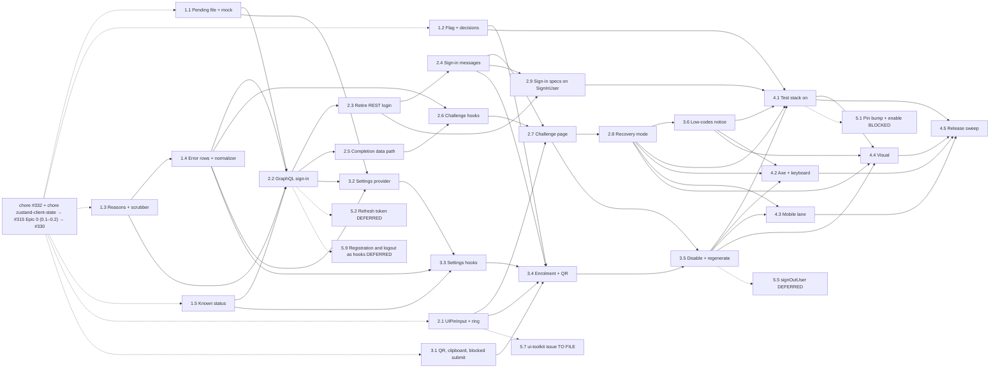

# Epics and stories: two-factor authentication for the user module

**Author:** BMad (Product Manager) **Date:** 2026-10-06, revised 2026-10-08 **Feature:**
`two-factor-authentication`

## Overview

This document decomposes the [PRD](./prd-two-factor-authentication-2026-10-06.md) (FR-1 to FR-45,
FR-2 withdrawn, NFR-1 to NFR-22, the authoritative _what_) and the
[architecture](./architecture-two-factor-authentication-2026-10-06.md) (the authoritative _how_)
into four epics, 25 stories (23 before the 2026-10-27 reconciliation) and nine follow-ups. The
predecessors are the
[research](./research-two-factor-authentication-2026-10-06.md) and the
[brief](./brief-two-factor-authentication-2026-10-06.md). Requirement ids (`FR-n`, `NFR-n`) are
the PRD's; section references (`§n`) are the architecture's. Every operation runs over GraphQL
only, against mocked operations until user-service releases them: Story 1.1 adds the 2FA pending
schema extension and the stateless mock rows, so no story waits for an upstream tag. Every story
names its dispatch dependencies, every dependency appears earlier in file order for Ralph's
top-to-bottom loop, and every story stays inside the rust-code-analysis caps (per file at most 10
functions, 6 closures and 15 in total, 120 LLOC; per function at most 10 LLOC, 3 arguments, 3
exit points; class NPM 8).

**Prerequisites and landing order.** chore #332 (`typed-boundaries-gate`, draft PR #333) and
chore `zustand-client-state` (#334, lands before #315) → #315 Epic 0 (Stories 0.1–0.2)
→ #330. The bundles land #315 → #330 → #331, so every shared piece has
one owner and this bundle imports it; it never builds a piece another bundle owns (planning
contract §3.4):

- **chore #332:** the TB-1 ESLint gate, `consistent-type-definitions`, the `*Transformer` suffix
  and the removal of `Controller` from the naming policy, and the burn-down names
  `AuthStatePatch`, `AuthOkResult<T>`, `AuthFailedResult` and `AuthResult<T>`.
- **chore `zustand-client-state`:** `zustand`, the ADR superseding ADR-008, the removal of the
  zustand ESLint ban and its contract test, and the Zustand stores that replace `AuthStateVar`,
  `ConnectivityStateVar` and `src/lib/state/*` — among them
  `@auth/stores/use-auth-store.ts` (`useAuthStore`, `create<AuthState>()`, also registered by
  value as `AUTH_TOKENS.AuthStore`, typed `StoreApi<AuthState>`, for DI-constructed classes) —
  with the paint budget measured. This bundle only adds fields to `AuthState`: reads are selectors
  (`useAuthStore((s) => s.twoFactorStatus)`), writes are `useAuthStore.setState(AuthStatePatch)`
  from hooks, no store holds logic, and nothing is persisted.
- **#315:** Epic 0 (ADR-019, the `data-providers/` and `transformers/` folders, the shared User
  folder `src/modules/user/types/user/` with `UserEntity`, `SignInDto` and the TB-2 naming
  check); `useAbortableSubmit`; `UserServiceErrorTransformer` with `UserServiceFailure`,
  `UserServiceFailureReason` and `FieldViolationSet`; `AuthProviderLoader` and
  `useAuthProviderLoader`; `AuthCard`, `InCardLink`, `CardBackControl`; the `UIForm`
  `errorAction` and `titleRef`; `SignInNotice`, `ArrivalNotice`, `useArrivalNotice` and the
  marker-clearing `useArrivalFocus`; the pending directory, the codegen schema array and the
  stateless mock composition.
- **#330:** the `settings` feature, `ROUTE_PATHS.settings`, the `UserProfile` page with its 2FA
  slot, the `userSettings` flag and `RouteFlagGate`, the home settings link; `SessionLinkFactory`
  (Bearer header, session end on a transport `401`, the anonymous-operation set that already
  lists `SignInUser` and `CompleteTwoFactorUser`); the `401` → `unauthenticated` status row and
  the exact-message step with its five rows; `settings/utils/response-schemas.ts` with its
  `EXEMPT_RENDER_PATH_FILES` entry; the `UIForm` `footer`; the error-text token
  `paletteColors.error.text`; the `session_ended` arrival notice and its `ProtectedRoute` rule;
  `UIToast` (unused by 2FA). The mock reads no token, as #330's does; every 401/403 branch comes
  from msw and `page.route`.

**Simplification 2026-10-08**
(`crm-worktrees/_planning-shared/over-engineering-review-2026-10-08.md`; the user: "apply all
10", "do not over-engineer", "we use only graphql"):

- Sign-in is GraphQL-only through `GraphQLSignInProvider`; the REST login (`LoginAPI`,
  `src/config/api-config.ts`, `AuthRepositoryImpl.login`, `LoginResponseMapper`, their tokens,
  registrations and tests) is removed by Story 2.3. Registration already uses the GraphQL
  `createUser` mutation and is not touched. The sign-in Strategy and its legacy implementation
  are gone.
- `twoFactorAuth` gates only the 2FA section of `/settings`; it no longer picks a transport and
  no route lists it.
- The sign-in hook `useSignInSubmit` and the challenge hook resolve `GraphQLSignInProvider`
  through #315's `AuthProviderLoader` and write `useAuthStore` themselves; there is no actions
  class on either step. Only the sign-in path leaves `AuthStoreActions` and `DeferredAuthActions`;
  their registration and logout methods are unchanged (Follow-up 5.9 covers the rest).
- The pieces #315 and #330 own are imported (about a fifth of the former criteria); the Bearer
  link, the route flag gate, the error-red token, the `UIForm` footer, the `/settings` shell and
  the generic notices have no story here.
- The mock is a stateless happy path with one violation per mutation that takes input; the
  settings-side security signal, its deps bag and closure, the busy state, the twin banner and
  field-error types and the slot ceremony of the error transformer are gone. The dropped names
  (`SignInProvider`, `TwoFactorChallengeActions`, `AuthStateActions`, `PendingChallenge`, the
  `two_factor` category, `mock-expired-token`, the pending checker) appear nowhere below.

Decisions this stage had to make on its own are recorded inline as `> Assumption:` blocks.

**Reconciliation 2026-10-27.** The stories now target branch
`feat/331-two-factor-authentication` at `77f59152`, stacked on #362 (app shell), #330 (PR #354)
and #315 (PR #340) over `main` with #311 and #333. The architecture's "Reconciliation
2026-10-27" list (items 1 to 18) states every corrected path and name; it and the
`Code facts (reconciled 2026-10-27)` notes in the stories win over older text. Story changes:

1. **Deleted: none.** #330 and #362 built the pieces this bundle already imported (the Bearer
   link, the route flag gate, the settings page, the error-red token, the `UIForm` `footer`) and
   none of the pieces it builds, so no story describes shipped work.
2. **Rewritten: Story 1.2** (decisions in the module README with a `[no-adr]` line; no ADR file
   exists from 003 up), **Story 2.4** (the reason texts on #315's sign-in result card instead of
   a `UIForm` banner) and **Story 1.5** (`SignOutContext` in the routes types, because the shell
   slot props extend the context).
3. **Moved criteria:** Story 2.1 also lands `UIForm` `errorAction`, which #315 did not ship;
   Story 2.6 takes the two `ArrivalNotice` members and their notice rows from Story 2.7, because
   the typed notice table makes `tsc` fail where the hook first names a member.
4. **Split:** Story 2.3's browser-spec migration becomes **Story 2.9**; Story 3.4's leaf pieces
   (the QR encoder and image, the clipboard hook, `submitBlockedReason`) become **Story 3.1**.
5. **Renumbered:** the low-codes notice, formerly Story 3.1, is **Story 3.6**, so the new 3.1
   can precede 3.4. No other number changes.
6. **Count:** 25 stories (Epic 1: 5, Epic 2: 9, Epic 3: 6, Epic 4: 5) and nine follow-ups.
7. **Before `bmalph implement`:** move `.ralph/@fix_plan.md` aside. It holds #362's plan with ten
   completed `Story N.M` lines, and bmalph's `syncFixPlan` copies completed ids into the new plan,
   which would start Stories 1.1, 2.1 to 2.5 and 3.1 to 3.4 checked.

> Assumption: the epic seams follow the architecture (contract and module foundation, sign-in and
> the challenge, the settings section, release wiring) rather than BMAD's "no technical-layer
> epic" heuristic; each piece of Epic 1 is observable on its own and each later epic builds only
> on earlier ones.
>
> Assumption: bmalph turns every `### Story N.M:` header under a `## Epic N:` heading into an
> open item of `.ralph/@fix_plan.md`, runs them top to bottom and ignores `Depends on`; every
> story therefore depends only on stories above it. The follow-ups use `### Follow-up 5.M:`
> headers, which neither bmalph pattern matches, so they are never dispatched.
>
> Assumption (reconciliation 2026-10-27): bmalph sorts the parsed stories by number before it
> writes the plan (`compareStoryIds` in `dist/transition/artifact-loading.js`) and its header
> pattern accepts only digits and dots, with `N.M` the canonical form; so the order is numeric,
> a split part cannot be named `N.Ma`, and every `Depends on` names a lower number. File order is
> kept numeric too, so both readings agree.

### Status vocabulary

The dispatch-readiness legend used on every `**Dispatch:** … **Status:** …` line:

- **Ready**: implementable now; the stories in its `Depends on` list are its only prerequisites.
  Every `### Story N.M:` in this document is Ready.
- **Independent**: a Ready story with no dispatch dependency; it can start in the first wave.
- **Blocked upstream**: a follow-up that waits for a user-service release (Follow-up 5.1).
- **Deferred**: a follow-up out of scope for this feature (Follow-ups 5.2, 5.3, 5.5 and 5.9).
- **Design owner**: a follow-up owned by the design owner (Follow-up 5.4).
- **To file**: a no-code follow-up completed by filing or commenting on an issue (Follow-ups 5.6,
  5.7 and 5.8).

## Requirements Inventory

### Functional Requirements

- FR-1: pending schema extension `src/api/contracts/pending/two-factor-authentication.graphql`,
  copied verbatim from user-service `main` at `a95c1e85`, beside #315's file in #315's mechanism.
- FR-2: withdrawn (2026-10-08); the self-expiring checker was dropped with #315's, and Follow-up
  5.1 deletes the pending file by its file list.
- FR-3: codegen maps `Iterable`; one document per mutation selects only what the client uses,
  never `id`, `_id`, `refreshToken` or `warning`.
- FR-4: the local Apollo mock answers the six mutations statelessly: the happy path, the
  challenge branch for the local part `2fa`, and one `422` violation per mutation that takes
  input.
- FR-5: msw handlers and Playwright route stubs dispatch on the operation name.
- FR-6: runtime flag `twoFactorAuth`, default `false`, gating only the 2FA section of
  `/settings`; the test stack enables it.
- FR-7: flag off hides the 2FA section: `/settings` renders without it and no 2FA settings
  operation runs; sign-in and the challenge do not read the flag.
- FR-8: sign-in runs over GraphQL `signInUser` only, through one Data provider; no `rememberMe`;
  the REST login is removed; registration is unchanged.
- FR-9: a 2FA-off sign-in stores the access token in memory only and drops the refresh token.
- FR-10: a 2FA-on sign-in stores the pending session id, never the token, and navigates to the
  challenge carrying only `state.from`.
- FR-11: sign-in failures map to i18n messages (uniform `401`/`422`, `423`, `429`, transient with
  a user Retry, abort silent).
- FR-12: public lazy route `/sign-in/two-factor`, always registered, read by no flag, reachable
  only with a pending challenge.
- FR-13: `state.from` survives the step; the challenge path is never a redirect target.
- FR-14: the challenge card in authenticator mode (back link, one `h1`, subtitle, time note, code
  input, submit, mode toggle; no providers, switcher, e-mail, resend or countdown).
- FR-15: the code input is the ui-toolkit `UiPinInput` through a crm seam with accessibility
  overrides.
- FR-16: explicit submit, client validation, busy and offline behaviour.
- FR-17: recovery-code mode with normalisation to `XXXX-XXXX`.
- FR-18: successful completion lands on the redirect-back target with focus on `main`.
- FR-19: a wrong code clears the input and shows a mode-specific error.
- FR-20: an expired or unrecognised `401` returns to `/sign-in` with a one-time notice.
- FR-21: `429` during the challenge shows a banner with no Retry; `423` returns to `/sign-in`.
- FR-22: network, timeout and server failures show a banner with a user Retry.
- FR-23: "Назад" and browser Back discard the challenge and abort a request in flight.
- FR-24: #330's session link adds `Authorization: Bearer` to non-anonymous operations and ends the
  session on a transport `401`; its anonymous operations, #330's set, already include
  `SignInUser` and `CompleteTwoFactorUser`.
- FR-25: the 2FA section fills #330's `UserProfile` slot on `/settings` while `twoFactorAuth` is
  on; the route, the page and the home link are #330's (reconciled 2026-10-27: the slot is the
  second child of `SettingsGrid`, and #362's sidebar and user-chip menu replaced the home link).
- FR-26: the known 2FA status kept in memory, unknown until learnt, cleared on logout.
- FR-27: the 2FA off state and an explicit "Почати налаштування" (never on mount).
- FR-28: the QR code encoded on the client, the manual key and copy with a fallback.
- FR-29: confirming enrolment with a six-digit code.
- FR-30: recovery codes shown once with copy and an acknowledgement.
- FR-31: the 2FA on state with "Вимкнути" and "Створити нові резервні коди".
- FR-32: disabling with an authenticator or recovery code.
- FR-33: regenerating recovery codes, including the re-authentication `403` and "Увійти знову".
- FR-34: status conflicts, stale setup and session end on settings mutations (`unauthenticated`
  and "Access Denied." are a session end; the section renders nothing extra).
- FR-35: settings transient failures (`429` without Retry; network, deadline, `5xx` with Retry),
  shown inline in the section.
- FR-36: the secret, the URI and the recovery codes live only in the section's memory.
- FR-37: the low recovery codes notice after landing, linking to `/settings`.
- FR-38: sign-in and challenge failures feed the security-event recorder through
  `AuthSecuritySignals` in the `login` category; settings outcomes record nothing.
- FR-39: the PII scrubber removes 2FA keys at any depth and `otpauth://` strings.
- FR-40: every string in uk and en, corrected copy, merged catalog regenerated.
- FR-41: the contracts README documents GraphQL-only sign-in, the 2FA pending file and the mock
  rows.
- FR-42: `docs/feature-flags.md` documents `twoFactorAuth`.
- FR-43: the `UiPinInput` seam registered per ADR-016 (reconciled 2026-10-27: no ADR-016 file
  exists; the register is `docs/ui-toolkit.md` and the seam list `uiToolkitSeams` in
  `eslint.config.mjs`).
- FR-44: ADR-020, Deciders @kravalg (reconciled 2026-10-27: recorded as
  `## Two-factor authentication decisions` in `src/modules/user/README.md`, as #315 and #330
  recorded theirs, with a `[no-adr]` line in the pull-request body; no ADR file is written).
- FR-45: `SECURITY.md`, READMEs, mirrors, route-coverage rows, axe route list and a story per
  rendering file.

### NonFunctional Requirements

- NFR-1: no secret in the URL, `history.state`, storage, cookies, title, console, Sentry or a
  signal; the access token only in `AuthState.token` of `useAuthStore` (no `persist`).
- NFR-2: every secret-bearing mutation uses `fetchPolicy: 'no-cache'`, minimal selections, an
  abort check before `mutate`, the caller's signal, and no retry.
- NFR-3: one message, one DOM and one request count for every sign-in `401`/`422`.
- NFR-4: security headers unchanged; the QR encoder permissive, offline, without `eval`.
- NFR-5: WCAG 2.1 AA; jest-axe and axe in three engines; zero new `A11Y_EXCEPTIONS`.
- NFR-6: the contrast overrides with exact colours.
- NFR-7: code-input accessibility (names, paste, one focused cell, one announcement) and manual
  NVDA and VoiceOver evidence.
- NFR-8: focus management and live regions for every state change; a settings outcome is
  announced once, by focus on the new state's status heading.
- NFR-9: keyboard contract for both surfaces; every stop shows a ring (the theme's on contained
  submits, one shared `focusVisibleRing` on every other new control).
- NFR-10: no new motion; touch completion and target sizes on Pixel 7 and iPhone 14; no
  horizontal overflow at 320, 390 and 412 px; pin cells inside their card at 320 to 767 px.
- NFR-11: nothing new on the eager path beyond the challenge route key and entry (under 1 kB
  gzip); the QR encoder only in the settings chunk; budgets unchanged.
- NFR-12: desktop ≥ 0.95 and mobile performance ≥ 0.85 (median of three) on the unchanged URL
  list; `/sign-in` loses no point against `main`; `lighthouse/lighthouserc.mobile.js` not edited.
- NFR-13: quality floors (100% coverage, mutation 100, zero lint, `tsc`, jscpd, depcruise,
  metrics and visual-diff findings), no suppressions.
- NFR-14: repository conventions and architecture gates.
- NFR-15: visual regression: new baselines from CI artifacts; intended changes only.
- NFR-16: deadline, abort, error element, chunk retry, no transport retry.
- NFR-17: localization parity.
- NFR-18: observability only through `AuthSecuritySignals` and the Apollo error link.
- NFR-19: Faker builders, semantic locators, test-liveness and console gates.
- NFR-20: documentation and ADR drift gates.
- NFR-21: TB-1 typed boundaries and TB-2 board types at component boundaries, gated by chore
  #332 and #315 Epic 0; `SignInDto`, `TwoFactorDto` and `TwoFactorSettingsEntity` cross component
  and form boundaries as themselves.
- NFR-22: Miro layer conformance: `[component]<route>` → React hook → Data provider ⇄ Transformer →
  GraphQL Repository → API; no frontend class is a Controller, Service or Handler.

### Additional Requirements

Derived from the architecture and from the repository gates this stage re-read:

- AR-1 (§6.3): the challenge reaches its Data provider only through #315's `AuthProviderLoader`;
  only `stores/index.ts` imports the composition root; the auth tree never reaches
  `@/providers/di`.
- AR-2 (§7): no new module-level singleton and no controller or service class;
  `TwoFactorCodeNormalizer` is built once per mount in a `useState` initializer and passed as a
  typed dependency.
- AR-3 (§6.18): single-flight, abort on unmount, Retry and StrictMode behaviour belong to #315's
  `useAbortableSubmit`; no hook of this feature re-implements them.
- AR-4 (§7.3): every interface and alias lives in a type-only file under a `types/` folder.
- AR-5 (§7.1): new classes use the approved suffixes `Repository`, `Transformer`, `Provider` and
  `Normalizer`; this bundle edits no naming policy.
- AR-6 (§6.5): one-time navigation markers (`focusMain`, `notice`) are cleared only by
  `useArrivalFocus`, in one history replace.
- AR-7: the integration suite's 100% threshold binds every `src` file an integration test loads;
  each class registered in the user-module composition root is covered by integration tests in
  the story that registers it.
- AR-8 (§6.8): one translation layer in two halves: the shared `UserServiceErrorTransformer`
  (#315's step list, #330's rows, this feature's appended rows) and one `GraphQL*Transformer` per
  feature, called only by its Data provider; repositories are transport only.
- AR-9 (§2.3): the settings feature never imports the auth feature; it reaches `useAuthStore`
  only through `ProtectedOutletContext`.
- AR-10 (§14): every shared piece has one owner (planning contract §3.4); this bundle imports the
  pieces #315 and #330 own and only appends where the owner allows (reasons, rows, schemas in
  #330's settings `response-schemas.ts`, `ArrivalNotice` members, outlet-context members).
- AR-11 (§6.16): no story moves a contract pin, sets `ALLOW_CONTRACT_VERSION_SKEW` or edits
  `src/api/generated/**` by hand; the pin bump is Follow-up 5.1.
- AR-12 (§6.15): the test stack enables the flag only in Story 4.1; before that, browser specs
  force it on per test through `overrideRuntimeConfig`.
- AR-13 (§12): caps to keep: `UserModuleRegistrar` stays at nine functions and gains no closure;
  `AuthStoreActions` drops to seven functions and `DeferredAuthActions` loses `loginUser`, because
  only sign-in leaves them; `useAuthStore` gains fields only, no action; every hook file stays
  within ten functions. Reconciled 2026-10-27: the registrar
  (`src/modules/user/config/di.ts`) has ten functions and four closures today; it stays at ten
  and four, because Story 2.2 folds `registerErrorFactories` into `registerErrorHandling` and
  adds one step, `registerUserServiceProviders`, for all six new bindings (architecture §7.2).
- AR-14 (§6.19): data access is GraphQL repositories only; no REST call remains on the sign-in
  path (planning contract §3.4).
- AR-15 (planning contract §4): TB-1 and TB-2 are gated by chore #332 and #315 Epic 0, both merged
  before Wave 1; this bundle adds no selector, fixture or policy pin.
- AR-16 (§2.4, §19): the Miro layer map: route page → React hook → Data provider ⇄ Transformer →
  GraphQL Repository → API; the sign-in and challenge hooks reach the sign-in Data provider
  through the loader and write State (the Zustand store `useAuthStore`, through
  `setState(AuthStatePatch)`) themselves, with no actions class between; DTOs and entities are
  named `[type]` interfaces.

### UX Design Requirements

- UX-DR-1: Figma file `xZ7ccrH6d4QyqLQsayFSEX`, challenge frames `72:4846` (desktop 1440),
  `72:4882` (tablet 1024) and `72:4918` (mobile 375), "2FA item" component set `72:5171`: card at
  the existing auth card width, inside the sign-in card's 6 px section padding. From crm `md`
  (768 px) the cells are 64 × 86 with an 8 px gap and shrink in width so the row never exceeds
  the card's content box; below `md` the six cells share the row with a 4 px gap, 64 px tall and
  at most 49 px wide (`flex: 1 1 0`, `min-width: 0`), inside the content box down to 320 px
  (§6.11). The tablet cells (about 86 × 130 in `72:4882`) are a recorded deviation (Follow-up 5.4).
- UX-DR-2: settings frames (misnamed "Помилка 404"): setup `313:10242` / `313:10480` /
  `313:10606`, connected `315:11502` / `315:12300` / `318:13133`, QR `315:11289`, key chip
  `315:11309`.
- UX-DR-3: the undrawn states (recovery-code mode, confirm, recovery codes, the disable and
  regenerate confirmation, re-authentication, errors, notices, the status headings of the off and
  on views) are composed from existing primitives until Follow-up 5.4.
- UX-DR-4: the NFR-6 colours are accessibility overrides of the design, recorded through the
  `figma-design-check` gate and raised in Follow-up 5.4.
- UX-DR-5: the Russian settings copy is translated to Ukrainian, the Figma spelling defects are
  corrected, there is no masked e-mail and no resend row (D1, D12).
- UX-DR-6: every user-facing story runs the mandatory `figma-design-check` gate through the Figma
  MCP before UI code is written; an unreachable MCP reports `BLOCKED`, never a skip.

### FR and NFR coverage map

| Requirement | Stories                                                    |
| ----------- | ---------------------------------------------------------- |
| FR-1        | 1.1                                                        |
| FR-2        | withdrawn (2026-10-08)                                     |
| FR-3        | 1.1, 2.2, 2.5, 3.2                                         |
| FR-4        | 1.1, 1.4                                                   |
| FR-5        | 2.2, 2.3, 2.4, 2.9, 3.2                                    |
| FR-6        | 1.2, 4.1                                                   |
| FR-7        | 1.2, 3.4, 4.1                                              |
| FR-8        | 2.2, 2.3, 2.9                                              |
| FR-9        | 2.2, 2.4                                                   |
| FR-10       | 2.2, 2.7                                                   |
| FR-11       | 1.4, 2.2, 2.4                                              |
| FR-12       | 2.7                                                        |
| FR-13       | 2.7                                                        |
| FR-14       | 2.7, 2.8, 4.4                                              |
| FR-15       | 2.1, 2.7                                                   |
| FR-16       | 2.6, 2.7                                                   |
| FR-17       | 1.4, 2.6, 2.8                                              |
| FR-18       | 2.5, 2.6, 2.7                                              |
| FR-19       | 1.4, 2.5, 2.6, 2.7, 2.8                                    |
| FR-20       | 1.4, 2.5, 2.6, 2.7                                         |
| FR-21       | 2.5, 2.6, 2.7                                              |
| FR-22       | 2.5, 2.6, 2.7                                              |
| FR-23       | 2.6, 2.7                                                   |
| FR-24       | 2.2, 2.5, 3.2                                              |
| FR-25       | 3.4, 4.1                                                   |
| FR-26       | 1.5, 2.2, 2.6, 3.3, 3.4                                    |
| FR-27       | 3.2, 3.3, 3.4                                              |
| FR-28       | 3.1, 3.2, 3.3, 3.4                                         |
| FR-29       | 3.2, 3.3, 3.4                                              |
| FR-30       | 3.1, 3.2, 3.3, 3.4                                         |
| FR-31       | 3.4, 3.5                                                   |
| FR-32       | 1.4, 3.2, 3.3, 3.5                                         |
| FR-33       | 3.2, 3.3, 3.5                                              |
| FR-34       | 1.4, 3.2, 3.3, 3.4, 3.5                                    |
| FR-35       | 3.2, 3.3, 3.4, 3.5                                         |
| FR-36       | 3.3, 3.4, 3.5                                              |
| FR-37       | 2.5, 3.6                                                   |
| FR-38       | 1.3, 2.2, 2.5, 2.6                                         |
| FR-39       | 1.3                                                        |
| FR-40       | 2.4, 2.6, 2.7, 2.8, 3.4, 3.5, 3.6                          |
| FR-41       | 1.1, 2.3, 4.5                                              |
| FR-42       | 1.2, 4.1                                                   |
| FR-43       | 2.1                                                        |
| FR-44       | 1.2, 3.1, 3.4, 4.5                                         |
| FR-45       | 2.3, 2.7, 2.9, 3.1, 3.4, 3.5, 4.2, 4.3, 4.4, 4.5           |
| NFR-1       | 1.3, 1.5, 2.2, 2.4, 2.5, 2.6, 2.7, 2.8, 3.2, 3.3, 3.4, 3.5 |
| NFR-2       | 2.2, 2.5, 3.2                                              |
| NFR-3       | 1.4, 2.2, 2.4                                              |
| NFR-4       | 3.1, 3.4, 4.5                                              |
| NFR-5       | 2.1, 2.4, 2.7, 2.8, 3.1, 3.4, 3.5, 3.6, 4.2                |
| NFR-6       | 2.1, 2.4, 2.7, 2.8, 3.4, 3.5, 4.2                          |
| NFR-7       | 2.1, 2.7, 3.4, 4.2                                         |
| NFR-8       | 2.4, 2.7, 2.8, 3.3, 3.4, 3.5, 3.6, 4.2                     |
| NFR-9       | 2.1, 2.4, 2.7, 2.8, 3.4, 3.5, 3.6, 4.2                     |
| NFR-10      | 2.7, 3.4, 4.3                                              |
| NFR-11      | 2.2, 2.5, 2.7, 3.1, 3.2, 3.4, 3.6, 4.5                     |
| NFR-12      | 4.1, 4.5                                                   |
| NFR-13      | 1.1, 1.2, 2.1, 2.3, 3.1, 4.5                               |
| NFR-14      | 1.4, 1.5, 2.1, 2.3, 3.2                                    |
| NFR-15      | 4.1, 4.4                                                   |
| NFR-16      | 2.6, 2.7, 3.3                                              |
| NFR-17      | 1.2, 2.4, 2.6, 2.7, 2.8, 3.4, 3.5, 3.6, 4.5                |
| NFR-18      | 1.3, 2.2, 2.5                                              |
| NFR-19      | 1.1, 1.3, 2.2, 2.3, 2.4, 2.7, 2.9, 3.2, 3.4, 4.2, 4.3, 4.4 |
| NFR-20      | 1.1, 1.2, 2.3, 3.1, 3.4, 4.1, 4.5                          |
| NFR-21      | 1.2–1.5, 2.1, 2.2, 2.4–2.8, 3.1–3.6, 4.5                   |
| NFR-22      | 1.4, 2.2, 2.5, 2.6, 3.2, 3.3, 3.4, 3.5, 4.5                |

Every FR-1 to FR-45 except the withdrawn FR-2, and every NFR-1 to NFR-22, is covered by at least
one Ready story. The table is generated from the per-story **Requirements** lines and equals their
union; a run of three or more consecutive stories of one epic in a long row is written as a range.
The repository-wide floors (NFR-13, NFR-14, NFR-17, NFR-19) also bind every story through the
Definition of done. Reconciled 2026-10-27: the rows follow the new Stories 2.9 and 3.1, the
renumbered 3.6 and the criteria moved into 2.6.

## Definition of done shared by every Ready story

Each story's own criteria add to these; a story is not done until all of them hold.

- **Quality floors.** No threshold, budget, allowlist, scope, baseline or ratchet value is edited
  to make a run pass. No `eslint-disable`, `@ts-ignore`, `@ts-expect-error`, depcruise ignore,
  coverage suppression, `.skip`, `.only`, `.fixme`, `waitForTimeout` or `expect` inside a
  conditional; no `data-testid` in `src`; no new `A11Y_EXCEPTIONS` entry; no added inline code
  comment beyond a `// Stryker disable next-line <Mutator>: <proof>` the mutation policy accepts.
- **Conventions.** Classes only in non-React `.ts` (no statics, no free functions, no
  function-valued properties of top-level object literals); types in type-only files; approved
  class-name suffixes; collaborators through DI tokens; the auth tree never reaches
  `@/providers/di`; only `stores/index.ts` imports the composition root; no raw `Intl` or
  `toLocale*` call; no `@mui/material` import on eager code; no sibling-feature import.
- **Typed boundaries and board layers.** Every value crossing a layer boundary is a named
  interface, class or named alias in a type-only file (TB-1, the chore #332 gate reports nothing);
  board types from the shared User folder cross component and form boundaries as themselves and
  no `*Dto` or `*Entity` is declared elsewhere (TB-2); every new unit sits in one board layer and
  no class is named `*Controller`, `*Service` or `*Handler` (NFR-22).
- **Prerequisites.** chore #332, chore `zustand-client-state` and #315 Epic 0 (Stories 0.1–0.2)
  are merged on `main`, and #315 and #330 have landed, before Wave 1 (AR-15, AR-10).
  Reconciled 2026-10-27: #333 (both chores) is on `main`; #315, #330 and #362 are not merged but
  are ancestors of this branch's `77f59152`, which is what the stories build on. If one of them
  changes before it merges, a correct-course pass aligns the affected stories first.
- **Client state.** Auth state is the chore's Zustand store `useAuthStore`; a story adds fields to
  `AuthState` only, reads them with selectors, writes them from hooks with
  `useAuthStore.setState(AuthStatePatch)`, and creates no store, action or `persist` middleware.
- **Imported pieces.** A story never builds a piece another bundle owns (planning contract §3.4);
  it imports it and appends only where the owner allows (AR-10).
- **Tests.** Every new `src` file has a direct unit test; unit coverage stays at 100%; AR-7
  integration coverage stays at 100%; arbitrary e-mails, passwords, tokens, session ids, codes,
  secrets and otpauth URIs come from the seeded Faker builders (`buildEmail`, `buildPassword`,
  `buildToken`, and the 2FA builders of Story 1.3); literals appear only where the value is the
  test case (the mock's magic inputs, boundary codes, upstream messages); elements are located by
  role, label or text; logging paths are spied and asserted per test; layout measurements (44 px
  and 24 px targets, the focus ring, pin cells inside their card) belong to the browser lanes; a
  colour a criterion names is asserted on the style object loaded in the test body, or with
  `toHaveCSS` in a browser spec.
- **Mutation.** Zero survivors on every new or changed file in the mutate scope; static tables
  (outcome tables, message rows, style objects) are loaded inside the test body through
  `tests/unit/utils/isolated-module.ts`; an equivalent mutant is removed by adopting the simpler
  program, or annotated with a proof only where no refactor exists.
- **i18n.** Every key a story first uses lands in uk and en in that story, followed by
  `make i18n-generate`; catalog edits are append-only so parallel stories merge cleanly.
  Reconciled 2026-10-27: catalogs listed in `config/i18n-catalog-policy.json` are lazy and never
  enter `src/i18n/localization.json`; `settings/i18n` is one, so settings keys need no regenerate,
  only `make lint-i18n`, and resolve only in the owner paths that file lists.
- **Design.** A user-facing story runs `figma-design-check` (UX-DR-6) before UI code and records
  the NFR-6 overrides and the composed states it ships.
- **Local gates** (light, run before handing back): `make format`; then ESLint, Prettier
  `--check` and `tsc` over the changed files inside the dev container; `make lint-md`,
  `make lint-i18n` and `make lint-docs` where the story touches Markdown, catalogs or docs; the
  gates its **Gates** line names; and the focused Jest files it touches, for example
  `docker compose exec -T dev bun x jest tests/unit/path/to/file.test.ts`.
- **CI-only gates** (heavy, never run locally): the full `make lint` aggregate,
  `make test-unit-all`, `make test-integration`, the sharded Stryker run, `make test-e2e`,
  `make test-visual`, `make test-a11y-e2e`, the mobile lane, Lighthouse, the bundle-size report,
  `make check-adr-drift` and the supply-chain scans.
- **Commits.** Headers of at most 100 characters with the issue scope; the auto-close reference
  rides the commit message (squash-merge repository).

## Epic List

All four epics start after the prerequisites of the Overview (AR-15, AR-10).

1. **Epic 1: Contract, mock and module foundation** — the 2FA pending extension and mock rows,
   the flag and the decision record, the challenge failure reasons and the scrubber, the appended
   error rows,
   the code normalizer and `TwoFactorDto`, and the known 2FA status in `useAuthStore` behind the
   outlet context.
2. **Epic 2: GraphQL sign-in and the two-factor challenge** — the `UIPinInput` seam, GraphQL
   sign-in, the retirement of the REST login, the sign-in failure messages, challenge completion,
   the challenge hooks, `/sign-in/two-factor` in authenticator and recovery-code modes, and the
   sign-in browser specs moved onto the GraphQL stub (Story 2.9).
3. **Epic 3: The 2FA settings section and the low-codes notice** — the QR image, clipboard and
   blocked-submit pieces (Story 3.1), the settings Data provider, Repository and Transformer, the
   section's hooks, enrolment with the client-side QR, disable and regenerate, and the low
   recovery codes notice (Story 3.6, formerly 3.1).
4. **Epic 4: Release wiring and quality** — the flag in the test stack, axe and the keyboard
   contract in every state, the mobile lane, the visual baselines and the final sweep.

The section "Upstream work and follow-ups (not dispatched)" after Epic 4 holds Follow-ups 5.1 to
5.9. It is not an epic and is never dispatched.

## Epic 1: Contract, mock and module foundation

**Goal.** Make the six user-service operations usable now, without a release, and land the
module-level pieces both 2FA surfaces share. Nothing visible changes.

**Scope.** `src/api/contracts/`, `codegen.ts`, `docker/apollo-server/lib/`, `tests/apollo-server/`,
`src/config/runtime/`, `public/index.html`, `.env.example`, `docker-compose.test.yml`,
`src/modules/user/README.md`, `docs/feature-flags.md`, `src/services/types/security-events/`,
`src/services/observability/pii-scrubber.ts`, `tests/builders/`,
`src/modules/user/{lib,transformers,types,config}/`,
`src/routes/types/{protected-outlet-context,shell-slot}.ts`,
`src/modules/user/features/auth/{stores,types}/`,
`src/modules/user/features/auth/components/protected-route/`.

### Story 1.1: Declare the 2FA operations and answer them from the stateless mock

As a developer of the user module,
I want the six 2FA operations in a pending schema extension that codegen and the local mock read,
So that the feature is built now against user-service `main` without waiting for a release.

**Dispatch:** Independent. **Status:** Ready.

**Requirements:** FR-1, FR-3, FR-4, FR-41, NFR-13, NFR-19, NFR-20, AR-10, AR-11 (architecture
§6.16).

**Files:** `src/api/contracts/pending/two-factor-authentication.graphql` (NEW), `codegen.ts`
(MODIFY: `scalars` gains `Iterable: 'unknown'`), `docker/apollo-server/lib/two-factor-resolvers.ts`
(NEW, stateless), `docker/apollo-server/lib/resolvers.ts` (MODIFY: spread into
`resolvers.Mutation`), `tests/apollo-server/two-factor-resolvers.test.ts` (NEW),
`src/api/contracts/README.md` (MODIFY: the 2FA rows of #315's pending section).

**Gates:** DoD local gates; `make codegen`, `make codegen-check`, `make lint-docs`,
`make lint-md`; the focused server-environment Jest file with `TEST_ENV=server`.

Code facts (reconciled 2026-10-27): the pin is `GRAPHQL_SCHEMA_VERSION=v2.8.0`
(`.env.example:84`) and neither it nor `src/api/generated/graphql.ts` declares a sign-in or 2FA
operation. #315's `src/api/contracts/pending/password-reset.graphql` opens with
`# pending-against: v2.8.0`, which `scripts/ci/check-pending-contracts.sh` (first step of
`scripts/codegen.sh`) requires of every pending file. `codegen.ts:28` maps
`scalars: { ID: 'string' }`. The mock's `resolvers.Mutation` (`docker/apollo-server/lib/
resolvers.ts`) spreads `profileResolvers.Mutation`, and violations come from
`rejectViolation(property, reason)` in `docker/apollo-server/lib/violations.ts`
(`extensions: { code: 'BAD_USER_INPUT', status: 422 }`, no `extensions.violations`). Server tests
build schemas from `tests/apollo-server/mock-schema-fixtures.ts`.

**Acceptance Criteria:**

- Given user-service `main` at `a95c1e854bf21770b7fc630611a8257b0f9c600b`, when the 2FA file is
  written, then it holds one `extend type Mutation` with `signInUser`, `completeTwoFactorUser`,
  `setupTwoFactorUser`, `confirmTwoFactorUser`, `disableTwoFactorUser` and
  `regenerateRecoveryCodesUser`, their input, payload and payload-data types copied verbatim, and
  `scalar Iterable` declared once across all pending files; its first line is
  `# pending-against: v2.8.0` and a header comment names the source commit and Follow-up 5.1 as
  the deletion trigger, so `scripts/ci/check-pending-contracts.sh` passes.
- Given #315's pending mechanism on `main`, when the story lands, then it adds only the 2FA file,
  the `Iterable` mapping, the resolvers and the README rows, and `codegen.ts`'s schema array and
  the mock composition are #315's, unchanged.
- Given `make codegen` with the documents that exist today, when it runs, then
  `src/api/generated/graphql.ts` is unchanged, `Iterable` maps to `unknown` (never `any`) and
  `make codegen-check` passes against the v2.8.0 pin.
- Given the stateless resolvers, when each mutation runs against a test-built server with the
  composed schema and the real `formatError`, then sign-in answers an `accessToken` with
  `twoFactorEnabled` false, or a `pendingSessionId` for the local part `2fa`; completion with
  `123456` answers an `accessToken`; setup answers a fixed `otpauthUri` and 32-character `secret`;
  confirm and regenerate answer eight fixed codes; disable answers `success`.
- Given a malformed e-mail on sign-in or a malformed code on completion, confirm or disable, when
  it runs, then the resolver throws through the shared `rejectViolation('email' | 'twoFactorCode',
reason)`, so the response carries the message `<property>: <reason>` with
  `extensions: { code: 'BAD_USER_INPUT', status: 422 }` and `formatError` keeps it (must-fail: an
  error thrown with code `BAD_REQUEST` instead reaches the response as the generic message).
- Given the resolvers, when they are read, then `docker/apollo-server/lib/two-factor-resolvers.ts`
  is spread into `resolvers.Mutation` beside `profileResolvers.Mutation`, they keep no state
  between requests, the existing `createUser`, password-reset and profile tests pass unchanged,
  no test opens a port or imports `server.ts`, the server tests build their schema with a 2FA
  fixture beside `tests/apollo-server/mock-schema-fixtures.ts`, and each error test spies and
  asserts `console.error` in that test only.
- Given `src/api/contracts/README.md`, when it is read, then #315's pending section lists the 2FA
  file, the version it is pending against (`v2.8.0`), the upstream commit, its mock rows and the
  layer split (Playwright stubs in the browser lanes, msw in integration, the mock locally), and
  `make lint-docs` passes.

### Story 1.2: Declare the twoFactorAuth flag and record the 2FA decisions

As the release owner,
I want one runtime flag, off by default, that hides the 2FA settings section, and the feature's
decisions recorded where the module's other decisions live,
So that the section stays hidden in production until user-service ships the operations, and the
ADR-drift gate passes on the significant paths this feature changes.

**Dispatch:** Independent. **Status:** Ready.

**Requirements:** FR-6, FR-7, FR-42, FR-44, NFR-13, NFR-17, NFR-20, NFR-21, AR-12 (architecture
§6.15, §15).

> Assumption (reconciliation 2026-10-27): no ADR file is written. `docs/adr/` holds only 001 and
> 002 (`docs/adr/README.md`), and #315 and #330 recorded their decisions as
> `## Password recovery decisions` and `## User Settings decisions` in
> `src/modules/user/README.md` with a `[no-adr]` line for `make check-adr-drift`. This story
> follows them: architecture §15 becomes `## Two-factor authentication decisions`, and later
> stories that this plan says "update ADR-020" update that section instead.

Code facts (reconciled 2026-10-27): `FeatureFlag` is `'userSettings'` alone
(`src/config/runtime/types/feature-flag.ts`); `FEATURE_FLAG_DEFAULTS` is
`src/config/runtime/feature-flag-service.ts:4`; the block is `public/index.html:28`; the
template line is `APP_CONFIG_FLAG_USER_SETTINGS=` (`.env.example:67`) and the test stack passes
`APP_CONFIG_FLAG_USER_SETTINGS=${APP_CONFIG_FLAG_USER_SETTINGS:-true}`
(`docker-compose.test.yml:24`).

**Files:** `src/config/runtime/types/feature-flag.ts`, `src/config/runtime/feature-flag-service.ts`,
`src/config/runtime/app-config-schema.ts`, `public/index.html`, `.env.example`,
`docker-compose.test.yml` (MODIFY each: `twoFactorAuth`, default `false`), `docs/feature-flags.md`
(MODIFY), `tests/builders/app-config.ts`, `tests/unit/config/runtime/*.test.ts`,
`tests/unit/scripts/render-app-config.test.js` (MODIFY), `src/modules/user/README.md` (MODIFY:
`## Two-factor authentication decisions`).

**Gates:** DoD local gates; `make check-env-sync`, `make lint-docs`, `make lint-md`,
`make lint-compose`; the focused Jest file `tests/unit/tooling/runtime-config-contract.test.ts`.

**Acceptance Criteria:**

- Given the declaration list of `docs/feature-flags.md`, when the flag is added, then the
  `FeatureFlag` union and `FeatureFlagValues`, `FEATURE_FLAG_DEFAULTS`, the strict schema and the
  committed `public/index.html` block each declare `twoFactorAuth`, the default is `false` in code
  and in the block, and the runtime-config contract test passes unchanged.
- Given `.env.example`, when it is read, then it declares an empty
  `APP_CONFIG_FLAG_TWO_FACTOR_AUTH=` after `APP_CONFIG_FLAG_USER_SETTINGS=`,
  `make check-env-sync` passes, and `docker-compose.test.yml` passes
  `APP_CONFIG_FLAG_TWO_FACTOR_AUTH=${APP_CONFIG_FLAG_TWO_FACTOR_AUTH-}` beside the
  `userSettings` line, so an empty value renders the in-code `false`.
- Given `scripts/render-app-config.js`, when the variable is `true` or `false`, then the rendered
  block carries that value, and any other value fails the container start.
- Given `useFeatureFlag('twoFactorAuth')`, when the block omits or sets the flag, then it returns
  the block value or `false`; no route contract lists the flag and no sign-in code reads it.
- Given `docs/feature-flags.md`, when the "Current flags" row is read, then it says the flag hides
  the 2FA section of `/settings`, the test stack enables it from Story 4.1, production enables it
  in Follow-up 5.1, and the flag is deleted once production has run it.
- Given `src/modules/user/README.md`, when `## Two-factor authentication decisions` is written
  from the architecture §15 draft after `## User Settings decisions`, then it opens like its two
  siblings (the issue link, "They live here rather than in an ADR by the maintainer's decision",
  a link to this architecture) and holds one `###` decision each, with context, decision and
  rejected options, for: GraphQL-only sign-in with the REST login removed; the pending file in
  #315's mechanism; memory-only token and pending session in `useAuthStore`; the challenge as a
  page-guarded public route; the 2FA section in `features/settings` reaching `useAuthStore` only
  through the outlet context; the flag gating only that section; classification through the
  shared transformer's appended rows; the QR encoder and its chunk; the `UIPinInput` overrides.
- Given the new section, when `make lint-docs` and `make lint-md` run, then both pass, no file is
  added under `docs/adr/`, and the pull-request description carries a `[no-adr]` line so
  `make check-adr-drift` passes in CI on this story's `src/config/` change and the later
  `dependencies` change of Story 3.1.
- Given the widened `FeatureFlag` union, when the chore #332 gate runs, then it reports nothing
  and the flag is a member of the named union, never a free string at a boundary (NFR-21).

### Story 1.3: Name the challenge failure reasons and scrub 2FA secrets from telemetry

As a security operator,
I want challenge failures to carry bounded reason codes and every 2FA secret removed from
captured events,
So that brute force on codes is visible and a captured event can never replay a session, a code
or a TOTP secret.

**Dispatch:** Independent. **Status:** Ready.

**Requirements:** FR-38, FR-39, NFR-1, NFR-18, NFR-19, NFR-21 (architecture §6.14).

> Assumption: the five 2FA test builders land here, the first story whose tests need arbitrary
> session ids, codes, secrets and otpauth URIs.

**Files:** `src/services/types/security-events/security-event.ts` (MODIFY: `AuthFailureReason`
gains `invalid_code`, `expired_session` and `locked`), `src/services/observability/pii-scrubber.ts`
(MODIFY: fragments `pendingsession`, `twofactorcode`, `recoverycode`, `otpauth`; an `otpauth://`
pattern), `tests/builders/two-factor.ts` (NEW: `buildTotpCode`, `buildRecoveryCode`,
`buildPendingSessionId`, `buildTotpSecret`, `buildOtpauthUri`), `tests/builders/index.ts`
(MODIFY), unit tests.

Code facts (reconciled 2026-10-27): `AuthFailureReason` is
`src/services/types/security-events/security-event.ts:10-11`; `PiiScrubber` holds
`deniedFragments` and `patterns` as private instance arrays
(`src/services/observability/pii-scrubber.ts:4-22`), already denies `secret`, and lists the
e-mail pattern first. `tests/builders/` holds `app-config`, `auth`, `credentials`, `graphql`,
`profile`, `seed` and `user`.

**Gates:** DoD local gates.

**Acceptance Criteria:**

- Given `AuthFailureReason`, when the change lands, then it includes `invalid_code`,
  `expired_session` and `locked`, no category is added, and the existing reasons keep their
  meaning.
- Given an event carrying `pendingSessionId`, `twoFactorCode`, `recoveryCodes`, `otpauthUri`,
  `secret`, `accessToken` and `refreshToken` keys at the top level, in `extra`, in a breadcrumb's
  `data` and inside `variables.input`, when it is scrubbed, then none of the seven values remains
  in the serialised event.
- Given the `@`-free vector `otpauth://totp/VilnaCRM%3Aa%40b.c?secret=ABC&issuer=VilnaCRM`
  followed by a space, a quote or the end of the string, when it is scrubbed, then no part of the
  URI remains, the text after the boundary is kept, and an upper-case `OTPAUTH://` is redacted
  too (must-fail: with the new pattern removed, the e-mail pattern leaves the vector intact).
- Given `patterns`, when it is read, then the otpauth pattern is its first entry, before the
  e-mail pattern, and `"otpauth://totp/VilnaCRM:a@b.c?secret=ABC" next` scrubs to
  `"[redacted]" next`; ESLint `security/detect-unsafe-regex` passes without suppression.
- Given a v4 UUID correlation id and an ordinary six-digit number in free text, when they are
  scrubbed, then both are unchanged.
- Given the builders under the seeded Faker, when they are called, then `buildTotpCode` returns
  six digits, `buildRecoveryCode` `XXXX-XXXX` from `[A-Z0-9]`, `buildPendingSessionId` a
  26-character ULID-shaped string, `buildTotpSecret` 32 base32 characters and `buildOtpauthUri`
  an `otpauth://totp/VilnaCRM%3A<label>?secret=<secret>&issuer=VilnaCRM` URI with a
  percent-encoded e-mail label, each deterministic per seed and exported from `@tests/builders`.
- Given the widened union and the five builders, when the chore #332 gate runs, then it reports
  nothing; the union stays a named alias of literals and each builder returns a scalar (NFR-21).

### Story 1.4: Append the 2FA rows to the error transformer and add the code normalizer

As both 2FA surfaces,
I want #315's `UserServiceErrorTransformer` to know every 2FA message, and one canonical TOTP or
recovery code carried by the board's `TwoFactorDto`,
So that no GraphQL shape or English message reaches a hook, and both surfaces accept codes the
same way.

**Dispatch:** Depends on: 1.3. **Status:** Ready.

**Requirements:** FR-4, FR-11, FR-17, FR-19, FR-20, FR-32, FR-34, NFR-3, NFR-14, NFR-21, NFR-22,
AR-2, AR-5, AR-7, AR-8, AR-10 (architecture §6.8, §7.1, §19).

> Assumption: the transformer's steps are #315's (aborted; `networkError` → status table; input
> property prefix → violation; `extensions.status` → status table; any other message → refused;
> unknown), with #330's `401` → `unauthenticated` row and its exact-message step ("Access
> Denied." → `access_denied`). This story only appends; it never reorders or removes a step.

Code facts (reconciled 2026-10-27): the transformer is
`src/modules/user/transformers/user-service-error-transformer.ts` (default export of
`src/modules/user/transformers/index.ts`), `@injectable()` and registered with
`registerSingleton`. Its tables are module-level constants: `STATUS_REASONS` (`0`, `401`, `422`,
`429`; 5xx is a range check), `MESSAGE_REASONS` ("Access Denied.", and #330's two
wrong-password texts), `TAKEN_MESSAGES` and `VIOLATION_PROPERTIES` (`email`, `token`,
`newPassword`, `initials`, `password`). The exact-message step runs after the violation step
and before `extensions.status`; an unmatched status-less error is `unknown` when it carries
`extensions.code` and `refused` otherwise. The file holds ten functions, so the story adds rows
only. Its unit test is
`tests/unit/modules/user/transformers/user-service-error-transformer.test.ts`;
the integration suites that resolve it are
`tests/integration/modules/user/features/auth/password-recovery-transformers.integration.test.ts`
and
`tests/integration/modules/user/features/settings/graphql-profile-repository.integration.test.ts`.

**Files:** `src/modules/user/transformers/user-service-error-transformer.ts` (MODIFY: appended
rows), `src/modules/user/types/user-service/user-service-failure.ts` (MODIFY: appended reasons),
`src/modules/user/lib/two-factor-code-normalizer.ts` (NEW: `TwoFactorCodeNormalizer`, no
`@injectable()`), `src/modules/user/types/user/two-factor-dto.ts` (NEW: `TwoFactorDto`),
`src/modules/user/index.ts` (MODIFY: type re-export), `src/modules/user/types/two-factor/code.ts`
(NEW: `TwoFactorCodeKind`, `TwoFactorCodeAcceptance`, `TwoFactorFieldError`,
`TwoFactorBannerCode`), unit tests and the transformer's integration test (MODIFY).

**Gates:** DoD local gates; `make lint-eslint`, `make lint-deps`, `make lint-metrics`; the focused
`tests/unit/tooling/di-collaborator-gate.test.ts`.

**Acceptance Criteria:**

- Given `UserServiceFailureReason`, when the story lands, then it gains exactly `locked`,
  `invalid_code`, `expired_session`, `setup_not_initiated`, `already_enabled`, `not_enabled` and
  `reauth_required`, and #315's and #330's members are unchanged.
- Given the appended rows, when the transformer sees each upstream answer, then a numeric status
  `423` (transport or `extensions.status`) gives `locked`; the exact messages "Invalid
  two-factor code.", "Invalid or expired two-factor session.", "Two-factor setup not
  initiated.", "Two-factor authentication is already enabled.", "Two-factor authentication is
  not enabled." and "Re-authentication required." give `invalid_code`, `expired_session`,
  `setup_not_initiated`, `already_enabled`, `not_enabled` and `reauth_required`, with or without
  `extensions.status`; one assertion per row, the rows loaded in the test body.
- Given the exact-message step, when "Invalid two-factor code. Retry" is normalised, then it is
  not `invalid_code` (must-fail: a contains-match fails the test), and an unmatched message keeps
  #315's result (`refused` without a status, the status table with one).
- Given a violation message whose prefix is `twoFactorCode` or `password`, when it is normalised,
  then it is `violation`: this story appends `twoFactorCode` to step 3, and `password` is #330's.
- Given two GraphQL errors with the same status and message, one with `extensions.code` and one
  without, when each is normalised, then the results are equal.
- Given every pre-existing row, when the suite runs, then each keeps its result (#315's and
  #330's tests pass unchanged).
- Given `TwoFactorCodeNormalizer.normalize(raw, accept)`, when `accept` is `totp`, then `123456`
  and `123 456` give `123456`, and five digits, seven digits or letters give `null`; when
  `recovery`, then `abcd2345`, `abcd-2345` and `ABCD-2345` give `ABCD-2345` and `abc-123` gives
  `null`; when `any`, then both shapes normalise and anything else is `null`.
- Given the normalizer, when inspected, then it lives in `src/modules/user/lib/`, has one public
  method, no collaborator, no `@injectable()` and no token, and is built once per mount by the
  hooks of Stories 2.6 and 3.3 (AR-2).
- Given the shared User folder, when it is read, then `two-factor-dto.ts` declares only
  `TwoFactorDto { readonly twoFactorCode: string }`, the module barrel re-exports it by type, and
  #315's TB-2 naming check passes.
- Given AR-7, when the integration suite resolves the transformer from the container, then the
  appended rows are 100% covered.
- Given the changed and new types, when the chore #332 gate runs, then it reports nothing;
  `unknown` appears only as the `error` parameter of `normalize`, and the four code unions are
  named literal unions shared by both features (NFR-21).
- Given the two classes against architecture §19, when compared, then the transformer is the
  module-shared [Transformer] the two Data providers call, the normalizer is a helper inside React
  hook, `TwoFactorDto` is the board's `2FADTO [type]`, and no class carries a `Controller`,
  `Service` or `Handler` suffix (NFR-22).

### Story 1.5: Keep the known 2FA status in AuthState and share it through the outlet context

As a signed-in user opening settings,
I want the app to remember in memory whether my account has 2FA on,
So that the settings section shows the right state without a status query, and forgets it when I
sign out.

**Dispatch:** Independent. **Status:** Ready.

**Requirements:** FR-26, NFR-1, NFR-14, NFR-21, AR-4, AR-9 (architecture §6.2, §6.6).

Code facts (reconciled 2026-10-27): `ProtectedOutletContext` is `{ readonly signOut }`
(`src/routes/types/protected-outlet-context.ts`). It is extended by `ShellSlotHostProps`
(`src/routes/types/shell-slot.ts`, the shell user-menu slot props that
`src/routes/shell-slot-factory.ts` builds from `signOut` and `onAvatar` only) and by
`SignOutState` (`@auth/types/sign-out.ts`). `ProtectedRoute` builds the context from
`useSignOut()`; `AppLayout` forwards it to its `<Outlet>` and passes `signOut` to the lazy shell;
the home page reads no context any more. `CLEARED_AUTH_STATE` is exported from
`@auth/stores/use-auth-store.ts`; the logout reset is `DeferredAuthActions.logout` and #330's
session link writes the same object.

> Assumption (reconciliation 2026-10-27): `SignOutContext` (`Pick<ProtectedOutletContext,
'signOut'>`) is declared in `src/routes/types/protected-outlet-context.ts`, because a routes
> type may not import `@auth`; `ShellSlotHostProps` and `SignOutState` extend it instead of the
> widened context, so the shell slot keeps receiving `signOut` alone.

**Files:** `src/routes/types/protected-outlet-context.ts` (MODIFY: `TwoFactorStatus`,
`SignOutContext`, `twoFactorStatus`, `setTwoFactorStatus`), `src/routes/types/shell-slot.ts`
(MODIFY: `ShellSlotHostProps extends SignOutContext`),
`src/modules/user/features/auth/types/auth-store.ts` and `stores/use-auth-store.ts` (MODIFY:
`twoFactorStatus`, `'unknown'` in `CLEARED_AUTH_STATE`),
`src/modules/user/features/auth/types/sign-out.ts` (MODIFY: `SignOutState extends
SignOutContext`), `src/modules/user/features/auth/components/protected-route/index.tsx` (MODIFY),
`src/modules/user/README.md` (MODIFY: "Sign-out through the protected outlet context"),
`src/routes/README.md` (MODIFY: "Shell slots"), unit tests including those that build the context
by hand (`tests/unit/components/protected-route.test.tsx`,
`tests/unit/components/layouts/app-layout.test.tsx`, `tests/unit/utils/render-app-shell.tsx`,
`tests/unit/routes/shell-slot-factory.test.tsx`,
`tests/unit/routes/route-mapper.shell-slot.test.tsx`).

**Gates:** DoD local gates; `make lint-deps`.

**Acceptance Criteria:**

- Given the cleared state of `useAuthStore`, when the app boots with or without the seeded test
  token, then `twoFactorStatus` is `unknown`, and the logout reset returns it to `unknown` with
  the token.
- Given `ProtectedRoute` with a token, when it renders its outlet, then the context carries
  `signOut`, `twoFactorStatus` read with `useAuthStore((s) => s.twoFactorStatus)`, and
  `setTwoFactorStatus`, which calls `useAuthStore.setState({ twoFactorStatus })` with an
  `AuthStatePatch` and nothing else.
- Given `ProtectedRoute` without a token, when it renders, then it redirects as today, and
  `AppLayout`, the app shell and its user-menu slot render unchanged: the slot still receives only
  `signOut` and `onAvatar`, typed through `SignOutContext`, and `tsc` passes on every file that
  builds a context or slot props by hand.
- Given `TwoFactorStatus`, when it is declared, then it is `'enabled' | 'disabled' | 'unknown'`
  in the type-only `protected-outlet-context.ts`, the auth types import it with `import type`, and
  dependency-cruiser reports no feature-to-feature edge.
- Given `useAuthStore` and `AuthStoreSelectors`, when inspected, then the store gains no action
  or logic, no `persist` middleware, and the selectors class gains no public method.
- Given `src/modules/user/README.md`, when it is read, then it documents the outlet context as
  the only seam through which a non-auth feature reads or writes auth state.
- Given the widened context and `SignOutContext` (`Pick<ProtectedOutletContext, 'signOut'>`
  named once), when the chore #332 gate runs, then it reports nothing and the paint-path graph
  test still passes (NFR-21).

## Epic 2: GraphQL sign-in and the two-factor challenge

**Goal.** Sign-in runs over GraphQL `signInUser` everywhere and the REST login is gone; an account
with 2FA continues on `/sign-in/two-factor`, completes it with an authenticator code or a recovery
code and lands where it was going; every failure has a localized, accessible answer.

**Scope.** `src/styles/{colors,focus-ring}.ts`, `src/components/ui-pin-input/`,
`src/components/types/`, `eslint.config.mjs`, `docs/ui-toolkit.md`,
`src/modules/user/features/auth/`, `src/modules/user/store/`, `src/modules/user/config/`,
`src/config/api-config.ts`, `config/di-collaborator-policy.js`, `src/routes/route-paths.ts`,
`src/routes/types/navigation-state.ts`, `src/api/contracts/README.md`,
`src/api/generated/graphql.ts`, `tests/integration/mocks/server.ts`, `tests/e2e/`, `SECURITY.md`.

### Story 2.1: Adopt UiPinInput as the UIPinInput seam with the shared focus ring

As a person entering a one-time code,
I want six clearly bordered cells that accept a paste, announce an error once and show where
focus is,
So that I can enter the code by typing, by pasting or with a screen reader.

**Dispatch:** Independent. **Status:** Ready.

**Requirements:** FR-15, FR-43, NFR-5, NFR-6, NFR-7, NFR-9, NFR-13, NFR-14, NFR-21 (architecture
§6.11, §6.12).

> Assumption: the shared `focusVisibleRing` and the non-text grey `paletteColors.border.strong`
> land here, because no other bundle builds them and the seam is the first user of both values.
> A requirement the toolkit's props and `sx` cannot meet is overridden in the seam and listed for
> the ui-toolkit issue (Follow-up 5.7); no `A11Y_EXCEPTIONS` entry is added.

Code facts (reconciled 2026-10-27): the toolkit pin is v0.8.0 (`package.json:14`), not v0.6.0;
`build/ui-pin-input.mjs` is in `config/ui-toolkit-checksums.json`, so read the component's props
from the installed v0.8.0 build, not from the v0.6.0 line ranges in architecture §6.11. The seams
are `uiToolkitSeams` (`eslint.config.mjs:529-540`, ten entries, `ui-checkbox` the latest pattern
to copy) and the "Adopted component subpaths" table and primitives register of
`docs/ui-toolkit.md`. No shared focus ring exists in `src/styles/` (#330's toast and #362's
header keep private ones), and `UIForm` has no `errorAction`
(`src/components/types/ui-form/index.ts`; `ErrorBanner` is
`src/components/ui-form/error-banner.tsx`).

> Assumption (reconciliation 2026-10-27): this story also adds `UIForm`
> `errorAction?: ReactNode | undefined`, which #315's plan owned and its code did not ship, so the
> challenge (Story 2.7) and the settings section (Story 3.4) have their Retry. `ErrorBanner`
> renders it after the alert text inside its focused `section`; with the prop absent every form
> renders exactly as before.

**Files:** `src/styles/colors.ts` (MODIFY: `paletteColors.border.strong = '#80878A'`),
`src/styles/focus-ring.ts` (NEW: `focusVisibleRing`), `src/components/ui-pin-input/index.tsx`,
`styles.ts` and `ui-pin-input.stories.tsx` (NEW), `src/components/types/ui-pin-input/index.ts`
(NEW), `eslint.config.mjs` (MODIFY: a `uiToolkitSeams` entry), `docs/ui-toolkit.md` (MODIFY:
seam table and register rows), `src/components/ui-form/error-banner.tsx`,
`src/components/ui-form/index.tsx`, `src/components/types/ui-form/index.ts` and
`src/components/ui-form/error-banner.stories.tsx` (MODIFY: `errorAction`), unit tests with
jest-axe.

**Gates:** DoD local gates; `make lint-ui-toolkit`, `make lint-docs`.

**Acceptance Criteria:**

- Given `src/styles/focus-ring.ts`, when it is read, then it exports `focusVisibleRing`, whose
  `&:focus-visible` rule sets `outline` to `2px solid` `#404142` (10.23:1 on white) and
  `outlineOffset` to `2px`; `src/styles/colors.ts` declares `paletteColors.border.strong` =
  `#80878A` (3.65:1 on white, 3.53:1 on `#FBFBFB`); no existing component changes, so no baseline
  changes.
- Given the seam inside a `UIForm`, when it renders through a react-hook-form `Controller` with
  `control`, `name` and `rules`, then it shows six controlled numeric cells with
  `autocomplete="one-time-code"` on the first, and it is the only file importing
  `@vilnacrm/ui-toolkit/ui-pin-input` (must-fail: an import from any other file fails ESLint).
- Given a `label` and a `cellLabel`, when it renders, then the `role="group"` is named by the
  label ("Код підтвердження") and each cell by "Цифра N з 6" / "Digit N of 6" from the caller.
- Given `123 456`, `123-456` or `123456` pasted into the first cell, when the paste settles, then
  the value is `123456` and focus is on the last cell; letters leave the value unchanged.
- Given keyboard use, when the user tabs into the group, then exactly one cell is focused at a
  time, each cell is a Tab stop, a typed digit advances focus, and arrow keys and Backspace move
  between cells.
- Given `error` and `helperText`, when it renders, then every cell has `aria-invalid="true"` and
  an `aria-describedby` to the helper text, the seam adds no live region, and one element carries
  the message; given `disabled`, every cell is `readOnly` with `aria-disabled="true"`.
- Given the `sx` overrides loaded in the test body, when they are read, then the rest border is
  `paletteColors.border.strong`, hover `#57595B` (7.03:1), error `#DC3939`, digit `#1A1C1E`
  (17.09:1), `:focus-visible` paints the values of `focusVisibleRing` under a cell selector that
  outranks the compiled rule, and the toolkit's constant `placeholder="0"` is hidden with a
  `transparent` `::placeholder` colour (the attribute stays, recorded for Follow-up 5.7).
- Given the cell sizing loaded in the test body, when it is read, then below crm `md` (a media
  query on `breakpointsTheme.breakpoints.values.md`, never an `sx` breakpoint key) the cells are
  `flex: 1 1 0`, `min-width: 0`, at most 49 px wide and 64 px tall with a 4 px gap, and from `md`
  64 px wide, 86 px tall, shrinkable, with an 8 px gap.
- Given the seam's focus helper, when a caller asks to focus the input, then the first `input`
  inside the group receives focus.
- Given `docs/ui-toolkit.md`, when it is read, then the register names the seam and its
  overrides (ring, border, gap, cell size, hidden placeholder, cell labels),
  `make lint-ui-toolkit` passes and `config/ui-toolkit-checksums.json` is unchanged.
- Given jest-axe, when the resting, filled, error and disabled stories render, then there is no
  violation.
- Given the seam, when the chore #332 gate runs, then it reports nothing: its props are the named
  `UIPinInputProps` and `cellLabel` is a callback from a cell number to a string (NFR-21).
- Given `UIForm` with `error` and an `errorAction` button, when the banner appears, then the
  focused banner `section` holds the `role="alert"` text and then the action, the action is the
  next Tab stop, and activating it calls its handler once; given `errorAction` without `error`,
  nothing renders; given no `errorAction`, the sign-in, sign-up, recovery and settings forms render
  the same DOM as before (their existing tests pass unchanged); jest-axe reports no violation and
  the error-banner story shows the action.

### Story 2.2: Sign in over GraphQL through the GraphQLSignInProvider

As a person signing in,
I want sign-in sent once over `signInUser`, my token kept only in memory, and a pending second
factor that never counts as signed in,
So that the client learns whether a second factor is needed without revealing whether an account
exists.

**Dispatch:** Depends on: 1.1, 1.3, 1.4, 1.5. **Status:** Ready.

**Requirements:** FR-3, FR-5, FR-8, FR-9, FR-10, FR-11, FR-24, FR-26, FR-38, NFR-1, NFR-2, NFR-3,
NFR-11, NFR-18, NFR-19, NFR-21, NFR-22, AR-5, AR-7, AR-8, AR-13, AR-14, AR-16 (architecture §6.1,
§6.2, §6.7, §6.8, §7, §8, §19).

**Files:** `@auth/repositories/sign-in-user.graphql` and `sign-in-user-mutation.ts` (NEW),
`src/api/generated/graphql.ts` (REGEN), `@auth/utils/response-schemas.ts` (MODIFY:
`SignInUserResultSchema`), `@auth/types/two-factor/sign-in.ts` (NEW: `SignInSessionOutcome`,
`SignInChallengeOutcome`, `SignInOutcome`, `SignInResult`, `SignInFailureReason`),
`@auth/types/auth-error.ts` (MODIFY: `reason?: SignInFailureReason`),
`@auth/repositories/graphql-sign-in-repository.ts`,
`@auth/data-providers/graphql-sign-in-provider.ts`,
`@auth/transformers/graphql-sign-in-transformer.ts`, `@auth/hooks/use-sign-in-submit.ts` (NEW),
`@auth/components/form-section/auth-forms/use-login-submitter.ts` and
`@auth/types/auth-forms/use-login-submitter.ts` (MODIFY: the loader and `useSignInSubmit`),
`@auth/stores/auth-store-actions.ts` and `@auth/stores/index.ts` (MODIFY: the sign-in methods
deleted), `@auth/types/auth-store.ts` and `stores/use-auth-store.ts` (MODIFY:
`pendingSessionId`, `AuthActions.loginUser` removed; `loginLoading` stays, reconciliation below),
`@auth/types/auth-store-actions-deps.ts` (MODIFY: `sandboxDemoSession` removed),
`@auth/utils/auth-security-signals.ts` (MODIFY), `src/modules/user/config/{tokens,di}.ts`
(MODIFY), `tests/integration/mocks/server.ts` (MODIFY: a `SignInUser` handler) or a
`tests/integration/mocks/two-factor-operations.ts` helper on the `profile-operations.ts` model,
`SECURITY.md` (MODIFY), unit and integration tests.

Code facts (reconciled 2026-10-27): sign-in today runs `LoginForm` → `useLoginSubmitter` (five
functions; an abort-controller set, so the result card's "Назад" aborts a running request) →
`authActions.loginUser` (`DeferredAuthActions`, which writes `loginLoading: true` before the
chunk loads) → `AuthStoreActions.login`, which first answers the sandbox demo credentials through
`sandboxDemoSession.signIn` and otherwise calls `AuthRepositoryImpl.login` (REST `LoginAPI`).
`LoginForm` renders failures and success in #315's result card (`login-form.tsx`,
`registration-error-view.tsx`) and drives its view from `postLogin.signedIn`
(`use-login-view.ts`). `AuthStoreActionsDeps` (`@auth/types/auth-store-actions-deps.ts`) holds
`repository`, `authRequestErrors`, `authState`, `securitySignals` and `sandboxDemoSession`.
`UserModuleRegistrar` has ten functions and four closures; `AUTH_TOKENS` (`config/tokens.ts`)
lists 27 symbols, the settings ones among them.

> Assumption (reconciliation 2026-10-27), replacing the `useAbortableSubmit` wording of this
> story: `useSignInSubmit(loader)` returns a named `SignInRun`,
> `(dto: SignInDto, signal: AbortSignal) => Promise<void>`, which `useLoginSubmitter`'s existing
> `useAbortableLogin` calls in place of `authActions.loginUser`. The run writes
> `{ loginLoading: true, loginError: null }` first, answers the sandbox demo credentials through
> `sandboxDemoSessionProvider.signIn` as a `session` outcome without a request, and otherwise
> resolves the provider through the loader. `AuthState.loginLoading`, its selector and
> `useLoginView` stay; `AuthStoreActionsDeps` loses `sandboxDemoSession`. The registrar makes
> room for the new bindings by folding `registerErrorFactories` into `registerErrorHandling` and
> adding one step, `registerUserServiceProviders` (architecture §7.2).

**Gates:** DoD local gates; `make codegen`, `make codegen-check`, `make lint-eslint`,
`make lint-deps`, `make lint-metrics`, `make lint-docs`.

**Acceptance Criteria:**

- Given the generated document, when a unit test parses its selection set, then it is exactly
  `success`, `twoFactorEnabled`, `accessToken` and `pendingSessionId` under `user` (must-fail:
  adding `id`, `_id`, `refreshToken` or `warning` fails the test), and `make codegen-check`
  passes.
- Given `GraphQLSignInRepository.signIn(dto, signal)` with a `SignInDto`, when it is called, then
  `mutate` runs once with `variables.input` holding `email`, `password` and a fresh v4 UUID
  `clientMutationId` and no `rememberMe`, `fetchPolicy: 'no-cache'` and the signal; the generated
  `SignInUserMutation` or the Apollo error comes back unchanged; an aborted signal never calls
  `mutate`; it calls no Transformer.
- Given `twoFactorEnabled: false` and an `accessToken`, when `GraphQLSignInTransformer` maps it,
  then the result is `ok` with a `SignInSessionOutcome` (lower-cased e-mail and token); with
  `twoFactorEnabled: true` and a `pendingSessionId`, `ok` with a `SignInChallengeOutcome` holding
  that id; any other shape is the `transient` failure.
- Given a `UserServiceFailure` of reason `violation`, `unauthenticated` or `refused`, when
  `toSignInFailure` maps it, then every one gives the identical failure with kind
  `authentication`, reason `invalid_credentials`, `retryable: false` and no status (must-fail: any
  field that differs fails the test, NFR-3).
- Given `locked`, `rate_limited`, `network`, `server` or any other reason, when it is mapped, then
  the failure is `locked` (kind `authentication`, status 423), `rate_limited` (kind `server`,
  status 429), or `transient` (retryable; kind `network` for no answer or the deadline, `server`
  otherwise); `aborted` gives the existing aborted `AuthError`; every `displayMessage` is its
  `sign_in.errors.<reason>` key.
- Given `GraphQLSignInProvider.login(dto, signal)`, when it settles, then it hands the payload to
  `toSignInResult`, or a caught error to `UserServiceErrorTransformer.normalize(error, signal)` and
  then `toSignInFailure`, and returns the `SignInResult` unchanged; it takes exactly three
  `@inject` collaborators (repository, transformer, error transformer) and holds no table.
- Given `useSignInSubmit` with a stub loader, when its `SignInRun` is called with a dto and a
  signal, then it writes `{ loginLoading: true, loginError: null }` synchronously, resolves
  `AUTH_TOKENS.GraphQLSignInProvider` through the loader, calls `login(dto, signal)` once and no
  flag is read; `useLoginSubmitter` builds the loader with `useAuthProviderLoader()`, hands the
  run to its existing `useAbortableLogin`, and keeps `isSubmitting` from `loginLoading`.
- Given the sandbox demo credentials (`demo@vilnacrm.com`, `Demo1234`) while the demo is active,
  when the run is called, then no loader resolve and no request happen and the `session` patch
  below is written with the demo token, as `AuthStoreActions.login` did.
- Given a `session` outcome, when the run settles, then one `useAuthStore.setState` writes
  `loginLoading: false`, `loginError: null`, the e-mail, the token and
  `twoFactorStatus: 'disabled'`, `LoginForm` shows #315's success card, and no refresh token
  exists anywhere in client state.
- Given a `challenge` outcome, when the run settles, then it writes `loginLoading: false`,
  `loginError: null`, the e-mail and `pendingSessionId` and never `token`, so `isAuthenticated`
  and `postLogin.signedIn` stay false and `LoginForm` shows neither card; `logout`, the
  cleared-state reset and a reload clear the id.
- Given a rejected loader resolve or an aborted signal, when the run settles, then the first
  writes `loginLoading: false` with the load-failure `loginError` and the second writes
  `loginLoading: false` only and records nothing; the result card's "Назад" still aborts a
  running request (the existing `login-retry` behaviour).
- Given `AuthStoreActions`, `DeferredAuthActions` and `UserModuleRegistrar`, when the change is
  read and `make lint-metrics` runs, then only `login`, `applyLogin`, `applyLoginRejection` and
  `loginUser` are gone, registration and logout are unchanged, `AuthStoreActionsDeps` loses only
  `sandboxDemoSession`, both hook files stay within ten functions, and the registrar has folded
  `registerErrorFactories` into `registerErrorHandling` and gained `registerUserServiceProviders`,
  so it stays at ten functions and four closures (AR-13).
- Given the paint-path graph test, when it runs, then the sign-in route chunk reaches no
  tsyringe, Apollo or zod; the loader is the only path to the container.
- Given `AuthSecuritySignals.loginSettled` with a `SignInResult`, when the outcome is a session,
  then `setUser` is called once; for a challenge nothing is recorded; a `locked` failure records
  `locked`; both causes of `invalid_credentials` record the same reason.
- Given #330's session link, when `SignInUser` is sent with a token in memory, then the request
  carries no `Authorization` header, because #330's anonymous set already lists the name.
- Given AR-7 and msw dispatching on the operation name (`SignInUser` beside `CreateUser`), when
  the integration suite runs through the container, then both outcomes, 401, 422, 423, 429, 503,
  a network error, a bad shape and an abort are covered, a `cache.write` spy records zero calls,
  and a 503 is requested once.
- Given `SECURITY.md`, when it is read, then the login emitter lists `locked`.
- Given the new types (`SignInSessionOutcome`, `SignInChallengeOutcome`, `SignInOutcome`,
  `SignInResult` over `AuthResult<T>`, `SignInFailureReason`, `AuthState.pendingSessionId`), when
  the chore #332 gate runs, then it reports nothing and generated types appear only in the
  repository, the transformer, the seam, the schema module and as `import type` in the provider
  body (NFR-21).
- Given the three classes against architecture §19, when compared, then the provider is the
  sign-in [Data provider], the repository its transport-only [Repository] and the transformer its
  [Transformer], `useSignInSubmit` is the React hook that calls the provider and writes State
  (board "2 save JWT token"), no actions class sits between, and no class carries a `Controller`,
  `Service` or `Handler` suffix (NFR-22).

### Story 2.3: Retire the REST login

As a maintainer,
I want the REST login placeholder removed now that sign-in runs over GraphQL,
So that one sign-in path remains and no dead code, token or test outlives it.

**Dispatch:** Depends on: 2.2. **Status:** Ready.

**Requirements:** FR-5, FR-8, FR-41, FR-45, NFR-13, NFR-14, NFR-19, NFR-20, AR-7, AR-14
(architecture §6.19).

> Assumption: the e2e specs that stubbed `**/api/users` for login move to a GraphQL route handler
> on the existing `REGISTRATION_API_URL` glob, `tests/e2e/utils/two-factor-responses.ts`, that
> dispatches on `operationName` and continues any other operation (the #315
> `password-reset-responses.ts` precedent); later stories add their operations to it.
>
> Assumption (reconciliation 2026-10-27): this story creates `two-factor-responses.ts` with its
> `SignInUser` answers and keeps the removals in `src/`, unit, integration, msw and docs; the
> migration of the browser specs is Story 2.9. #315 left no `password-reset-responses.ts` (its
> recovery specs stub inline); the shared-helper precedent is #330's
> `tests/e2e/modules/user/features/settings/utils/profile-stub.ts`, which answers its own
> operations and calls `route.fallback()` for any other.

Code facts (reconciled 2026-10-27): `src/config/api-config.ts` is imported only by `login-api.ts`,
`tests/integration/mocks/server.ts` (`http.post(API_ENDPOINTS.LOGIN, …)` with
`buildLoginResponse()`) and
`tests/integration/modules/user/features/auth/login-api.integration.test.ts`.
The `api-config` carve-out is `config/di-collaborator-policy.js:230-233`; the `url-builder` reason
reads "consumed by api-config at module load" (`:169`). `registerApis` registers
`RegistrationAPI` and `LoginAPI`; `registerResponseMappers` registers `LoginResponseMapper` among
seven; `buildAuthRepositoryDeps` resolves `loginAPI` and `loginResponseMapper`.

**Files:** DELETE `src/config/api-config.ts`, `@auth/repositories/login-api.ts`,
`src/modules/user/store/login-response-mapper.ts`, `src/modules/user/types/store/login-mapper.ts`
and their tests (`login-api.test.ts`, `login-api.integration.test.ts`,
`login-response-mapper.test.ts`); MODIFY `@auth/repositories/{index,auth-repository-impl}.ts`
(`login` removed, `register` kept), `@auth/types/{auth-repository,auth-repository-deps,
api-responses}.ts`, `@auth/utils/response-schemas.ts` (`LoginResponseSchema` removed),
`src/modules/user/config/{tokens,di}.ts` (`LoginAPI`, `LoginResponseMapper` removed),
`config/di-collaborator-policy.js` (the `api-config` carve-out removed, the `url-builder` reason
reworded), `tests/builders/auth.ts`, `tests/integration/mocks/server.ts` (REST login handler
removed), the unit, integration and tooling tests that name the removed code,
`tests/e2e/utils/two-factor-responses.ts` (NEW, `SignInUser` only), `src/api/contracts/README.md`,
`src/modules/user/README.md` (MODIFY).

**Gates:** DoD local gates; `make lint-deps`, `make lint-metrics`, `make lint-docs`; the focused
`tests/unit/tooling/di-collaborator-gate.test.ts`.

**Acceptance Criteria:**

- Given the merged tree, when `src/`, `config/` and `tests/` outside `tests/e2e` are searched,
  then no `LoginAPI`, `LoginResponseMapper`, `LoginResponseSchema`, `API_ENDPOINTS`,
  `api-config`, `buildLoginResponse` or `AuthRepository.login` remains, and `tsc` reports no
  dangling import; the browser specs' `LOGIN_API_URL` stubs are Story 2.9's.
- Given `tests/e2e/utils/two-factor-responses.ts`, when a spec registers it, then it answers
  `SignInUser` with a session, a challenge, or any of the §8 failures (401, 422, 423, 429, 503,
  network) chosen per call, records each request's variables and `Authorization` header, and calls
  `route.fallback()` for every other operation, so it composes with `profile-stub.ts`.
- Given registration, when the suites run, then `RegistrationAPI` (GraphQL `createUser`),
  `AuthRepositoryImpl.register`, the registration mapper and their tests are unchanged and pass.
- Given `UserModuleRegistrar`, when it is read, then `registerApis` registers only
  `RegistrationAPI`, `registerResponseMappers` no login mapper, `buildAuthRepositoryDeps` has no
  login fields, the registrar keeps at most ten functions and four closures, and
  `tests/unit/config/user-module-composition-root.test.ts` passes on the new token list.
- Given `config/di-collaborator-policy.js`, when the `api-config` carve-out is removed, then
  `tests/unit/tooling/di-collaborator-gate.test.ts` passes and no policy entry names a missing
  file; the `url-builder` entry still exempts the module `oauth-providers.ts` reads.
- Given the gate fixtures in `scripts/ci/eslint-gate-fixtures.mjs` that name `login-api` in
  in-memory code strings, when the fixture test runs, then it passes; a string is re-pointed at
  `registration-api` only if the fixture test fails.
- Given `tests/integration/mocks/server.ts`, when it is read, then it holds no REST login handler
  and an unexpected request fails through `onUnhandledRequest: 'error'`.
- Given `src/api/contracts/README.md` and `src/modules/user/README.md`, when they are read, then
  the transport rule says sign-in is GraphQL `signInUser` and no document names a REST login, and
  `make lint-docs` passes.
- Given the change, when the DoD gates run, then unit and integration coverage stay at 100% and
  the mutate scope holds no removed file.

### Story 2.4: Show GraphQL sign-in failures on the result card with Retry only where it helps

As a person whose sign-in fails,
I want a clear message for wrong credentials, a locked account, too many attempts or a lost
connection, and a Retry button only where retrying helps,
So that I know what to do next and cannot tell from the message whether an e-mail is registered.

**Dispatch:** Depends on: 2.3. **Status:** Ready.

**Requirements:** FR-5, FR-9, FR-11, FR-40, NFR-1, NFR-3, NFR-5, NFR-6, NFR-8, NFR-9, NFR-17,
NFR-19, NFR-21, UX-DR-6 (architecture §6.1, §13).

> Assumption: GraphQL messages render as plain text; the former REST frame "Помилка входу:
> {{reason}}" and its "unknown" fallback leave with the REST login.

Code facts (reconciled 2026-10-27), why this story was rewritten: #315 replaced the sign-in
banner with a result card. `LoginForm` passes `error={null}` to `UIForm` and shows a settled
failure as `RegistrationNotification` with `flow="signIn"`
(`@auth/components/form-section/auth-forms/login-form.tsx`): a focused h2 "Трапилась помилка", an
alert filled after mount with `submitter.error`, an outlined "Назад" and, only when `onRetry` is
passed, a contained "Спробувати ще раз" (`registration-error-view.tsx`; keys
`notifications.error.*`). `loginErrorMessage` (`use-login-submitter.ts`) maps the `AuthError`
kind and HTTP 429 to `sign_in.errors.invalid_credentials` ("Невірна електронна адреса або
пароль"), `sign_in.errors.rate_limited` ("Забагато спроб входу. Спробуйте пізніше") or a
`failure_responses.*` text (`@auth/i18n/uk.json:83-84`). The e2e helper for the card is
`tests/e2e/utils/sign-in-result-card.ts`. `overrideRuntimeConfig`
(`tests/utils/override-runtime-config.ts`) still answers every non-document request with
`route.continue()`.

> Assumption (reconciliation 2026-10-27): the shipped card and copy stay. This story maps
> `AuthError.reason` to `sign_in.errors.<reason>` ahead of the kind table, keeps the existing
> `invalid_credentials` and `rate_limited` keys and texts (they are what users and the visual
> baselines see today; the PRD wording is not adopted), adds `sign_in.errors.locked` and
> `sign_in.errors.transient` with the PRD texts, and passes `onRetry` to the card only for
> `transient`. No `UIForm` banner and no `errorAction` is used on sign-in.

**Files:** `use-login-submitter.ts` and `login-form.tsx` in
`@auth/components/form-section/auth-forms/` and `@auth/types/auth-forms/use-login-submitter.ts`
(MODIFY: reason keys, a `retryable` flag on `LoginSubmitter`, `onRetry` only for `transient`),
`@auth/i18n/{uk,en}.json` (MODIFY: `sign_in.errors.locked`, `sign_in.errors.transient`),
`src/i18n/localization.json` (REGEN), `tests/e2e/utils/expect-no-secrets.ts` (NEW),
`tests/utils/override-runtime-config.ts` (MODIFY: `route.fallback()` for non-document requests),
`tests/e2e/modules/user/features/auth/graphql-sign-in.spec.ts` (NEW),
`tests/e2e/route-coverage.tsv` (MODIFY), unit tests with jest-axe.

**Gates:** DoD local gates; `make lint-i18n`, `make check-e2e-route-coverage`; CI `make test-e2e`.

**Acceptance Criteria:**

- Given each failure reason, when the sign-in form settles with it, then the result card's alert
  reads exactly `invalid_credentials` "Невірна електронна адреса або пароль" / "Invalid e-mail or
  password", `locked` "Обліковий запис тимчасово заблоковано через забагато невдалих спроб.
  Спробуйте пізніше.", `rate_limited` "Забагато спроб входу. Спробуйте пізніше" / "Too many
  sign-in attempts. Try again later", `transient` "Не вдалося надіслати запит. Перевірте
  з'єднання та спробуйте ще раз.", each in uk and en, and an abort shows no card.
- Given the `transient` card, when "Спробувати ще раз" is activated, then exactly one more
  request with the same credentials is sent; the `invalid_credentials`, `locked` and
  `rate_limited` cards render "Назад" and no "Спробувати ще раз", and nothing is re-sent
  automatically.
- Given each card, when it appears, then its h2 holds focus, "Назад" returns to the form with the
  e-mail value kept and focus on the e-mail field, and exactly one request was sent.
- Given two stubbed 401 answers with different upstream messages, when each settles in the e2e
  spec, then the card's DOM is identical and each sent one request (NFR-3).
- Given a stubbed 2FA-off answer, when the e2e spec signs in from a protected-page redirect, then
  one `SignInUser` POST carries `email` and `password` without `rememberMe`, the success card's
  "Продовжити" lands the user back with focus on `main`; a stubbed 423, 429 and 503 show their
  text and only the 503 offers "Спробувати ще раз".
- Given every step of the spec, when `expectNoSecrets` runs with the token and the password, then
  neither appears in the URL, `history.state`, `localStorage`, `sessionStorage` or IndexedDB.
- Given `overrideRuntimeConfig` with `route.fallback()` for non-document requests, when a GraphQL
  stub is registered before or after it, then the stub answers its operation and the existing
  runtime-config and settings specs pass unchanged.
- Given jest-axe, when each card state renders, then there is no violation; `make lint-i18n`
  passes with the two new keys in uk and en.
- Given the sign-in form, when its types are read, then it stays a `UIForm<SignInDto>` whose
  Retry re-submits that `SignInDto`, and its submitter result is the named `LoginSubmitter`
  (TB-2, NFR-21).

### Story 2.5: Complete the challenge through the GraphQLSignInProvider

As a person with 2FA on,
I want the code I enter sent once over `completeTwoFactorUser` and the answer classified,
So that the second factor works end to end with nothing cached.

**Dispatch:** Depends on: 2.2. **Status:** Ready.

**Requirements:** FR-3, FR-18, FR-19, FR-20, FR-21, FR-22, FR-24, FR-37, FR-38, NFR-1, NFR-2,
NFR-11, NFR-18, NFR-21, NFR-22, AR-7, AR-8, AR-16 (architecture §6.3, §6.8, §6.14, §8, §19).

**Files:** `@auth/repositories/complete-two-factor-user.graphql` and
`complete-two-factor-user-mutation.ts` (NEW), `src/api/generated/graphql.ts` (REGEN),
`@auth/utils/response-schemas.ts` (MODIFY), `@auth/repositories/graphql-sign-in-repository.ts`,
`@auth/data-providers/graphql-sign-in-provider.ts`,
`@auth/transformers/graphql-sign-in-transformer.ts` (MODIFY: `completeChallenge`,
`toChallengeResult`, `toChallengeFailure`), `@auth/types/two-factor/challenge.ts` (NEW:
`TwoFactorChallengeInput`, `ChallengeFailureReason`, `ChallengeCompletedOutcome`,
`ChallengeFailedOutcome`, `ChallengeResult`), `@auth/types/auth-store.ts` and
`stores/use-auth-store.ts`
(MODIFY: `recoveryCodesRemaining`), `@auth/utils/auth-security-signals.ts` (MODIFY:
`challengeSettled`), `tests/integration/mocks/server.ts` (MODIFY: a `CompleteTwoFactorUser`
handler), `SECURITY.md` (MODIFY), unit and integration tests.

**Gates:** DoD local gates; `make codegen-check`, `make lint-eslint`, `make lint-deps`,
`make lint-metrics`, `make lint-docs`.

**Acceptance Criteria:**

- Given the generated document, when a unit test parses its selection set, then it is exactly
  `twoFactorEnabled`, `accessToken` and `recoveryCodesRemaining` under `user` (must-fail: `id`,
  `refreshToken` or `warning` fails), and `make codegen-check` passes.
- Given `completeChallenge(input, signal)` on the repository with a `TwoFactorChallengeInput`, when
  it is called, then `mutate` runs once with `pendingSessionId`, `twoFactorCode` and a fresh
  `clientMutationId`, `fetchPolicy: 'no-cache'` and the signal; the payload or the Apollo error
  comes back unchanged; an aborted signal never calls `mutate`; a `cache.write` spy records zero
  calls.
- Given each completion row of architecture §8, when `GraphQLSignInProvider.completeChallenge`
  settles, then data gives a `ChallengeCompletedOutcome` with the token and
  `recoveryCodesRemaining` (a number or `null`); `invalid_code` or `violation` gives
  `invalid_code`; `expired_session`, `unauthenticated` or `refused` gives `expired_session`;
  `locked` gives `locked`; `rate_limited` gives `rate_limited`; `network` and `aborted` give
  `network`; anything else or a bad shape gives `server`; one assertion per row with the table
  loaded in the test body.
- Given the provider, when inspected, then it keeps its three `@inject` collaborators and now has
  two public methods; only it calls the Transformers and the repository calls none.
- Given `AuthSecuritySignals.challengeSettled(result)` with a `ChallengeResult`, when the result is
  completed, then `observability.setUser` is called once; each failure records one
  `auth_failure` in `login` with its reason; five invalid codes inside the window make the fifth
  `auth_failure_burst`; the payload holds only `event`, `category`, `reason`, `severity` and the
  window counters.
- Given `AuthState`, when it is read, then `recoveryCodesRemaining: number | null` is `null` in
  the cleared state of `useAuthStore`, and the logout reset clears it.
- Given #330's session link, when `CompleteTwoFactorUser` is sent, then it carries no
  `Authorization` header and a `401` on it never clears a token.
- Given AR-7, when the integration suite runs over msw through the container, then the completion
  half of the repository, provider and transformer and `challengeSettled` are 100% covered, and an
  HTTP 503 is requested once.
- Given `SECURITY.md`, when it is read, then the challenge emitter and its reasons are listed.
- Given the new types and `TwoFactorChallengeInput extends TwoFactorDto` with `pendingSessionId`
  alone, when the chore #332 gate and #315's TB-2 naming check run, then both report nothing; the
  input sits in the auth `types/` folder and no component imports it (NFR-21).
- Given the classes against architecture §19, when compared, then the provider stays the sign-in
  [Data provider] over its transport-only [Repository] and its [Transformer], and no class carries
  a `Controller`, `Service` or `Handler` suffix (NFR-22).

### Story 2.6: Drive the challenge with the useTwoFactorChallenge hooks

As a person on the challenge step,
I want each submit checked before it is sent, my session stored when it succeeds, every answer
turned into the right next step, and a request I leave behind cancelled,
So that I never send an incomplete code twice and always end up somewhere sensible.

**Dispatch:** Depends on: 1.4, 2.5. **Status:** Ready.

**Requirements:** FR-16, FR-17, FR-18, FR-19, FR-20, FR-21, FR-22, FR-23, FR-26, FR-38, FR-40,
NFR-1, NFR-16, NFR-17, NFR-21, NFR-22, AR-1, AR-2, AR-3, AR-13, AR-16 (architecture §5.1, §6.3,
§6.5, §6.18, §19).

> Assumption: the hooks publish bounded codes (`TwoFactorFieldError`, `TwoFactorBannerCode`),
> never copy; the challenge form maps each code to its i18n key. The security signal is emitted
> where the state is written, as `useSignInSubmit` does for the password step: the provider
> cannot take a fourth constructor argument (cap 3), so the hook resolves `AuthSecuritySignals`
> through the same loader.
>
> Assumption (reconciliation 2026-10-27): the two `ArrivalNotice` members move here from Story
> 2.7. This story's hook is the first code that names `two_factor_expired` and `account_locked`,
> and `SignInNoticeMessageTable` (`@auth/types/components/sign-in-notice.ts`) has one member per
> notice, so `NOTICE_ROWS[notice]` in `@auth/components/sign-in-notice/index.tsx` fails `tsc`
> until both rows exist. Both rows take tone `neutral` and `InfoOutlinedIcon`, as
> `session_ended` does.

Code facts (reconciled 2026-10-27): `useAbortableSubmit` is `src/hooks/use-abortable-submit.ts`
(`isSubmitting`, `submit`; aborts on unmount), `AuthProviderLoader` is exported from
`@auth/stores/index.ts` and `useAuthProviderLoader` is `@auth/hooks/use-auth-provider-loader.ts`.
`ArrivalNotice` is `'password_reset' | 'session_ended'` (`src/routes/types/navigation-state.ts`);
`sign_in.notices.*` holds `password_reset` and `session_ended` (`@auth/i18n/uk.json:102-105`).

**Files:** `@auth/hooks/use-two-factor-challenge.ts` (NEW: mode, value, validation, outcome →
state lookup, returns `TwoFactorChallengeProps`), `@auth/hooks/use-challenge-submit.ts` (NEW:
`useAbortableSubmit<TwoFactorDto, ChallengeResult>` over the loader),
`@auth/types/two-factor/challenge-view.ts` (NEW: `TwoFactorChallengeState`,
`TwoFactorChallengeCallbacks`, `TwoFactorChallengeProps`, `ChallengeSubmitHookDeps`),
`src/routes/types/navigation-state.ts` (MODIFY: `ArrivalNotice` gains `two_factor_expired` and
`account_locked`), `@auth/types/components/sign-in-notice.ts` and
`@auth/components/sign-in-notice/index.tsx` (MODIFY: two table members and rows),
`@auth/i18n/{uk,en}.json` (MODIFY: `sign_in.notices.two_factor_expired`,
`sign_in.notices.account_locked`), `src/i18n/localization.json` (REGEN), unit tests
(`renderHook`; the notice component's rows).

**Gates:** DoD local gates; `make lint-eslint`, `make lint-deps`, `make lint-metrics`,
`make lint-i18n`.

**Acceptance Criteria:**

- Given authenticator mode and fewer than six digits, when the user submits, then the state shows
  the field error `incomplete`, requests focus on the first empty cell, and no request is sent;
  six digits never submit by themselves.
- Given recovery mode and a value `TwoFactorCodeNormalizer` turns into `null`, when the user
  submits, then the field error is `format` and no request is sent.
- Given a valid code, when the user submits, then the run calls
  `loader.resolve(AUTH_TOKENS.GraphQLSignInProvider)` from `useAuthProviderLoader()` and then
  `completeChallenge` once with a `TwoFactorChallengeInput` built from the normalised
  `TwoFactorDto` and `useAuthStore.getState().pendingSessionId`; a second submit while in flight
  sends nothing.
- Given no pending session id, when the run starts, then it returns a `ChallengeFailedOutcome`
  `expired_session` and sends no request.
- Given a completed result, when it settles, then the hook writes one `AuthStatePatch` with the
  token, `twoFactorStatus: 'enabled'`, `pendingSessionId: null` and `recoveryCodesRemaining`
  (kept only for 0, 1 or 2), navigates nowhere (the page calls `postLogin.proceed()` once
  `signedIn` turns true, Story 2.7) and stores no refresh token.
- Given any settled result whose signal is not aborted, when it settles, then the hook calls
  `challengeSettled` once on `AuthSecuritySignals` resolved through the loader; an aborted run
  records nothing and publishes nothing.
- Given `invalid_code`, when it settles, then the value is cleared, the field error is
  `invalid_code`, focus is requested on the input, and the pending session is kept.
- Given `expired_session` or `locked`, when it settles, then `navigate(ROUTE_PATHS.signIn,
{ replace: true, state })` runs with a `RedirectNavigationState` holding the original `from`,
  `focusMain: true` and the notice `two_factor_expired` or `account_locked`.
- Given `SignInNotice` with `two_factor_expired` or `account_locked`, when it renders, then its
  polite status reads "Час на підтвердження входу минув. Увійдіть знову." or the FR-21 locked
  text (and the en forms) with the neutral tone and the info icon, `tsc` passes on the widened
  `ArrivalNotice`, and the existing `password_reset` and `session_ended` rows are unchanged.
- Given `rate_limited`, `network` or `server`, when it settles, then the banner code is
  `rate_limited` (no Retry) or `transient` (Retry sends exactly one more identical request), and
  the value and the mode are kept.
- Given a rejected load from the loader, when the run settles, then the result is a retryable
  `network` failure (a module-level constant typed `ChallengeFailedOutcome`).
- Given a mode switch, when it runs, then the value and any error are cleared and focus is
  requested on the new input; given "Назад" or an unmount with a request in flight,
  `useAbortableSubmit` aborts it, and a `StrictMode` remount still submits.
- Given the hook files, when inspected, then there is no challenge actions class,
  `stores/index.ts` gains nothing for the challenge, each file holds at most ten
  functions, the normalizer is built once per mount in a `useState` initializer, and the files
  value-import only type-only files, tokens, `@auth/stores`, `@/routes/route-paths` and
  `src/hooks/` (AR-1, AR-13).
- Given the new types, when the chore #332 gate runs over the hooks, then it reports nothing;
  `TwoFactorChallengeCallbacks.submit` takes the form's `TwoFactorDto` and no form-values type
  repeats its field (TB-2, NFR-21).
- Given the hooks against architecture §19, when compared, then they are the React hook of
  `2FA [component]<route>`, reach the [Data provider] only through the loader drawn inside its
  box, write State directly (board "2 save JWT token"), and call no Repository or Transformer
  (NFR-22).

### Story 2.7: Complete the challenge on /sign-in/two-factor with an authenticator code

As Taras, whose account has 2FA on,
I want a challenge step after my password where I type or paste the six digits from my
authenticator app and land where I was going,
So that my account is protected by one extra step.

**Dispatch:** Depends on: 2.1, 2.4, 2.6. **Status:** Ready.

**Requirements:** FR-10, FR-12, FR-13, FR-14, FR-15, FR-16, FR-18, FR-19, FR-20, FR-21, FR-22,
FR-23, FR-40, FR-45, NFR-1, NFR-5, NFR-6, NFR-7, NFR-8, NFR-9, NFR-10, NFR-11, NFR-16, NFR-17,
NFR-19, NFR-21, AR-6, UX-DR-1, UX-DR-6 (architecture §5.1, §6.4, §6.5, §6.11).

> Assumption: the mode toggle and the recovery field land together in Story 2.8, so this story
> renders no toggle.

Code facts (reconciled 2026-10-27): every auth page is a small route chunk that lazily loads a
form section through a `form-section-loader.ts` singleton with `webpackPreload`
(`@auth/routes/sign-in/`, `@auth/routes/reset-password/`), and the form-section chunk names are
listed in `scripts/auth-forms-chunk-group.ts` (pinned by
`tests/unit/tooling/auth-forms-chunk-group.test.ts`) so their shared modules come from the cached
`auth-forms` chunks. The recovery pages wrap `AuthPageLayout` in `RecoveryPageLayout`
(`@auth/components/recovery-page-layout/`), which registers the lazy recovery catalog and sets
the title, around `AuthCard` and `CardBackControl` ("Назад", key `password_recovery.back`).
`InCardLink` navigates with `{ focusMain: true }` only. `usePostLoginRedirect` returns
`{ signedIn, proceed }` and navigates only on `proceed()`. `LoginRedirectTarget.isInternalPath`
rejects only `ROUTE_PATHS.signIn` (`@auth/utils/login-redirect-target.ts`). The two arrival
notices land in Story 2.6.

> Assumption (reconciliation 2026-10-27): the page follows that shape. The route entry loads
> `@auth/routes/two-factor/index.tsx` (chunk `two-factor-challenge`): `RecoveryPageLayout` with
> `titleKey="two_factor.title"`, the guard, `usePostLoginRedirect()` with an effect that calls
> `proceed()` once `signedIn` turns true, and a lazy `two-factor-form-section.tsx` loaded by
> `@auth/routes/two-factor/form-section-loader.ts` (`webpackChunkName: "two-factor-form-section"`,
> `webpackPreload`), which joins the form-section list of `scripts/auth-forms-chunk-group.ts`.
> "Назад" is `CardBackControl` in its `onClick` form, navigating to `/sign-in` with
> `{ from, focusMain: true }`. If `make lint-i18n` rejects `password_recovery.back` there, the
> challenge files join the recovery catalog's owners in `config/i18n-catalog-policy.json`.

**Files:** `src/routes/route-paths.ts` (MODIFY: `twoFactorChallenge: '/sign-in/two-factor'`),
`@auth/routes/index.ts` (MODIFY: the public entry), `@auth/routes/two-factor/index.tsx` (NEW: page
and guard), `@auth/routes/two-factor/form-section-loader.ts` and
`@auth/routes/two-factor/two-factor-form-section.tsx` (NEW),
`@auth/components/two-factor-challenge/challenge-form.tsx` and its story (NEW),
`@auth/hooks/use-two-factor-redirect.ts` (NEW), `@auth/routes/sign-in/index.tsx` (MODIFY),
`@auth/utils/login-redirect-target.ts` (MODIFY), `scripts/auth-forms-chunk-group.ts` and
`tests/unit/tooling/auth-forms-chunk-group.test.ts` (MODIFY), `@auth/i18n/{uk,en}.json` (MODIFY:
`two_factor.*`), `src/i18n/localization.json` (REGEN), `tests/e2e/utils/two-factor-responses.ts`
(MODIFY: `CompleteTwoFactorUser`),
`tests/e2e/modules/user/features/auth/two-factor-challenge.spec.ts`
(NEW), `tests/e2e/a11y/routes.a11y.spec.ts`, `tests/e2e/route-coverage.tsv` (MODIFY), unit tests
with jest-axe.

**Gates:** DoD local gates; `make lint-i18n`, `make check-e2e-route-coverage`, `make lint-deps`;
the focused `tests/unit/tooling/auth-forms-chunk-group.test.ts`; CI `make test-e2e`,
`make test-a11y-e2e`, the bundle-size report.

**Acceptance Criteria:**

- Given the auth route contract, when it is read, then it registers `/sign-in/two-factor` as a
  `guard: 'public'` lazy route with the chunk name `two-factor-challenge` and
  `meta.titleKey: 'two_factor.title'`, lists no flag, and `src/routes/routes.tsx` and the composer
  are unchanged; the page loads `two-factor-form-section` with `webpackPreload`, and the
  chunk-group test lists it beside the recovery form sections.
- Given a 2FA-on sign-in, when the pending session id appears, then `useTwoFactorRedirect`
  navigates once on the false-to-true edge to `/sign-in/two-factor` with `state: { from }` only;
  the URL and `history.state` hold no session id and `token` is `null`.
- Given a pending session in memory, when `/sign-in` is reached by any means, then the hook's
  first run discards it.
- Given no pending session, when `/sign-in/two-factor` is opened by typed URL, reload, a new tab
  or Forward, then the entry is replaced by `/sign-in` with no notice and no GraphQL request.
- Given a pending session, when the page renders, then `document.title` is "Двофакторна
  автентифікація - VilnaCRM" (uk) and focus is on the card `h1` (`titleRef` with
  `useFocusOnMount`).
- Given the card, when it renders, then it shows #315's `CardBackControl` "Назад", whose
  `onClick` navigates to `/sign-in` with `{ from, focusMain: true }`, one `h1` "Двофакторна
  автентифікація", the subtitle "Введіть шестизначний код із
  застосунку Google Authenticator.", the note "Код можна ввести протягом 5 хвилин після входу.",
  the `UIPinInput` group "Код підтвердження" and a submit "Підтвердити"; no provider button,
  switcher, e-mail, resend row or countdown exists.
- Given four digits submitted, when it settles, then "Введіть усі 6 цифр коду" shows on the input
  with `aria-invalid` and `aria-describedby`, focus is on the first empty cell, and nothing is
  sent; a request in flight sets `aria-busy`, the polite status "Перевірка…" and a disabled input.
- Given a completed answer, when it settles, then the page calls `postLogin.proceed()` once (no
  success card, no timer), the URL is the `from` target or `/`, `main` has focus, the pending
  session is gone, and Back does not render the challenge.
- Given a wrong code, when it settles, then the input is empty, every cell has
  `aria-invalid="true"`, "Невірний код. Перевірте, чи правильно встановлено час на телефоні, і
  спробуйте ще раз." is referenced by `aria-describedby`, and focus is in the input.
- Given an expired session or an unknown 401, when it settles, then `/sign-in` shows "Час на
  підтвердження входу минув. Увійдіть знову." once in #315's `SignInNotice` region with `main`
  focused, and the next sign-in lands on the original `from`; given a 423, the locked text shows
  the same way, and a reload or Back never shows a notice again.
- Given an HTTP 429, when it settles, then a focused `role="alert"` banner (`UIForm` `error`)
  reads "Забагато спроб. Зачекайте хвилину і спробуйте знову." with no Retry; for a 503 the
  transient banner's "Спробувати ще раз" (`UIForm` `errorAction`, Story 2.1) sends exactly one
  more identical request.
- Given a request in flight, when "Назад" is activated, then the request is aborted, the URL is
  `/sign-in`, no banner shows and no signal is recorded.
- Given `LoginRedirectTarget`, when `from` is `/sign-in/two-factor`, `//evil.example` or
  `/\evil.example`, then the target is `/`; `/?x=1#t` is kept.
- Given the 1440, 1024 and 375 px viewports, when the card is measured, then its width equals the
  sign-in card's, the cell gap is 8, 8 and 4 px and the height 86, 86 and 64 px; at 320, 360, 600
  and 767 px every cell lies inside the card's content box with no horizontal overflow.
- Given every step of the e2e spec, when `expectNoSecrets` runs with the session id, the code and
  the token, then none appears in the URL, `history.state`, storage or the title.
- Given the route scan in three engines behind a stubbed sign-in, when it runs, then axe reports
  no violation outside the allowlist; `make check-e2e-route-coverage` finds `twoFactorChallenge`
  e2e rows and no allowlisted row.
- Given jest-axe, when the resting, error, banner and busy states render, then there is no
  violation; the form has a story and every `two_factor.*` key exists in uk and en.
- Given `figma-design-check` against `72:4846`, `72:4882` and `72:4918`, when it runs before UI
  code, then the D1 deviations, the tablet cell size and the NFR-6 overrides are recorded for
  Follow-up 5.4; an unreachable MCP reports `BLOCKED`.
- Given the form, when its types are read, then it is a `UIForm<TwoFactorDto>` taking the named
  `TwoFactorChallengeProps` of Story 2.6 (TB-2, NFR-21).
- Given the change, when the bundle-size report runs, then the eager entry grows by under 1 kB
  gzip and the challenge chunk holds no container, Apollo, zod or tsyringe import.

### Story 2.8: Sign in with a recovery code

As Iryna, who lost her phone,
I want to switch the challenge to a recovery code, type it in any case with or without the hyphen,
and switch back,
So that I can still sign in without my authenticator app.

**Dispatch:** Depends on: 2.7. **Status:** Ready.

**Requirements:** FR-14, FR-17, FR-19, FR-40, NFR-1, NFR-5, NFR-6, NFR-8, NFR-9, NFR-17, NFR-21,
UX-DR-3, UX-DR-6 (architecture §5.1).

**Files:** `@auth/components/two-factor-challenge/recovery-code-field.tsx` and `mode-toggle.tsx`
with stories (NEW), `challenge-form.tsx` (MODIFY: the toggle in #330's `footer`, the subtitle per
mode), `@auth/i18n/{uk,en}.json` (MODIFY), `src/i18n/localization.json` (REGEN),
`tests/e2e/modules/user/features/auth/two-factor-challenge.spec.ts` (MODIFY), unit tests with
jest-axe.

**Gates:** DoD local gates; `make lint-i18n`; CI `make test-e2e`.

Code facts (reconciled 2026-10-27): #330 shipped `UILinkButton` (`src/components/ui-link-button/`,
props `UILinkButtonProps` in `src/components/types/ui-link-button/`): a `type="button"` underlined
text button in `paletteColors.primary.linkText` (`#0074B5`), `linkTextHover` (`#00588A`) on hover,
with its own ring `2px solid #0074B5`, offset 2 px. The shared labelled text field is
`UIFormInputField` (`src/components/ui-form-input-field/`).

> Assumption (reconciliation 2026-10-27): the mode toggle is `UILinkButton` rather than a new
> styled button, so `mode-toggle.tsx` only chooses its label and handler, and its focus ring is
> `UILinkButton`'s `#0074B5` (5.04:1 on white), not `focusVisibleRing`; the recovery field builds
> on `UIFormInputField` with the border override.

**Acceptance Criteria:**

- Given authenticator mode, when the card renders, then the `footer` holds #330's `UILinkButton`
  "Використати резервний код", underlined, `#0074B5` (5.04:1) and `#00588A` on hover (7.60:1),
  after the submit in the Tab order.
- Given the toggle, when it is activated, then one labelled field "Резервний код" replaces the
  cells (helper "Формат: XXXX-XXXX", `autocomplete="off"`, `autocapitalize="characters"`,
  `spellcheck="false"`, no placeholder, border `#80878A`), the subtitle reads "Введіть один із
  резервних кодів, які ви зберегли під час налаштування.", the toggle reads "Використати код із
  застосунку", the value and any error are cleared, and focus is on the field.
- Given recovery mode, when the toggle is activated again, then the cells return with focus on
  the first cell and the value and any error cleared.
- Given `abcd2345` or `abcd-2345`, when it is submitted, then `variables.input.twoFactorCode` is
  `ABCD-2345`; given `abc-123`, then "Введіть резервний код у форматі XXXX-XXXX" shows and no
  request is sent.
- Given a wrong recovery code, when it settles, then the field is cleared, "Невірний резервний
  код. Спробуйте ще раз." is referenced by `aria-describedby` with `aria-invalid="true"`, and
  focus is in the field.
- Given a stubbed completion for `ABCD-0001`, when it settles in the e2e spec, then the user lands
  on the `from` target with focus on `main`, and `expectNoSecrets` finds neither the code nor the
  session id.
- Given the toggle focused with Tab in either mode, when its style is read in the e2e spec, then
  `toHaveCSS` reads `UILinkButton`'s `2px` `solid` `rgb(0, 116, 181)` outline with a `2px` offset.
- Given jest-axe, when both modes and both errors render, then there is no violation; each new
  file has a story and the new keys exist in uk and en.
- Given the field and the toggle, when their types are read, then their props are the named
  `RecoveryCodeFieldProps` and `ModeToggleProps`, the field writes the same `twoFactorCode` of the
  `UIForm<TwoFactorDto>`, and the mode is view state, never a DTO field (TB-2, NFR-21).

### Story 2.9: Move the sign-in browser specs onto the SignInUser stub

As a maintainer,
I want every browser spec that signs in through the form to stub `SignInUser` instead of the
removed REST login,
So that the e2e, a11y and mobile lanes exercise the sign-in that ships and no REST stub outlives
it.

**Dispatch:** Depends on: 2.3, 2.4. **Status:** Ready.

**Requirements:** FR-5, FR-8, FR-45, NFR-19, AR-14 (architecture §6.19).

> Assumption (reconciliation 2026-10-27): split from Story 2.3, whose `src/` removals and spec
> migration together exceed one session. It runs after Story 2.4 because the settings and
> runtime-config specs combine their login stub with `overrideRuntimeConfig`, whose
> `route.fallback()` for non-document requests lands there. Between Stories 2.2 and 2.9 these
> specs still stub the REST login; they are CI-only and no story before this one runs them.

Code facts (reconciled 2026-10-27): the specs that stub the REST login are
`tests/e2e/modules/user/features/auth/components/form-section/auth-forms/login-form.spec.ts` and
`login-retry.spec.ts`, `tests/e2e/modules/user/features/auth/post-login-redirect.spec.ts`,
`tests/e2e/modules/user/features/auth/runtime-config.spec.ts` (`LOGIN_PATH`),
`tests/e2e/a11y/sign-in-keyboard.a11y.spec.ts`, `tests/e2e/a11y/home-keyboard.a11y.spec.ts`,
`tests/e2e/modules/coming-soon.spec.ts`,
`tests/e2e/modules/user/features/settings/settings.spec.ts`,
`settings-session.spec.ts` and `tests/e2e/mobile/auth-touch-flow.spec.ts` (via `LOGIN_API_URL` in
`tests/e2e/mobile/constants.ts`). `tests/e2e/components/skeletons/auth-skeleton.spec.ts` only
tolerates the bootstrap `400` on `/api/users` and `profile-stub.ts`'s `/api/users/…` is a user
IRI; neither is a login stub. The sign-in result card helper is
`tests/e2e/utils/sign-in-result-card.ts`.

**Files:** the ten specs above and `tests/e2e/mobile/constants.ts` (MODIFY: `LOGIN_API_URL`
removed), `tests/e2e/utils/two-factor-responses.ts` (MODIFY only if a spec needs an answer it
lacks), `tests/e2e/utils/README.md` (MODIFY if it names the REST login).

**Gates:** DoD local gates (ESLint, Prettier and `tsc` over the changed specs); CI
`make test-e2e`, `make test-a11y-e2e`, the mobile lane.

**Acceptance Criteria:**

- Given each migrated spec, when it runs, then it stubs `SignInUser` through
  `tests/e2e/utils/two-factor-responses.ts`, asserts the same behaviour as before (redirect-back,
  the result card's Retry and "Назад", keyboard order, the coming-soon and settings flows after
  sign-in, the runtime-config override, the touch flow), and sends no POST to `/api/users`.
- Given a spec that also stubs profile operations, when both helpers are registered, then each
  answers only its own operations and calls `route.fallback()` for the rest, in either
  registration order.
- Given `src/`, `config/` and `tests/`, when they are searched, then no `LOGIN_API_URL`,
  `LOGIN_PATH` login stub or credentials POST to `/api/users` remains; the auth-skeleton
  bootstrap `400` check and the profile stub's user IRI stay.
- Given the specs, when they are read, then each asserts something on every path
  (`playwright/expect-expect`), holds no conditional around an assertion and no
  `waitForTimeout`, and keeps `retries: 0` deterministic.

## Epic 3: The 2FA settings section and the low-codes notice

**Goal.** On #330's `/settings` page a signed-in user turns 2FA on (QR code, manual key, confirm
code, recovery codes shown once), turns it off with a code, and generates new recovery codes, with
the re-authentication path when the server asks for a fresh sign-in. After a recovery-code
sign-in that leaves two or fewer codes, a notice points to `/settings`. Secrets stay in the
section's memory only.

**Scope.** `src/modules/user/features/settings/`, `src/routes/types/protected-outlet-context.ts`,
`src/components/layouts/`, `src/components/ui-form/`, `src/components/types/ui-form/`,
`src/modules/user/features/auth/components/{recovery-codes-notice,protected-route}/`,
`src/modules/user/config/`, `config/di-collaborator-policy.js`, `package.json`, `bun.lock`,
`src/modules/user/README.md`, `tests/integration/mocks/`, `tests/e2e/`.

Reconciled 2026-10-27: Story 3.1 now holds the QR image, the clipboard hook and
`submitBlockedReason` (split from 3.4), and the low-codes notice is Story 3.6 (formerly 3.1).

### Story 3.1: Draw the QR code, copy to the clipboard and block a submit with a reason

As the settings section,
I want a client-side QR image, a clipboard hook with a manual fallback and a `UIForm` submit that
explains why it cannot be pressed yet,
So that the enrolment views of Story 3.4 only compose finished, tested pieces.

**Dispatch:** Independent. **Status:** Ready.

**Requirements:** FR-28, FR-30, FR-44, FR-45, NFR-4, NFR-5, NFR-11, NFR-13, NFR-20, NFR-21
(architecture §6.10, §6.12).

> Assumption (reconciliation 2026-10-27): split from Story 3.4, which with these pieces exceeded
> one session; the number is free because the low-codes notice moved to Story 3.6. The QR
> round-trip test needs a decoder, added as an exact-pinned `devDependency` and named in the
> README decisions section (Story 1.2's `## Two-factor authentication decisions`). Adding a
> package changes `package.json` and `bun.lock`. The install never runs on the host in a
> worktree whose `node_modules` links to another checkout (this one's links to the main
> checkout); it runs in a dev container bound to this worktree, and if none is available the
> story stops and reports instead of installing elsewhere.

Code facts (reconciled 2026-10-27): no QR encoder or clipboard helper exists in `src/` or
`package.json`. The settings hooks live in `settings/hooks/` with their types in
`settings/types/hooks/` (`settings/types/hooks/use-profile-save.ts`). `UIForm`
(`src/components/ui-form/index.tsx`) renders its submit in `SubmitControls`, described by the
offline notice id, with native `disabled` for `isSubmitDisabled` or offline; its props type is
`UIFormProps` in `src/components/types/ui-form/index.ts`, and Story 2.1 added `errorAction`.
`ALLOWED_LICENSES` is in the `Makefile` and `make lint-licenses` scores the production tree only.

**Files:** `package.json` and `bun.lock` (MODIFY: `qrcode-generator` exact in `dependencies`, the
decoder exact in `devDependencies`), `settings/components/two-factor-settings/qr-code-image.tsx`
and its story (NEW), `settings/hooks/use-copy-to-clipboard.ts` (NEW),
`settings/types/two-factor/{qr,clipboard}.ts` (NEW), `src/components/ui-form/index.tsx`,
`src/components/types/ui-form/index.ts` and `src/components/ui-form/ui-form.stories.tsx`
(MODIFY: `submitBlockedReason?: string | undefined`), `src/types/` (NEW ambient declaration, only
if the package ships none), `src/modules/user/README.md` (MODIFY: the QR encoder decision), unit
tests with jest-axe.

**Gates:** DoD local gates; `make lint-licenses`, `make lint-lockfile`, `make lint-docs`; CI
`make check-adr-drift` (through the `[no-adr]` line), `make scan-dependencies`, the bundle-size
report.

**Acceptance Criteria:**

- Given `QrCodeImage` with a `buildOtpauthUri` value and a label, when it renders, then it encodes
  the URI with error correction `M`, reads the matrix through `getModuleCount()` and
  `isDark(row, col)`, and draws one `<svg role="img">` named by the label with one path in
  `#1A1C1E` on a white quiet zone of four modules; a round-trip unit test decodes the rasterised
  path back to the exact URI; it uses no `dangerouslySetInnerHTML`, `data:` URI, network or `eval`,
  and the security headers are unchanged.
- Given `package.json`, when it is read, then `qrcode-generator` is pinned exactly with its MIT
  licence passing `make lint-licenses`, the decoder is an exact `devDependency`,
  `make lint-lockfile`
  passes, and the README decisions section records the encoder, its licence and that only
  `qr-code-image.tsx` imports it.
- Given `useCopyToClipboard`, when `copy({ text, fallbackTarget })` runs and
  `navigator.clipboard.writeText` resolves, then the status is `copied` and the text is exactly
  the one passed; when the API is missing (an insecure origin) or rejects, then the target's text
  is selected and the status is `failed`; focus never moves, and the hook publishes only the named
  `ClipboardCopy`.
- Given `UIForm` with `submitBlockedReason` set, when it renders, then the submit is
  `aria-disabled="true"` instead of native `disabled`, stays focusable, keeps its contained style,
  is described by the reason (visible helper text in `#404142` after the submit, its id appended
  to `aria-describedby` beside the offline notice id), and click, Enter or Space never call
  `onSubmit`; offline, native `disabled` still wins; without the prop sign-in, sign-up, recovery
  and settings render exactly as before.
- Given jest-axe, when `QrCodeImage` and a `UIForm` with a blocked submit render, then there is no
  violation; both have stories, and `ui-form.stories.tsx` shows the blocked state.
- Given the new types, when the chore #332 gate runs, then it reports nothing:
  `QrCodeImageProps`, `ClipboardCopy`, `ClipboardCopyRequest` and `ClipboardCopyStatus` are
  named, and `submitBlockedReason` is a scalar prop (NFR-21).
- Given `src/`, when it is searched, then `qrcode-generator` is imported only by
  `qr-code-image.tsx`, and nothing outside the settings feature imports `qr-code-image.tsx` or
  `use-copy-to-clipboard.ts` (the chunk placement is measured in Story 3.4, which mounts them).

### Story 3.2: Serve the four settings mutations through the TwoFactorSettingsProvider

As the settings feature,
I want a Data provider over setup, confirm, disable and regenerate that sends each call through a
transport-only repository and translates every answer through one transformer,
So that the section's hooks see only named entities and outcomes and secrets never reach the
Apollo cache.

**Dispatch:** Depends on: 1.1, 1.4, 2.2. **Status:** Ready.

**Requirements:** FR-3, FR-5, FR-24, FR-27, FR-28, FR-29, FR-30, FR-32, FR-33, FR-34, FR-35, NFR-1,
NFR-2, NFR-11, NFR-14, NFR-19, NFR-21, NFR-22, AR-5, AR-7, AR-8, AR-9, AR-16 (architecture §6.17,
§7, §8, §19).

**Files:** `settings/repositories/{setup,confirm,disable}-two-factor-user.graphql`,
`regenerate-recovery-codes-user.graphql` and the four `-mutation.ts` seams (NEW),
`src/api/generated/graphql.ts` (REGEN), `settings/utils/response-schemas.ts` (MODIFY: the four
2FA schemas appended to #330's module),
`src/modules/user/types/user/two-factor-settings-entity.ts` (NEW: `RecoveryCode`,
`RecoveryCodeSet`, `TwoFactorSettingsEntity`), `src/modules/user/index.ts` (MODIFY),
`settings/types/two-factor/outcome.ts` (NEW: `TwoFactorSettingsOperation`,
`TwoFactorSettingsFailureReason`, `TwoFactorSettingsChangedOutcome`,
`TwoFactorSettingsFailedOutcome`, `TwoFactorSettingsOutcome`),
`settings/repositories/graphql-two-factor-settings-repository.ts`,
`settings/transformers/graphql-two-factor-settings-transformer.ts`,
`settings/data-providers/two-factor-settings-provider.ts` (NEW),
`src/modules/user/config/{tokens,di}.ts` (MODIFY), `tests/builders/two-factor.ts` (MODIFY:
`buildRecoveryCodeSet`), `tests/integration/mocks/server.ts` (MODIFY: four handlers), unit and
integration tests.

Code facts (reconciled 2026-10-27): the shipped precedent is #330's profile path in the same
feature: `settings/data-providers/profile-provider.ts`,
`settings/transformers/graphql-profile-transformer.ts` and
`settings/repositories/graphql-profile-repository.ts` (`no-cache`, `assertActive(signal)` before
the call, `context.fetchOptions.signal`). Both settings barrels default-export the profile class
(`settings/repositories/index.ts`, `settings/transformers/index.ts`), and
`no-repository-internal-imports` (`.dependency-cruiser.js:291-305`) lets only the barrel be
imported from outside `repositories/`, so the new repository and transformer join the barrels as
named exports. `settings/utils/response-schemas.ts` already holds `CurrentUserResultSchema`,
`UpdateUserResultSchema` and `ResendEmailResultSchema`. The bindings go into the
`registerUserServiceProviders` step Story 2.2 added. `profile-operations.ts` beside
`tests/integration/mocks/server.ts` is the model for a per-operation msw helper.

**Gates:** DoD local gates; `make codegen`, `make codegen-check`, `make lint-eslint`,
`make lint-deps`, `make lint-metrics`; the focused
`tests/unit/tooling/di-collaborator-gate.test.ts`.

**Acceptance Criteria:**

- Given the four documents, when a unit test parses their selection sets, then setup selects
  exactly `otpauthUri` and `secret`, confirm and regenerate exactly `recoveryCodes`, disable
  exactly `success`, and none selects `id`, `_id`, `accessToken`, `refreshToken` or `warning`
  (must-fail).
- Given each repository method (`setup(signal)`, `confirm(dto, signal)` and `disable(dto, signal)`
  with a `TwoFactorDto`, `regenerate(signal)`), when it is called, then `mutate` runs once with a
  fresh `clientMutationId` (and the dto's `twoFactorCode`), `fetchPolicy: 'no-cache'` and the
  signal; an aborted signal never calls `mutate`; a `cache.write` spy records zero calls; the
  generated payload or the Apollo error comes back unchanged.
- Given a seeded token and the container's client in integration, when each operation is sent,
  then its request carries `Authorization: Bearer <token>` through #330's link.
- Given a `recoveryCodes` value that is not an array of strings, when the transformer narrows it
  through `settings/utils/response-schemas.ts`, then the outcome is the `server` failure; an array
  of strings becomes a `RecoveryCodeSet` of `RecoveryCode`s in response order.
- Given each settings row of architecture §8, when `TwoFactorSettingsProvider` settles, then setup
  data gives a changed outcome whose entity holds the `otpauthUri`, the `secret` and status
  `disabled`; confirm data status `enabled` with the `RecoveryCodeSet`; disable data status
  `disabled`; regenerate data status `enabled` with the new set; and the failure reasons map to
  `already_enabled`, `not_enabled`, `setup_not_initiated`, `invalid_code` (also `violation`),
  `reauth_required`, `session_ended` (`unauthenticated`, `access_denied`), `rate_limited`,
  `network` (also `aborted`) and `server` (every other reason); one assertion per row with the
  tables loaded in the test body.
- Given the provider, when inspected, then it is `@injectable()` in `settings/data-providers/`,
  takes exactly three `@inject` collaborators (repository, transformer,
  `UserServiceErrorTransformer`) with no deps bag and no `useFactory`, records no security signal,
  has four public methods each resolving a `TwoFactorSettingsOutcome`, and has no interface.
- Given the repository and the transformer, when inspected, then the repository takes only
  `AUTH_TOKENS.ApolloClient`, holds no table and calls no Transformer, and the transformer has no
  collaborator, performs no I/O and holds its tables as module-level data.
- Given `UserModuleRegistrar`, when the three `registerSingleton` calls are added to the
  `registerUserServiceProviders` step of Story 2.2, then it stays at ten functions and four
  closures, that step holds at most ten statements, and `make lint-metrics` passes (AR-13).
- Given `config/di-collaborator-policy.js`, when the 2FA schemas are appended, then #330's
  entry still covers the module and the gate test passes.
- Given AR-7, when the integration suite runs over msw through the container, then the three
  classes are 100% covered, including a transport 401 (`session_ended`), "Access Denied." without
  a token (`session_ended`), 429, 503 and an abort.
- Given the shared User folder, when it is read, then `two-factor-settings-entity.ts` holds only
  `TwoFactorSettingsEntity` (`status`, `otpauthUri`, `secret`, `recoveryCodes`, each `readonly`,
  the secrets `null` when absent) with `RecoveryCode` and `RecoveryCodeSet`, re-exported by type
  from the module barrel, and #315's TB-2 naming check passes.
- Given every new type and `buildRecoveryCodeSet()` (eight `XXXX-XXXX` codes, deterministic per
  seed), when the chore #332 gate runs, then it reports nothing and the codes cross only as
  `RecoveryCodeSet` (NFR-21).
- Given the classes against architecture §19, when compared, then they are the [Data provider],
  [Transformer] and [Repository] of the board's `2FASettings → 2FADTOSettingsEntity` path and no
  class carries a `Controller`, `Service` or `Handler` suffix (NFR-22).

### Story 3.3: Coordinate TwoFactorSettings with its React hooks

As a person managing 2FA,
I want each settings action to run once, move the section to the right next state and forget
every secret when I leave,
So that the section never shows a stale state and my TOTP secret and codes do not linger.

**Dispatch:** Depends on: 1.4, 1.5, 3.2. **Status:** Ready.

**Requirements:** FR-26, FR-27, FR-28, FR-29, FR-30, FR-32, FR-33, FR-34, FR-35, FR-36, NFR-1,
NFR-8, NFR-16, NFR-21, NFR-22, AR-2, AR-3, AR-4, AR-9, AR-16 (architecture §5.2, §6.10, §6.18,
§8, §19).

> Assumption: the busy state is `useAbortableSubmit`'s `isSubmitting`; the view state holds no
> second busy flag. The operations are split over four hook files to stay inside the ten-function
> file cap.

**Files:** `settings/hooks/use-two-factor-settings.ts`, `use-two-factor-setup.ts`,
`use-two-factor-disable.ts`, `use-recovery-codes-regenerate.ts` (NEW),
`settings/types/two-factor/settings-view.ts` (NEW: `TwoFactorSettingsView`, `TwoFactorStatusCode`,
`TwoFactorSettingsViewState`, `TwoFactorSettingsTransition`, `TwoFactorSettingsCallbacks`,
`TwoFactorSettingsProps`, `TwoFactorSettingsHookDeps`), unit tests (`renderHook`).

Code facts (reconciled 2026-10-27): `useService` is `@/providers/di`
(`src/providers/di/use-service.ts`)
and the settings hooks already use it (`settings/hooks/use-profile-load.ts`,
`use-profile-save.ts`); no settings file reads `useOutletContext` yet, and the outlet context
carries `twoFactorStatus` and `setTwoFactorStatus` from Story 1.5. The profile hooks keep each
hook's types in `settings/types/hooks/`; this story keeps its view types in
`settings/types/two-factor/settings-view.ts` as planned.

**Gates:** DoD local gates; `make lint-eslint`, `make lint-deps`, `make lint-metrics`.

**Acceptance Criteria:**

- Given the outlet status `enabled`, when the hook mounts, then the view is `on`; given
  `disabled` or `unknown`, `off`; no request is sent on mount, under `StrictMode` too.
- Given "Почати налаштування", when it runs, then `provider.setup` is called once; a changed
  outcome gives the `setup` view with the entity's `otpauthUri` and `secret`; `already_enabled`
  gives `on` with the status code `already_on` and calls `recordStatus('enabled')`.
- Given the confirm step, when fewer than six digits are submitted, then the field error is
  `incomplete` and nothing is sent; six digits call `provider.confirm` once with a normalised
  `TwoFactorDto`; a changed outcome gives the `codes` view with the `RecoveryCodeSet` and calls
  `recordStatus('enabled')`; `invalid_code` keeps the view with the field error;
  `setup_not_initiated` gives `off` with the status code `stale` and drops the secrets.
- Given the codes view, when "Готово" runs, then the `RecoveryCodeSet` is dropped and the view is
  `on` with no status code.
- Given the disable step, when a value that is neither six digits nor `XXXX-XXXX` is submitted,
  then the field error is `format` and nothing is sent; a valid code calls `provider.disable`
  once; a changed outcome or `not_enabled` gives `off` with `disabled` or `already_off` and calls
  `recordStatus('disabled')`; `invalid_code` keeps the step with the field error.
- Given the regenerate step, when it is confirmed, then `provider.regenerate` is called once; a
  changed outcome gives `codes`; `reauth_required` gives `reauth`; `not_enabled` gives `off` with
  `already_off` and `recordStatus('disabled')`.
- Given `session_ended`, when it settles, then the hooks publish nothing and call neither
  `recordStatus` nor a sign-out (the token is gone and the `ProtectedRoute` redirect unmounts the
  section).
- Given `rate_limited`, `network` or `server`, when it settles, then the banner code is
  `rate_limited` (no Retry) or `transient` (Retry sends exactly one more identical request), and
  the view and its values are kept; an aborted run changes nothing.
- Given secrets on screen, when "Готово" runs, the view changes to one that does not show them,
  or the section unmounts, then the entity the hook returns holds `null` secrets and codes.
- Given the hook files, when inspected, then `useTwoFactorSettings` resolves the provider through
  `useService(AUTH_TOKENS.TwoFactorSettingsProvider)`, reads `twoFactorStatus` and
  `setTwoFactorStatus` from `useOutletContext<ProtectedOutletContext>()`, builds the normalizer
  once per mount, keeps the secrets and the view state in React state, and returns
  `TwoFactorSettingsProps`; the three operation hooks each take one `TwoFactorSettingsHookDeps`;
  each file holds at most ten functions and no class exists.
- Given the new types, when the chore #332 gate runs over the hooks, then it reports nothing; the
  props carry the shared `TwoFactorSettingsEntity` as `settings`, and `confirm` and `disable`
  take the form's `TwoFactorDto` (TB-2, NFR-21).
- Given the hooks against architecture §19, when compared, then they are the React hook of the
  board's `2FASettings [component]` and reach the [Data provider] only through `useService` below
  the route code split (NFR-22).

### Story 3.4: Turn 2FA on from the settings section

As Olena,
I want to start setup, scan a QR code drawn in the page, confirm a code and save my recovery codes
once,
So that my account asks for a second factor from now on, with no third-party service involved.

**Dispatch:** Depends on: 1.2, 2.1, 2.4, 3.1, 3.3. **Status:** Ready.

**Requirements:** FR-7, FR-25, FR-26, FR-27, FR-28, FR-29, FR-30, FR-31, FR-34, FR-35, FR-36,
FR-40, FR-44, FR-45, NFR-1, NFR-4, NFR-5, NFR-6, NFR-7, NFR-8, NFR-9, NFR-10, NFR-11, NFR-17,
NFR-19, NFR-20, NFR-21, NFR-22, UX-DR-2, UX-DR-3, UX-DR-4, UX-DR-5, UX-DR-6 (architecture §5.2,
§6.9, §6.10, §6.12).

> Assumption: the QR round-trip test needs a decoder, added as an exact-pinned `devDependency`
> and named in ADR-020. The on view lands here with its status text only; its two buttons arrive
> with their flows in Story 3.5.
>
> Assumption (reconciliation 2026-10-27): the QR encoder, `QrCodeImage`, `useCopyToClipboard`
> and `UIForm` `submitBlockedReason` with the decoder are Story 3.1's; this story composes them
> into the section, its views and the slot. The codes acknowledgement is the `UICheckbox` seam
> (`src/components/ui-checkbox/`).

Code facts (reconciled 2026-10-27): the slot is the second child of `SettingsGrid`
(`settings/components/settings-grid/`), after the profile-column `Box` that holds
`UserProfileSettings` and `SocialNetworks` in `settings/routes/user-profile/index.tsx`; above
1024 px it becomes the implicit `minmax(0, 29.9375rem)` column beside the 675 px profile column,
at and below 1024 px a second row (`settings/components/settings-grid/styles.ts`). The page
already renders inside #362's `UIShellContent`, left-aligned beside the sidebar. The settings
browser specs sign in and force flags with `signInWithFlag` and stub profile operations with
`stubProfile` (`tests/e2e/modules/user/features/settings/utils/profile-stub.ts`). Settings copy
is a lazy catalog, so `src/i18n/localization.json` does not change.

**Files:** `settings/components/two-factor-settings/` `index.tsx` (`TwoFactorSettings`),
`off-view.tsx`, `setup-view.tsx`, `recovery-codes-view.tsx`, `on-view.tsx`, `styles.ts` and their
stories (NEW), `settings/routes/user-profile/index.tsx` (MODIFY: `<TwoFactorSettings />` as the
second `SettingsGrid` child while `useFeatureFlag('twoFactorAuth')` is on),
`settings/i18n/{uk,en}.json` (MODIFY), `settings/README.md` (MODIFY: page tree and layer table),
`tests/e2e/utils/two-factor-responses.ts` (MODIFY: the four settings operations),
`tests/e2e/modules/user/features/settings/two-factor-enrolment.spec.ts` (NEW),
`tests/e2e/route-coverage.tsv` (MODIFY), unit tests with jest-axe.

**Gates:** DoD local gates; `make lint-i18n`, `make check-e2e-route-coverage`, `make lint-docs`;
CI `make test-e2e`, the bundle-size report.

**Acceptance Criteria:**

- Given a seeded token with `userSettings` and `twoFactorAuth` forced on, when `/settings`
  renders, then the second `SettingsGrid` child is a section with the `h2` "Двофакторна
  автентифікація" showing the off view, beside the profile column above 1024 px and below it at
  1024 px and narrower, and no request has been sent; with `twoFactorAuth` off the section is
  absent, the grid and the profile column render as before, and no 2FA settings operation runs;
  the page calls no 2FA hook.
- Given the off view, when it renders, then it shows the description, the three translated steps
  (badge text `#57595B` on `#E1E7EA`, 5.63:1) and the submit "Почати налаштування"; activating it
  sends one setup request with the `Authorization` header, `aria-busy` and the status
  "Підготовка…".
- Given a resolved setup, when it settles, then focus moves to the `h3` "Налаштуйте двофакторну
  автентифікацію"; the QR image is named "QR-код для застосунку автентифікації"; the key chip
  (`#57595B` on `#EAECEE`, 5.94:1) shows the secret in groups of four; the confirm form shows the
  `UIPinInput` group "Код із застосунку", the note "Після підтвердження всі інші ваші сеанси буде
  завершено." and the submit "Підтвердити".
- Given the setup view, when it renders, then it uses Story 3.1's `QrCodeImage` for the
  `otpauthUri`, and the bundle-size report shows `qrcode-generator` only in the `settings` chunk,
  never in the eager entry, the auth chunks or the deferred DI chunk.
- Given "Скопіювати ключ" (outlined, border `#80878A`, text `#1B2327`), when the clipboard works,
  then it holds the secret without spaces and the always-mounted status region reads "Ключ
  скопійовано"; on an insecure origin the key is selected and "Не вдалося скопіювати. Виділіть
  ключ і скопіюйте вручну." is announced; focus stays on the button.
- Given the confirm form, when fewer than six digits are submitted, then "Введіть усі 6 цифр коду"
  shows and nothing is sent; when a wrong code settles, the wrong-code text shows with
  `aria-invalid` and `aria-describedby`, focus is in the input, and the QR and key stay.
- Given a resolved confirm, when it settles, then focus moves to the `h3` "Резервні коди", the
  eight codes render as an ordered list (`#1A1C1E` on `#EAECEE`, 14.43:1), "Скопіювати коди"
  copies them newline-separated, and the `UICheckbox` "Я зберіг(-ла) коди в надійному місці"
  toggles with Space.
- Given the codes view unticked, when it renders, then its `UIForm` passes `submitBlockedReason`
  "Спочатку підтвердьте, що зберегли коди" (Story 3.1), so "Готово" is `aria-disabled`, stays
  focusable, is described by the reason, and click, Enter or Space send nothing.
- Given the box ticked, when "Готово" is activated, then the on view shows with focus on its
  status heading "Двофакторну автентифікацію ввімкнено" (with a decorative icon), the only
  announcement, and no code is left in the DOM; leaving before "Готово" leaves no code in memory.
- Given a setup 409 or a confirm `setup_not_initiated`, when it settles, then the on view shows
  "Двофакторну автентифікацію вже ввімкнено." or the off view shows "Налаштування застаріло.
  Почніть знову.", each in the focused status heading.
- Given an HTTP 429 or 503, when it settles, then a focused `role="alert"` banner inside the
  section (`UIForm` `error`) reads the rate-limited text with no Retry or the transient text with
  a Retry (`UIForm` `errorAction`, Story 2.1) that sends exactly one more request; the view keeps
  its values.
- Given the copy buttons focused with Tab in the e2e spec, when their style is read, then
  `toHaveCSS` reads the shared ring; at 320, 360, 600, 767, 768 and 1024 px every pin cell lies
  inside the section's content box with no horizontal overflow.
- Given every step of the e2e spec, when `expectNoSecrets` runs, then no secret, URI or code
  appears in the URL, `history.state`, storage or the title; `make check-e2e-route-coverage` finds
  the spec's `settings` row.
- Given jest-axe, when every view, error and banner renders, then there is no violation; every
  rendering file has a story and every new key exists in uk and en.
- Given `figma-design-check` against `313:10242`, `313:10480`, `313:10606`, `315:11289` and
  `315:11309`, when it runs before UI code, then the start-button deviation, the composed confirm
  and codes views and the NFR-6 overrides are recorded; an unreachable MCP reports `BLOCKED`.
- Given the section, when its types are read, then every view takes the named
  `TwoFactorSettingsProps`, the codes view renders the `RecoveryCodeSet`'s `items`, the confirm
  form is a `UIForm<TwoFactorDto>`, and the views consume Story 3.1's named `QrCodeImageProps`
  and `ClipboardCopy` (TB-2, NFR-21).
- Given `TwoFactorSettings` against architecture §19, when compared, then it is the board's
  `2FASettings [component]` under #330's `UserProfile [component]<route>`, it calls the hooks of
  Story 3.3 itself, and it never reaches the provider directly (NFR-22).

### Story 3.5: Turn 2FA off and generate new recovery codes from the section

As Iryna, with 2FA on,
I want to turn it off with a code, or replace my recovery codes, and sign in again when the
server asks me to,
So that I stay in control of my second factor.

**Dispatch:** Depends on: 2.7, 3.4. **Status:** Ready.

**Requirements:** FR-31, FR-32, FR-33, FR-34, FR-35, FR-36, FR-40, FR-45, NFR-1, NFR-5, NFR-6,
NFR-8, NFR-9, NFR-17, NFR-21, NFR-22, UX-DR-3, UX-DR-6 (architecture §5.2, §6.10).

> Assumption: the disable and regenerate confirmations are one view, `confirm-view.tsx`,
> parameterised by the view state; the view-state union still names both.

Code facts (reconciled 2026-10-27): the outlet `signOut` comes from `useSignOut`
(`@auth/stores/use-sign-out.ts`), and `ProtectedRoute`'s `useSessionRedirectState` sends a
signed-out user to `/sign-in` with `{ from, focusMain: true }` and no notice, while a session that
ends any other way (#330's link) carries `notice: 'session_ended'`
(`@auth/hooks/use-session-redirect-state.ts`). After a sign-in the result card's "Продовжити"
performs the redirect back (§6.4 of the architecture); after a challenge the page proceeds
itself. Settings copy is lazy, so `src/i18n/localization.json` does not change here.

**Files:** `settings/components/two-factor-settings/on-view.tsx` (MODIFY: both buttons),
`confirm-view.tsx`, `reauth-view.tsx` and their stories (NEW), `settings/i18n/{uk,en}.json`
(MODIFY), `tests/e2e/modules/user/features/settings/two-factor-management.spec.ts` (NEW),
`tests/e2e/route-coverage.tsv` (MODIFY), unit tests with jest-axe.

**Gates:** DoD local gates; `make lint-i18n`, `make check-e2e-route-coverage`; CI `make test-e2e`.

**Acceptance Criteria:**

- Given the on view, when it renders, then the outlined buttons "Вимкнути" and "Створити нові
  резервні коди" (border `#80878A`, text `#1B2327`) are reachable by name in that order.
- Given "Вимкнути", when it is activated, then the confirmation shows the `h3` "Вимкнути
  двофакторну автентифікацію" with focus on it, the text "Введіть код із застосунку або резервний
  код.", one labelled field "Код підтвердження" (border `#80878A`, no placeholder), the submit
  "Вимкнути" and "Скасувати" (outlined) in the form's `footer`.
- Given `123456` or `abcd-2345`, when it is submitted, then the request carries `123456` or
  `ABCD-2345`; given `12345`, then "Введіть 6 цифр або резервний код у форматі XXXX-XXXX" shows
  and nothing is sent; a wrong code shows "Невірний код. Спробуйте ще раз." with focus in the
  field.
- Given a resolved disable or a 403 not enabled, when it settles, then the off view shows with
  focus on its status heading "Двофакторну автентифікацію вимкнено." or "Двофакторну
  автентифікацію вже вимкнено.", the only announcement, and the known status is `disabled`.
- Given "Створити нові резервні коди", when it is activated, then the same confirmation view shows
  the `h3` "Створити нові резервні коди" with focus on it, "Старі резервні коди перестануть
  діяти. Продовжити?", the submit "Створити коди" and "Скасувати"; confirming sends one
  regenerate request and a resolved answer shows the codes view with eight new codes.
- Given either confirmation, when "Скасувати" or Escape is used, then the on view returns with
  focus on the button that opened it.
- Given a 403 "Re-authentication required.", when it settles, then the reauth view shows "З
  міркувань безпеки нові коди можна створити лише протягом 5 хвилин після входу. Увійдіть знову,
  щоб продовжити." with focus on it and an outlined "Увійти знову" (text `#1A1C1E`); activating it
  runs the outlet `signOut`, `/sign-in` opens with `from` = `/settings` and no notice, and a
  stubbed sign-in with the challenge lands back on `/settings`.
- Given a protected operation answered by a stubbed transport 401 with user-service's
  problem+json body, when it settles, then #330's link ends the session, the section shows no
  banner, and `/sign-in` shows #330's session-ended notice with `from` = `/settings`.
- Given an HTTP 429 or 503 on either operation, when it settles, then the banners of Story 3.4
  apply and nothing is re-sent automatically.
- Given every new non-contained control focused with Tab in the e2e spec, when its style is read,
  then `toHaveCSS` reads the shared ring; `expectNoSecrets` finds no code after any step, and
  `make check-e2e-route-coverage` finds the spec's `settings` row.
- Given jest-axe, when every new view, error and banner renders, then there is no violation; each
  view has a story and every new key exists in uk and en.
- Given the new views, when their types are read, then they take `TwoFactorSettingsProps`, the
  disable form is a `UIForm<TwoFactorDto>`, and they reach the Data provider only through the
  hooks of Story 3.3 (TB-2, NFR-21, NFR-22).

### Story 3.6: Warn after landing when few recovery codes remain

As Iryna, who just used a recovery code,
I want a notice that tells me how many codes are left and links to settings,
So that I generate new codes before I run out.

**Dispatch:** Depends on: 2.8. **Status:** Ready.

**Requirements:** FR-37, FR-40, NFR-5, NFR-8, NFR-9, NFR-11, NFR-17, NFR-21, UX-DR-3
(architecture §6.13).

> Assumption (reconciliation 2026-10-27): this is the former Story 3.1, renumbered so the leaf
> pieces of the enrolment views can take 3.1 and still precede 3.4 (bmalph runs stories in
> numeric order). Its content is unchanged except where #362's shell moved the layout. The notice
> wraps itself in `UIShellContent` so it takes the page's insets beside the sidebar.

Code facts (reconciled 2026-10-27): #362's `AppLayout` (`src/components/layouts/app-layout.tsx`)
renders a `Frame` with the lazy `AppShell` (header and sidebar or drawer, under `Suspense` with
placeholders), then `<Main ref={focusOnArrival} tabIndex={-1}>` holding only the `<Outlet>`, then
the lazy footer; pages supply their insets with `UIShellContent`
(`src/components/ui-shell-content/`). `ThemedChunkLoader` and `muiThemeShellLoader` are in
`src/providers/mui-theme/`, `ChunkRetryLoader` in `src/lib/reliability/`; all three already load
eagerly through `src/routes/shell-slot-factory.ts`. `AppLayout`'s story is
`src/components/layouts/app-layout.stories.tsx`; `ProtectedRoute` is exempt from the
story-coverage gate. `recoveryCodesRemaining` is written by Story 2.6's hook.

**Files:** `@auth/components/recovery-codes-notice/index.tsx` and its story (NEW),
`@auth/components/protected-route/index.tsx` (MODIFY: the lazily loaded notice as `banner`),
`src/routes/types/protected-outlet-context.ts` (MODIFY: `banner?: ReactNode | undefined`),
`src/components/layouts/app-layout.tsx` and `app-layout.stories.tsx` (MODIFY: renders `banner`
first in `Main`, before the `Outlet`), `@auth/i18n/{uk,en}.json` (MODIFY),
`src/i18n/localization.json` (REGEN),
`tests/e2e/modules/user/features/auth/two-factor-low-codes.spec.ts` (NEW), unit tests with
jest-axe.

**Gates:** DoD local gates; `make lint-i18n`; CI `make test-e2e`.

**Acceptance Criteria:**

- Given a completion that reported 1 or 2 remaining codes, when the user lands on a protected
  page, then a polite `role="status"` region at the top of `main`, before the page content and
  aligned with it beside the sidebar, reads "Залишився 1 резервний код. Створіть нові коди в
  налаштуваннях." or "Залишилося 2 резервні коди. Створіть нові коди в налаштуваннях." (and the
  en forms), with a link "Відкрити налаштування" and a button "Закрити сповіщення"; for 0 it reads
  "Резервні коди закінчилися. Створіть нові коди зараз.".
- Given the notice, when it appears, then it never takes focus, its region mounts empty and is
  filled in an effect, and its link (`#0074B5`) navigates client-side to `/settings`.
- Given no reported count, when the user lands, then no notice exists and its chunk is never
  requested; the lazy boundary uses the non-null `RouteFallback`.
- Given `ProtectedRoute`, when inspected, then it creates the lazy notice once per mount in a
  `useState` initializer from a `ThemedChunkLoader` over a `ChunkRetryLoader` and
  `muiThemeShellLoader`, and exports no loader or module-level instance.
- Given "Закрити сповіщення" (outlined, border `#80878A`, text `#1B2327`), when it is activated,
  then `useAuthStore.setState` clears the count; arriving on `/settings` dismisses it in an effect;
  logout and a reload clear it.
- Given `AppLayout` without a banner, when a protected page renders, then `Main`'s DOM, the shell
  and the footer are unchanged and the shell baselines are untouched.
- Given the e2e spec (GraphQL stubbed per `operationName`), when a recovery-code completion
  reports one code, then the notice shows on the landing page, the link and the dismiss button
  read the shared ring with `toHaveCSS` after Tab, and the link renders `/settings` with the
  notice gone.
- Given jest-axe, when the one, few and none variants render in both locales, then there is no
  violation; the uk one, few, many and other and the en one and other forms are complete.
- Given `RecoveryCodesNotice` and the outlet `banner`, when the chore #332 gate runs, then it
  reports nothing: the props are the named `RecoveryCodesNoticeProps` and `banner` is
  `ReactNode` (NFR-21).

## Epic 4: Release wiring and quality

**Goal.** Turn the 2FA section on in the test stack — the shipped default stays off until a
user-service release carrying 2FA is deployed — and prove both surfaces against every
browser-level gate: axe and the keyboard contract in every state, manual screen-reader evidence,
the mobile touch lane, the visual matrix, and a final sweep.

**Scope.** `docker-compose.test.yml`, `src/config/runtime/README.md`, `docs/`, `tests/e2e/`,
`tests/visual/`, `tests/unit/tooling/runtime-config-contract.test.ts`, `SECURITY.md`, the READMEs
and the `CLAUDE.md`, `AGENTS.md` and Copilot mirrors.

### Story 4.1: Enable twoFactorAuth in the test stack

As the CI suites,
I want the test stack to run with the 2FA section on while production keeps it off,
So that every browser lane exercises the section by default.

**Dispatch:** Depends on: 1.2, 2.8, 2.9, 3.5, 3.6. **Status:** Ready.

**Requirements:** FR-6, FR-7, FR-25, FR-42, NFR-12, NFR-15, NFR-20, AR-12 (architecture §6.15).

> Assumption: as in #315, only the test stack enables the flag; the dev server keeps the
> committed `false` (no dev-server transform), and `make start-prod` renders it from the
> environment.

Code facts (reconciled 2026-10-27): the precedent is #330's line
`APP_CONFIG_FLAG_USER_SETTINGS=${APP_CONFIG_FLAG_USER_SETTINGS:-true}`
(`docker-compose.test.yml:24`); the settings specs force flags through `signInWithFlag` /
`overrideRuntimeConfig` (`tests/e2e/modules/user/features/settings/utils/profile-stub.ts`).
Lighthouse audits eight URLs (`lighthouse/constants.js:15-29`), none of them `/settings` or the
challenge.

**Files:** `docker-compose.test.yml` (MODIFY: `prod` passes
`APP_CONFIG_FLAG_TWO_FACTOR_AUTH=${APP_CONFIG_FLAG_TWO_FACTOR_AUTH:-true}`), the settings specs
that forced the flag on (MODIFY: override removed), `docs/feature-flags.md`,
`src/config/runtime/README.md` and `src/modules/user/README.md` (MODIFY: the decisions section).

**Gates:** DoD local gates; `make lint-compose`, `make lint-docs`; the focused
`tests/unit/tooling/runtime-config-contract.test.ts`; CI `make test-e2e`, `make test-visual`,
Lighthouse.

**Acceptance Criteria:**

- Given `.env` carrying the empty `APP_CONFIG_FLAG_TWO_FACTOR_AUTH=`, when compose interpolates
  the test file, then `make lint-compose` passes, the `prod` service receives `true`, and an
  explicit `false` yields `false`.
- Given the committed block and `FEATURE_FLAG_DEFAULTS`, when they are read, then both still say
  `false` and the runtime-config contract test passes.
- Given the stack on, when `/settings` renders with the seeded token and `userSettings` on, then
  the 2FA section shows without a per-test override; with the flag forced off per test, the
  section is absent and sign-in and the challenge behave identically.
- Given the visual suite, when it runs, then no existing baseline changes (the section is new and
  the sign-in path renders as before).
- Given Lighthouse CI on the unchanged URL list, when it runs, then desktop performance,
  accessibility and best practices stay at or above 0.95 and SEO at or above 0.90, mobile
  performance is at or above 0.85 (median of three), `/sign-in` loses no point against `main`,
  and `lighthouse/lighthouserc.mobile.js` is not edited.
- Given `docs/feature-flags.md`, `src/config/runtime/README.md` and the README's
  `## Two-factor authentication decisions`, when they are read, then they say the test stack
  enables the flag and production enables it in Follow-up 5.1.

### Story 4.2: Prove both surfaces against axe and the keyboard contract in every state

As a keyboard or screen-reader user,
I want every challenge and settings state to be operable without a mouse and correctly announced,
So that I can sign in with 2FA and manage it with assistive technology.

**Dispatch:** Depends on: 2.8, 3.5, 3.6. **Status:** Ready.

**Requirements:** FR-45, NFR-5, NFR-6, NFR-7, NFR-8, NFR-9, NFR-19 (architecture §13).

Code facts (reconciled 2026-10-27): `A11Y_EXCEPTIONS` holds ten scoped `color-contrast` entries
(`tests/utils/a11y/axe-config.ts`), not four. The mode toggle is #330's `UILinkButton`, whose ring
is `2px solid #0074B5`; `UIButton`'s contained ring is `#404142`
(`src/components/ui-button/theme.ts:30-31`). The protected pages now render #362's shell, so the
top of a protected page's Tab order is the shell's (skip link, header, sidebar), and
`tests/e2e/a11y/home-keyboard.a11y.spec.ts` is the shell-era precedent.

Code facts (reconciled 2026-10-27, Story 4.2): the settings card's outlined buttons paint the
settings ring `2px solid #1A1C1E` (`SETTINGS_FOCUS_RING`), not `#404142`; only the pin cells, the
challenge's "Назад" and the recovery notice use `#404142`. The specs landed as
`two-factor-challenge-{states,keyboard}.a11y.spec.ts` and
`two-factor-settings-{states,keyboard}.a11y.spec.ts`, plus `tests/utils/a11y/expect-clean-scan.ts`.

**Files:** `tests/e2e/a11y/two-factor-challenge-keyboard.a11y.spec.ts`,
`tests/e2e/a11y/settings-two-factor-keyboard.a11y.spec.ts`,
`tests/e2e/a11y/two-factor-states.a11y.spec.ts` (NEW), `tests/e2e/route-coverage.tsv` (MODIFY).

**Gates:** DoD local gates; `make check-e2e-route-coverage`; CI `make test-a11y-e2e`.

**Acceptance Criteria:**

- Given the state list (challenge resting, wrong code, recovery mode, both banners; `/sign-in`
  with the expired notice; a protected page with the low-codes notice; settings off, setup, codes,
  on, both confirmations, re-authentication and both banners), when axe runs on each in chromium,
  firefox and webkit, then it reports no violation outside the existing allowlist, no positive
  `tabindex` exists, and `A11Y_EXCEPTIONS` keeps the entries it had before this feature (ten at
  `77f59152`), none added.
- Given the browser, when colours are read with `toHaveCSS`, then the mode toggle is
  `rgb(0, 116, 181)` with its own `2px solid rgb(0, 116, 181)` ring, a resting pin cell border is
  `rgb(128, 135, 138)`, the error text is `rgb(198, 40, 40)`, and every other new non-contained
  control and a focused cell paint a `2px solid rgb(64, 65, 66)` outline offset 2 px.
- Given the challenge in authenticator mode, when the user tabs from the top with
  `expectTabOrder`, then the order is back-to-main → "Назад" → cells 1 to 6 → "Підтвердити" →
  "Використати резервний код" → footer links, each stop `:focus-visible`, and Enter submits; in
  recovery mode the field replaces the cells and the toggle reads "Використати код із
  застосунку".
- Given the settings section, when the user tabs through each state, then the orders are: off
  "Почати налаштування"; setup "Скопіювати ключ" → cells → "Підтвердити"; codes "Скопіювати коди" →
  checkbox → "Готово" (focusable while `aria-disabled`); on "Вимкнути" → "Створити нові резервні
  коди"; disable field → "Вимкнути" → "Скасувати"; regenerate "Створити коди" → "Скасувати";
  re-authentication "Увійти знову"; Escape acts as "Скасувати".
- Given each settings state change, when it happens, then focus lands on the new `h3` or status
  heading, the only announcement, failures show as a focused `role="alert"` banner, and copy
  feedback leaves focus on the copy button.
- Given NVDA and VoiceOver, when a tester enters, pastes, triggers an error, switches mode and
  submits on the challenge and the confirm step, then each reads the group name, the cell names
  and the error once, the evidence records whether either reads the hidden `placeholder="0"`, and
  it is attached to the pull request; a defect is fixed in the owning story's files or listed for
  Follow-up 5.7.
- Given the manifest, when `make check-e2e-route-coverage` runs, then `twoFactorChallenge` and
  `settings` gain rows for the keyboard specs and the state scans.

### Story 4.3: Complete the challenge and enrolment on touch devices

As a person on a phone,
I want to sign in with 2FA and enrol with taps only,
So that the feature works where many people manage their accounts.

**Dispatch:** Depends on: 2.8, 3.5. **Status:** Ready.

**Requirements:** FR-45, NFR-10, NFR-19 (architecture §13).

**Files:** `tests/e2e/mobile/two-factor-touch.spec.ts` (NEW), `tests/e2e/route-coverage.tsv`
(MODIFY).

**Gates:** DoD local gates; `make check-e2e-route-coverage`; CI mobile lane inside
`make test-e2e`.

**Acceptance Criteria:**

- Given `mobile-chrome` (Pixel 7) and `mobile-safari` (iPhone 14), when the challenge in both
  modes and the enrolment run with `tap()` only against GraphQL stubs per `operationName`, then
  each completes.
- Given the pin cells, the recovery field, the settings code fields and every submit, when they
  are measured, then each is at least 44 CSS px where the floor applies (challenge cells about
  48.8 × 64), and "Назад", the mode toggle, the copy buttons and the checkbox hit area are at
  least 24 × 24 CSS px.
- Given 320, 390 and 412 px widths, when both surfaces render, then neither overflows
  horizontally and the submit stays reachable at the keyboard-height layout viewport.
- Given the layout viewport at 320, 360, 600 and 767 px on both projects, when the challenge and
  the confirm step render, then every pin cell lies inside its card's content box.
- Given an empty submit or `prefers-reduced-motion: reduce`, when it is tapped or the section
  changes state, then no request fires and no transition or smooth scroll runs.
- Given `retries: 0`, when the lane runs, then every test is deterministic, and both route keys
  gain a mobile row in the manifest.

### Story 4.4: Record the 2FA visual baselines from CI

As a maintainer,
I want every new screen and state captured in the visual matrix,
So that a later pixel regression on 2FA fails CI.

**Dispatch:** Depends on: 2.8, 3.5, 3.6, 4.1. **Status:** Ready.

**Requirements:** FR-14, FR-45, NFR-15, NFR-19 (architecture §13).

> Assumption: the settings snapshots use the mock's fixed `otpauthUri` and secret as literals,
> because a stable QR baseline needs a fixed value.

**Files:** `tests/visual/visual-comparison.two-factor-challenge.spec.ts`,
`tests/visual/visual-comparison.settings-two-factor.spec.ts` (NEW), `tests/visual/constants.ts`,
`tests/visual/mobile/auth.spec.ts` (MODIFY), the new snapshot folders (from the CI artifact),
`tests/e2e/route-coverage.tsv` (MODIFY).

**Gates:** DoD local gates; `make check-e2e-route-coverage`; CI `make test-visual`.

**Acceptance Criteria:**

- Given every snapshot, when its page opens, then the spec first asserts the expected heading is
  visible and only then calls `waitForStableDom`, so a redirect or a not-found render is never
  recorded in its place.
- Given the 13 screen sizes in three desktop engines, when the suite runs, then the challenge in
  authenticator mode and the settings off state have resting baselines.
- Given the desktop and mobile pairs, when the suite runs, then recovery mode, the wrong-code
  error, setup (fixed secret and QR), recovery codes, on, the disable confirmation,
  re-authentication, `/sign-in` with the expired notice and a page with the low-codes notice have
  baselines; the mobile lane records the challenge and the settings off state.
- Given the baselines, when they are committed, then they come from the CI `visual tests`
  artifact of this branch, and no existing baseline changes.
- Given the manifest, when `make check-e2e-route-coverage` runs, then both route keys gain a
  visual row naming their spec.

### Story 4.5: Close the documentation and sweep the release gates

As the release owner,
I want one final pass that proves every floor holds on the merged feature and that every document
describes what shipped,
So that the pull request can be approved without a hidden regression.

**Dispatch:** Depends on: 4.1, 4.2, 4.3, 4.4. **Status:** Ready.

**Requirements:** FR-41, FR-44, FR-45, NFR-4, NFR-11, NFR-12, NFR-13, NFR-17, NFR-20, NFR-21,
NFR-22, AR-15.

**Files:** `SECURITY.md`, `src/modules/user/README.md`, `src/routes/README.md`,
`src/api/contracts/README.md`, `CLAUDE.md`, `AGENTS.md` and `.github/copilot-instructions.md`
where they describe login transport or the outlet context, `src/modules/user/README.md`
`## Two-factor authentication decisions` (MODIFY: links; reconciled 2026-10-27, no ADR file is
written), `src/modules/user/features/settings/README.md` (the 2FA card in the page tree and the
layer table); no source change unless a gate finds a defect, which is fixed at its root.

**Gates:** every CI check of the pull request, including the full `make lint` aggregate.

**Acceptance Criteria:**

- Given CI, when it finishes, then unit and integration coverage are 100%, the merged Stryker
  score is 100 with zero survivors, and jscpd, `make lint-metrics`, ESLint, `tsc`,
  dependency-cruiser and markdownlint report zero findings.
- Given the bundle-size report, when it runs, then the eager entry grows by under 1 kB gzip,
  `qrcode-generator` sits only in the `settings` chunk, the deferred auth/DI chunk stays within
  400 000 B raw and 130 000 B gzip, and no `@mui/material` import reached eager code.
- Given Lighthouse CI, when it runs, then the floors of Story 4.1 hold and
  `lighthouse/lighthouserc.mobile.js` is not edited.
- Given the production build in the test stack, when the network is observed on both surfaces,
  then only the document origin and the configured API origins are contacted, and the
  security-header gate, `make lint-licenses` and the dependency scan pass.
- Given `make codegen-check` in CI, when it runs, then it passes against the v2.8.0 pin with the
  2FA pending file.
- Given the manifest, when `make check-e2e-route-coverage` runs, then `twoFactorChallenge` has no
  allowlisted row and every named spec exists.
- Given the documents, when they are read, then `SECURITY.md` lists every 2FA emitter, reason and
  scrubber key, the contracts README holds the GraphQL-only transport rule and the 2FA mock rows,
  the READMEs describe the challenge route and the outlet context, and the mirrors no longer say
  login is REST.
- Given `make lint-docs`, `make lint-adr` and `make check-adr-drift`, when they run, then all
  pass, the last through the pull-request body's `[no-adr]` line, and `docs/adr/` is unchanged.
- Given the pull request diff, when it is searched, then it adds no `eslint-disable`,
  `@ts-ignore`, `@ts-expect-error`, depcruise ignore, coverage suppression, threshold change or
  `A11Y_EXCEPTIONS` entry, and no REST login code.
- Given the merged feature, when the chore #332 gate and the naming gate run, then they report
  nothing, no new class is named `*Controller`, `*Service` or `*Handler`, and every new class
  appears in the architecture §19 table (NFR-21, NFR-22).

## Upstream work and follow-ups (not dispatched)

**Purpose.** Track what this feature asks of user-service, ui-toolkit, the design owner and crm
itself, and the work it deliberately leaves for later. These nine items are not stories: their
`### Follow-up 5.M:` headers sit outside bmalph's `### Story N.M:` grammar, so the implementation
stage never puts them in its fix plan.

### Follow-up 5.1: Bump the contract pins, delete the 2FA pending file and enable the flag

As the release owner,
I want the pinned contract to be a user-service release that carries sign-in and 2FA, the pending
2FA file gone, and the flag enabled per environment,
So that production signs in over GraphQL with a second factor and no hand-copied schema lingers.

**Dispatch:** Not dispatched; would depend on 1.1, 4.1. **Status:** Blocked upstream
(user-service #513, a release tag above v2.8.0; #458, the release pipeline).

**Acceptance Criteria:**

- Given the new tag, when both pins move together in `.env.example` and the `Mockoon.Dockerfile`
  pin and checksum follow, then the 2FA pending file, its mock rows and its README rows are
  deleted in the same change; #315's mechanism stays while another pending file remains.
- Given `make contract-diff` between v2.8.0 and the tag, when it reports breaking changes, then
  each has a reviewed approval line and every call site it reaches is fixed with its tests.
- Given the appended message rows of `UserServiceErrorTransformer`, when they are re-checked
  against the released server, then every difference is fixed, and a cross-origin preflight
  carrying `Authorization`, `X-Request-Id` and `X-Correlation-Id` succeeds (user-service#514).
- Given staging first, when `APP_CONFIG_FLAG_TWO_FACTOR_AUTH=true` is set and a real enrolment and
  challenge complete there, then production follows, and the flag is deleted once production has
  run it.

### Follow-up 5.2: Store the refresh token and wire "remember me"

As a returning user,
I want my session renewed and "remember me" honoured,
So that I am not signed out every time the access token expires.

**Dispatch:** Not dispatched; would depend on 2.2. **Status:** Deferred (D3, D3').

**Acceptance Criteria:**

- Given a refresh flow design, when the follow-up is planned, then it decides where the refresh
  token lives, wires the checkbox into `SignInDto` (a reviewed change to #315's board type), sends
  `rememberMe` to `signInUser` and `refreshTokenUser`, and carries its own ADR.

### Follow-up 5.3: Combine social OAuth sign-in with 2FA

As a person who signs in with a social provider,
I want the second factor to apply to that path too,
So that 2FA protects every way into my account.

**Dispatch:** Not dispatched. **Status:** Deferred (user-service #472 notes the OAuth password
grant bypasses 2FA).

**Acceptance Criteria:**

- Given user-service support for 2FA on social sign-in, when the follow-up is planned, then it gets
  its own PRD amendment and stories.

### Follow-up 5.4: Ask the design owner for the missing 2FA frames, copy and tokens

As the design owner,
I want frames for every state this feature composed without one,
So that the design of record matches what ships.

**Dispatch:** Not dispatched. **Status:** Design owner.

**Acceptance Criteria:**

- Given the composed states, when the request is filed, then it lists recovery-code mode, the
  confirm step, the recovery codes, the disable and regenerate confirmation, re-authentication,
  errors, busy and disabled states, both notices and the status headings of the off and on views.
- Given the NFR-6 colours, when the request is filed, then it asks to adopt them as tokens and to
  confirm the 8 / 4 px cell gaps and the 64 × 86 tablet cells over the about 86 × 130 cells of
  `72:4882`.
- Given the copy, when the request is filed, then it lists the Ukrainian corrections and the
  translated Russian settings copy (D12).

### Follow-up 5.5: Revoke sessions on the server through signOutUser

As a person who signs out,
I want the server session revoked too,
So that a copied token stops working when I sign out or choose "Увійти знову".

**Dispatch:** Not dispatched; would depend on 3.5. **Status:** Deferred.

**Acceptance Criteria:**

- Given `signOutUser` and `signOutAllUser` in a released contract, when the follow-up is planned,
  then sign-out and "Увійти знову" call the server before clearing local state, with no automatic
  retry.

### Follow-up 5.6: File the crm issue candidate found while planning

As the crm team,
I want the pre-existing contrast defect of the shared text field recorded,
So that it is fixed on its own schedule.

**Dispatch:** Not dispatched. **Status:** To file.

**Acceptance Criteria:**

- Given the shared text field border `#D0D4D8` (1.49:1) and placeholder `#969B9D` (2.81:1), when
  the issue is filed, then it asks for compliant values for every form.

### Follow-up 5.7: File the ui-toolkit issue for UiPinInput

As the ui-toolkit owner,
I want the gaps the crm seam overrides reported,
So that the toolkit component meets WCAG 2.1 AA on its own.

**Dispatch:** Not dispatched; would depend on 2.1. **Status:** To file.

**Acceptance Criteria:**

- Given the compiled `UiPinInput` of the pinned toolkit (v0.8.0 since the 2026-10-27
  reconciliation; the gaps were read in v0.6.0 and are re-checked in Story 2.1), when the issue
  is filed, then it lists the
  `:focus-visible` `outline: none` with only a 15% shadow, the `#E1E7EA` cell border (1.25:1), the
  fixed 12 px gap, the fixed `4rem` cells with `flexShrink: 0`, the constant `placeholder="0"` with
  no prop to remove it, and any screen-reader finding of Story 4.2.

### Follow-up 5.8: File or comment on the user-service issues

As the crm team,
I want user-service to know what this feature worked around,
So that the workarounds can be removed later.

**Dispatch:** Not dispatched. **Status:** Filed with crm #331 — user-service #523 (confirm
appends codes), #524 (GraphQL 2FA limiters), #525 (`twoFactorEnabled`); comments on #522 (error
codes, shared with crm #330), #362 (plaintext TOTP fallback) and #513 (release).

**Acceptance Criteria:**

- Given no status query, when the feature request is filed, then it asks for `twoFactorEnabled` on
  a `User` or me query.
- Given message-based classification, when the issue is filed, then it asks for machine-readable
  `extensions.code` values on auth and 2FA errors; it is one issue shared with crm #330.
- Given `ConfirmTwoFactorCommandHandler` and `TwoFactorCodeValidator`, when the bugs are filed,
  then they report that a second confirm appends eight codes and the silent plaintext fallback of
  `decryptSecret`.
- Given #513, when it is commented on, then the comment says the requested release also carries
  sign-in and 2FA, which crm needs for Follow-up 5.1.

### Follow-up 5.9: Move registration and logout to the hook → provider shape

As a maintainer,
I want the responsibilities left in `AuthStoreActions` and `DeferredAuthActions` (registration,
logout and the state resets) reached the way sign-in now is,
So that no orchestrating actions class remains between a React hook and its Data provider.

**Dispatch:** Not dispatched; would depend on 2.2. **Status:** Deferred (registration and logout
are out of this feature's scope; Story 2.2 moves only the sign-in path).

**Acceptance Criteria:**

- Given registration, when it is moved, then a hook resolves a registration Data provider through
  #315's `AuthProviderLoader` and writes the `AuthStatePatch` itself, as `useSignInSubmit` does.
- Given logout and the resets, when they are moved, then a hook calls `useAuthStore.setState`,
  and `AuthStoreActions`, `DeferredAuthActions` and `AuthStoreActionsDeps` are deleted.
- Given the auth paint path, when the change lands, then it stays container-free and the
  rust-code-analysis caps hold without a cap change.

## Dependency graph

Solid edges are dispatch dependencies between stories; dashed edges come from the prerequisite
chain `pre` (chore #332 and chore `zustand-client-state` → #315 Epic 0 (Stories 0.1–0.2) → #330,
merged before Wave 1) or lead to
follow-ups, which are never dispatched.

## Dependency summary and parallel waves

Waves list stories whose dependencies are all done; stories inside a wave can be dispatched in
parallel. Before Wave 1, the prerequisite chain is merged on `main` (AR-15, AR-10); Story 1.1
supplies the operations against the v2.8.0 pin, so no wave waits for user-service.

1. **Wave 1 (independent):** 1.1, 1.2, 1.3, 1.5, 2.1, 3.1.
2. **Wave 2:** 1.4.
3. **Wave 3:** 2.2.
4. **Wave 4:** 2.3, 2.5, 3.2.
5. **Wave 5:** 2.4, 2.6, 3.3.
6. **Wave 6:** 2.7, 2.9, 3.4.
7. **Wave 7:** 2.8, 3.5.
8. **Wave 8:** 3.6, 4.3.
9. **Wave 9:** 4.1, 4.2.
10. **Wave 10:** 4.4.
11. **Wave 11:** 4.5.
12. **Not dispatched:** Follow-ups 5.1 to 5.9.

Cross-track dependencies: 3.2 on 2.2 (the per-operation msw handlers), 3.4 on 2.1 (the seam and
the shared ring) and 2.4 (the e2e helpers), 3.5 on 2.7 (the challenge its re-authentication round
trip passes through), 3.6 on 2.8 (the recovery-code sign-in that reports the remaining codes),
2.9 on 2.4 (the `overrideRuntimeConfig` fallback), and Epic 4 on both tracks. Ralph's
sequential loop ignores `Depends on` and takes stories in numeric order (reconciled
2026-10-27: bmalph sorts them by id); every `Depends on` names only lower-numbered stories.

Parallel stories that touch the same files keep their edits append-only or small: the auth and
settings `i18n/{uk,en}.json` catalogs and `src/i18n/localization.json` (the merge re-runs
`make i18n-generate`), `src/modules/user/config/{tokens,di}.ts` (each registration folded into an
existing step, AR-13), `tests/integration/mocks/server.ts` (one handler per operation),
`tests/e2e/utils/two-factor-responses.ts` (one operation per story), `tests/e2e/route-coverage.tsv`,
`src/modules/user/index.ts` (Stories 1.4 and 3.2), `SECURITY.md` (Stories 2.2 and 2.5) and
`src/api/generated/graphql.ts` (Stories 2.2, 2.5 and 3.2; the merge re-runs `make codegen`).
Reconciled 2026-10-27: the six new registrations share the one `registerUserServiceProviders`
step (Stories 2.2 and 3.2), and the settings catalog is lazy, so only the auth catalog edits
regenerate `src/i18n/localization.json`.

## Rulings and points for the owners

The decisions below are settled; the stories apply them as written.

1. **GraphQL-only sign-in.** The user (2026-10-08): "we should use only repositories to access
   data but with graphql, not the REST". Story 2.3 removes the REST login; registration already
   runs over GraphQL `createUser` and is not touched. Until user-service #513 ships, production
   sign-in has no backend, exactly as the REST placeholder has none today (it posted to the
   create-user endpoint).
2. **The flag.** `twoFactorAuth` gates only the 2FA section of `/settings`; sign-in and the
   challenge read no flag, because a sign-in can return a challenge whatever the flag says.
3. **Session end on settings.** Only #330's link ends a session, on a transport `401`; the
   settings outcome for `unauthenticated` and `access_denied` is `session_ended`, which publishes
   nothing (Story 3.3). A GraphQL `401` with an unrecognised message would also read as
   `session_ended` while the token stays; user-service sends none today, and Follow-up 5.1
   re-checks it.
4. **Challenge signal.** The challenge hook records `challengeSettled` through the loader, where it
   writes the state, because the provider is at the three-argument cap (Story 2.6).
5. **No toast in 2FA.** A settings outcome is announced once, by focus on the new state's status
   heading; failures show inline as a focused `role="alert"` banner.
6. **DI policy entry.** #330 owns `settings/utils/response-schemas.ts` and its
   `EXEMPT_RENDER_PATH_FILES` entry; Story 3.2 appends schemas and adds no entry. Story 2.3
   removes the `api-config` carve-out. Reconciled 2026-10-27: the entry is
   `config/di-collaborator-policy.js:180`, the carve-out `:230-233`.
7. **Shared files with open work.** #315 and #330 land first; this branch rebases on them, keeps
   ADR numbers free (Story 1.2), re-counts the caps of `di.ts` and `UIForm` (AR-13) and re-runs
   `make check-e2e-route-coverage` against the merged route table. Reconciled 2026-10-27: the
   branch already sits on #315, #330 and #362 (`77f59152`); there is no ADR number to keep,
   because the decisions go to the module README; the caps were re-counted (registrar ten
   functions and four closures, `UIForm` eight functions and one closure).
8. **Bundle baseline.** The deferred auth/DI chunk figure (317 727 of 400 000 B raw) dates from
   2026-07-20; Stories 2.2, 2.5 and 3.2 measure the real growth and answer a breach by moving
   code, never by raising a budget.
9. **Typed boundaries and Miro layers.** TB-1 and TB-2 bind every story and are gated by chore
   #332 and #315 Epic 0. Both data paths are Data provider ⇄ Transformer → GraphQL Repository;
   sign-in, the challenge and the settings section are driven by React hooks; 2FA rules stay in
   user-service.
10. **Zustand client state.** The user (2026-10-08): "change the react state var to zustand".
    Chore `zustand-client-state` lands before #315 and builds `useAuthStore`; no story here
    migrates state or creates a store. The stories add `AuthState` fields, read them with
    selectors and write them from hooks with `useAuthStore.setState(AuthStatePatch)`.
