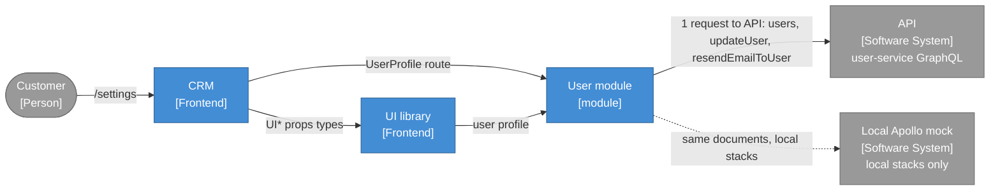
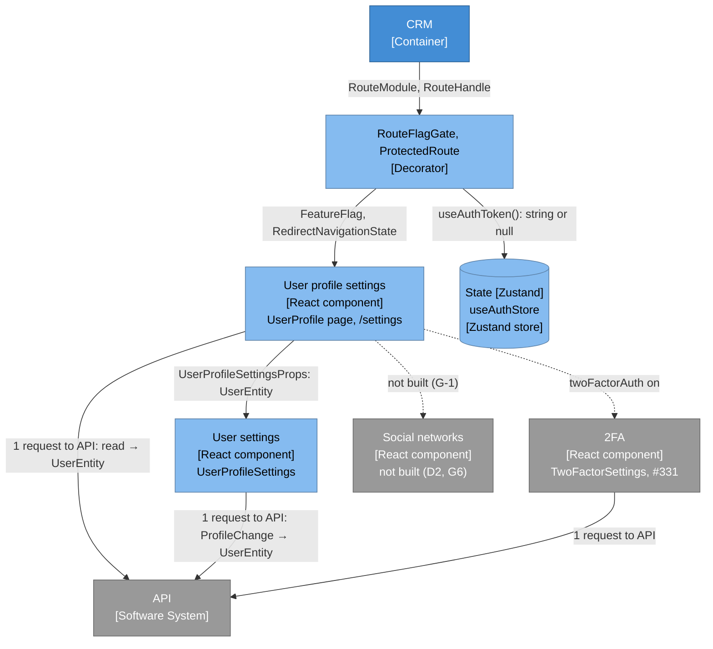
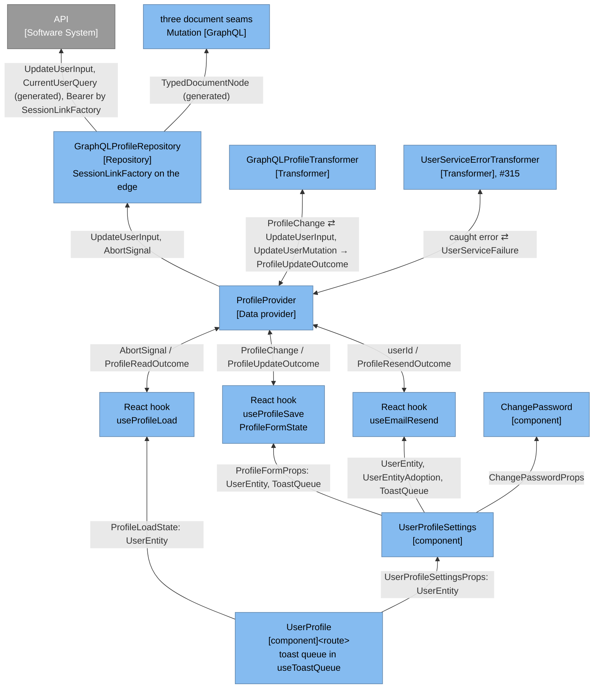
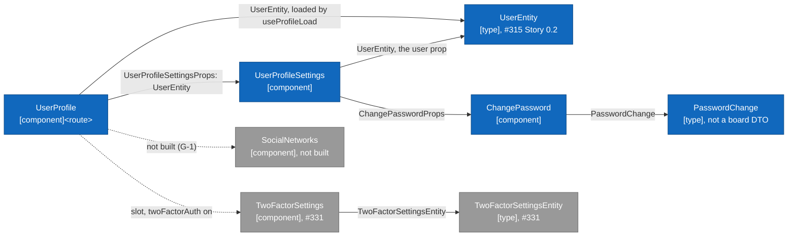
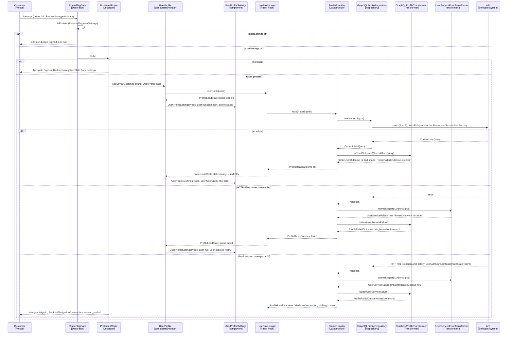
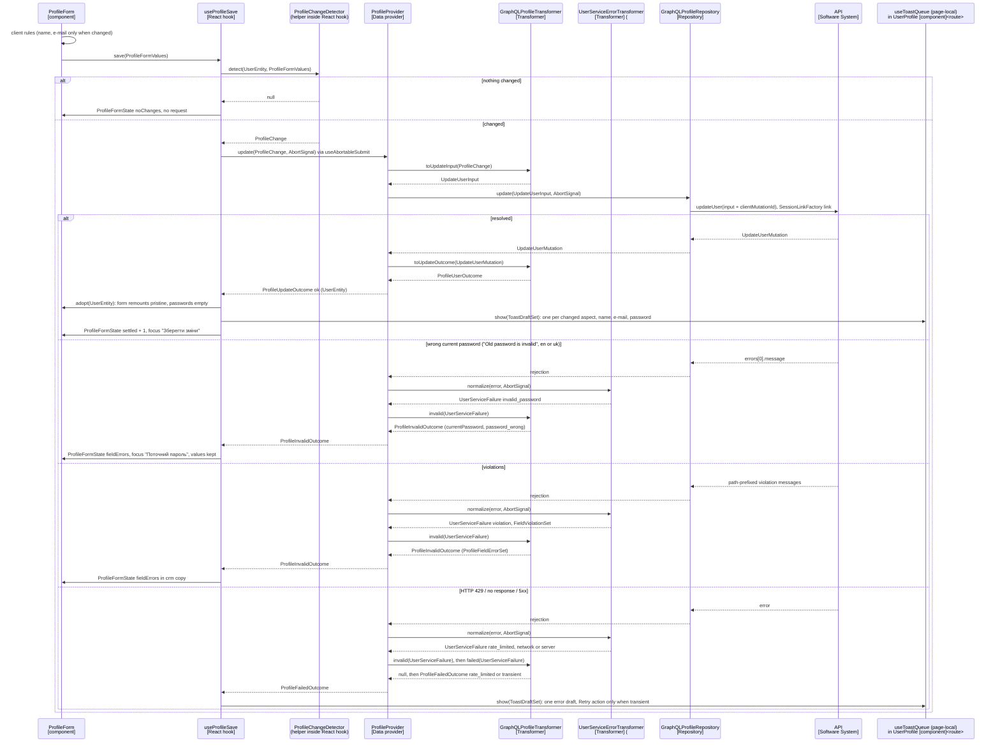
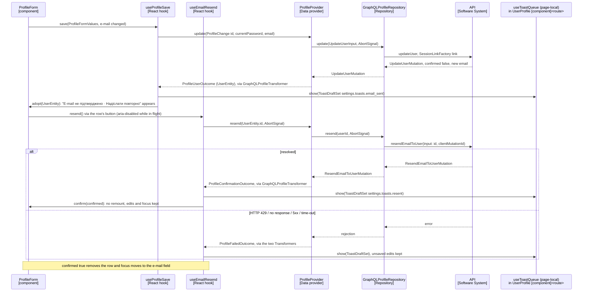
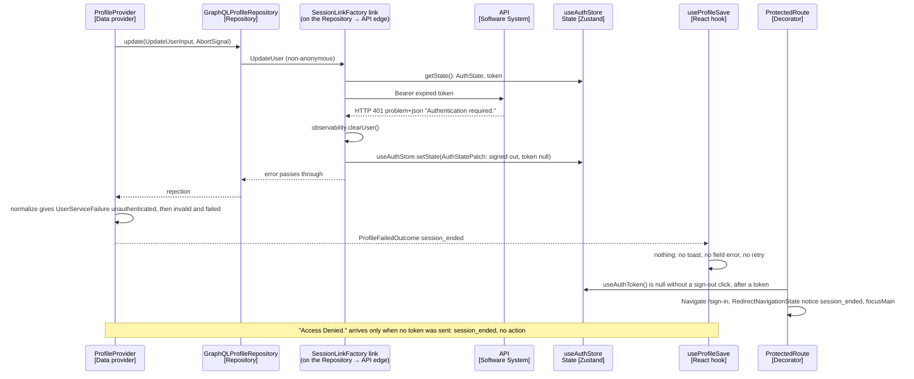

# Architecture: user settings for the user module

**Author:** BMad (Architect) **Date:** 2026-10-06, revised 2026-10-08 **Feature:**
`user-settings`

Predecessors: [research](./research-user-settings-2026-10-06.md) (cited "research §N"),
[brief](./brief-user-settings-2026-10-06.md) ("brief §N") and the authoritative
[PRD](./prd-user-settings-2026-10-06.md) (FR-1 to FR-30, FR-23 withdrawn, NFR-1 to NFR-15). The
PRD decides _what_; this document decides _how_. Ids `U1`-`U11`, `D1`-`D18`, `R1`-`R28` and
`P1`-`P6` come from the run's decision record; an `R` amendment supersedes the `D` item it names.
Every claim about crm code cites `path:line` in this worktree (`origin/main` `58099168`);
user-service code is cited as `M:<path>#L…` (`main` `a95c1e85`) or `T:<path>#L…` (tag `v2.8.0`),
the short form research §2 defines. Decisions this stage took on its own are marked
`> Assumption:`.

The 2026-10-08 revisions apply the shared Miro layer contract
(`crm-worktrees/_planning-shared/miro-layer-contract.md`, "the contract"): the layers follow the
"Frontend C4 Architecture VilnaCRM" board (<https://miro.com/app/board/uXjVMG64hTs=/>), there is
no frontend Controller, Service or Handler class, every value that crosses a layer is a named
type (TB-1, §1.2), and the board's `UserEntity` is #315's and crosses component props as itself
(TB-2). The domain is plain data interfaces; every rule lives in user-service.

> Simplification 2026-10-08
> (`crm-worktrees/_planning-shared/over-engineering-review-2026-10-08.md`; the user: "apply all
> 10", "do not over-engineer, its just front-end features without any logic, its all in the
> back-end side"):
>
> - Prerequisites are the chore #332 (typed-boundaries gate), the chore `zustand-client-state`
>   (#334, lands before #315) and then #315 Epic 0 (Stories 0.1–0.2); #315 owns every
>   shared piece it builds and this plan imports them.
> - One Transformer for the feature, `GraphQLProfileTransformer`, beside #315's shared
>   `UserServiceErrorTransformer`; `ProfileFailureTransformer` is merged into it (§5.4).
> - `ProfileProvider` takes three `@inject` collaborators: no deps bag, no `useFactory` closure.
> - The invented `profile_update` security signal (FR-23) and its plumbing are gone.
> - `SessionLinkFactory` keeps one rule, a transport 401 ends the session, and is built once,
>   here (§5.5). The route gate takes one scalar `flag` (§5.6).
> - No glue: `useUserProfileSettings`, `ToastQueueStore` and the `ToastRequest` mapping are gone;
>   the form calls its hooks directly and the hooks emit `ToastDraftSet` (§5.8, §7.3).
> - The aborted outcome and the per-operation failure types collapsed into one
>   `ProfileFailedOutcome` (§6.1). The mock is a stateless happy path (§5.12).
> - All data access goes through GraphQL repositories; this plan adds no REST call.

**Client state 2026-10-08** (the user: "change the react state var to zustand"): the chore
`zustand-client-state` (#334, merged with PR #333) added `zustand`, recorded its rules as
ADR-002's "Current rules" (`docs/adr/002-zustand-over-redux.md`), and replaced the reactive-var
stores and `src/lib/state/` with Zustand stores, one per concern, created with `create`
(`useAuthStore`, `useConnectivityStore`; `docs/state-architecture.md`). This plan reads and writes
`useAuthStore` (`@auth/stores/use-auth-store.ts`): reads through selectors such as
`useAuthToken()` (over `useAuthStore`), writes through `useAuthStore.setState(patch)` with a named
`AuthStatePatch`. The token stays memory-only, with no `persist` middleware; server state stays
in Apollo and the GraphQL repositories; the toast queue stays a local reducer in
`useToastQueue`.

**Reconciliation 2026-10-16.** The plan now builds on real code: branch `feat/330-user-settings`
is stacked on PR #340's head `f8ff83c7` (crm #315 implemented, not yet merged), which is based on
PR #333 (`db3db0f6` on `main`, the chores #332 and #334). Line citations elsewhere in this
document are against `origin/main` `58099168` and may have moved; where a section below and this
list disagree, this list and the reconciled sections win. The corrections:

| Planned (2026-10-08)                                            | Real (PR #340 / PR #333)                                                                |
| --------------------------------------------------------------- | --------------------------------------------------------------------------------------- |
| a new ADR for this page; the deleted ADRs 008 to 022 cited      | no ADR from 003 up exists; `## User Settings decisions` in `src/modules/user/README.md` |
| `UserServiceErrorTransformer` in `user/lib/`, undecorated (R23) | `src/modules/user/transformers/`, `@injectable()`, `registerSingleton`                  |
| #315's six steps, exact-message step "between steps 3 and 4"    | six steps as shipped (§5.4); the step goes between the violation and status steps       |
| `useAbortableSubmit` with `isSubmitting`, `submit`, `retry`     | `isSubmitting` and `submit` only                                                        |
| `ServerFieldError` with its logic inside                        | renders nothing; logic in `@auth/hooks/use-server-field-error.ts`                       |
| `PasswordPolicyRules` takes the policy result as a prop         | evaluates and translates itself; its keys are lazy (§5.9)                               |
| `password_reset.errors.policy_rejected` reusable                | lazy recovery key; settings declares `settings.errors.new_password_rejected`            |
| every new string in the eager merged catalog                    | `config/i18n-catalog-policy.json` lazy catalogs; `settings.*` lazy (§5.16)              |
| `forgotPassword` flag and its contract-test precedent           | no flag at all (`FeatureFlag = never`, issue #309); `userSettings` is the only one      |
| msw: one default handler per operation in `server.ts`           | per-test `server.use` helpers (`password-recovery-operations.ts`)                       |
| the link clears the store with a module-private patch           | also `sandboxDemoSessionProvider.signOut()`, as `logout()` does; `CLEARED_AUTH_STATE`   |
| anonymous operations `SignInUser`, `CompleteTwoFactorUser`, ... | plus #315's public `RequestPasswordReset` and `ConfirmPasswordReset`                    |
| `A11Y_EXCEPTIONS` holds four entries                            | eight entries today; this plan adds none                                                |
| Lighthouse URL list `/`, `/sign-up`, `/sign-in`                 | eight URLs in `lighthouse/constants.js`, unchanged by this plan                         |
| sign-up's e-mail label "Електронна пошта"                       | "E-mail" since #311; settings reuses the key                                            |
| message rows classify freely                                    | #315's README rejects message-text classification; settings records an amendment (§14)  |
| `failure(reason, status, property)` gains a `taken` argument    | the 3-argument cap: `failure` takes a named `FieldViolation \| null` instead (§5.4)     |
| `SignInNotice` rows are plain keys                              | always a green success check; rows become `SignInNoticeRow` with a tone (§5.5)          |
| `ProtectedRoute` reads `useAuthStore((s) => s.token)`           | `useAuthToken()`, no memory of an earlier token; a `useRef` adds it (§5.5)              |
| settings repositories without a barrel                          | `no-repository-internal-imports`: a `settings/repositories/index.ts` barrel (§8)        |
| `make lint-deps` proves every board edge                        | type-only and hook edges uncovered; `settings-layer-edges.test.ts` (§12)                |
| mock tests reuse the pinned SDL fixture                         | `PINNED_SDL_FIXTURE` lacks the profile operations; a profile fixture (§5.12)            |
| the 2FA slot of the settings grid                               | the card's slot only; the 2FA challenge has its own page (Figma `72:4846`, user, §5.7)  |

## 1. Approach summary

A brownfield extension of the `user` module: one new feature, `features/settings`, which the
two-factor bundle (#331) later extends, plus a few shared pieces in `src/components`,
`src/routes` and the module's `lib` and `types`. The feature is drawn exactly as the board's User
module frame and its layer stack: the `UserProfile` route page, the `UserProfileSettings` and
`ChangePassword` components, React hooks, one Data provider, one Transformer and one GraphQL
Repository (§1.1, §3.3). Four new classes belong to the feature; `SessionLinkFactory` is built
here and imported by #331, and the upstream error transformer is #315's. Nothing new reaches the
eager entrypoint except the route declaration, the small route flag gate and the protected
route's session-ended notice rule (R17).

```text
/ (home) ──"Налаштування" (flag-gated link)──▶ /settings   protected, lazy chunk "settings"
                                               │ RouteFlagGate: flag userSettings
                                               ▼
 UserProfile [component]<route>: h1, subtitle, grid ─┬─ UserProfileSettings [component]
 loads UserEntity, passes it down                    │    skeleton ─▶ card ─▶ toasts, field errors
                                                     │    └ ChangePassword [component]
                                                     └─ 2FA slot: TwoFactorSettings (#331)
 React hooks ─useService─▶ ProfileProvider [Data provider] ⇄ GraphQLProfileTransformer,
                           UserServiceErrorTransformer (#315) [Transformer]
              ProfileProvider ─▶ GraphQLProfileRepository [Repository]
              ─Apollo + SessionLinkFactory (Bearer)─▶ API [Software System] (user-service)
       users(first: 1) · updateUser (current password + changed fields) · resendEmailToUser
```

Twelve decisions shape everything below:

1. **One Data provider and one Transformer for three operations** (U8, contract §3.2).
   `ProfileProvider` reads, updates and resends; `GraphQLProfileRepository` only sends
   `users(first: 1)`, `updateUser` and `resendEmailToUser` through the container's Apollo client
   and returns the generated transport types; `GraphQLProfileTransformer` parses `data` with zod,
   turns it into `UserEntity` and named outcomes, and turns a failure into the operation's
   outcome. No `initials`, `password`, GraphQL error, generated type or English message crosses
   the Data provider (§2.2, §5.1).
2. **The current user is the first edge of the owner-scoped collection** (D4). Its `id`, the IRI
   `/api/users/<uuid>`, is held as an opaque value and sent back verbatim; nothing decodes a
   JWT. Admitting a `*-query.ts` document seam is a reviewed DI-policy edit (§5.2).
3. **Only changed fields travel** (D6). A container-free `ProfileChangeDetector`, built by the
   save hook, compares the form with the loaded `UserEntity` (trimmed name; trimmed, lower-cased
   e-mail) and returns a named `ProfileChange`, which the Transformer turns into an `updateUser`
   input that always carries `id` and the current password (§5.3).
4. **Failures are classified once** (R3). #315's `UserServiceErrorTransformer` knows Apollo's
   error shapes; settings appends a `401` status row, its input properties, the `taken` reason
   and the first exact-message step. `GraphQLProfileTransformer` then gives an update its field
   errors (`invalid`) or any operation its failure reason (`failed`) from one table (§5.4).
5. **One rule ends a session, in the link only** (D10, R11, R28). `SessionLinkFactory` adds
   `Authorization: Bearer <token>` per request and clears the session on a transport 401;
   `ProtectedRoute` then redirects with the session-ended notice. The Transformer maps a 401 and
   "Access Denied." to a `session_ended` outcome on which the page does nothing (§5.5).
6. **Routes are gated by one flag read lazily** (D13, R6, R17). A route contract may declare
   `flag`, one `FeatureFlag`; `RouteMapper` copies it into the route `handle`, and an eager
   `RouteFlagGate` above `ProtectedRoute` renders the not-found page at render time while it is
   off. Nothing reads a flag while the router is built (§5.6).
7. **The page shell is built here, its 2FA section is not** (D12). The `UserProfile` page owns
   the `h1`, subtitle, grid and the toast stack; the page renders only under `userSettings`, and
   #331 adds its `TwoFactorSettings` section to the grid under `twoFactorAuth` (§5.7).
8. **A new `UIToastStack` primitive, used by settings alone** (D9, U2, R14, R16): success toasts
   announced through one always-mounted polite region, error toasts as `role="alert"`, no timer,
   at most three, the oldest leaving first; the queue is a reducer in `useToastQueue` (§5.8).
9. **#315's password pieces leave `@auth` before settings uses them** (U3, D11): the policy and
   the name and e-mail validators to `src/modules/user/lib/validations/`, the field, rule list
   and server-error components to `src/components` with the policy passed as props, and the rule
   list's `password_policy.*` keys into a lazy catalog that component owns (§5.9). The settings
   copy itself is a lazy catalog the settings route registers, so the eager catalog `/sign-in`
   downloads does not grow (§5.16).
10. **Accessibility is fixed at the source** (U11, D15, R8, R19): field-error text moves to a new
    `paletteColors.error.text` token, `#C62828` (5.62:1), app-wide; the greeting and the resend
    control use existing passing tokens, and `A11Y_EXCEPTIONS` gains nothing (§5.10).
11. **The board's layers, and only those** (contract §1.11, §2): `[component]<route>` →
    `[component]` → React hook → `[Data provider]` ⇄ `[Transformer]`, `[Data provider]` →
    `[Repository]` → API, State beside them. There is no frontend Controller, Service or Handler
    class: the old `ProfileFormController` became the hooks `useProfileSave` and
    `useEmailResend` over #315's `useAbortableSubmit`, and the old `ProfileFailureHandler` became
    the `invalid` and `failed` methods of `GraphQLProfileTransformer` (§17).
12. **Typed boundaries (TB-1, TB-2)**: every constructor dependency, method parameter and
    result, hook result, published state, toast payload and DI value is a named interface or
    class from a type-only file; collections cross as named `*Set` interfaces; the board's
    `UserEntity`, imported from #315, crosses component props as itself, and no settings type
    takes the `*Dto` or `*Entity` suffix (§1.2, §2.4, §6.1).

### 1.1 Miro alignment

Every node of the §3 diagrams maps to one board element; §17 holds the full table, every class
of §6 with its layer, and the gaps.

| Diagram node (§3)                     | Board element (frame; screenshot)                  |
| ------------------------------------- | -------------------------------------------------- |
| Customer, CRM, User module, UI lib.   | `[Person]`, `[Frontend]`, `[module]` (Context; 25) |
| `UserProfile` page at `/settings`     | `UserProfile [component]<route>` (code; 21)        |
| `UserProfileSettings`                 | `UserProfileSettings [component]` (21); L2 (01)    |
| `ChangePassword`, `PasswordChange`    | `RestorePassword` (21), renamed (§17.3 G-5)        |
| `UserEntity` (#315 Story 0.2)         | `UserEntity [type]` (21)                           |
| `TwoFactorSettings` slot (#331)       | `2FASettings [component]` (21)                     |
| React hooks                           | `React hook` (05, 22, 23)                          |
| `ProfileProvider`                     | `[Data provider]` (`EntityProvider`; 05, 23)       |
| the two Transformers                  | `[Transformer]` (`GraphQLTransformer`; 05, 23)     |
| `GraphQLProfileRepository`, documents | `[Repository]`, `Mutation [GraphQL]` (05, 23)      |
| `useAuthStore` (Zustand store)        | `State [Redux]`, drawn `State [Zustand]`           |
| `RouteFlagGate`, `ProtectedRoute`     | `[Decorator]` (`MutationAccessGuard`), `[Routing]` |

### 1.2 Typed boundaries (TB-1)

The canonical rule, verbatim from the contract §4:

> **TB-1 Typed boundaries.** Every value that crosses a layer boundary is an instance of a
> **named type**: an exported `interface` declared in a type-only file (`types/` folder or
> `types.ts`, issue #88), a class, or a named alias declared in a type-only file whose whole
> body is a union of named types or literals, a callback type, or one generic or derived type
> whose arguments are named types (`type RecoveryRetry = () => Promise<void>`,
> `type LoadFailureReporter = Pick<…>`, `type AuthFailureCategory = Extract<…>`). A layer
> boundary is any of these positions:
>
> 1. the props of a `[component]` or `[component]<route>`;
> 2. the parameters and result of an exported React hook;
> 3. the constructor parameters, the parameters and return type (including a `Promise`'s
>    resolved type) of every non-private method, and every non-private property of a class in
>    the Data provider, Transformer, Repository, State, Guard, Factory or helper roles (the layer
>    map of the planning contract §2);
> 4. every value registered in or resolved from the DI container;
> 5. published state: reactive-var state, outlet context, router navigation state, toast and
>    notice payloads;
> 6. events and telemetry payloads (security signals, observability);
> 7. every member of an interface in a type-only file;
> 8. the return value of a test builder in `tests/builders/`.
>
> At those positions the following are **forbidden**:
>
> - **(a) Anonymous objects.** Inline object type literals `{ … }`, including object members of
>   a union (`{ kind: 'sent' } | { kind: 'failed' }`): each variant is a named interface
>   (`RecoverySentOutcome`, `RecoveryFailedOutcome`) and the union is a named alias of them. An
>   object shape is always declared with `interface`, never `type X = { … }`.
> - **(b) Tuples** `[A, B]`.
> - **(c) Bare arrays.**
>   - `T[]`, `readonly T[]`, `Array<T>` and `ReadonlyArray<T>` are forbidden as a parameter, a
>     return type, a class property, a hook result, an alias body or a nested array.
>   - A collection crosses only as a **named collection interface**, whose array property's
>     element type is itself a named interface or class:
>     `interface RecoveryCodeSet { readonly items: readonly RecoveryCode[] }` with
>     `interface RecoveryCode { readonly value: string }`.
>   - Arrays of primitives or literals (`readonly string[]`) are forbidden everywhere at a
>     boundary.
> - **(d) Catch-all payloads.** `any`, `object`, `Record<…>` and index signatures
>   (`[key: string]: …`). `unknown` is allowed in exactly two places:
>   - the parameter (never the return) of a method whose role is to narrow a caught error (a
>     `*Transformer`, `*Guard` or `*Detector`);
>   - the `error` / `cause` property of an error type.
> - **(e) Inline derived types.** `Omit`, `Pick`, `Partial` and `Required` written at the
>   boundary. Name the derivation once in a type-only file
>   (`export type ToastDraft = Omit<ToastItem, 'id'>;`) and use the name.
>
> **Allowed.**
>
> - Single scalar values (`string`, `number`, `boolean`, a named literal-union alias).
> - Named third-party types (`ReactNode` for `children`, `AbortSignal`, `TFunction`, `SxProps`,
>   `ApolloClient`, `RefObject<UserEntity>`).
> - Generics whose arguments are named types (`Promise<RecoveryOutcome>`).
> - Callback types whose parameters and results obey this rule.
> - `T | null` and `T | undefined`, written inline, where `T` is itself allowed here
>   (`RecoveryFailure | null`, `string | undefined`).
>
> **Exceptions.** No others:
>
> - **(i) Generated contract types.** Generated GraphQL/OpenAPI codegen types
>   (`src/api/generated/**`) are named, but they stay below the Data provider. They may appear
>   only in `repositories/`, `transformers/`, `*-mutation.ts` / `*-query.ts` contract modules,
>   `response-schemas.ts`, and as `import type` inside `data-providers/` bodies. They never
>   appear in a Provider's public signature, a hook, a component or State, including as the
>   argument of a generic type (`Promise<RequestPasswordResetMutation>`).
> - **(ii) Module augmentation and declaration files.** `declare module` blocks and `.d.ts`
>   files.
> - **(iii) Private members and function-local values.** These are not boundaries.
>
> **No suppression.** Satisfy TB-1 by declaring the named type, never with `eslint-disable`, a
> cast, a scope narrowing or an allowlist entry.

Position 5's "reactive-var state" reads as Zustand store state, since the chore
`zustand-client-state` landed with PR #333; the frozen text is unchanged.

Shipped gate (PR #333, reconciled 2026-10-16): it is syntactically wider than the frozen text. It
also gates non-exported top-level functions and every constructor parameter property,
`private readonly` included (an `@inject(TOKEN) private readonly x: T` needs a named `T`), and it
allows a mapped type over a named key union; see CLAUDE.md, "Typed boundaries (TB-1, issue
#332)", and `config/typed-boundary-policy.js`.

The gate that enforces it (two `no-restricted-syntax` selector arrays in
`config/typed-boundary-policy.js`, `@typescript-eslint/consistent-type-definitions`, their
fixtures and the burn-down) is the chore #332, merged with PR #333; #315 (PR #340) added the
shared User domain and the TB-2 naming check `tests/unit/tooling/domain-type-names.test.ts`. This feature adds no selector, and its new
code must pass both (P.2). Exception (i) is a review item: no dependency-cruiser rule confines
the generated types. Violations the 2026-10-06 plan had written, and their named replacements in
§5 and §6.1:

| Written before (old §)                                 | Named replacement                    |
| ------------------------------------------------------ | ------------------------------------ |
| `show(items: readonly Omit<ToastItem,'id'>[])` (§5.8)  | `show(drafts: ToastDraftSet)`        |
| `toasts: readonly ToastItem[]` (§5.8)                  | `toasts: ToastItemSet`               |
| `evaluate` → `readonly { label; met }[]` (§5.9)        | `PasswordRuleViewSet`                |
| `variables: Record<string, unknown>` (§6.1)            | generated variables, Repository-only |
| result unions of inline `{ kind … }` members (§6.1)    | one interface per variant            |
| `fieldErrors: readonly ProfileFieldError[]` (§6.1)     | `ProfileFieldErrorSet`               |
| `notify: (toasts: readonly ToastRequest[]) => void`    | `show(drafts: ToastDraftSet)`        |
| `flags?: readonly FeatureFlag[]` (§5.6, §6.1)          | `flag?: FeatureFlag`, one scalar     |
| `violations: readonly UpstreamViolation[]` (§6.1)      | `FieldViolationSet` (#315)           |
| `ProfileFormControllerDeps` callbacks (§6.1)           | `ProfileFormProps`, passed whole     |
| `{ from, focusMain: true }` state literals (§4, §5.15) | `RedirectNavigationState` (#315)     |

TB-2 sits beside TB-1 and leaves its text unchanged; verbatim from the contract §4:

> **TB-2 Board types at component boundaries** (the user, 2026-10-08; it sits beside TB-1 and
> does not change it). A board type crosses component and form boundaries as itself (e.g.
> `UIForm<SignInDto>`); form values may only `extends` a DTO to add UI-only fields; the
> `*Dto`/`*Entity` names are reserved for board types, the `[type]` cards of the Miro "User
> module" frame, plus `CreateNewPasswordDto`, whose card is proposed to the board.
>
> Enforcement is deliberately light. #315 Story 0.7 adds one naming check,
> `tests/unit/tooling/domain-type-names.test.ts`, which fails when an interface or alias named
> `*Dto` or `*Entity` is declared outside `src/modules/*/types/user/`, with a must-fail case on an
> in-memory fixture. The other two clauses are review-enforced; no ESLint selector is added.

TB-2's frozen text names the naming check's story by its former id: it is now #315 Story 0.2.

In this plan:

| Written before (TB-2)                              | Now                                  |
| -------------------------------------------------- | ------------------------------------ |
| `UserEntity` built by settings                     | imported from #315 Story 0.2         |
| `UserProfileSettingsProps` without the entity      | `user: UserEntity \| null` from page |
| `RestorePasswordDto`, the board's #315 request DTO | `PasswordChange`, not a board type   |
| `UserNodeDto` below the Data provider              | `UserNode`                           |

`ProfileForm` is a `UIForm<ProfileFormValues>`. No board DTO covers the settings form, because
`RestorePasswordDTO` is #315's (contract Q-1), so its values are the `PasswordChange` pair plus
the `UserEntity` field names `fullName` and `email`; they copy no board DTO.

## 2. Language and boundaries

### 2.1 Glossary

Research §1.1 is the language and is reused unchanged (User, User IRI, Full name, Current
password, New password, Confirmation, Profile update, Owner scope). The crm side adds:

| Term             | Meaning in crm                                                          |
| ---------------- | ----------------------------------------------------------------------- |
| User entity      | `UserEntity` (#315), the module's one User: id, full name, e-mail, flag |
| Profile change   | `ProfileChange`, what one Save asks for: id, current password, changes  |
| Password change  | `PasswordChange`, the current and new password pair of the form         |
| Changed aspect   | `name`, `email` or `password`; one success toast each, in that order    |
| Field error      | a server answer pinned to one form field, in crm copy                   |
| Upstream failure | `UserServiceFailure` (#315), one failed user-service call               |
| Session end      | the token is cleared without a sign-out click; `/sign-in` says so       |
| Owner refusal    | "Access Denied." at HTTP 200: no token reached an owner-checked call    |
| Page flag        | `userSettings` alone; `twoFactorAuth` only shows the 2FA card in it     |
| Toast            | a non-modal outcome message bottom-right (mobile: bottom, full width)   |

### 2.2 The Data provider boundary

The User belongs to user-service, which owns every rule about it; crm's `user` module is a
client of it over GraphQL only (U1). The boundary is drawn at the Data provider,
`ProfileProvider`: everything above it (hooks, components, State) speaks the glossary
(`UserEntity`, `ProfileChange`, the named outcome interfaces); everything below it speaks
transport (generated documents, inputs and results, Apollo errors, `UserServiceFailure`), which
TB-1 exception (i) confines there.

- `GraphQLProfileRepository` only transports: it sends the three generated documents through
  the container's Apollo client, adds `clientMutationId` and returns the generated result
  types; it translates nothing.
- `GraphQLProfileTransformer` translates in both directions: `fullName` ↔ `initials`,
  `currentPassword` → `password`, the `UserEntity` `id` passed through untouched; it parses every
  answer with zod and turns it into a named outcome, and its `invalid` and `failed` methods turn
  a `UserServiceFailure` into field errors or a failure reason.
- `UserServiceErrorTransformer` (#315, module `transformers/`) is the shared lower half of failure
  translation: Apollo error shapes, transport statuses and the upstream message rows; it knows
  no operation.
- Nothing above the Data provider sees a status, an English or Ukrainian server message, a
  violation path, `extensions.code` or a generated type; components render i18n keys chosen by
  the React hooks.

> Assumption: form values use the crm names `fullName`, `email`, `currentPassword` and
> `newPassword`, never the upstream `initials` and `password`. The rename lives in one method
> of `GraphQLProfileTransformer`, so a later upstream rename (G4) touches one file.

### 2.3 Placement under the sibling-feature ban

`no-cross-feature-imports` (`.dependency-cruiser.js:591-602`) forbids every edge from
`features/settings` into `features/auth`, and `tsPreCompilationDeps: true` (`:852`) makes an
`import type` an edge too. Placement follows `config/module-shape.json` with the feature
`data-providers` and `transformers` folders and the module-level `transformers` folder #315
added (contract §2.1):

- **Settings feature:** route contract and page, components, hooks, the change detector,
  `data-providers/` (`ProfileProvider`), `transformers/` (`GraphQLProfileTransformer`),
  `repositories/` (`GraphQLProfileRepository` and the three documents), schemas, types and the
  `settings.*` catalog.
- **Auth feature:** `SessionLinkFactory` (R11; the only folders that may value-import
  `@apollo/client` are repositories, `config/di.ts` and the observability link factory,
  `.dependency-cruiser.js:375-398`) and the `ProtectedRoute` session-ended notice rule, both
  built here and imported by #331 (contract §3.4).
- **Module level:** #315's `UserServiceErrorTransformer` (`src/modules/user/transformers/`, an
  allowed module folder the DI-collaborator gate and `components-no-direct-injectable-import`
  cover, shared by every feature), the failure types (`src/modules/user/types/user-service/`, R17), `UserEntity`
  (#315's `src/modules/user/types/user/`, imported, never built here, contract §3.5) and the
  moved validators (`src/modules/user/lib/validations/`); `no-lib-to-features`
  (`.dependency-cruiser.js:663-672`) keeps them feature-free.
- **Shared UI:** `UIToastStack`, `UIToast` and the moved field components in `src/components`
  (`no-components-import-modules`, `:280-289`, so they receive the policy as props and their
  prop types live in `src/components/types/`).
- **Route shell:** `RouteFlagGate` and the `flag` contract field in `src/routes`. The settings
  feature imports nothing from auth: a session end reaches it only as the token disappearing.

### 2.4 Board types (the shared User domain)

The board's User domain is `UserEntity` plus the DTOs its components submit, plain data
interfaces in `src/modules/user/types/user/` built by #315 Story 0.2 (contract §3.5). The
frontend carries and displays them; it adds no class, rule or layer around them.

| Board `[type]`            | In this plan                                                    |
| ------------------------- | --------------------------------------------------------------- |
| `UserEntity`              | imported; the page loads it and passes it down as itself (TB-2) |
| `RestorePasswordDTO`      | not used: #315's forgotten-password request (Q-1, §17.3 G-5)    |
| `UserSocialNetworkEntity` | not built: social networks have no backend (G-1)                |

The settings password change is `PasswordChange`, a plain pair outside the domain folder: it is
not a board type, so it carries no `Dto` suffix.

## 3. Context, component, layer and code views

The four views mirror the board's zoom levels (contract §5). Node labels carry the board's
stereotype; edge labels carry the named type that crosses; arrows point toward the dependency,
as on the board. Colours: light blue for component level and the layer stack, dark blue for
code level, grey for systems and modules outside this feature. "State" is drawn as a cylinder;
the board labels it `[Redux]`, drawn here as `State [Zustand]`: the `useAuthStore` Zustand store
of the chore `zustand-client-state`.
Page-local `useState` (the form state, the toast queue) is not State: it is drawn inside the hook
or page box that owns it, as #315 draws its flow hooks' state (verification F15).

### 3.1 L1 context



The BFF `[Software System]` of the board is not on this path: the page neither signs in nor
signs out through it, and a session end is the link writing the signed-out `AuthStatePatch`
through `useAuthStore.setState` (§5.5).

### 3.2 L2 component (the board's User module, component level)



The page sends the read, so it draws its own "1 request to API" edge beside the card's (§17.3
C-5). The `UserProfile` page reaches the container only through `useService`
(`src/providers/di/use-service.ts:6-8`) below the route code split, which
`no-eager-shell-import-di-bridge` allows (`.dependency-cruiser.js:505-522`); it reaches nothing
in auth. Nothing in the eager tree (`RouteFlagGate`, `ProtectedRoute`, the route contract)
imports Apollo, zod, tsyringe or `@mui/*`.

### 3.3 L3 layer stack (the board's Interactive access control and Onboarding frames)



- Arrows point the board's way, bottom-up to API; Provider ⇄ Transformer is two-headed, as on
  the board.
- The route page holds the user, as the board's `UserProfile → UserEntity` edge says: it reads
  through `useProfileLoad` and passes the `UserEntity` down in `UserProfileSettingsProps`,
  unchanged (TB-2). The card's form saves through `useProfileSave` and resends through
  `useEmailResend`, both over #315's `useAbortableSubmit`; the form calls them directly.
- The Data provider box is one class, `ProfileProvider`, with three `@inject` collaborators:
  the Repository, `GraphQLProfileTransformer` and #315's `UserServiceErrorTransformer`. No
  Provider calls another Provider, and no Data-provider method is generic (§6).
- `SessionLinkFactory` is transport infrastructure drawn inside the Repository → API edge
  (contract §2), so the Bearer it adds is part of that edge's label. It reads the token from
  `useAuthStore.getState()` per request; the board draws no edge from Repository → API into
  State, so that read is declared as gap G-4 (§17.3). `useAuthStore` is the only State on this
  page.
- `ProfileFormState` (the `useState` of `useProfileSave`) and the toast queue (the page's
  `useToastQueue`) are page-local, so they sit inside their hook and page boxes rather than in
  the State cylinder (C-3).
- The settings route is protected and below the code split, so the hooks reach the Data
  provider with `useService` (contract §2.2); #315's `AuthProviderLoader` serves the public auth
  pages only.

### 3.4 L4 code (the board's User module, code level)



`UserProfile → UserEntity`: the page loads the signed-in user and holds it;
`UserProfileSettings → UserEntity`: the card receives that same entity as its `user` prop,
shows it and adopts a saved one; `ChangePassword → PasswordChange`: the password pair is the
`PasswordChange` slice of `ProfileFormValues`. The board draws `RestorePassword →
RestorePasswordDTO` here, which is #315's forgotten-password pair (§17.3 G-5). #331 draws its
own `TwoFactorSettings → TwoFactorSettingsEntity` edge.

## 4. Sequence views

Participants carry their board stereotype; every message names its argument and result types
(contract §5). `ok`, `invalid`, `confirmed` and `failed` below are the `kind` of the named
outcome interfaces of §6.1, never inline objects.

### 4.1 Page load



`ProfileProvider` is the only caller of the Repository and of the two Transformers: it awaits
the repository call itself, hands a rejection to `UserServiceErrorTransformer.normalize` and the
resulting `UserServiceFailure` to `GraphQLProfileTransformer` (`invalid` first on an update,
then `failed`). No method of it is generic, so no generated type crosses it as a type argument
(TB-1 exception (i)).

### 4.2 Save with changed fields



When `detect` returns `null`, the hook sends nothing and the form's status region says "Немає
змін для збереження" (FR-11).

### 4.3 E-mail change and resend



### 4.4 Session end through the shared link



## 5. Design decisions

### 5.1 Transport: Apollo through the container client

Code facts: `AUTH_TOKENS.ApolloClient` is one container singleton with a process-wide
`new InMemoryCache()` (`registerGraphqlClient`, `src/modules/user/config/di.ts:73-84`); its link chain has no retry link
by design (`src/services/observability/apollo-link-factory.ts:17-23`) and fetches through the
deadline adapter, whose expiry arrives as `HttpError({ status: 0 })`
(`src/services/https-client/deadline-fetch-adapter.ts:83`); `RegistrationAPI` is the only
GraphQL consumer and mutates without a `fetchPolicy`
(`src/modules/user/features/auth/repositories/registration-api.ts:48-57`).

- **One repository, three operations.** `GraphQLProfileRepository` injects the client and calls
  `query` (read) or `mutate` (update, resend) with the generated `TypedDocumentNode`s, the
  generated variables and `context: { fetchOptions: { signal } }`, the shape of
  `registration-api.ts:52-56`; the read also turns query deduplication off (§5.2). It returns
  the generated result types (`CurrentUserQuery`, `UpdateUserMutation`,
  `ResendEmailToUserMutation`) and lets Apollo's rejection pass; it parses, classifies and
  renames nothing. It extends no base class: it throws no `ApiError`, so `BaseAPI` would only
  add a dependency, and the board has no API-client box between Repository and API.
- **The Data provider supplies outcomes.** `ProfileProvider` asks `GraphQLProfileTransformer`
  for the input, awaits the repository call itself and returns the Transformer's named outcome;
  on a rejection it hands the error to #315's `UserServiceErrorTransformer` and the resulting
  `UserServiceFailure` to `GraphQLProfileTransformer` (`invalid` first on an update, then
  `failed`; §6). Three `@inject`
  collaborators, the metrics cap; no deps bag and no security call.
- **`fetchPolicy: 'no-cache'` on all three** (U6). The default policy writes the result, and for
  a mutation the arguments-keyed root field, into the shared cache; `no-cache` skips the write.
  The integration test spies on `cache.write` and asserts zero calls (the #315 lesson: under
  both policies `cache.extract()` is empty afterwards, so it proves nothing).
- **Abort.** The caller's signal rides `context.fetchOptions.signal`, so a signal that is
  already aborted makes the fetch reject before anything is sent (U6's abort check). The hooks
  drop an aborted run (`useAbortableSubmit` resolves `null`; `useProfileLoad` dispatches only
  while its signal is live), so an aborted call needs no outcome of its own.
- **Minimal selection.** The read and `updateUser` select `id email initials confirmed`;
  `resendEmailToUser` selects `user { id confirmed }`; no `clientMutationId` is selected.
- **No retry anywhere.** Nothing is added to the chain; the transient error toast's
  "Спробувати ще раз" is the only re-send and is user-initiated (FR-18).
- **No new endpoint.** The GraphQL URL is the existing `GraphQLUrl` binding (`di.ts:74`), so the
  CSP `connect-src` is unchanged (NFR-9). No REST call is added.

### 5.2 Current-user read

Code facts: the pinned SDL declares `users(first: Int, …): UserCursorConnection` and the node
`User { id confirmed email initials }`, byte-identical on `main` (research §4.3); on `main` the
collection provider returns only the caller's own record
(`M:src/User/Application/Provider/UserCollectionProvider.php#L45-L73`) under `ROLE_USER`
(`M:config/api_platform/resources/User.yaml#L77-L79`). The DI policy admits only
`-mutation.ts` document seams (the `graphql-documents` entry, `config/di-collaborator-policy.js:289-295`).

```text
query CurrentUser {
  users(first: 1) {
    edges {
      node { id email initials confirmed }
    }
  }
}
```

- The document is `settings/repositories/current-user.graphql` (the board's `Mutation
[GraphQL]` box, here a query), re-exported through `current-user-query.ts` exactly as
  `create-user-mutation.ts:5` re-exports its document.
- The `graphql-documents` allowlist entry widens from `-mutation[.]ts$` to
  `-(?:mutation|query)[.]ts$` in both its `path` and `specifier` regexes; the gate test
  (`tests/unit/tooling/di-collaborator-gate.test.ts`) gains a must-fail `@/services/evil-query`
  beside its `evil-mutation` case, so the widening cannot admit a query outside a repositories
  folder.
- `settings/utils/response-schemas.ts` (read by `GraphQLProfileTransformer`) imports `z` from
  `@/config/zod`, as `auth/utils/response-schemas.ts:1` does (`src/config/zod.ts:1-5` sets
  `jitless` for the CSP). The file sits inside the gated `src/modules/*/features/*/utils/**/*.ts`
  glob (`LOGIC_SOURCE_GLOBS`, `config/di-collaborator-policy.js:34-44`) and `@/config/zod` is in no allowed target, so
  it gets its own `EXEMPT_RENDER_PATH_FILES` entry, mirroring the auth entry (`:178-181`), with
  the reason "The settings zod response-contract module; declares schemas consumed as data." The
  gate test's per-entry carve-out case (`di-collaborator-gate.test.ts:178-184`) covers it. The
  Transformer's value import of the module is already admitted once `transformers/` joins
  `LOGIC_SOURCE_GLOBS` (#315 Story 0.1): the `response-contracts` target is path-based
  (the `response-contracts` entry, `config/di-collaborator-policy.js:279-287`), so no further DI-policy change is needed
  (verification F9). The schemas' output is the named `UserNode` (§6.1).
- The read passes `context: { fetchOptions: { signal }, queryDeduplication: false }`, so an
  aborted read is never shared with the next one. Apollo Client 3.14 joins identical in-flight
  queries by printed document and variables
  (`node_modules/@apollo/client/core/QueryManager.js:720-748`, on by default), `CurrentUser` has
  no variables, and `React.StrictMode` (`src/index.tsx:69`) mounts, aborts and remounts the
  reading effect in development: without the flag the second read joins the aborted first one
  and the page shows the load failure on every visit.
- `GraphQLProfileTransformer.toReadOutcome` gives a `ProfileUserOutcome` carrying the
  `UserEntity` of the first node; an empty `edges`, a `null` node or a schema failure is a
  `ProfileFailedOutcome` with `rejected` (an expired session arrives as the transport 401 of
  §5.5, not as an empty connection; research §5.7).
- The node `id` becomes `UserEntity.id` unchanged and is the only id the mutations send (FR-5).
- After a successful mutation the page adopts the payload's user; it never reads again on its
  own (D7).

### 5.3 Change detection and e-mail normalisation

Code facts: `updateUserInput` keeps every absent optional field upstream
(`M:src/User/Application/Resolver/UserUpdateMutationResolver.php#L39-L41`); the unchanged own
e-mail is rejected by `UniqueEmail` because the own-row exemption reads a route attribute the
GraphQL endpoint lacks (`M:src/Shared/Application/Validator/EmailUniquenessValidator.php#L46-L60`,
inferred, G3); sign-up trims only the name and sends the e-mail as typed
(`src/modules/user/features/auth/utils/registration-handlers-factory.ts:26-31`,
`src/modules/user/features/auth/repositories/registration-api.ts:78-84`), although its
validator checks the trimmed value (`validations/email.ts:23-27`).

`ProfileChangeDetector.detect(user: UserEntity, values: ProfileFormValues)` returns `null` or
one `ProfileChange`. It is a container-free helper inside the React hook (contract §2), built
once per mount in a `useState` initializer of `useProfileSave`, which hands it to
`useProfileFormRules` through its result:

| Aspect   | Changed when                                        | Sent as                    |
| -------- | --------------------------------------------------- | -------------------------- |
| name     | `values.fullName.trim()` differs from the profile's | `initials`: trimmed value  |
| e-mail   | trimmed, lower-cased values differ                  | `email`: trimmed, as typed |
| password | `values.newPassword` is not empty                   | `newPassword`: as typed    |

- With at least one aspect the change also carries `id` and `currentPassword` (`password`
  upstream, P1); `GraphQLProfileTransformer.toUpdateInput` renames the keys and the repository
  adds `clientMutationId` (`uuid`, the `registration-api.ts:83` precedent), because a fresh
  random id is not a pure translation.
- Optional input keys are added by conditional spread, never as `undefined`
  (`exactOptionalPropertyTypes`); the integration test pins the exact key sets of FR-11.
- The same detector backs the form rules, so validation and sending can never disagree: the
  name and e-mail validators run only while `nameChanged` / `emailChanged` is true (D6), and the
  current password's `required` rule runs only while `detect` would return a change, so a Save
  with nothing changed shows the no-change status instead of a required error (FR-11).

> Assumption: the current password is required only when a change exists. FR-9 requires it for
> "every Save with a change" and FR-11 forbids a field error on a no-change Save, so the rule is
> conditional on the same detector call.
>
> Assumption: settings trims the e-mail it sends, unlike sign-up. The shared validator passes a
> value with surrounding spaces because it checks the trimmed text, and upstream's `Email`
> constraint could then reject the untrimmed address the user never saw as wrong.

### 5.4 Error classification

Code facts: user-service's domain-exception normalizer returns `['message' => …]` and drops
every extension (`M:src/Shared/Application/Normalizer/DomainExceptionNormalizer.php#L29-L41`);
violations arrive as `"<path>: <message>"` with API Platform's `extensions.status` 422
(`M:features/user_graphql_operations.feature#L64-L94`); the owner refusal is "Access Denied." at
HTTP 200 (`M:tests/Behat/UserGraphQLContext/UserGraphQLResponseContext.php#L170-L182`).

**The shared lower half** is #315's `UserServiceErrorTransformer.normalize(error: unknown,
signal?: AbortSignal): UserServiceFailure` in
`src/modules/user/transformers/user-service-error-transformer.ts` (reconciled 2026-10-16
against PR #340), with #315's one `UserServiceFailure { reason; status; violations }` interface.
Its steps run in order and the first match wins: (1) an aborted signal or an `AbortError` (on
the error or its `networkError`) → `aborted`; (2) a `networkError` → its `statusCode` or `status`
through `fromStatus`, no numeric status → `network`; (3) no first GraphQL error → `unknown`;
(4) a message prefix naming one of `VIOLATION_PROPERTIES` (`email`, `token`, `newPassword`) →
`violation` with one `FieldViolation` of reason `other`, keeping any numeric `extensions.status`;
(5) a numeric `extensions.status` → `fromStatus`; (6) otherwise `unknown` when
`extensions.code` is set and `refused` when it is not. `fromStatus` maps `STATUS_REASONS`
(`0` → `network`, `422` → `violation`, `429` → `rate_limited`), `5xx` → `server`, anything else →
`unknown`. The class is `@injectable()` and registered with `registerSingleton` under
`AUTH_TOKENS.UserServiceErrorTransformer` (#315 drift item 9); its file holds nine methods and one
closure against the 10-function cap.

Settings only appends, and never reorders or removes a step (contract §3.4):

- **A status row:** `401` → `unauthenticated` in `STATUS_REASONS`. A transport 401 reaches it
  through step 2, a GraphQL `extensions.status` 401 through step 5.
- **Input properties for step 4:** `initials` and `password` join `VIOLATION_PROPERTIES`, and the
  reason `taken`, appended to `FieldViolationReason`, is set when the text after the prefix is the
  uniqueness message below; every other violation keeps #315's `other`.
- **The exact-message step between steps 4 and 5,** first needed here: the first GraphQL error's
  whole message equals a row below → that row's reason, with `status` the numeric
  `extensions.status` or `null`. It sits before step 5, so "Access Denied." with
  `extensions.status` 403 is still `access_denied`.
- **Reason literals** appended to `UserServiceFailureReason`: `unauthenticated`, `access_denied`
  and `invalid_password`. #331 later appends its own rows to the same step.
- **Budget.** The three whole-message rows are a module-level `Map<string,
UserServiceFailureReason>` and the two uniqueness texts a `ReadonlySet<string>`, data rather
  than methods. `fromGraphQLError` already has three exits, the cap, so the message lookup
  cannot be one more `return` there: either `fromCode` is widened to take the status and run the
  lookup before its status-or-code branch (no new method), or one private method takes over that
  branch; the file holds nine methods and one closure today, so either stays inside 10 functions,
  6 closures and 15 in total. `failure` takes a named `FieldViolation | null` as its third
  argument instead of the property string, because a fourth `taken` argument would break
  `nargs_function_max` 3.
- **#315's own decision is amended, not ignored.** Its README entry "Failures are classified in
  two steps" says no step reads a translated message for meaning and rejects classification by
  message text. The settings section of the same README (§14) records the amendment: only the
  listed whole texts are matched, until G8 ships codes, and every other message still
  classifies by shape, so #315's unit case "never reads the message for meaning" ("Token has
  expired.", "User not found." → `refused`) stays green unchanged.

| Reason             | Message (whole text)                       | Source            |
| ------------------ | ------------------------------------------ | ----------------- |
| `access_denied`    | "Access Denied."                           | Behat `#L170-182` |
| `invalid_password` | "Old password is invalid"                  | `M:…en.yaml#L26`  |
| `invalid_password` | "Старий пароль невірний"                   | `M:…uk.yaml#L26`  |
| violation, `taken` | "This email address is already registered" | `M:…en.yaml#L6`   |
| violation, `taken` | "Ця email-адреса вже зареєстрована"        | `M:…uk.yaml#L6`   |

`…en.yaml` and `…uk.yaml` are `translations/messages+intl-icu.<locale>.yaml` for `#L26` and
`translations/validators+intl-icu.<locale>.yaml` for `#L6`, fetched at `a95c1e85` with `gh api`
on 2026-10-06. The exact-message step never reads `extensions.code` (R3); #315's step 6, which
tells a coded unknown message from a code-less refusal, is unchanged. The unit tests feed each
message with no `extensions` and again with `extensions.status`. The resend time-out ("Cannot
send new email till …") gets no row: it carries no extension upstream, so it ends in step 6 as
`refused`.

**The settings upper half** is two methods of `GraphQLProfileTransformer` over one private
table. On an update, `invalid(failure)` comes first: `invalid_password` gives a
`ProfileInvalidOutcome` with `currentPassword` and `password_wrong`, a `violation` whose paths
are all known gives one with a field error per path, and anything else gives `null`. Every other
case of every operation is `failed(failure)`, a `ProfileFailedOutcome` whose `reason` is:

| `UserServiceFailure` `reason`      | `ProfileFailedOutcome` `reason` |
| ---------------------------------- | ------------------------------- |
| `unauthenticated`, `access_denied` | `session_ended`                 |
| `rate_limited`                     | `rate_limited`                  |
| `network`, `server`, `aborted`     | `transient`                     |
| any other, the default             | `rejected`                      |

The last row is the default, so `invalid_password` and `violation` outside an update, a
violation with an unknown path, and any reason #331 appends later map to `rejected`. `aborted`
is never shown, because the hooks drop an aborted run (§5.1).

> Assumption: `unauthenticated` is always `session_ended`. Upstream answers an invalid, expired
> or revoked token with a transport 401 before GraphQL runs (§5.5), which the link turns into a
> session end; it sends no 401 inside a GraphQL body on these operations.

**Violation path → field** (`ProfileInvalidOutcome` carries a `ProfileFieldErrorSet` with one
`ProfileFieldError` per known path):

| `path`        | Field             | Message key                                      |
| ------------- | ----------------- | ------------------------------------------------ |
| `initials`    | `fullName`        | `sign_up.form.name_input.full_name_format_error` |
| `email`       | `email`           | `sign_up.errors.email_used` when `taken`         |
| `email`       | `email`           | `sign_up.form.email_input.invalid_message`       |
| `password`    | `currentPassword` | `settings.errors.password_not_accepted`          |
| `newPassword` | `newPassword`     | `settings.errors.new_password_rejected`          |
| (wrong pass.) | `currentPassword` | `settings.errors.password_wrong`                 |

UI per outcome: update `invalid` → field errors, focus on the first in DOM order; `transient` →
error toast "Не вдалося зберегти зміни. Перевірте з’єднання…" with "Спробувати ще раз";
`rejected` → "Не вдалося зберегти зміни. Спробуйте пізніше." without an action; `rate_limited` →
"Забагато спроб. Спробуйте пізніше."; `session_ended` → nothing at all (§5.5). Resend:
`rate_limited` → the rate-limit toast, `transient` and `rejected` → "Не вдалося надіслати
посилання. Спробуйте ще раз.", `session_ended` → nothing. Read: any `failed` but
`session_ended` → the load-failure state; `session_ended` → nothing (the redirect unmounts the
page).

> Assumption: violations are all-or-nothing. When any path is unknown the outcome is `rejected`
> (generic toast) rather than half field errors and half toast; an unknown path means contract
> drift, which the pin-bump re-check catches.

### 5.5 Session end: the shared link

Code facts (reconciled 2026-10-16): no request sends `Authorization` today
(`src/services/observability/apollo-link-factory.ts` sets only the correlation headers, spreading
`previousContext.headers`); `ProtectedRoute` renders
`<Navigate to="/sign-in" replace state={{ from: location, focusMain: signedOut }} />` as soon as
`useAuthToken()` is `null` (`src/modules/user/features/auth/components/protected-route/index.tsx`);
`DeferredAuthActions.logout()` (`src/modules/user/features/auth/stores/index.ts`) calls
`observabilityCore.clearUser()`, `sandboxDemoSessionProvider.signOut()` and
`setState(CLEARED_AUTH_STATE)`, the cleared state `use-auth-store.ts` exports. Upstream
authenticates a request only when it carries a token
(`M:src/Shared/Infrastructure/Adapter/DualAuthenticator.php#L34-L41`; `/api/graphql` is public,
`M:config/packages/security.yaml#L16`): an invalid, expired, revoked or orphaned token answers a
transport 401 "Authentication required." before GraphQL runs
(`DualAuthenticator.php#L80-L93`, `#L147-L161`;
`M:src/Shared/Infrastructure/Resolver/AccessTokenUserResolver.php#L36-L59`), while a request
without a token runs anonymously and an owner-checked operation answers "Access Denied." at
HTTP 200 (research §4.5).

**`SessionLinkFactory`** is built here, once; #331 imports it (contract §3.4). It is transport
infrastructure drawn inside the board's Repository → API edge (contract §2), not a layer:

- File `src/modules/user/features/auth/repositories/session-link-factory.ts`, token
  `AUTH_TOKENS.SessionLinkFactory`, collaborators `AUTH_TOKENS.AuthStore` (the `useAuthStore`
  store, registered by value as `StoreApi<AuthState>`), `AUTH_TOKENS.SandboxDemoSessionProvider`
  and `OBSERVABILITY_TOKENS.ObservabilityService`; one public method `build(): ApolloLink`.
- Registration and composition inside the existing `registerGraphqlClient` step of
  `UserModuleRegistrar`: `registerSingleton(AUTH_TOKENS.SessionLinkFactory, SessionLinkFactory)`,
  and in its `instanceCachingFactory` closure
  `link: from([sessionLinkFactory.build(), apolloLinkFactory.build(uri)])`. No new function or
  closure in `di.ts`; the correlation link keeps the header because it spreads the previous
  context's headers.
- A `setContext` half adds `Authorization: Bearer <token>`, read from
  `authStore.getState().token` at request time, for every operation whose `operationName` is
  not anonymous. The anonymous names are a module-private constant this feature owns:
  `SignInUser`, `CompleteTwoFactorUser`, `CreateUser`, and #315's public `RequestPasswordReset`
  and `ConfirmPasswordReset`, so a signed-in user following a reset link never sends a token there
  and never loses the session to its answer; #331 appends nothing to it. Without a token it adds
  nothing.
- An `onError` half has one rule: a non-anonymous operation answered by a transport 401
  (`networkError.statusCode` 401) ends the session exactly as `logout()` does,
  `observability.clearUser()`, `sandboxDemoSession.signOut()`, then
  `authStore.setState(SIGNED_OUT)`, and lets the error pass through. `SIGNED_OUT` is a
  module-private `AuthState` equal to `CLEARED_AUTH_STATE`, which a unit test pins: the
  DI-collaborator gate (issue #130) forbids a logic class in a repositories folder to value-import
  the hook file `use-auth-store.ts`. No GraphQL error and no other status ends a session.
- **Adapter policy entry** (R17): the file value-imports `ApolloLink`, `from`, `setContext` and
  `onError` inside a DI-gated folder, which the third-party allowlist rejects
  (`config/di-collaborator-policy.js`, `ALLOWED_LIBRARIES`). `RESTRICTED_LIBRARY_ADAPTERS` gains a
  second entry beside `apollo-link-factory.ts`, whose `path` is
  `src/modules/user/features/auth/repositories/session-link-factory.ts` and whose `reason` is
  "The injectable adapter that builds the session link — it must touch Apollo."; the existing
  "still exists" case of `tests/unit/tooling/di-collaborator-gate.test.ts` covers it.

> Assumption (reconciliation 2026-10-16): signing the sandbox demo session out on a 401 matches
> `logout()` and keeps a rejected demo token from being restored on the next reload. It costs the
> third constructor collaborator, the `nargs_function_max` cap.

**The page's part** (R14, R16, R17). `GraphQLProfileTransformer` maps `unauthenticated` and
`access_denied` to `session_ended`, and the hooks do nothing on it: no toast, no field error, no
retry, no call into auth. After the link's signed-out write, `ProtectedRoute`'s
`useAuthToken()` selector (over `useAuthStore`) sees the token lost without a sign-out click, after
the route had mounted with one, and
navigates with a `RedirectNavigationState` carrying `from`, `focusMain: true`
and `notice: 'session_ended'`, which unmounts the page and aborts anything in flight.
"Access Denied." needs no action of its own: upstream sends it only when no token reached the
server, which on a protected page means the token is already gone and the same redirect is
under way.

The route remembers whether it has seen a token: a `useRef` set while `useAuthToken()` returns
one, so a cold, tokenless visit keeps today's `{ from, focusMain: false }` and only a token lost
mid-session carries the notice. The static parts of the two redirect states are module-level
constants typed `RedirectNavigationState`, `{ focusMain: true, notice: 'session_ended' }` and
`{ focusMain: true }` (the precedent is #315's `PASSWORD_RESET_ARRIVAL` in
`@auth/hooks/use-create-new-password.ts`); `from` is the live `location`, spread in per render.
`useArrivalFocus` drops the notice from the history entry because `focusMain` is `true`, so a
reload does not show it again.

**The notice.** #315 builds the generic `SignInNotice` (`@auth/components/sign-in-notice/`) with
`SignInNoticeProps { notice: ArrivalNotice | null }`, `ArrivalNotice = 'password_reset'` and a
`SignInNoticeMessageTable { password_reset: string }` in `@auth/types/components/sign-in-notice.ts`;
it always draws `CheckCircleOutlinedIcon` in `paletteColors.success.text` `#2E7D32` inside a
polite `<p role="status">` whose text is set in an effect. This plan appends `'session_ended'` to
`ArrivalNotice` and gives each table member a named `SignInNoticeRow { key; tone }`, with
`SignInNoticeTone = 'success' | 'info'`: `password_reset` keeps `success` and its exact pixels,
and `session_ended` (`SESSION_ENDED_NOTICE_KEY`, `sign_in.notices.session_ended`, "Сеанс
завершився. Увійдіть знову.") is `info`, drawn with `InfoOutlinedIcon` in
`customColors.text.primary` `#404142` (10.23:1). A green check would tell a user whose session
ended that something succeeded. The props stay unchanged, and #331 uses the same member.

> Assumption (reconciliation 2026-10-16): the `info` tone has no Figma frame; Follow-up 5.13 asks
> the design owner. Keeping #315's success styling for both was rejected for the reason above.
>
> Assumption (reconciliation 2026-10-16): a restored sandbox demo token
> (`sandbox-demo-session-token`) is sent as Bearer like any other; the dev mock reads no token,
> and the test stack's production build on the host `prod` never restores one.

### 5.6 Route and flag gating

Code facts: the router is built at module evaluation (`src/routes/routes.tsx:6`), reached from
`src/index.tsx:18` through `src/app.tsx:4`, so it runs before the guarded
`appConfigSource.load()` (`src/index.tsx:51-56`); a flag read parses the block and throws on
malformed JSON (`src/config/runtime/app-config-source.ts:54-69`, via
`feature-flag-service.ts:9-13`). Protected pages sit under `ProtectedRoute`
(`protectedBranch`, `src/routes/route-composer.tsx:63-77`), which redirects a tokenless visit before any child
renders (`protected-route/index.tsx:14-18`). No route is gated by a flag today, and no flag
exists at all: `FeatureFlag` is `never` and `docs/feature-flags.md` "Current flags" reads "None"
since issue #309 removed `forgotPassword` (reconciled 2026-10-16).

FR-2 wants `/settings` to render the not-found page "with or without a token" when
`userSettings` is off, without requesting the `settings` chunk and without reading a flag at
router build. The gate therefore sits above `ProtectedRoute` and evaluates at render time. It is
built here and `/settings` is its only flagged route; #331's sign-in challenge is an
always-registered public route that reads no flag (2FA FR-12):

1. `RouteCommon` in `src/routes/types/app-route.ts:16-20` gains
   `readonly flag?: FeatureFlag | undefined`, one scalar; the routes type-only file declares the
   `RouteHandle` interface (`readonly flag?: FeatureFlag | undefined`) for the react-router
   `handle`.
2. `RouteMapper.map` (`src/routes/route-mapper.tsx:17-26`) copies `flag` into `handle`.
3. `RouteComposer.compose` (`route-composer.tsx`), when at least one route declares `flag`,
   wraps the root's children, today
   `[...this.protectedBranch(secured), ...this.pages(open, 'main')]`, in one pathless route
   `{ element: <RouteFlagGate notFound={…} />, errorElement, children }`. The `notFound` element
   is the composer's own `routeMapper.map` of the registered route whose `path` is
   `ROUTE_PATHS.notFound` (the `app.shell` 404), so the `error-page` chunk renders behind
   `ThemedChunkLoader` and the public `ReloadingChunkLoader` exactly as for an unknown path.
   With no flagged route the composer emits no gate and the tree is PR #340's, which keeps the
   composer's `only-public` and empty-module unit cases as they are. `RouteValidator`
   (`src/routes/route-validator.ts:4-30`), which checks no not-found route today, gains two
   rejections: a flagged registry with no route at `ROUTE_PATHS.notFound` ("A flagged route
   needs a registered not-found route"), and a nested `flag`, because flags are top-level only,
   like guards. `tests/unit/routes/route-composer.test.tsx` finds the guard by its
   `ProtectedRoute` element rather than as any pathless route with children (`isLayout`,
   `protectedBranchOf`), so the gate level is never taken for it, and its real-registry cases
   read the public level through a `publicLevelOf(tree)` helper that descends through the gate
   route when it is the root's only child (Story 1.5). Once `/settings` is registered (Story 1.6)
   the real tree has exactly one child under `RootLayout`, the gate, and invariant B reads
   "public routes sit directly under the gate route, itself directly under RootLayout". The
   presence check and the not-found lookup are two closures (`some`, `find`); `children`'s two
   `filter`s become one `for…of` partition loop to make room for them (§12).
4. `RouteFlagGate` (`src/routes/route-flag-gate.tsx`) reads `useMatches()`; when a matched
   route's `handle.flag` is set and `featureFlagService.isEnabled` (`feature-flag-service.ts:9-13`)
   says it is off, it renders `notFound`, otherwise `<Outlet />`. The settings page element is
   never rendered, so its lazy chunk is never requested. Every read happens during render, after
   `index.tsx` validated the block, so a malformed block reaches the accessible bootstrap
   fallback first (FR-2's fourth criterion).

- The prop is named `notFound`, not `fallback`, so the Suspense-fallback gate, which inspects
  every attribute named `fallback` (`eslint.config.mjs:295-316`), never has to judge it.
- The settings contract declares `flag: 'userSettings'` (R17): `twoFactorAuth` only decides
  whether the 2FA card shows inside the page, so enabling 2FA in an environment needs
  `userSettings` on there too.
- `RouteFlagGate` renders no UI of its own and joins the story-coverage `EXEMPT` map
  (`tests/unit/tooling/storybook-story-coverage.test.ts:13-28`) with that reason, like
  `ProtectedRoute`.
- `useMatches` needs the data router the app already uses (`routes.tsx:1,6`).

> Assumption: the gate wraps public and protected branches alike, so a later flagged public
> route would use the same declaration instead of a module-level flag read; #331's challenge
> route declares none.

### 5.7 Page shell and the 2FA slot

Code facts: protected pages render inside `AppLayout`'s focusable `<main>` with the lazy footer
after it (`src/components/layouts/app-layout.tsx:30-44`); home renders its `h1` inside
`UIContainer` (`src/features/home/index.tsx:20-30`).

- `settings/routes/user-profile/index.tsx` (`UserProfile`, the board's
  `UserProfile [component]<route>`; the route path stays `/settings`) calls
  `usePageTitle('settings.title')` (`src/hooks/use-page-title.ts`), renders `UIContainer`, one
  `h1` "Налаштування", the subtitle of FR-3, a grid, then `UIToastStack` as the page's last
  child: inside `main`, after both sections, before the footer (FR-20).
- The page renders only while `userSettings` is on (the gate, §5.6), so the grid always holds
  `UserProfileSettings`; #331 adds `TwoFactorSettings` to it under `twoFactorAuth`. Desktop
  places the columns side by side with the profile card first in DOM and reading order; below
  the `lg` breakpoint the 2FA card follows below; mobile is one column. Track widths come from
  Figma `313:10242`, `313:10480`, `313:10606` through the design gate; an absent section leaves
  no visible column and the card keeps its desktop width (FR-3).
- The page owns the toast queue (`useToastQueue`, page-local) and the save button ref, and
  passes them to `UserProfileSettings` as `UserProfileSettingsProps` (`toasts: ToastQueue`,
  `saveRef`); the 2FA card reports in its own card and does not use the toast (R16).
- The settings sections read nothing from the outlet context and add no state to it (R12).
- **Two-factor authentication has its own page** (the user, 2026-10-16, Figma `72:4846`: a
  standalone 1440 × 940 frame with the header back link, a 502 px card with "Назад",
  "Двухфакторна аунтефікація", six digit cells, "Підтвердити" and a resend countdown). That is
  the sign-in challenge, #331's own always-registered public route that reads no flag (2FA
  FR-12); this shell never renders it and links nowhere to it. The right-hand column is only for
  the 2FA settings card that `313:10242` draws ("Настройте 2FA"); because the one-child grid
  already keeps the profile card's desktop width, a later decision to move that card to a page of
  its own as well changes nothing here.
- The page owns the load state through `useProfileLoad` (R7; the page holds `UserEntity`, as the
  board's `UserProfile → UserEntity` edge says) and passes the `ProfileLoadState`, `user:
UserEntity | null` among it, to `UserProfileSettings`, which renders the skeleton, the card or
  the failure state from `status`. The hook's closures stay in `use-profile-load.ts`.

### 5.8 Toast primitive and live regions

Code facts: no toast, snackbar or alert exists in `src` or in ui-toolkit v0.8.0
(`package.json:14`; research §5.5, written against v0.6.0; v0.8.0 adds `ui-clear-button` and
other components this plan does not adopt, `docs/ui-toolkit.md`); an always-mounted status region is the established announcement technique
(`src/components/ui-offline-notice/index.tsx:10-39`,
`src/components/ui-live-status/index.tsx:18-24`). Settings is the toast's only builder and
consumer (R16).

**API** (`src/components/ui-toast/`; every type below in
`src/components/types/ui-toast/index.ts`):

```ts
export type ToastTone = 'success' | 'error';
export type ToastDismiss = (id: number) => void;
export interface ToastAction {
  readonly label: string;
  readonly onActivate: () => void;
}
export interface ToastDraft {
  readonly tone: ToastTone;
  readonly message: string;
  readonly action?: ToastAction | undefined;
}
export interface ToastItem extends ToastDraft {
  readonly id: number;
}
export interface ToastDraftSet {
  readonly items: readonly ToastDraft[];
}
export interface ToastItemSet {
  readonly items: readonly ToastItem[];
}
export interface UIToastProps {
  readonly toast: ToastItem;
  readonly onDismiss: ToastDismiss;
}
export interface UIToastStackProps {
  readonly toasts: ToastItemSet;
  readonly announcement: string; // success texts of the latest show(), joined
  readonly onDismiss: ToastDismiss;
  readonly returnFocusRef: RefObject<HTMLElement | null>;
}
export interface ToastQueue {
  readonly toasts: ToastItemSet;
  readonly announcement: string;
  show(drafts: ToastDraftSet): void;
  dismiss(id: number): void;
}
```

`ToastItem` extends the `ToastDraft` interface instead of deriving the draft with an inline
`Omit` (TB-1 (e)); every collection is a named `*Set` whose items are named interfaces (TB-1 (c)).

- **Queue** (`src/hooks/use-toast-queue.ts`, page-local state): a file-level reducer under
  `useReducer` keeps FIFO order, at most three (a fourth arrival removes the oldest of either
  tone), removal by id, the id counter and the alternating announcement mark. `show` takes a
  `ToastDraftSet` so one Save's three success toasts arrive in one commit. No timer exists (R14,
  FR-20). Hooks are exempt from the class rules (#100), so no queue class exists.
- **Drafts are built where the outcome is known.** The save and resend hooks call `t` and pass a
  `ToastDraftSet` to `show`; no parallel request shape or page mapping exists.
- **Announcement.** `UIToastStack` always renders one visually hidden `UILiveStatus` before the
  stack; `announcement` carries the success texts of the latest `show`, so three toasts are one
  utterance, each announced once. A sequence mark (an alternating trailing zero-width space)
  makes an identical repeat a text change, so the second "Зміни збережено" is heard too.
- **Visible toasts.** Success toasts carry no role (the region announces them); error toasts
  are `role="alert"` and are announced on insertion. No toast takes focus.
- **Layout.** A fixed stack bottom-right on desktop and tablet, full width at the bottom on
  mobile (`315:11754`, `318:13410`). Each toast: decorative icon (`aria-hidden`; success
  `#38B386`, error `#DC3939`), the message, the optional action, and a close button named by
  `ui_toast.close` ("Закрити сповіщення"); success surface `#E8F4EF`, error surface `#FDECEC`,
  text `#1A1C1E` (15.15:1 and 14.96:1). The action is a text button labelled in `#1A1C1E`
  (14.96:1 on `#FDECEC`, 15.15:1 on `#E8F4EF`) and underlined, never the link token `#0074B5`,
  which reaches only 4.41:1 on the error surface; the close icon is `#1A1C1E`, above the 3:1
  non-text floor. Buttons are at least 44 CSS px on mobile (NFR-6).
- **Focus.** Closing a toast moves focus to the next toast's close button, else to
  `returnFocusRef` ("Зберегти зміни"). An action removes its toast and runs `onActivate`.
- **Not covering focus.** While toasts show, a layout effect of the stack sets the root
  element's `scroll-padding-bottom` to the stack's measured height and clears it when the stack
  empties or unmounts, so focus scrolling keeps the focused control clear of the stack at 375
  px (FR-20). No global stylesheet changes.
- **Motion.** None: toasts appear and leave without animation, so reduced motion needs no
  special case.
- **Tokens.** `paletteColors.success.surface` `#E8F4EF`, `success.icon` `#38B386`,
  `error.surface` `#FDECEC`; icons are new SVGs in `src/assets/icons/` drawn with
  `currentColor`.

> Assumption: the toast's close label lives in its own catalog
> (`src/components/ui-toast/i18n/`, key `ui_toast.close`) because the toast is new, so the
> primitive needs no prop for it; the identical auth string (`notifications.close`,
> `auth/i18n/uk.json:101`) stays where it is. The moved `UIPasswordField` keeps the existing
> `auth.password.*` keys (`auth/i18n/uk.json:17-20`) so sign-in, sign-up and #315 keep their
> tests and strings unchanged (§5.9).

### 5.9 Shared #315 pieces moved out of `@auth`

Code facts (reconciled 2026-10-16 against PR #340): the validators are container-free singletons
in the auth feature (`@auth/components/form-section/validations/{index,password,name,email}.ts`;
`passwordValidator` has `create`, `createChecklistGate` and `evaluate`); `PasswordField`,
`FormField`, `PasswordPolicyRules` and `ServerFieldError` live in
`@auth/components/form-section/components/` and import those validators and auth styles;
`PasswordField` takes optional `rules` (falling back to the sign-up rules), `name` and
`describedBy`; `FormField` already takes `describedBy` and orders the ids before
`<name>-helper-text`; `PasswordPolicyRules` takes `id` and `name`, watches the value, calls
`passwordValidator.evaluate` itself and translates its labels from the lazy `password_policy.*`
keys of the recovery catalog; `ServerFieldError` renders nothing and delegates to
`@auth/hooks/use-server-field-error.ts`; the eye icons are auth assets imported by
`form-section/components/styles.ts`. The module shape allows `lib`, `transformers` and `types`
at module level and `src/components` is the shared UI root (`config/module-shape.json`).

Story 1.1 (P.1: stacked on PR #340) moves, never copies:

| From (`@auth/…`)                                    | To                                                               |
| --------------------------------------------------- | ---------------------------------------------------------------- |
| `components/form-section/validations/*.ts`          | `src/modules/user/lib/validations/*.ts`                          |
| `types/validations/*.ts`                            | `src/modules/user/types/validations/*.ts`                        |
| `form-section/components/form-field.tsx`            | `src/components/ui-form-field/index.tsx`                         |
| `form-section/components/password-field.tsx`        | `src/components/ui-password-field/index.tsx`                     |
| `form-section/components/styles.ts`: field          | `src/components/ui-form-field/styles.ts`                         |
| `form-section/components/styles.ts`: eye icons      | `src/components/ui-password-field/styles.ts`                     |
| `form-section/components/password-policy-rules.tsx` | `src/components/ui-password-policy-rules/index.tsx`              |
| `…/password-policy-rules-styles.ts`                 | `src/components/ui-password-policy-rules/styles.ts`              |
| recovery catalog `password_policy.*` keys           | `src/components/ui-password-policy-rules/i18n/{uk,en}.json`      |
| `form-section/components/server-field-error.tsx`    | `src/components/ui-server-field-error/index.tsx`                 |
| `hooks/use-server-field-error.ts`                   | `src/components/ui-server-field-error/use-server-field-error.ts` |
| `assets/{eye,eye-off}.svg`                          | `src/assets/icons/{eye,eye-off}.svg`                             |
| `types/components/{form-field,password-field,…}.ts` | `src/components/types/ui-*/index.ts`                             |

- Only `eye.svg` and `eye-off.svg` move: they are the two icons anything imports
  (`form-section/components/styles.ts`); `eye-hover.svg` and `eye-off-disabled.svg` have no
  importer and stay where they are.
- The styles move with the components that use them, because `src/components` may not import a
  feature (`no-components-import-feature-internals`). `formFieldLabel` and `formFieldInput` move
  to `ui-form-field/styles.ts`; `passwordFieldInput`, `endAdornment`, `passwordButton`,
  `StyledEyeIcon` and `StyledEyeIconOff` move to `ui-password-field/styles.ts`, which imports the
  icons from `src/assets/icons`. The auth file keeps only `formFieldWrapper` with
  `fieldGapMargins`, which every auth caller passes through the `sx` of each `UIFormField` and
  `UIPasswordField` it renders. The tests that pin these styles move or split with them
  (`styles.test.tsx`, `styles.tokens.test.ts`, `styles.styled-eye-icons.test.tsx`,
  `password-policy-rules-styles.test.ts` under
  `tests/unit/modules/user/features/auth/components/form-section/components/`), and
  `tests/unit/components/skeletons/auth-skeleton.spacing.test.tsx`, which reads
  `formFieldLabel`, imports it from `ui-form-field/styles.ts`.
- The three validator classes and `FormValidators` keep their singletons; they move, so no new
  module-level singleton appears (U7). `PasswordValidator` keeps #315's four rules, its
  line-break rule, `createChecklistGate` and `evaluate()`.
- Shared components take the policy as props: `UIPasswordField` keeps #315's `name`, `rules`,
  `describedBy`, with `rules` now required (the sign-up fallback moves to the auth callers, which
  pass `required` + `validators.password`), and gains an optional `sx` that it forwards to its
  `UIFormField` grid. `UIPasswordPolicyRules` takes
  `UIPasswordPolicyRulesProps` (`name`, `id`, `evaluate`), where `evaluate` is a
  `PasswordRuleEvaluator`, `(value: string) => PasswordRuleViewSet`, all in
  `src/components/types/ui-password-policy-rules/index.ts`. The component keeps #315's label
  lookup (`useRuleLabels` and the visually hidden met or unmet word), so a `PasswordRuleView`
  carries a `key` of the named union `PasswordRuleViewKey` (the four literals of #315's
  `PasswordRuleKey`) and `met`, not a label: #315's `PasswordRuleResultSet` is assignable to it
  without a mapping, and each caller passes a stable callback that returns
  `passwordValidator.evaluate(value)` on the validator itself.
- The `password_policy.*` keys leave the lazy recovery catalog for
  `src/components/ui-password-policy-rules/i18n/`, which `config/i18n-catalog-policy.json` lists
  as a second lazy catalog owned by `components/ui-password-policy-rules`.
  `PasswordPolicyCatalogLoader` (`password-policy-catalog-loader.ts`, the `RecoveryCatalogLoader`
  precedent and its accepted module-singleton exception) registers both locales when the
  component module evaluates, which happens only in the chunks that import the component: the
  recovery routes and settings. The recovery entry loses its `password-policy-rules.tsx` owner,
  `src/i18n/localization.json` is unchanged, and `createRecoveryLocaleI18n` and
  `.storybook/preview.tsx` also register the policy catalog.

> Assumption: the component takes the evaluation as a prop, not the validator.
> `no-components-import-modules` with `tsPreCompilationDeps` forbids even a type import from
> `src/modules` into `src/components`, so the view types are declared again on the component side
> with the same shape, and TypeScript's structural typing lets the caller pass #315's result
> unchanged.
>
> Assumption (reconciliation 2026-10-16): the keys move with the component rather than into the
> eager catalog, because #315 moved them out of it to restore `/sign-in` mobile Lighthouse
> headroom, and rather than into the settings catalog, because a key the component renders must
> resolve wherever the component renders.

- `UIServerFieldError` gains an optional `focus` prop (default `true`, #315's behaviour); the
  settings form passes `true` only to the first error in DOM order, so several server errors
  never fight over focus (FR-16). Its hook moves beside it, as `ui-form/use-offline-submit.ts`
  sits beside `UIForm`, and its story-coverage `EXEMPT` entry ("renders no DOM") follows the file.
- `UIFormField` keeps #315's `describedBy` (its ids, then `<name>-helper-text` while an error
  shows) and gains `sx`; the auth-only spacing (`fieldGapMargins`, `form-section/styles.ts`) stays
  in auth and is passed through `sx`, so sign-in, sign-up and #315 render the same DOM and pixels.
  Today `FormField` applies `formFieldWrapper` (`&:nth-of-type(-n+2):not(:last-of-type)`) to every
  field grid, the one `PasswordField` renders included: on sign-in the password grid is the second
  of three sibling `div`s and carries the margin, as the first `/password-reset` field does. The
  password callers (`login-form-fields.tsx`, `registration-form-fields.tsx`,
  `create-new-password-form.tsx`) therefore pass it through `UIPasswordField`'s `sx` as well.
- `UIForm` (`src/components/ui-form/index.tsx`) already has #315's `notice`, `submitSpacing`,
  `titleRef`, `titleComponent` and `submittingAnnouncement`, and its `ErrorBanner` returns focus
  to the submit through the `submitRef` that `useOfflineSubmit` creates. It gains `submitRef`
  (handed to `useOfflineSubmit`, which accepts an external ref instead of creating one),
  `submitSx` (merged after `styles.submitButton` and the `submitSpacing` variant, whose
  `width: '100%'` the settings pill overrides) and `footer?: ReactNode`, which holds "Очистити".
  All three are built here (contract §3.4); #331 adds only its own `submitBlockedReason`, which
  settings never uses.
- The eye toggle's labels keep their keys `auth.password.show` / `.hide` (eager).
- `tests/unit/config/eslint-policy.test.ts` and `scripts/ci/print-eslint-policy-config.mjs`
  name `form-field.tsx` as their sample component `.tsx`; both switch to the same auth component
  that stays (for example `auth-switcher/index.tsx`).

> Assumption: the moved components take the `UI` prefix (`UIFormField`, `UIPasswordField`,
> `UIPasswordPolicyRules`, `UIServerFieldError`), the repository's rule for reusable UI
> components in `src/components`.

### 5.10 Field-error contrast fixed at the source

Code facts: `MuiFormHelperText` error text uses `paletteColors.error.main` `#DC3939` at 14 px,
weight 500 (the `MuiFormHelperText` `&.Mui-error` rule in
`src/components/ui-form-input-field/theme.ts`), 4.48:1 on white; the palette has no darker error
text (`paletteColors.error` in `src/styles/colors.ts` holds only `main`).

- The token is `paletteColors.error.text` = `#C62828` (5.62:1 on white, 4.92:1 on `#FDECEC`),
  built here as its own small change and imported by #331 under the same name (R19);
  the `MuiFormHelperText` `&.Mui-error` colour in `theme.ts` reads `error.text`. Borders keep
  `error.main` (4.48:1 meets 3:1 for a graphic), including the `Mui-error` input border rule of
  the same theme.
- Affected baselines: none. No existing visual spec renders a field error: sign-in, sign-up and
  the mobile auth lane snapshot the resting page, `visual-comparison.password-recovery.spec.ts`
  snapshots the forms, the sent step (a valid e-mail), the invalid link and the sign-in notice,
  and the submit-loader and registration-notification specs submit valid data. The CI visual
  suite therefore shows zero diffs for the token change; the new `/settings` field-error pair
  (from the CI artifact) is its first visual record, and the sign-in keyboard spec pins the
  computed colour in the browser.
- #315's `ErrorBanner` (`src/components/ui-form/error-banner.tsx`) colours its text with
  `paletteColors.error.main` through `errorText` in `src/components/ui-form/styles.ts` (about
  4.48:1); settings renders no banner, so it stays a follow-up (R14, Follow-up 5.12).
- Greeting `#57595B` is `customColors.decorative.divider` (`colors.ts`, 7.03:1); the
  resend control uses `paletteColors.primary.linkText` `#0074B5` (`colors.ts`, 5.04:1);
  "Очистити" reuses the home sign-out pill tokens (the `signOut` style of
  `src/features/home/styles.ts`: text
  `#1A1C1E`, 17.09:1, border `#969B9D`). Save stays under the existing #276 entry
  (`form button[type="submit"].MuiButton-contained` in `tests/utils/a11y/axe-config.ts`);
  `A11Y_EXCEPTIONS` keeps the eight entries it has on the base branch and gains none.

### 5.11 Telemetry: the name scrubber

The 2026-10-06 plan recorded a `profile_update` security signal for a rejected current password
(FR-23). It was invented by the planner, no gate requires it and the backend owns the rules, so
it is withdrawn with its category, its reporter injection and its deps bag; settings records no
security signal.

- `PiiScrubber.deniedFragments` (`src/services/observability/pii-scrubber.ts:4-12`) gains
  `initials` (FR-24); `patterns` (`:14-18`) is unchanged.
- The IRI needs no pattern. It travels only in variables and payloads, which the error link
  never captures (`apollo-link-factory.ts:35-51` reports the error objects only). The one
  upstream message that embeds it, `Item "/api/users/<uuid>" not found.` (research §4.6),
  cannot answer a settings call: the IRI comes from the caller's own record, and a token whose
  user is gone fails authentication with the transport 401 first
  (`M:src/Shared/Infrastructure/Resolver/AccessTokenUserResolver.php#L38-L52`).

### 5.12 Local Apollo mock

Code facts (reconciled 2026-10-16): the mock serves the pinned schema plus #315's pending
extension through `docker/apollo-server/lib/schema-loader.ts`, and its exported `resolvers`
holds only a `Mutation` map (`createUser`, and #315's `requestPasswordResetUser` and
`confirmPasswordResetUser` with a file-private `rejectViolation` helper,
`docker/apollo-server/lib/resolvers.ts`), so a `Query` map is new here;
`formatError` logs every error (`docker/apollo-server/lib/format-error.ts:11`) and masks a
code-less error as `INTERNAL_SERVER_ERROR` (`format-error.ts:13-20`). The browser lanes cannot
reach the mock: the bundle's GraphQL URL is `http://localhost:4000/graphql`, assembled from
`.env.example:9,14,17,39`, and the browser runs in the `playwright` container, where nothing
listens on that port (the `playwright` service of `docker-compose.test.yml`); they stub
`**/graphql` instead (`REGISTRATION_API_URL` in
`tests/e2e/modules/user/features/auth/components/form-section/auth-forms/constants/constants.ts`),
and #315's specs answer each operation by name (`answer(page, operation, reply)` in
`tests/e2e/mobile/password-recovery-touch.spec.ts`, which calls `route.fallback()` when
`postDataJSON().operationName` differs). Integration tests use msw.

The mock is therefore a stateless happy path for local development, as #315's is (contract
§3.4). `docker/apollo-server/lib/profile-resolvers.ts` exports `profileResolvers = { Query: {
users }, Mutation: { updateUser, resendEmailToUser } }`, which `resolvers.ts` merges per key
(`Query: { ...profileResolvers.Query }`, `Mutation: { ...#315's three, ...profileResolvers.Mutation
}`; a top-level spread would replace #315's `Mutation` map). #315's file-private
`rejectViolation(property, reason)` (`BAD_USER_INPUT`, status 422) and `EMAIL_REGEX` move to a
shared `docker/apollo-server/lib/violations.ts`, so the e-mail violation below reuses one rule
and the two resolver files never import each other. The file holds one constant `SEEDED_USER`
(`/api/users/0193a9e2-7c1d-7d8e-9f3a-5b6c7d8e9f01`, `olena.petrenko@example.com`, "Олена
Петренко", confirmed):

| Operation | Input                                  | Answer                                    |
| --------- | -------------------------------------- | ----------------------------------------- |
| users     | any request                            | `edges: [{ node: SEEDED_USER, cursor }]`  |
| update    | `id` not the seeded IRI                | "Access Denied." `FORBIDDEN`, status 403  |
| update    | `email` failing the mock's e-mail rule | `email:` violation, `BAD_USER_INPUT`, 422 |
| update    | otherwise                              | the seeded user with the sent fields      |
| resend    | any request                            | `user { id confirmed }` of the seed       |

The update answer echoes the sent `initials` and `email` (an e-mail change sets `confirmed`
false) and stores nothing. Every error carries a code so `formatError` keeps its message (U4).
The mock reads no token and keeps no state: the transport 401, the wrong current password, the
taken e-mail, 429, 5xx, the resend time-out and the empty connection come from msw in the
integration suite and from `page.route` in the browser lanes, which answer the expired session
with user-service's exact problem body (`Content-Type: application/problem+json`,
`WWW-Authenticate: Bearer`, `type` `about:blank`, `title` `Unauthorized`, `status` 401,
`detail` "Authentication required.";
`M:src/Shared/Infrastructure/Adapter/DualAuthenticator.php#L147-L162`).

`tests/apollo-server/profile-resolvers.test.ts` covers every row through a test-built
`ApolloServer` with the real `formatError` and the exported resolvers, as #315's
`tests/apollo-server/password-reset.test.ts` does, spying and asserting `console.error` per error
test. Its schema is a new `PROFILE_SDL_FIXTURE` in `tests/apollo-server/mock-schema-fixtures.ts`
(the `users(first: Int)` connection, `updateUser`, `resendEmailToUser` and their v2.8.0 input and
payload types), because `PINNED_SDL_FIXTURE` declares only `ping`, `User` and `createUser`. No
test imports `server.ts`; `server.ts` and `schema-loader.ts` are unchanged, no file joins
`src/api/contracts/pending/`, and `password-reset.test.ts` and `pending-schema.test.ts` pass
unchanged.

### 5.13 Scaffolding the feature

Code facts: `make new-feature` writes `${constant(module)}_TOKENS`, which is `USER_TOKENS` for
this module (`plopfile.ts:482`), into a `register()` line of `di.ts` (`plopfile.ts:165`) and
into the generated loader (`scripts/templates/feature/stores/index.ts.hbs:1,10`), while the
module's object is `AUTH_TOKENS` (`src/modules/user/config/tokens.ts:1`); `addTokenEntry` finds
the real object by its anchor (`plopfile.ts:143`), so the token itself lands in `AUTH_TOKENS`.

Story 1.6 runs `make new-feature module=user feature=settings` and then, in the same story,
replaces what this feature does not use: the `/user/settings` path (`plopfile.ts:191-193`)
becomes `ROUTE_PATHS.settings`, and `load` points at `./user-profile` (the `UserProfile` page at
`settings/routes/user-profile/index.tsx`, the auth `routes/sign-in` shape) instead of the
generated feature-root page `..`. Deleted in favour of §6: the generated `di.ts` line and its
import, the `SettingsRepository` token, the feature-root `index.tsx`, the panel, the list hook
with its `hooks/index.ts` export, the `SettingsRepositoryLoader` module singleton in
`stores/index.ts` (U7), the placeholder repository and its barrel, the three generated type files
(`types/settings-repository.ts`, `types/components/settings-panel.ts`,
`types/hooks/use-settings.ts`) and the two generated unit tests that exercise them
(`plopfile.ts:57-96`). The generated e2e spec stays and becomes the route spec. Every
`USER_TOKENS` reference the generator writes sits in a deleted line, so the feature needs no
generator change.

> Assumption: the generator defect (it names `<MODULE>_TOKENS` instead of the object
> `tokens.ts` declares) is a crm follow-up, not part of this feature: the hand fix above is a
> subset of the clean-up the story does anyway, and `make verify-scaffold`, which scaffolds a
> fresh self-consistent module, stays green either way.

### 5.14 Flag declarations and stacks

Code facts (reconciled 2026-10-16): no flag is declared anywhere. `FeatureFlag` is `never`
(`src/config/runtime/types/feature-flag.ts`), `FEATURE_FLAG_DEFAULTS` is `Object.freeze({})`
(`feature-flag-service.ts`), the schema's `flags` is `z.strictObject({})`
(`app-config-schema.ts`), the committed block is `{ "flags": {} }` (`public/index.html`),
`.env.example` declares only `APP_CONFIG_API_BASE_URL` and `APP_CONFIG_GRAPHQL_URL` and says no
flag is declared, the test stack passes only those two (`docker-compose.test.yml`), and
`docs/feature-flags.md` "Current flags" reads "None" (issue #309 removed `forgotPassword`). The
contract test ties the sites together through bijection cases and lists the route contracts it
probes in `ROUTE_CONTRACTS` (`tests/unit/tooling/runtime-config-contract.test.ts`).

- `userSettings` becomes the `FeatureFlag` union's one member, with `FEATURE_FLAG_DEFAULTS`
  (`false`), the zod `flags` strict object and the committed block (`"userSettings": false`);
  `.env.example` gains `APP_CONFIG_FLAG_USER_SETTINGS=` after `APP_CONFIG_GRAPHQL_URL=` and drops
  the "none is declared" wording.
- `docker-compose.test.yml` `prod` passes
  `APP_CONFIG_FLAG_USER_SETTINGS=${APP_CONFIG_FLAG_USER_SETTINGS:-true}`, the first flag variable
  the test stack carries; the `:-` form is required because `.env` declares the variable empty
  (U5). The e2e, visual, a11y, mobile and Lighthouse lanes and `make start-prod` therefore run
  with the page on.
- The dev server keeps the committed block: no dev-only flag transform exists, so a developer
  runs `make start-prod` to see the page locally.
- The contract test adds `src/modules/user/features/settings/routes/index.ts` to
  `ROUTE_CONTRACTS`, asserts `userSettings` ships `false` unconditionally (FR-1), and forbids a
  compose `:-true` while `ROUTE_PATHS.settings` is unregistered; both are new cases, since the
  `forgotPassword` case they were modelled on is gone.
- Four suites pin today's empty flag set against the real shell or service and follow the new
  flag: `tests/bats/render_app_config.bats` (`STAGING_CONFIG`, `PRODUCTION_CONFIG`, the
  entrypoint's expected block, and two "Known flags: (none)." cases that become
  "Known flags: userSettings."), the committed-shell cases of
  `tests/unit/scripts/render-app-config.test.js`,
  `tests/unit/config/runtime/feature-flag-service.test.ts` and
  `tests/integration/config/runtime.integration.test.ts` (`names()` and `snapshot()`).
- `docs/feature-flags.md` "Current flags" describes `userSettings` (default `false`; on in the
  test stack; production after G1; delete once production is on) and keeps its `forgotPassword`
  history paragraph, and `src/config/runtime/README.md` names the route flag gate.

### 5.15 Home entry link

Code facts: home's only control is "Вийти" (`src/features/home/index.tsx:26-28`); a
`UIButton to` renders a real anchor and needs `useLinkClickHandler` to navigate client-side
(`src/modules/user/features/auth/components/auth-switcher/index.tsx:10-19`); a document load
would lose the memory-only token.

- Home renders, between the description and "Вийти", `UIButton to={ROUTE_PATHS.settings}` with
  `onClick={useLinkClickHandler(ROUTE_PATHS.settings, SETTINGS_ARRIVAL)}`, where the module-level
  `SETTINGS_ARRIVAL` carries a `RedirectNavigationState` with `focusMain: true` as its `state`
  (navigation state is published state, TB-1 position 5), while
  `useFeatureFlag('userSettings')` is true, labelled `home.settings_link` "Налаштування".
  `AppLayout`'s arrival focus then lands on `main` (`src/hooks/use-arrival-focus.ts:10-23`).
- The link is built here; the 2FA bundle reuses it and adds no second link (D3).

### 5.16 Localisation namespaces

Code facts (reconciled 2026-10-16): `src/i18n.js` imports the merged
`src/i18n/localization.json` into the eager `index.js` every page downloads, and `/sign-in`
has no mobile Lighthouse headroom, so #315 introduced lazy catalogs (its drift item 4; CLAUDE.md,
"Localization" and "Localization Parity"): `config/i18n-catalog-policy.json` lists each lazy
catalog with its `owners`, the generator leaves it out of the merged file, `make lint-i18n`
still checks parity and fails a lazy key used outside its owners (`[lazy-key-scope]`), and the
route module that renders it registers both locales through a `*CatalogLoader` singleton calling
`addResourceBundle` when it evaluates. Tests opt in per file (`createRecoveryLocaleI18n`), and
`.storybook/preview.tsx` and `tests/e2e/utils/initialize-localization.js` register every lazy
catalog.

- **Lazy, owned by settings:** `src/modules/user/features/settings/i18n/{en,uk}.json`
  (`settings.*`, shared with 2FA's `settings.two_factor.*`), listed in
  `config/i18n-catalog-policy.json` with the owner `modules/user/features/settings` and
  registered by `SettingsCatalogLoader` (`settings/routes/user-profile/settings-catalog-loader.ts`)
  when the `UserProfile` route module evaluates, before `usePageTitle('settings.title')` runs.
  The contract's `meta.titleKey` is data no eager code translates, the auth contract precedent.
  Settings tests render through `tests/unit/utils/create-settings-locale-i18n.ts`, which
  registers this catalog and the policy catalog below, because `ChangePassword` renders the
  moved rule list.
- **Lazy, owned by the rule list:** `src/components/ui-password-policy-rules/i18n/{en,uk}.json`
  (`password_policy.*`, moved out of the recovery catalog, §5.9).
- **Eager, because another page renders them:** `src/components/ui-toast/i18n/{en,uk}.json`
  (`ui_toast.close`, one key), `src/features/home/i18n/*` (`home.settings_link`) and `@auth/i18n/*`
  (`sign_in.notices.session_ended`, rendered on `/sign-in`), followed by `make i18n-generate`.
- **Reused eager keys:** `sign_up.form.name_input.label`, `sign_up.form.email_input.label`
  ("E-mail" since #311), the name and e-mail format messages, `sign_up.errors.email_used`,
  `sign_up.form.password_input.*`, `auth.password.show` / `.hide` and `auth.error.tryAgain`.
  #315's lazy `password_reset.errors.policy_rejected` is not reusable outside the recovery
  owners, so settings declares `settings.errors.new_password_rejected` with the same text.

§11 lists every key.

## 6. Classes, types, tokens and registrations

`@auth` is `src/modules/user/features/auth`, `settings` is
`src/modules/user/features/settings`, `user` is `src/modules/user`. Every suffix is in
`config/class-naming-policy.js` since PR #333 (P.2): Repository, Provider, Detector, Factory,
Loader and `Transformer`, which the chore #332 added while removing `Controller` (contract
§2.1). No new `*Service`, `*Controller`, `*Handler`, `*Normalizer`, `*Store` or `*Impl` class;
this plan makes no policy edit of its own.

| Class                         | Board layer       | Owner  | File (`settings/`, or as noted)       |
| ----------------------------- | ----------------- | ------ | ------------------------------------- |
| `ProfileProvider`             | `[Data provider]` | here   | `data-providers/profile-provider`     |
| `GraphQLProfileTransformer`   | `[Transformer]`   | here   | `transformers/graphql-profile-…`      |
| `GraphQLProfileRepository`    | `[Repository]`    | here   | `repositories/graphql-profile-…`      |
| `ProfileChangeDetector`       | in React hook     | here   | `utils/profile-change-detector`       |
| `SettingsCatalogLoader`       | route module seam | here   | `routes/user-profile/settings-catal…` |
| `PasswordPolicyCatalogLoader` | UI library seam   | here   | `src/components/ui-password-policy-…` |
| `SessionLinkFactory`          | on the API edge   | shared | `@auth/repositories/session-…`        |
| `UserServiceErrorTransformer` | `[Transformer]`   | #315   | `user/transformers/user-service-err…` |

The `…` file names end `-transformer.ts`, `-repository.ts` and `-catalog-loader.ts` after the
class name in kebab case. The Provider, the Transformer, the Repository and the link carry
`@injectable()` and are registered against their own tokens; the detector is container-free and
built by the save hook in a `useState` initializer; the two catalog loaders are stateless module
singletons, the accepted exception #315 made for `RecoveryCatalogLoader` (AR-2); #315's
transformer is `@injectable()` and registered with `registerSingleton` in
`registerResponseMappers`, inside the DI gate's scope (`src/modules/*/transformers/`).

```ts
// [Data provider]: the face the React hooks resolve with useService; three operations, each
// returning a named outcome. AUTH_TOKENS.ProfileProvider. One implementation, no interface.
@injectable()
export default class ProfileProvider {
  constructor(
    @inject(AUTH_TOKENS.GraphQLProfileRepository) repository: GraphQLProfileRepository,
    @inject(AUTH_TOKENS.GraphQLProfileTransformer) transformer: GraphQLProfileTransformer,
    @inject(AUTH_TOKENS.UserServiceErrorTransformer) errors: UserServiceErrorTransformer
  );
  public read(signal: AbortSignal): Promise<ProfileReadOutcome>;
  public update(change: ProfileChange, signal: AbortSignal): Promise<ProfileUpdateOutcome>;
  public resend(userId: string, signal: AbortSignal): Promise<ProfileResendOutcome>;
}

// [Transformer], pure: GraphQL payload ⇄ entity and outcome, and failure → outcome (§5.4).
// Parses with the zod schemas of settings/utils/response-schemas.ts.
// AUTH_TOKENS.GraphQLProfileTransformer.
@injectable()
export default class GraphQLProfileTransformer {
  public toUpdateInput(change: ProfileChange): UpdateUserInput; // §5.3, conditional spreads
  public toReadOutcome(data: CurrentUserQuery): ProfileReadOutcome; // first edge
  public toUpdateOutcome(data: UpdateUserMutation): ProfileUpdateOutcome;
  public toResendOutcome(data: ResendEmailToUserMutation): ProfileResendOutcome;
  public invalid(failure: UserServiceFailure): ProfileInvalidOutcome | null; // update only
  public failed(failure: UserServiceFailure): ProfileFailedOutcome; // the §5.4 table
  // private toUser(node: UserNode): UserEntity — initials → fullName
  // private fieldErrors(violations: FieldViolationSet): ProfileFieldErrorSet | null
}

// [Repository], transport only: the three generated documents through the container client,
// no-cache, the abort signal, clientMutationId. AUTH_TOKENS.GraphQLProfileRepository.
@injectable()
export default class GraphQLProfileRepository {
  constructor(
    @inject(AUTH_TOKENS.ApolloClient) apolloClient: ApolloClient<NormalizedCacheObject>
  );
  public read(signal: AbortSignal): Promise<CurrentUserQuery>;
  public update(input: UpdateUserInput, signal: AbortSignal): Promise<UpdateUserMutation>;
  public resend(userId: string, signal: AbortSignal): Promise<ResendEmailToUserMutation>;
}

// Helper inside React hook: which aspects a submission changes. Container-free; built once per
// mount by useProfileSave, which hands it to useProfileFormRules.
export default class ProfileChangeDetector {
  public detect(user: UserEntity, values: ProfileFormValues): ProfileChange | null;
  public nameChanged(user: UserEntity, fullName: string): boolean;
  public emailChanged(user: UserEntity, email: string): boolean;
}

// Built here, imported by #331 (contract §3.4); §5.5.
@injectable()
export default class SessionLinkFactory {
  constructor(
    @inject(AUTH_TOKENS.AuthStore) authStore: StoreApi<AuthState>, // useAuthStore, by value
    @inject(AUTH_TOKENS.SandboxDemoSessionProvider) sandboxDemoSession: SandboxDemoSessionProvider,
    @inject(OBSERVABILITY_TOKENS.ObservabilityService) observability: ObservabilityService
  );
  public build(): ApolloLink;
}

// Lazy catalog seams (AR-2's accepted exception, #315's RecoveryCatalogLoader precedent): one
// method, no field; exported as a module singleton and called when their module evaluates.
export class SettingsCatalogLoader {
  public register(i18n: I18nInstance): void; // settings/i18n, both locales
}
export class PasswordPolicyCatalogLoader {
  public register(i18n: I18nInstance): void; // ui-password-policy-rules/i18n, both locales
}

// #315's (contract §3.4), extended per §5.4. @injectable() and registered with
// registerSingleton; src/modules/user/transformers/ is inside LOGIC_SOURCE_PATHS.
@injectable()
export default class UserServiceErrorTransformer {
  public normalize(error: unknown, signal?: AbortSignal): UserServiceFailure;
}
```

- **Public methods:** at most six per class (cap 8). **Constructor deps:** at most three, the
  `nargs_function_max` cap (`config/metrics-policy.json`); `ProfileProvider` takes exactly
  three, so it needs no deps bag (contract §2.2).
- **TB-1 in the signatures.** Every parameter and result above is a named interface, a named
  union alias, a scalar, `AbortSignal` or a generic over named types. The generated
  `CurrentUserQuery`, `UpdateUserMutation`, `UpdateUserInput` and `ResendEmailToUserMutation`
  appear only in the Repository and `GraphQLProfileTransformer` signatures and, as `import type`,
  in the `ProfileProvider` body; no public `ProfileProvider` method is generic, so no generated
  type reaches its public signature, even as a type argument (TB-1 exception (i)). `unknown`
  appears only as the parameter of `UserServiceErrorTransformer.normalize`.
- **Tokens:** `AUTH_TOKENS` (`user/config/tokens.ts`) gains `ProfileProvider`,
  `GraphQLProfileRepository`, `GraphQLProfileTransformer` and `SessionLinkFactory`;
  `UserServiceErrorTransformer`, `AuthStore` and `SandboxDemoSessionProvider` are existing tokens.
- **Registrations** fold into existing `UserModuleRegistrar` steps (`di.ts`): the
  Repository and the Provider (`registerSingleton`) in `registerRepository`, the Transformer in
  `registerResponseMappers`, the link in `registerGraphqlClient`. Every DI value is a class
  under its own token: settings registers no anonymous object, bare array or function value
  (TB-1 position 4).
- **Changed classes:** `RouteComposer` (gate route, not-found lookup), `RouteMapper` (`handle`),
  `PiiScrubber` (one fragment), `UserModuleRegistrar` (registrations), the moved validators
  (paths only), and #315's `UserServiceErrorTransformer` (a status row, input properties, the
  message step). `FeatureFlagService` changes only by its defaults entry.

**Registrar closure budget (contract §2.2).** `UserModuleRegistrar`
(`src/modules/user/config/di.ts`) holds 9 functions and 3 closures today against the file caps
of 10 functions, 6 closures and 15 in total, as it stands on PR #340 (#315 added registrations
only), and settings adds no function and
no closure: every class here takes at most three `@inject` parameters, so the registrar stays at
3 of 6 closures.

### 6.1 Type-only files (TB-1)

Every type that crosses a layer is below. No member is an inline object literal, tuple, bare or
primitive array, `Record`, `object`, index signature or inline `Omit` / `Pick` / `Partial` /
`Required`; every collection is a named `*Set` whose `items` are named interfaces; every result
union is a named alias of named variant interfaces. Module-private data tables (the toast and
failure tables) are not boundaries and carry no named type (TB-1 (iii)).

```ts
// UserEntity is #315's (Story 0.2, contract §3.5), imported by type, never declared here:
// import type { UserEntity } from '@/modules/user/types/user/user-entity';
// readonly fields: id (the upstream IRI, opaque), fullName, email, confirmed

// settings/types/user-profile/password-change.ts (the form's password pair; not a board type,
// so no Dto suffix: the board's RestorePasswordDTO is #315's request, contract Q-1)
export interface PasswordChange {
  readonly currentPassword: string;
  readonly newPassword: string;
}

// settings/types/user-profile/profile-form-values.ts (UserEntity's fullName and email)
export interface ProfileFormValues extends PasswordChange {
  readonly fullName: string;
  readonly email: string;
}

// settings/types/user-profile/profile-change.ts
export interface ProfileChange {
  readonly id: string;
  readonly currentPassword: string;
  readonly fullName?: string | undefined;
  readonly email?: string | undefined;
  readonly newPassword?: string | undefined;
}

// settings/types/user-profile/user-node.ts (the schemas' output; below the Data provider)
export interface UserNode {
  readonly id: string;
  readonly email: string;
  readonly initials: string;
  readonly confirmed: boolean;
}

// settings/types/user-profile/outcome.ts
export type ProfileField = 'fullName' | 'email' | 'currentPassword' | 'newPassword';
export type FieldErrorReason =
  | 'name_rejected'
  | 'email_taken'
  | 'email_invalid'
  | 'password_wrong'
  | 'password_not_accepted'
  | 'new_password_rejected';
export interface ProfileFieldError {
  readonly field: ProfileField;
  readonly reason: FieldErrorReason;
}
export interface ProfileFieldErrorSet {
  readonly items: readonly ProfileFieldError[];
}
export type ProfileFailureReason = 'session_ended' | 'rate_limited' | 'transient' | 'rejected';
export interface ProfileUserOutcome {
  readonly kind: 'ok';
  readonly user: UserEntity;
}
export interface ProfileInvalidOutcome {
  readonly kind: 'invalid';
  readonly errors: ProfileFieldErrorSet;
}
export interface ProfileConfirmationOutcome {
  readonly kind: 'confirmed';
  readonly confirmed: boolean;
}
export interface ProfileFailedOutcome {
  readonly kind: 'failed';
  readonly reason: ProfileFailureReason;
}
export type ProfileReadOutcome = ProfileUserOutcome | ProfileFailedOutcome;
export type ProfileUpdateOutcome =
  ProfileUserOutcome | ProfileInvalidOutcome | ProfileFailedOutcome;
export type ProfileResendOutcome = ProfileConfirmationOutcome | ProfileFailedOutcome;

// settings/types/user-profile/form-state.ts (published state of useProfileSave)
export interface ProfileFormState {
  readonly fieldErrors: ProfileFieldErrorSet;
  readonly noChanges: boolean;
  readonly settled: number; // bumps on every settled Save; the form focuses "Зберегти зміни"
}

// settings/types/hooks/use-profile-load.ts
export type ProfileLoadStatus = 'loading' | 'failed' | 'ready';
export interface UserEntityAdoption {
  readonly adopt: (user: UserEntity) => void; // a Save: new entity, form remounts
  readonly confirm: (confirmed: boolean) => void; // a resend: no remount
}
export interface ProfileLoadState {
  readonly status: ProfileLoadStatus;
  readonly user: UserEntity | null;
  readonly version: number; // the form's key; bumped by adopt only
  readonly refocus: boolean; // the next settled state takes focus (after a retry)
  readonly retry: () => void;
  readonly adoption: UserEntityAdoption;
}

// settings/types/hooks/use-profile-save.ts and use-email-resend.ts
export interface ProfileSave {
  readonly state: ProfileFormState;
  readonly isSubmitting: boolean;
  readonly changes: ProfileChangeDetector; // import type; reused by useProfileFormRules
  readonly save: (values: ProfileFormValues) => void;
  readonly clear: () => void;
}
export interface EmailResend {
  readonly isSubmitting: boolean;
  readonly resend: () => void;
}

// settings/types/hooks/use-profile-form-rules.ts
export type ProfileFieldRules = RegisterOptions<ProfileFormValues>;
export interface ChangePasswordRules {
  readonly currentPassword: ProfileFieldRules;
  readonly newPassword: ProfileFieldRules;
}
export interface ProfileFormRules extends ChangePasswordRules {
  readonly fullName: ProfileFieldRules;
  readonly email: ProfileFieldRules;
  readonly evaluate: PasswordRuleEvaluator; // from src/components/types/ui-password-policy-rules
}

// settings/types/components/*.ts (one file per component)
export interface UserProfileSettingsProps extends ProfileLoadState {
  // from the UserProfile page; ProfileLoadState carries user: UserEntity | null as is (TB-2)
  readonly toasts: ToastQueue;
  readonly saveRef: RefObject<HTMLButtonElement | null>;
}
export interface ProfileFormProps {
  readonly user: UserEntity; // the loaded entity itself, never a copy of its shape (TB-2)
  readonly adoption: UserEntityAdoption;
  readonly refocus: boolean;
  readonly toasts: ToastQueue;
  readonly saveRef: RefObject<HTMLButtonElement | null>;
}
export interface ChangePasswordProps {
  readonly rules: ChangePasswordRules;
  readonly evaluate: PasswordRuleEvaluator;
}
export interface ProfileHeaderProps {
  readonly fullName: string;
}
export interface ProfileLoadErrorProps {
  readonly onRetry: () => void;
  readonly focus: boolean;
}
export interface EmailStatusRowProps {
  readonly statusId: string;
  readonly busy: boolean;
  readonly onResend: () => void;
}
export interface ClearButtonProps {
  readonly defaults: ProfileFormValues;
  readonly busy: boolean;
  readonly onClear: () => void;
}

// src/components/types/ui-password-policy-rules/index.ts (MOVE of #315's
// @auth/types/components/password-policy-rules.ts plus the view types, §5.9). #315's
// PasswordRuleResultSet stays in the module and is structurally assignable to these, so the
// caller passes it unchanged; the component keeps #315's label lookup (reconciled 2026-10-16).
export type PasswordRuleViewKey =
  'invalidLength' | 'numberRequired' | 'uppercaseRequired' | 'lowercaseRequired';
export interface PasswordRuleView {
  readonly key: PasswordRuleViewKey;
  readonly met: boolean;
}
export interface PasswordRuleLabels {
  // #315's, moved: one label per PasswordRuleViewKey
  readonly invalidLength: string;
  readonly numberRequired: string;
  readonly uppercaseRequired: string;
  readonly lowercaseRequired: string;
}
export interface PasswordRuleViewSet {
  readonly items: readonly PasswordRuleView[];
}
export type PasswordRuleEvaluator = (value: string) => PasswordRuleViewSet;
export interface UIPasswordPolicyRulesProps {
  readonly name: string;
  readonly id: string;
  readonly evaluate: PasswordRuleEvaluator;
}

// src/routes/types/app-route.ts (MOD): RouteCommon gains readonly flag?: FeatureFlag | undefined
export interface RouteHandle {
  readonly flag?: FeatureFlag | undefined;
}

// Appended members only, in files other bundles own:
// user/types/user-service/user-service-failure.ts (#315): UserServiceFailureReason gains
//   'unauthenticated' | 'access_denied' | 'invalid_password'; FieldViolationReason gains 'taken'
// src/routes/types/navigation-state.ts (#315): ArrivalNotice gains 'session_ended'
// @auth/types/components/sign-in-notice.ts (#315): SignInNoticeMessageTable gains session_ended,
//   and each member becomes a SignInNoticeRow { readonly key: string; readonly tone:
//   SignInNoticeTone }, with SignInNoticeTone = 'success' | 'info' (§5.5)
// src/config/runtime/types/feature-flag.ts: FeatureFlag gains 'userSettings'
```

`ClearButton` keeps a props type because it must render inside `UIForm`'s form context to call
`useFormContext().reset`. Component prop types of the shared components go to one
`src/components/types/<component>/index.ts` each (`ui-toast` in §5.8, `ui-form-field`,
`ui-password-field`, `ui-password-policy-rules`, `ui-server-field-error`); `UIFormProps` and
`OfflineSubmit` change in `src/components/types/ui-form/index.ts`, with `submitRef` typed as
#315's `OfflineSubmit.submitRef` already is, `RefObject<HTMLButtonElement | HTMLAnchorElement |
null>`, `submitSx` typed `SxProps<Theme>` and `footer` typed
`ReactNode`, all named third-party types. The seeded test builders (TB-1 position 8) return
`UserEntity` (`buildUserEntity`), `ProfileFormValues` (`buildProfileFormValues`),
`ProfileChange` (`buildProfileChange`) and `UserNode` (`buildUserNode`).

> Assumption: hooks import `ProfileProvider` and `ProfileChangeDetector` by type rather than
> through an interface. The contract allows an interface only with a real second
> implementation (contract §2, U8); a test double registered against the token is
> substitution, not a second implementation.

## 7. Components and hooks

### 7.1 Page tree

```text
UserProfile [component]<route> (settings/routes/user-profile/index.tsx)
│                                   usePageTitle('settings.title'), useToastQueue,
│                                   useProfileLoad → loading | failed | ready, UserEntity
└ UIContainer
  ├ h1 "Налаштування", p subtitle
  ├ grid
  │ ├ UserProfileSettings [component] (userSettings)   props: ProfileLoadState (UserEntity)
  │ │ ├ UILiveStatus, always mounted: "Завантаження профілю…" while loading, else empty
  │ │ ├ loading: ProfileSkeleton (aria-hidden)
  │ │ ├ failed:  ProfileLoadError (role=alert text, "Спробувати ще раз", focused after a retry)
  │ │ └ ready:   card
  │ │    ├ ProfileHeader (monogram aria-hidden, "Вітаємо!", name)
  │ │    └ ProfileForm          useProfileSave, useEmailResend, useProfileFormRules
  │ │       └ UIForm key=version, submitRef=saveRef, footer=ClearButton
  │ │          ├ h2 "Особисті дані" (focus target after a retry)
  │ │          ├ UIFormField fullName (autocomplete name)
  │ │          ├ UIFormField email (type email, autocomplete email) + EmailStatusRow
  │ │          ├ ChangePassword [component]     the PasswordChange fields; rules as props
  │ │          │ ├ h2 "Пароль"
  │ │          │ ├ UIPasswordField currentPassword (autocomplete current-password)
  │ │          │ └ UIPasswordField newPassword (autocomplete new-password) + hint
  │ │          │     + UIPasswordPolicyRules
  │ │          ├ UIServerFieldError × ProfileFieldErrorSet items
  │ │          └ p role=status (no-change text), always mounted
  │ └ TwoFactorSettings (twoFactorAuth; 2FA bundle, board 2FASettings)
  └ UIToastStack toasts: ToastItemSet, announcement, returnFocusRef=saveRef
```

`ProfileSkeleton`, `ProfileLoadError`, `ProfileHeader`, `ProfileForm`, `EmailStatusRow` and
`ClearButton` are child components drawn inside the board's `UserProfileSettings [component]`
box, as the board's Interactive access control frame draws "Child component" boxes under its
root page component; none of them reaches a hook other than its parent's or a Data provider.

### 7.2 Component contracts

| Component             | File (`settings/components/…`)     | Board      | Contract              |
| --------------------- | ---------------------------------- | ---------- | --------------------- |
| `UserProfile`         | `../routes/user-profile/index`     | route      | FR-3, FR-20, title    |
| `UserProfileSettings` | `user-profile-settings/index`      | component  | FR-6 states, focus    |
| `ProfileSkeleton`     | `user-profile-settings/…skeleton`  | child      | `UISkeleton*`, hidden |
| `ProfileLoadError`    | `user-profile-settings/…error`     | child      | `role="alert"`, retry |
| `ProfileHeader`       | `profile-header/index`             | child      | FR-7 monogram         |
| `ProfileForm`         | `profile-form/index`               | child      | FR-8 to FR-13, FR-16  |
| `ChangePassword`      | `change-password/index`            | component  | FR-8 to FR-10         |
| `EmailStatusRow`      | `profile-form/email-status-row`    | child      | FR-15 text, resend    |
| `ClearButton`         | `profile-form/clear-button`        | child      | FR-13 `type="button"` |
| `UIToastStack`        | `src/components/ui-toast/index`    | UI library | FR-20 stack, region   |
| `UIToast`             | `src/components/ui-toast/ui-toast` | UI library | FR-20 toast, close    |

Every component takes one named props interface from §6.1 or §5.8; no component imports a Data
provider, Transformer or Repository, even as a type, and no component reaches the container
other than through a hook.

- **`ProfileHeader`.** The monogram is the upper-cased first letter of each of the first two
  words (`toUpperCase`, the raw-Intl gate forbids `toLocale*`), `#1A1C1E` on a `#E1E7EA` disc
  (13.69:1), `aria-hidden`; an empty name shows a decorative person glyph. "Вітаємо!" and the name
  are plain text, no heading role.
- **`UserProfileSettings`** renders from the `ProfileLoadState` the page passes (its `status`
  and its `user`, the page's `UserEntity` itself, TB-2) and calls no load hook of its own. It
  keeps one polite `UILiveStatus` mounted in every state; its text is "Завантаження профілю…"
  while a read is pending and empty otherwise, so a retry changes the text of an existing region
  instead of creating a region together with its text, which most screen readers drop
  (`src/components/ui-offline-notice/index.tsx:10-12`). After a retry the next settled state
  takes focus (`ProfileLoadState.refocus`): the `h2` "Особисті дані" when ready, and "Спробувати
  ще раз" (through `useFocusOnMount`, `src/utils/use-focus-on-mount.ts:3-13`) when the read fails
  again, because the button that held focus was replaced by the skeleton. The first load moves
  no focus.
- **`ProfileForm`** calls `useProfileSave(props)`, `useEmailResend(user, adoption, toasts)` and
  `useProfileFormRules(user, save.changes)` and renders `UIForm` with `showTitle={false}`,
  `title={null}`, `submitLabel` "Зберегти зміни", `submittingLabel` "Збереження…", `submitSx`
  for the pill pair, `submitRef`, `footer={<ClearButton …/>}`, and `key` bumped on every Save
  adoption so `useForm` reads the new defaults (`use-ui-form.ts:11` reads them once); a resend's
  `confirm` never bumps it, so the form keeps unsaved edits and typed passwords and the resend
  button keeps focus. Rules: `fullName` and `email` validate only while changed;
  `currentPassword` `required` only while a change exists; `newPassword` runs the shared policy
  only when non-empty. Enter submits. After `settled` changes the form focuses `saveRef` in a
  layout effect; field errors focus through `UIServerFieldError` instead.
- **`ChangePassword`** (drawn where the board's `RestorePassword [component]` sits, renamed
  because `RestorePasswordDTO` is #315's, §17.3 G-5; working with `PasswordChange`) renders the
  `h2` "Пароль", the current and new password fields, the hint and the rule list from the
  `ChangePasswordProps` it receives (one function, at most two closures).
- **Closure budget** (`nom_closures_file_max: 6`, `config/metrics-policy.json:15`). The four
  conditional `validate` rules and the policy `evaluate` callback live in
  `settings/hooks/use-profile-form-rules.ts` (one function and at most six closures, the cap: the
  four rules, `evaluate` and the memoised result). `ProfileForm` passes the hooks' own `save` and `resend`
  functions to the form and the row (stable references, so `react/jsx-no-bind` stays silent) and
  keeps the `settled` layout effect and the `fieldErrors.items.map` (at most three closures).
- **`EmailStatusRow`** renders only while `confirmed` is false: `p id={statusId}` "E-mail не
  підтверджено", a separator, and a `button type="button"` styled as a link in `#0074B5`, at
  least 24 px tall. The e-mail field's `describedBy` includes `statusId`. While a resend or a
  Save is in flight, the button is `aria-disabled="true"` and ignores activation, so focus stays
  on it (P4, FR-15).
- **`ClearButton`** calls `useFormContext().reset(defaults)` (both password fields empty and
  masked, errors gone) and `onClear()` (the save hook's `clear`: server errors and the no-change
  status); it is `aria-disabled` during a Save and never dismisses a toast.
- **Eye toggles** are the moved `UIPasswordField` button: `aria-pressed`, localized name, 32 px
  (the known shared gap of issue #154).
- **Skeleton** respects reduced motion: if the toolkit block animates, `ProfileSkeleton` sets
  `animation: none` under `prefers-reduced-motion: reduce`.

### 7.3 Hooks (the board's React hook boxes)

| Hook                         | File                                | Returns            |
| ---------------------------- | ----------------------------------- | ------------------ |
| `useProfileLoad()`           | `settings/hooks/use-profile-load`   | `ProfileLoadState` |
| `useProfileSave(props)`      | `settings/hooks/use-profile-save`   | `ProfileSave`      |
| `useEmailResend(u, a, t)`    | `settings/hooks/use-email-resend`   | `EmailResend`      |
| `useProfileFormRules(u, ch)` | `settings/hooks/use-profile-form-…` | `ProfileFormRules` |
| `useToastQueue()`            | `src/hooks/use-toast-queue`         | `ToastQueue`       |
| `useAbortableSubmit` (#315)  | `src/hooks/use-abortable-submit`    | `AbortableSubmit`  |
| `useOfflineSubmit`, MOD      | `src/components/ui-form/…`          | `OfflineSubmit`    |

Every hook takes named parameters and returns a named interface from §6.1 (TB-1 position 2).
The hooks replace the 2026-10-06 `ProfileFormController` class: the board has no frontend
controller (contract §1.11), and hooks are exempt from the class rules (#100, #129). There is no
compose hook: `ProfileForm` calls the three it needs.

- `useProfileLoad()`, called by the `UserProfile` page, resolves `AUTH_TOKENS.ProfileProvider`
  through `useService`, runs one `provider.read(signal)` per `attempt` in an effect with its own
  `AbortController` (aborted in the cleanup), and maps the `ProfileReadOutcome`: `ok` → ready,
  `failed` with `session_ended` → nothing (the redirect of §5.5 unmounts the page), any other
  `failed` → failed. `retry` bumps `attempt` and sets `refocus` (the first heading when ready,
  the retry button when the read fails again, §7.2); `adopt` clears it. `adoption` is a
  `UserEntityAdoption`: `adopt(user)` for a Save replaces the entity and bumps `version`, and
  `confirm(confirmed)` for a resend updates only `confirmed` with no version bump; neither sends
  a read, and both are stable callbacks over the reducer's `dispatch`. The read's
  `queryDeduplication: false` (§5.2) keeps the StrictMode remount's second read independent of
  the first, aborted one. The state lives in a file-level reducer (`useReducer`) and the read
  runs through a file-level async loader that dispatches only while its signal is not aborted,
  so the file holds three functions and at most five closures: the effect, its cleanup, `retry`,
  `adopt` and `confirm` (§12). The reducer has at most three exits (`nexits_max` 3,
  `config/metrics-policy.json:8`): `retry` and `adopt` return early, and `loaded`, `failed` and
  `confirm` share one merging return.
- `useProfileSave(props: ProfileFormProps)` resolves `AUTH_TOKENS.ProfileProvider` through
  `useService`, builds one `ProfileChangeDetector` in a `useState` initializer (the
  `RegistrationHandlersFactory` precedent), keeps `ProfileFormState` in `useState` and runs
  `provider.update(change, signal)` through #315's `useAbortableSubmit` (single flight, abort on
  unmount). `save(values)` calls `detect(props.user, values)`; on `null` it sets
  `noChanges: true` and sends nothing; otherwise it submits and maps the outcome by `kind`:
  `ok` → `props.adoption.adopt(user)`, one success draft per changed aspect in the order name,
  e-mail, password, built with `t` from a module-private key table, passed to
  `props.toasts.show` as one `ToastDraftSet`, and `settled` + 1; `invalid` → `fieldErrors` in DOM
  order, no toast; `failed` → one error draft (with a "Спробувати ще раз" action whose
  `onActivate` calls `props.saveRef.current?.click()` only for `transient`) and `settled` + 1;
  `session_ended` and a `null` from `submit` → nothing. `clear()` resets `fieldErrors` and
  `noChanges`. At most two functions and five closures (the initializer, the run, `save`,
  `clear`, the retry action).
- `useEmailResend(user, adoption, toasts)` runs `provider.resend(user.id, signal)` through
  `useAbortableSubmit`; `ok` (`confirmed`) → `adoption.confirm(confirmed)` and the
  `settings.toasts.resent` draft, never `adopt`, so the form is not remounted; `rate_limited` →
  the rate-limit draft; `transient` and `rejected` → the resend-failed draft; `session_ended`
  and a `null` → nothing. One function and at most three closures.
- `useProfileFormRules(user, changes)` returns the `ProfileFormRules`: the four conditional
  rules, each reading the other values from react-hook-form's `validate(value, values)`
  arguments, and the policy `evaluate`, a stable `PasswordRuleEvaluator` that returns
  `passwordValidator.evaluate(value)` unchanged (#315's `PasswordRuleResultSet` is assignable to
  `PasswordRuleViewSet`, and `UIPasswordPolicyRules` translates the labels itself, §5.9), so
  `ProfileForm` and `ChangePassword` hold no rule closures (§7.2).
- `useToastQueue()` returns the `ToastQueue` of §5.8 over its file-level reducer: one hook
  function, the reducer, and at most three closures (`show`, `dismiss`, the memoised result).

The retry action clicks Save rather than calling `form.requestSubmit()`, so a retry runs the
form's own validation and Save with the current values and focus lands on "Зберегти зміни"
(FR-18); `click()` on a disabled button does nothing, so offline, where `UIForm` disables Save
(`src/components/ui-form/index.tsx:107`), and during a Save the retry sends nothing (FR-12).

`useProfileSave` and `useEmailResend` use #315's `useAbortableSubmit` exactly as PR #340 ships
it: `useAbortableSubmit<TInput, TOutcome>(run: AbortableRun<TInput, TOutcome>):
AbortableSubmit<TInput, TOutcome>`, with `isSubmitting` and
`submit(input): Promise<TOutcome | null>` only (`src/hooks/types/use-abortable-submit.ts`; #315
removed `retry`, its drift item 10). The save hook instantiates it as
`<ProfileChange, ProfileUpdateOutcome>`, the resend hook as `<string, ProfileResendOutcome>`,
each over a stable `run`, because `submit` changes identity with `run`; the toast's retry
clicks Save rather than re-submitting the last input. The
form disables the resend row while `save.isSubmitting` is true, and `UIForm` disables Save while
it submits (`ui-form/index.tsx:70,100`), so no extra busy state exists.

## 8. File-by-file placement

NEW unless marked MOD or MOVE. `settings/` = `src/modules/user/features/settings/`. Reconciled
2026-10-16 against PR #340.

**Settings feature** (scaffolded with `make new-feature module=user feature=settings`, §5.13;
`data-providers/` and `transformers/` are allowed since #315, P.1):

- `settings/routes/index.ts` — `RouteModule` `user.settings`: `path: ROUTE_PATHS.settings`,
  `guard: 'protected'`, `flag: 'userSettings'` (§5.6),
  `load: () => import(/* webpackChunkName: "settings" */ './user-profile')`,
  `meta: { titleKey: 'settings.title' }`.
- `settings/routes/user-profile/index.tsx`, `settings/routes/user-profile/styles.ts` — the
  `UserProfile` page, grid; `settings/routes/user-profile/settings-catalog-loader.ts` — the
  lazy catalog seam (§5.16).
- `settings/components/user-profile-settings/{index,profile-skeleton,profile-load-error}.tsx`,
  `styles.ts`.
- `settings/components/profile-header/index.tsx`, `styles.ts`.
- `settings/components/profile-form/{index,email-status-row,clear-button}.tsx`, `styles.ts`.
- `settings/components/change-password/index.tsx`, `styles.ts`.
- One `*.stories.tsx` beside each of the nine rendering components above.
- `settings/hooks/{index,use-profile-load,use-profile-save}.ts`,
  `settings/hooks/{use-email-resend,use-profile-form-rules}.ts`.
- `settings/data-providers/profile-provider.ts`.
- `settings/transformers/graphql-profile-transformer.ts`.
- `settings/repositories/graphql-profile-repository.ts` and `settings/repositories/index.ts`,
  the barrel `ProfileProvider` imports the Repository's type from, because
  `no-repository-internal-imports` admits only the `index` file from outside a repositories
  folder and the composition roots (#315's `PasswordRecoveryProvider` imports
  `@auth/repositories`). `di.ts` imports the Provider and the Transformer by path, as it imports
  `PasswordRecoveryProvider` and `PasswordRecoveryTransformer`, so those two folders have no
  barrel.
- `settings/repositories/current-user.graphql` with `current-user-query.ts`;
  `update-user.graphql` with `update-user-mutation.ts`; `resend-email-to-user.graphql` with
  `resend-email-to-user-mutation.ts`.
- `settings/utils/{profile-change-detector,response-schemas}.ts`.
- `settings/types/user-profile/{password-change,profile-form-values,profile-change}.ts`,
  `settings/types/user-profile/{user-node,outcome,form-state}.ts`,
  `settings/types/components/*.ts`, `settings/types/hooks/*.ts`.
- `settings/i18n/{en,uk}.json` (the lazy settings catalog); `settings/README.md` (feature
  contract).

**Auth feature:**

- `@auth/repositories/session-link-factory.ts` (built here, imported by #331).
- `@auth/components/protected-route/index.tsx` MOD (the session-ended notice rule);
  `src/routes/types/navigation-state.ts` MOD (`session_ended` in #315's `ArrivalNotice`);
  `@auth/components/sign-in-notice/{index.tsx,styles.ts,sign-in-notice.stories.tsx}` and
  `@auth/types/components/sign-in-notice.ts` MOD (`SignInNoticeRow`, `SignInNoticeTone`, the
  message-table row, the `info` icon and colour, and a story).
- `@auth/components/form-section/components/{form-field,password-field,password-policy-rules,server-field-error}.tsx`,
  `password-policy-rules-styles.ts`, their stories, `@auth/hooks/use-server-field-error.ts` and
  `@auth/types/components/{form-field,password-field,password-policy-rules,server-field-error}.ts`
  MOVE (§5.9), and every auth caller MOD (`auth-forms/{login-form-fields,login-form,registration-form-fields,registration-form}.tsx`
  and two of their stories, `types/auth-forms/{login-form-fields,registration-form-fields,registration-form}.ts`,
  `reset-password-form.tsx`, `create-new-password-form.tsx`, `form-section/styles.ts`).
- `@auth/components/form-section/validations/*` MOVE; `@auth/types/validations/*` MOVE.
- `@auth/assets/{eye,eye-off}.svg` MOVE; `@auth/components/form-section/components/styles.ts`
  MOD (keeps only `formFieldWrapper`, or is deleted, §5.9).
- `@auth/routes/recovery-catalog/i18n/{en,uk}.json` MOD (the `password_policy.*` keys leave).
- `@auth/i18n/{en,uk}.json` MOD (`sign_in.notices.session_ended`).

**Module level:**

- `user/transformers/user-service-error-transformer.ts` MOD (#315's; the `401` status row, the
  input properties and `taken`, the exact-message step, §5.4; it stays `@injectable()`).
- `user/lib/validations/{index,password,name,email}.ts` (MOVE).
- No file in `user/types/user/`: `UserEntity` is #315's, imported by type (§2.4).
- `user/types/validations/*.ts` (MOVE); `user/types/user-service/user-service-failure.ts` MOD
  (#315's; union members appended only).
- `user/config/di.ts` MOD; `user/config/tokens.ts` MOD; `user/README.md` MOD (the
  `## User Settings decisions` section, the settings feature, shared pieces).

**Shared source:**

- `src/routes/route-paths.ts` MOD (`settings: '/settings'`); `src/routes/registry.ts` MOD
  (`settingsRoutes` appended to `routeModules.items`).
- `src/routes/route-flag-gate.tsx`; `src/routes/route-composer.tsx`, `src/routes/route-mapper.tsx`
  and `src/routes/types/app-route.ts` MOD; `src/routes/README.md` MOD.
- `src/components/ui-toast/{index,ui-toast}.tsx`, `styles.ts`, two stories, `i18n/{en,uk}.json`.
- `src/components/{ui-form-field,ui-password-field,ui-password-policy-rules,ui-server-field-error}/`
  (MOVE targets) with their stories; `ui-form-field/styles.ts`, `ui-password-field/styles.ts`
  and `ui-password-policy-rules/styles.ts` (MOVE of the field, eye-icon and rule-list styles,
  §5.9); `ui-password-policy-rules/{i18n/en.json,i18n/uk.json,password-policy-catalog-loader.ts}`;
  `ui-server-field-error/use-server-field-error.ts` (MOVE).
- `src/components/types/<component>/index.ts` for the five shared components above;
  `src/components/types/ui-form/index.ts` MOD.
- `src/components/ui-form/{index.tsx,use-offline-submit.ts}` MOD (`submitRef`, `submitSx`,
  `footer`).
- `src/components/ui-form-input-field/theme.ts` MOD (`error.text`); `src/styles/colors.ts` MOD.
- `src/assets/icons/{eye,eye-off,toast-success,toast-error}.svg`.
- `src/hooks/use-toast-queue.ts` (its types live in `src/components/types/ui-toast/index.ts`).
- `src/features/home/{index.tsx,styles.ts,i18n/en.json,i18n/uk.json}` MOD (§5.15).
- `src/config/runtime/{feature-flag-service,app-config-schema}.ts`, `types/feature-flag.ts`
  MOD (`userSettings`, the first flag since #309); `src/config/runtime/README.md` MOD.
- `src/services/observability/pii-scrubber.ts` MOD (`initials`).
- `src/api/generated/graphql.ts` MOD (`make codegen`); `src/i18n/localization.json` MOD
  (`make i18n-generate`, eager keys only: `ui_toast.close`, `home.settings_link`,
  `sign_in.notices.session_ended`).

**Config, tooling, mock and docs:**

- `config/di-collaborator-policy.js` MOD (`graphql-documents` widening; the `response-schemas`
  carve-out for `settings/utils/response-schemas.ts`; the link adapter entry). The
  `data-providers` and `transformers` globs and the module-shape folders are #315's, and the
  `*Transformer` suffix and the TB-1 gate are PR #333's (P.1, P.2), not repeated here.
- `config/i18n-catalog-policy.json` MOD (two `lazyCatalogs` entries: settings and the
  password-policy rule list; the recovery entry loses its `password-policy-rules.tsx` owner).
- `.storybook/preview.tsx` MOD (registers both new lazy catalogs).
- `public/index.html`, `.env.example`, `docker-compose.test.yml` MOD.
- `docker/apollo-server/lib/{profile-resolvers,violations}.ts`; `docker/apollo-server/lib/resolvers.ts`
  and `types.ts` MOD (the per-key merge, #315's helpers moved out); `server.ts`,
  `schema-loader.ts`, `package.json` and `bun.lock` unchanged (§5.12).
- `docs/feature-flags.md` MOD. No file under `docs/adr/` changes; the pull-request body carries
  `[no-adr]`.

**Tests, manifests and baselines** (§13): `tests/unit/modules/user/features/settings/**`,
`tests/unit/components/ui-toast/**`, the moved tests of §5.9 under `tests/unit/components/`,
`tests/unit/routes/route-flag-gate.test.tsx`, `tests/unit/hooks/use-toast-queue.test.ts`,
`tests/unit/utils/create-settings-locale-i18n.ts` and `create-recovery-locale-i18n.ts` MOD,
`tests/integration/modules/user/features/settings/*.integration.test.ts` (flat, as #315's auth
integration tests are; `tests-module-allowed-folders` admits only `features`, `helpers`, `lib`,
`repositories`, `store` and `transformers` under a test module),
`tests/integration/modules/user/features/auth/session-link.integration.test.ts`,
`tests/integration/mocks/profile-operations.ts` (the `password-recovery-operations.ts`
precedent; `server.ts` unchanged), `tests/apollo-server/profile-resolvers.test.ts`,
`tests/e2e/modules/user/features/settings/settings.spec.ts`,
`tests/e2e/a11y/settings-keyboard.a11y.spec.ts`, `tests/e2e/mobile/settings-touch.spec.ts`,
`tests/visual/visual-comparison.settings.spec.ts`, `tests/visual/mobile/settings.spec.ts`,
`tests/e2e/utils/settings-graphql.ts`, `tests/builders/` MOD (profile builders),
`tests/e2e/route-coverage.tsv` MOD, `tests/e2e/a11y/routes.a11y.spec.ts` MOD,
`tests/e2e/a11y/home-keyboard.a11y.spec.ts` MOD, `tests/apollo-server/mock-schema-fixtures.ts`
MOD (`PROFILE_SDL_FIXTURE`), `tests/unit/tooling/settings-layer-edges.test.ts` (§12), and the
tooling tests named in §5 and §12.

## 9. GoF patterns used

None. No new abstraction has a second implementation (U8, contract §2.2): `ProfileProvider`,
`GraphQLProfileRepository` and `GraphQLProfileTransformer` have one each, so none gets an
interface, and a test double registered against a token is substitution, not a pattern. The
names Data provider, Transformer and Repository are the board's layer roles (contract §2), not
a GoF catalogue; `useAbortableSubmit` is a shared hook, not a Template Method. Class suffixes
name roles from `config/class-naming-policy.js`.

## 10. Bundle and paint-path analysis

Budgets are unchanged (`config/performance-budget.json:3-15`); both affected chunks are measured
in the pull request's bundle-size report and no budget is raised (NFR-5, R14).

| Chunk         | What settings adds                                                           | Estimate        |
| ------------- | ---------------------------------------------------------------------------- | --------------- |
| Eager entry   | route key, contract and flag, `RouteFlagGate`, notice rule, three eager keys | < 1 kB gzip     |
| `settings`    | page, components, five hooks, detector, toast                                | 8-12 kB gzip    |
| Shared fields | moved field components, already in auth's chunks                             | ±0              |
| Deferred DI   | provider, transformer, repository, documents, schemas, link                  | +6 to +9 kB raw |

- **Eager.** The registry imports contracts statically (`src/routes/registry.ts:1-6`), so the
  settings contract, `ROUTE_PATHS.settings`, the gate (no MUI, no Apollo) and
  `feature-flag-service.ts` join the entry, and `ProtectedRoute` grows by the notice rule. The
  paint-path graph test (`tests/unit/tooling/paint-path-graph.test.ts`) and the eager-MUI walk
  of `tests/unit/tooling/performance-serving.test.ts` (CLAUDE.md, "The MUI theme engine is not
  on the eager path") stay green because none of these files imports Apollo, zod, tsyringe or
  `@mui/*`. The merged catalog grows only by `ui_toast.close`, `home.settings_link` and
  `sign_in.notices.session_ended`; every `settings.*` and `password_policy.*` key is lazy
  (§5.16), the lever #315 used to bring `index.js` back to about 47.9 kB raw.
- **Settings chunk.** Loaded only when `/settings` renders past the gate; it statically imports
  `useService`, so the DI chunk loads in parallel on navigation, as for any routed DI consumer.
  The hooks import the Data provider by type only, so no Data provider, Transformer, Repository
  or zod code joins the `settings` chunk. #315's `useAbortableSubmit` is shared with the #315
  pages and adds well under 1 kB.
- **Deferred DI chunk.** 317 727 of 400 000 raw bytes at the stale 2026-07-20 baseline
  (`config/performance-budget.json:26,30`); 2FA estimates +12 to +18 kB for its own classes. The
  settings classes and documents are registered in `user/config/di.ts`, so they live there.
- **Lighthouse.** The audited URLs stay the eight of `lighthouse/constants.js` (`/`, `/sign-up`,
  `/sign-in`, `/forbidden`, `/server-error`, an unknown path, `/password-recovery` and
  `/password-reset?token=…`); `/` gains only the link; the sign-in and recovery chunks are
  unchanged except for the moved field imports and the policy catalog's new home.

## 11. Localisation and copy

Every string exists in `uk` and `en` with identical key sets; `make i18n-generate` then
`make lint-i18n` (FR-28). The Figma copy is Russian and is translated, not copied (D14). The
`settings.*` keys live in the lazy settings catalog and the three keys other pages render
(`ui_toast.close`, `home.settings_link`, `sign_in.notices.session_ended`) in eager catalogs
(§5.16).

| Key (`settings.*` unless noted) | `uk`                                               |
| ------------------------------- | -------------------------------------------------- |
| `title`, `heading`              | Налаштування                                       |
| `subtitle`                      | Керуйте особистими даними та безпекою облікового…  |
| `profile.greeting`              | Вітаємо!                                           |
| `profile.loading`               | Завантаження профілю…                              |
| `profile.load_failed`           | Не вдалося завантажити профіль                     |
| `profile.sections.personal`     | Особисті дані                                      |
| `profile.sections.password`     | Пароль                                             |
| `profile.current_password`      | Поточний пароль                                    |
| `profile.new_password`          | Новий пароль                                       |
| `profile.new_password_hint`     | Необов’язково. Залиште порожнім, щоб не змінювати… |
| `profile.save`                  | Зберегти зміни                                     |
| `profile.saving`                | Збереження…                                        |
| `profile.clear`                 | Очистити                                           |
| `profile.no_changes`            | Немає змін для збереження                          |
| `profile.email_unconfirmed`     | E-mail не підтверджено                             |
| `profile.resend`                | Надіслати повторно                                 |
| `toasts.saved`                  | Зміни збережено                                    |
| `toasts.email_sent`             | Ми надіслали посилання для підтвердження на нову…  |
| `toasts.password_changed`       | Ви успішно змінили пароль                          |
| `toasts.resent`                 | Посилання для підтвердження надіслано повторно     |
| `toasts.save_failed_transient`  | Не вдалося зберегти зміни. Перевірте з’єднання…    |
| `toasts.save_failed`            | Не вдалося зберегти зміни. Спробуйте пізніше.      |
| `toasts.rate_limited`           | Забагато спроб. Спробуйте пізніше.                 |
| `toasts.resend_failed`          | Не вдалося надіслати посилання. Спробуйте ще раз.  |
| `errors.password_wrong`         | Неправильний поточний пароль                       |
| `errors.password_not_accepted`  | Поточний пароль не прийнято. Перевірте його та…    |
| `errors.new_password_rejected`  | Пароль не відповідає вимогам. Перевірте правила…   |
| `ui_toast.close`                | Закрити сповіщення                                 |
| `home.settings_link`            | Налаштування                                       |
| `sign_in.notices.session_ended` | Сеанс завершився. Увійдіть знову.                  |

Full texts (the table truncates with "…") and the `en` strings are PRD §12 verbatim. Reused
eager keys: `sign_up.form.name_input.label`, `sign_up.form.email_input.label` ("E-mail" since
#311), the name and e-mail format messages, `sign_up.errors.email_used`,
`sign_up.form.password_input.*`, `auth.password.show` / `.hide`, `auth.error.tryAgain`. The
rule-list labels `password_policy.rules.*` and `password_policy.state.*` are rendered by
`UIPasswordPolicyRules` from its own lazy catalog (§5.9), and settings never references #315's
lazy `password_reset.*` keys. `document.title` is
"Налаштування - VilnaCRM" through `usePageTitle` (`src/hooks/use-page-title.ts:5-9`).

## 12. Gate-compliance notes

**Metrics** (`config/metrics-policy.json`: 10 functions, 6 closures, 15 total per file;
8 public methods and 2 public attributes per class; 3 arguments). Planned counts:

| File                                                | Functions | Closures |
| --------------------------------------------------- | --------- | -------- |
| `settings/data-providers/profile-provider`          | 4         | 0        |
| `settings/transformers/graphql-profile-transformer` | 8         | ≤ 2      |
| `settings/repositories/graphql-profile-repository`  | 4         | 0        |
| `settings/utils/profile-change-detector`            | 4         | 0        |
| `settings/hooks/use-profile-load`                   | 3         | ≤ 5      |
| `settings/hooks/use-profile-save`                   | ≤ 2       | ≤ 5      |
| `settings/hooks/use-email-resend`                   | 1         | ≤ 3      |
| `settings/hooks/use-profile-form-rules`             | 1         | 6 (cap)  |
| `settings/components/profile-form/index.tsx`        | 1         | ≤ 3      |
| `settings/components/change-password/index.tsx`     | 1         | ≤ 2      |
| `@auth/repositories/session-link-factory`           | 2         | 2        |
| `user/transformers/user-service-error-transformer`  | ≤ 10      | ≤ 2      |
| `settings/routes/user-profile/settings-catalog-…`   | 1         | 0        |
| `src/components/ui-password-policy-rules/…-loader`  | 1         | 0        |
| `src/hooks/use-toast-queue`                         | 2         | ≤ 3      |
| `src/routes/route-flag-gate.tsx`                    | 1         | ≤ 2      |
| `src/routes/route-composer.tsx` (MOD)               | 7         | 5        |
| `src/routes/route-mapper.tsx` (MOD)                 | 5         | 2        |
| `user/config/di.ts` (MOD)                           | 9         | 3, +0    |

Every class constructor takes at most three arguments (`nargs_function_max` 3;
`ProfileProvider` takes three), and every hook at most three (`useEmailResend` takes three,
`useProfileSave` one, its form's props). Each public `ProfileProvider` method has two exits
(the resolved outcome, the caught failure). The `di.ts` row follows the registrar budget of §6:
settings adds no function and no closure.

The composer holds five closures of six: `flatMap`, the error handler, `map`, the flag-presence
`some` that decides whether the gate exists, and the not-found `find`. The two `filter`s of
`children` (five closures on PR #340 with them) become one `for…of` partition loop, without
which the gate's two closures would make seven. The hook rows
follow from §5.8 and §7.3: `use-profile-load` keeps a file-level reducer and a file-level async
loader beside the hook, and the reducer has at most three exits (`retry` and `adopt` return
early; `loaded`, `failed` and `confirm` share one merging return), cyclomatic at most 10, LLOC
at most 10 (`nexits_max` 3, `config/metrics-policy.json:8`); `use-toast-queue` keeps its
reducer at file level; and `use-profile-form-rules` reaches the cap with four rules, `evaluate`
and its `map`. The module-private tables (the toast keys in the hooks, the failure table and
`FIELD_BY_PATH` in `GraphQLProfileTransformer`) are data maps with no function values (#180),
loaded inside the test body for mutation (NFR-1).

- **ESLint.** No statics or free functions in `.ts` outside hooks; no `new PascalCase()` in
  `.tsx` (hooks construct the detector); no `data-testid`; no raw `toLocale*` (monogram uses
  `toUpperCase`); no `fallback={null}`-like attribute (the gate's prop is `notFound`); the gate
  route literal carries `errorElement` (`eslint.config.mjs` route-object selectors); no
  `useQuery` / `useMutation`.
- **TB-1 (gate from the chore #332, P.2).** Both selector arrays and
  `@typescript-eslint/consistent-type-definitions` report nothing on the settings files: §6.1
  declares every boundary type as a named interface or a named union alias, every collection as
  a `*Set`, no `Record`, `object`, index signature, tuple, bare array or inline derivation.
  `ToastItem extends ToastDraft` replaces the inline `Omit`; the route contract's `flag` is one
  `FeatureFlag`; `ProfileProvider` has no generic method, so no generated type reaches its
  public signatures, even as a type argument. The selectors are syntactic (contract §4.1.7), so
  "every `*Set` item is an interface or class", "no un-annotated public method returns an
  object literal" and TB-1 exception (i) stay review items for this plan's reviewers.
- **TB-2 (naming check from #315 Story 0.2, P.1).** `domain-type-names.test.ts` finds no `*Dto`
  or `*Entity` declared in settings (`PasswordChange`, `UserNode`); `UserEntity` is imported,
  and the page and card pass it as itself. Review covers the other two clauses.
- **Dependency-cruiser.** No edge from settings into auth (`no-cross-feature-imports`); settings
  components never value-import a Data provider, Transformer or Repository
  (`components-no-direct-injectable-import`, which #315 extended to `data-providers` and
  `transformers` and which skips `type-only` edges and `.ts` files) and never import a
  Repository at any dependency type (`no-components-to-repositories`); outside a repositories
  folder and the composition roots, a Repository is reached only through its `index` barrel
  (`no-repository-internal-imports`); settings hooks, components and routes never import
  `src/services`, even tokens (`no-feature-ui-to-services`), which is why the scrubber stays
  below the Data provider; `@apollo/client` value imports only in the two repositories folders
  and `di.ts`; the registry imports `features/settings/routes/index.ts` only
  (`no-routes-import-feature-internals`).
- **Board edges no rule covers** (AR-8). A type-only import of a Data provider or a Transformer
  into a component, and any import of a Repository or a Transformer from a hook, pass every
  dependency-cruiser rule. `tests/unit/tooling/settings-layer-edges.test.ts` (Story 3.2) reads
  the import specifiers of every file under `settings/{components,hooks,routes}` and fails on
  them, with a seeded must-fail fixture per edge; a new dependency-cruiser rule was rejected
  because each rule needs its bidirectional fixture and overlap entries (issue #181) for a
  check that only this feature needs.
- **jscpd.** The form reuses the moved field components; the toast tones share one component with
  a tone prop; no file copies a field, policy, validator or toast style.
- **Class naming.** Four settings classes, all on approved suffixes (`Provider`, `Transformer`,
  `Repository`, `Detector`; §6), plus `SessionLinkFactory` (`Factory`), and none on
  `Controller`, `Service`, `Handler`, `Normalizer`, `Store` or `Impl`; the moved validators keep
  their names.
- **DI collaborator policy.** The Provider, Transformer and Repository value-import only
  tokens, `uuid` (the Repository), the `-query.ts` / `-mutation.ts` seams (the Repository),
  `response-schemas.ts` (the Transformer) and type-only files; collaborators arrive by `@inject`
  only (#130). Three reviewed policy edits (§5.2: the `graphql-documents` widening and the
  `response-schemas` carve-out; §5.5: the link adapter entry). `ProfileChangeDetector` receives
  nothing. #315's `UserServiceErrorTransformer` stays `@injectable()` inside the gated
  `src/modules/*/transformers/` scope and gains only data maps; the session link injects
  `AUTH_TOKENS.SandboxDemoSessionProvider` rather than value-importing the singleton.
- **Type-only files.** Every new type sits in a `types/` folder (§6.1) and is imported with
  `import type`; every object shape is an `interface` (TB-1 (a)).
- **i18n parity.** Two new lazy catalogs (settings, and the moved rule list's
  `password_policy.*`) and one eager component catalog (the toast), both locales; no key is
  declared twice (the toast's close key is new, the auth `notifications.close` stays; the
  settings new-password key shares #315's text, not its key); no `[lazy-key-scope]` finding
  (§5.16).
- **Console gate.** Components log nothing; apollo-server tests spy and assert `console.error`
  per test; boundary tests pass `onCaughtError`.
- **Route coverage.** `settings` rows use suites `e2e` and `visual` only
  (`scripts/ci/check-e2e-route-coverage.ts:25-28`), no `allowlisted` row (§13.3).
- **a11y route scan.** `/settings` joins the route table of `tests/e2e/a11y/routes.a11y.spec.ts`
  with `seedAuth: true` and `ready: 'main h2'`, after stubbing `**/graphql` for the read.
- **ADR drift.** `src/config/**`, `src/routes/registry.ts` and the route composer change; no ADR
  is written (only ADR-001 and ADR-002 exist), the decisions go into the user module README
  (§14), and `make check-adr-drift` passes through the pull-request body's `[no-adr]` line.
- **Storybook.** One story per rendering component (§8); `RouteFlagGate` joins the coverage
  test's `EXEMPT` map, and #315's `server-field-error.tsx` entry ("renders no DOM") follows
  `UIServerFieldError` to `src/components/ui-server-field-error/index.tsx`.

## 13. Test strategy

Floors from `.claude/react-sdlc.yml` (`quality.*`), raise-only: 100 % coverage, mutation `break`
100, zero ESLint, tsc, jscpd, markdownlint, dependency-cruiser and visual-diff findings. Test data
comes from the seeded Faker builders (`tests/builders/` gains `buildUserEntity`,
`buildProfileFormValues`, `buildProfileChange` and `buildUserNode`, each returning its named
type, TB-1 position 8); literals only where the value is the case.

### 13.1 Mapping to requirements

| FR / NFR     | Unit (jsdom)                  | Integration, server     | Browser              |
| ------------ | ----------------------------- | ----------------------- | -------------------- |
| FR-1         | runtime contract cases        | runtime config          | flag on, test stack  |
| FR-2         | gate, mapper, composer        | —                       | flag off → not-found |
| FR-3         | page per flag subset          | —                       | 3 breakpoints        |
| FR-4         | home link, click handler      | —                       | link, focus on main  |
| FR-5         | read, IRI passthrough         | read, `cache.write` spy | stubbed read         |
| FR-6         | section states, retry focus   | read failure classes    | failure + retry      |
| FR-7         | monogram cases                | —                       | visual header        |
| FR-8         | labels, autocomplete, toggles | —                       | keyboard spec        |
| FR-9, FR-10  | dirty-only rules, policy      | —                       | field-error flows    |
| FR-11        | detector, input keys          | exact input keys        | request bodies       |
| FR-12, FR-13 | single flight, clear, focus   | one request per Save    | 2 clicks, offline    |
| FR-14, FR-15 | toasts per aspect, resend     | payload adoption        | toasts, resend       |
| FR-16, FR-17 | transformer table, messages   | violations, no `code`   | field errors         |
| FR-18        | failure toasts, retry         | 429, 5xx, deadline      | `page.route` codes   |
| FR-19        | link rule, notice, no action  | 401, owner refusal      | redirect + notice    |
| FR-20        | stack, queue, focus, region   | —                       | axe, keys, 375 px    |
| FR-21, FR-22 | link header, no retry         | Bearer, no-cache, abort | header present       |
| FR-24        | scrubber                      | —                       | origins observed     |
| FR-25, FR-26 | moved parts, colour token     | —                       | zero auth diffs      |
| FR-27        | —                             | apollo-server suite     | —                    |
| FR-28, FR-29 | i18n gate                     | —                       | route-coverage gate  |
| NFR-6 to 8   | jest-axe, every component     | —                       | axe, keys, mobile    |
| NFR-14, 15   | TB-1 gate, class-naming gate  | provider end to end     | —                    |

FR-23 is withdrawn (§5.11) and has no test.

### 13.2 Lanes

- **Unit.** Every row of the §5.4 `failed` table and its default and every `invalid` case;
  every `GraphQLProfileTransformer` input and outcome case (key sets, the schema failure);
  #315's transformer, as extended here, over message-only errors (proves `extensions.code` is
  never read), each table message with and without `extensions.status`, "Access Denied." with
  and without `extensions.status` 403, the `taken` violation, and the transport 401; the
  detector over trim, case and empty-password cases; `useProfileSave` and `useEmailResend` under
  StrictMode remount (one request), abort on unmount, every outcome's `ToastDraftSet` and
  published `ProfileFormState`, a resend that confirms without a remount; the toast reducer
  (trim to three, removal by id, the counter, the alternating mark); the link (header per
  request, token change between two requests, none for anonymous operations and without a token,
  a session end on a transport 401 only, never on a GraphQL error, another status or an
  anonymous operation); `RouteFlagGate` (no flag, flag on, flag off, not-found element); jest-axe
  on every new component and page state (`expectNoA11yViolations`).
- **Integration (msw).** `tests/integration/mocks/server.ts` keeps its default `CreateUser`
  handler; a new `tests/integration/mocks/profile-operations.ts` (`answerProfileOperation`, the
  `password-recovery-operations.ts` precedent) `server.use`s one `userServiceGraphql.query` or
  `.mutation` handler per operation name (`CurrentUser`, `UpdateUser`, `ResendEmailToUser`) in
  each test and records the variables. Through the container's real `ProfileProvider`, Transformers, Repository and
  Apollo client (AR-7): every row of the PRD §1 table, `cache.write` never called, an aborted
  signal never reaching the transport, the exact `variables.input` keys, the Bearer header, a
  transport 401 with user-service's problem body clearing the token, "Access Denied." leaving it,
  HTTP 429 and 503 answers, and two reads where the first is aborted before the second starts
  (two `CurrentUser` requests, the second `ok`).
- **Apollo server.** Every row of §5.12 through a test-built `ApolloServer`.
- **E2E desktop** (`tests/e2e/utils/settings-graphql.ts` answers `**/graphql` per
  `operationName` and falls back for any other, the shape of #315's `answer` helper in
  `tests/e2e/mobile/password-recovery-touch.spec.ts`): resting load, each change, all
  three, e-mail and resend, wrong password, violations, 429, 503 with retry, offline, session end
  with the notice and the return to `/settings`, flag off.
- **Mobile, keyboard, axe.** NFR-6 to NFR-8 on Pixel 7 and iPhone 14 with `tap()` only; the
  keyboard order of NFR-7 through `tests/utils/a11y/keyboard.ts`; the route scan in three
  engines; `A11Y_EXCEPTIONS` asserted to gain no entry (eight on the base branch).
- **Visual.** `/settings` resting over the 13 sizes in three engines; desktop and mobile pairs
  for the not-confirmed row, field errors, three toasts, the transient error toast, skeleton and
  load failure; the mobile lane; the re-recorded home (link) baselines; no auth baseline changes
  for the field-error colour, because none renders a field error (§5.10). All
  from the CI artifact, never a local container.
- **Storybook.** A story per rendering component, including both toast tones and every profile
  section state, with the container registrations mocked in decorators.

### 13.3 Route-coverage rows

New `tests/e2e/route-coverage.tsv` rows (tab-separated in the file, each with a one-line
`details` cell); suites `e2e` and `visual` only, no `allowlisted` row:

| Route      | Suite    | Spec                                                        |
| ---------- | -------- | ----------------------------------------------------------- |
| `settings` | `e2e`    | `tests/e2e/modules/user/features/settings/settings.spec.ts` |
| `settings` | `e2e`    | `tests/e2e/a11y/routes.a11y.spec.ts`                        |
| `settings` | `e2e`    | `tests/e2e/a11y/settings-keyboard.a11y.spec.ts`             |
| `settings` | `e2e`    | `tests/e2e/mobile/settings-touch.spec.ts`                   |
| `settings` | `visual` | `tests/visual/visual-comparison.settings.spec.ts`           |
| `settings` | `visual` | `tests/visual/mobile/settings.spec.ts`                      |

The existing `home` row for `tests/e2e/a11y/home-keyboard.a11y.spec.ts` stays; that spec gains
the link stop.

### 13.4 Must-fail cases

- A document selecting `clientMutationId` or more than the four fields fails the selection test.
- A `cache.write` call during any of the three operations fails the integration test.
- A message-only "Old password is invalid" not classified as `invalid_password` fails, and so
  does a `FORBIDDEN`-coded unknown message that is (FR-17).
- A shipped `userSettings: true`, or a compose `:-true` without the registered route, fails the
  runtime contract test.
- A flag read at module evaluation: the gate test renders with a malformed block replaced after
  import and expects no throw before render.
- A violation with one unknown path producing field errors fails (all-or-nothing, §5.4).
- An `evil-query` seam outside a repositories folder fails the DI gate test.
- A `session_ended` outcome that shows a toast, a field error or sends a request fails the
  `useProfileSave` and `useEmailResend` tests.
- A link that ends the session on a GraphQL error, on a status other than a transport 401, or on
  an anonymous operation fails the link test.
- A failure shape other than #315's one `UserServiceFailure` interface (a variant interface, a
  `kind` field, a redefined union member) fails `tsc` against #315's type file (verification D1).
- A settings call site of a lazy recovery key (`password_reset.*`) or of `password_policy.*`
  outside `UIPasswordPolicyRules` fails `make lint-i18n` with `[lazy-key-scope]`; a settings test
  built with `createLocaleI18n` alone renders the raw `settings.title`.
- A session-link test that sends `RequestPasswordReset` or `ConfirmPasswordReset` with a token
  and sees an `Authorization` header, or a cleared token after their 401, fails.
- A read that keeps query deduplication on fails the integration test: the second of two reads
  joins the aborted first one and settles as a failure.
- A resend that remounts the form fails the page test: an unsaved name edit is lost and focus
  falls to `body`.
- A `ProtectedRoute` that keys the notice on `signedOut` alone shows `session_ended` on a cold,
  tokenless visit and fails its test.
- A `session_ended` notice drawn with the success check or `#2E7D32` fails the notice test, and a
  changed `password_reset` pixel fails the sign-in visual suite.
- A seeded fixture that type-imports a Transformer into a settings component, or imports a
  Repository into a settings hook, fails `settings-layer-edges.test.ts`.
- A message row that matches by substring, or any text outside the table, fails: #315's
  "never reads the message for meaning" case keeps "Token has expired." and "User not found."
  `refused`.

## 14. README decisions outline

No ADR is written (reconciled 2026-10-16): PR #333 deleted every ADR from 003 up, the maintainer
decided that ADR content goes into a README or nowhere, and #315 recorded its decisions as
`## Password recovery decisions` in `src/modules/user/README.md`. Story 1.2 adds a sibling
section in the same shape, after #315's: one `###` heading per decision, then **Context.**,
**Decision.** and **Rejected.** paragraphs (the outline below abbreviates them as plain labels);
Story 4.6 adds the issue links. The pull-request body carries `[no-adr]` for `make check-adr-drift`. Decisions that
are #315's (the board's layers and folders, `UserServiceErrorTransformer`, the lazy-catalog
mechanism, the shared password policy) are referenced, not repeated.

```text
## User Settings decisions

The durable decisions of the user settings page (crm #330). They live here rather than in an
ADR by the maintainer's decision; the full design is the settings architecture
(specs/user-settings/planning-artifacts/architecture-user-settings-2026-10-06.md).

### One flag, read when the route renders
Context: user-service v2.8.0 authenticates nobody, so the page ships off in production and on in
the test stack; the router is built at module evaluation, before the guarded runtime-config load,
and mobile Lighthouse has no headroom.
Decision: a route contract declares one `flag`; RouteMapper copies it into `handle`, and an eager
RouteFlagGate above ProtectedRoute renders the not-found page while it is off.
Rejected: filtering contracts by flag while the router is built (reads the block before the
guarded load); gating inside the page chunk (ProtectedRoute redirects first and the chunk is
requested).

### The current user is the first edge of users(first: 1)
Context: no `me` query exists (G2); upstream scopes the collection to its owner.
Decision: read `users(first: 1)` and send its IRI back verbatim; nothing decodes a JWT.
Rejected: decoding the token; a pending schema extension for a `me` query.

### Layers follow the Miro board
Context and the folders are #315's (Password recovery decisions).
Decision: the UserProfile route, the UserProfileSettings and ChangePassword components, React
hooks over useAbortableSubmit, the ProfileProvider Data provider with three injected
collaborators as the translation boundary, GraphQLProfileTransformer beside #315's
UserServiceErrorTransformer, and GraphQLProfileRepository; named types at every layer boundary
(TB-1) and #315's UserEntity passed down as itself (TB-2).
Rejected: controller, service and handler classes; a deps bag; a second Transformer for failures.

### Only changed fields travel, through the container's Apollo client
Decision: a change-only updateUser input that always carries id and the current password;
fetchPolicy no-cache, minimal selection, the abort signal, no retry link; resendEmailToUser
selects only id and confirmed.
Rejected: sending the whole form; the default cache policy (it would keep passwords); a
transport retry.

### Settings appends rows to the two-step classification, and amends it for five texts
Context: #315's "Failures are classified in two steps" rejects classification by message text,
but upstream answers the owner refusal and the wrong current password with a bare message and no
code (G8), and the e-mail uniqueness violation differs from other e-mail violations only by its
text.
Decision: a 401 status row, the initials and password properties, and, amending #315's decision,
whole-message matching of exactly five upstream texts until G8 ships codes: three rows in a new
exact-message step between steps 4 and 5 ("Access Denied.", "Old password is invalid",
"Старий пароль невірний"), and the e-mail uniqueness text in en and uk, a set read inside step 4,
the violation step, that gives the taken reason; every other message still classifies by
shape, so #315's "never reads the message for meaning" case stays green.
GraphQLProfileTransformer maps the failure to field errors or one of four reasons.
Rejected: matching extensions.code (upstream drops it); a substring or case-insensitive match;
half field errors and half toast.

### One rule ends a session, in the link
Decision: SessionLinkFactory adds the Bearer token to every non-anonymous operation and, on a
transport 401, ends the session exactly as logout() does (observability, the sandbox demo
session, the cleared store); ProtectedRoute, which now remembers that it saw a token, then shows
the session_ended notice on /sign-in in a neutral info tone. #315's recovery operations are
anonymous, so a reset link opened while signed in never ends the session.
Rejected: ending a session on a GraphQL error or another status; a per-feature 401 rule; the
green success check for the notice.

### Two-factor authentication has its own page
Context: Figma 72:4846 draws the 2FA code entry as a standalone page (the user, 2026-10-16).
Decision: that challenge is #331's own public route; /settings keeps only the grid slot for the
2FA settings card of 313:10242, and the one-child grid keeps the profile card's width.
Rejected: rendering the challenge inside /settings.

### Outcomes are toasts with no timer
Decision: UIToastStack, success toasts announced through one always-mounted polite region, error
toasts as alerts, at most three, no timer, focus returned to Save.
Rejected: a timer (a confirmation could be lost); a toast per field error.

### The settings copy is a lazy catalog
Decision: settings/i18n is listed in config/i18n-catalog-policy.json and registered by
SettingsCatalogLoader when the route module evaluates; the rule list's password_policy keys move
into a catalog the component owns.
Rejected: the eager merged catalog (grows index.js on /sign-in); reusing #315's lazy recovery keys
outside their owners.

### Contrast is fixed at the source
Decision: paletteColors.error.text (#C62828) for field-error text app-wide; the greeting and
resend control use existing passing tokens; A11Y_EXCEPTIONS gains nothing.
Rejected: a new contrast exception.

### The local mock is a stateless happy path
Decision: users, updateUser (owner check and one violation) and resendEmailToUser answer from
one seeded user; every error shape lives in msw and page.route.
Rejected: a stateful mock that models 401, 429, 5xx and the time-out.

### Upstream requests
G1 to G8 (user-service #513 to #522) and #514, linked by Story 4.6.
```

## 15. Upstream requests and coordination

### 15.1 Requests to user-service (filed after readiness)

| Id  | Request                                                                | Blocks          |
| --- | ---------------------------------------------------------------------- | --------------- |
| G1  | Release `main`'s authentication surface (widen #513 or a sibling)      | production only |
| G2  | A `me` query, or the user id in `AuthPayload`                          | nothing         |
| G3  | Own unchanged e-mail rejected by `UniqueEmail`; regression test first  | nothing         |
| G4  | Profile update without the current password; OAuth users               | nothing         |
| G5  | Avatar field, upload and storage                                       | nothing         |
| G6  | Signed-in social link, list and unlink                                 | nothing         |
| G7  | GraphQL `updateUser` and `deleteUser` bypass the limiters              | nothing         |
| G8  | Machine-readable `extensions.code` on domain errors (one issue w/ 2FA) | nothing         |

G8 also names the wrong-password exception and the owner refusal, the messages §5.4 matches by
text. Nothing in research §4.9 is filed again.

### 15.2 Shared pieces: one owner each

The landing order is PR #333 (merged: the chores #332 and #334), then #315 (PR #340, this
branch's base) → #330 → #331 (contract §3.4). Each shared piece has one owner; later bundles
import it and only append where a row says so. There is no "build if absent" branch.

| Piece                                                                      | Owner          |
| -------------------------------------------------------------------------- | -------------- |
| TB-1 gate, `*Transformer` suffix, `Controller` removed                     | #332 (PR #333) |
| `useAuthStore`, `useConnectivityStore`; ADR-002 "Current rules"            | #334 (PR #333) |
| Feature and module folders, `UserEntity`, the DTOs, TB-2 naming check      | #315 (PR #340) |
| `UserServiceErrorTransformer`, `UserServiceFailure`, `FieldViolation`      | #315 (PR #340) |
| `useAbortableSubmit`, `SignInNotice`, `ArrivalNotice`, password pieces     | #315 (PR #340) |
| Lazy catalogs (`config/i18n-catalog-policy.json`, `RecoveryCatalogLoader`) | #315 (PR #340) |
| `AuthProviderLoader` (public auth pages only; settings uses `useService`)  | #315 (PR #340) |
| `ROUTE_PATHS.settings`, the settings contract, the `UserProfile` shell     | #330 (here)    |
| `RouteFlagGate` and the route `flag` field                                 | #330 (here)    |
| `SessionLinkFactory`, its adapter entry, the `session_ended` notice        | #330 (here)    |
| `UIForm` `submitRef`, `submitSx` and `footer`; `error.text` token          | #330 (here)    |
| The `UI*` moves of #315's field pieces and the policy catalog (Story 1.1)  | #330 (here)    |
| The settings lazy catalog; the home link                                   | #330 (here)    |
| Toast primitive (used by settings alone, R16)                              | #330 (here)    |
| `UIForm` `submitBlockedReason`, `TwoFactorSettings`, 2FA message rows      | #331           |

Settings appends to #315's pieces exactly what §5.4 and §5.5 list: the `401` status row, its
input properties and `taken`, the exact-message step with its three rows and the two uniqueness
texts of step 4, the reason literals, the `session_ended` notice member, the two anonymous
recovery operation names it honours, and the two lazy-catalog entries of §5.16. If PR #340
changes one of these pieces before it merges, a correct-course pass aligns the stories that use
it before Ralph runs.

### 15.3 Points for the 2FA bundle

1. **Import, never rebuild.** #331 imports `SessionLinkFactory`, `RouteFlagGate` with its scalar
   `flag`, the `UserProfile` shell, the `footer` slot, the `error.text` token, the home link and
   the `session_ended` notice from this plan, and appends its own rows to #315's
   `UserServiceErrorTransformer` exact-message step.
2. **One session-end rule.** The link ends a session on a transport 401 of a non-anonymous
   operation only; another 401 inside a GraphQL body stays with each feature's Data provider.
3. **Missing token.** On `/api/graphql` a request without a token is not authenticated at all
   (`M:src/Shared/Infrastructure/Adapter/DualAuthenticator.php#L34-L41`), so an owner-checked
   operation answers "Access Denied." at HTTP 200 (§5.5).
4. **Mocks are stateless.** Each bundle's mock answers its own operations with a happy path;
   msw and `page.route` stubs carry every error shape, user-service's exact 401 included.
5. **Notice rows.** §5.5 turns `SignInNoticeMessageTable` into `SignInNoticeRow` (`key`, `tone`)
   entries and `tsc` fails while an `ArrivalNotice` member lacks one, so #331 adds a row with an
   explicit tone for each member it introduces (`two_factor_expired`, `account_locked`).
6. **Lazy settings copy.** 2FA keys added to `settings/i18n` are lazy (§5.16), resolve only in
   files under `features/settings`, and leave `src/i18n/localization.json` unchanged.

## 16. Traceability

| Requirement | Sections              | Requirement  | Sections           |
| ----------- | --------------------- | ------------ | ------------------ |
| FR-1        | §5.14                 | FR-18        | §5.4, §7.3         |
| FR-2        | §5.6, §10             | FR-19        | §4.4, §5.5         |
| FR-3        | §5.7, §7.1            | FR-20        | §5.8, §7.2         |
| FR-4        | §5.15                 | FR-21        | §5.5               |
| FR-5        | §4.1, §5.1, §5.2      | FR-22        | §5.1, §5.2         |
| FR-6        | §7.1, §7.3            | FR-23        | withdrawn, §5.11   |
| FR-7        | §7.2, §5.10           | FR-24        | §5.11              |
| FR-8        | §7.1, §7.2            | FR-25        | §5.9               |
| FR-9        | §5.3, §7.2            | FR-26        | §5.10              |
| FR-10       | §5.9, §7.2            | FR-27        | §5.12              |
| FR-11       | §5.3                  | FR-28        | §5.16, §11         |
| FR-12       | §7.2, §7.3            | FR-29        | §12, §13.3         |
| FR-13       | §7.2                  | FR-30        | §14                |
| FR-14       | §4.2, §5.8            | NFR-1        | §12, §13           |
| FR-15       | §4.3, §7.2            | NFR-2        | §12                |
| FR-16       | §5.4                  | NFR-3        | §5.10, §13.2       |
| FR-17       | §4.2, §5.4            | NFR-4, 5     | §10                |
| NFR-6 to 8  | §5.8, §7.2, §13.2     | NFR-9        | §5.1, §5.11        |
| NFR-10      | §5.1, §5.5            | NFR-11 to 13 | §11, §12, §13, §14 |
| NFR-14      | §1.2, §2.4, §6.1, §12 | NFR-15       | §1.1, §3, §6, §17  |

## 17. Miro conformance

Board: "Frontend C4 Architecture VilnaCRM", <https://miro.com/app/board/uXjVMG64hTs=/>,
captured 2026-10-08 (contract §1; screenshots in `crm-worktrees/_planning-shared/miro/`).

### 17.1 Board elements and edges → implementation

| Board element or edge (frame; screenshot)        | Implemented by                              |
| ------------------------------------------------ | ------------------------------------------- |
| Customer `[Person]` → CRM `[Frontend]` (25)      | the signed-in user; the crm SPA             |
| UI library `[Frontend]` (25)                     | `src/components` `UI*`: toast, moved fields |
| User module `[module]` (25)                      | `src/modules/user`, feature `settings`      |
| "User profile settings" `[React component]` (01) | `UserProfile` page at `/settings`           |
| → "User settings" `[React component]` (01)       | `UserProfileSettings`                       |
| → "2FA", → "Social networks" (01)                | #331's `TwoFactorSettings`; not built (G-1) |
| "User settings" → API "1 request to API" (01)    | `GraphQLProfileRepository` → user-service   |
| "User profile" → BFF "Log-out" (01)              | not on this page (G-2)                      |
| State `[Redux]` (01)                             | `useAuthStore`, drawn `State [Zustand]`     |
| `UserProfile [component]<route>` (21)            | `settings/routes/user-profile/index.tsx`    |
| `UserProfile` → `UserEntity [type]` (21)         | `useProfileLoad` in the page; #315's type   |
| `UserProfile` → `UserProfileSettings` (21)       | the grid's first child                      |
| `UserProfile` → `2FASettings` (21)               | the `TwoFactorSettings` slot (#331)         |
| `UserProfile` → `SocialNetworks` (21)            | not built (G-1)                             |
| `UserProfileSettings` → `UserEntity` (21)        | the `user` prop, the page's `UserEntity`    |
| `UserProfileSettings` → `RestorePassword` (21)   | `ChangePassword`, renamed (G-5)             |
| `RestorePassword` → `RestorePasswordDTO` (21)    | #315's flow (Q-1); here `PasswordChange`    |
| Root page component → React hook (05, 22)        | page → `useProfileLoad`; form → its hooks   |
| React hook ↔ `[Data provider]` (05, 23)          | hooks → `ProfileProvider` via `useService`  |
| `[Data provider]` ⇄ `[Transformer]` (05, 23)     | `ProfileProvider` ⇄ the two Transformers    |
| `[Data provider]` → `[Repository]` (05, 23)      | `ProfileProvider` → the GraphQL repository  |
| `[Repository]` → API (05, 23)                    | Apollo client + `SessionLinkFactory` link   |
| `Mutation [GraphQL]` (23)                        | the query seam and the two mutation seams   |
| React hook → State; root → State (05, 22)        | not drawn: page-local `useState` (C-3)      |
| `MutationAccessGuard [Decorator]` (05)           | `RouteFlagGate`, `ProtectedRoute`           |
| `[Routing]` (Core module, 26)                    | `src/routes` registry and composer          |

Every node of the §3 diagrams and every class of §6 appears in this table or in §17.2; nothing
in the plan lacks a board counterpart except the infrastructure the contract places inside a
box (§17.2) and the gaps of §17.3.

### 17.2 Classes and modules inside a board box (contract §2)

| Class or module                         | Drawn inside                                |
| --------------------------------------- | ------------------------------------------- |
| `ProfileChangeDetector`                 | the React hook box (`useProfileSave`)       |
| `ProfileFormState` (`useState`)         | the React hook box (`useProfileSave`)       |
| `useToastQueue` and its reducer         | the `UserProfile` `[component]<route>` box  |
| `SessionLinkFactory`                    | the Repository → API edge                   |
| `UserModuleRegistrar` (MOD)             | the DI composition root                     |
| `ChunkRetryLoader` (existing)           | lazy chunk loading of the route             |
| moved validators, `useProfileFormRules` | form helpers inside the React hook box      |
| child components (§7.1)                 | the `UserProfileSettings` `[component]` box |

### 17.3 Gaps and conformance notes

- **G-1.** `SocialNetworks [component]` and `UserSocialNetworkEntity [type]` are not built:
  user-service has no signed-in link, list or unlink (D2, G6, Follow-up 5.5).
- **G-2.** The component-level "User profile" card (header menu with "user settings" and
  "Log-out" to the BFF) is app-shell work (D3, Follow-up 5.6); the home link stands in for its
  "user settings" entry and touches no BFF.
- **G-3.** The board's `2FASettings` `[component]` and `2FADTOSettingsEntity` are #331's
  (`TwoFactorSettings`, `TwoFactorSettingsEntity`); this plan only reserves the slot.
- **G-4. The session link reads and resets State.** `SessionLinkFactory`, drawn inside the
  Repository → API edge (contract §2), reads the in-memory token from
  `useAuthStore.getState()` on every request to set the Bearer header. The board has no edge
  from that edge, or from `[Repository]`, into State. Routing the token through the Data
  provider or a hook instead would put it in their public signatures and in every Repository
  call, so the read stays in the link and is declared here rather than drawn as a Repository →
  State edge. A transport 401 also
  writes the signed-out `AuthStatePatch` from the same Repository → API edge
  (`useAuthStore.setState(...)` after `observability.clearUser()`, §5.5). #331 imports the same
  link.
- **G-5. `RestorePassword` → `RestorePasswordDTO` is #315's.** The frame draws the pair under
  `UserProfileSettings`, but the user resolved contract Q-1 on 2026-10-08: `RestorePasswordDTO`
  is the forgotten-password request, which #315 builds. The settings password section is
  therefore `ChangePassword` (from the component-level card's "changing password"), and its
  payload is the plain `PasswordChange`, which never uses `RestorePasswordDto`. Contract Q-1
  proposes moving the board pair beside Reset Password.
- **C-1. No Controller, Service or Handler.** The words "Controller" and "Service" appear on no
  frontend frame of the board (contract §1.11): "Controller" only in the Structurizr Internet
  Banking sample, as server-side Spring MVC REST controllers; "service" only as backend
  containers. This plan therefore names no frontend `*Controller`, `*Service` or `*Handler`: the
  old `ProfileFormController` is the React hooks of §7.3 and the old `ProfileFailureHandler` is
  the `invalid` and `failed` methods of `GraphQLProfileTransformer`. The existing
  `ObservabilityService` and `FeatureFlagService` stay infrastructure the plan injects or calls,
  as the contract allows.
- **C-2. One Provider, one Transformer.** The board's "one Provider ⇄ one Transformer" holds:
  `ProfileProvider` works with `GraphQLProfileTransformer` and the module-shared
  `UserServiceErrorTransformer` helper, injected as three plain `@inject` parameters. The
  2026-10-06 and first 2026-10-08 revisions had a separate `ProfileFailureTransformer`, a
  security recorder and a `ProfileProviderDeps` bag built by a `useFactory` closure; the
  simplification removed all three, so the board's edges hold with fewer pieces: hooks reach only
  `ProfileProvider`, only it reaches the Repository and the Transformers.
- **C-3. State.** The board's `State [Redux]` is drawn `State [Zustand]`: the `useAuthStore`
  Zustand store of the chore `zustand-client-state`; Redux is not used (contract §1.11). The
  board has no Provider → State edge, and none is drawn: the Data provider publishes nothing.
  The board's React hook → State and root → State edges have no counterpart on this page:
  `ProfileFormState` is the `useState` of `useProfileSave` and the toast queue the page's
  `useToastQueue`, both page-local and drawn inside their boxes, as #315 draws its flow hooks'
  state (verification F15). `useAuthStore` is the only State, read and written by the
  link and read by `ProtectedRoute`.
- **C-4. Technology.** The board's "Angular" containers are the React 19 SPA, and its
  "Pipe (RXjs)" edges belong to the RBAC topic (#114), not to this page.
- **C-5. The page sends the read.** The code-level `UserProfile → UserEntity` edge makes the
  route page hold the user, so `useProfileLoad` runs there and the L2 view draws a second "1
  request to API" edge from the "User profile settings" card (§3.2). The component-level frame
  draws that bus from "User settings" only; the card still sends every Save and resend.
