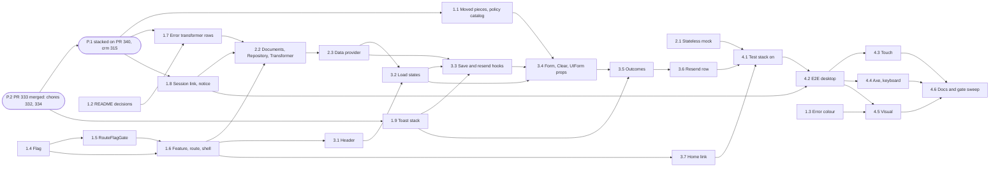

# Epics and stories: user settings for the user module

**Author:** BMad (Product Manager) **Date:** 2026-10-06, revised 2026-10-08, reconciled
2026-10-16 **Feature:** `user-settings`

Predecessors: [research](./research-user-settings-2026-10-06.md),
[brief](./brief-user-settings-2026-10-06.md), [PRD](./prd-user-settings-2026-10-06.md) and
[architecture](./architecture-user-settings-2026-10-06.md).

## Overview

This document decomposes the PRD (30 FRs, FR-23 withdrawn, and 15 NFRs, the authoritative
_what_) and the reviewed architecture (the authoritative _how_) into four epics, 25 stories and 13
follow-ups. Requirement ids (`FR-n`, `NFR-n`) are the PRD's, section references (`§n`) are the
architecture's, and `U`, `D`, `R` and `P` ids come from the run's decision record. Every
operation the page uses (`users`, `updateUser`, `resendEmailToUser`) is in the pinned v2.8.0
schema (D5), so no story waits for user-service: the page runs against the browser-lane stubs,
msw and a stateless local Apollo mock, behind the `userSettings` flag, which ships off (U5).

`settings/` below means `src/modules/user/features/settings/`, `@auth/` means
`src/modules/user/features/auth/` and `user/` means `src/modules/user/`.

Every story names its dispatch dependencies so the implementation stage can fan independent
stories out, and every dependency points to a lower story id, because bmalph orders
`.ralph/@fix_plan.md` by `N.M` (epic, then story; file order is the same here) and ignores
`Depends on`. Every story is sized to land as one reviewable unit inside the rust-code-analysis
caps (per file at most 10 functions, 6 closures, 15 in total and 120 LLOC; per function at most
10 LLOC, 3 arguments and 3 exit points; per class at most 8 public methods).

How bmalph reads this file: every `### Story N.M:` header under a `## Epic N:` heading becomes one
open item of `.ralph/@fix_plan.md`, with no status field, so every story here is dispatched. The
follow-ups use `### Follow-up 5.M:` headers under `## Follow-ups`, which neither bmalph pattern
matches. Acceptance criteria are plain bullets that start with "Given", each on one line, because
a wrapped continuation line splits or drops a criterion; bmalph strips every `**` inside them, so
no criterion relies on emphasis or on a literal glob such as a double star.

Decisions this stage had to make on its own are recorded inline as `> Assumption:` blocks.

The 2026-10-08 revisions apply the shared Miro layer contract: the stories build the board's
layers (the `UserProfile` route page, the `UserProfileSettings` and `ChangePassword` components,
React hooks, the `ProfileProvider` Data provider, the `GraphQLProfileTransformer` and the
`GraphQLProfileRepository`), no story builds a frontend Controller, Service or Handler, every
story that introduces a type crossing a layer carries a TB-1 criterion (PRD NFR-14), and #315's
`UserEntity` crosses component props as itself (TB-2).

**Simplification 2026-10-08**
(`crm-worktrees/_planning-shared/over-engineering-review-2026-10-08.md`; the user: "apply all
10", "do not over-engineer, its just front-end features without any logic, its all in the
back-end side"):

- Prerequisites: until the 2026-10-16 reconciliation these were the chore #332, the chore
  `zustand-client-state` (#334) and #315 Epic 0; see P.1 and P.2 for the current state (both
  chores merged in PR #333, this branch stacked on PR #340). Every shared piece has one owner
  (Prerequisites table); no story builds a piece "if absent".
- `ProfileFailureTransformer` is merged into `GraphQLProfileTransformer`; `ProfileProvider` takes
  three `@inject` collaborators, so `ProfileProviderDeps` and its closure are gone.
- The invented `profile_update` security signal (FR-23) is withdrawn with its story; the
  `initials` scrubber moved into Story 2.3.
- `useUserProfileSettings`, `ToastQueueStore` and the `ToastRequest` mapping are gone; the hooks
  emit `ToastDraftSet`, and the form reaches them through one stateless compose hook,
  `useProfileFormModel`, with `useEmailRow` over `useEmailResend` (amendment 2026-10-19,
  architecture §7.3).
- `SessionLinkFactory` ends a session on a transport 401 only; the route gate takes one scalar
  `flag`; the mock is a stateless happy path with one violation and the owner check.
- Thin stories merged and every story renumbered (the former ids are in the run summary): 1.8
  with 1.9, 1.10 with 1.11, 2.1 with 2.2, 2.4 to 2.6 into one, the detector into the hooks
  story, `UIForm` props and Clear into the form story, 4.6 with 4.7.

**Reconciliation 2026-10-16** (branch `feat/330-user-settings`, stacked on PR #340's head
`f8ff83c7`, crm #315 implemented and not yet merged, itself based on PR #333, merged into `main`
as `db3db0f6`). Every story below names the pieces #315 and #333 actually built, by their real
paths and signatures; the run summary lists each change. The main corrections:

- No ADR is written. PR #333 deleted every ADR from 003 up (only ADR-001 and ADR-002 remain),
  and the maintainer decided that ADR content goes into a README or nowhere. The durable
  decisions go into a `## User Settings decisions` section of `src/modules/user/README.md`,
  beside #315's `## Password recovery decisions`, and the pull-request body carries a `[no-adr]`
  line for `make check-adr-drift` (Stories 1.2 and 4.6).
- `UserServiceErrorTransformer` lives in `src/modules/user/transformers/` and is an
  `@injectable()` class registered with `registerSingleton` (#315 drift item 9), not an
  undecorated class in `user/lib/` (Story 1.7).
- `useAbortableSubmit` returns `isSubmitting` and `submit` only; #315 removed `retry` (drift item
  10). `ServerFieldError` delegates to the hook `@auth/hooks/use-server-field-error.ts`, and
  `PasswordPolicyRules` translates its own labels from `password_policy.*` keys (Story 1.1).
- #315 introduced lazy i18n catalogs (`config/i18n-catalog-policy.json`) because `/sign-in`
  has no mobile Lighthouse headroom. The settings copy ships as a lazy catalog registered by the
  settings route module (Story 1.6), and the `password_policy.*` keys move with the moved rule
  list into a catalog that component owns (Story 1.1). `password_reset.errors.policy_rejected`
  is lazy and owned by the recovery routes, so settings declares its own
  `settings.errors.new_password_rejected` (Story 3.5).
- No runtime flag exists today (`FeatureFlag` is `never`; issue #309 removed `forgotPassword`),
  so `userSettings` is the only flag and no `forgotPassword` precedent remains (Stories 1.4 and
  4.1).
- The integration suite answers GraphQL per test through `server.use` helpers
  (`tests/integration/mocks/password-recovery-operations.ts`), not through one default handler
  per operation in `server.ts` (Story 2.2).
- #315's README rejects classifying a failure by its message text. The settings rows that match
  a whole upstream message ("Access Denied.", the wrong current password, the e-mail uniqueness
  text) are therefore recorded as an amendment of that decision until user-service G8 ships
  codes, and #315's "never reads the message for meaning" test stays green (Stories 1.2, 1.7).
- A session end mirrors `logout()`, sandbox demo session included, treats #315's two public
  recovery operations as anonymous, and shows a notice with its own neutral tone, because
  #315's `SignInNotice` always draws a green success check (Story 1.8).
- Two-factor authentication has its own page (the user, 2026-10-16, Figma `72:4846`): the
  sign-in challenge is #331's own public route, never part of `/settings`. The `UserProfile`
  grid keeps only the slot for the 2FA settings card that Figma `313:10242` draws (Story 1.6).

> Assumption: the epic seams follow the dispatcher's shape (foundations, data access and mock,
> the page, release) rather than BMAD's "no technical-layer epic" heuristic. Epic 1 builds what
> the settings page and the two-factor bundle both consume, and each later epic builds only on
> earlier ones.
>
> Assumption: the README decisions are recorded early (Story 1.2), not in the release epic, so
> reviewers see why the page is shaped as it is before the first significant path changes.
> Stories 1.4, 1.5 and 1.6 change `src/config/`, the route composer and the registry, which
> `config/docs-policy.json` names as significant; with no ADR written, the pull-request body's
> `[no-adr]` line is what `make check-adr-drift` accepts (the #315 precedent), and Story 4.6
> completes the section's links.
>
> Assumption: the test stack turns `userSettings` on in Story 4.1, once the page is complete,
> not in the flag story. Turning it on earlier would put a half-built page and the home link on
> the test stack and re-record the home baselines twice; FR-1's stack criterion is met in 4.1.
>
> Assumption: Story 1.6 adds the first `settings` row of the route-coverage manifest with a real
> e2e spec that forces the flag through `overrideRuntimeConfig`
> (`tests/utils/override-runtime-config.ts`), because the gate fails on a route key without a row
> and an allowlisted row expires as soon as a contract registers the route (issue #169).

## Prerequisites (outside the story grammar)

### P.2: PR #333 merged (chore #332 and the Zustand client state, #334)

PR #333 (`db3db0f6` on `main`) landed both chores this plan waited for:

- **TB-1 gate (#332).** The two selector arrays in `config/typed-boundary-policy.js`, spread by
  `eslint.config.mjs`, with their fixtures; `@typescript-eslint/consistent-type-definitions` at
  `error`; the burn-down; the `*Transformer` suffix in `config/class-naming-policy.js` with
  `Controller` removed. `Handler`, `Service`, `Normalizer`, `Store` and `Impl` stay approved
  suffixes; this plan simply adds no class with them (AR-3).
- **Zustand client state (#334).** `useAuthStore` (`@auth/stores/use-auth-store.ts`,
  `create<AuthState>()` with no middleware, exporting `CLEARED_AUTH_STATE`), read through
  `useAuthToken()` and `useAuthState()` (`@auth/stores/`) and registered by value under
  `AUTH_TOKENS.AuthStore` as `StoreApi<AuthState>`; `useConnectivityStore`
  (`src/lib/connectivity/use-connectivity-store.ts`); `AuthStatePatch = Partial<AuthState>` in
  `@auth/types/auth-store.ts`. The binding rules are ADR-002's "Current rules"
  (`docs/adr/002-zustand-over-redux.md`) and `docs/state-architecture.md`; `src/lib/state` and
  every `*StateVar` are gone. The token stays memory-only.
- **ADRs.** Every ADR from 003 up was deleted; only ADR-001 and ADR-002 remain
  (`docs/adr/README.md`).

Every story below that adds a type crossing a layer satisfies the gate as it stands; no story
here adds, edits or relaxes a selector, a fixture or a policy entry of it.

### P.1: stacked on PR #340 (crm #315 implemented)

This branch is stacked on PR #340's head `f8ff83c7`: crm #315 (password recovery) is implemented
there and not yet merged. Its decisions live in `src/modules/user/README.md`,
`## Password recovery decisions`, and its deliberate differences from its own plan in
`specs/create-new-password/planning-artifacts/epics-create-new-password-2026-10-05.md`,
"Implementation drift". Settings imports from it, under these real names:

- **Feature and module folders.** `data-providers/` and `transformers/` in a feature, and a
  module-level `transformers/` (`config/module-shape.json`, the DI-collaborator globs in
  `config/di-collaborator-policy.js`, dependency-cruiser and the mutation scope).
- **User domain.** `UserEntity` (`src/modules/user/types/user/user-entity.ts`: readonly `id`,
  `fullName`, `email`, `confirmed`) and the DTOs `SignInDto`, `SignUpDto`, `RestorePasswordDto`,
  `CreateNewPasswordDto`, re-exported from `@/modules/user`; the TB-2 naming check
  `tests/unit/tooling/domain-type-names.test.ts`.
- **Upstream failures.** `UserServiceErrorTransformer`
  (`src/modules/user/transformers/user-service-error-transformer.ts`, re-exported by
  `src/modules/user/transformers/index.ts`), an `@injectable()` class registered with
  `registerSingleton` under `AUTH_TOKENS.UserServiceErrorTransformer` in
  `registerResponseMappers`, one public method
  `normalize(error: unknown, signal?: AbortSignal): UserServiceFailure`, a `STATUS_REASONS` map
  (`0`, `422`, `429`) and `VIOLATION_PROPERTIES` (`email`, `token`, `newPassword`); the types in
  `src/modules/user/types/user-service/user-service-failure.ts` (`UserServiceFailure` with
  `reason`, `status`, `violations`; `UserServiceFailureReason`; `FieldViolation` with `path`,
  `reason`; `FieldViolationReason` `'other'`; `FieldViolationSet`).
- **Submission.** `useAbortableSubmit` (`src/hooks/use-abortable-submit.ts`, types in
  `src/hooks/types/use-abortable-submit.ts`):
  `useAbortableSubmit(run: AbortableRun<TInput, TOutcome>): AbortableSubmit<TInput, TOutcome>`
  with `isSubmitting` and `submit(input): Promise<TOutcome | null>`, single flight and abort on
  unmount; there is no `retry`.
- **Arrival notice.** `ArrivalNotice = 'password_reset'` and `RedirectNavigationState` (`from`,
  `focusMain`, `notice`) in `src/routes/types/navigation-state.ts`; `useArrivalNotice`
  (`src/hooks/use-arrival-notice.ts`); `SignInNotice` (`@auth/components/sign-in-notice/`, a
  polite `role="status"` paragraph with the module-private `NOTICE_MESSAGES` table) with
  `SignInNoticeProps` and `SignInNoticeMessageTable` in
  `@auth/types/components/sign-in-notice.ts`; the key `sign_in.notices.password_reset` in the
  eager `@auth/i18n` catalog.
- **Password pieces** (all under `@auth/`): `passwordValidator`
  (`components/form-section/validations/password.ts`: `create`, `createChecklistGate`,
  `evaluate(value): PasswordRuleResultSet`, rules `/^[^\n\r\u2028\u2029]{8,64}$/u`, `[0-9]`,
  `[A-Z]`, `\p{Ll}`), `FormValidators`, `FullNameValidator`, `EmailValidator`
  (`validations/{index,name,email}.ts`) and their types (`types/validations/`); `PasswordField`
  (`components/form-section/components/password-field.tsx`, optional `rules` falling back to the
  sign-up rules, `name`, `describedBy`); `FormField` (`form-field.tsx`, already taking
  `describedBy`); `PasswordPolicyRules` (`password-policy-rules.tsx`, props `id` and `name`,
  which evaluates the watched value itself and translates the `password_policy.*` labels); and
  `ServerFieldError` (`server-field-error.tsx`, props `name` and `message`, rendering nothing and
  delegating to `@auth/hooks/use-server-field-error.ts`).
- **Lazy catalogs.** `config/i18n-catalog-policy.json` (`lazyCatalogs`), the recovery catalog
  `@auth/routes/recovery-catalog/i18n/` registered by `RecoveryCatalogLoader` (replaced here by
  the shared `lazyCatalogLoader`, AR-2), the test helper
  `tests/unit/utils/create-recovery-locale-i18n.ts`, `.storybook/preview.tsx` and
  `tests/e2e/utils/initialize-localization.js`. The `password_policy.*` and `password_reset.*`
  keys live in that lazy catalog and resolve only in its owner files.
- **Local mock.** `docker/apollo-server/lib/resolvers.ts` (a `Mutation` map with `createUser`,
  `requestPasswordResetUser` and `confirmPasswordResetUser`; no `Query` map) and the pending
  schema loader `docker/apollo-server/lib/schema-loader.ts`.
- **Not used here.** `AuthProviderLoader` and `useAuthProviderLoader` (the public auth pages
  reach their Data provider without `useService`; settings uses `useService`),
  `RecoveryFailureHandler`, and the pending GraphQL contract mechanism
  (`src/api/contracts/pending/`, `scripts/ci/check-pending-contracts.sh`): the three settings
  operations are in the pinned v2.8.0 schema (D5), so no pending extension is added.

If #340 changes one of these pieces before it merges, a correct-course pass aligns the stories
that use it before Ralph runs; no story carries conditional text for it.

### Shared pieces: one owner each

The landing order is PR #333 (merged), then #315 (PR #340) → #330 → #331 (contract §3.4). Each
piece is built once, by its owner; later bundles import it and append only where architecture
§15.2 says so.

| Shared piece                                                              | Owner and story |
| ------------------------------------------------------------------------- | --------------- |
| TB-1 gate, `*Transformer` suffix, `Controller` removed                    | #332 (PR #333)  |
| `useAuthStore`, `useConnectivityStore`; ADR-002 "Current rules"           | #334 (PR #333)  |
| Feature and module folders, `UserEntity`, the DTOs, TB-2 naming check     | #315 (PR #340)  |
| `UserServiceErrorTransformer`, failure types, `useAbortableSubmit`        | #315 (PR #340)  |
| `SignInNotice`, `ArrivalNotice`, password pieces, lazy catalogs, the mock | #315 (PR #340)  |
| Settings rows of #315's `UserServiceErrorTransformer` (appended)          | here, 1.7       |
| `UI*` moves of #315's field pieces and the policy catalog                 | here, 1.1       |
| Field-error text token `paletteColors.error.text` = `#C62828`             | here, 1.3       |
| Route key `settings`, the route `flag` field and `RouteFlagGate`          | here, 1.5, 1.6  |
| `UserProfile` page shell: title, `h1`, subtitle, grid, 2FA slot           | here, 1.6       |
| `SessionLinkFactory`, its adapter entry, the `session_ended` notice       | here, 1.8       |
| `UIForm` `submitRef`, `submitSx` and `footer`                             | here, 3.4       |
| Home link to `/settings`                                                  | here, 3.7       |

The two-factor bundle imports every piece this file builds and adds only its own rows and
props (`submitBlockedReason`, its message rows, `TwoFactorSettings`). The toast is built and
used by settings alone (R16).

## Requirements Inventory

### Functional Requirements

- FR-1: `userSettings` flag (`APP_CONFIG_FLAG_USER_SETTINGS`) in the four declaration sites,
  `.env.example`, the test stack as `:-true`, the docs row and the contract test; shipped
  `false`.
- FR-2: protected `/settings` in the settings feature's route contract, lazy chunk `settings`,
  rendered only while `userSettings` is on, the not-found page otherwise whatever `twoFactorAuth`
  says (that flag only shows the 2FA card inside the page); flags read at render time only.
- FR-3: page shell with one `h1`, a subtitle and a grid holding the profile card and the 2FA slot;
  side by side on desktop, stacked below; no horizontal scroll at 320 CSS px. The slot is for the
  2FA settings card only; the 2FA sign-in challenge has its own page (#331).
- FR-4: one flag-gated home link "Налаштування" before "Вийти"; client-side navigation with focus
  on `main`.
- FR-5: current user from `users(first: 1)` with the Bearer header, `no-cache`, the deadline and
  the abort signal; the IRI passed through; the mutation payload adopted instead of a re-read.
- FR-6: skeleton with a polite loading status; a read failure shows an alert and a user-initiated
  retry; focus on the card's first heading after a successful retry.
- FR-7: decorative monogram, greeting in `#57595B` and the name; no avatar controls.
- FR-8: one form, two `h2` sections, labelled fields with `autocomplete`, eye toggles, Save and
  Clear; Enter submits.
- FR-9: name and e-mail validated only while changed; the current password required for every
  Save with a change and never checked against the policy.
- FR-10: optional new password under the shared policy, with four live rules and a hint.
- FR-11: change detection (trimmed name, trimmed lower-cased e-mail, filled new password); a
  no-change status; an input carrying only the changed fields.
- FR-12: native busy state, single flight, Save disabled offline, focus never left on `body`.
- FR-13: Clear restores the last loaded values, empties both password fields, sends nothing.
- FR-14: one success toast per changed aspect in the order name, e-mail, password; payload
  adopted, form pristine.
- FR-15: not-confirmed row with a resend button in `#0074B5`; single flight; success toast.
- FR-16: 422 violations become field errors in crm copy, decided by the Data provider and its
  Transformer; an unknown path gives the generic toast.
- FR-17: wrong current password recognised by its `en` or `uk` message; a field error.
- FR-18: rate-limit, transient and other failures as error toasts; a Retry action only on the
  transient one.
- FR-19: a transport 401 ends the session through the shared link; redirect with the notice; the
  owner refusal does nothing.
- FR-20: toast primitive: two tones, a polite region, alert errors, no timer, at most three,
  focus rules and placement.
- FR-21: `Authorization: Bearer` on non-anonymous GraphQL operations through `SessionLinkFactory`.
- FR-22: `no-cache`, minimal selection, abort check and no retry on all three operations;
  documents against pinned v2.8.0; the query-seam policy edit.
- FR-23: withdrawn 2026-10-08 (no security signal).
- FR-24: passwords, e-mail, name, IRI and token never reach observability; the scrubber denies
  `initials`.
- FR-25: the shared pieces live outside `@auth`; `UIForm` gains `submitRef`, `submitSx` and the
  `footer` slot.
- FR-26: contrast fixed at the source: greeting, resend control and field-error text `#C62828`;
  no new exception.
- FR-27: a stateless local Apollo mock answers the three operations: the seeded user, one
  violation and the owner check.
- FR-28: every string in `uk` and `en`; the `settings.*` copy in a lazy catalog the settings
  route registers, the few keys other pages render (home link, session-ended notice, toast
  close) in eager catalogs with the merged catalog regenerated.
- FR-29: route-coverage rows, axe route scan, keyboard spec and mobile spec; Lighthouse URL list
  unchanged.
- FR-30: the User Settings decisions in a `## User Settings decisions` section of
  `src/modules/user/README.md`; no ADR, and a `[no-adr]` line in the pull-request body.

### NonFunctional Requirements

- NFR-1: 100% coverage in the unit and integration suites; mutation `break: 100` with static
  tables loaded in the test body.
- NFR-2: ESLint, `tsc`, dependency-cruiser, markdownlint, jscpd and metrics at zero; every
  repository convention of U7 kept.
- NFR-3: zero visual diffs; new baselines from the CI artifact only; the one intended re-baseline
  is the home page (no existing baseline renders a field error, so Story 1.3 re-records none).
- NFR-4: Lighthouse floors (desktop 0.95, mobile 0.84 median of three) on the unchanged URL list
  of `lighthouse/constants.js` (`/`, `/sign-up`, `/sign-in`, `/forbidden`, `/server-error`, an
  unknown path, `/password-recovery` and `/password-reset`).
- NFR-5: bundle and paint-path budgets; eager growth under 1 kB gzip; nothing new on the static
  graph from `src/index.tsx`.
- NFR-6: WCAG 2.1 AA; jest-axe and axe in three engines; 44 CSS px mobile targets and a 24 px
  resend control; no new `A11Y_EXCEPTIONS` entry.
- NFR-7: keyboard order and focus rules with the repository `:focus-visible` ring.
- NFR-8: mobile touch lane on Pixel 7 and iPhone 14.
- NFR-9: secrets never in a URL, storage, the cache, logs or telemetry; passwords emptied; no new
  origin; the flag shipped off.
- NFR-10: request deadline, abort, no retry link, route error element and chunk retry; errors
  reach observability only through the Apollo error link.
- NFR-11: i18n parity, the console gate, Faker builders, semantic locators and test liveness.
- NFR-12: test lanes: unit, integration with msw, apollo-server, e2e desktop, mobile, axe and
  keyboard.
- NFR-13: documentation drift (`make lint-docs`); the ADR-drift gate passes through the
  pull-request body's `[no-adr]` line, because the decisions live in the module README.
- NFR-14: typed boundaries (TB-1): every value crossing a layer is a named interface, class or
  named union alias; collections cross as named `*Set` interfaces; no inline object, tuple, bare
  array, `Record`, `object`, index signature or inline derived type; gate from the chore #332
  (PR #333, P.2); TB-2: #315's `UserEntity` crosses component props as itself, and no settings
  type is named `*Dto` or `*Entity` (`tests/unit/tooling/domain-type-names.test.ts`).
- NFR-15: Miro layer alignment: route page, components, React hooks, Data provider ⇄
  Transformer, GraphQL Repository; board names (the page holds `UserEntity`; `ChangePassword`
  stands where the board draws #315's `RestorePassword`); no frontend Controller, Service or
  Handler.

### Additional Requirements

- AR-1 (§2.2): the Data provider (`ProfileProvider`) is the translation boundary; nothing
  above it sees a status, a server message, a violation path, `extensions.code` or a generated
  type, and form values use `fullName`, `email`, `currentPassword` and `newPassword`.
- AR-2 (§5.8, §6, §7.3, U7): no new module-level singleton; `useProfileSave` builds the
  `ProfileChangeDetector` in a `useState` initializer, and the toast queue is a reducer inside
  `useToastQueue`; the moved validators keep the singletons they already have. The one accepted
  exception is #315's (its drift items 1 and 4): a stateless catalog seam exported as a module
  singleton because it registers a lazy catalog when its module evaluates, before any component
  exists. Amendment 2026-10-19: one shared `lazyCatalogLoader` (`src/lib/locale-catalog`,
  `register(i18n, catalog: LocaleCatalogPair)`) replaces `RecoveryCatalogLoader`,
  `SettingsCatalogLoader` (Story 1.6) and `PasswordPolicyCatalogLoader` (Story 1.1); each
  owner keeps its own JSON import.
- AR-3 (§6): approved class suffixes (`Provider`, `Transformer`, `Repository`, `Detector`,
  `Loader`, and `Factory` for `SessionLinkFactory`, with `Transformer` added by the chore #332)
  and no policy edit of this plan's own; no new `*Controller`, `*Service`, `*Handler`,
  `*Normalizer`, `*Store` or `*Impl`; at most six public methods and three constructor
  dependencies per new class.
- AR-4 (§6, §12): registrations fold into existing `UserModuleRegistrar` steps; the settings
  registrations add no function and no closure. The session link adds one `registerSessionLink`
  step and its one `SessionLinkDeps` closure, so the registrar holds 10 of 10 functions and 4 of
  6 closures (architecture §6, registrar budget; contract §2.2).
- AR-5 (§12): no edge from settings into `@auth`; settings hooks and components import neither
  `src/services` nor a repository; `@apollo/client` value imports only in repositories folders,
  `user/config/di.ts` and the observability link factory.
- AR-6 (§5.6, R6): no flag is read at module evaluation.
- AR-7 (this stage): the integration run's 100% threshold binds every `src` file an integration
  test loads, including classes reached through the container, so each container-registered
  class (the extended upstream-error transformer, the link, the Transformer, the Repository and
  the Data provider) is covered by integration tests in the story that adds it.
- AR-8 (§1.1, §3.3, §17): the board's edges hold: components import no Data provider,
  Transformer or Repository, even as types; hooks reach the Data provider only through
  `useService`; only the Data provider reaches the Repository and the Transformers; the Data
  provider publishes no State. `make lint-deps` proves only part of it: a component (`.tsx`)
  value-importing a Data provider, Transformer or Repository fails
  `components-no-direct-injectable-import`, and a feature component importing a Repository at any
  dependency type fails `no-components-to-repositories`. A type-only import into a component and
  any import of a Repository or Transformer from a hook are not covered by a rule, so Story 3.2
  adds `tests/unit/tooling/settings-layer-edges.test.ts`, which reads the import specifiers of
  every file under `settings/{components,hooks,routes}` and fails on such an edge.

> Assumption: AR-7 follows the #315 analysis of the same configuration. `jest.config.ts` builds
> the integration run from `roots: ['./tests/integration']` (`:5-10`), and existing integration
> tests resolve the container, so every registered class an integration test reaches is in the
> denominator.

### UX Design Requirements

- UX-DR-1: Figma file `xZ7ccrH6d4QyqLQsayFSEX`, group `6242:41691`: resting `313:10242`,
  `313:10480`, `313:10606`; e-mail not confirmed `386:27830`, `386:27945`, `386:28059`; toasts
  `315:11754`, `315:12551`, `318:13410`.
- UX-DR-2: the skeleton, the load failure, the error toast, field errors and the no-change status
  have no frame; their composition from existing primitives is the v1 design (PRD §10).
- UX-DR-3: the Russian Figma copy is replaced by the PRD §12 `uk` and `en` strings; the mobile
  header "Management board" is a Figma defect and the desktop title stays.
- UX-DR-4: contrast overrides: greeting `#57595B`, resend control `#0074B5`, field-error text
  `#C62828`; "Очистити" is never the primary blue (D15, R8).
- UX-DR-5: no photo, pencil badge or social networks card (D2); the monogram is decorative.
- UX-DR-6: every user-facing story runs the `figma-design-check` gate through the Figma MCP before
  UI code is written; an unreachable MCP reports `BLOCKED`, never a skip.

### FR and NFR Coverage Map

| Requirement | Stories                                                                     |
| ----------- | --------------------------------------------------------------------------- |
| FR-1        | 1.4, 4.1, 4.6                                                               |
| FR-2        | 1.5, 1.6, 4.2                                                               |
| FR-3        | 1.6, 3.2, 4.3, 4.5                                                          |
| FR-4        | 3.7, 4.1, 4.2                                                               |
| FR-5        | 2.2, 2.3, 3.2, 4.2                                                          |
| FR-6        | 2.3, 3.2, 3.4, 4.2, 4.5                                                     |
| FR-7        | 3.1, 3.5, 4.5                                                               |
| FR-8        | 3.4, 4.2                                                                    |
| FR-9        | 1.1, 3.3, 3.4, 4.2                                                          |
| FR-10       | 1.1, 3.4                                                                    |
| FR-11       | 2.2, 2.3, 3.3, 3.4, 4.2                                                     |
| FR-12       | 3.3, 3.4, 4.2                                                               |
| FR-13       | 3.4                                                                         |
| FR-14       | 1.9, 3.3, 3.5, 4.2                                                          |
| FR-15       | 2.2, 2.3, 3.3, 3.6, 4.2, 4.5                                                |
| FR-16       | 1.7, 2.2, 2.3, 3.3, 3.5, 4.2                                                |
| FR-17       | 1.7, 2.2, 2.3, 3.3, 3.5, 4.2                                                |
| FR-18       | 1.7, 2.2, 2.3, 3.3, 3.5, 3.6, 4.2                                           |
| FR-19       | 1.7, 1.8, 2.2, 2.3, 3.2, 3.3, 3.5, 4.2                                      |
| FR-20       | 1.9, 3.5, 4.3, 4.4, 4.5                                                     |
| FR-21       | 1.8, 2.2, 2.3                                                               |
| FR-22       | 2.2, 2.3                                                                    |
| FR-23       | withdrawn 2026-10-08; no story                                              |
| FR-24       | 2.3, 4.2                                                                    |
| FR-25       | 1.1, 3.4                                                                    |
| FR-26       | 1.3, 3.1, 3.4, 3.6, 4.4                                                     |
| FR-27       | 2.1                                                                         |
| FR-28       | 1.1, 1.6, 1.8, 1.9, 3.1, 3.2, 3.4, 3.5, 3.6, 3.7                            |
| FR-29       | 1.6, 4.2, 4.3, 4.4, 4.5, 4.6                                                |
| FR-30       | 1.2, 4.6                                                                    |
| NFR-1       | every code story; 4.6 sweep                                                 |
| NFR-2       | every code story; 1.1, 1.5 to 1.8, 2.2, 2.3, 3.3, 4.6                       |
| NFR-3       | 1.1, 1.3, 3.4, 4.1, 4.5                                                     |
| NFR-4       | 4.1, 4.6                                                                    |
| NFR-5       | 1.5, 1.6, 1.8, 2.2, 4.6                                                     |
| NFR-6       | every UI story, and 1.1, 1.3, 1.6, 1.8, 1.9, 3.1, 3.2, 3.4 to 3.7, 4.3, 4.4 |
| NFR-7       | 1.8, 1.9, 3.4 to 3.7, 4.1, 4.4                                              |
| NFR-8       | 1.9, 4.3                                                                    |
| NFR-9       | 1.4, 1.8, 2.2, 2.3, 4.2, 4.6                                                |
| NFR-10      | 1.5 to 1.8, 2.2, 2.3, 3.2, 4.6                                              |
| NFR-11      | every story with tests; 1.6, 1.8, 2.1, 3.3, 4.2, 4.6                        |
| NFR-12      | 2.1, 2.2, 2.3, 4.2, 4.3, 4.4                                                |
| NFR-13      | 1.2, 1.4, 1.5, 4.6                                                          |
| NFR-14      | 1.1, 1.5, 1.7 to 1.9, 2.2, 2.3, 3.1 to 3.7, 4.6                             |
| NFR-15      | 1.6, 1.8, 2.2, 2.3, 3.2, 3.3, 3.4, 4.6                                      |

Every FR except the withdrawn FR-23, and every NFR, is covered by at least one story. The FR
rows equal the union of the per-story **Requirements** lines below, each row in id order; an NFR
row that opens with "every …" lets the qualifier stand for the stories it names generically.

## Definition of done shared by every story

Each story's own criteria add to these; a story is not done until all of them hold.

- **Quality floors.** No threshold, budget, allowlist, scope, baseline or ratchet value is edited
  to make a run pass; the only reviewed re-baseline is the home page (Story 4.1), and the only
  reviewed DI-policy edits are the three of
  architecture §12 (the adapter entry in Story 1.8, the `graphql-documents` widening and the
  `response-schemas` carve-out in Story 2.2), and the only reviewed edits of
  `config/i18n-catalog-policy.json` are its two new lazy entries (Stories 1.1 and 1.6) and the
  one owner Story 1.1 removes from the recovery entry. No `eslint-disable`, `@ts-ignore`,
  `@ts-expect-error`, `depcruise-ignore`, `.skip`, `.only`, `.fixme`, `waitForTimeout`,
  conditional `expect` or `data-testid` in `src`; no inline comments beyond a
  `// Stryker disable next-line` with a proof the mutation policy accepts.
- **Conventions.** Classes only in non-React `.ts` (no statics, no free functions, no
  function-valued properties of top-level object literals); types in type-only files imported
  with `import type`; approved class suffixes; collaborators through DI tokens; components reach
  the container only through `useService`; the auth paint path stays container-free; no raw
  `Intl` or `toLocale*` call; no eager `@mui/material` import; AR-1 to AR-8. ESLint warnings
  count too (`eslint_warnings: 0`, `.claude/react-sdlc.yml:58`): `react/jsx-no-bind` warns
  (`eslint.config.mjs:735`), so a JSX handler prop is a stable reference (`useCallback` or a
  hook's own function), never an inline arrow, as everywhere in `src` today.
- **Tests.** Every new `src` file has a direct unit test; unit coverage and the AR-7 integration
  coverage stay at 100%; seeded Faker builders supply arbitrary values and literals appear only
  where the value is the case (a case-only e-mail, a Cyrillic password, an upstream message, the
  seeded mock user); elements are located by role, label or text; a logging path is spied and
  asserted in its own test; layout measurements belong to the browser lanes, never to jsdom.
- **Mutation.** Zero survivors on every new or changed file in the mutate scope; static tables
  (the failure table, message rows, toast keys, toast styles) are loaded in the test body
  through `tests/unit/utils/isolated-module.ts`; an equivalent mutant is removed by the simpler
  program, or annotated with its proof only where no refactor exists.
- **Accessibility.** jest-axe (`expectNoA11yViolations`) on every new rendering component and
  state; no positive `tabindex`; no new `A11Y_EXCEPTIONS` entry; text at 4.5:1 or more.
- **i18n.** Every key a story first uses lands in `uk` and `en` in that story, followed by
  `make i18n-generate`; catalog edits are append-only so parallel stories merge cleanly. The
  `settings.*` keys live in the lazy settings catalog (Story 1.6), which the generator leaves out
  of `src/i18n/localization.json`; a settings test renders through
  `tests/unit/utils/create-settings-locale-i18n.ts`, the `create-recovery-locale-i18n.ts`
  precedent, which registers the settings catalog and, from Story 3.4, the policy catalog, so a
  lazy key leaking into an eager page renders raw in that page's tests.
- **Visual.** Baselines are recorded only from the CI `visual tests` artifact of the branch, never
  from a local container; a story that changes an existing baseline it does not name stops and
  reports instead of re-baselining.
- **Local gates** (light, before handing back): `make format`; ESLint, Prettier `--check` and
  `tsc` over the changed files inside the dev container; `make lint-md`, `make lint-i18n` and
  `make lint-docs` where the story touches Markdown, catalogs or docs; the gates named in the
  story's **Gates** line; the focused Jest files the story touches, for example
  `docker compose exec -T dev bun x jest tests/unit/path/to/file.test.ts`, with
  `TEST_ENV=integration` or `TEST_ENV=server` for those suites.
- **CI-only gates** (heavy, never run locally): the full `make lint` aggregate,
  `make test-unit-all`, `make test-integration`, the sharded Stryker run, `make test-e2e`,
  `make test-visual`, `make test-a11y-e2e`, the mobile lane, Lighthouse, the bundle-size report,
  `make check-adr-drift` and the supply-chain scans.
- **Commits.** Headers of at most 100 characters with the issue scope; the auto-close reference
  rides the commit message (squash-merge repository).

## Epic List

1. **Epic 1: Foundations shared with #315 and two-factor authentication** — the moved password
   and form pieces, the README's User Settings decisions, the field-error colour, the flag, the
   route flag gate, the settings
   feature with its route and `UserProfile` shell, the settings rows of #315's upstream-error
   transformer, the Bearer link with the session-ended notice, and the toast primitive.
2. **Epic 2: Profile data access and the local mock** — the stateless mock, the three documents
   with the Repository and the Transformer, and the Data provider.
3. **Epic 3: The settings page** — header, load states, the save and resend hooks, the profile
   form with `ChangePassword` and Clear, outcomes, the unconfirmed e-mail row and the home link.
4. **Epic 4: Release wiring and quality** — the flag on in the test stack, the browser lanes, the
   visual baselines, the documentation and the gate sweep.

`## Follow-ups` after Epic 4 holds Follow-ups 5.1 to 5.13. It is not an epic and is never
dispatched.

## Epic 1: Foundations shared with #315 and two-factor authentication

Give the settings page every shared foundation it needs before any profile code exists: the
password pieces of crm #315 outside `@auth`, the README's User Settings decisions, readable
field errors, the `userSettings` flag, render-time route gating, the registered `/settings` shell
with its lazy catalog, the settings rows of #315's upstream error transformer, the Bearer link
with its one session-end rule and notice, and the toast primitive. Every story here that adds a
type crossing a layer runs after P.2. Scope: `src/components`, `src/routes`, `src/config/runtime`,
`src/styles`, `src/hooks`, `user/lib`, `user/transformers`, `user/types`, `user/config`,
`user/README.md`, `config/i18n-catalog-policy.json`, `@auth/` (moved pieces, link, notice,
protected route), `settings/` (scaffold, route, shell, catalog).

### Story 1.1: Move the shared password and form pieces out of the auth feature

As a developer of the settings feature,
I want #315's password policy, validators and password-field components outside `@auth`,
So that settings reuses one implementation of each without crossing the sibling-feature ban.

**Dispatch:** Independent; runs after P.1 and P.2.

**Requirements:** FR-9, FR-10, FR-25, FR-28, NFR-1, NFR-2, NFR-3, NFR-6, NFR-14 (architecture
§5.9).

> Assumption (reconciliation 2026-10-16): #315's `PasswordPolicyRules` evaluates the watched
> value and translates its labels itself, and its `password_policy.*` keys sit in the lazy
> recovery catalog, which resolves only in the recovery owner files. The moved rule list keeps
> its label lookup and receives only the evaluation as a prop, and its keys move into a catalog
> the component folder owns and registers, so the recovery pages and settings both resolve them
> and the eager catalog does not grow.

**Files:** `user/lib/validations/{index,password,name,email}.ts` (MOVE from
`@auth/components/form-section/validations/`), `user/types/validations/{index,email,name,password}.ts`
(MOVE from `@auth/types/validations/`), `src/components/ui-form-field/index.tsx` (MOVE of
`@auth/components/form-section/components/form-field.tsx`; keeps #315's `describedBy`, gains
`sx`), `src/components/ui-form-field/styles.ts` (MOVE: `formFieldLabel`, `formFieldInput`),
`src/components/ui-password-field/index.tsx` (MOVE of `password-field.tsx`; `rules` required,
gains an optional `sx` forwarded to its `UIFormField`),
`src/components/ui-password-field/styles.ts` (MOVE: `endAdornment`, `passwordButton`,
`StyledEyeIcon`, `StyledEyeIconOff`, importing the icons from `src/assets/icons`; the unapplied
`passwordFieldInput` is deleted), `src/components/ui-password-policy-rules/index.tsx` (MOVE of
`password-policy-rules.tsx`; props `UIPasswordPolicyRulesProps` with `id`, `name` and
`evaluate`), `src/components/ui-password-policy-rules/styles.ts` (MOVE of
`password-policy-rules-styles.ts`), `src/components/ui-password-policy-rules/i18n/{uk,en}.json`
(MOVE of the `password_policy.*` keys out of `@auth/routes/recovery-catalog/i18n/`),
`src/components/ui-password-policy-rules/index.tsx` (registers its catalog through the shared
`lazyCatalogLoader`, `src/lib/locale-catalog/lazy-catalog-loader.ts`, NEW, AR-2),
`src/components/ui-server-field-error/index.tsx` (MOVE of `server-field-error.tsx`; gains
`focus`, default `true`), `src/components/ui-server-field-error/use-server-field-error.ts` (MOVE
of `@auth/hooks/use-server-field-error.ts`, placed beside its component as
`ui-form/use-offline-submit.ts` is), one `src/components/types/<component>/index.ts` per moved
component (MOVE of `@auth/types/components/{form-field,password-field,password-policy-rules,server-field-error}.ts`),
`src/assets/icons/{eye,eye-off}.svg` (MOVE from `@auth/assets/`),
`@auth/components/form-section/components/styles.ts` (MODIFY: keeps only `formFieldWrapper` with
`fieldGapMargins`, which every auth caller passes through the `sx` of each `UIFormField` and
`UIPasswordField` it renders), `config/i18n-catalog-policy.json` (MODIFY: a `lazyCatalogs` entry for
`components/ui-password-policy-rules/i18n` owned by `components/ui-password-policy-rules`, and the
recovery entry loses its `password-policy-rules.tsx` owner),
`tests/unit/scripts/localization-generator.test.js` (MODIFY: the case that pins the policy's
catalog list with `toEqual` lists the recovery and policy catalogs),
`tests/unit/utils/create-recovery-locale-i18n.ts` and `.storybook/preview.tsx` (MODIFY: also register the policy catalog; the e2e helper
`tests/e2e/utils/initialize-localization.js` already registers every policy entry), every auth
caller (MODIFY: `@auth/components/form-section/auth-forms/{login-form-fields,login-form,registration-form-fields,registration-form}.tsx`
with `login-form-fields.stories.tsx` and `registration-form-fields.stories.tsx`,
`@auth/types/auth-forms/{login-form-fields,registration-form-fields,registration-form}.ts`,
`@auth/components/reset-password/reset-password-form.tsx`,
`@auth/components/create-new-password/create-new-password-form.tsx` and
`@auth/components/form-section/styles.ts`), the three moved stories (`form-field.stories.tsx`,
`password-field.stories.tsx`, `password-policy-rules.stories.tsx`) beside their components,
`tests/unit/tooling/storybook-story-coverage.test.ts` (MODIFY: the `server-field-error.tsx`
`EXEMPT` entry follows the file), the moved tests (every file under
`tests/unit/modules/user/features/auth/components/form-section/validations/` moves to
`tests/unit/modules/user/lib/validations/`, `password-policy.test.ts` and
`validator-factories.test.ts` with `createChecklistGate` among them;
`form-field.defaults.test.tsx`, `password-field.test.tsx`, `password-field.generalised.test.tsx`,
`password-policy-rules-styles.test.ts`, `styles.test.tsx`, `styles.tokens.test.ts` and
`styles.styled-eye-icons.test.tsx` under
`tests/unit/modules/user/features/auth/components/form-section/components/`,
`form-section/server-field-error.test.tsx` and
`tests/unit/modules/user/features/auth/hooks/use-server-field-error.test.tsx` move or split to
`tests/unit/components/ui-*/` with their files), the callers' tests (MODIFY: import paths only,
under `tests/unit/modules/user/features/auth/components/form-section/auth-forms/`,
`components/{reset-password,create-new-password}/`, `routes/{reset-password,create-new-password}/`
and `routes/{sign-in,sign-up}/index.test.tsx`),
`tests/unit/components/skeletons/auth-skeleton.spacing.test.tsx` (MODIFY: reads
`formFieldLabel` from `ui-form-field/styles.ts`, and its two `jest.mock('@auth/assets/eye*.svg')`
calls are re-pointed to `@/assets/icons/eye*.svg`, because the moved SVGs no longer exist under
`@auth/assets/` and Jest fails to resolve a mocked specifier with no file), `tests/unit/config/eslint-policy.test.ts` and
`scripts/ci/print-eslint-policy-config.mjs` (MODIFY: the sample component `.tsx` of both becomes
`auth-switcher/index.tsx`).

**Gates:** DoD local gates; `make lint-deps`, `make lint-dup`, `make lint-i18n`; CI `make test-visual`.

**Acceptance Criteria:**

- Given the pieces listed in the architecture §5.9 table, when the change lands, then each exists once at its target path, no copy remains under `@auth`, and `make lint-dup` reports zero clones.
- Given `make lint-deps`, when it runs, then `no-cross-feature-imports`, `no-components-import-modules`, `no-components-import-feature-internals` and `no-lib-to-features` report nothing, and no file under `src/components` imports from `src/modules`.
- Given `FormValidators`, `PasswordValidator`, `FullNameValidator` and `EmailValidator` imported from `user/lib/validations`, when their existing tests run with only the import paths changed, then every case passes, `PasswordValidator` keeps its four rules, the line-break rule, `createChecklistGate` and `evaluate()`, and the singletons moved rather than multiplied.
- Given `UIPasswordField` on sign-in, sign-up and the two #315 forms, when each renders, then each passes its own `rules`, `rules` is a required prop with no sign-up fallback left in `src/components` (so the component no longer imports `formValidators`), the conditional `name` typing of #315's `PasswordFieldProps` (`name` defaults to `password`) moves unchanged into `src/components/types/ui-password-field/index.ts`, and the toggle keeps the names "Показати пароль" and "Приховати пароль" (keys `auth.password.show` and `auth.password.hide`) and its `aria-pressed` state.
- Given `UIPasswordPolicyRules` with the watched value `Pa1`, when it renders, then it lists the four rules in policy order with only the length rule unmet, marks each by icon plus text with the visually hidden met or unmet word, and is not a live region.
- Given the moved prop types in `src/components/types/`, when `make lint-eslint` runs the TB-1 selectors, then `evaluate` is a `PasswordRuleEvaluator` returning a `PasswordRuleViewSet` of `PasswordRuleView` items keyed by the named `PasswordRuleViewKey` union, #315's `PasswordRuleResultSet` is assignable to it without a mapping, every moved props type is a named interface, and no file carries a suppression.
- Given each caller of `UIPasswordPolicyRules`, when it renders, then it passes a stable `PasswordRuleEvaluator` that calls `passwordValidator.evaluate` on the validator itself, never an inline arrow or a detached method reference.
- Given `config/i18n-catalog-policy.json` and `make lint-i18n`, when they run, then the `password_policy.*` keys exist only in `src/components/ui-password-policy-rules/i18n/`, `lazyCatalogLoader.register(i18n, { en, uk })` registers both locales when the component module evaluates, the recovery catalog no longer holds them, `src/i18n/localization.json` is unchanged, no `[lazy-key-scope]` finding is reported, and the localization-generator unit test pins the policy's catalog list as the recovery catalog then `components/ui-password-policy-rules/i18n`.
- Given `UIServerFieldError` without `focus`, when a message arrives, then it sets the server error and focuses its field as #315's component did, and with `focus={false}` it sets the error and leaves focus in place; a cleared message still clears only a `server` error.
- Given `UIFormField` with `describedBy` and `sx`, when it renders, then the input's `aria-describedby` keeps #315's order (the `describedBy` ids, then `<name>-helper-text` while an error shows), and the auth spacing reaches it through `sx`, so sign-in, sign-up and the #315 pages render the same DOM and computed styles.
- Given `UIPasswordField` with an `sx`, when it renders, then it forwards that `sx` to its `UIFormField` grid unchanged, the optional `sx` is declared in `src/components/types/ui-password-field/index.ts`, and without one the grid carries no auth spacing.
- Given sign-in and `/password-reset`, when they render, then each password-field grid still carries the `formFieldWrapper` margin it has on PR #340 (on sign-in the second of three sibling `div`s, on `/password-reset` the first new-password field), because `login-form-fields.tsx`, `registration-form-fields.tsx`, `reset-password-form.tsx` and `create-new-password-form.tsx` pass `formFieldWrapper` to every `UIFormField` and `UIPasswordField` they render (must-fail: a password field rendered without it changes the sign-in or `/password-reset` visual baseline in CI).
- Given the eye icons and the field styles, when the move lands, then only `eye.svg` and `eye-off.svg` moved, `UIFormField` and `UIPasswordField` import only their own `styles.ts`, and no file under `src/components` imports `form-section/components/styles.ts`.
- Given `tests/unit/config/eslint-policy.test.ts` and `scripts/ci/print-eslint-policy-config.mjs`, when the test runs, then both name the same auth component that stays where it is as their sample `.tsx` and the test passes.
- Given the story-coverage test, when it runs, then `UIFormField`, `UIPasswordField` and `UIPasswordPolicyRules` have their moved stories and `UIServerFieldError` keeps its `EXEMPT` reason at its new path.
- Given the CI visual suite, when it runs on this change, then no baseline changes; a changed sign-in, sign-up or password-recovery baseline stops the story for a report instead of a re-baseline.
- Given the change, when the DoD gates run, then ESLint, `tsc`, dependency-cruiser and `make lint-metrics` report nothing, unit coverage stays at 100% and Stryker reports zero survivors on the moved files.

### Story 1.2: Record the User Settings decisions in the user module README

As a maintainer of the user module,
I want the durable decisions of the settings page recorded before any significant path changes,
So that reviewers can see why the page is shaped as it is, without an ADR.

**Dispatch:** Independent.

**Requirements:** FR-30, NFR-13 (architecture §14).

> Assumption (reconciliation 2026-10-16): PR #333 deleted every ADR from 003 up and the
> maintainer decided that ADR content goes into a README or nowhere. #315 recorded its decisions
> as `## Password recovery decisions` in `src/modules/user/README.md` and carries a `[no-adr]`
> line in its pull-request body; this story follows it. No file under `docs/adr/` changes, so the
> Deciders rule does not apply.

**Files:** `src/modules/user/README.md` (MODIFY: a `## User Settings decisions` section after
`## Password recovery decisions`, in the same context, decision and rejected shape).

**Gates:** `make lint-docs`, `make lint-doc-links`, `make lint-prettier`; CI
`make check-adr-drift` through the pull-request body's `[no-adr]` line.

**Acceptance Criteria:**

- Given `src/modules/user/README.md`, when the story lands, then it holds a `## User Settings decisions` section after `## Password recovery decisions`, linking crm #330 and the settings architecture, and every decision in it states its context, the decision and the options it rejected, as #315's section does.
- Given the architecture §14 outline, when the section is read, then it records route gating by one `flag` read at render time by `RouteFlagGate` (with the two rejected options and why), the current user from `users(first: 1)` and its IRI, the Miro layer stack with `ProfileProvider` as the translation boundary, named types at every layer boundary (TB-1), #315's `UserEntity` passed down as itself (TB-2), the change-only `updateUser` input, `no-cache` with minimal selection and no retry, the toast contract, `SessionLinkFactory` ending a session on a transport 401 only, the lazy settings catalog, the error-text token `paletteColors.error.text` (`#C62828`) and the stateless mock.
- Given the decisions, when they are compared with #315's section, then none repeats it: the Data provider, Transformer and Repository folders, `UserServiceErrorTransformer` and the lazy-catalog mechanism are referenced as #315's, and settings records only what it appends.
- Given #315's decision "Failures are classified in two steps", which rejects classification by message text, when the settings section is read, then one entry amends it by name: whole-message rows are allowed only for the listed upstream texts ("Access Denied.", "Old password is invalid", "Старий пароль невірний" and the e-mail uniqueness text) until user-service G8 ships codes, every other message still classifies by shape, and the entry names the rejected options (matching `extensions.code`, which upstream drops; a substring or case-insensitive match of a message).
- Given the session-end and notice decisions, when they are read, then they state that a transport 401 ends the session as `logout()` does (sandbox demo session included), that #315's `RequestPasswordReset` and `ConfirmPasswordReset` are anonymous, that the `session_ended` notice has its own neutral tone, and that the 2FA sign-in challenge is #331's own page (Figma `72:4846`), not part of `/settings`.
- Given `docs/adr/`, when the story lands, then no file there changed and `docs/adr/README.md` still lists ADR-001 and ADR-002 only.
- Given the pull request, when its body is written, then it carries a `[no-adr]` line, so `make check-adr-drift` passes in CI although Stories 1.4, 1.5 and 1.6 change files under `src/config/`, the route composer and the registry.
- Given `make lint-docs`, `make lint-doc-links` and `make lint-prettier`, when they run, then they pass; the links to the user-service issues are added by Story 4.6.

### Story 1.3: Raise field-error text contrast at its source token

As a person who mistypes in any form,
I want field-error text I can read,
So that I understand what went wrong without straining.

**Dispatch:** Independent.

**Requirements:** FR-26, NFR-1, NFR-3, NFR-6 (architecture §5.10).

**Files:** `src/styles/colors.ts` (MODIFY: `paletteColors.error.text` `#C62828`),
`src/components/ui-form-input-field/theme.ts` (MODIFY: the `MuiFormHelperText` `&.Mui-error`
colour reads `error.text`; the `Mui-error` input border rule keeps `error.main`),
`tests/e2e/a11y/sign-in-keyboard.a11y.spec.ts` (MODIFY: the computed colour of the
field errors), unit tests. No visual baseline changes: none of the existing snapshots renders a
field error.

**Gates:** DoD local gates; CI `make test-visual`, `make test-a11y-e2e`.

> Assumption: no existing baseline renders a field error (every visual spec, the mobile lane
> included, snapshots a resting or valid-input state), so this story re-records nothing and the
> CI visual suite shows zero diffs; the first visual record of the token is the `/settings`
> field-error pair of Story 4.5. The two-factor bundle imports the token and builds none (R19).

**Acceptance Criteria:**

- Given `src/styles/colors.ts`, when it is read, then `paletteColors.error.text` is `#C62828` and `error.main` `#DC3939` stays for borders and icons, where 4.48:1 meets the 3:1 graphic rule.
- Given the WCAG 2.1 contrast formula in a unit test, when it is computed for `#C62828`, then the ratio is at least 5.6:1 on `#FFFFFF` and at least 4.9:1 on `#FDECEC`.
- Given the `MuiFormHelperText` override loaded in the test body, when a field error renders in jsdom, then its colour is the `error.text` token on every `UIForm` consumer.
- Given the sign-in keyboard spec's empty submit, when the field errors show in the browser, then their computed colour is `rgb(198, 40, 40)` and `A11Y_EXCEPTIONS` (`tests/utils/a11y/axe-config.ts`) gains no entry.
- Given the CI visual suite, when it runs on this change, then no baseline changes, because no existing snapshot renders a field error; a changed baseline stops the story for a report instead of a re-baseline.
- Given #315's `ErrorBanner` (`src/components/ui-form/error-banner.tsx`, text colour `paletteColors.error.main` through `errorText` in `src/components/ui-form/styles.ts`), when this story lands, then it is unchanged; it is Follow-up 5.12.
- Given the change, when the DoD gates run, then ESLint, `tsc`, jscpd and `make lint-metrics` report nothing, unit coverage stays at 100% and Stryker kills the colour mutants.

### Story 1.4: Declare the userSettings runtime flag, shipped off

As the release owner,
I want a `userSettings` flag declared everywhere a flag belongs and shipped off,
So that the page can be built behind it while production stays off until user-service ships
authentication.

**Dispatch:** Independent.

**Requirements:** FR-1, NFR-1, NFR-9, NFR-13 (architecture §5.14).

> Assumption (reconciliation 2026-10-16): no flag exists today. `FeatureFlag` is `never`,
> `FEATURE_FLAG_DEFAULTS` is `Object.freeze({})`, the schema's `flags` is `z.strictObject({})`,
> the committed block is `{ "flags": {} }`, `.env.example` declares no `APP_CONFIG_FLAG_*`
> variable and says so in its comment, and `docs/feature-flags.md` "Current flags" reads "None"
> (issue #309 removed `forgotPassword`). `userSettings` is therefore the only flag, and the
> must-fail cases below are new rather than copied from a `forgotPassword` precedent.

**Files:** `src/config/runtime/types/feature-flag.ts` (MODIFY: `FeatureFlag` becomes
`'userSettings'`; `FeatureFlagSnapshot` and `FeatureFlagValues` follow), `src/config/runtime/feature-flag-service.ts`
(MODIFY: `FEATURE_FLAG_DEFAULTS`), `src/config/runtime/app-config-schema.ts` (MODIFY: the
`flags` strict object), `public/index.html` (MODIFY: the committed block), `.env.example`
(MODIFY: `APP_CONFIG_FLAG_USER_SETTINGS=` after `APP_CONFIG_GRAPHQL_URL=`, and the comment that
says none is declared), `docs/feature-flags.md` (MODIFY: "Current flags" names `userSettings`),
`tests/unit/tooling/runtime-config-contract.test.ts` (MODIFY: the new cases),
`tests/unit/scripts/render-app-config.test.js` (MODIFY: the new flag, and the three committed-shell
cases, which today expect `{ flags: {} }` and "Known flags: (none)."),
`tests/unit/config/runtime/feature-flag-service.test.ts` (MODIFY: the case "declares no flags"
becomes `userSettings` with its `false` default),
`tests/integration/config/runtime.integration.test.ts` (MODIFY: `names()` and both `snapshot()` assertions), `tests/bats/render_app_config.bats` (MODIFY:
the header comment, `STAGING_CONFIG`, `PRODUCTION_CONFIG`, the entrypoint case's expected block, the
"committed shell declares no flags" case and the retired-`forgotPassword` case), unit tests of the
schema.

**Gates:** DoD local gates; `make check-env-sync`, `make lint-docs`; the focused integration Jest
file `tests/integration/config/runtime.integration.test.ts` with `TEST_ENV=integration`; CI
`make test-bats` (`bats testing`).

**Acceptance Criteria:**

- Given the four declaration sites, when they are read, then `userSettings` is the `FeatureFlag` union's one member, `FEATURE_FLAG_DEFAULTS.userSettings` is `false`, the zod `flags` strict object accepts it as an optional boolean, and the committed block in `public/index.html` holds `{ "flags": { "userSettings": false } }`.
- Given `.env.example`, when it is read, then `APP_CONFIG_FLAG_USER_SETTINGS=` (empty) follows `APP_CONFIG_GRAPHQL_URL=`, the runtime-configuration comment no longer says that no flag is declared, and `make check-env-sync` passes.
- Given the runtime contract test, when a declaration site, the `.env.example` variable or the `docs/feature-flags.md` mention is missing, then its existing bijection cases fail, and it passes on this change.
- Given the runtime contract test, when a shipped default in `FEATURE_FLAG_DEFAULTS` or in the committed block is `true`, then a new case fails (must-fail), because against v2.8.0 a shipped `true` would read and update an arbitrary user.
- Given the runtime contract test, when a compose file passes `APP_CONFIG_FLAG_USER_SETTINGS` with a `:-true` default while no route contract in `ROUTE_CONTRACTS` registers `ROUTE_PATHS.settings`, then a new case fails (must-fail on an in-memory fixture).
- Given `scripts/render-app-config.js` with `APP_CONFIG_FLAG_USER_SETTINGS=true`, when the block is rendered, then it carries `"userSettings": true`, and a value other than `true` or `false` aborts the start (the existing rule, asserted for the new flag).
- Given the committed shell and no flag variable, when `render-app-config.test.js` and `tests/bats/render_app_config.bats` render it, then the block is `{"flags":{"userSettings":false}}` plus the URL keys (`STAGING_CONFIG`, `PRODUCTION_CONFIG` and the entrypoint case carry `"userSettings":false`), and an unknown or retired flag variable (`APP_CONFIG_FLAG_DARK_MODE`, `APP_CONFIG_FLAG_FORGOT_PASSWORD`) aborts with "Known flags: userSettings." instead of "Known flags: (none).".
- Given `FeatureFlagService` from its module and from the container in the integration suite, when it is read, then `names()` is `{ items: [{ name: 'userSettings' }] }` and `snapshot()` is `{ userSettings: false }` with no block and with a block that sets no flag, while `appConfig.get().flags` stays the block's own `{}`.
- Given both compose files, when they are read, then neither passes the variable yet (Story 4.1 does), so no stack turns the flag on.
- Given `docs/feature-flags.md`, when it is read, then "Current flags" describes `userSettings`: default `false`, on in the test stack once the page is complete, production after G1, deletion once production is on, with its owner and removal trigger; the `forgotPassword` history paragraph stays; `make lint-docs` passes.
- Given the change, when the DoD gates run, then ESLint, `tsc` and `make lint-metrics` report nothing, unit coverage stays at 100% and Stryker reports zero survivors on the changed files.

### Story 1.5: Gate flagged routes at render time with RouteFlagGate

As the release owner,
I want a route contract to name the flag that switches it on, checked when the route renders,
So that a flag-off path shows the not-found page to every visitor and a malformed runtime block
still reaches the bootstrap fallback.

**Dispatch:** Depends on: 1.4. Runs after P.2.

**Requirements:** FR-2, NFR-1, NFR-2, NFR-5, NFR-10, NFR-13, NFR-14 (architecture §5.6, R17).

**Files:** `src/routes/types/app-route.ts` (MODIFY: `flag?: FeatureFlag | undefined` on
`RouteCommon` and the `RouteHandle` interface), `src/routes/route-mapper.tsx` (MODIFY: copies
`flag` into `handle`), `src/routes/route-flag-gate.tsx` (NEW: `RouteFlagGate`),
`src/routes/route-composer.tsx` (MODIFY: when at least one route declares `flag`,
`RouteComposer.compose` wraps the root route's children, today `[...protectedBranch, ...pages]`,
in one pathless gate route with its own `errorElement`; its `notFound` element is the composer's
own `routeMapper.map` of the registered route whose `path` is `ROUTE_PATHS.notFound`; with no
flagged route the tree is today's; the two `filter`s of `children` become one `for…of` partition
loop, so the flag-presence `some` and the not-found `find` fit the 6-closure cap),
`src/routes/route-validator.ts` (MODIFY: rejects a nested
`flag` and a flagged registry with no not-found route), `tests/unit/routes/route-composer.test.tsx`
(MODIFY: `isLayout` and `protectedBranchOf` find the guard by its `ProtectedRoute` element, so the
gate level is never taken for it; a `publicLevelOf(tree)` helper returns the gate route's children
when the root's only child is the `RouteFlagGate` route and the root's children otherwise, and
`protectedBranchOf`, invariant B, the open-route landmark case and the 403 and 5xx case read it
instead of `rootOf(tree).children`; plus the gate cases over a flagged-registry fixture),
`tests/unit/routes/route-validator.test.ts`
(MODIFY: the two rejections), `tests/unit/tooling/storybook-story-coverage.test.ts` (MODIFY:
`EXEMPT` entry), `src/routes/README.md` and `src/config/runtime/README.md` (MODIFY), unit tests.

**Gates:** DoD local gates; `make lint-deps`, `make lint-docs`; the focused Jest files
`tests/unit/tooling/storybook-story-coverage.test.ts`,
`tests/unit/tooling/performance-serving.test.ts` and `tests/unit/tooling/paint-path-graph.test.ts`;
CI `make check-adr-drift` (through `[no-adr]`), `make test-e2e`, `make test-visual`.

**Acceptance Criteria:**

- Given a malformed `#app-runtime-config` block in the document, when `src/routes/routes.tsx` is imported, then the router is built without reading a flag and nothing throws (must-fail: a contract that reads a flag during registration throws in this test).
- Given the route types, when `make lint-eslint` runs the TB-1 selectors, then `flag` is one `FeatureFlag`, `RouteHandle` is a named interface, and no array, inline object or suppression remains.
- Given a contract route with `flag`, when the composer builds the tree, then the route is registered whatever the flag value, its page route carries `handle.flag`, and exactly one pathless `RouteFlagGate` route with its own `errorElement` sits directly under `RootLayout`, above the `ProtectedRoute` branch and the public pages; `src/routes/routes.tsx` is unchanged.
- Given a registry in which no route declares `flag` (today's, the `only-public` case and the empty module of `route-composer.test.tsx`), when the composer builds the tree, then it emits no gate level and the tree equals PR #340's, so those cases keep their assertions.
- Given a flagged-registry fixture in `route-composer.test.tsx`, when `protectedBranchOf` and `publicLevelOf` read it, then they find the `ProtectedRoute` branch and the fixture's public routes under the gate level, and for a flag-free registry they return today's levels, so registering a flagged route in the real registry (Story 1.6) needs no new helper.
- Given a registry with a flagged route and no route whose `path` is `ROUTE_PATHS.notFound`, when it is composed, then `RouteValidator` throws "A flagged route needs a registered public not-found route" before any route is mapped (negative; a protected not-found route does not count, amendment 2026-10-19), and a nested route that declares `flag` throws "Nested routes must not declare a flag (flags are top-level only)", as a nested `guard` does.
- Given a matched route whose flag is off, when it renders, then the gate renders the composer's not-found element (the `error-page` chunk behind `ThemedChunkLoader` and the public `ReloadingChunkLoader`, exactly as for an unknown path) and the flagged page element never renders, so its chunk is never requested; when the flag is on, or no matched route has one, then the gate renders its `Outlet`.
- Given a protected flagged route with its flag off and no token, when it opens, then the not-found page renders and no redirect to `/sign-in` happens, because the gate sits above `ProtectedRoute`.
- Given the gate, when it decides, then it reads `useMatches()` and `featureFlagService.isEnabled` during render only, holds no state, and names its prop `notFound`, so the Suspense-fallback ESLint gate never has to judge it.
- Given the existing routes, none of which has a flag, when they render, then their DOM, landmarks, Tab order and visual baselines are unchanged, and navigating between protected pages remounts neither `ProtectedRoute` nor `AppLayout`.
- Given the paint-path graph test and the eager-MUI walk of `performance-serving.test.ts` (CLAUDE.md, "The MUI theme engine is not on the eager path"), when they run, then the gate imports no tsyringe, `@/providers/di`, Apollo, zod or `@mui/*`; `make lint-metrics` keeps `route-composer.tsx` at no more than 6 closures (the two `filter`s merged into one `for…of` partition loop leave `flatMap`, the error handler, `map`, the flag-presence `some` and the not-found `find`: five).
- Given the story-coverage test, when it runs, then `RouteFlagGate` is in `EXEMPT` with the reason that it renders no UI of its own, like `ProtectedRoute`.
- Given `src/routes/README.md` and `src/config/runtime/README.md`, when they are read, then they describe `flag`, the render-time gate and why no flag is read while the router is built; `make lint-docs` passes, and `make check-adr-drift` passes in CI through the pull-request body's `[no-adr]` line.
- Given the change, when the DoD gates run, then ESLint (including the issue-#116 route literal selector), `tsc`, dependency-cruiser and jscpd report nothing, unit coverage stays at 100% and Stryker reports zero survivors on the changed routing files.

### Story 1.6: Scaffold the settings feature and register /settings with its page shell

As a signed-in user,
I want a settings page at `/settings`,
So that I have one place to manage my account.

**Dispatch:** Depends on: 1.4, 1.5.

**Requirements:** FR-2, FR-3, FR-28, FR-29, NFR-1, NFR-2, NFR-5, NFR-6, NFR-10, NFR-11,
NFR-15 (architecture §5.6, §5.7, §5.13, §5.16, §17).

> Assumption: the contract's `flag` is `userSettings` and stays so: the two-factor bundle adds no
> flag to it, because `/settings` is gated by `userSettings` alone (R17) and `twoFactorAuth`
> (#331's own flag, not declared yet) only decides whether the 2FA card shows inside the page; the
> grid takes its sections as children, so that bundle adds its column without changing this
> shell.
>
> Assumption (reconciliation 2026-10-16): two-factor authentication has its own page (the user,
> 2026-10-16, Figma `72:4846`: the code-entry challenge with "Назад", six digit cells,
> "Підтвердити" and a resend countdown). That page is #331's own public route; this shell never
> renders it. The right-hand column stays only for the 2FA settings card that Figma `313:10242`
> draws beside the profile card, and with one child the grid already keeps the profile card's
> desktop width, so dropping that column later costs no change here.
>
> Assumption (reconciliation 2026-10-16): the `settings.*` copy is a lazy catalog, as #315's
> recovery copy is (its drift item 4). `src/i18n/localization.json` is imported into the eager
> `index.js` every page downloads, and `/sign-in` has no mobile Lighthouse headroom
> (CLAUDE.md, "Localization"), so roughly forty settings strings in two locales stay out of it.
> The generated feature catalog `settings/i18n/` becomes that lazy catalog, owned by the whole
> settings feature folder and registered when the `UserProfile` route module evaluates.

**Files:** `settings/` (NEW, generated by `make new-feature module=user feature=settings` and
trimmed per architecture §5.13), `settings/routes/index.ts` (NEW: `RouteModule` `user.settings`),
`settings/routes/user-profile/index.tsx`, `styles.ts` and a story (NEW: the `UserProfile` page
shell, the board's `UserProfile [component]<route>`),
the page module registering its catalog through the shared `lazyCatalogLoader`
(`src/lib/locale-catalog/`, AR-2), `settings/i18n/{uk,en}.json` (NEW from the generator, trimmed
to `settings.title`, `settings.heading`, `settings.subtitle`), `config/i18n-catalog-policy.json`
(MODIFY: a `lazyCatalogs` entry for `modules/user/features/settings/i18n` owned by
`modules/user/features/settings`), `tests/unit/scripts/localization-generator.test.js` (MODIFY:
the pinned catalog list gains the settings catalog after the entries already there),
`tests/unit/utils/create-settings-locale-i18n.ts` (NEW: the `create-recovery-locale-i18n.ts`
precedent), `.storybook/preview.tsx` (MODIFY: registers the settings catalog), `settings/README.md`
(NEW), `src/routes/route-paths.ts` (MODIFY: `settings: '/settings'`) and `src/routes/registry.ts`
(MODIFY: `settingsRoutes` appended to `routeModules.items`), `tests/unit/routes/registry.test.ts`
(MODIFY: the pinned ids become `['app.shell', 'user.auth', 'user.settings']`, plus a case for the
settings contract), `tests/unit/routes/route-paths.test.ts` (MODIFY: a
`settings is "/settings"` case), `tests/unit/routes/route-composer.test.tsx` (MODIFY: invariant B
is restated as "public routes sit directly under the gate route, itself directly under
RootLayout", plus a real-registry case for the single gate child),
`tests/unit/tooling/runtime-config-contract.test.ts`
(MODIFY: `ROUTE_CONTRACTS`), `tests/unit/tooling/performance-serving.test.ts` (MODIFY: reads the
settings contract beside `app-routes.ts` and the auth contract, and pins `settings` beside #315's
`password_recovery`, `password_reset` and `password_policy` among the namespaces the merged
catalog must not contain),
`tests/e2e/modules/user/features/settings/settings.spec.ts` (NEW: route cases),
`tests/e2e/route-coverage.tsv` (MODIFY), unit tests with jest-axe.

**Gates:** DoD local gates; `make verify-scaffold`, `make lint-deps`, `make lint-i18n`,
`make check-e2e-route-coverage`, `make lint-docs`; CI `make check-adr-drift` (through
`[no-adr]`), `make test-e2e`.

**Acceptance Criteria:**

- Given the generator output, when the story lands, then `settings/` holds only folders that `config/module-shape.json` allows; the generated `USER_TOKENS` lines, the `SettingsRepository` token and its `SettingsRepositoryImpl` registration, the feature-root `index.tsx`, the panel, the list hook with `hooks/index.ts`, the `SettingsRepositoryLoader` singleton in `stores/index.ts`, the placeholder repository with its barrel, the three generated type files and the two generated unit tests are deleted (architecture §5.13); `user/config/{di,tokens}.ts` keep no scaffold line; the generated e2e spec stays as the route spec; and `make verify-scaffold` still passes.
- Given the contract, when it is read, then `/settings` is `ROUTE_PATHS.settings`, `guard: 'protected'`, `flag: 'userSettings'`, `meta.titleKey: 'settings.title'`, and `load` is `import(/* webpackChunkName: "settings" */ './user-profile')`; the performance-serving golden test reads `settings/routes/index.ts` beside the app and auth contracts and pins that import; and `routeModules.items` in `src/routes/registry.ts` gains `settingsRoutes` after `authRoutes`.
- Given `tests/unit/routes/route-composer.test.tsx` on the real registry, when it runs, then `RootLayout` has exactly one child, the pathless `RouteFlagGate` route, the `ProtectedRoute` branch and the seven public routes sit directly under it, and invariant B's case is titled "keeps public routes directly under the gate route, itself directly under RootLayout" and still pins the seven public paths in order.
- Given `tests/unit/routes/registry.test.ts`, when it runs, then the module ids are `['app.shell', 'user.auth', 'user.settings']`, still unique, and a case finds the `user.settings` route by `ROUTE_PATHS.settings` and asserts its `guard` `protected`, `flag` `userSettings` and `meta.titleKey` `settings.title`.
- Given `config/i18n-catalog-policy.json`, when `make lint-i18n` runs, then `modules/user/features/settings/i18n` is a lazy catalog owned by `modules/user/features/settings`, `src/i18n/localization.json` holds no `settings.*` key (pinned by the performance-serving namespace case as well), both locales hold the three keys, no `[lazy-key-scope]` finding is reported, and the localization-generator unit test pins the policy's lazy catalogs in order, the settings catalog last (three once Story 1.1 has landed).
- Given the `UserProfile` route module, when it evaluates, then `lazyCatalogLoader.register(i18n, { en, uk })` adds both locale bundles of the settings JSON through `addResourceBundle` before the page's `usePageTitle('settings.title')` runs; the loader is a stateless module singleton with one public method and no field, the accepted exception of AR-2.
- Given `tests/unit/utils/create-settings-locale-i18n.ts` and `.storybook/preview.tsx`, when a settings test or story renders, then the settings keys resolve, and a test built with `createLocaleI18n` alone renders the raw `settings.title` key (must-fail proof that the catalog is lazy).
- Given the page component, when it is read, then it is named `UserProfile` after the board's `UserProfile [component]<route>`, its grid takes its sections as `children` (`ReactNode`), and the settings folder holds no class or file named for a controller, service or handler.
- Given the route mapper, when it maps the settings route, then the loader is `ThemedChunkLoader` over `ChunkRetryLoader` and never `ReloadingChunkLoader`, because the route is protected, and the route carries the composer's error element.
- Given a seeded token and `userSettings` on, when `/settings` renders, then `document.title` is "Налаштування - VilnaCRM", one `h1` "Налаштування" and the subtitle "Керуйте особистими даними та безпекою облікового запису." render inside `AppLayout`'s `main` with no landmark of their own, followed by the grid.
- Given the grid with two children, when its styles are read in the unit test, then the children sit side by side above 1024 px with the first child first in DOM order and stack below it in one 749 px column from 768 px through 1024 px, and with one child the grid holds a single column at the profile card's desktop width.
- Given the flag forced on through `overrideRuntimeConfig` and no token, when `/settings` opens in the browser, then the protected redirect lands on `/sign-in` with `state.from` naming `/settings`, and signing in returns to `/settings`.
- Given the flag forced off, when `/settings` opens in the browser with and without a token, then the not-found page renders and no request for the `settings` chunk is observed.
- Given `tests/e2e/route-coverage.tsv` and the runtime contract test, when `make check-e2e-route-coverage` and the test run, then `settings` has an e2e row naming `settings.spec.ts` and no allowlisted row, and `ROUTE_CONTRACTS` includes the settings contract.
- Given jest-axe, when the shell renders, then there is no violation, and the page has a story.
- Given the change, when the DoD gates run, then ESLint, `tsc`, dependency-cruiser (no edge from settings into auth), jscpd and `make lint-metrics` report nothing, the `settings` chunk and its catalog are not statically reachable from `src/index.tsx`, the eager entry grows only by the contract and the route key, unit coverage stays at 100% and Stryker reports zero survivors.

### Story 1.7: Append the settings rows to the upstream error transformer

As the user module,
I want #315's `UserServiceErrorTransformer` to classify the failures settings meets,
So that no GraphQL shape, status or server message reaches a page or a React hook.

**Dispatch:** Depends on: 1.2 (the README amendment it implements). Runs after P.1 and P.2.

**Requirements:** FR-16, FR-17, FR-18, FR-19, NFR-1, NFR-2, NFR-10, NFR-14 (architecture §5.4).

> Assumption (reconciled 2026-10-16 against PR #340): #315 built the class at
> `src/modules/user/transformers/user-service-error-transformer.ts` as an `@injectable()`
> singleton, with these steps in `normalize`: (1) an aborted signal or an `AbortError` →
> `aborted`; (2) a `networkError` → its `statusCode` or `status` through `fromStatus`, no status →
> `network`; (3) no first GraphQL error → `unknown`; (4) a message prefix naming one of
> `VIOLATION_PROPERTIES` → `violation` with one `FieldViolation` of reason `other`; (5) a numeric
> `extensions.status` → `fromStatus`; (6) otherwise `unknown` when `extensions.code` is set, else
> `refused`. `fromStatus` maps `STATUS_REASONS` (`0`, `422`, `429`), `5xx` → `server`, and
> anything else → `unknown`. This story only appends: `401` → `unauthenticated` in
> `STATUS_REASONS`; `initials` and `password` in `VIOLATION_PROPERTIES` with the `taken` reason;
> an exact-message step between steps 4 and 5 with its three rows, the two uniqueness texts that
> give `taken` inside step 4; and the reason members
> `unauthenticated`, `access_denied`, `invalid_password` and `taken`. It never reorders or removes
> a step (contract §3.4).

**Files:** `src/modules/user/transformers/user-service-error-transformer.ts` (MODIFY: the appends
above; it keeps its `@injectable()` decorator and its `registerSingleton` registration),
`src/modules/user/types/user-service/user-service-failure.ts` (MODIFY: appends `unauthenticated`,
`access_denied` and `invalid_password` to `UserServiceFailureReason` and `taken` to
`FieldViolationReason`; no field, no variant),
`tests/unit/modules/user/transformers/user-service-error-transformer.test.ts` (MODIFY: the
message rows loaded in the test body; #315's "unknown property prefix with a 422" case moves from
`initials: too short` to `clientMutationId: too short`, a prefix that stays unknown, because
`initials` joins `VIOLATION_PROPERTIES`),
`tests/integration/modules/user/features/auth/password-recovery-transformers.integration.test.ts`
(MODIFY: the appended rows through the container-resolved singleton; #315's recovery cases stay
unchanged).

**Gates:** DoD local gates; `make lint-deps`, `make lint-metrics`; the focused Jest file
`tests/unit/tooling/di-collaborator-gate.test.ts`.

**Acceptance Criteria:**

- Given a transport 401, or a GraphQL error with `extensions.status` 401, when it is normalised, then the result is `unauthenticated` with `status` 401, through step 2 or step 5 and the appended `STATUS_REASONS` row, and no other status changes its result.
- Given the exact-message step between steps 4 and 5, when "Access Denied." is normalised with no `extensions`, with `extensions.status` 403 and with `extensions.code` `FORBIDDEN` plus `extensions.status` 403 (the local mock's shape), then all three give `access_denied` (must-fail: the step placed after step 5 turns the 403 shapes into `unknown`).
- Given "Old password is invalid" and "Старий пароль невірний", each with and without `extensions.status`, when they are normalised, then each gives `invalid_password`, and "Old password is invalid. Retry" without `extensions` falls through to step 6 as `refused` (whole-message match).
- Given an `email:` message whose text is "This email address is already registered" or "Ця email-адреса вже зареєстрована", when it is normalised, then the result is `violation` with one `FieldViolation` on `email` whose reason is `taken`; any other `email`, `initials`, `password`, `newPassword` or `token` violation keeps #315's `other`.
- Given a table message with and without `extensions.code`, when each is normalised, then the results are equal, because the exact-message step reads only the message (must-fail: a row keyed on `code` makes them differ); #315's step 6, which tells a coded unknown message from a code-less refusal, is unchanged.
- Given "Cannot send new email till 2026-10-08T10:00:00+00:00" with no `extensions`, when it is normalised, then it reaches step 6 as `refused`, because no row matches it.
- Given #315's recovery cases (the `token` and `newPassword` violations, 422, 429, 5xx, abort, network), when the existing unit and integration tests run, then every case passes unchanged and `PasswordRecoveryTransformer` maps them as before; the one rewritten case is the unknown-prefix 422, now `clientMutationId: too short`, which still gives `violation` with no `FieldViolation`.
- Given `initials: too short` and `password: too short`, each with `extensions.status` 422, when they are normalised, then each gives `violation` with one `FieldViolation` on that property whose reason is `other`.
- Given the class, when it is inspected, then it keeps its one public method `normalize(error: unknown, signal?: AbortSignal): UserServiceFailure`, no collaborator, no static member and its `@injectable()` decorator, and the new rows are module-level data maps with no function values.
- Given `make lint-metrics`, when it runs on the file, then it stays within 10 functions, 6 closures, 3 arguments and 3 exits per function: #315's file holds 9 methods and 1 closure and `fromGraphQLError` already has 3 exits, so the message lookup is not a fourth `return` there: `fromCode` is widened to take the status and run the lookup before its status-or-code branch, or at most one private method takes that branch over; the three message rows are a module-level `Map<string, UserServiceFailureReason>` and the two uniqueness texts a `ReadonlySet<string>`, `failure` takes a named `FieldViolation | null` as its third argument instead of a property string (a fourth `taken` argument would break the 3-argument cap), `VIOLATION_PROPERTIES` gains `'initials'` and `'password'`, and `STATUS_REASONS` gains `[401, 'unauthenticated']`.
- Given #315's unit case "never reads the message for meaning", when it runs unchanged, then "Token has expired." and "User not found." still give `refused`, because only the listed texts are matched, as the README amendment of Story 1.2 allows.
- Given the failure types, when `make lint-eslint` runs the TB-1 selectors and `tsc` runs, then `UserServiceFailure` is still #315's one interface with no added field or variant, the reasons are only appended members, and no inline object, bare array or suppression remains.
- Given the container and AR-7, when `AUTH_TOKENS.UserServiceErrorTransformer` is resolved in the integration suite, then #315's singleton returns and stays 100% covered, and the story adds no function and no closure to `UserModuleRegistrar`.
- Given the change, when the DoD gates run, then ESLint, `tsc`, dependency-cruiser, jscpd and `make lint-metrics` report nothing, unit coverage stays at 100% and Stryker reports zero survivors.

### Story 1.8: Send the Bearer token, end a dead session and say so on /sign-in

As a signed-in user,
I want my access token sent with protected GraphQL operations, my session ended locally when the
server rejects the token, and `/sign-in` to tell me why,
So that settings calls are authorised and an expired session sends me back to sign-in with an
explanation.

**Dispatch:** Independent; runs after P.1 and P.2.

**Requirements:** FR-19, FR-21, FR-28, NFR-1, NFR-2, NFR-5, NFR-6, NFR-7, NFR-9, NFR-10, NFR-11,
NFR-14, NFR-15 (architecture §5.5).

> Assumption: the integration tests probe the link with a test-only non-anonymous document,
> because no settings document exists before Story 2.2; msw answers an expired token exactly as
> user-service does: HTTP 401, `Content-Type: application/problem+json`,
> `WWW-Authenticate: Bearer` and the body `type` `about:blank`, `title` `Unauthorized`, `status`
> 401, `detail` "Authentication required.". The local mock reads no token (Story 2.1).
>
> Assumption (reconciliation 2026-10-16): a session end mirrors `DeferredAuthActions.logout()`
> in `@auth/stores/index.ts`, which calls `observabilityCore.clearUser()`,
> `sandboxDemoSessionProvider.signOut()` and `setState(CLEARED_AUTH_STATE)`. The link therefore
> takes `AUTH_TOKENS.SandboxDemoSessionProvider` as its third collaborator, so a rejected demo
> session is not restored on the next reload. It cannot value-import `CLEARED_AUTH_STATE` from
> the hook file `use-auth-store.ts` (the DI-collaborator gate of issue #130), so it keeps a
> module-private `SIGNED_OUT` that a unit test pins equal to `CLEARED_AUTH_STATE`. #315's two
> recovery operations are public and must never end a session, so they join the anonymous names;
> `SignInUser` and `CompleteTwoFactorUser` are reserved there for #331's GraphQL sign-in (crm
> signs in over REST today). A restored sandbox demo token is still sent as Bearer: the dev mock
> ignores it, and the test stack's production build never restores one.
>
> Amendment 2026-10-19: the link also needs `UserServiceErrorTransformer` to classify the 401,
> so its five collaborators exceed the three-argument cap and arrive as one named
> `SessionLinkDeps` bundle (architecture §5.5). The bundle carries `CLEARED_AUTH_STATE` itself as
> `signedOut`, built in `di.ts`, which may value-import it, so there is no module-private
> `SIGNED_OUT` copy.
>
> Assumption (reconciliation 2026-10-16): #315's `SignInNotice` always draws
> `CheckCircleOutlinedIcon` in `paletteColors.success.text` `#2E7D32`, which would tell a user
> whose session ended that something succeeded. Each row of the message table therefore becomes a
> named `SignInNoticeRow` (`key`, `tone`) with `SignInNoticeTone` `'success' | 'info'`:
> `password_reset` keeps `success` and its exact pixels, and `session_ended` is `info`, drawn with
> `InfoOutlinedIcon` in `customColors.text.primary` `#404142` (10.23:1 on white). No Figma frame
> shows the notice; Follow-up 5.13 asks the design owner.

**Files:** `@auth/repositories/session-link-factory.ts` (NEW: `SessionLinkFactory`),
`@auth/types/session-link-deps.ts` (NEW: `SessionLinkDeps`), `user/config/tokens.ts` (MODIFY:
`SessionLinkFactory`, `SessionLinkDeps`), `user/config/di.ts` (MODIFY: a new `registerSessionLink`
step with the `SessionLinkDeps` factory and `registerSingleton(AUTH_TOKENS.SessionLinkFactory,
SessionLinkFactory)`, and inside the existing `registerGraphqlClient` step's
`instanceCachingFactory` closure `link: session.concat(link)`),
`config/di-collaborator-policy.js` (MODIFY: one `RESTRICTED_LIBRARY_ADAPTERS` entry),
`@auth/components/protected-route/index.tsx` (MODIFY: the notice rule; today it renders
`<Navigate to="/sign-in" replace state={{ from: location, focusMain: signedOut }} />` from
`useAuthToken()` and `useSignOut()` and remembers no earlier token, so a `useRef` set while a
token is present tells a lost session from a cold visit), `src/routes/types/navigation-state.ts`
(MODIFY: `ArrivalNotice` gains `'session_ended'`), `@auth/components/sign-in-notice/index.tsx`,
its `styles.ts` and `@auth/types/components/sign-in-notice.ts` (MODIFY: `SignInNoticeRow`,
`SignInNoticeTone`, a `SESSION_ENDED_NOTICE_KEY` row in `NOTICE_MESSAGES`, the `session_ended`
member of `SignInNoticeMessageTable` and the `info` icon and colour),
`@auth/components/sign-in-notice/sign-in-notice.stories.tsx` (MODIFY: a story for the new
notice), `@auth/i18n/{uk,en}.json` (MODIFY: `sign_in.notices.session_ended`, eager because
`/sign-in` renders it), `src/i18n/localization.json` (REGEN), unit tests with jest-axe,
`tests/integration/modules/user/features/auth/session-link.integration.test.ts` (NEW).

**Gates:** DoD local gates; `make lint-deps`, `make lint-metrics`, `make lint-i18n`; the focused
Jest files `tests/unit/tooling/di-collaborator-gate.test.ts` and
`tests/unit/tooling/paint-path-graph.test.ts`.

**Acceptance Criteria:**

- Given a token in `useAuthStore`, when a non-anonymous operation is sent through the container's Apollo client, then the request carries `Authorization: Bearer <token>` read from `authStore.getState().token` at request time; after a signed-out write the next request carries no `Authorization` header; and when the token changes between two requests, the second carries the new token.
- Given a token, when `CreateUser`, `RequestPasswordReset` or `ConfirmPasswordReset` is sent (and `SignInUser` or `CompleteTwoFactorUser`, the names reserved for #331), then the request has no `Authorization` header, and a 401 on any of them never clears the token, so a reset link opened while signed in never ends the session.
- Given a non-anonymous operation answered by a transport 401 with user-service's problem body, when it settles, then the link calls `observability.clearUser()`, then `sandboxDemoSession.signOut()`, then `authStore.setState(signedOut)`, and the error still reaches the caller.
- Given the container's `SessionLinkDeps`, when a unit test reads its `signedOut`, then it is `CLEARED_AUTH_STATE` from `@auth/stores/use-auth-store.ts` itself, so a session end and a sign-out leave the same `AuthState`.
- Given a non-anonymous operation answered by a GraphQL error with `extensions.status` 401 at HTTP 200, by "Access Denied." with or without `extensions.status` 403, or by a transport 429 or 503, when it settles, then the token is kept (must-fail: ending the session on a GraphQL error fails this test).
- Given any operation, when it is sent, then `X-Request-Id` and `X-Correlation-Id` still come from `ApolloLinkFactory`, and REST requests are unchanged.
- Given the class, when it is inspected, then it has one constructor collaborator, the named `SessionLinkDeps` bundle under `AUTH_TOKENS.SessionLinkDeps` (`authStore`, the `useAuthStore` store typed `StoreApi<AuthState>`; `signedOut`, `CLEARED_AUTH_STATE` itself; `sandboxDemoSession`; `observability`; `errors`, #315's `UserServiceErrorTransformer`), because five collaborators exceed the three-argument cap, one public `build()` returning `ApolloLink`, and the anonymous operation names as a module-private constant; it lives in `@auth/repositories/` on the Repository → API edge with the approved `Factory` suffix.
- Given `config/di-collaborator-policy.js`, when the file lands in the DI-gated repositories folder, then `RESTRICTED_LIBRARY_ADAPTERS` holds a second entry beside `apollo-link-factory.ts` whose `path` is `src/modules/user/features/auth/repositories/session-link-factory.ts` and whose `reason` names it the injectable adapter that builds the session link, and the gate test's still-exists case covers it.
- Given `UserModuleRegistrar`, when the composition lands, then the story adds one function (`registerSessionLink`) and one closure (the `SessionLinkDeps` factory) to it, so it holds 10 functions and 4 closures, because folding that closure into `registerGraphqlClient` or `registerAuthState` exceeds the function Halstead volume cap of 1000 (measured 1304 and 1324), and `registerGraphqlClient` stays within 10 LLOC; the paint-path graph test finds `session-link-factory.ts` unreachable from `src/index.tsx`.
- Given `ProtectedRoute` mounted with a token, when the token from `useAuthToken()` turns `null` without a sign-out click (`useSignOut`'s `signedOut` false), then it redirects to `/sign-in` with a `RedirectNavigationState` carrying `from`, `focusMain: true` and `notice: 'session_ended'`; after a click on sign-out the state carries `from` and `focusMain: true` with no notice; an unauthenticated first visit still carries `from` and `focusMain: false` with no notice (must-fail: a component that keys the notice on `signedOut` alone shows it on a cold visit).
- Given the redirect states, when they are read, then their static parts are module-level constants typed `RedirectNavigationState` (`{ focusMain: true, notice: 'session_ended' }` and `{ focusMain: true }`, after #315's `PASSWORD_RESET_ARRIVAL` in `@auth/hooks/use-create-new-password.ts`), and `from` is the live `location` spread in per render.
- Given navigation state with `notice: 'session_ended'`, when `/sign-in` renders, then "Сеанс завершився. Увійдіть знову." (en "Your session has ended. Please sign in again.") shows once in #315's polite `role="status"` `SignInNotice` region through `useArrivalNotice`, `main` has focus, and a reload, Back or Forward does not show it again.
- Given no notice, when `/sign-in` renders, then no region exists, the resting `/sign-in` DOM and baselines equal those of PR #340, and #315's `password_reset` notice still shows its own text with the success icon and colour, pixel for pixel.
- Given the `session_ended` notice, when it renders, then it shows `InfoOutlinedIcon` with `aria-hidden="true"` and text in `customColors.text.primary` `#404142`, never the success check or `#2E7D32`.
- Given the notice types, when `make lint-eslint` runs the TB-1 selectors and `tsc` runs, then `ArrivalNotice` holds `session_ended` beside `password_reset`, `SignInNoticeProps` is unchanged, `SignInNoticeMessageTable` changes shape (each member a `SignInNoticeRow`), every redirect state is typed `RedirectNavigationState`, and `tsc` fails while the `session_ended` member of `SignInNoticeMessageTable` is missing.
- Given AR-7, jest-axe and the catalogs, when the suites run, then the factory is 100% covered by integration tests, both notice kinds have no axe violation and a story, and `sign_in.notices.session_ended` exists in `uk` and `en` of the eager auth catalog.
- Given the change, when the DoD gates run, then ESLint, `tsc`, dependency-cruiser, jscpd and `make lint-metrics` report nothing, unit coverage stays at 100%, Stryker reports zero survivors, and the CI bundle-size report keeps the deferred DI chunk within 400 000 B raw and 130 000 B gzip with no budget edited.

### Story 1.9: Show outcomes in a toast stack with UIToast and useToastQueue

As a person who has just saved or failed to save,
I want every outcome shown in readable colours, announced once and kept until I close it,
So that I know what happened and never lose a confirmation to a timer.

**Dispatch:** Independent; runs after P.2.

**Requirements:** FR-14, FR-20, FR-28, NFR-1, NFR-6, NFR-7, NFR-8, NFR-14 (architecture §5.8).

**Files:** `src/components/ui-toast/ui-toast.tsx` (NEW: `UIToast`),
`src/components/ui-toast/index.tsx` (NEW: `UIToastStack`), `src/components/ui-toast/styles.ts`
(NEW), `src/components/types/ui-toast/index.ts` (NEW: the §5.8 types),
`src/hooks/use-toast-queue.ts` (NEW: the hook and its file-level reducer),
`src/styles/colors.ts` (MODIFY: `success.surface` `#E8F4EF`, `success.icon` `#38B386`,
`error.surface` `#FDECEC`),
`src/assets/icons/{toast-success,toast-error}.svg` (NEW, drawn with `currentColor`),
`src/components/ui-toast/i18n/{uk,en}.json` (NEW: `ui_toast.close`), `src/i18n/localization.json`
(REGEN), `src/components/ui-toast/{ui-toast,ui-toast-stack}.stories.tsx` (NEW), unit tests with
jest-axe.

**Gates:** DoD local gates; `make lint-i18n`, `make lint-metrics`; the Figma design gate.

**Acceptance Criteria:**

- Given the Figma design gate run through the Figma MCP before code, when it reads `315:11754` and `318:13410`, then the toast follows that layout and the error tone reuses it on its own surface; an unreachable MCP reports `BLOCKED`.
- Given tone `success`, when `UIToast` renders, then the text is `#1A1C1E` on `#E8F4EF` (15.15:1), a check icon in `#38B386` has `aria-hidden="true"`, the toast itself has no role, and a close button is named "Закрити сповіщення" (en "Close notification"); tone `error` shows `#1A1C1E` on `#FDECEC` (14.96:1), an icon in `#DC3939` and `role="alert"`.
- Given a `ToastAction` (`label`, `onActivate`), when it is activated by Enter, Space or a click, then the toast is removed and `onActivate` runs once; the action is an underlined text button labelled in `#1A1C1E`, never the link token `#0074B5`, and the close icon is `#1A1C1E`.
- Given `useToastQueue`, when `show` receives a `ToastDraftSet` of three drafts in one call, then they appear in one commit in that order with ids from the reducer's counter; when a fourth arrives, the oldest toast of either tone is removed; and with fake timers advanced 60 seconds every toast is still shown.
- Given `UIToastStack` with no toasts, when it renders, then one visually hidden polite `role="status"` region (`UILiveStatus`) is present from the first render; three success toasts that arrive together are one update of its text, an identical repeat changes the text through the alternating zero-width mark, and an error toast's text never enters the region.
- Given a toast closed by its button, when it leaves, then focus moves to the next toast's close button, or to `returnFocusRef` when it was the last, and no toast takes focus when it mounts.
- Given toasts on screen, when the layout effect runs with a stubbed `getBoundingClientRect`, then the root element's `scroll-padding-bottom` equals the stack's height; it is measured again whenever the toast set changes (a capped queue that swaps one toast for a taller one keeps its count) and on every window resize, and it is cleared when the stack empties or unmounts.
- Given the style objects loaded in the test body, when they are read, then the colours come from the palette tokens, the stack is fixed bottom-right from the `sm` breakpoint and spans the bottom below it, the buttons have a 44 CSS px minimum height below `sm` (measured in Story 4.3), and no transition or keyframes exist.
- Given both tones with and without an action, and one, three and mixed-tone stacks, when jest-axe runs, then there is no violation, and the two story files show each case.
- Given the toast types, when `make lint-eslint` runs the TB-1 selectors, then `ToastItem` extends `ToastDraft` instead of an inline `Omit`, `show` takes a `ToastDraftSet`, `toasts` is a `ToastItemSet`, `ToastQueue` is a named interface, and no file carries a suppression.
- Given the change, when the DoD gates run, then ESLint, `tsc`, dependency-cruiser (`no-components-import-modules`), jscpd and `make lint-metrics` report nothing (`use-toast-queue.ts` at two functions and at most three closures), `ui_toast.close` exists in `uk` and `en`, unit coverage stays at 100% and Stryker reports zero survivors.

## Epic 2: Profile data access and the local mock

Read and change the signed-in user's profile through the board's layer stack, a
`ProfileProvider` Data provider over a `GraphQLProfileRepository` and one
`GraphQLProfileTransformer` on the container's Apollo client, with every upstream answer
classified into a named crm outcome, and let the local stacks answer the three operations from
a stateless mock (the page itself shows on `make start-prod`; the dev server keeps the flag off). No UI in this epic. Every story here that adds a type crossing a layer runs after
P.2. Scope: `docker/apollo-server/lib`, `tests/apollo-server`, `settings/repositories`,
`settings/transformers`, `settings/data-providers`, `settings/utils`, `settings/types`,
`user/config`, `config/di-collaborator-policy.js`, `src/api/generated`,
`src/services/observability/pii-scrubber.ts`, `tests/integration`, `tests/builders`.

### Story 2.1: Answer the profile operations from a stateless local mock

As a developer running the local `make start-prod` stack,
I want the local Apollo mock to answer `users`, `updateUser` and `resendEmailToUser`,
So that the settings page loads a real-looking user in a host browser.

**Dispatch:** Independent.

**Requirements:** FR-27, NFR-1, NFR-11, NFR-12 (architecture §5.12).

> Assumption: the mock is a stateless happy path, as #315's is: the browser lanes cannot reach
> it and the integration suite uses msw, so the 401, the wrong password, the taken e-mail, 429,
> 5xx and the time-out are stubbed there, never modelled here (over-engineering review, item 3).

> Assumption (reconciliation 2026-10-16): #315 extended `docker/apollo-server/lib/resolvers.ts`
> inline (a `Mutation` map with `createUser`, `requestPasswordResetUser` and
> `confirmPasswordResetUser`, a file-private `rejectViolation(property, reason)` raising
> `BAD_USER_INPUT` 422) and tested it in its own `tests/apollo-server/password-reset.test.ts`.
> The exported `resolvers` has no `Query` map yet, so the profile resolvers add one. The three
> operations are in the pinned v2.8.0 schema, so `schema-loader.ts` and
> `src/api/contracts/pending/` stay untouched.

**Files:** `docker/apollo-server/lib/profile-resolvers.ts` (NEW: a `Query` map with `users`, a
`Mutation` map with `updateUser` and `resendEmailToUser`, and the constant `SEEDED_USER`),
`docker/apollo-server/lib/resolvers.ts` (MODIFY: `resolvers` merges per key,
`Query: { ...profileResolvers.Query }` and `Mutation: { ..., ...profileResolvers.Mutation }`,
because a top-level spread would replace #315's `Mutation` map),
`docker/apollo-server/lib/violations.ts` (NEW: #315's file-private `rejectViolation` and
`EMAIL_REGEX` moved out of `resolvers.ts`, so both resolver files reuse one e-mail rule and one
violation shape without importing each other), `docker/apollo-server/lib/types.ts` (MODIFY: the
`UpdateUserInput`, `ResendEmailToUserInput` and connection payload types),
`tests/apollo-server/mock-schema-fixtures.ts` (MODIFY: a `PROFILE_SDL_FIXTURE` with the
`users(first: Int)` connection, `updateUser` and `resendEmailToUser` and their v2.8.0 input and
payload types, because `PINNED_SDL_FIXTURE` declares only `ping`, `User` and `createUser`),
`tests/apollo-server/profile-resolvers.test.ts` (NEW, the `password-reset.test.ts` precedent),
`tests/apollo-server/password-reset.test.ts` and `tests/apollo-server/pending-schema.test.ts`
(MODIFY: both build an `ApolloServer` from the full exported `resolvers`, so their `typeDefs` gain
`PROFILE_SDL_FIXTURE`; Apollo rejects a resolver for a field the schema does not declare; their
assertions are unchanged).

**Gates:** DoD local gates; the focused server Jest files with `TEST_ENV=server`.

**Acceptance Criteria:**

- Given any request, when `users(first: 1)` runs, then `edges` holds exactly one node with a cursor, the seeded user: id `/api/users/0193a9e2-7c1d-7d8e-9f3a-5b6c7d8e9f01`, e-mail `olena.petrenko@example.com`, name "Олена Петренко", confirmed.
- Given `updateUser` whose `id` is not the seeded IRI, when it runs, then the answer is HTTP 200 with "Access Denied.", `extensions.code` `FORBIDDEN` and `extensions.status` 403.
- Given `updateUser` with an `email` that fails the mock's e-mail rule, when it runs, then the answer carries `extensions.code` `BAD_USER_INPUT`, `extensions.status` 422 and the message `email: <text>` with user-service's English validator text.
- Given a valid `updateUser` carrying some of `initials`, `email` and `newPassword`, when it runs, then the payload is the seeded user with the sent `initials` and `email` applied, an e-mail change sets `confirmed` to `false`, and a second request starts again from the seed.
- Given `resendEmailToUser`, when it runs, then `user { id confirmed }` of the seeded user returns.
- Given every error row, when it is answered, then it carries an `extensions.code`, so `formatError` keeps its message; each error test spies `console.error` and asserts its `'GraphQL Error:'` call; `format-error.ts` is not edited.
- Given the tests, when they run with `TEST_ENV=server`, then they build their own `ApolloServer` with the real `formatError` and the exported resolvers, open no port, import no `server.ts`, cover every new branch under `docker/apollo-server/lib/`, the existing `createUser` tests pass unchanged, and `password-reset.test.ts` and `pending-schema.test.ts` pass with only `PROFILE_SDL_FIXTURE` added to their `typeDefs` and every assertion unchanged (must-fail: without the fixture, building their server throws because `Query.users` is not in the schema).
- Given `server.ts`, `package.json` and `bun.lock`, when the story lands, then none of them changed, and the rebuilt `apollo` container starts healthy and answers `users(first: 1)`.
- Given `violations.ts`, when both resolver files are read, then `rejectViolation` and `EMAIL_REGEX` are declared once there, #315's reset resolvers use them unchanged, and the profile e-mail violation reuses them rather than a second rule.
- Given the change, when the DoD gates run, then ESLint, `tsc` and jscpd report nothing.

### Story 2.2: Transport the profile operations through the GraphQL Repository and Transformer

As the settings Data provider,
I want typed documents, one Repository that only sends them and one Transformer that turns
`ProfileChange` into the update input and every payload or failure into a named outcome,
So that no secret reaches the cache and no generated type rises above the Data provider.

**Dispatch:** Depends on: 1.6, 1.7, 1.8. Runs after P.2.

**Requirements:** FR-5, FR-11, FR-15, FR-16, FR-17, FR-18, FR-19, FR-21, FR-22, NFR-1, NFR-2,
NFR-5, NFR-9, NFR-10, NFR-12, NFR-14, NFR-15 (architecture §5.1 to §5.4, §6, §6.1).

**Files:** `settings/repositories/current-user.graphql` with `current-user-query.ts`,
`settings/repositories/update-user.graphql` with `update-user-mutation.ts`,
`settings/repositories/resend-email-to-user.graphql` with `resend-email-to-user-mutation.ts`
(NEW; each seam re-exports its generated document as `create-user-mutation.ts:5` does),
`src/api/generated/graphql.ts` (REGEN: `make codegen`), `settings/utils/response-schemas.ts` (NEW:
the three zod schemas, whose node output is the named `UserNode`),
`settings/repositories/graphql-profile-repository.ts` (NEW: `GraphQLProfileRepository`, the
board's `[Repository]`), `settings/repositories/index.ts` (NEW: re-exports it, because
`no-repository-internal-imports` lets code outside a repositories folder and the composition
roots import only its `index` file, as `ProfileProvider` does in Story 2.3, the
`@auth/repositories` precedent), `settings/transformers/graphql-profile-transformer.ts` (NEW:
`GraphQLProfileTransformer`, the board's `[Transformer]`, with its private failure and
`FIELD_BY_PATH` tables), `settings/types/user-profile/` (NEW: `password-change.ts`,
`profile-form-values.ts`, `profile-change.ts`, `user-node.ts` and `outcome.ts` of architecture
§6.1), `user/config/tokens.ts` and `user/config/di.ts` (MODIFY: the Repository in
`registerRepository`, the Transformer in `registerResponseMappers`),
`config/di-collaborator-policy.js` (MODIFY: the `graphql-documents` entry and an
`EXEMPT_RENDER_PATH_FILES` entry for `settings/utils/response-schemas.ts`),
`tests/unit/tooling/di-collaborator-gate.test.ts` (MODIFY),
`tests/integration/mocks/profile-operations.ts` (NEW: `answerProfileOperation`, which
`server.use`s one `userServiceGraphql.query` or `.mutation` handler per operation name
(`CurrentUser`, `UpdateUser`, `ResendEmailToUser`) and records the variables, the
`password-recovery-operations.ts` precedent; `tests/integration/mocks/server.ts` and its default
`CreateUser` handler stay unchanged),
`tests/integration/modules/user/features/settings/graphql-profile-repository.integration.test.ts`
(NEW; flat under `features/settings/`, following #315's flat placement of its auth integration
tests; below `features/<f>/` the `tests-feature-allowed-folders` rule admits `repositories`,
`data-providers` and `transformers`), `tests/builders/profile.ts` (NEW:
`buildUserEntity`, `buildProfileFormValues`, `buildProfileChange`, and `buildUserNode`, which
delegates to the existing `buildGraphqlUser` of `tests/builders/graphql.ts` (the same `id`,
`confirmed`, `email`, `initials` shape) with an IRI `/api/users/<uuid>` id, so no near-duplicate
builder appears), `tests/builders/index.ts` (MODIFY), unit tests with the tables loaded in the
test body.

**Gates:** DoD local gates; `make codegen`, `make codegen-check`, `make lint-deps`,
`make lint-metrics`; the focused Jest file `tests/unit/tooling/di-collaborator-gate.test.ts`; the
focused integration Jest files with `TEST_ENV=integration`.

**Acceptance Criteria:**

- Given the three documents, when `make codegen` runs against pinned v2.8.0 (`GRAPHQL_SCHEMA_VERSION` in `.env.example`) with no settings schema extension, then `src/api/generated/graphql.ts` gains `CurrentUserDocument`, `UpdateUserDocument`, `ResendEmailToUserDocument` and their types, #315's `src/api/contracts/pending/password-reset.graphql` stays the only pending file, `make codegen-check` passes, no pin moves and no generated file is edited by hand.
- Given each document, when its selection is read in a unit test, then `CurrentUser` selects `users(first: 1) { edges { node { id email initials confirmed } } }`, `UpdateUser` selects `user { id email initials confirmed }`, `ResendEmailToUser` selects `user { id confirmed }`, and none selects `clientMutationId` (must-fail: an extra field fails the test).
- Given `config/di-collaborator-policy.js`, when the `graphql-documents` entry is widened to `-(?:mutation|query)[.]ts$` in its `path` and `specifier` regexes and `settings/utils/response-schemas.ts` gets its `EXEMPT_RENDER_PATH_FILES` entry with the reason "The settings zod response-contract module; declares schemas consumed as data.", then a `-query.ts` seam inside a repositories folder passes, the new must-fail `@/services/evil-query` case fails beside `evil-mutation`, and both layers report nothing.
- Given `read`, when it runs, then exactly one `CurrentUser` query is sent with `fetchPolicy: 'no-cache'` and `context: { fetchOptions: { signal }, queryDeduplication: false }`, and two reads whose first signal aborts before the second starts give two `CurrentUser` requests at msw, the second resolving (must-fail: with deduplication the second rejects).
- Given `update(input)` for a name-only `ProfileChange` and `resend(userId)`, when they run, then one `UpdateUser` is sent whose `variables.input` keys are exactly `id`, `password`, `initials` and `clientMutationId` (a fresh v4 UUID added by the Repository), one `ResendEmailToUser` carries only `id` and `clientMutationId`, and any rejection passes through unchanged.
- Given `toUpdateInput`, when it maps a `ProfileChange`, then `fullName` becomes trimmed `initials`, `currentPassword` becomes `password`, `email` and `newPassword` are added only when present (exact key sets for name only, e-mail only, password only and all three), and no key is `undefined`.
- Given `toReadOutcome`, `toUpdateOutcome` and `toResendOutcome`, when they receive a payload, then a valid one gives `ProfileUserOutcome` (a `UserEntity` with `fullName` from `initials` and `id` unchanged) or `ProfileSentOutcome`, and an empty `edges` list, a null node or a schema failure gives `ProfileFailedOutcome` `rejected`.
- Given `failed(failure)`, when it receives each row of the architecture §5.4 table, then `unauthenticated` and `access_denied` give `session_ended`, `rate_limited` gives `rate_limited`, `network`, `server` and `aborted` give `transient`, and every other reason gives `rejected`; one assertion per row, every input #315's one `UserServiceFailure`.
- Given `invalid(failure)`, when it receives `invalid_password`, then it gives a `ProfileInvalidOutcome` with `currentPassword` and `password_wrong`; a `violation` whose paths are all known gives one field error per path (`initials` to `name_rejected`, `email` with `taken` to `email_taken`, other `email` to `email_invalid`, `password` to `password_not_accepted`, `newPassword` to `new_password_rejected`); an unknown path, an empty set or any other reason gives `null` (must-fail: half field errors fail the test).
- Given a spy on the container client's `cache.write` and a token, when each operation resolves, then the spy records no call and msw sees `Authorization: Bearer <token>` (must-fail: without `no-cache` a write is recorded); a 503 or a network failure reaches msw exactly once.
- Given a signal already aborted, when any Repository method runs, then it throws an `AbortError` before calling the client, as `GraphQLPasswordRecoveryRepository.mutate` does, and nothing reaches msw.
- Given the two classes, when they are inspected, then the Repository has three public methods and one injected collaborator (`AUTH_TOKENS.ApolloClient`), extends no base class and value-imports only tokens, `uuid` and the three seams; the Transformer has six public methods, no collaborator and no I/O, value-imports only `response-schemas.ts`, and no hook or component imports either, even as a type.
- Given the types and signatures, when `make lint-eslint` runs the TB-1 selectors, then generated types appear only in these two classes and the seams (TB-1 exception (i)), every outcome variant is a named interface and each union a named alias, `errors` is a `ProfileFieldErrorSet`, and no `Record`, inline object or suppression remains.
- Given #315's TB-2 naming check and the builders, when they run, then no settings type ends in `Dto` or `Entity`, `ProfileFormValues` extends `PasswordChange`, and each builder returns its named type with domain-valid values under the seeded Faker.
- Given the container and AR-7, when the integration suite runs with every settings operation answered through `answerProfileOperation`, then both classes are singletons covered 100% by integration tests, the default `CreateUser` handler and the existing `CreateUser` and recovery tests pass unchanged, and the story adds no function and no closure to `UserModuleRegistrar`.
- Given the change, when the DoD gates run, then ESLint (class naming: the `Transformer` suffix of the chore #332), `tsc`, dependency-cruiser, jscpd and `make lint-metrics` report nothing, unit coverage stays at 100%, Stryker reports zero survivors, and the CI bundle-size report keeps the deferred DI chunk within its budgets.

### Story 2.3: Read and change the profile through the ProfileProvider Data provider

As the settings page's React hooks,
I want one Data provider that reads the current user, saves only the changed fields and re-sends
the confirmation link, each returning a named outcome,
So that the hooks never see a transport type.

**Dispatch:** Depends on: 2.2. Runs after P.2.

**Requirements:** FR-5, FR-6, FR-11, FR-15, FR-16, FR-17, FR-18, FR-19, FR-21, FR-22, FR-24,
NFR-1, NFR-2, NFR-9, NFR-10, NFR-12, NFR-14, NFR-15 (architecture §2.2, §4, §5.1, §5.4, §5.11,
§6, §17).

**Files:** `settings/data-providers/profile-provider.ts` (NEW: `ProfileProvider`),
`user/config/tokens.ts` (MODIFY: `ProfileProvider`), `user/config/di.ts` (MODIFY: the Provider
singleton in `registerRepository`), `src/services/observability/pii-scrubber.ts` (MODIFY:
`initials` in `deniedFragments`, beside the existing `password`, `token` and `email`),
`tests/integration/modules/user/features/settings/profile-provider.integration.test.ts` (NEW,
the `password-recovery-provider.integration.test.ts` precedent, answering through
`answerProfileOperation`), unit tests.

> Assumption (reconciliation 2026-10-16): #315's `PasswordRecoveryProvider` hands a caught error
> to its `RecoveryFailureHandler`, which also reports an `unknown` failure that never reached the
> link. Settings keeps the plan's three collaborators and NFR-10: the Provider calls
> `UserServiceErrorTransformer.normalize` itself, and errors reach observability only through the
> Apollo error link, so no settings `*Handler` exists.

**Gates:** DoD local gates; `make lint-deps`, `make lint-metrics`; the focused integration Jest
files with `TEST_ENV=integration`.

**Acceptance Criteria:**

- Given `update(change, signal)`, when it resolves, then `ProfileProvider` asks `GraphQLProfileTransformer` for the input, awaits `GraphQLProfileRepository.update` itself and returns `toUpdateOutcome`'s outcome; `read` and `resend` follow the same path with their own repository call and outcome method.
- Given a rejection, when any operation catches it, then the Provider passes the error and the signal to `UserServiceErrorTransformer.normalize`; on an update it returns `GraphQLProfileTransformer.invalid` when that is not `null`, and otherwise, on every operation, `GraphQLProfileTransformer.failed`.
- Given a signal aborted before the call, when any operation runs, then nothing reaches msw, and the outcome is never shown because the hooks drop an aborted run.
- Given msw, when each operation is sent, then a transport 401 with user-service's problem body clears the token and gives `session_ended`; "Access Denied." at HTTP 200, with no `extensions` and with `extensions.status` 403, gives `session_ended` and keeps the token; and a GraphQL "Old password is invalid" on `UpdateUser` gives `invalid` with `password_wrong`.
- Given every row of the PRD §1 outcome table, when msw answers with it (HTTP 429, 5xx, the deadline, code-less errors, violations, an empty connection), then the real Data provider, Transformers, Repository and client return the outcome the architecture §5.4 table names.
- Given the class, when it is inspected, then its constructor takes exactly three `@inject` parameters (`AUTH_TOKENS.GraphQLProfileRepository`, `AUTH_TOKENS.GraphQLProfileTransformer`, `AUTH_TOKENS.UserServiceErrorTransformer`), it has three public methods, none generic, no interface, no module-level instance, no security call, publishes no State and injects no other Provider.
- Given the public signatures, when `make lint-eslint` runs the TB-1 selectors, then they name only `AbortSignal`, `ProfileChange`, a string id and the named outcome types, generated types reach the file as `import type` only, and no inline object, bare array or suppression remains.
- Given the board's edges, when the settings import specifiers are read, then only `ProfileProvider` (and the composition root `user/config/di.ts`) imports `GraphQLProfileRepository`, through `type { GraphQLProfileRepository } from` the `settings/repositories` barrel, and `GraphQLProfileTransformer`, so `make lint-deps` (`no-repository-internal-imports`) passes; no settings hook or component exists yet, and Story 3.2's `settings-layer-edges.test.ts` keeps them out of both (AR-8).
- Given an event with `password`, `newPassword`, `email` and `initials` keys at any depth, `variables.input` included, when `PiiScrubber` scrubs it, then none of the four values remains, and the scrubber's `patterns` are unchanged.
- Given the container and AR-7, when `AUTH_TOKENS.ProfileProvider` is resolved in the integration suite, then a singleton returns, it is 100% covered, and the story adds no function and no closure to `UserModuleRegistrar`.
- Given the change, when the DoD gates run, then ESLint (class naming: `Provider`), `tsc`, dependency-cruiser, jscpd and `make lint-metrics` report nothing, unit coverage stays at 100% and Stryker reports zero survivors.

## Epic 3: The settings page

A signed-in user sees the profile card on `/settings`, changes the full name, e-mail and
password with one Save, re-sends the confirmation link, and hears every outcome through a toast
or a field error, at every breakpoint and by keyboard alone. The page is built as the board's
code-level User module: the `UserProfile` route loads #315's `UserEntity` and passes it to
`UserProfileSettings` as itself, which renders `ChangePassword` over the plain
`PasswordChange`, and React hooks sit between the components and the Data provider. Every story
here that adds a type crossing a layer runs after P.2. Scope: `settings/components`,
`settings/hooks`, `settings/utils`, `settings/routes/user-profile`, `settings/i18n`,
`src/components/ui-form`, `src/features/home`.

### Story 3.1: Greet the user with ProfileHeader

As a signed-in user,
I want the card to greet me by name,
So that I can see whose profile I am editing.

**Dispatch:** Depends on: 1.6.

**Requirements:** FR-7, FR-26, FR-28, NFR-1, NFR-6, NFR-14 (architecture §7.2).

**Files:** `settings/components/profile-header/index.tsx`, `styles.ts` and a story (NEW),
`settings/types/components/profile-header.ts` (NEW: `ProfileHeaderProps`),
`settings/i18n/{uk,en}.json` (MODIFY: `settings.profile.greeting`, in the lazy settings
catalog, so `src/i18n/localization.json` is unchanged), unit tests with jest-axe rendered through
`createSettingsLocaleI18n`.

**Gates:** DoD local gates; `make lint-i18n`; the Figma design gate.

**Acceptance Criteria:**

- Given the Figma design gate on the header of `313:10242`, when it runs before code, then the monogram, greeting and name follow the frame without the photo and pencil badge; an unreachable MCP reports `BLOCKED`.
- Given the name "Олена Петренко", when the header renders, then the monogram shows "ОП"; "Admin" shows "A"; "Олена Іванівна Петренко" shows "ОІ"; an empty name shows a decorative person glyph; letters are upper-cased with `toUpperCase`, never a `toLocale*` call.
- Given the monogram, when the accessibility tree is read, then it is `aria-hidden="true"`, and "Вітаємо!" and the name are plain text with no heading or image role and no control.
- Given the computed styles, when they are read, then the greeting is `#57595B` (7.03:1) and the monogram letters are `#1A1C1E` on a `#E1E7EA` disc (13.69:1).
- Given the header, when it renders, then no photo, pencil badge, upload control or file input exists.
- Given jest-axe, when the header renders with a name and with an empty name, then there is no violation, and the story shows both.
- Given `ProfileHeaderProps`, when `make lint-eslint` runs the TB-1 selectors, then it is a named interface in a type-only file holding only the scalar `fullName`, no entity copy, and no file carries a suppression.
- Given the change, when the DoD gates run, then ESLint (the raw-Intl gate included), `tsc`, jscpd and `make lint-metrics` report nothing, `settings.profile.greeting` exists in `uk` and `en`, unit coverage stays at 100% and Stryker reports zero survivors.

### Story 3.2: Load the profile with a skeleton, a failure state and a retry

As a signed-in user opening settings,
I want to see that my profile is loading and a way to try again if it fails,
So that I am never left in front of an empty or broken card.

**Dispatch:** Depends on: 2.3, 3.1.

**Requirements:** FR-3, FR-5, FR-6, FR-19, FR-28, NFR-1, NFR-6, NFR-10, NFR-14, NFR-15
(architecture §5.7, §7.1 to §7.3).

**Files:**
`settings/components/user-profile-settings/{index,profile-skeleton,profile-load-error}.tsx`,
`styles.ts` and one story per component (NEW: `UserProfileSettings`, the board's
`UserProfileSettings [component]`, and its two children),
`settings/hooks/{index,use-profile-load}.ts` (NEW), `settings/types/hooks/use-profile-load.ts`
(NEW: `ProfileLoadStatus`, `UserEntityAdoption`, `ProfileLoadState`) and
`settings/types/components/` (NEW: `UserProfileSettingsProps extends ProfileLoadState`,
`ProfileLoadErrorProps`), `settings/routes/user-profile/index.tsx` (MODIFY: calls
`useProfileLoad` and renders `UserProfileSettings` with its state), `settings/i18n/{uk,en}.json`
(MODIFY: `settings.profile.loading`, `settings.profile.load_failed`; lazy, so
`src/i18n/localization.json` is unchanged), `tests/e2e/modules/user/features/settings/settings.spec.ts`
(MODIFY: the flag-on cases answer the `CurrentUser` read through `page.route`),
`tests/unit/tooling/settings-layer-edges.test.ts` (NEW: the AR-8 edges no dependency-cruiser rule
covers), unit tests with jest-axe and the `AUTH_TOKENS.ProfileProvider` token mocked in the
container.

**Gates:** DoD local gates; `make lint-i18n`, `make lint-deps`, `make lint-metrics`; the focused
Jest file `tests/unit/tooling/settings-layer-edges.test.ts`.

**Acceptance Criteria:**

- Given the page mounts and the read is pending, when it renders, then the `h1` and subtitle show, the card area shows a skeleton built from the existing `UISkeleton*` blocks in the card's shape, hidden from the accessibility tree with no focusable element, and a polite status region that the section keeps mounted in every state says "Завантаження профілю…" (empty in the other states); under `prefers-reduced-motion: reduce` the skeleton does not animate.
- Given `useProfileLoad`, when it runs, then it resolves `AUTH_TOKENS.ProfileProvider` through `useService`, runs one `read` per attempt with its own `AbortController`, aborts it on unmount, and ignores the settled result of an aborted attempt, so nothing renders or is reported after it.
- Given a read that settles as `failed` with any reason but `session_ended`, when the section renders, then the card area shows "Не вдалося завантажити профіль" in a `role="alert"` region with "Спробувати ще раз", announced once, and the token is kept.
- Given "Спробувати ще раз" activated, when it runs, then exactly one new read is sent, the skeleton shows again, the same status element's text becomes "Завантаження профілю…", and the next settled state takes focus (`refocus`): the card's first heading when ready (consumed by the form in Story 3.4), the new "Спробувати ще раз" when the read fails again (must-fail: a status region created together with its text, or focus left on `body`, fails the test).
- Given a read that settles as `session_ended`, when the section renders, then nothing new renders and nothing is reported, because the protected route's redirect unmounts the page.
- Given `ok`, when the section renders, then the card shows `ProfileHeader` with the entity's name, and `useProfileLoad` exposes a `UserEntityAdoption` whose `adopt(user)` replaces the `UserEntity` and bumps the form version and whose `confirm(confirmed)` updates only `confirmed`; neither sends a read.
- Given the page rendered under `React.StrictMode`, when the read resolves, then the card renders and no load failure shows; Story 2.2 proves the client never joins the remount's read to the aborted first one.
- Given the flag-on route cases of `settings.spec.ts`, when the page reads on mount, then they answer `CurrentUser` through a `page.route` registered after `overrideRuntimeConfig` (whose catch-all handler sends every non-document request on, and the route registered last runs first), so the e2e console guard records no failed request.
- Given the page and the card, when they render, then `UserProfile` calls `useProfileLoad` and the card does not, and the card's `user` prop is the page's `UserEntity` itself (TB-2).
- Given `tests/unit/tooling/settings-layer-edges.test.ts`, when it reads the import specifiers of every file under `settings/{components,hooks,routes}`, then none names `settings/repositories`, `settings/transformers` or `@/modules/user/transformers`, and no component names `settings/data-providers`, even with `import type`; hooks may import the Data provider by type only; a seeded fixture that type-imports the Transformer into a component, and one that imports the Repository into a hook, both fail it (must-fail), because `components-no-direct-injectable-import` ignores type-only edges and no rule covers hooks (AR-8).
- Given jest-axe, when each state renders (loading, failed, ready), then there is no violation, and each component's story shows its state with the container registration mocked.
- Given the hook and component types, when `make lint-eslint` runs the TB-1 selectors, then `useProfileLoad` returns a `ProfileLoadState`, the props are named interfaces, and no inline object, bare array or suppression remains.
- Given the change, when the DoD gates run, then ESLint, `tsc`, dependency-cruiser (no settings hook or component imports `src/services`, a Repository or a Transformer), jscpd and `make lint-metrics` report nothing (`use-profile-load.ts` at three functions and at most five closures; the reducer at most three exits), both keys exist in `uk` and `en`, unit coverage stays at 100% and Stryker reports zero survivors.

### Story 3.3: Run Save and resend in React hooks with ProfileChangeDetector

As the profile form,
I want React hooks that detect what changed, run Save and resend once at a time through the Data
provider and turn each named outcome into field errors, toasts or an adopted entity,
So that the form component only renders state and never decides what an answer means.

**Dispatch:** Depends on: 1.9, 2.3, 3.2. Runs after P.1 (`useAbortableSubmit`) and P.2.

**Requirements:** FR-9, FR-11, FR-12, FR-14, FR-15, FR-16, FR-17, FR-18, FR-19, NFR-1, NFR-2,
NFR-11, NFR-14, NFR-15 (architecture §4.2, §4.3, §5.3, §6.1, §7.3).

> Assumption: the hooks use #315's `useAbortableSubmit` as it ships on PR #340:
> `useAbortableSubmit(run: AbortableRun<TInput, TOutcome>)` returns `{ isSubmitting, submit }`,
> and `submit(input)` resolves `TOutcome | null`, `null` for a refused duplicate or an abort; #315
> removed `retry` (its drift item 10). Save instantiates it as
> `<ProfileChange, ProfileUpdateOutcome>`, resend as `<string, ProfileResendOutcome>`, each with a
> stable `run` (`useCallback` over the resolved provider), because `submit` changes identity with
> `run` (architecture §7.3).

**Files:** `settings/utils/profile-change-detector.ts` (NEW: `ProfileChangeDetector`),
`settings/hooks/use-profile-save.ts` and `settings/hooks/use-email-resend.ts` (NEW),
`settings/types/user-profile/form-state.ts` (NEW: `ProfileFormState`),
`settings/types/hooks/{use-profile-save,use-email-resend}.ts` (NEW: `ProfileSave`,
`EmailResend`), `settings/types/components/profile-form.ts` (NEW: `ProfileFormProps`, the save
hook's one parameter), `settings/hooks/index.ts` (MODIFY), unit tests with the toast key tables
loaded in the test body.

**Gates:** DoD local gates; `make lint-metrics`, `make lint-deps`.

**Acceptance Criteria:**

- Given a `UserEntity` and form values that differ only in the current password, when `detect` runs, then it returns `null`; a name that differs only by surrounding spaces and an e-mail that differs only by case or spaces are not changes.
- Given changed aspects, when `detect` runs, then the change carries `id` (the entity's IRI, unchanged) and `currentPassword` as typed, `fullName` trimmed, `email` trimmed in the typed case and a `newPassword` holding a non-space character as typed (a whitespace-only one is no change), and every absent aspect is an absent key (exact key sets for name only, e-mail only, password only and all three); `nameChanged`, `emailChanged` and `passwordChanged` return the booleans `detect` uses.
- Given the detector, when it is inspected, then it has three public methods, no collaborator and no static member, imports neither tsyringe nor a token module, and `useProfileSave` builds it once in a `useState` initializer and exposes it as `changes`.
- Given `save(values)` when `detect` returns `null`, when it runs, then no request is sent, the published `ProfileFormState` has `noChanges: true` and an empty `ProfileFieldErrorSet`, and `toasts.show` is not called.
- Given a change and `save` called twice before the first settles, when they run, then one `update` reaches the Data provider through `useAbortableSubmit`, and `isSubmitting` is true until it settles.
- Given the `run` each hook hands to `useAbortableSubmit`, when the hook re-renders without a new provider, then `run` is the same `useCallback` reference over the `ProfileProvider` resolved through `useService`, so `submit` keeps its identity (must-fail: an inline `run` makes `submit` change on every render).
- Given a `ProfileUserOutcome`, when the Save settles, then `adoption.adopt` receives its `UserEntity`, `toasts.show` receives one `ToastDraftSet` with one success draft per changed aspect in the order name ("Зміни збережено"), e-mail and password, built with `t`, and `settled` increments.
- Given a `ProfileInvalidOutcome`, when the Save settles, then the published state holds its `ProfileFieldErrorSet` in DOM order (`fullName`, `email`, `currentPassword`, `newPassword`), no toast is shown, and `settled` does not change.
- Given a `ProfileFailedOutcome` with `transient`, `rejected` or `rate_limited`, when the Save settles, then one error draft follows (`settings.toasts.save_failed_transient` with a "Спробувати ще раз" action whose `onActivate` calls `saveRef.current?.click()`, `settings.toasts.save_failed`, `settings.toasts.rate_limited`, the last two without an action), nothing is adopted, and `settled` increments.
- Given `session_ended`, or a `null` from `submit` (a duplicate refused or an abort), when the Save or resend settles, then nothing happens: no draft, no field error, no adoption and no second request (must-fail).
- Given `resend()` called twice before the first settles, when they run, then one `resend` is sent with the current `UserEntity` id; a `ProfileSentOutcome` shows the `settings.toasts.resent` draft and calls `adoption.confirm`, never `adopt`; `rate_limited` shows the rate-limit draft; `transient` and `rejected` show `settings.toasts.resend_failed`.
- Given the component unmounting while a request is in flight, when the request settles, then it was aborted by `useAbortableSubmit` and nothing is published; under a StrictMode remount a Save still sends one request.
- Given the hooks, when they are inspected, then the detector is the only class they construct, no module-level instance is added, the toast key tables are module-private data maps with no function values, and the hooks import the Data provider by type only and no Repository or Transformer.
- Given the hook types, when `make lint-eslint` runs the TB-1 selectors, then every hook parameter and result is a named interface (`ProfileFormProps`, `ProfileSave`, `EmailResend`), `show` takes a `ToastDraftSet`, field errors are a `ProfileFieldErrorSet`, `ProfileFormProps` carries the `UserEntity` itself (TB-2), and no inline object, bare array or suppression remains.
- Given the change, when the DoD gates run, then ESLint, `tsc`, dependency-cruiser, jscpd and `make lint-metrics` report nothing (`use-profile-save.ts` at most two functions and five closures, `use-email-resend.ts` one function and at most three closures), unit coverage stays at 100% and Stryker kills every trim and lower-case mutant and reports zero survivors.

### Story 3.4: Render the profile form with ChangePassword, Clear and change-only validation

As a signed-in user,
I want one form for my name, e-mail and password that only checks what I changed and can be
reset to what was loaded,
So that a legacy value never blocks an unrelated change and I can start over without reloading.

**Dispatch:** Depends on: 1.1, 3.2, 3.3.

**Requirements:** FR-6, FR-8, FR-9, FR-10, FR-11, FR-12, FR-13, FR-25, FR-26, FR-28, NFR-1,
NFR-3, NFR-6, NFR-7, NFR-14, NFR-15 (architecture §5.9, §7.1, §7.2, §17).

**Files:** `src/components/ui-form/index.tsx` and `src/components/ui-form/use-offline-submit.ts`
(MODIFY: `submitRef`, `submitSx`, `footer?: ReactNode` beside the props #315 already added
(`notice`, `submitSpacing`, `titleRef`, `titleComponent`, `submittingAnnouncement`); the hook,
which today creates its own `submitRef` typed `RefObject<HTMLButtonElement | HTMLAnchorElement |
null>` and hands it to `SubmitControls` and `ErrorBanner`, accepts an external ref instead),
`src/components/types/ui-form/index.ts` (MODIFY), `src/components/ui-form/ui-form.stories.tsx`
(MODIFY: a story per new prop), `settings/components/profile-form/{index,clear-button}.tsx`,
`styles.ts` and a story each (NEW), `settings/components/change-password/index.tsx`, `styles.ts`
and its story (NEW: `ChangePassword`, drawn where the board's `RestorePassword [component]` sits
and working with the plain `PasswordChange`),
`settings/types/components/{change-password,clear-button}.ts` (NEW),
`settings/hooks/use-profile-form-rules.ts` (NEW: the four conditional rules and the policy
`evaluate`), `settings/types/hooks/use-profile-form-rules.ts` (NEW: `ProfileFieldRules`,
`ChangePasswordRules`, `ProfileFormRules`), `settings/hooks/index.ts` (MODIFY),
`settings/components/user-profile-settings/index.tsx` (MODIFY: the ready card renders the form),
`settings/routes/user-profile/index.tsx` (MODIFY: owns `saveRef`), `settings/i18n/{uk,en}.json`
(MODIFY: section, field, hint, save, saving, clear and no-change keys; lazy, so
`src/i18n/localization.json` is unchanged), `tests/unit/utils/create-settings-locale-i18n.ts`
(MODIFY: also registers Story 1.1's `password_policy.*` catalog through `lazyCatalogLoader`, as
`create-recovery-locale-i18n.ts` does), unit tests with jest-axe.

**Gates:** DoD local gates; `make lint-i18n`, `make lint-metrics`; the Figma design gate.

**Acceptance Criteria:**

- Given `UIForm` without the new props, when sign-in, sign-up and the #315 forms render, then their DOM equals PR #340's and no baseline changes; with `submitRef` the ref receives the submit `button` and `useOfflineSubmit` and #315's `ErrorBanner` focus return use it; `submitSx` is merged after `styles.submitButton` and the `submitSpacing` variant; and a `footer` sits inside the `<form>` after the submit control and before the `UILiveStatus`, where a `type="button"` never submits.
- Given the Figma design gate on `313:10242`, `313:10480` and `313:10606`, when it runs before code, then the card, sections, fields and the Save and "Очистити" pills follow the frames with the PRD §12 copy; an unreachable MCP reports `BLOCKED`.
- Given the loaded page, when the form renders, then `h2` "Особисті дані" heads "Ваше ім’я та прізвище" (`autocomplete="name"`, prefilled) and "E-mail" (the reused `sign_up.form.email_input.label`, `type="email"`, `autocomplete="email"`, prefilled), and `h2` "Пароль" heads "Поточний пароль" (`autocomplete="current-password"`) and "Новий пароль" (`autocomplete="new-password"`), both empty with eye toggles; each field is found by its visible label.
- Given a settings test built with `createSettingsLocaleI18n`, when `ChangePassword` renders, then the four `UIPasswordPolicyRules` labels and their met or unmet words render translated in `uk` and `en` and no raw `password_policy.*` key appears (must-fail: the helper without the policy catalog renders the raw keys).
- Given an eye toggle activated with Space, when it updates, then the field shows text, the button name changes from "Показати пароль" to "Приховати пароль" and `aria-pressed` is `"true"`.
- Given a loaded name "admin" that fails the client rule and only the e-mail changed, when Save runs with the current password, then no name error shows and the request is sent; a name edited to the single word "Олена" shows "Будь ласка, введіть повне ім’я у правильному форматі", takes focus and sends nothing.
- Given a change and an empty current password, when Save runs, then that field shows "Це поле обов'язкове", takes focus, and nothing is sent; with only the current password typed, nothing is sent, no field error shows and a polite status in the form says "Немає змін для збереження"; the current password `abc` with a change raises no client error.
- Given an empty new password and a changed name, when Save runs, then the input has no `newPassword` and no rule error shows; with `Pa1` typed, only the length rule of `UIPasswordPolicyRules` is unmet; with `Пароль123`, Save shows the shared uppercase message, focuses the field and sends nothing, because `useProfileFormRules` wraps `passwordValidator.create(t)` so that an empty or whitespace-only value passes (the field is optional) and any other value gets the per-rule message, not #315's `createChecklistGate`; the field's `aria-describedby` names the hint "Необов’язково. Залиште порожнім, щоб не змінювати пароль." and the rule list.
- Given Save, when it runs, then the button is disabled with the spinner and keeps the name "Зберегти зміни", the form has `aria-busy`, "Збереження…" is announced, Enter in any field submits, and offline the button is disabled and described by the offline notice.
- Given a settled Save that adopts or ends in a toast, when it settles, then focus is on "Зберегти зміни"; a Save that ends in field errors focuses the first field in error in DOM order with `aria-invalid="true"`; a successful retry of a failed read focuses `h2` "Особисті дані", which has `tabIndex={-1}` (when that heading is the `UIForm` title, #315's `titleRef` `RefCallback<HTMLElement>` focuses it instead of a second hand-rolled ref).
- Given a Save adoption, when the form's `key` changes, then the form reads the new defaults, both password fields are empty and the form is pristine; a resend's `confirm` never changes the `key`.
- Given edited fields, typed passwords and field errors, when "Очистити" is activated, then the fields hold the last loaded values, both password fields are empty and masked, no field has `aria-invalid`, the no-change status is cleared, nothing is sent and focus stays on it; during a Save it is `aria-disabled="true"` and does nothing.
- Given the Save and "Очистити" pills, when their styles and axe are read, then Save stays under the existing exception of issue #276, "Очистити" is outlined with label `#1A1C1E` (17.09:1) and border `#969B9D`, `A11Y_EXCEPTIONS` gains nothing, and both have a 44 CSS px minimum height on mobile (measured in Story 4.3).
- Given jest-axe, when the form renders resting, busy and with field errors, and "Очистити" idle and disabled, then there is no violation, and each new component has a story.
- Given `make lint-metrics`, when it runs, then `profile-form/index.tsx` stays at one function and at most three closures, `change-password/index.tsx` at one and at most two, and `use-profile-form-rules.ts` at one and at most six, the cap, and `ui-form/index.tsx` within 10 functions and 6 closures.
- Given the form types, when `make lint-eslint` runs the TB-1 selectors, then `ChangePasswordProps`, `ClearButtonProps` and the `UIForm` props are named interfaces, `evaluate` is a `PasswordRuleEvaluator` that returns `passwordValidator.evaluate(value)` unchanged (#315's `PasswordRuleResultSet` is assignable to `PasswordRuleViewSet`, Story 1.1), `ProfileForm` is a `UIForm<ProfileFormValues>`, no settings file imports #315's `RestorePasswordDto` (TB-2), and no suppression remains.
- Given the component tree, when `make lint-deps` and Story 3.2's `settings-layer-edges.test.ts` run, then `ProfileForm`, `ChangePassword` and `ClearButton` import no Data provider, Transformer or Repository, even as types (AR-8).
- Given the change, when the DoD gates run, then ESLint, `tsc`, dependency-cruiser, jscpd and `make lint-metrics` report nothing, every new key exists in `uk` and `en`, unit coverage stays at 100%, Stryker reports zero survivors and no existing visual baseline changes.

### Story 3.5: Report save outcomes through toasts and field errors

As a signed-in user who pressed Save,
I want every outcome shown and announced once, as a toast or as an error on the field to fix,
So that I always know what was saved and what to do next.

**Dispatch:** Depends on: 1.9, 3.4.

**Requirements:** FR-7, FR-14, FR-16, FR-17, FR-18, FR-19, FR-20, FR-28, NFR-1, NFR-6, NFR-7,
NFR-14 (architecture §5.4, §5.8, §7.3).

**Files:** `settings/routes/user-profile/index.tsx` (MODIFY: `useToastQueue`, `UIToastStack` as the
page's last child with `returnFocusRef={saveRef}`, the queue passed as `toasts`),
`settings/components/user-profile-settings/index.tsx` and `profile-form/index.tsx` (MODIFY: one
`UIServerFieldError` per item of the `ProfileFieldErrorSet` with `focus` only on the first),
`settings/i18n/{uk,en}.json` (MODIFY: `settings.toasts.*` and `settings.errors.*`, among them
`settings.errors.new_password_rejected`; lazy, so `src/i18n/localization.json` is unchanged),
unit and page tests with the `AUTH_TOKENS.ProfileProvider` token mocked.

> Assumption (reconciliation 2026-10-16): the plan reused #315's
> `password_reset.errors.policy_rejected` for a rejected new password, but that key lives in the
> lazy recovery catalog and resolves only in the recovery owner files, so a settings call site
> fails `[lazy-key-scope]` and would render the raw key. Settings declares
> `settings.errors.new_password_rejected` with the same text ("Пароль не відповідає вимогам.
> Перевірте правила нижче" / "The password does not meet the requirements. Check the rules
> below"); two catalogs may share a text, never a key.

**Gates:** DoD local gates; `make lint-i18n`.

**Acceptance Criteria:**

- Given only the name changed and the Save succeeds, when it settles, then "Зміни збережено" shows, is announced once through the status region while focus stays on "Зберегти зміни", the header and the field show the payload's name, both password fields are empty and the form is pristine.
- Given only the e-mail changed and the Save succeeds, when it settles, then "Ми надіслали посилання для підтвердження на нову адресу" shows and the payload's `confirmed: false` is adopted; with all three changed, three toasts show in the order name, e-mail, password as one utterance, and an immediate second Save sends nothing.
- Given a 422 violation on `email` with the uniqueness message, or no `extensions` and the message `email: This email address is already registered`, when it settles, then the e-mail field shows "Електронна адреса вже використовується" and takes focus.
- Given violations on `initials` and `newPassword`, when they settle, then the name field shows "Будь ласка, введіть повне ім’я у правильному форматі", the new-password field shows "Пароль не відповідає вимогам. Перевірте правила нижче" from `settings.errors.new_password_rejected`, and focus is on the name field, first in DOM order; a violation list with an unknown path shows "Не вдалося зберегти зміни. Спробуйте пізніше." and no field error.
- Given "Old password is invalid" with no `extensions`, or its Ukrainian text, when it settles, then "Поточний пароль" shows "Неправильний поточний пароль", takes focus and the other fields keep their values; an unknown message carrying `FORBIDDEN` shows the generic toast instead.
- Given an HTTP 429, when it settles, then "Забагато спроб. Спробуйте пізніше." shows with no action; no answer, the deadline or a 5xx shows "Не вдалося зберегти зміни. Перевірте з’єднання та спробуйте ще раз." with "Спробувати ще раз", whose activation removes the toast, submits once through the form's own validation and leaves focus on "Зберегти зміни".
- Given the transient toast and the browser offline, when "Спробувати ще раз" is activated, then nothing is sent, because the action clicks the disabled Save instead of calling `requestSubmit()`, which would ignore the disabled state (must-fail).
- Given `session_ended`, when it settles, then no toast and no field error show and nothing is sent again.
- Given a server field error, when its field is next edited, then the error clears; "Очистити" never dismisses a toast; and closing the last toast puts focus on "Зберегти зміни".
- Given the page, when it renders, then the toast stack is its last child inside `main`, after both sections and before the footer, and `UserProfileSettingsProps` carries the queue as a `ToastQueue`.
- Given jest-axe, when the page renders with toasts and with field errors, then there is no violation; the catalogs pass `make lint-i18n`.
- Given the change, when the DoD gates run, then ESLint (the TB-1 selectors included), `tsc`, dependency-cruiser, jscpd and `make lint-metrics` report nothing, unit coverage stays at 100%, Stryker reports zero survivors and no existing visual baseline changes.

### Story 3.6: Show the unconfirmed e-mail row and resend the link

As a signed-in user who changed my e-mail,
I want to see that the address is not confirmed and send the link again,
So that I can finish confirming it without leaving the page.

**Dispatch:** Depends on: 3.5.

**Requirements:** FR-15, FR-18, FR-26, FR-28, NFR-1, NFR-6, NFR-7, NFR-14 (architecture §4.3,
§7.2).

**Files:** `settings/components/profile-form/email-status-row.tsx` and a story (NEW),
`settings/types/components/email-status-row.ts` (NEW: `EmailStatusRowProps`),
`settings/components/profile-form/index.tsx` (MODIFY: the e-mail field's `describedBy`; the
row's state comes from `useEmailRow` over `useEmailResend`, through `useProfileFormModel`),
`profile-form/styles.ts` (MODIFY), `settings/i18n/{uk,en}.json` (MODIFY:
`settings.profile.email_unconfirmed`, `settings.profile.resend`, `settings.toasts.resent`,
`settings.toasts.resend_failed`; lazy, so `src/i18n/localization.json` is unchanged), unit
tests with jest-axe.

**Gates:** DoD local gates; `make lint-i18n`; the Figma design gate.

**Acceptance Criteria:**

- Given the Figma design gate on `386:27830`, `386:27945` and `386:28059`, when it runs before code, then the row follows the frames with the overridden colours; an unreachable MCP reports `BLOCKED`.
- Given `confirmed` false, when the form renders, then "E-mail не підтверджено · Надіслати повторно" sits under the e-mail field and the status text's id is in the e-mail field's `aria-describedby`; with `confirmed` true no row renders.
- Given the control, when it is read, then it is a `button type="button"` styled as a link in `#0074B5` (5.04:1), the status text reaches 4.5:1, and its style gives a 24 CSS px minimum height.
- Given the control activated twice quickly, when the requests are observed, then one `resendEmailToUser` carrying only `id` and `clientMutationId` was sent, and the control was `aria-disabled="true"` until it settled while keeping focus.
- Given a resend that succeeds, when it settles, then "Посилання для підтвердження надіслано повторно" shows and focus is on the control; a payload with `confirmed: true` removes the row and puts focus on the e-mail field the row described, never on `body` (FR-15).
- Given an edited, unsaved name and a typed current password, when a resend succeeds, then the name field still holds the edit, the password field still holds its value and focus is on the control, because the resend calls `confirm` and the form is not remounted (must-fail: a resend that adopts the profile loses the edit and drops focus to `body`).
- Given a 429, when it settles, then the rate-limit toast shows with no action; any other failure, user-service's resend time-out included, shows "Не вдалося надіслати посилання. Спробуйте ще раз." with no action; `session_ended` shows nothing.
- Given the browser offline or a Save in flight, when the control is activated, then it is `aria-disabled="true"` and nothing is sent.
- Given jest-axe, when the row renders idle and in flight, then there is no violation, and the story shows the unconfirmed state.
- Given `EmailStatusRowProps`, when `make lint-eslint` runs the TB-1 selectors, then the props are a named interface, the resend reaches the row as the hook's `resend` function, and no file carries a suppression.
- Given the change, when the DoD gates run, then ESLint, `tsc`, jscpd and `make lint-metrics` report nothing, unit coverage stays at 100%, Stryker reports zero survivors and `make lint-i18n` passes.

### Story 3.7: Link to settings from the home page

As a signed-in user on the home page,
I want a link to my settings,
So that I can reach them without typing the address.

**Dispatch:** Depends on: 1.6.

**Requirements:** FR-4, FR-28, NFR-1, NFR-6, NFR-7, NFR-14 (architecture §5.15).

**Files:** `src/features/home/index.tsx` and `styles.ts` (MODIFY),
`src/features/home/i18n/{uk,en}.json` (MODIFY: `home.settings_link`),
`src/i18n/localization.json` (REGEN), the home unit tests and story (MODIFY).

**Gates:** DoD local gates; `make lint-i18n`.

**Acceptance Criteria:**

- Given `userSettings` off, when `/` renders, then its DOM and requests equal those of the base branch (PR #340's head).
- Given `userSettings` on, when `/` renders, then one link named "Налаштування" with `href="/settings"` sits between the description and "Вийти" in DOM and Tab order.
- Given a plain click, when the link is activated, then `useLinkClickHandler` navigates client-side with `state.focusMain` true, no document load happens and the token survives; a modifier click follows the `href`.
- Given the link focused by keyboard, when it is read, then it shows the repository focus ring.
- Given jest-axe, when the home page renders with the link, then there is no violation, and the home story shows it.
- Given the link's navigation state, when `make lint-eslint` runs the TB-1 selectors, then the state handed to `useLinkClickHandler` is a module-level constant typed `RedirectNavigationState` with `focusMain: true`, and no file carries a suppression.
- Given the change, when the DoD gates run, then ESLint, `tsc`, jscpd and `make lint-metrics` report nothing, unit coverage stays at 100%, Stryker reports zero survivors, `make lint-i18n` passes and no existing visual baseline changes while the stacks keep the flag off.

## Epic 4: Release wiring and quality

Turn the page on in the test stack and prove it in every browser lane (desktop flows,
touch devices, axe, keyboard, visual), close the documentation, and sweep every release gate.
Scope: `docker-compose.test.yml`, `tests/e2e`, `tests/visual`, `docs`, `CLAUDE.md`, the module
and feature READMEs.

### Story 4.1: Turn userSettings on in the test stack

As the browser lanes and a developer running `make start-prod`,
I want the test stack to run with `userSettings` on,
So that every browser lane exercises the page and it is usable locally.

**Dispatch:** Depends on: 1.4, 2.1, 3.2, 3.4, 3.5, 3.6, 3.7.

**Requirements:** FR-1, FR-4, NFR-3, NFR-4, NFR-7 (architecture §5.14, PRD NFR-3).

> Assumption: only the test stack turns the flag on: the dev server serves the committed block
> and no dev-only flag transform exists, so a developer sees the page through `make start-prod`
> (architecture §5.14). #315 ended up shipping without a flag (issue #309 removed
> `forgotPassword`), so this is the first `APP_CONFIG_FLAG_*` variable the test stack passes;
> its `prod` service passes only `APP_CONFIG_API_BASE_URL` and `APP_CONFIG_GRAPHQL_URL` today.

**Files:** `docker-compose.test.yml` (MODIFY: one variable under the `prod` service's
runtime-configuration block),
`tests/unit/tooling/runtime-config-contract.test.ts` (MODIFY), `tests/e2e/modules/home.spec.ts`
and `tests/e2e/a11y/home-keyboard.a11y.spec.ts` (MODIFY: the link), the home visual baselines
(RE-RECORDED from the CI artifact).

**Gates:** DoD local gates; `make lint-compose`, `make check-env-sync`; CI `make test-e2e`,
`make test-visual`, `make test-a11y-e2e`, Lighthouse.

**Acceptance Criteria:**

- Given `docker-compose.test.yml`, when it is read, then the `prod` service passes `APP_CONFIG_FLAG_USER_SETTINGS=${APP_CONFIG_FLAG_USER_SETTINGS:-true}`, the `:-` form that turns the empty `.env` value into `true`, `docker-compose.yml` is unchanged, and `make lint-compose` passes.
- Given the runtime contract test, when it runs, then it passes with `ROUTE_PATHS.settings` registered, still asserts the shipped default `false` in code and in `public/index.html`, and fails on a shipped `true` (must-fail).
- Given `make start-prod` with no override, when `/` and `/settings` open with a seeded token, then the link shows and the page renders; the check is run once by hand and recorded in the pull request.
- Given the home e2e and keyboard specs, when they run in CI, then the link "Налаштування" is present, precedes "Вийти" in the Tab order and shows the `:focus-visible` ring.
- Given the CI visual suite, when it runs, then only the home baselines change (the link), they are re-recorded from the CI artifact of this branch, and nothing else changes.
- Given Lighthouse CI, when it runs on the unchanged URL list of `lighthouse/constants.js` (`/`, `/sign-up`, `/sign-in`, `/forbidden`, `/server-error`, an unknown path, `/password-recovery` and `/password-reset`), then every category keeps its floor and `/` loses no point against the base branch.
- Given the change, when the DoD gates run, then the focused contract test and `make lint-md` pass, and the console gate is silent.

### Story 4.2: Prove the settings journeys end to end on desktop

As the release owner,
I want every settings journey proven in the three desktop engines,
So that a regression in any path fails CI before it reaches a user.

**Dispatch:** Depends on: 1.8, 4.1.

**Requirements:** FR-2, FR-4, FR-5, FR-6, FR-8, FR-9, FR-11, FR-12, FR-14, FR-15, FR-16, FR-17,
FR-18, FR-19, FR-24, FR-29, NFR-9, NFR-11, NFR-12 (architecture §13.2).

> Assumption: the browser lanes cannot reach the Apollo mock, because the bundled GraphQL URL is
> not served inside the Playwright container (architecture §5.12), so every spec answers the
> settings operations with `page.route` keyed on `operationName`; values come from the seeded
> builders. The precedent is #315's `answer(page, operation, reply)` in
> `tests/e2e/mobile/password-recovery-touch.spec.ts`, which calls `route.fallback()` when
> `postDataJSON().operationName` differs (`tests/e2e/utils/create-user-response.ts` fulfils any
> matched route and reads no operation name).
>
> Assumption (reconciliation 2026-10-16): the test stack runs the production build on the host
> `prod`, where `SandboxDemoSessionProvider` is inactive, so no restored demo token reaches these
> specs; the seeded token comes from the preloaded-auth seed of the `test-harness` image.

**Files:** `tests/e2e/utils/settings-graphql.ts` (NEW: answers every GraphQL request by
`operationName`, falls back for any other operation and records the request bodies, in the shape
of #315's per-spec helpers, which stay where they are),
`tests/e2e/modules/user/features/settings/settings.spec.ts` (MODIFY: the journeys).

**Gates:** DoD local gates; `make check-e2e-route-coverage`; CI `make test-e2e`.

**Acceptance Criteria:**

- Given the seeded token, when `/settings` opens through the home link, then no document load happens, `main` has focus, the title, `h1` and skeleton show, then the card with the stubbed user, and exactly one `CurrentUser` request carrying `Authorization: Bearer` was sent.
- Given a name change with the current password, when Save runs, then one `UpdateUser` was sent with input keys exactly `id`, `password`, `initials` and `clientMutationId`, "Зміни збережено" shows, the header updates and both password fields are empty.
- Given an e-mail change, when Save runs, then its toast and the unconfirmed row show; when "Надіслати повторно" runs, then one `ResendEmailToUser` was sent and its toast shows; with all three aspects changed, three toasts show in the order name, e-mail, password.
- Given a message-only wrong-password answer, a 422 taken-e-mail answer, an HTTP 429 and an HTTP 503 followed by "Спробувати ще раз", when each settles, then the field error or toast of FR-16 to FR-18 shows and the retry sends exactly one new `UpdateUser`.
- Given the browser offline, when Save is activated, then it is disabled and nothing is sent; with only the current password typed, Save sends nothing and the no-change status shows.
- Given a failed read, when "Спробувати ще раз" runs, then one new `CurrentUser` is sent and the card renders.
- Given a transport 401 on `UpdateUser` carrying user-service's problem body and `WWW-Authenticate: Bearer`, when it settles, then the URL is `/sign-in`, the session-ended notice is in a polite region, `main` has focus; signing in returns to `/settings` with both password fields empty; and a reload of `/sign-in` does not show the notice again.
- Given the flag forced off through `overrideRuntimeConfig`, when `/settings` opens with and without a token, then the not-found page renders, no `settings` chunk is requested and the home page shows no link.
- Given the network log of every spec, when it is read, then only the document origin and the configured GraphQL origin, plus the REST API origin during the sign-in step of the session-end spec, were contacted, and no password, e-mail or name appears in a URL.
- Given the specs, when they run with `retries: 0`, then they pass deterministically with semantic locators, no `waitForTimeout` and no conditional `expect`, and `make check-e2e-route-coverage` passes.

### Story 4.3: Complete the settings changes on touch devices

As a person on a phone,
I want to change my profile with taps alone,
So that the page works on the devices I carry.

**Dispatch:** Depends on: 4.2.

**Requirements:** FR-3, FR-20, FR-29, NFR-6, NFR-8, NFR-12 (PRD NFR-8).

**Files:** `tests/e2e/mobile/settings-touch.spec.ts` (NEW), `tests/e2e/route-coverage.tsv`
(MODIFY: the mobile row).

**Gates:** DoD local gates; `make check-e2e-route-coverage`; CI `make test-e2e`.

**Acceptance Criteria:**

- Given the `mobile-chrome` and `mobile-safari` projects, when the spec runs with `tap()` only, then a name change, an e-mail change, a password change and a resend each complete with their toasts, and an eye toggle toggles its field when tapped.
- Given `expectTouchTarget`, when it measures, then the inputs, Save, "Очистити" and the toast buttons are at least 44 CSS px tall and "Надіслати повторно" at least 24 px; the eye toggle's known 32 px gap (issue #154) is not asserted.
- Given `expectNoHorizontalOverflow`, when it runs at 390 and 412 px and at a 320 CSS px wide viewport, then no horizontal scroll exists.
- Given the keyboard-height viewport, when Save is needed, then it is reachable and tappable.
- Given toasts on screen, when focus moves to a control under the stack, then the control is scrolled clear of it, and the toasts span the bottom of the screen.
- Given only the current password typed, when Save is tapped, then no request is sent.
- Given `retries: 0`, when the spec runs, then it passes deterministically, and the manifest gains an e2e row for it.

### Story 4.4: Scan /settings with axe and prove its keyboard contract

As a keyboard and screen-reader user,
I want the settings page to meet WCAG 2.1 AA in every state,
So that I can change my profile without a mouse or sight.

**Dispatch:** Depends on: 4.2.

**Requirements:** FR-20, FR-26, FR-29, NFR-6, NFR-7, NFR-12 (PRD NFR-6, NFR-7).

**Files:** `tests/e2e/a11y/routes.a11y.spec.ts` (MODIFY: `/settings` with `seedAuth: true`,
`ready: 'main h2'` and the read stubbed), `tests/e2e/a11y/settings-keyboard.a11y.spec.ts` (NEW),
`tests/e2e/route-coverage.tsv` (MODIFY: two e2e rows).

**Gates:** DoD local gates; `make check-e2e-route-coverage`; CI `make test-a11y-e2e`.

**Acceptance Criteria:**

- Given the route scan in chromium, firefox and webkit, when `/settings` is scanned loaded, then axe reports no violation outside the #276 entry and no positive `tabindex` exists; the states with field errors, the unconfirmed row and toasts are scanned too with the same result, and `A11Y_EXCEPTIONS` keeps the entries it has on the base branch, with none added.
- Given `expectTabOrder`, when the keyboard spec tabs through the loaded page with the unconfirmed row and a toast showing, then the order is the name, the e-mail, "Надіслати повторно", the current password, its toggle, the new password, its toggle, "Зберегти зміни", "Очистити", the toast buttons and then the footer, and every stop is `:focus-visible` with the repository ring.
- Given the eye toggle focused, when Space is pressed, then it toggles; when Enter is pressed in a field, then the form submits.
- Given the focus rules, when a Save settles, a Save ends in field errors, "Очистити" runs, the last toast closes and a session ends, then focus is on "Зберегти зміни", on the first field in error, on "Очистити", on "Зберегти зміни" and on `main` of `/sign-in` respectively.
- Given the 2FA card, when it is absent from this feature, then the keyboard spec asserts no stop for it; the bundle that renders the card adds its stop.
- Given the manifest, when `make check-e2e-route-coverage` runs, then the scan and the keyboard spec have `settings` e2e rows.

### Story 4.5: Record the settings visual baselines from CI

As a maintainer,
I want every settings state captured in the visual matrix,
So that any later pixel regression on the page fails CI.

**Dispatch:** Depends on: 1.3, 4.2.

**Requirements:** FR-3, FR-6, FR-7, FR-15, FR-20, FR-29, NFR-3 (PRD NFR-3).

**Files:** `tests/visual/visual-comparison.settings.spec.ts` (NEW),
`tests/visual/mobile/settings.spec.ts` (NEW), `tests/visual/constants.ts` (MODIFY where it lists
pages), the new snapshot folders (from the CI artifact), `tests/e2e/route-coverage.tsv` (MODIFY:
two visual rows).

**Gates:** DoD local gates; `make check-e2e-route-coverage`; CI `make test-visual`.

**Acceptance Criteria:**

- Given every snapshot, when the spec prepares it, then it first asserts that the state is visible (for the resting page, `h2` "Особисті дані" with the seeded user's name) and only then waits on `waitForStableDom` and takes the snapshot.
- Given the 13 screen sizes in three desktop engines, when the suite runs, then the resting `/settings` has baselines.
- Given the desktop and mobile pairs, when the suite runs, then the unconfirmed row, the field errors, three success toasts, the transient error toast, the skeleton and the load failure have baselines.
- Given the mobile lane (Pixel 7 and iPhone 14, `scale: 'device'`), when it runs, then the resting page has baselines.
- Given the stubbed answers, when the snapshots render, then the user data are fixed literals (the seeded mock user), so the baselines are stable across runs.
- Given the baselines, when they are committed, then they come from the CI `visual tests` artifact of this branch, never from a local container, and every existing baseline other than the intended home set (Story 4.1) is unchanged; the field-error pair is the first visual record of Story 1.3's `error.text` token.
- Given the manifest, when `make check-e2e-route-coverage` runs, then `settings` has the two visual rows.

### Story 4.6: Close the settings documentation and sweep the release gates

As the release owner,
I want every document that describes the feature to say what shipped and one final pass that
proves every floor holds,
So that the next reader finds the shared mechanisms where they look and the pull request can be
approved without a hidden regression.

**Dispatch:** Depends on: 1.1, 1.2, 1.3, 4.3, 4.4, 4.5.

**Requirements:** FR-1, FR-29, FR-30, NFR-1, NFR-2, NFR-4, NFR-5, NFR-9, NFR-10, NFR-11, NFR-13,
NFR-14, NFR-15 (PRD §6, NFR-13).

> Assumption: `CLAUDE.md` gains an Important Patterns entry for flag-gated routes and one for the
> toast contract, because both are shared mechanisms other features are expected to reuse (PRD
> NFR-13 asks for an entry only in that case); its "Localization" section names the settings and
> password-policy lazy catalogs beside the recovery one.

**Files:** `src/modules/user/README.md` (MODIFY: the `## User Settings decisions` section of
Story 1.2 gains the links to the feature issue and the user-service issues, and the module
README describes the settings feature), `docs/feature-flags.md` (MODIFY: "Current flags"
records the test stack on), `settings/README.md` (MODIFY), `src/routes/README.md` (MODIFY),
`CLAUDE.md` (MODIFY), `AGENTS.md` and `.github/copilot-instructions.md` (MODIFY where they mirror
the same sections); a defect a gate finds is fixed at its root in the file that owns it.

**Gates:** `make lint-docs`, `make lint-md`, `make lint-prettier`; every CI check of the pull
request, the full `make lint` aggregate and `make check-adr-drift` (through the pull-request
body's `[no-adr]` line) included.

**Acceptance Criteria:**

- Given the `## User Settings decisions` section of `src/modules/user/README.md`, when it is read, then it links crm #330 and the user-service issues filed for G1 to G8, `make lint-doc-links` passes, and `docs/adr/` is unchanged.
- Given the pull request, when its body is read, then it carries a `[no-adr]` line, and `make check-adr-drift` passes in CI.
- Given `user/README.md` and `settings/README.md`, when they are read, then they describe the settings feature, the shared pieces it imports from #315 and owns for #331, the route contract, the page tree, the Miro layer stack with its conformance table, and the Data provider's outcome table.
- Given `src/routes/README.md`, `docs/feature-flags.md` and `CLAUDE.md` with its mirrors, when they are read, then they document `flag` and `RouteFlagGate` with the settings route as the example, `userSettings` as the one current flag (default `false`, on in the test stack, production after G1, deletion once production is on), the toast contract (no timer, polite region, alert errors, at most three), and the settings and password-policy lazy catalogs beside #315's recovery catalog.
- Given CI, when it finishes, then unit and integration coverage are 100%, the merged Stryker score is 100% with zero survivors, and jscpd, `make lint-metrics`, ESLint, `tsc`, dependency-cruiser and markdownlint report zero findings.
- Given the bundle-size report and Lighthouse CI, when they are read, then the eager entry grows by under 1 kB gzip, the `settings` and deferred DI chunks are within their budgets with no budget raised and no eager `@mui/material` import, and desktop 0.95 and mobile 0.84 (median of three) hold on the unchanged URL list.
- Given the security-header and preloaded-auth seed gates, `make storybook-build` and `make check-storybook-static`, when they run in CI, then all pass, no new origin is contacted and the story-coverage test passes for every new rendering component.
- Given the shipped runtime block, `FEATURE_FLAG_DEFAULTS` and the manifest, when they are read, then `userSettings` is `false` in both and `settings` has no allowlisted row.
- Given the merged feature, when the TB-1 gate and #315's TB-2 naming check run, then they report zero findings on the feature's files, and a review of every public signature the selectors cannot see finds no inline object, bare array or generated type above the Data provider.
- Given the architecture's Miro conformance table, when it is compared with the merged files, then every class and component it names exists under its board name, no file names a controller, service or handler, and every gap it lists is still a gap.

## Follow-ups

Not dispatched with this feature; no story waits for them. Their `### Follow-up 5.M:` headers
sit outside bmalph's `### Story N.M:` grammar, so the implementation stage never puts them in its
fix plan.

### Follow-up 5.1: File the user-service issues the plan relies on

As the CRM team,
I want the eight upstream requests of PRD §8 filed once,
So that production enablement and the later improvements each have an upstream owner.

**Dispatch:** Not dispatched. **Status:** Filed 2026-10-06 from crm #330 — G1 as a comment on
user-service #513, G2 #515, G3 #516, G4 #517 and #518, G5 #519, G6 #520, G7 #521, G8 #522, and
the CORS request headers (`X-Request-Id`, `X-Correlation-Id`, found by readiness) #514. Linking
them from the README's `## User Settings decisions` section stays with Story 4.6.

**Acceptance Criteria:**

- Given G1 to G8, when they are filed against user-service, then G1 asks to release `main`'s authentication surface (widening #513 or a sibling), G2 a `me` query or the user id in `AuthPayload`, G3 the own-email uniqueness defect with a regression test first, G4 a password-free profile update and OAuth users, G5 avatars, G6 signed-in social link, list and unlink, G7 the `updateUser` and `deleteUser` limiter bypass, and G8 machine-readable codes that name the wrong-password exception and the owner refusal.
- Given G8 is shared with the two-factor bundle, when one session files it, then the other adds its operation list as a comment, so one issue exists.
- Given the issues already tracked upstream, when filing, then none of #421, #458, #462, #463, #468, #469, #470, #472, #473, #477, #512 and #513 is filed again, and the new issues are linked from the README's User Settings decisions (Story 4.6) and the feature issue.

### Follow-up 5.2: Enable userSettings in production after the user-service authentication release

As a signed-in production user,
I want the settings page once production user-service authenticates and scopes my calls,
So that I change my own profile and nobody else's.

**Dispatch:** Not dispatched; would depend on 4.1. **Status:** Blocked upstream (G1).

**Unblock condition:** a user-service release tag newer than v2.8.0 that carries `main`'s
authentication surface (Bearer JWT, owner-scoped `users`) is deployed behind the production SPA.

**Acceptance Criteria:**

- Given the tag, when `GRAPHQL_SCHEMA_VERSION` and `OPENAPI_SPEC_VERSION` move together in `.env.example` with the `Mockoon.Dockerfile` pin and checksum, then `make codegen-check` passes and the three settings operations generate unchanged (D5).
- Given `make contract-diff` between v2.8.0 and the tag, when it reports breaking changes, then each has a reviewed approval line and every call site it reaches is fixed with its tests.
- Given staging cross-origin, when `/settings` loads, then the preflight admits `Authorization`, `X-Request-Id` and `X-Correlation-Id`: user-service CORS allows only `Content-Type` and `Authorization` today (`M:config/packages/nelmio_cors.yaml#L6`), so it is widened (filed with G1) or the API is served same-origin.
- Given staging first, when `APP_CONFIG_FLAG_USER_SETTINGS=true` is set and the container restarts, then a real name, e-mail and password change completes there, production follows per `docs/feature-flags.md`, and clearing the variable hides the page again.

### Follow-up 5.3: Delete the userSettings flag after production rollout

As a maintainer,
I want the flag removed once the page is live everywhere,
So that a dead toggle does not linger in the runtime configuration.

**Dispatch:** Not dispatched; would depend on Follow-up 5.2. **Status:** Deferred.

**Acceptance Criteria:**

- Given removal, when the change lands, then the flag leaves the four declaration sites, `.env.example`, the test compose file, the contract test and the docs together with an update of the README's User Settings decisions, the route contract drops its `flag`, and the home link and profile section render without it.

### Follow-up 5.4: Add avatar upload, crop and removal (G5)

As a signed-in user,
I want to upload, crop and remove my photo,
So that my profile shows my face instead of a monogram.

**Dispatch:** Not dispatched. **Status:** Blocked upstream (G5: no avatar field or storage).

**Acceptance Criteria:**

- Given user-service avatar storage released, when the follow-up is planned, then it gets its own PRD amendment covering the Figma photo and pencil badge, the upload dialog, file validation and the decorative monogram's replacement.

### Follow-up 5.5: Add the social networks card (G6)

As a signed-in user,
I want to see, link and unlink my social accounts,
So that I can sign in with them.

**Dispatch:** Not dispatched. **Status:** Blocked upstream (G6).

**Acceptance Criteria:**

- Given signed-in link, list and unlink operations released upstream, when the follow-up is planned, then the Figma social networks card and its success toasts get a PRD amendment that reuses the toast primitive.

### Follow-up 5.6: Reach settings from app-shell navigation (D3)

As a signed-in user,
I want a sidebar, a header and a user menu with a settings entry,
So that settings is reachable from every page, not only from home.

**Dispatch:** Not dispatched. **Status:** Deferred (app-shell work).

**Acceptance Criteria:**

- Given the app-shell navigation built from the Figma chrome and the Miro "User profile" menu, when it lands, then its user-menu entry replaces the home link of Story 3.7 and the home keyboard spec and baselines follow.

### Follow-up 5.7: Support OAuth-created users and password-free profile changes (P1, P2, G4)

As a user who signed up through a social provider,
I want to change my name and e-mail without a password I never set,
So that settings works for me too.

**Dispatch:** Not dispatched. **Status:** Blocked upstream (G4) and on crm social sign-in.

**Acceptance Criteria:**

- Given a password-free profile mutation upstream and working social sign-in in crm, when the follow-up is planned, then the current-password requirement for name and e-mail changes is revisited and OAuth-created users get a PRD amendment.

### Follow-up 5.8: Throttle the resend control with the upstream limiter (P4, #470)

As a signed-in user,
I want to know when I may ask for another confirmation mail,
So that I do not hit a limit by pressing the control again.

**Dispatch:** Not dispatched. **Status:** Blocked upstream (#470) and on a design.

**Acceptance Criteria:**

- Given the upstream resend limiter and a designed countdown, when the follow-up is planned, then the control's disabled period and its announcement are specified against FR-15.

### Follow-up 5.9: Classify user-service errors by stable codes (R3, G8)

As a maintainer,
I want the upstream-error transformer to classify by machine-readable codes,
So that a changed upstream message text can no longer break the wrong-password or owner-refusal
cases.

**Dispatch:** Not dispatched; would depend on 1.7. **Status:** Blocked upstream (G8).

**Acceptance Criteria:**

- Given G8 released, when the follow-up lands, then `UserServiceErrorTransformer` matches codes first, the exact-message rows remain a fallback only while the pin allows older answers, and the must-fail tests switch from messages to codes for both bundles.

### Follow-up 5.10: Read the current user through a me query (D4, G2)

As a maintainer,
I want the current user read through a dedicated query,
So that the read no longer depends on owner scoping of a collection.

**Dispatch:** Not dispatched; would depend on 2.2. **Status:** Blocked upstream (G2).

**Acceptance Criteria:**

- Given a `me` query or the user id in `AuthPayload` released upstream, when the follow-up lands, then the `CurrentUser` document, the Repository's `read` and the Transformer's read outcome switch to it.

### Follow-up 5.11: Make the feature generator write the module's token object (R5)

As a developer scaffolding a feature,
I want `make new-feature` to write the token object the module's `config/tokens.ts` declares,
So that a generated feature in the `user` module compiles without hand edits.

**Dispatch:** Not dispatched. **Status:** Deferred (crm tooling).

**Acceptance Criteria:**

- Given `make new-feature module=user feature=<name>`, when it runs, then the generated `di.ts` line and loader reference `AUTH_TOKENS`, not `USER_TOKENS` (`plopfile.ts:482`, `addRegistrarBinding`), and `make verify-scaffold` still passes.

### Follow-up 5.12: Raise the UIForm error banner contrast (R14)

As a person who reads a form error banner,
I want its text at 4.5:1 or more,
So that the banner meets WCAG 2.1 AA like the field errors.

**Dispatch:** Not dispatched; would depend on 1.3. **Status:** Deferred (settings renders no
banner).

**Acceptance Criteria:**

- Given #315's `ErrorBanner` text (`errorText` in `src/components/ui-form/styles.ts`, `paletteColors.error.main` `#DC3939`, about 4.48:1 on white), when the follow-up lands, then it reads the `error.text` token and the banner baselines (the password-recovery transient states among them) are re-recorded from the CI artifact.

### Follow-up 5.13: Ask the design owner the open settings questions (PRD §10)

As the CRM team,
I want the design owner to confirm or replace the v1 defaults,
So that the next iteration has frames for the states v1 composed on its own.

**Dispatch:** Not dispatched. **Status:** Deferred (design).

**Acceptance Criteria:**

- Given PRD §10, when the questions are sent, then they cover the error toast frame, field error states, the page-load error state, the post-change e-mail state, the subtitle and mobile header, the "Очистити" colours, the greeting and resend overrides, the monogram without a pencil badge, the optional-password hint, toast timing, and the tone of the `/sign-in` "session ended" notice (Story 1.8 draws it as `info`, with no frame).

## Dependency graph

Solid edges are dispatch dependencies. Every edge points from a lower story id to a higher one
(bmalph's order, which equals file order here); P.2 (PR #333 merged: the chores #332 and #334) and P.1 (this branch stacked on PR
#340, crm #315 implemented) precede everything and are drawn as the roots.

The graph shows the edges that shape the order; the full lists are each story's **Dispatch**
line. Independent stories that can run in parallel from the start, once P.1 and P.2 hold: 1.1,
1.2, 1.3, 1.4, 1.8, 1.9 and 2.1; 1.7 follows 1.2, whose README amendment it implements. Stories 1.1 and 1.6 both append a `lazyCatalogs` entry to
`config/i18n-catalog-policy.json`, so the second to land rebases onto the first.

## Points for the owners

Things this stage found in the upstream artifacts or the sibling plan that a reviewer should know:

1. One owner per shared piece (Prerequisites table): #331 imports the session link, the route
   gate with its scalar `flag`, the shell, the `footer` slot, the `error.text` token, the home
   link and the `session_ended` notice from this plan, and builds none of them.
2. The exact-message step sits between #315's violation-prefix step and its
   `extensions.status` step (steps 4 and 5 of the shipped `normalize`), as the contract places
   it, so "Access Denied." with `extensions.status` 403 is `access_denied`, not a status-table
   result (Story 1.7).
3. The link ends a session on a transport 401 only; upstream answers an unusable token with that
   401 before GraphQL runs, so no GraphQL-body 401 rule is kept (Story 1.8).
4. The resend time-out has no message row: it is `refused` and shows the generic resend failure
   toast, not the rate-limit toast (Stories 1.7, 3.6).
5. PRD FR-15 keeps focus on the resend control after a success and moves it to the e-mail field
   when a confirmed payload removes the row (Story 3.6).
6. FR-1 puts the compose `:-true` in the flag requirement; Story 4.1 lands it after the page so
   the test stack never serves a half-built page and the home baselines change once.
7. NFR-7's keyboard order includes the 2FA card "when on"; this plan cannot assert it before the
   two-factor bundle renders the card, so Story 4.4 leaves that stop to the bundle that adds it.
8. `ClearButton` stays a child component: it must run inside `UIForm`'s form context to call
   `useFormContext().reset`; its story merged into Story 3.4.
9. Revision 2026-10-08, Miro layer contract: the stories follow the board's layers and names
   (`UserProfile`, `UserProfileSettings`, `UserEntity`, with `ChangePassword` and
   `PasswordChange` where the board draws #315's `RestorePassword` pair; React hooks, Data
   provider, Transformer, Repository). The board has no frontend Controller or Service:
   "Controller" appears only in its Structurizr Internet Banking sample (server-side Spring
   MVC), "service" only as backend containers.
10. Reconciliation 2026-10-16, lazy catalogs: #315 moved its copy out of the eager catalog to
    restore `/sign-in` mobile Lighthouse headroom, so the `settings.*` copy is lazy (Story 1.6),
    the `password_policy.*` keys move with the rule list into a catalog the component owns
    (Story 1.1), and the rejected new password gets its own `settings.errors.*` key (Story 3.5).
11. Reconciliation 2026-10-16, session end: the link mirrors `DeferredAuthActions.logout()`,
    including `sandboxDemoSessionProvider.signOut()`, and treats #315's `RequestPasswordReset`
    and `ConfirmPasswordReset` as anonymous, so a public recovery page never ends a session
    (Story 1.8).
12. Reconciliation 2026-10-16, no ADR: the decisions go into the user module README and the pull
    request carries `[no-adr]` (Stories 1.2 and 4.6), the #315 precedent.
13. Reconciliation 2026-10-16, message rows: #315's README rejects classification by message text,
    so the three whole-message rows and the two uniqueness texts are a recorded amendment of that
    decision until G8 (Stories 1.2, 1.7); every other message still classifies by shape.
14. Reconciliation 2026-10-16, two-factor page: the user confirmed that 2FA has its own page
    (Figma `72:4846`). The sign-in challenge is #331's public route; `/settings` keeps only the
    slot for the 2FA settings card (Story 1.6). Whether that card also moves to a page of its own
    is the two-factor bundle's call; the one-child grid already keeps the profile card's width.
15. Reconciliation 2026-10-16, adoptions for the two-factor bundle (its file is outside this
    plan's edit scope): Story 1.8 turns `SignInNoticeMessageTable` into `SignInNoticeRow`
    (`key`, `tone`) entries, so each `ArrivalNotice` member #331 adds (`two_factor_expired`,
    `account_locked`) needs one row with an explicit tone in `@auth/components/sign-in-notice/`
    and `@auth/types/components/sign-in-notice.ts`; 2FA keys added to `settings/i18n` are lazy
    (Story 1.6), resolve only under `features/settings` and leave `src/i18n/localization.json`
    unchanged, so the 2FA stories drop their `localization.json` (REGEN) entries; and its
    "exact-message step with its five rows" becomes "three rows and the two uniqueness texts of
    step 4".
